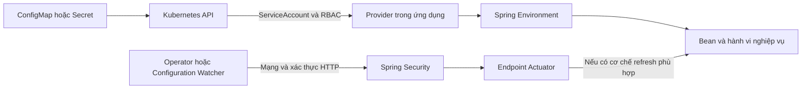

# Kiểm thử thứ tự cấu hình, quyền RBAC và endpoint quản trị

Trong chương **Tương thích và nâng cấp** của module **SPRING_CLOUD_KUBERNETES**, bài này hướng dẫn xây dựng các kiểm thử hồi quy cho ba phần dễ thay đổi khi nâng cấp: nguồn cấu hình đang có hiệu lực, quyền gọi Kubernetes API và khả năng truy cập endpoint quản trị.

Một ứng dụng khởi động thành công vẫn có thể dùng giá trị mặc định sai, được cấp quyền rộng hơn dự kiến hoặc vô tình mở một endpoint nhạy cảm. Bộ kiểm thử cần chứng minh cả những hành động được phép lẫn những hành động phải bị từ chối.

Ví dụ API dùng Spring Cloud Kubernetes **3.3.x/Fabric8**; các ví dụ Actuator và Spring Security lấy **Spring Boot 3.5.x, Spring Security 6.5.x** làm mốc. Trước khi áp dụng, chọn Spring Cloud BOM tương thích và đối chiếu tài liệu đúng phiên bản. Không trộn cấu hình của các nhánh chỉ vì tên thuộc tính giống nhau.

Các đoạn mã là mẫu để thực hành trong môi trường học, chưa phải kết quả đã chạy trên cluster của bạn. Chỉ dùng dữ liệu giả cho việc tạo xung đột cấu hình hoặc kiểm tra che giá trị.

## 1. Tách ba hợp đồng cần kiểm thử

| Hợp đồng | Câu hỏi kiểm thử | Bằng chứng phù hợp |
| --- | --- | --- |
| Thứ tự cấu hình | Thuộc tính đến từ đâu, nguồn nào thắng, giá trị có đúng kiểu? | Giá trị thử nghiệm, nguồn hoặc origin và hành vi bean sử dụng |
| Kubernetes RBAC | Danh tính ứng dụng được thực hiện thao tác nào trên tài nguyên nào? | Kiểm tra phân quyền theo ServiceAccount và lần gọi API thực tế |
| Endpoint quản trị | Endpoint có tồn tại, được expose, được bảo vệ và gọi được đúng đường mạng? | Kiểm thử HTTP, Spring Security, probe và đường truy cập triển khai |

Đây là các lớp khác nhau. Role Kubernetes cho phép đọc ConfigMap không cấp vai trò gọi `POST /actuator/refresh`. Một operator gọi được Actuator cũng chưa chứng minh JVM có quyền đọc Secret.



Phân chia kiểm thử thành ba mức:

- Trong tiến trình Spring: nạp cấu hình, chuyển kiểu, mapping và quy tắc phân quyền HTTP.
- Với Kubernetes thật trong môi trường thử nghiệm: nguồn API, ServiceAccount và phạm vi namespace.
- Với bản triển khai thật: Service, Ingress, cổng quản trị, probe và luồng Watcher.

Một mức kiểm thử không thay thế hoàn toàn các mức còn lại.

## 2. Chuẩn bị bộ dữ liệu thử có thể phân biệt nguồn

Ví dụ dùng ứng dụng `orders-api`, namespace `upgrade-lab`, ConfigMap `orders-config` và ServiceAccount `orders-api`. Giả định namespace học tập đã tồn tại; namespace `upgrade-other` dành cho kiểm tra truy cập chéo cũng được chuẩn bị trước.

Các dependency cần thiết tùy mẫu gồm Spring MVC, Actuator, Spring Security, starter `spring-cloud-starter-kubernetes-fabric8-config`, cùng `spring-boot-starter-test` và `spring-security-test` cho kiểm thử. Giữ một họ Kubernetes client trong ứng dụng. [Các starter Spring Cloud Kubernetes](https://docs.spring.io/spring-cloud-kubernetes/reference/3.3/getting-started.html)

### 2.1. Cấu hình chung của ứng dụng thử

Đặt trong `application.yaml`:

```yaml
spring:
  application:
    name: orders-api
  jmx:
    enabled: false
  cloud:
    kubernetes:
      config:
        enabled: false
      secrets:
        enabled: false
      discovery:
        enabled: false

verification:
  marker: from-jar
  limit: 5

management:
  endpoints:
    access:
      default: none
    web:
      exposure:
        include: health,refresh
  endpoint:
    health:
      access: read-only
      show-details: never
      probes:
        enabled: true
    refresh:
      access: unrestricted
    env:
      show-values: never
    configprops:
      show-values: never
```

Mẫu cho phép endpoint health và refresh tham gia bài kiểm thử. `access: unrestricted` là mức hoạt động của endpoint, **không phải** cho phép người dùng ẩn danh; Spring Security ở mục 6 sẽ kiểm soát người gọi.

JMX được tắt để thu hẹp phạm vi mẫu. Trong hệ thống có JMX, kiểm tra riêng kênh này; danh sách HTTP exposure không thay thế chính sách JMX. Các thuộc tính quản trị phải được đối chiếu đúng nhánh Boot. [Danh sách thuộc tính Spring Boot 3.5](https://docs.spring.io/spring-boot/3.5/appendix/application-properties/index.html)

### 2.2. Profile đọc ConfigMap qua API

Đặt trong `application-upgrade-api.yaml`:

```yaml
spring:
  config:
    import: "kubernetes:"
  cloud:
    kubernetes:
      config:
        enabled: true
        enable-api: true
        name: orders-config
        namespace: upgrade-lab
        include-profile-specific-sources: false
        fail-fast: true
        retry:
          enabled: false
```

Chỉ bật profile `upgrade-api` khi kiểm tra nguồn Kubernetes. Không đồng thời bật legacy bootstrap. Trong mẫu, tắt tìm nguồn bổ sung theo profile để chỉ có một ConfigMap cần đối chiếu.

ConfigMap dùng dữ liệu không nhạy cảm:

```yaml
apiVersion: v1
kind: ConfigMap
metadata:
  name: orders-config
  namespace: upgrade-lab
data:
  verification.marker: "from-configmap"
  verification.limit: "25"
```

Nếu ứng dụng thật dùng nhiều `sources`, prefix, label hoặc tài nguyên theo profile, bổ sung các ca kiểm thử tương ứng. Đừng thu gọn tập nguồn trong lúc kiểm thử rồi kết luận cấu hình production được giữ nguyên. [Cách chọn và xử lý ConfigMap](https://docs.spring.io/spring-cloud-kubernetes/reference/3.3/property-source-config/configmap-propertysource.html)

## 3. Kiểm thử thứ tự cấu hình bằng giá trị xung đột

### 3.1. Khai báo kết quả kỳ vọng trước khi chạy

| Mã ca | Đầu vào | marker kỳ vọng | limit kỳ vọng |
| --- | --- | --- | --- |
| C01 | Không bật nguồn API, không có ghi đè ngoài | `from-jar` | `5` |
| C02 | Bật profile API, ConfigMap hợp lệ | `from-configmap` | `25` |
| C03 | Như C02, thêm `VERIFICATION_MARKER=from-env` | `from-env` | `25` |
| C04 | Như C03, thêm `--verification.marker=from-cli` | `from-cli` | `25` |
| C05 | Nguồn bắt buộc không tải được | Theo chính sách thất bại đã định nghĩa | Không âm thầm phục vụ bằng mặc định sai |
| C06 | Nguồn có `verification.limit=not-a-number` | Phát hiện lỗi chuyển kiểu hoặc validation | Không chấp nhận cấu hình không hợp lệ |

Trong Config Data, nguồn import có ưu tiên cao hơn tài liệu khai báo import; nguồn môi trường và đối số dòng lệnh có thể tiếp tục ghi đè. Khi có nhiều vị trí import trong một danh sách, vị trí sau có ưu tiên cao hơn vị trí trước. [Thứ tự nguồn Kubernetes Config Data](https://docs.spring.io/spring-cloud-kubernetes/reference/property-source-config.html#_property_source_precedence)

Giữ cấu hình kích hoạt nguồn như tên ứng dụng, namespace và import ở nơi có sẵn trước lần tải. Một giá trị chọn nguồn chỉ nằm trong chính ConfigMap chưa được tìm thấy không giúp client định vị nguồn đó.

### 3.2. Ví dụ kiểm thử tích hợp một ca cụ thể

Mẫu sau kiểm tra C02. Đặt lớp test trong package mà `@SpringBootTest` tìm được lớp ứng dụng:

```java
import org.junit.jupiter.api.Test;
import org.springframework.beans.factory.annotation.Autowired;
import org.springframework.boot.test.context.SpringBootTest;
import org.springframework.core.env.Environment;
import org.springframework.test.context.ActiveProfiles;

import static org.assertj.core.api.Assertions.assertThat;

@SpringBootTest(webEnvironment = SpringBootTest.WebEnvironment.RANDOM_PORT)
@ActiveProfiles("upgrade-api")
class KubernetesConfigurationContractIT {

    @Autowired
    Environment environment;

    @Test
    void configMapOverridesPackagedDefaults() {
        assertThat(environment.getRequiredProperty("verification.marker"))
            .isEqualTo("from-configmap");

        assertThat(environment.getRequiredProperty(
            "verification.limit", Integer.class
        )).isEqualTo(25);
    }
}
```

Đây là kiểm thử tích hợp: tiến trình test cần truy cập được cluster thử nghiệm với credential được cấp rõ. Không mock provider hoặc nhét chính hai giá trị mong đợi vào `@TestPropertySource`, vì khi đó test có thể đạt dù ConfigMap không được tải.

Nếu test chạy trên máy quản trị, nó kiểm chứng danh tính của tiến trình test. Muốn đánh giá đúng ServiceAccount của Pod, cần thêm kiểm thử trên bản triển khai hoặc chạy tiến trình kiểm thử trong môi trường dùng danh tính đó.

`RANDOM_PORT` khởi động một web context thật; MockMvc ở mục 7 dùng web context giả lập để kiểm tra HTTP trong tiến trình. Chúng có phạm vi khác nhau. [Các chế độ Spring Boot Test](https://docs.spring.io/spring-boot/3.5/reference/testing/spring-boot-applications.html)

### 3.3. Không để nguồn test che mất lỗi nguồn thật

Các thuộc tính do test cung cấp có thể có ưu tiên cao. Kiểm tra những nơi như `@SpringBootTest(properties=...)`, `@DynamicPropertySource`, biến môi trường của CI và đối số khởi động.

Đối với C03 và C04, thay đổi đầu vào của tiến trình rồi dùng assertion tương ứng; không giữ assertion của C02 và gọi đó là một lần chạy khác. Ngoài giá trị, xác nhận nguồn có hiệu lực bằng công cụ chẩn đoán origin hoặc cấu hình log phù hợp với dữ liệu thử. [Thứ tự cấu hình và nguồn do test cung cấp](https://docs.spring.io/spring-boot/3.5/reference/features/external-config.html)

Khi bật đồng thời ConfigMap và Secret trên nhánh 3.3, thêm một ca xung đột riêng: tài liệu quy định ConfigMap có ưu tiên cao hơn Secret khi trùng key. Chỉ tạo dữ liệu giả cho ca này, không đặt mật khẩu thật vào ConfigMap để thử. [Thứ tự ConfigMap và Secret](https://docs.spring.io/spring-cloud-kubernetes/reference/3.3/property-source-config/order_of_configMaps_and_secrets.html)

Cuối cùng, xác nhận bean hoặc client nghiệp vụ thực sự sử dụng cấu hình vừa kiểm tra. `Environment` đúng chưa đủ nếu một singleton đã lưu bản sao giá trị cũ.

## 4. Kiểm thử RBAC theo ServiceAccount thực tế

### 4.1. Cấp quyền đúng cho fixture

Ví dụ chỉ đọc ConfigMap lúc khởi động; không dùng Secret API, discovery hoặc theo dõi sự kiện trong JVM:

```yaml
apiVersion: v1
kind: ServiceAccount
metadata:
  name: orders-api
  namespace: upgrade-lab
---
apiVersion: rbac.authorization.k8s.io/v1
kind: Role
metadata:
  name: orders-config-reader
  namespace: upgrade-lab
rules:
  - apiGroups: [""]
    resources: ["configmaps"]
    verbs: ["get", "list"]
---
apiVersion: rbac.authorization.k8s.io/v1
kind: RoleBinding
metadata:
  name: orders-config-reader-binding
  namespace: upgrade-lab
subjects:
  - kind: ServiceAccount
    name: orders-api
    namespace: upgrade-lab
roleRef:
  apiGroup: rbac.authorization.k8s.io
  kind: Role
  name: orders-config-reader
```

Deployment phải chọn `serviceAccountName: orders-api`. Với client dùng credential in-cluster, bảo đảm cơ chế cung cấp token được cấu hình phù hợp.

Role này cho phép đọc ConfigMap trong toàn namespace, không chỉ `orders-config`. Không thêm `resourceNames` vào một Role vẫn cần `list` rồi mặc định nó sẽ giới hạn truy cập như mong muốn; loại truy vấn và hành vi client cần được kiểm chứng. [Ngữ nghĩa Role, RoleBinding và resourceNames](https://kubernetes.io/docs/reference/access-authn-authz/rbac/)

Không mở thêm quyền Secret hoặc quyền ghi để làm test khởi động đạt. Với ứng dụng có DiscoveryClient hoặc Watcher, xây dựng hợp đồng tài nguyên và verb riêng theo chức năng thực sự bật. [Quyền theo thành phần Spring Cloud Kubernetes](https://docs.spring.io/spring-cloud-kubernetes/reference/3.3/security-service-accounts.html)

### 4.2. Ma trận quyền dương và âm

| Mã ca | Thao tác của orders-api | Kỳ vọng trong fixture |
| --- | --- | --- |
| R01 | `get configmaps/orders-config` ở `upgrade-lab` | Cho phép |
| R02 | `list configmaps` ở `upgrade-lab` | Cho phép |
| R03 | `list configmaps` ở `upgrade-other` | Từ chối |
| R04 | `get` hoặc `list secrets` ở `upgrade-lab` | Từ chối |
| R05 | `create secrets` ở `upgrade-lab` | Từ chối |
| R06 | `update configmaps/orders-config` | Từ chối |
| R07 | `watch configmaps` khi fixture không dùng watch | Từ chối |

R07 chỉ là hợp đồng của fixture. Nếu ứng dụng thật cần theo dõi, chuyển kỳ vọng cho đúng thiết kế và kiểm tra quyền đó có nằm đúng namespace hay không.

Kubernetes RBAC là cơ chế cộng quyền. Một Role hẹp không thu hồi quyền đã được cấp bởi RoleBinding hoặc ClusterRoleBinding khác. Vì vậy các ca âm rất quan trọng: chúng phát hiện quyền rộng còn sót lại từ nhóm hoặc binding khác.

### 4.3. Gọi can-i với danh tính và nhóm phù hợp

Các lệnh sau dùng Bash:

```bash
SA_ID=system:serviceaccount:upgrade-lab:orders-api

AS_ARGS=(
  "--as=$SA_ID"
  "--as-group=system:authenticated"
  "--as-group=system:serviceaccounts"
  "--as-group=system:serviceaccounts:upgrade-lab"
)

kubectl auth can-i get configmaps/orders-config -n upgrade-lab "${AS_ARGS[@]}"
kubectl auth can-i list configmaps -n upgrade-lab "${AS_ARGS[@]}"
kubectl auth can-i list configmaps -n upgrade-other "${AS_ARGS[@]}"
kubectl auth can-i get secrets/orders-db -n upgrade-lab "${AS_ARGS[@]}"
kubectl auth can-i list secrets -n upgrade-lab "${AS_ARGS[@]}"
kubectl auth can-i create secrets -n upgrade-lab "${AS_ARGS[@]}"
kubectl auth can-i update configmaps/orders-config -n upgrade-lab "${AS_ARGS[@]}"
kubectl auth can-i watch configmaps -n upgrade-lab "${AS_ARGS[@]}"
```

Hai dòng đầu mong đợi `yes`; các dòng còn lại mong đợi `no` với hợp đồng mẫu. Lệnh kiểm tra quyền không cần in nội dung Secret hoặc thực hiện thao tác ghi.

Người chạy phải có quyền impersonation tương ứng cho người dùng và nhóm được giả danh. Một lỗi “không được phép impersonate” là lỗi của bước kiểm thử, không được ghi nhận thành một ca RBAC âm đạt. [Lệnh kubectl auth can-i](https://kubernetes.io/docs/reference/kubectl/generated/kubectl_auth/kubectl_auth_can-i/)

Trong CI, phân biệt ba kết quả: được phép, bị từ chối đúng chính sách và không đánh giá được do lỗi công cụ/credential. Không dùng quy tắc “mọi exit code khác 0 đều là từ chối đúng”.

### 4.4. Đối chiếu với lần truy cập thật

`can-i` đánh giá phân quyền cho thao tác được hỏi; nó không chứng minh token trong Pod hợp lệ, JVM dùng đúng cluster hoặc đường mạng đến API server thông suốt.

Sau R01/R02, khởi động Pod mới bằng đúng ServiceAccount và xác nhận C02. Khi gây lỗi quyền trong namespace thử, đối chiếu danh tính, verb, resource và namespace trong phản hồi 403. Với 401, kiểm tra xác thực; với timeout hoặc TLS, kiểm tra kết nối và CA.

Nếu ứng dụng nhận Secret qua volume hoặc biến môi trường, việc ServiceAccount không có quyền đọc Secret API có thể là thiết kế đúng. Không ép mọi ứng dụng phải đạt một ca đọc Secret API chỉ vì chúng có sử dụng dữ liệu Secret.

## 5. Định nghĩa hợp đồng endpoint quản trị

Khả năng gọi một endpoint phụ thuộc nhiều điều kiện:

1. Endpoint và operation được cung cấp bởi dependency/cấu hình.
2. Mức `access` cho phép operation đó.
3. Endpoint được expose qua HTTP hoặc kênh tương ứng.
4. Request đi qua kiểm soát xác thực, phân quyền và CSRF.
5. Người gọi thực sự đi được đến đúng cổng và đường dẫn.

Trong Boot 3.5, mức access không cho phép có thể khiến endpoint bị loại khỏi context; `read-only` không cho phép write operation. Chỉ thêm endpoint vào exposure chưa đảm bảo gọi được. [Access và exposure của Actuator](https://docs.spring.io/spring-boot/3.5/reference/actuator/endpoints.html#actuator.endpoints.access)

Với fixture của bài, hợp đồng HTTP là:

| Mã ca | Request | Kỳ vọng |
| --- | --- | --- |
| E01 | Ẩn danh `GET /actuator/health` khi ứng dụng khỏe | 200, không lộ chi tiết nhạy cảm |
| E02 | Ẩn danh `GET /actuator/health/liveness` | 200 khi liveness đạt |
| E03 | Ẩn danh `GET /actuator/health/readiness` | Phản ánh readiness thực tế |
| E04 | Ẩn danh POST refresh, có CSRF token hợp lệ trong test | 401 |
| E05 | Đã xác thực nhưng thiếu vai trò, POST refresh có CSRF | 403 |
| E06 | Có vai trò nhưng thiếu CSRF token | 403 với chính sách mẫu |
| E07 | Có vai trò và CSRF hợp lệ, POST refresh | 200 khi endpoint hoạt động bình thường |
| E08 | Operator đã xác thực gọi `GET /actuator/env` | 404 vì không expose trong fixture |
| E09 | Operator đã xác thực gọi `GET /actuator/configprops` | 404 vì không expose trong fixture |

Các mã HTTP này gắn với cấu hình mẫu ở mục 6. Trong hệ thống khác, một lớp bảo vệ có thể trả 401/403 trước khi request đến mapping của endpoint. Không kết luận endpoint đã bị tắt chỉ dựa vào một request ẩn danh bị từ chối.

## 6. Ví dụ chính sách Spring Security dành cho fixture

Mẫu Servlet dưới đây dùng Actuator cùng cổng ứng dụng, base path mặc định `/actuator`, HTTP Basic cho bài thử và giữ CSRF mặc định. Danh tính thực cần được cấp bởi cơ chế xác thực của môi trường; không nhúng mật khẩu vào mã.

```java
import jakarta.servlet.DispatcherType;
import org.springframework.context.annotation.Bean;
import org.springframework.context.annotation.Configuration;
import org.springframework.http.HttpMethod;
import org.springframework.security.config.Customizer;
import org.springframework.security.config.annotation.web.builders.HttpSecurity;
import org.springframework.security.web.SecurityFilterChain;

@Configuration(proxyBeanMethods = false)
class UpgradeFixtureSecurity {

    @Bean
    SecurityFilterChain fixtureSecurity(HttpSecurity http) throws Exception {
        http.authorizeHttpRequests(authorize -> authorize
                .dispatcherTypeMatchers(DispatcherType.ERROR).permitAll()
                .requestMatchers(
                    HttpMethod.GET,
                    "/actuator/health",
                    "/actuator/health/liveness",
                    "/actuator/health/readiness"
                ).permitAll()
                .requestMatchers(
                    HttpMethod.POST, "/actuator/refresh"
                ).hasRole("CONFIG_REFRESH")
                .requestMatchers("/actuator/**").authenticated()
                .anyRequest().denyAll()
            )
            .httpBasic(Customizer.withDefaults());

        return http.build();
    }
}
```

`hasRole("CONFIG_REFRESH")` kiểm tra authority `ROLE_CONFIG_REFRESH`; đây là vai trò trong ứng dụng, không phải Role Kubernetes.

Mẫu chủ động chặn các route ngoài fixture. Khi áp dụng vào dự án có API nghiệp vụ, ghép chính sách tương ứng để không chặn nhầm API. Nếu có nhiều filter chain hoặc đổi management port/base path, kiểm thử lại matcher và chain thực sự nhận request. [Quy tắc phân quyền HTTP của Spring Security](https://docs.spring.io/spring-security/reference/6.5/servlet/authorization/authorize-http-requests.html)

Không tắt toàn bộ CSRF chỉ để một ca POST hết 403. Với Watcher hoặc client máy, thiết kế cơ chế xác thực và xử lý CSRF phù hợp rồi kiểm chứng luồng thật. `with(csrf())` trong MockMvc không tự cung cấp token cho Watcher trên cluster.

## 7. Kiểm thử endpoint bằng MockMvc

Mẫu dùng cấu hình chung ở mục 2, không bật profile `upgrade-api`; do đó không cần gọi Kubernetes để kiểm tra chính sách HTTP.

```java
import org.junit.jupiter.api.Test;
import org.springframework.beans.factory.annotation.Autowired;
import org.springframework.boot.test.autoconfigure.web.servlet.AutoConfigureMockMvc;
import org.springframework.boot.test.context.SpringBootTest;
import org.springframework.security.test.context.support.WithMockUser;
import org.springframework.test.web.servlet.MockMvc;

import static org.springframework.security.test.web.servlet.request
    .SecurityMockMvcRequestPostProcessors.csrf;
import static org.springframework.test.web.servlet.request
    .MockMvcRequestBuilders.get;
import static org.springframework.test.web.servlet.request
    .MockMvcRequestBuilders.post;
import static org.springframework.test.web.servlet.result
    .MockMvcResultMatchers.jsonPath;
import static org.springframework.test.web.servlet.result
    .MockMvcResultMatchers.status;

@SpringBootTest
@AutoConfigureMockMvc
class ManagementEndpointContractTest {

    @Autowired
    MockMvc mvc;

    @Test
    void anonymousCanReadMinimalHealth() throws Exception {
        mvc.perform(get("/actuator/health"))
            .andExpect(status().isOk())
            .andExpect(jsonPath("$.status").value("UP"))
            .andExpect(jsonPath("$.components").doesNotExist());
    }

    @Test
    void anonymousCannotRefreshEvenWithCsrf() throws Exception {
        mvc.perform(post("/actuator/refresh").with(csrf()))
            .andExpect(status().isUnauthorized());
    }

    @Test
    @WithMockUser(roles = "VIEWER")
    void viewerCannotRefresh() throws Exception {
        mvc.perform(post("/actuator/refresh").with(csrf()))
            .andExpect(status().isForbidden());
    }

    @Test
    @WithMockUser(roles = "CONFIG_REFRESH")
    void refreshRoleStillNeedsCsrf() throws Exception {
        mvc.perform(post("/actuator/refresh"))
            .andExpect(status().isForbidden());
    }

    @Test
    @WithMockUser(roles = "CONFIG_REFRESH")
    void authorizedCallerCanReachRefresh() throws Exception {
        mvc.perform(post("/actuator/refresh").with(csrf()))
            .andExpect(status().isOk());
    }

    @Test
    @WithMockUser(roles = "CONFIG_REFRESH")
    void diagnosticEndpointsRemainUnexposed() throws Exception {
        mvc.perform(get("/actuator/env"))
            .andExpect(status().isNotFound());

        mvc.perform(get("/actuator/configprops"))
            .andExpect(status().isNotFound());
    }
}
```

Ca POST ẩn danh cố ý có CSRF token hợp lệ để kiểm tra xác thực. Ca đúng vai trò nhưng thiếu token kiểm tra CSRF độc lập; nếu gộp hai điều kiện, một mã 403 có thể bị giải thích sai. [Kiểm thử CSRF với MockMvc](https://docs.spring.io/spring-security/reference/6.5/servlet/test/mockmvc/csrf.html)

`@WithMockUser` đưa một danh tính thử vào SecurityContext. Nó kiểm tra phân quyền theo danh tính đó, không kiểm chứng mật khẩu thật, JWT, chứng chỉ hoặc quá trình đăng nhập của operator. Cần thêm kiểm thử xác thực HTTP thực trên môi trường triển khai. [Danh tính mô phỏng trong Spring Security Test](https://docs.spring.io/spring-security/reference/6.5/servlet/test/method.html)

Ca health giả định môi trường thử khỏe; nếu có health indicator cho dịch vụ ngoài, chuẩn bị dependency hoặc điều chỉnh hợp đồng một cách tường minh. Không mock toàn bộ hệ thống bảo vệ để làm các assertion đạt.

Ca refresh 200 chỉ xác nhận một caller hợp lệ đến được operation trong fixture. Muốn chứng minh refresh có tác dụng, cần kiểm tra thay đổi cấu hình và hành vi sử dụng ở mục 9.

### Kiểm tra không lộ dữ liệu khi bật chẩn đoán tạm

Trong một profile chẩn đoán riêng, có thể bật `env` hoặc `configprops` với access chỉ đọc và `show-values: never`. Chèn một giá trị giả dễ nhận diện, gọi bằng operator hợp lệ rồi kiểm tra:

- Response đúng endpoint và thực sự có thông tin thuộc tính cần chẩn đoán.
- Chuỗi giả không xuất hiện ở dạng rõ trong response.
- Log lỗi, log request và báo cáo CI cũng không chứa chuỗi đó.
- Profile chẩn đoán không hiện diện trong cấu hình rollout thông thường.

Dùng giá trị giả giúp kiểm tra sanitization mà không đưa Secret thật vào báo cáo. Tránh chỉ assertion “không thấy chuỗi” trên một response 401 hoặc 404, vì khi đó cơ chế che giá trị chưa được kiểm tra.

## 8. Kiểm thử đường mạng và sức khỏe Pod

MockMvc không mở cổng mạng. Một request qua `kubectl port-forward` cũng không chứng minh đường Service, Ingress hoặc NetworkPolicy hoạt động đúng như người gọi thật.

Kiểm tra riêng từng đường đang có trong thiết kế:

| Đường truy cập | Điều cần xác nhận |
| --- | --- |
| Kubelet tới probe của Pod | Đúng cổng, path, trạng thái và thời gian khởi động |
| Operator qua kênh quản trị | Cơ chế xác thực thật và vai trò được chấp thuận |
| Pod Watcher tới ứng dụng | Kết nối, identity và khả năng gọi refresh |
| Pod thông thường không có quyền quản trị | Không truy cập được operation quản trị ngoài thiết kế |
| Ingress công khai | Chỉ có các endpoint dự kiến được đưa ra ngoài |

NetworkPolicy kiểm soát kết nối theo khả năng hỗ trợ của network plugin; nó không thay thế xác thực và phân quyền HTTP. Một policy khai báo trong manifest cũng cần được kiểm chứng bằng lưu lượng từ đúng nguồn. [NetworkPolicy trong Kubernetes](https://kubernetes.io/docs/concepts/services-networking/network-policies/)

### Kiểm tra probe đúng hợp đồng

Ở fixture, probe có thể dùng:

```yaml
livenessProbe:
  httpGet:
    path: /actuator/health/liveness
    port: 8080
readinessProbe:
  httpGet:
    path: /actuator/health/readiness
    port: 8080
```

Đây là đoạn cấu hình container; bổ sung startup probe và ngân sách thời gian theo đặc tính ứng dụng. Nếu management dùng cổng riêng, đổi đúng cổng probe và kiểm tra thêm khả năng phục vụ trên cổng nghiệp vụ.

Liveness không nên phụ thuộc đơn thuần vào việc cơ sở dữ liệu hay Kubernetes API đang khả dụng, vì lỗi ngoài ứng dụng có thể tạo vòng restart. Readiness cần phản ánh chính sách nhận traffic của ứng dụng. Việc probe quản trị thành công không tự chứng minh API nghiệp vụ phục vụ được. [Kubernetes probes của Spring Boot](https://docs.spring.io/spring-boot/3.5/reference/actuator/endpoints.html#actuator.endpoints.kubernetes-probes)

Trong kiểm thử lỗi, xác nhận readiness thay đổi như mong đợi và Service không tiếp tục đưa traffic đến Pod chưa sẵn sàng. Ghi cả Event và số lần restart; trạng thái Running không đồng nghĩa với Ready. [Vòng đời Pod và probe](https://kubernetes.io/docs/concepts/workloads/pods/pod-lifecycle/#container-probes)

## 9. Kiểm thử luồng cập nhật cấu hình đầy đủ

Nếu hệ thống dùng Configuration Watcher, cần một ca xuyên suốt sau khi ba nhóm kiểm thử độc lập đã đạt:

1. Khởi động các replica bằng cấu hình phiên bản thử đầu tiên.
2. Xác nhận marker và hành vi nghiệp vụ ban đầu trên từng replica.
3. Cập nhật ConfigMap bằng một giá trị giả mới.
4. Xác nhận Watcher phát hiện đúng nguồn và gửi thông báo đến đúng ứng dụng.
5. Xác nhận request quản trị được xác thực/phân quyền đúng.
6. Đợi đến khi bean hoặc client đích dùng cấu hình mới trong thời hạn đã định.
7. Xác nhận caller không hợp lệ vẫn không thực hiện được thao tác tương tự.

Với ConfigMap `orders-config` và ứng dụng `orders-api`, kiểm tra label `spring.cloud.kubernetes.config: "true"` và ánh xạ ứng dụng bằng annotation `spring.cloud.kubernetes.configmap.apps: "orders-api"` khi sử dụng cơ chế này của nhánh 3.3.

Watcher có ServiceAccount riêng và quyền riêng. Một Watcher đọc được ConfigMap nhưng bị HTTP 401/403 ở ứng dụng là lỗi khác với việc ứng dụng không có quyền tải nguồn. Kiểm tra cả cổng/path quản trị tùy biến nếu có. [Configuration Watcher và đích refresh](https://docs.spring.io/spring-cloud-kubernetes/reference/3.3/spring-cloud-kubernetes-configuration-watcher.html)

Không dừng ở log “đã nhận sự kiện” hoặc HTTP 200. Refresh phải đi tới bean được hỗ trợ cập nhật; connection pool và tài nguyên lưu trạng thái có thể cần quy trình riêng. Với volume, còn phải tính độ trễ chiếu dữ liệu trước khi đọc lại. [Refresh Scope và endpoint Spring Cloud](https://docs.spring.io/spring-cloud-commons/reference/4.3/spring-cloud-commons/application-context-services.html)

Mẫu Security ở mục 6 giữ CSRF. Watcher thực tế sẽ không tự có token do MockMvc tạo; nếu luồng máy cần chính sách khác, triển khai chính sách đó với credential phù hợp và chạy lại cả ca được phép lẫn ca bị từ chối.

Nếu hệ thống không dùng cập nhật động, kiểm thử quy trình rollout thay thế và giữ refresh không expose trong cấu hình vận hành. Endpoint không cần thiết không phải điều kiện bắt buộc để sử dụng Spring Cloud Kubernetes.

## 10. Đưa bằng chứng vào quy trình nâng cấp

Chạy cùng hợp đồng trên phiên bản hiện tại và phiên bản dự kiến nâng cấp. Giữ dữ liệu thử, namespace, quyền và đầu vào HTTP ổn định để so sánh có ý nghĩa.

Có thể chia các bước xác nhận thành:

1. Kiểm thử cấu hình trong Spring và chính sách endpoint trong CI.
2. Kiểm tra RBAC dương/âm trên cluster thử nghiệm.
3. Kiểm tra nguồn API với danh tính triển khai thực.
4. Kiểm tra probe, đường truy cập quản trị và luồng refresh hoặc rollout.
5. Chạy canary và quan sát trước khi mở rộng triển khai.

Báo cáo theo mẫu:

| Trường bằng chứng | Ví dụ thông tin |
| --- | --- |
| Mã ca | `C02`, `R04`, `E07` |
| Phiên bản và artifact | Bộ BOM, image digest, mã bản build |
| Đầu vào | Profile, tên nguồn, namespace, biến thử không nhạy cảm |
| Danh tính | ServiceAccount hoặc vai trò operator; không ghi token |
| Kỳ vọng và kết quả | Giá trị, quyết định phân quyền hoặc mã HTTP |
| Nguồn bằng chứng | Assertion, log đã lọc, Event hoặc trace trong môi trường thử |
| Kết luận | PASS, FAIL hoặc chưa đánh giá được |

Không đổi một ca FAIL thành PASS bằng cách mở `include: "*"`, cấp `cluster-admin`, tắt toàn bộ bộ lọc bảo vệ hoặc đưa giá trị mong đợi vào nguồn test có ưu tiên cao. Khi hợp đồng cần thay đổi thật, ghi rõ lý do và sửa kết quả kỳ vọng có chủ đích.

Khi rollback, khôi phục artifact và cấu hình tương thích. Lịch sử Deployment không tự khôi phục nội dung ConfigMap/Secret đã sửa tại chỗ; cần quản lý phiên bản cấu hình hoặc có bản khôi phục tương ứng. Sau rollback, chạy lại các ca quan trọng về nguồn dữ liệu, quyền và endpoint.

## 11. Bài thực hành và tiêu chí hoàn thành

Thực hiện từng thay đổi trong namespace học tập:

- Tạo xung đột giữa giá trị trong JAR, ConfigMap và môi trường; chứng minh nguồn thắng.
- Bỏ quyền `list` khi client cần thao tác đó; xác nhận lỗi không bị nhầm với thiếu ConfigMap.
- Tạo một binding thừa trong môi trường thử rồi dùng ca âm để phát hiện quyền mở rộng.
- Thử caller ẩn danh, caller sai vai trò và caller đúng vai trò nhưng thiếu CSRF.
- Đưa `env` vào profile chẩn đoán riêng và kiểm tra giá trị giả được che.
- Kiểm tra một thay đổi cấu hình đến hành vi ứng dụng hoặc một lần rollout trên Pod mới.

Sau mỗi lần gây lỗi, khôi phục trạng thái ban đầu trước khi thử tình huống khác. Không xóa binding dùng chung hoặc làm thay đổi namespace production để tạo bài tập.

Chỉ xác nhận bộ kiểm thử nâng cấp đạt khi:

- Các ca cấu hình chứng minh đúng giá trị, kiểu và nguồn có hiệu lực.
- Quyền cần thiết được cho phép và các quyền ngoài hợp đồng vẫn bị từ chối.
- Lỗi công cụ, impersonation hoặc kết nối được phân biệt với kết quả từ chối hợp lệ.
- Endpoint cần dùng hoạt động đúng với danh tính hợp lệ; endpoint không cần dùng không bị mở ngoài dự kiến.
- Giá trị nhạy cảm được che và không đi vào log hoặc artifact kiểm thử.
- Probe và đường truy cập thực tế được kiểm tra ngoài MockMvc.
- Luồng refresh hoặc rollout đạt đến hành vi ứng dụng, có bằng chứng trên các replica liên quan.
- Báo cáo ghi rõ phiên bản, kết quả đã quan sát và những phần chưa được kiểm chứng.
