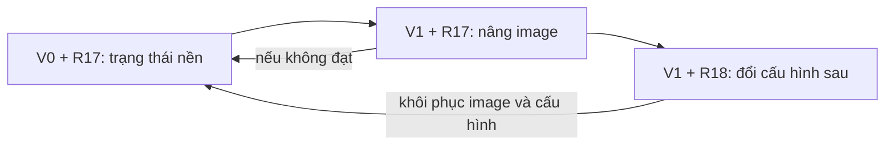

# Kế hoạch nâng cấp từng phần và tiêu chí quay lại phiên bản trước

Trong chương **Tương thích và nâng cấp** của **SPRING_CLOUD_KUBERNETES**, bài này hướng dẫn lập kế hoạch nâng cấp một hệ thống Spring chạy trên Kubernetes theo từng phạm vi nhỏ, đo kết quả và quyết định khi nào phải quay lại trạng thái đã biết tốt.

Phạm vi bao gồm bộ phiên bản Spring Boot/Spring Cloud/Spring Cloud Kubernetes, Kubernetes client, DiscoveryClient, ConfigMap, Secret, Spring Cloud LoadBalancer, Configuration Watcher, RBAC và sức khỏe Pod. Chỉ đưa vào kế hoạch những tính năng ứng dụng thực sự sử dụng.

Sau bài học, bạn có thể:

- Chọn đơn vị nâng cấp đủ nhỏ nhưng vẫn giữ bộ dependency tương thích.
- Chuẩn bị trạng thái nền và dữ liệu cần để khôi phục.
- Thiết kế các giai đoạn thử nghiệm, canary và mở rộng có tiêu chí đo.
- Phân biệt khôi phục image với khôi phục toàn bộ trạng thái triển khai.
- Xác định điều kiện quay lại, điều kiện phải dừng và trường hợp cần sửa tiến thay vì chạy image cũ.

## 1. Nâng cấp từng phần là chia phạm vi triển khai

Một lỗi thường gặp là hiểu “từng phần” thành nâng riêng từng thư viện: đổi Spring Boot trước, giữ Spring Cloud không tương thích rồi tìm cách làm ứng dụng khởi động. Cách chia phù hợp hơn là:

> Trong một ứng dụng, thay một bộ phiên bản đã được xác nhận tương thích; trong hệ thống, triển khai bộ đó lần lượt cho từng nhóm ứng dụng hoặc từng nhóm nhận lưu lượng.

Đơn vị thay đổi có thể là:

| Đơn vị | Ví dụ | Điều phải giữ đúng |
| --- | --- | --- |
| Một ứng dụng | Nâng `catalog-api` trước các dịch vụ khác | Dependency trong tiến trình tương thích |
| Một nhóm instance | Deployment canary tách biệt | Định tuyến và quan sát phân biệt được hai nhóm |
| Một nhóm chức năng | Đổi đường nạp cấu hình sau khi nền runtime ổn định | Có phép kiểm chứng riêng cho thay đổi hành vi |
| Một controller | Nâng Configuration Watcher | Tương thích với mọi ứng dụng mà controller còn điều khiển |

Bộ Spring Boot và Spring Cloud cần đối chiếu nguồn chính thức tại thời điểm chuẩn bị: [Spring Cloud](https://spring.io/projects/spring-cloud/) và [Spring project generations](https://spring.io/projects/generations/). Không dùng số major giống nhau để suy ra các dự án tương thích.

Bài dùng ký hiệu **V0** cho image ứng dụng đang chạy tốt, **V1** cho image ứng viên, **R17/R18** cho revision cấu hình và **W0/W1** cho controller cũ/mới. Đây là ký hiệu kế hoạch, không phải số phiên bản sản phẩm hoặc khuyến nghị chọn một release cụ thể.

## 2. Lập hồ sơ hiện trạng trước khi đặt lịch nâng cấp

### 2.1. Ghi lại bộ triển khai đang chạy

Hồ sơ cần phản ánh trạng thái thật của Pod, không chỉ nội dung một tệp build hoặc manifest trong Git.

| Thành phần | Thông tin cần lưu |
| --- | --- |
| Ứng dụng | Commit, release ID, image digest và số replica |
| Runtime/dependency | Java, Spring Boot, Spring Cloud BOM và các phiên bản thực tế được resolve |
| Kubernetes client | Loại client và API discovery đang sử dụng |
| Cấu hình | Nguồn nạp, namespace, tên ConfigMap/Secret, revision và profile |
| Quyền | ServiceAccount, Role/RoleBinding và phạm vi namespace |
| Discovery/LoadBalancer | Service, port, tiêu chí chọn instance và cách xử lý instance chưa Ready |
| Watcher | Image, nguồn theo dõi, ánh xạ ứng dụng, HTTP/Bus và chiến lược refresh |
| Vận hành | Probe, tài nguyên, HPA, quota, cơ chế triển khai và thời gian khởi động |
| Dữ liệu liên quan | Hợp đồng API, message, cache/schema và credential còn hiệu lực |

Lưu tham chiếu Secret hoặc phiên bản ở hệ thống quản lý bí mật; không chép giá trị Secret vào biên bản nâng cấp, log hoặc dashboard.

Image cũ phải còn lấy được từ registry. Ghi digest giúp nhận diện đúng nội dung image thay vì phụ thuộc một tag có thể được gán lại. Xem [quy tắc image tag và digest của Kubernetes](https://kubernetes.io/docs/concepts/containers/images/).

### 2.2. Chọn đúng các tính năng cần kiểm tra

| Ứng dụng đang dùng | Phép kiểm chứng cần có |
| --- | --- |
| DiscoveryClient | Tìm đúng Service/namespace, đúng port và đúng instance |
| ConfigMap qua API | Đọc bằng ServiceAccount thật, đúng tên/profile và giá trị hiệu lực |
| ConfigMap qua volume | Tệp được mount đúng, Spring đọc đúng đường và đúng thời điểm |
| Secret | Đọc đúng nguồn và kết nối thành công tới hệ thống đích |
| Spring Cloud LoadBalancer | Request tới đúng tập instance, có xử lý instance rời nhóm |
| Configuration Watcher | Thay đổi nguồn chỉ tác động đúng ứng dụng, từng Pod hội tụ về revision mới |
| Chỉ dùng Service DNS và tệp mount | Kiểm chứng đường đó; không tự thêm DiscoveryClient hay Watcher |

DiscoveryClient có lựa chọn namespace và tiêu chí tạo danh sách instance cần được đối chiếu theo phiên bản. Xem [DiscoveryClient for Kubernetes](https://docs.spring.io/spring-cloud-kubernetes/reference/discovery-client.html).

Không biến đợt nâng cấp thành dịp bật tất cả tính năng Spring Cloud Kubernetes. Mỗi tính năng bổ sung làm tăng số quyền, đường mạng và trạng thái cần khôi phục.

### 2.3. Ghi rõ điều không đổi trong từng giai đoạn

Ví dụ phạm vi của một bước đầu:

```text
Mục tiêu: thay bộ dependency/runtime trong image V1.
Cấu hình nghiệp vụ: giữ R17.
Kubernetes client: giữ loại đang sử dụng.
Đường nạp cấu hình: giữ cơ chế hiện tại.
Discovery và LoadBalancer: giữ phạm vi Service/namespace.
Watcher: giữ W0 và phạm vi thông báo hiện tại.
Dữ liệu nghiệp vụ: chưa xóa hoặc đổi nghĩa trường cũ.
```

Đây là biện pháp giúp tìm nguyên nhân khi kết quả khác đi. Nếu thay đổi bắt buộc phải đi cùng nhau, ghi chúng thành một đơn vị triển khai và khôi phục chung.

## 3. Chuẩn bị ma trận tương thích và trạng thái cần khôi phục

### 3.1. Kiểm tra theo tổ hợp, không chỉ theo từng thành phần

| Tổ hợp | Vai trò | Điều kiện trước khi triển khai |
| --- | --- | --- |
| V0 + R17 + W0 | Trạng thái nền | Đang có bằng chứng hoạt động tốt |
| V1 + R17 + W0 | Bước nâng image | Phải được kiểm chứng nếu đây là bước đầu |
| V1 + R18 + W0 | Bước đổi cấu hình | Kiểm tra riêng ảnh hưởng của R18 |
| V0 + R18 + W0 | Image cũ gặp cấu hình mới | Chỉ được xem là đường quay lại nếu đã kiểm chứng |
| V0/V1 + W1 | Giai đoạn ứng dụng dùng chung controller mới | W1 phải hoạt động đúng với cả hai nhóm còn tồn tại |

Một đường triển khai minh họa:



Đường quay từ V1 + R18 về V0 + R17 cần khôi phục **cả hai** thành phần nếu V0 không chấp nhận R18. Đổi riêng image về V0 chưa đưa hệ thống về trạng thái nền.

### 3.2. Tương thích build là điều kiện đầu, không phải điều kiện cuối

Spring Cloud có compatibility verifier để phát hiện một số tổ hợp Spring Boot không phù hợp. Việc tắt verifier không làm tổ hợp đó trở thành tương thích; kiểm tra này cũng không bao phủ mọi hành vi Kubernetes. Xem [Spring Cloud Compatibility Verification](https://docs.spring.io/spring-cloud-commons/reference/spring-cloud-commons/common-abstractions.html#spring-cloud-compatibility-verification).

Cần phân biệt:

1. Dependency resolve và ứng dụng có thể khởi động.
2. Tích hợp Kubernetes hoạt động với quyền và cấu hình dự kiến.
3. Phiên bản mới cùng tồn tại với phiên bản cũ qua API/message/dữ liệu.
4. Trạng thái cũ vẫn có thể phục hồi sau các thay đổi đã thực hiện.

Một đợt nâng cấp không đạt điều kiện 3 hoặc 4 chưa có đường quay lại an toàn dù build xanh.

### 3.3. Chuẩn bị một bộ tham chiếu khôi phục

```yaml
releaseId: catalog-before-upgrade
application:
  imageDigest: "DIGEST_V0_DA_XAC_MINH"
  configRef: catalog-config-r17
  secretVersionRef: "PHIEN_BAN_CREDENTIAL_CON_HIEU_LUC"
  serviceAccount: catalog-runtime
  deploymentRevision: 12
platform:
  watcherRelease: "W0_DA_XAC_MINH"
  routingRevision: "ROUTING_STABLE"
  rbacRevision: "RBAC_TUONG_THICH_V0"
```

Đây là mẫu hồ sơ, không phải Kubernetes resource để `kubectl apply`. Giá trị giữ chỗ phải được điền bằng bằng chứng từ môi trường triển khai; số revision 12 chỉ là ví dụ.

Giữ lại ConfigMap/Secret và các tham chiếu cần thiết trong toàn bộ thời hạn còn được phép quay lại. Chính sách dọn tài nguyên không được xóa chúng ngay khi V1 bắt đầu chạy.

## 4. Thiết kế các giai đoạn và điều kiện chuyển bước

| Giai đoạn | Phạm vi | Nội dung kiểm chứng | Điều kiện chuyển tiếp |
| --- | --- | --- | --- |
| Chuẩn bị | Chưa thay production | Tổ hợp phiên bản, image, cấu hình và đường khôi phục | Có đủ artifact và người chịu trách nhiệm |
| Môi trường thử | Một bản sao đại diện | Khởi động, quyền, cấu hình, discovery và nghiệp vụ | Phép kiểm tra cần thiết đạt, đã diễn tập quay lại |
| Canary | Một nhóm được định tuyến rõ | Hành vi V1 với dữ liệu và lưu lượng đại diện | Đạt ngưỡng và đủ mẫu/thời gian quan sát |
| Mở rộng lần đầu | Một nhóm ứng dụng hoặc một phần lưu lượng | Tác động lên downstream, API server và controller | Không có hồi quy vượt tiêu chí |
| Mở rộng tiếp | Các nhóm còn lại | Tính nhất quán giữa replica và năng lực chịu tải | Còn đủ sức chứa và đường khôi phục |
| Ổn định | Toàn bộ phạm vi đã nâng | Tác vụ định kỳ, refresh, reconnect và đỉnh tải liên quan | Hết thời hạn quan sát đã chốt |
| Dọn dẹp | Sau thời hạn quay lại | Quyền, nguồn cũ, artifact và cấu hình không dùng | Chấp nhận rõ trạng thái nền mới |

Tỷ lệ như 5% → 25% → 100% có thể dùng trong một kế hoạch, nhưng cần router hỗ trợ và phép đo xác nhận tỷ lệ thật. Số replica canary chia tổng replica không bảo đảm chính xác tỷ lệ request, nhất là khi có connection dài, session hoặc lưu lượng không đều.

Với ứng dụng ít traffic, có thể mở rộng thời gian quan sát hoặc tạo lưu lượng thử đại diện. Hết thời gian nhưng chưa đủ dữ liệu thì giữ bước, không tự đánh dấu đạt.

### 4.1. Thứ tự giữa nâng image, client và cơ chế cấu hình

Một trình tự thường dễ kiểm chứng:

1. Chốt bộ phiên bản tương thích và tạo image V1.
2. Kiểm chứng V1 với cấu hình và cách triển khai hiện có.
3. Mở rộng V1 theo nhóm, giữ dữ liệu cấu hình ở R17.
4. Sau khi ổn định, đổi từng cơ chế nếu cần: nạp Config Data, loại client hoặc đường discovery.
5. Thực hiện thay đổi Watcher/reload trong một bước có phạm vi và cách quay lại riêng.
6. Thu hẹp quyền và gỡ tương thích tạm sau khi hết thời hạn cần quay lại.

Đây không phải thứ tự bắt buộc cho mọi hệ thống. Nếu controller cũ không hỗ trợ V1, phải chuẩn bị một controller/phạm vi riêng hoặc một bước cầu nối đã kiểm chứng trước.

Với chuyển bootstrap sang Config Data, không bật đồng thời hai cơ chế để thử giữ cả hai đường nạp. Quy tắc này được nêu trong [Kubernetes PropertySource implementations](https://docs.spring.io/spring-cloud-kubernetes/reference/property-source-config.html). Cần kiểm tra thêm nguồn thắng và giá trị hiệu lực sau chuyển đổi.

## 5. Đặt tiêu chí dừng và quay lại trước khi triển khai

Một tiêu chí có thể hành động phải nói rõ **phạm vi đo, đại lượng, ngưỡng, thời gian, cỡ mẫu và hành động**.

Các số dưới đây là ví dụ cho một API giả định. Khi dùng thực tế, thay bằng SLO, mức tải, chi phí lỗi và thời gian khôi phục đã chấp nhận của hệ thống.

| Tín hiệu | Ví dụ tiêu chí | Hành động đã định |
| --- | --- | --- |
| Lỗi nghiệp vụ nghiêm trọng | Một giao dịch có tác động sai hoặc không thể bảo toàn dữ liệu | Dừng mở rộng, chặn đường gây lỗi và xử lý sự cố ngay |
| Sai phạm vi Watcher | Một refresh/shutdown ngoài nhóm được phép | Ngăn thông báo tới phạm vi sai và khôi phục định tuyến/controller phù hợp |
| Lỗi request của canary | Tỷ lệ lỗi > 1% trong cửa sổ 5 phút, có ít nhất 1.000 request hợp lệ | Quay lại nếu xác nhận gắn với thay đổi và chưa có chặn khôi phục |
| Độ trễ canary | p95 > 250 ms **và** > 1,25 lần nhóm ổn định cùng loại request trong 5 phút | Giữ bước hoặc quay lại theo mức ảnh hưởng đã chốt |
| Khởi động | Pod không Ready trong ngân sách khởi động 180 giây của dịch vụ mẫu | Không mở traffic mới, điều tra hoặc khôi phục image |
| Restart/OOM | Có OOM mới hoặc restart lặp sau giai đoạn làm nóng | Dừng mở rộng, so tài nguyên và lỗi runtime |
| Cấu hình | Bất kỳ Pod thuộc nhóm đích còn sai revision sau thời hạn hội tụ đã chốt | Giữ bước, xác định nguồn và khôi phục nếu vượt ngân sách lỗi |
| Discovery/LoadBalancer | Đường gọi bắt buộc không tìm thấy đúng instance/port | Dừng mở rộng, khôi phục cấu hình hoặc image tương ứng |
| Khả năng quay lại | Credential cũ bị thu hồi hoặc dữ liệu đã mất tương thích | Dừng quy trình rollback image tự động, chuyển sang phương án phục hồi đã thiết kế |

Tỷ lệ lỗi cần có mẫu số rõ: số request phù hợp với phép đo, cùng endpoint hoặc nhóm nghiệp vụ, trong cùng khoảng thời gian. Xác định trước lỗi nào được tính; không thay định nghĩa để làm đẹp kết quả sau khi phát hiện hồi quy.

Không gộp canary vào tổng toàn hệ thống rồi kết luận không có lỗi. Một nhóm nhỏ bị lỗi nhiều có thể bị che bởi lưu lượng lớn của nhóm ổn định.

### 5.1. Phân biệt ba quyết định

- **Giữ bước:** chưa đủ bằng chứng để mở rộng, trong khi phạm vi hiện tại vẫn đáp ứng điều kiện phục vụ.
- **Quay lại:** có hồi quy vượt tiêu chí và trạng thái nền vẫn phục hồi được.
- **Xử lý sự cố bằng phương án khác:** dữ liệu, credential hoặc điều kiện bên ngoài đã làm đường quay lại không còn hợp lệ.

Nếu cả V0 và V1 cùng suy giảm do một downstream chung, khôi phục V0 có thể không giải quyết nguyên nhân. Vẫn phải giảm tác động và dùng quy trình sự cố; không kéo dài thử nghiệm chỉ để chứng minh V1 vô can.

### 5.2. Theo dõi đúng chiều của dữ liệu

Dashboard cần phân biệt được `releaseId`, nhóm stable/canary, namespace và tuyến nghiệp vụ. Tên Pod có thể dùng để điều tra log; cần quản lý số lượng nhãn metric để tránh tạo quá nhiều chuỗi.

Tối thiểu quan sát:

- Lỗi, độ trễ và kết quả nghiệp vụ của từng nhóm.
- Số Pod Ready, restart count, OOM và thời gian khởi động.
- Khóa cấu hình demo/revision đã được áp dụng ở từng Pod.
- Lỗi gọi Kubernetes API, reconnect hoặc throttling tăng bất thường.
- Kết quả discovery và đường gọi downstream thực sự sử dụng LoadBalancer.
- Kết quả gửi thông báo Watcher và thời gian hội tụ cấu hình.

HTTP 200 từ Actuator hoặc trạng thái Running của Pod chưa phải bằng chứng đầy đủ về giá trị cấu hình và nghiệp vụ. Spring Boot mô tả readiness/liveness và các giới hạn của probe tại [Kubernetes Probes](https://docs.spring.io/spring-boot/reference/actuator/endpoints.html#actuator.endpoints.kubernetes-probes).

## 6. Cô lập canary cả ở lưu lượng lẫn cấu hình

Hai nhóm có thể dùng hai Deployment và hai Service:

```yaml
apiVersion: v1
kind: Service
metadata:
  name: catalog-api
  namespace: learning
spec:
  selector:
    app: catalog-api
    track: stable
  ports:
    - name: http
      port: 8080
      targetPort: http
---
apiVersion: v1
kind: Service
metadata:
  name: catalog-api-canary
  namespace: learning
spec:
  selector:
    app: catalog-api
    track: canary
  ports:
    - name: http
      port: 8080
      targetPort: http
```

Selector của từng Deployment cũng phải chứa `track` tương ứng, khớp với nhãn Pod. Không để selector hai Deployment chồng lên nhau. Đây là thiết kế cho workload được chuẩn bị theo mô hình này; không sửa tùy tiện selector bất biến của một Deployment đang tồn tại.

Nếu Service nghiệp vụ chỉ chọn `app: catalog-api`, nó có thể chọn cả Pod canary ngoài ý định. Cách lựa chọn Pod của Service được mô tả trong [Service của Kubernetes](https://kubernetes.io/docs/concepts/services-networking/service/).

Một router có thể phân phối tới hai Service theo trọng số hoặc quy tắc người dùng. Manifest trên chỉ tách đích; nó chưa cấu hình tỷ lệ 5% hay 25%. Thay Service selector toàn bộ từ stable sang canary là đổi nhóm đích, không phải cơ chế trọng số.

### 6.1. Kiểm tra các đường có thể bỏ qua router

Ngay cả khi router đã chia lưu lượng, cần kiểm tra:

- Caller dùng DiscoveryClient có nhìn thấy Service canary ngoài danh sách được phép không?
- LoadBalancer của caller chọn tên Service nào và có cache instance không?
- Có job, consumer hoặc lịch chạy nào thực hiện tác động nghiệp vụ mà không đi qua HTTP router không?
- Canary có dùng chung ConfigMap mutable với stable không?
- Watcher có ánh xạ một nguồn tới cả hai Service không?
- Hai nhóm có ghi vào cache/message/schema chung mà V0 không hiểu không?

Một canary không nhận traffic ngoài nhưng vẫn chạy scheduler ghi dữ liệu có thể tác động hệ thống ngay khi khởi động.

### 6.2. Cô lập Configuration Watcher

Đổi nhãn hoặc annotation của nguồn có thể làm phạm vi refresh rộng hơn dự kiến. Khi nâng một nhóm ứng dụng, chốt:

1. Controller nào chịu trách nhiệm cho nhóm đó.
2. Namespace và tập nguồn nào được theo dõi.
3. Tên ứng dụng/Service nào nhận thông báo.
4. HTTP hoặc Bus truyền thông báo theo phạm vi nào.
5. Khi quay lại sẽ gỡ hoặc khôi phục ánh xạ nào.

Không mặc định tăng replica Watcher hoặc chạy đồng thời W0/W1 trên cùng nguồn sẽ bảo đảm một lần thông báo. Cơ chế phối hợp, nhãn và giá trị mặc định phải kiểm tra theo đúng phiên bản. Xem [Configuration Watcher](https://docs.spring.io/spring-cloud-kubernetes/reference/spring-cloud-kubernetes-configuration-watcher.html).

Nếu mục tiêu đợt đầu chỉ là nâng image, có thể giữ cấu hình ổn định và hoãn thay cơ chế refresh sang bước riêng. Điều này cần được thể hiện trong kế hoạch, không chỉ là thỏa thuận ngầm.

## 7. Gắn image với revision cấu hình có thể khôi phục

### 7.1. Dùng nguồn có phiên bản cho cấu hình phát hành

Trong ví dụ, mỗi revision có tên riêng:

```yaml
apiVersion: v1
kind: ConfigMap
metadata:
  name: catalog-config-r17
  namespace: learning
immutable: true
data:
  application.yaml: |-
    demo:
      banner: "Cấu hình nền đã kiểm chứng"
      config-revision: "r17"
---
apiVersion: v1
kind: ConfigMap
metadata:
  name: catalog-config-r18
  namespace: learning
immutable: true
data:
  application.yaml: |-
    demo:
      banner: "Cấu hình ứng viên"
      config-revision: "r18"
```

Khi dữ liệu của một ConfigMap đã được đánh dấu immutable, không sửa `data` của đối tượng đó để tạo bản kế tiếp. Tạo tên mới rồi đổi tham chiếu của workload. Quy tắc này được mô tả trong [Immutable ConfigMaps](https://kubernetes.io/docs/concepts/configuration/configmap/#immutable-configmaps).

Tên có phiên bản và `immutable` không tự bảo đảm dữ liệu đúng; chúng giúp nhận diện và giữ nguyên bản đã kiểm chứng. Không xóa rồi tạo lại cùng tên để lách tính bất biến trong thời hạn còn cần khôi phục.

Nếu ứng dụng nạp ConfigMap qua Spring Cloud Kubernetes API, đưa tên nguồn phiên bản vào cấu hình khởi động và kiểm chứng giá trị hiệu lực. Nếu dùng tệp mount như mẫu sau, đưa tham chiếu ConfigMap vào Pod template. Hai đường này không có cùng yêu cầu RBAC.

### 7.2. Ví dụ Pod template tham chiếu rõ cấu hình

Manifest sau minh họa Deployment **mới trong lab** cho nhóm stable. Cần chuẩn bị namespace và image phù hợp trước; `IMAGE_V0_THEO_DIGEST` là chỗ giữ chỗ phải thay bằng image thật.

Hai image V0/V1 của lab cần có ứng dụng web trên cổng 8080, Actuator với probe phù hợp và cấu hình đóng gói:

```yaml
spring:
  config:
    import: "file:/etc/catalog-config/application.yaml"
management:
  endpoint:
    health:
      probes:
        enabled: true
```

Đây là ví dụ đường đọc tệp, không yêu cầu thêm starter Kubernetes chỉ để mount volume. Với ứng dụng đang có nhiều nguồn import, phải giữ đúng tập nguồn của ứng dụng; không dùng đoạn mẫu này để vô tình thay hết nguồn hiện có.

```yaml
apiVersion: apps/v1
kind: Deployment
metadata:
  name: catalog-api
  namespace: learning
spec:
  replicas: 3
  revisionHistoryLimit: 10
  minReadySeconds: 15
  progressDeadlineSeconds: 600
  strategy:
    type: RollingUpdate
    rollingUpdate:
      maxUnavailable: 0
      maxSurge: 1
  selector:
    matchLabels:
      app: catalog-api
      track: stable
  template:
    metadata:
      labels:
        app: catalog-api
        track: stable
      annotations:
        example.com/config-revision: "r17"
    spec:
      terminationGracePeriodSeconds: 30
      containers:
        - name: app
          image: IMAGE_V0_THEO_DIGEST
          ports:
            - name: http
              containerPort: 8080
          volumeMounts:
            - name: app-config
              mountPath: /etc/catalog-config
              readOnly: true
          startupProbe:
            httpGet:
              path: /actuator/health/liveness
              port: http
            periodSeconds: 5
            failureThreshold: 24
          readinessProbe:
            httpGet:
              path: /actuator/health/readiness
              port: http
            periodSeconds: 5
          livenessProbe:
            httpGet:
              path: /actuator/health/liveness
              port: http
            periodSeconds: 10
      volumes:
        - name: app-config
          configMap:
            name: catalog-config-r17
```

Để chuẩn bị Deployment canary riêng từ mẫu này, đổi **đồng bộ**:

- `metadata.name` thành `catalog-api-canary`.
- `replicas` thành số replica thử nghiệm đã chọn.
- `spec.selector.matchLabels.track` và `spec.template.metadata.labels.track` thành `canary`.
- Image thành V1; bước đầu vẫn giữ ConfigMap R17.

Không đổi nhãn Pod mà quên selector của Deployment/Service. Khi sang bước cấu hình R18, đổi tên ConfigMap trong volume và annotation revision cùng lúc trong bản khai báo đã quản lý.

Annotation chỉ là thông tin khai báo mong muốn. Muốn biết ứng dụng đã đọc revision nào, cần tín hiệu từ ứng dụng, chẳng hạn endpoint nội bộ hoặc log khởi động cho khóa demo không nhạy cảm. Endpoint kiểu `/internal/release` là hợp đồng tự thiết kế, không phải endpoint Spring Boot có sẵn.

### 7.3. Hiểu giới hạn của rollout và probe

`maxUnavailable: 0` yêu cầu giữ số replica khả dụng theo chiến lược rollout, nhưng còn cần quota và tài nguyên cho `maxSurge`. Nó không bảo đảm không có lỗi request trong mọi tình huống.

`progressDeadlineSeconds` giúp phát hiện rollout không tiến triển. Kubernetes báo điều kiện `ProgressDeadlineExceeded`; bản thân điều kiện đó không tự chạy rollback. Xem [Failed Deployment](https://kubernetes.io/docs/concepts/workloads/controllers/deployment/#failed-deployment).

Startup/readiness/liveness cần có ý nghĩa phù hợp với ứng dụng. Không dùng liveness để khởi động lại hàng loạt Pod chỉ vì một downstream dùng chung đang lỗi. Probe thành công cũng chưa kiểm chứng toàn bộ giao dịch nghiệp vụ.

PodDisruptionBudget không thay cho chiến lược rollout hoặc việc bảo đảm sức chứa; cần hiểu phạm vi của nó đối với các loại gián đoạn. Xem [Disruptions](https://kubernetes.io/docs/concepts/workloads/pods/disruptions/).

## 8. Thu thập bằng chứng trước và sau mỗi bước

Các lệnh trong bài dùng PowerShell ở môi trường thực hành đã chuẩn bị. Chúng minh họa thao tác cho người vận hành, không phải yêu cầu thực hiện một đợt nâng cấp production ngay.

### 8.1. Trước thay đổi

```powershell
kubectl config current-context
kubectl -n learning get deployment catalog-api -o yaml
kubectl -n learning rollout history deployment/catalog-api
kubectl -n learning get pods -l app=catalog-api -o wide
kubectl -n learning get service catalog-api -o yaml
kubectl -n learning get configmap catalog-config-r17 -o yaml
```

Đối chiếu ít nhất image, config reference, ServiceAccount, probe, selector và replica. Với Secret, chỉ lưu tham chiếu cần thiết và bằng chứng sử dụng được; không xuất toàn bộ giá trị để “sao lưu nhanh”.

Ghi riêng revision Deployment đã biết tốt, chẳng hạn `12`, sau khi xem chi tiết:

```powershell
kubectl -n learning rollout history deployment/catalog-api --revision=12
```

Đừng dùng “revision liền trước” làm đồng nghĩa với “bản tốt”. Giữa hai lần phát hành có thể đã có các lần sửa cấu hình hoặc rollout thất bại.

### 8.2. Sau khi tạo/đổi nhóm ứng viên

```powershell
kubectl -n learning rollout status deployment/catalog-api-canary --timeout=180s
kubectl -n learning get pods -l app=catalog-api,track=canary -o wide
kubectl -n learning get endpointslice -l kubernetes.io/service-name=catalog-api-canary
```

EndpointSlice ở đây là cách người vận hành kiểm tra địa chỉ Service; nó không tự đổi Kubernetes API mà DiscoveryClient trong ứng dụng đang dùng.

Chọn rõ Pod để đọc log và kiểm tra revision:

```powershell
$podName = 'TEN_POD_CANARY_DA_CHON'
kubectl -n learning logs $podName -c app --tail=200
kubectl -n learning describe pod $podName
```

Nếu container đã restart và còn log lần trước:

```powershell
kubectl -n learning logs $podName -c app --previous --tail=200
```

Đối chiếu bằng chứng này với dashboard và phép kiểm tra nghiệp vụ. `rollout status` kết thúc thành công chỉ phản ánh điều kiện rollout, không thay cho khoảng quan sát ở mục 5.

### 8.3. Khi có khác biệt, kiểm tra đúng tầng

| Dấu hiệu | Hướng kiểm tra có mục tiêu |
| --- | --- |
| Pod không tạo/không lên được | Image pull, quota, scheduling và tham chiếu ConfigMap/Secret |
| Pod lên nhưng lỗi 403 tới Kubernetes API | ServiceAccount, verb, resource và namespace thực tế |
| Giá trị cấu hình khác | Tên nguồn, profile, prefix và PropertySource có ưu tiên cao hơn |
| Discovery thấy sai port/instance | Service, tập endpoint và cấu hình discovery |
| Gọi downstream lỗi sau nâng | Đường LoadBalancer, cache instance, timeout và tương thích API |
| Watcher gửi thành công nhưng bean cũ | Thời điểm đọc lại nguồn và vòng đời bean |
| Chỉ một số Pod lỗi | Image/config revision và trạng thái của chính các Pod đó |

Không dùng thay đổi RBAC toàn cluster hoặc tắt kiểm tra tương thích để làm biến mất triệu chứng rồi tiếp tục mở rộng.

## 9. Runbook quay lại phiên bản đã biết tốt

Một runbook cần có người ra quyết định và người thực hiện, thời hạn khôi phục, artifact chính xác, các bước theo thứ tự và phép kiểm tra kết thúc.

### Bước 1: dừng mở rộng và ngăn thay đổi tiếp theo

Dừng bước promotion của pipeline hoặc công cụ triển khai. Xác định ai đang quản lý trạng thái mong muốn để lần đồng bộ tiếp theo không tự đưa V1 trở lại.

Nếu dùng Helm/GitOps, cập nhật hoặc quay lại release/commit ở nguồn được quản lý theo quy trình đó. Không để bản sửa trực tiếp trên cluster trở thành một trạng thái ngắn hạn rồi bị controller ghi đè.

Không đồng nhất “dừng pipeline” với “Pod V1 đã ngừng phục vụ”. Cần bước định tuyến tiếp theo.

### Bước 2: giảm tác động ở đường phục vụ

Với hai nhóm stable/canary, đưa phần lưu lượng ứng viên về nhóm stable đã xác nhận đủ sức chứa, rồi xử lý request/kết nối đang chạy theo cơ chế graceful shutdown của ứng dụng.

Đối với worker/consumer, cần cơ chế tương ứng cho message đang xử lý; chỉ gỡ route HTTP chưa dừng được tác động của chúng.

Nếu lỗi liên quan Watcher, ngăn thông báo sai tới đúng nhóm bị ảnh hưởng trước khi tái tạo Pod. Với controller dùng chung, tránh dừng toàn bộ controller mà chưa đánh giá các nhóm ứng dụng khác.

### Bước 3: xác nhận trạng thái nền còn phục hồi được

Kiểm tra nhanh:

- V0 còn kéo được và chạy được trong môi trường hiện tại.
- R17 cùng Secret/credential cần thiết còn tồn tại và còn được chấp nhận.
- Role/RoleBinding và NetworkPolicy còn cho V0 thực hiện các đường bắt buộc.
- V0 còn đọc được dữ liệu/message/schema đã phát sinh.
- Định tuyến, Service và ánh xạ Watcher có thể khôi phục phù hợp.
- Đã chọn đúng revision hoặc bộ manifest đã biết tốt.

Nếu có điều kiện không đạt, không tiếp tục một lệnh rollback image tự động theo quán tính. Chuyển sang phương án phục hồi hoặc sửa tiến đã chuẩn bị, đồng thời giảm tác động lên người dùng.

### Bước 4: khôi phục đúng phạm vi trạng thái

Có hai lựa chọn chính:

| Cách khôi phục | Điều kiện áp dụng |
| --- | --- |
| Khôi phục bản khai báo/release đã biết tốt | Cần đưa nhiều tài nguyên và cấu hình về một tổ hợp rõ ràng |
| `kubectl rollout undo` | Cần khôi phục Pod template đã lưu và các tài nguyên ngoài template vẫn phù hợp |

Ví dụ cho Deployment lab, sau khi đã xác nhận revision 12 chứa đúng V0 và tham chiếu R17:

```powershell
kubectl -n learning rollout undo deployment/catalog-api --to-revision=12
kubectl -n learning rollout status deployment/catalog-api --timeout=180s
kubectl -n learning get pods -l app=catalog-api,track=stable -o wide
```

Cú pháp chọn revision được mô tả trong [kubectl rollout undo](https://kubernetes.io/docs/reference/kubectl/generated/kubectl_rollout/kubectl_rollout_undo/).

Rollback Deployment chỉ khôi phục phần Pod template của revision. Nó không tự đưa nội dung ConfigMap/Secret, Service, RBAC, HPA, số replica mong muốn hoặc dữ liệu nghiệp vụ về bản cũ. Tham chiếu ConfigMap nằm trong template có thể quay lại tên R17, nhưng chính đối tượng R17 vẫn phải còn nguyên và sử dụng được. Xem [Rolling Back a Deployment](https://kubernetes.io/docs/concepts/workloads/controllers/deployment/#rolling-back-a-deployment).

Ví dụ chỉ thay image bằng `set image` có thể bỏ sót tham chiếu R18 trong volume hoặc biến môi trường. Ưu tiên khôi phục tổ hợp đã xác minh thay vì ghép thủ công nhiều trạng thái chưa từng được thử cùng nhau.

### Bước 5: xác minh khôi phục theo kết quả, không chỉ theo câu lệnh

Sau khi công cụ báo hoàn tất:

1. Xác nhận từng Pod cần phục vụ đang chạy đúng image V0.
2. Xác nhận ứng dụng đọc đúng R17 và dùng được Secret cần thiết.
3. Kiểm tra discovery, đường LoadBalancer và giao dịch nghiệp vụ trọng yếu.
4. Xác nhận lỗi/độ trễ trở về ngưỡng chấp nhận, không chỉ giảm do mất traffic.
5. Kiểm tra không còn Watcher hoặc controller đưa cấu hình sai vào nhóm vừa khôi phục.
6. Theo dõi lại trong cửa sổ xác nhận đã chốt.

Chỉ thu hẹp hoặc scale nhóm canary về 0 sau khi xác định ảnh hưởng tới request, message và tác vụ nền. Nếu cần giữ Pod để điều tra, cô lập đường gây tác động; việc giữ Pod chạy có thể vẫn cho scheduler hoạt động.

### Bước 6: ghi lại nguyên nhân và điều kiện thử lại

Ghi rõ tổ hợp thất bại, tín hiệu kích hoạt, thời điểm, phạm vi ảnh hưởng và tổ hợp đã khôi phục. Chỉ thử lại sau khi có thay đổi giải quyết nguyên nhân hoặc phép kiểm chứng mới; không chạy đi chạy lại cùng một rollout để chờ may mắn.

## 10. Những thay đổi làm đường quay lại mất hiệu lực

### 10.1. Đổi cấu trúc cấu hình

Nếu R18 đổi tên `client.timeout-ms` thành một cấu trúc mà V0 không đọc được, cần một giai đoạn tương thích hoặc giữ R17 cho V0.

Không giả định thêm thuộc tính luôn vô hại: binding, validation hoặc code có thể từ chối giá trị mới. Xóa thuộc tính rồi refresh cũng không bảo đảm khôi phục giá trị đã giữ trong bean.

### 10.2. Xoay credential

Giữ lại tham chiếu Secret cũ không giúp V0 nếu hệ thống đích đã thu hồi credential đó. Thời gian chồng lấn và cách chuyển client phải được xác định trong quy trình xoay Secret.

Nếu không được phép dùng lại credential cũ, phương án phục hồi có thể là V0 được cấu hình để dùng credential mới đã tương thích, hoặc image sửa tiến. Cần kiểm chứng phương án này trước, không chỉ lưu một bản Secret.

### 10.3. Thay đổi dữ liệu và hợp đồng giao tiếp

Trong thời gian V0/V1 cùng tồn tại, tránh xóa ngay trường mà V0 còn dùng hoặc phát message chỉ V1 hiểu.

Một hướng thiết kế là bổ sung khả năng tương thích trước, chuyển dần người sử dụng, rồi mới loại bỏ phần cũ sau thời hạn quay lại. Với dữ liệu đã ghi, cần phân biệt “dừng chạy V1” và “hoàn tác tác động V1 đã tạo”. Hai việc này không tương đương.

Không tự chạy migration đảo chiều hoặc xóa dữ liệu để làm image cũ khởi động nếu chưa có kế hoạch bảo toàn dữ liệu và phép kiểm chứng tương ứng.

### 10.4. Thu hẹp quyền hoặc đổi controller quá sớm

Nếu đã gỡ quyền V0 cần hoặc xóa cấu hình W0, image cũ có thể không hoạt động sau rollback. Giữ các thành phần cần khôi phục trong thời hạn đã chốt, đồng thời hạn chế đúng phạm vi; không giữ quyền dư vô thời hạn.

Sau khi đóng thời hạn quay lại, việc xóa R17, gỡ tương thích tạm và thu hẹp quyền là một bước có chủ đích. Từ thời điểm đó, quy trình phục hồi dựa trên trạng thái nền mới.

## 11. Diễn tập với một tình huống cụ thể

Giả sử `catalog-api` có ba replica stable chạy V0 + R17. Kế hoạch muốn nâng image lên V1 trước rồi mới đổi cấu hình R18.

### Lần thử một: phát hiện vấn đề từ canary

Canary V1 + R17 nhận lưu lượng đại diện. Trong cửa sổ 5 phút có 1.200 request phù hợp phép đo, 18 request lỗi: tỷ lệ 1,5%. Nhóm stable cùng tuyến vẫn trong ngưỡng. Log cho thấy V1 chọn sai port của một downstream qua discovery.

Đối chiếu tiêu chí ví dụ ở mục 5:

- Đã đủ cỡ mẫu.
- Lỗi vượt 1%.
- Có bằng chứng liên hệ với khác biệt của V1.
- V0 + R17 vẫn còn phục hồi được.

Quyết định là dừng mở rộng và đưa lưu lượng canary về stable. Không đổi dữ liệu cấu hình sang R18 trong khi lỗi image chưa được giải quyết.

### Lần thử hai: tách hồi quy cấu hình

Sau khi sửa và kiểm chứng lại V1 + R17, toàn bộ nhóm đích ổn định. Bước tiếp theo thử V1 + R18 trong phạm vi nhỏ; một số Pod không hội tụ về revision cấu hình dự kiến.

Nếu V0 không hỗ trợ R18, kế hoạch quay lại V0 phải khôi phục cả tham chiếu R17. Nếu vấn đề chỉ ở dữ liệu cấu hình và V1 + R17 vẫn tốt, có thể chọn khôi phục R17 trên V1 theo ma trận đã kiểm chứng, không nhất thiết đổi image.

Bài diễn tập phải đo thời gian thực hiện và xác minh kết quả, thay vì chỉ kiểm tra lệnh rollback có trả mã thành công.

### Ngân sách khôi phục

Có thể ước lượng:

```text
Thời gian khôi phục =
  thời gian phát hiện và ra quyết định
  + thời gian đổi định tuyến/giảm tác động
  + thời gian khôi phục tài nguyên và khởi động
  + thời gian xác minh trạng thái phục vụ
```

Nếu yêu cầu phục hồi nhanh hơn thời gian kéo image và khởi động V0, cần chuẩn bị trước sức chứa của nhóm stable hoặc thay cách triển khai. Một con số RTO trong tài liệu không tự tạo ra khả năng phục hồi đó.

## 12. Tiêu chí hoàn tất kế hoạch nâng cấp

Trước khi mở rộng toàn bộ, cần có đủ:

- Bộ phiên bản tương thích, dependency thực tế và image digest đã chốt.
- Phạm vi chức năng Spring Cloud Kubernetes cần dùng đã xác định.
- Ma trận V0/V1 với cấu hình, controller và dữ liệu trong giai đoạn cùng tồn tại.
- Artifact, quyền và credential cần cho khôi phục còn sử dụng được.
- Định tuyến canary, nguồn cấu hình và phạm vi Watcher được cô lập phù hợp.
- Ngưỡng lỗi/độ trễ, điều kiện sức khỏe, cỡ mẫu và cửa sổ quan sát có định nghĩa rõ.
- Người ra quyết định, cách dừng promotion và runbook khôi phục đã diễn tập.
- Bằng chứng từng replica dùng đúng image/cấu hình và nghiệp vụ vẫn hoạt động.
- Thời hạn quay lại cùng bước dọn tài nguyên, quyền và tương thích tạm sau đó.

Nâng cấp từng phần đạt mục tiêu khi mỗi bước có phạm vi rõ, có bằng chứng để quyết định và có trạng thái phục hồi còn hiệu lực. Kế hoạch tốt phải trả lời được cả hai câu: **khi nào mở rộng V1** và **khi nào, bằng cách nào đưa hệ thống về một tổ hợp đã biết tốt**.
