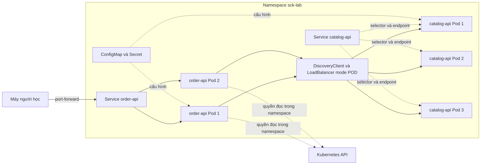

# Triển khai hai dịch vụ với nhiều Pod trong namespace riêng

Bài **Thực hành tổng hợp** của **SPRING_CLOUD_KUBERNETES** xây dựng hai dịch vụ Spring Boot trong namespace `sck-lab`: `order-api` có hai Pod và `catalog-api` có ba Pod. Người học sẽ tạo image, triển khai Deployment và Service, phân quyền RBAC, nạp ConfigMap/Secret, kiểm tra sức khỏe và chứng minh request đi đến nhiều backend.

Toàn bộ mã, manifest và lệnh bên dưới là hướng dẫn để người học tạo trong một thư mục lab riêng. Kết quả JSON và tên Pod minh họa không phải bằng chứng đã chạy trên một cluster thực tế.

## 1. Kiến trúc và tiêu chí đầu ra



| Thành phần | Vai trò |
| --- | --- |
| `order-api` | Nhận yêu cầu xem trước đơn hàng, gọi catalog qua Spring Cloud LoadBalancer |
| `catalog-api` | Trả sản phẩm mẫu, tên Pod phục vụ và revision cấu hình |
| Hai ClusterIP Service | Tên dịch vụ ổn định và selector gắn với đúng nhóm Pod |
| Hai ConfigMap | Cấu hình không nhạy cảm của từng ứng dụng |
| Một Secret dùng chung | Token giả cho header nội bộ trong lab |
| Hai ServiceAccount | Tách danh tính; chỉ `order-api` cần đọc Kubernetes API |
| Role và RoleBinding | Giới hạn quyền đọc của `order-api` trong `sck-lab` |

`order-api` dùng Fabric8 cho discovery, ConfigMap PropertySource và load balancing. `catalog-api` không cần SDK Kubernetes: nó đọc tệp ConfigMap mount và Secret qua env. Chỉ chọn tính năng cần cho từng ứng dụng; không thêm gói `-all` vào cả hai. Các họ starter Fabric8 và Kubernetes Java Client không được trộn trong một ứng dụng theo [tài liệu Spring Cloud Kubernetes](https://docs.spring.io/spring-cloud-kubernetes/reference/3.3/getting-started.html).

Namespace tổ chức và giới hạn phạm vi nhiều resource. Nó không tự chặn lưu lượng giữa các namespace; cách ly mạng cần NetworkPolicy cùng CNI hỗ trợ. [Tài liệu Kubernetes về namespace](https://kubernetes.io/docs/concepts/overview/working-with-objects/namespaces/).

Hoàn thành lab khi có đủ hai Deployment với tổng năm Pod `Ready`, hai Service có endpoint đúng, `order-api` tìm thấy các instance catalog và phản hồi nghiệp vụ cho thấy nhiều tên Pod catalog khác nhau.

## 2. Chuẩn bị môi trường và dự án

### 2.1. Công cụ và bộ phiên bản

Cần JDK 21, Maven, Docker chạy Linux container, `kubectl` và `kind`. Máy phải đủ tài nguyên cho cluster và năm ứng dụng; manifest đặt request bộ nhớ tổng khoảng 960 MiB, chưa tính hệ thống Kubernetes, container runtime và bộ nhớ vượt request.

Bài cố định Spring Boot `3.5.16`, Spring Cloud BOM `2025.0.3`, Java 21; BOM này quản lý Spring Cloud Kubernetes `3.3.3`. Đây là bộ phiên bản để tái lập ví dụ theo dòng tài liệu 3.3. Khi chuyển sang một thế hệ mới, cập nhật cả bộ theo bảng tương thích thay vì nâng riêng starter. [Spring Boot 3.5.16](https://github.com/spring-projects/spring-boot/releases/tag/v3.5.16), [BOM 2025.0.3](https://github.com/spring-cloud/spring-cloud-release/blob/v2025.0.3/spring-cloud-dependencies/pom.xml), [bảng tương thích Spring Cloud](https://github.com/spring-cloud/spring-cloud-release/wiki/Supported-Versions).

Các lệnh dùng PowerShell:

```powershell
java -version
mvn -version
docker version
kubectl version --client
kind version
```

Tạo cluster lab khi chưa có cluster cùng tên:

```powershell
kind create cluster --name sck-lab
kubectl --context kind-sck-lab cluster-info
kubectl --context kind-sck-lab get nodes
kubectl --context kind-sck-lab api-resources --api-group=discovery.k8s.io
```

Kiểm tra có `EndpointSlice` API. Các lệnh tác động cluster trong bài ghi rõ context để hạn chế nhầm cluster. Nếu đã có `sck-lab`, kiểm tra nó thay vì xóa để tạo lại. [Hướng dẫn kind](https://kind.sigs.k8s.io/docs/user/quick-start/).

### 2.2. Cấu trúc thư mục người học tạo

```text
spring-k8s-lab/
  pom.xml
  catalog-api/
    pom.xml
    Dockerfile
    src/main/java/vn/example/catalog/CatalogApplication.java
    src/main/resources/application.yaml
  order-api/
    pom.xml
    Dockerfile
    src/main/java/vn/example/orders/OrderApplication.java
    src/main/java/vn/example/orders/OrderController.java
    src/main/resources/application.yaml
  k8s/
    00-namespace.yaml
    10-rbac.yaml
    20-configmaps.yaml
    21-secret.yaml
    30-catalog.yaml
    31-order.yaml
```

Các lệnh build và apply phía sau chạy từ thư mục `spring-k8s-lab`. Các đoạn mã tiếp theo là nội dung đầy đủ của những tệp tương ứng, trừ nơi có chỉ dẫn dùng cùng nội dung cho hai tệp.

### 2.3. Maven parent

Nội dung `pom.xml` ở gốc lab:

```xml
<project xmlns="http://maven.apache.org/POM/4.0.0"
         xmlns:xsi="http://www.w3.org/2001/XMLSchema-instance"
         xsi:schemaLocation="http://maven.apache.org/POM/4.0.0 https://maven.apache.org/xsd/maven-4.0.0.xsd">
    <modelVersion>4.0.0</modelVersion>
    <parent>
        <groupId>org.springframework.boot</groupId>
        <artifactId>spring-boot-starter-parent</artifactId>
        <version>3.5.16</version>
        <relativePath/>
    </parent>
    <groupId>vn.example</groupId>
    <artifactId>spring-k8s-lab</artifactId>
    <version>1.0.0</version>
    <packaging>pom</packaging>
    <modules>
        <module>catalog-api</module>
        <module>order-api</module>
    </modules>
    <properties>
        <java.version>21</java.version>
        <project.build.sourceEncoding>UTF-8</project.build.sourceEncoding>
        <spring-cloud.version>2025.0.3</spring-cloud.version>
    </properties>
    <dependencyManagement>
        <dependencies>
            <dependency>
                <groupId>org.springframework.cloud</groupId>
                <artifactId>spring-cloud-dependencies</artifactId>
                <version>${spring-cloud.version}</version>
                <type>pom</type>
                <scope>import</scope>
            </dependency>
        </dependencies>
    </dependencyManagement>
</project>
```

BOM quản lý version; nó không tự thêm mọi dependency vào runtime của module con.

## 3. Viết dịch vụ catalog

### 3.1. Dependency

Nội dung `catalog-api/pom.xml`:

```xml
<project xmlns="http://maven.apache.org/POM/4.0.0"
         xmlns:xsi="http://www.w3.org/2001/XMLSchema-instance"
         xsi:schemaLocation="http://maven.apache.org/POM/4.0.0 https://maven.apache.org/xsd/maven-4.0.0.xsd">
    <modelVersion>4.0.0</modelVersion>
    <parent>
        <groupId>vn.example</groupId>
        <artifactId>spring-k8s-lab</artifactId>
        <version>1.0.0</version>
    </parent>
    <artifactId>catalog-api</artifactId>
    <dependencies>
        <dependency>
            <groupId>org.springframework.boot</groupId>
            <artifactId>spring-boot-starter-web</artifactId>
        </dependency>
        <dependency>
            <groupId>org.springframework.boot</groupId>
            <artifactId>spring-boot-starter-actuator</artifactId>
        </dependency>
    </dependencies>
    <build>
        <plugins>
            <plugin>
                <groupId>org.springframework.boot</groupId>
                <artifactId>spring-boot-maven-plugin</artifactId>
            </plugin>
        </plugins>
    </build>
</project>
```

### 3.2. API sản phẩm có thông tin Pod

Nội dung `CatalogApplication.java`:

```java
package vn.example.catalog;

import java.nio.charset.StandardCharsets;
import java.security.MessageDigest;

import org.springframework.beans.factory.annotation.Value;
import org.springframework.boot.SpringApplication;
import org.springframework.boot.autoconfigure.SpringBootApplication;
import org.springframework.http.HttpStatus;
import org.springframework.web.bind.annotation.GetMapping;
import org.springframework.web.bind.annotation.PathVariable;
import org.springframework.web.bind.annotation.RequestHeader;
import org.springframework.web.bind.annotation.RestController;
import org.springframework.web.server.ResponseStatusException;

@SpringBootApplication
@RestController
public class CatalogApplication {
    private final String podName;
    private final String revision;
    private final String productTitle;
    private final byte[] expectedToken;

    public CatalogApplication(
            @Value("${POD_NAME:local}") String podName,
            @Value("${demo.revision}") String revision,
            @Value("${catalog.product-title}") String productTitle,
            @Value("${lab.shared-token}") String token) {
        this.podName = podName;
        this.revision = revision;
        this.productTitle = productTitle;
        this.expectedToken = token.getBytes(StandardCharsets.UTF_8);
    }

    public static void main(String[] args) {
        SpringApplication.run(CatalogApplication.class, args);
    }

    @GetMapping("/api/products/{sku}")
    public Product product(
            @PathVariable("sku") String sku,
            @RequestHeader(name = "X-Lab-Token", defaultValue = "") String token) {
        if (!MessageDigest.isEqual(expectedToken, token.getBytes(StandardCharsets.UTF_8))) {
            throw new ResponseStatusException(HttpStatus.UNAUTHORIZED);
        }
        return new Product(sku, productTitle, 129000, podName, revision);
    }

    public record Product(
            String sku, String title, int priceVnd, String servedBy, String configRevision) {
    }
}
```

Đây là catalog dữ liệu mẫu: mọi SKU trả cùng một sản phẩm minh họa. Header token chỉ giúp thực hành Secret và phát hiện cấu hình sai giữa hai ứng dụng; không thay cho cơ chế xác thực dịch vụ và TLS của hệ thống thực tế.

### 3.3. Cấu hình catalog

Nội dung `catalog-api/src/main/resources/application.yaml`:

```yaml
spring:
  application:
    name: catalog-api
  config:
    import: "file:/etc/app-config/application.yaml"
  lifecycle:
    timeout-per-shutdown-phase: 20s
server:
  port: 8080
  shutdown: graceful
management:
  endpoints:
    web:
      exposure:
        include: health,info
  endpoint:
    health:
      probes:
        enabled: true
```

Tệp import được mount từ ConfigMap trong manifest. Token đến từ env `LAB_SHARED_TOKEN`, ánh xạ tới property chuẩn `lab.shared-token`. Không đặt token trong ConfigMap, response hoặc log.

## 4. Viết dịch vụ order

### 4.1. Dependency

Nội dung `order-api/pom.xml`:

```xml
<project xmlns="http://maven.apache.org/POM/4.0.0"
         xmlns:xsi="http://www.w3.org/2001/XMLSchema-instance"
         xsi:schemaLocation="http://maven.apache.org/POM/4.0.0 https://maven.apache.org/xsd/maven-4.0.0.xsd">
    <modelVersion>4.0.0</modelVersion>
    <parent>
        <groupId>vn.example</groupId>
        <artifactId>spring-k8s-lab</artifactId>
        <version>1.0.0</version>
    </parent>
    <artifactId>order-api</artifactId>
    <dependencies>
        <dependency>
            <groupId>org.springframework.boot</groupId>
            <artifactId>spring-boot-starter-web</artifactId>
        </dependency>
        <dependency>
            <groupId>org.springframework.boot</groupId>
            <artifactId>spring-boot-starter-actuator</artifactId>
        </dependency>
        <dependency>
            <groupId>org.springframework.cloud</groupId>
            <artifactId>spring-cloud-starter-kubernetes-fabric8</artifactId>
        </dependency>
        <dependency>
            <groupId>org.springframework.cloud</groupId>
            <artifactId>spring-cloud-starter-kubernetes-fabric8-config</artifactId>
        </dependency>
        <dependency>
            <groupId>org.springframework.cloud</groupId>
            <artifactId>spring-cloud-starter-kubernetes-fabric8-loadbalancer</artifactId>
        </dependency>
    </dependencies>
    <build>
        <plugins>
            <plugin>
                <groupId>org.springframework.boot</groupId>
                <artifactId>spring-boot-maven-plugin</artifactId>
            </plugin>
        </plugins>
    </build>
</project>
```

### 4.2. RestTemplate có LoadBalancer

Nội dung `OrderApplication.java`:

```java
package vn.example.orders;

import org.springframework.boot.SpringApplication;
import org.springframework.boot.autoconfigure.SpringBootApplication;
import org.springframework.cloud.client.loadbalancer.LoadBalanced;
import org.springframework.context.annotation.Bean;
import org.springframework.http.client.SimpleClientHttpRequestFactory;
import org.springframework.web.client.RestTemplate;

@SpringBootApplication
public class OrderApplication {
    public static void main(String[] args) {
        SpringApplication.run(OrderApplication.class, args);
    }

    @Bean
    @LoadBalanced
    RestTemplate catalogRestTemplate() {
        var factory = new SimpleClientHttpRequestFactory();
        factory.setConnectTimeout(2000);
        factory.setReadTimeout(3000);
        return new RestTemplate(factory);
    }
}
```

`@LoadBalanced` áp dụng cơ chế chọn instance vào `RestTemplate` do Spring quản lý. Code dùng service ID `catalog-api`; không ghi IP Pod trong Java. [Tài liệu Spring Cloud Commons về HTTP client cân bằng tải](https://docs.spring.io/spring-cloud-commons/reference/4.3/spring-cloud-commons/common-abstractions.html).

### 4.3. Endpoint nghiệp vụ và endpoint quan sát discovery

Nội dung `OrderController.java`:

```java
package vn.example.orders;

import java.util.List;

import org.springframework.beans.factory.annotation.Value;
import org.springframework.cloud.client.discovery.DiscoveryClient;
import org.springframework.http.HttpEntity;
import org.springframework.http.HttpHeaders;
import org.springframework.http.HttpMethod;
import org.springframework.http.HttpStatus;
import org.springframework.web.bind.annotation.GetMapping;
import org.springframework.web.bind.annotation.PathVariable;
import org.springframework.web.bind.annotation.RestController;
import org.springframework.web.client.RestClientException;
import org.springframework.web.client.RestTemplate;
import org.springframework.web.server.ResponseStatusException;

@RestController
public class OrderController {
    private final RestTemplate restTemplate;
    private final DiscoveryClient discoveryClient;
    private final String podName;
    private final String revision;
    private final String banner;
    private final String token;

    public OrderController(
            RestTemplate restTemplate,
            DiscoveryClient discoveryClient,
            @Value("${POD_NAME:local}") String podName,
            @Value("${demo.revision}") String revision,
            @Value("${order.banner}") String banner,
            @Value("${lab.shared-token}") String token) {
        this.restTemplate = restTemplate;
        this.discoveryClient = discoveryClient;
        this.podName = podName;
        this.revision = revision;
        this.banner = banner;
        this.token = token;
    }

    @GetMapping("/api/orders/preview/{sku}")
    public Preview preview(@PathVariable("sku") String sku) {
        var headers = new HttpHeaders();
        headers.set("X-Lab-Token", token);
        try {
            Product product = restTemplate.exchange(
                    "http://catalog-api/api/products/{sku}",
                    HttpMethod.GET,
                    new HttpEntity<>(null, headers),
                    Product.class,
                    sku).getBody();
            if (product == null) {
                throw new ResponseStatusException(HttpStatus.BAD_GATEWAY, "Catalog trả body rỗng");
            }
            return new Preview(podName, banner, revision, product);
        } catch (RestClientException | IllegalStateException exception) {
            throw new ResponseStatusException(
                    HttpStatus.SERVICE_UNAVAILABLE, "Chưa gọi được catalog-api", exception);
        }
    }

    @GetMapping("/internal/catalog-instances")
    public List<Endpoint> instances() {
        return discoveryClient.getInstances("catalog-api").stream()
                .map(instance -> new Endpoint(
                        instance.getHost(), instance.getPort(), instance.isSecure()))
                .toList();
    }

    public record Product(
            String sku, String title, int priceVnd, String servedBy, String configRevision) {
    }

    public record Preview(
            String orderPod, String banner, String orderConfigRevision, Product product) {
    }

    public record Endpoint(String host, int port, boolean secure) {
    }
}
```

Endpoint `/internal/catalog-instances` công bố địa chỉ nội bộ để chẩn đoán trong lab. Khi triển khai ứng dụng thật, hạn chế hoặc loại bỏ endpoint này theo nhu cầu vận hành.

### 4.4. Cấu hình order

Nội dung `order-api/src/main/resources/application.yaml`:

```yaml
spring:
  application:
    name: order-api
  config:
    import: "kubernetes:"
  lifecycle:
    timeout-per-shutdown-phase: 20s
  cloud:
    kubernetes:
      client:
        namespace: ${POD_NAMESPACE}
      config:
        namespace: ${POD_NAMESPACE}
        sources:
          - name: order-api
        fail-fast: true
      secrets:
        enabled: false
      discovery:
        all-namespaces: false
        namespaces:
          - ${POD_NAMESPACE}
        use-endpoint-slices: true
        primary-port-name: http
      loadbalancer:
        mode: POD
    loadbalancer:
      cache:
        enabled: false
server:
  port: 8080
  shutdown: graceful
management:
  endpoints:
    web:
      exposure:
        include: health,info
  endpoint:
    health:
      probes:
        enabled: true
```

Ở đây `kubernetes:` nạp PropertySource qua Spring Cloud Kubernetes; không bật bootstrap cũ đồng thời. [Tài liệu Kubernetes PropertySource](https://docs.spring.io/spring-cloud-kubernetes/reference/3.3/property-source-config.html).

Phạm vi discovery là namespace nhận qua Downward API. Bài chọn EndpointSlice nên cần quyền trên group `discovery.k8s.io`; kiểm tra theo [tài liệu DiscoveryClient](https://docs.spring.io/spring-cloud-kubernetes/reference/3.3/discovery-client.html).

Mode `POD` chọn instance qua DiscoveryClient. Mode `SERVICE` dùng đường gọi Service và là bài thử khác. [Tài liệu LoadBalancer cho Kubernetes](https://docs.spring.io/spring-cloud-kubernetes/reference/3.3/load-balancer.html).

Tắt cache của Spring Cloud LoadBalancer giúp giảm một lớp cache trong phép thử thêm/bớt Pod; discovery vẫn cần thời gian hội tụ. `secrets.enabled: false` tắt nguồn Secret của Spring Cloud Kubernetes, không ngăn Kubernetes đưa key Secret vào env của container.

## 5. Build hai image

Tạo `Dockerfile` với cùng nội dung trong cả `catalog-api` và `order-api`:

```dockerfile
FROM eclipse-temurin:21-jre
WORKDIR /app
COPY target/*.jar app.jar
USER 10001
EXPOSE 8080
ENTRYPOINT ["java", "-jar", "/app/app.jar"]
```

Từ gốc lab:

```powershell
mvn -B package
docker build -t catalog-api:lab-001 ./catalog-api
docker build -t order-api:lab-001 ./order-api
kind load docker-image catalog-api:lab-001 order-api:lab-001 --name sck-lab
```

Hai module phải tạo được executable JAR trước khi build image. Nạp image vào kind giúp node dùng image local; tag không phải `latest` và manifest sẽ dùng `IfNotPresent`. Với cluster từ xa, cần push image vào registry mà node truy cập được và sửa image reference tương ứng.

## 6. Khai báo namespace, danh tính và cấu hình

### 6.1. Namespace riêng

Nội dung `k8s/00-namespace.yaml`:

```yaml
apiVersion: v1
kind: Namespace
metadata:
  name: sck-lab
  labels:
    app.kubernetes.io/part-of: sck-lab
```

Tất cả resource thuộc namespace trong các tệp tiếp theo ghi rõ `namespace: sck-lab`. Việc dùng namespace riêng giúp quan sát, cấp quyền và dọn lab mà không phải tìm từng resource trong `default`.

### 6.2. RBAC cho đúng ứng dụng cần API

Nội dung `k8s/10-rbac.yaml`:

```yaml
apiVersion: v1
kind: ServiceAccount
metadata:
  name: order-api
  namespace: sck-lab
---
apiVersion: v1
kind: ServiceAccount
metadata:
  name: catalog-api
  namespace: sck-lab
automountServiceAccountToken: false
---
apiVersion: rbac.authorization.k8s.io/v1
kind: Role
metadata:
  name: order-api-reader
  namespace: sck-lab
rules:
  - apiGroups: [""]
    resources: ["pods", "services"]
    verbs: ["get", "list", "watch"]
  - apiGroups: ["discovery.k8s.io"]
    resources: ["endpointslices"]
    verbs: ["get", "list", "watch"]
  - apiGroups: [""]
    resources: ["configmaps"]
    verbs: ["get", "list"]
---
apiVersion: rbac.authorization.k8s.io/v1
kind: RoleBinding
metadata:
  name: order-api-reader
  namespace: sck-lab
subjects:
  - kind: ServiceAccount
    name: order-api
    namespace: sck-lab
roleRef:
  apiGroup: rbac.authorization.k8s.io
  kind: Role
  name: order-api-reader
```

Role này cho discovery theo EndpointSlice và đọc ConfigMap lúc nạp cấu hình; không cấp quyền ghi, không cấp quyền đọc Secret. Nếu đổi sang discovery bằng Endpoints, phải đánh giá quyền trên resource `endpoints` của core API thay vì coi hai resource là một.

`catalog-api` không có RoleBinding và không mount token ServiceAccount. ConfigMap volume và Secret env của nó do Kubernetes cung cấp cho container; ứng dụng không cần tự gọi API lấy các giá trị đó. Kiểm tra quyền theo danh tính, resource, verb và namespace thay vì cấp quyền rộng để thử. [Tài liệu RBAC](https://kubernetes.io/docs/reference/access-authn-authz/rbac/).

### 6.3. Hai ConfigMap

Nội dung `k8s/20-configmaps.yaml`:

```yaml
apiVersion: v1
kind: ConfigMap
metadata:
  name: catalog-api
  namespace: sck-lab
data:
  application.yaml: |-
    demo:
      revision: "catalog-v1"
    catalog:
      product-title: "Sổ tay thực hành Spring"
---
apiVersion: v1
kind: ConfigMap
metadata:
  name: order-api
  namespace: sck-lab
data:
  application.yaml: |-
    demo:
      revision: "order-v1"
    order:
      banner: "Xem trước đơn hàng trong lab"
```

Cùng một loại resource được dùng qua hai đường: mount file ở catalog và Spring Cloud Kubernetes API ở order. Không nhầm dữ liệu của ConfigMap đã đổi với bean trong tiến trình đã đổi. [Tài liệu ConfigMap](https://kubernetes.io/docs/concepts/configuration/configmap/).

### 6.4. Secret giả cho lab

Nội dung `k8s/21-secret.yaml`:

```yaml
apiVersion: v1
kind: Secret
metadata:
  name: lab-shared-token
  namespace: sck-lab
type: Opaque
stringData:
  token: "lab-only-change-me"
```

Giá trị trên công khai và chỉ là dữ liệu giả để thực hành. Với dữ liệu thật, đưa Secret vào bằng quy trình quản lý bí mật của môi trường, không lưu credential thực trong source. Secret không đồng nghĩa dữ liệu tự được mã hóa an toàn chỉ vì có dạng base64. [Tài liệu Kubernetes Secret](https://kubernetes.io/docs/concepts/configuration/secret/).

## 7. Khai báo Deployment và Service

### 7.1. Catalog: ba replica, cấu hình qua volume

Nội dung `k8s/30-catalog.yaml`:

```yaml
apiVersion: apps/v1
kind: Deployment
metadata:
  name: catalog-api
  namespace: sck-lab
spec:
  replicas: 3
  minReadySeconds: 3
  strategy:
    type: RollingUpdate
    rollingUpdate:
      maxUnavailable: 0
      maxSurge: 1
  selector:
    matchLabels:
      app: catalog-api
  template:
    metadata:
      labels:
        app: catalog-api
        app.kubernetes.io/part-of: sck-lab
    spec:
      serviceAccountName: catalog-api
      automountServiceAccountToken: false
      terminationGracePeriodSeconds: 30
      containers:
        - name: app
          image: catalog-api:lab-001
          imagePullPolicy: IfNotPresent
          securityContext:
            runAsNonRoot: true
            runAsUser: 10001
          ports:
            - name: http
              containerPort: 8080
          env:
            - name: POD_NAME
              valueFrom:
                fieldRef:
                  fieldPath: metadata.name
            - name: LAB_SHARED_TOKEN
              valueFrom:
                secretKeyRef:
                  name: lab-shared-token
                  key: token
          volumeMounts:
            - name: app-config
              mountPath: /etc/app-config
              readOnly: true
          resources:
            requests:
              cpu: 100m
              memory: 192Mi
            limits:
              cpu: 500m
              memory: 512Mi
          startupProbe:
            httpGet:
              path: /actuator/health/liveness
              port: http
            periodSeconds: 5
            timeoutSeconds: 2
            failureThreshold: 30
          readinessProbe:
            httpGet:
              path: /actuator/health/readiness
              port: http
            periodSeconds: 5
            timeoutSeconds: 2
          livenessProbe:
            httpGet:
              path: /actuator/health/liveness
              port: http
            periodSeconds: 10
            timeoutSeconds: 2
      volumes:
        - name: app-config
          configMap:
            name: catalog-api
---
apiVersion: v1
kind: Service
metadata:
  name: catalog-api
  namespace: sck-lab
spec:
  type: ClusterIP
  selector:
    app: catalog-api
  ports:
    - name: http
      port: 8080
      targetPort: http
```

Mount cả thư mục để có tệp `/etc/app-config/application.yaml`. Bài không dùng `subPath`, không thêm cơ chế refresh nóng vào catalog.

### 7.2. Order: hai replica, API token và namespace tường minh

Nội dung `k8s/31-order.yaml`:

```yaml
apiVersion: apps/v1
kind: Deployment
metadata:
  name: order-api
  namespace: sck-lab
spec:
  replicas: 2
  minReadySeconds: 3
  strategy:
    type: RollingUpdate
    rollingUpdate:
      maxUnavailable: 0
      maxSurge: 1
  selector:
    matchLabels:
      app: order-api
  template:
    metadata:
      labels:
        app: order-api
        app.kubernetes.io/part-of: sck-lab
    spec:
      serviceAccountName: order-api
      automountServiceAccountToken: true
      terminationGracePeriodSeconds: 30
      containers:
        - name: app
          image: order-api:lab-001
          imagePullPolicy: IfNotPresent
          securityContext:
            runAsNonRoot: true
            runAsUser: 10001
          ports:
            - name: http
              containerPort: 8080
          env:
            - name: POD_NAME
              valueFrom:
                fieldRef:
                  fieldPath: metadata.name
            - name: POD_NAMESPACE
              valueFrom:
                fieldRef:
                  fieldPath: metadata.namespace
            - name: LAB_SHARED_TOKEN
              valueFrom:
                secretKeyRef:
                  name: lab-shared-token
                  key: token
          resources:
            requests:
              cpu: 100m
              memory: 192Mi
            limits:
              cpu: 500m
              memory: 512Mi
          startupProbe:
            httpGet:
              path: /actuator/health/liveness
              port: http
            periodSeconds: 5
            timeoutSeconds: 2
            failureThreshold: 30
          readinessProbe:
            httpGet:
              path: /actuator/health/readiness
              port: http
            periodSeconds: 5
            timeoutSeconds: 2
          livenessProbe:
            httpGet:
              path: /actuator/health/liveness
              port: http
            periodSeconds: 10
            timeoutSeconds: 2
---
apiVersion: v1
kind: Service
metadata:
  name: order-api
  namespace: sck-lab
spec:
  type: ClusterIP
  selector:
    app: order-api
  ports:
    - name: http
      port: 8080
      targetPort: http
```

`Deployment.spec.selector`, label trong Pod template và Service selector phải thống nhất cho từng ứng dụng. Đừng dùng một selector chung cho cả order và catalog. Service có địa chỉ ổn định, còn IP Pod có thể đổi khi được thay thế. [Tài liệu Kubernetes Service](https://kubernetes.io/docs/concepts/services-networking/service/).

### 7.3. Ý nghĩa các probe

| Probe | Mục đích trong lab |
| --- | --- |
| Startup | Cho ứng dụng thời gian khởi động trước khi liveness/readiness bắt đầu kiểm tra |
| Readiness | Xác định Pod sẵn sàng theo nhóm sức khỏe readiness |
| Liveness | Phát hiện tình trạng cần khởi động lại container theo nhóm liveness |

Các nhóm `/actuator/health/liveness` và `/actuator/health/readiness` do Spring Boot Actuator cung cấp khi bật probes. [Tài liệu Actuator](https://docs.spring.io/spring-boot/3.5/reference/actuator/endpoints.html). Kubernetes dùng probe để quyết định sẵn sàng hoặc khởi động lại theo loại probe. [Tài liệu startup, readiness và liveness](https://kubernetes.io/docs/tasks/configure-pod-container/configure-liveness-readiness-startup-probes/).

Không đưa khả năng gọi catalog vào liveness của order. Một backend tạm thời không sẵn sàng không nên làm mọi order container liên tục bị restart. Với cấu hình trong bài, `Ready` chưa chứng minh nghiệp vụ gọi catalog thành công; phải gọi endpoint nghiệp vụ để kiểm tra thêm.

## 8. Triển khai theo thứ tự và đọc trạng thái

Từ thư mục gốc lab:

```powershell
kubectl --context kind-sck-lab apply -f k8s/00-namespace.yaml
kubectl --context kind-sck-lab -n sck-lab apply -f k8s/10-rbac.yaml
kubectl --context kind-sck-lab -n sck-lab apply -f k8s/20-configmaps.yaml
kubectl --context kind-sck-lab -n sck-lab apply -f k8s/21-secret.yaml
kubectl --context kind-sck-lab -n sck-lab apply -f k8s/30-catalog.yaml
kubectl --context kind-sck-lab -n sck-lab rollout status deployment/catalog-api --timeout=240s
kubectl --context kind-sck-lab -n sck-lab apply -f k8s/31-order.yaml
kubectl --context kind-sck-lab -n sck-lab rollout status deployment/order-api --timeout=240s
```

Chờ catalog trước giúp lần kiểm tra nghiệp vụ đầu tiên dễ diễn giải. Khi manifest đã được tạo và kiểm tra, những lần apply sau có thể điều phối theo pipeline tương ứng.

Quan sát:

```powershell
kubectl --context kind-sck-lab -n sck-lab get deployments
kubectl --context kind-sck-lab -n sck-lab get pods -o wide
kubectl --context kind-sck-lab -n sck-lab get services
kubectl --context kind-sck-lab -n sck-lab get endpointslices -l kubernetes.io/service-name=catalog-api -o yaml
```

Kết quả ổn định mong đợi:

```text
DEPLOYMENT    READY   UP-TO-DATE   AVAILABLE
catalog-api   3/3     3            3
order-api     2/2     2            2
```

Với EndpointSlice, đối chiếu tổng endpoint và điều kiện ready với Pod thực tế; một Service có thể có nhiều slice. Chỉ nhìn thấy tên Service chưa chứng minh Service đã có backend.

Có nhiều Pod trên một node giúp thực hành thay Pod và cân bằng tải. Nó không chứng minh chịu được lỗi node; cluster kind mặc định có thể chỉ có một node.

## 9. Chứng minh discovery và nhiều Pod thực sự phục vụ

### 9.1. Truy cập order qua port-forward

Mở một terminal từ máy người học và giữ lệnh chạy:

```powershell
kubectl --context kind-sck-lab -n sck-lab port-forward service/order-api 18080:8080
```

Ở terminal khác:

```powershell
curl.exe --fail-with-body -sS http://127.0.0.1:18080/actuator/health/readiness
curl.exe --fail-with-body -sS http://127.0.0.1:18080/internal/catalog-instances
curl.exe --fail-with-body -sS http://127.0.0.1:18080/api/orders/preview/book-001
```

Response nghiệp vụ minh họa:

```json
{
  "orderPod": "order-api-6c7d8c9b6b-alpha",
  "banner": "Xem trước đơn hàng trong lab",
  "orderConfigRevision": "order-v1",
  "product": {
    "sku": "book-001",
    "title": "Sổ tay thực hành Spring",
    "priceVnd": 129000,
    "servedBy": "catalog-api-7f8c6d5d9b-bravo",
    "configRevision": "catalog-v1"
  }
}
```

Endpoint discovery phải trả các host/port catalog dự kiến, thường là ba địa chỉ ở trạng thái ổn định của lab. Đối chiếu chúng với IP Pod và EndpointSlice; đừng chỉ đếm phần tử khi có Pod đang chuyển trạng thái.

### 9.2. Gửi nhiều request và nhóm theo backend

Trong PowerShell:

```powershell
$rows = 1..24 | ForEach-Object {
    $reply = Invoke-RestMethod 'http://127.0.0.1:18080/api/orders/preview/book-001'
    [pscustomobject]@{
        OrderPod = $reply.orderPod
        CatalogPod = $reply.product.servedBy
        OrderRevision = $reply.orderConfigRevision
        CatalogRevision = $reply.product.configRevision
    }
}
$rows | Format-Table
$rows | Group-Object CatalogPod | Select-Object Name,Count
```

Trong trạng thái ổn định, mong đợi thấy nhiều tên catalog Pod. Không bắt buộc tỉ lệ chia đều tuyệt đối trong một mẫu nhỏ hoặc một thứ tự cố định. Nếu luôn có một backend, kiểm tra discovery, số endpoint ready và `RestTemplate` được inject có phải bean `@LoadBalanced` không.

**Port-forward đến Service chọn một Pod để chuyển tiếp**, không tạo phép đo cân bằng tải cho cả hai order Pod. Vì vậy, việc `orderPod` không đổi trong vòng lặp là bình thường. Biến thiên `product.servedBy` chứng minh tầng gọi catalog qua LoadBalancer của order.

### 9.3. Kiểm tra order Pod còn lại

Liệt kê hai order Pod, xác định Pod khác với `orderPod` đã thấy. Ở terminal mới, thay placeholder bằng tên thật:

```powershell
kubectl --context kind-sck-lab -n sck-lab get pods -l app=order-api -o wide
kubectl --context kind-sck-lab -n sck-lab port-forward 'pod/<order-Pod-con-lai>' 18081:8080
```

Gọi trên cổng mới:

```powershell
curl.exe --fail-with-body -sS http://127.0.0.1:18081/internal/catalog-instances
curl.exe --fail-with-body -sS http://127.0.0.1:18081/api/orders/preview/book-001
```

Phải thấy tên order Pod tương ứng và nghiệp vụ thành công. Chỉ một Pod chạy tốt chưa chứng minh replica còn lại đã được cấu hình đúng.

## 10. Kiểm tra ranh giới RBAC và Secret

Với người dùng có quyền impersonate trong cluster lab:

```powershell
kubectl --context kind-sck-lab auth can-i list services --as=system:serviceaccount:sck-lab:order-api -n sck-lab
kubectl --context kind-sck-lab auth can-i watch endpointslices.discovery.k8s.io --as=system:serviceaccount:sck-lab:order-api -n sck-lab
kubectl --context kind-sck-lab auth can-i get configmap/order-api --as=system:serviceaccount:sck-lab:order-api -n sck-lab
kubectl --context kind-sck-lab auth can-i get secrets --as=system:serviceaccount:sck-lab:order-api -n sck-lab
kubectl --context kind-sck-lab auth can-i list services --as=system:serviceaccount:sck-lab:catalog-api -n sck-lab
kubectl --context kind-sck-lab auth can-i list services --as=system:serviceaccount:sck-lab:order-api -n default
```

Với đúng các quyền đã khai báo và không có binding bổ sung, ba lệnh đầu trả `yes`, ba lệnh sau trả `no`. Nếu người chạy thiếu quyền impersonate, xử lý thông báo đó trước; đừng diễn giải lỗi impersonation thành kết quả quyền của ServiceAccount đích.

Order vẫn gửi được header token dù không có quyền GET Secret qua Kubernetes API. Token được đưa vào env bằng `secretKeyRef` khi container được tạo; đây là đường phân phối khác với Spring Cloud Kubernetes đọc Secret API.

Có thể kiểm chứng catalog từ chối request không có token bằng port-forward một catalog Pod tới cổng riêng:

```powershell
kubectl --context kind-sck-lab -n sck-lab port-forward service/catalog-api 18082:8080
```

Ở terminal khác:

```powershell
curl.exe -i http://127.0.0.1:18082/api/products/book-001
```

Mong đợi HTTP `401`. Luồng qua order vẫn thành công vì order gửi token. Không in token ra log hoặc endpoint chỉ để chứng minh nó đã được inject.

## 11. Thay đổi số Pod và quan sát khả năng phục hồi

### 11.1. Scale catalog lên bốn replica

```powershell
kubectl --context kind-sck-lab -n sck-lab scale deployment/catalog-api --replicas=4
kubectl --context kind-sck-lab -n sck-lab rollout status deployment/catalog-api --timeout=240s
kubectl --context kind-sck-lab -n sck-lab get pods -l app=catalog-api -o wide
```

Gọi lại `/internal/catalog-instances` ở **cả hai** order Pod sau thời gian hội tụ. Kiểm tra endpoint mới xuất hiện và thêm request nghiệp vụ cho đến khi quan sát được backend mới. Ghi thời gian chuyển từ Pod `Ready` đến lúc ứng dụng thấy endpoint; không giả định bằng không.

Đưa lab về ba replica:

```powershell
kubectl --context kind-sck-lab -n sck-lab scale deployment/catalog-api --replicas=3
kubectl --context kind-sck-lab -n sck-lab rollout status deployment/catalog-api --timeout=240s
```

Lệnh scale thay đổi trạng thái trên cluster. Tệp `30-catalog.yaml` vẫn ghi `replicas: 3`; lần apply tệp đó có thể đưa số replica về giá trị trong tệp. Khi vận hành thật, giữ trạng thái khai báo và cách điều khiển replica nhất quán.

### 11.2. Xóa một catalog Pod để Deployment thay thế

Trong lab:

```powershell
$victim = kubectl --context kind-sck-lab -n sck-lab get pods -l app=catalog-api -o jsonpath='{.items[0].metadata.name}'
kubectl --context kind-sck-lab -n sck-lab get pod $victim -o wide
kubectl --context kind-sck-lab -n sck-lab delete pod $victim
kubectl --context kind-sck-lab -n sck-lab rollout status deployment/catalog-api --timeout=240s
kubectl --context kind-sck-lab -n sck-lab get pods -l app=catalog-api -o wide
```

Chỉ thực hiện khi đã xác nhận biến chứa đúng một catalog Pod của lab. Deployment tạo Pod thay thế để duy trì số replica mong muốn. [Tài liệu Deployment cho ứng dụng stateless](https://kubernetes.io/docs/tasks/run-application/run-stateless-application-deployment/).

Đối chiếu tên/IP cũ và mới trong discovery rồi gửi request lại. Trong cửa sổ thay đổi có thể có lỗi request do kết nối đang dùng hoặc dữ liệu endpoint chưa hội tụ; bài không thiết lập retry/circuit breaker để bảo đảm mọi request đều thành công.

Nếu một phiên port-forward mất kết nối vì Pod gắn với nó bị thay, mở lại port-forward. Không nhầm lỗi của đường chẩn đoán này với toàn bộ Service đã ngừng hoạt động.

### 11.3. Phân biệt sức khỏe Pod với sức khỏe nghiệp vụ

Bài thử tùy chọn trong lab: scale catalog về `0`, quan sát hai order Pod và gọi endpoint nghiệp vụ. Order có thể vẫn `Ready` theo probe của nó nhưng request gọi catalog thất bại. Sau khi ghi nhận, scale catalog về `3`, chờ rollout và kiểm tra lại.

Không lấy `Ready` làm bằng chứng duy nhất cho toàn bộ chuỗi dịch vụ. Đồng thời, không gắn mọi phụ thuộc từ xa vào liveness để che khoảng trống quan sát nghiệp vụ.

## 12. Cập nhật cấu hình theo cơ chế đã chọn

Lab này dùng cấu hình tại thời điểm khởi tạo bean và cập nhật bằng rollout. Chưa triển khai Configuration Watcher, chưa expose `/actuator/refresh`, chưa thêm refresh scope.

Sửa **tệp nguồn** `k8s/20-configmaps.yaml`:

- `catalog-v1` thành `catalog-v2`, đổi tên sản phẩm nếu muốn quan sát rõ.
- `order-v1` thành `order-v2`, đổi banner.

Apply rồi thay Pod có kiểm soát:

```powershell
kubectl --context kind-sck-lab -n sck-lab apply -f k8s/20-configmaps.yaml
kubectl --context kind-sck-lab -n sck-lab rollout restart deployment/catalog-api
kubectl --context kind-sck-lab -n sck-lab rollout status deployment/catalog-api --timeout=240s
kubectl --context kind-sck-lab -n sck-lab rollout restart deployment/order-api
kubectl --context kind-sck-lab -n sck-lab rollout status deployment/order-api --timeout=240s
```

Mở lại port-forward nếu phiên cũ gắn với Pod đã bị thay. Xác nhận cả hai order Pod trả `order-v2`, các catalog Pod được gọi trả `catalog-v2` và giá trị nghiệp vụ mới. Trong lúc rolling update, có thể quan sát đồng thời hai revision; chỉ kết luận hoàn tất sau khi các replica mong muốn đã cập nhật.

ConfigMap được cập nhật trên API hoặc trong volume chưa tự gán lại field `@Value` của singleton. Secret qua env cũng cần container mới để nhận giá trị mới. Nếu đổi token dùng chung, phải thiết kế khoảng chuyển tương thích giữa bên gửi và bên nhận; đổi từng bên tùy tiện có thể tạo lỗi `401` tạm thời.

Sau khi đường triển khai cơ bản đạt, có thể mở rộng bằng Configuration Watcher và `@RefreshScope`/`@ConfigurationProperties`. Khi đó phải thêm quyền, bảo vệ endpoint refresh và kiểm chứng từng replica. Không cần broker hoặc Watcher chỉ để đạt mục tiêu triển khai hai dịch vụ của bài này.

## 13. Chẩn đoán theo lớp gặp lỗi

| Triệu chứng | Kiểm tra tiếp theo |
| --- | --- |
| `ImagePullBackOff` | Image đã load vào đúng kind cluster chưa, đúng tag và pull policy không? |
| Pod `Pending` | Events, tài nguyên node, request CPU/bộ nhớ và điều kiện scheduling |
| `CreateContainerConfigError` | Secret/ConfigMap đã tồn tại đúng namespace, đúng key chưa? |
| `CrashLoopBackOff` ở catalog | Import file, volume mount, property bắt buộc, log khởi động |
| `CrashLoopBackOff` ở order | Config Data, namespace env, RBAC và kết nối Kubernetes API |
| Probe thất bại | Đúng cổng/path, Actuator probes, lỗi startup và thời gian khởi động |
| Service không có endpoint | Selector, label Pod, readiness và EndpointSlice |
| Discovery không thấy catalog | Namespace, quyền list/watch, EndpointSlice API và log discovery |
| Gọi catalog trả `401` trực tiếp | Header token thiếu/sai; probe health không yêu cầu header đó |
| Order trả `503` | Không có instance hoặc lỗi gọi downstream; xem log và discovery trước khi sửa quyền |
| Chỉ thấy một catalog Pod phục vụ | Số endpoint ready, bean `@LoadBalanced`, mode và số request quan sát |
| ConfigMap mới nhưng response cũ | Bean chưa tái tạo, rollout chưa xong, đang gọi Pod cũ hoặc nguồn cấu hình khác |

Lệnh quan sát mẫu:

```powershell
kubectl --context kind-sck-lab -n sck-lab get events --sort-by=.metadata.creationTimestamp
kubectl --context kind-sck-lab -n sck-lab describe pod '<ten-Pod-can-kiem-tra>'
kubectl --context kind-sck-lab -n sck-lab logs '<ten-Pod-can-kiem-tra>' --tail=100
kubectl --context kind-sck-lab -n sck-lab logs '<ten-Pod-can-kiem-tra>' --previous --tail=100
```

Thay placeholder bằng tên thật. `--previous` chỉ có ích khi có container instance trước đó. Ghi resource, namespace, verb và mã lỗi; không bật log toàn bộ header có token.

Kubernetes RBAC kiểm soát gọi API server. Nó không sửa được lỗi Service selector, cổng HTTP hoặc token nghiệp vụ. Duy trì các lớp chẩn đoán riêng để tránh thay nhiều cấu hình cùng lúc.

## 14. Nghiệm thu và dọn môi trường

Ghi lại bằng chứng trước khi dọn:

| Tiêu chí | Bằng chứng cần lưu |
| --- | --- |
| Namespace riêng | Tài nguyên ứng dụng đều ở `sck-lab` |
| Đủ replica | Catalog `3/3`, order `2/2` ở trạng thái ổn định |
| Service đúng backend | Selector, IP Pod và endpoint ready khớp nhau |
| Discovery giới hạn phạm vi | Hai order Pod tìm đúng catalog trong namespace lab |
| Nhiều backend thực sự phục vụ | Nhóm response theo `product.servedBy` có nhiều tên Pod |
| Hai frontend đều hoạt động | Response trực tiếp từ từng order Pod có tên tương ứng |
| Quyền đúng nhu cầu | Order đọc resource cần thiết, không có quyền GET Secret theo Role lab |
| Phục hồi sau thay Pod | Pod mới xuất hiện, discovery hội tụ, nghiệp vụ hoạt động lại |
| Cập nhật cấu hình đúng cơ chế | Revision mới được quan sát ở từng replica sau rollout |

Lưu cả image tag, số replica, revision và giới hạn phép đo. Năm Pod trên một node chưa chứng minh chịu lỗi node; các request lab thành công chưa thay cho thử tải hoặc chính sách bảo mật triển khai thật.

Khi đã kết thúc, dừng các phiên port-forward bằng `Ctrl+C`. Kiểm tra đúng namespace lab trước khi xóa:

```powershell
kubectl --context kind-sck-lab get namespace sck-lab
kubectl --context kind-sck-lab -n sck-lab get deployments,services,configmaps,secrets
kubectl --context kind-sck-lab delete namespace sck-lab
```

Lệnh cuối xóa toàn bộ resource thuộc namespace lab. Chỉ dùng khi đó là môi trường riêng của bài và không còn dữ liệu cần giữ. Nếu muốn giữ kết quả để thực hành tiếp, dừng ở bước lưu bằng chứng và giữ namespace.
