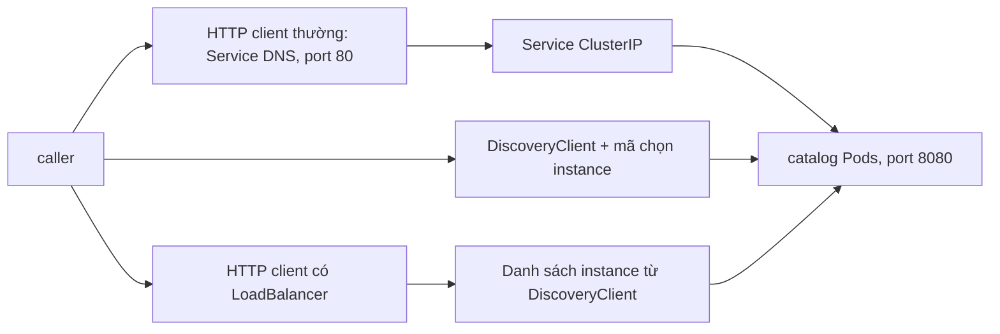

# Đối chiếu gọi qua DNS với DiscoveryClient và LoadBalancer

Trong chương **Thực hành tổng hợp** của module Spring Cloud Kubernetes (`SPRING_CLOUD_KUBERNETES`), bạn sẽ gọi cùng một backend bằng ba cách, quan sát Pod thực sự trả lời rồi giải thích thành phần nào chọn đích.

Thí nghiệm dùng Service `catalog` có ba replica và ứng dụng `caller` trong namespace riêng `sck-call-paths`. Service công bố port 80, còn ứng dụng trong Pod lắng nghe port 8080. Cách bố trí này giúp phát hiện việc nhầm Service port với Pod port.

Sau bài học, bạn cần:

- Phân biệt phân giải DNS, truy vấn danh sách instance và chọn instance cho mỗi request.
- Tạo HTTP client thường và HTTP client có Spring Cloud LoadBalancer mà không dùng nhầm bean.
- Đối chiếu ClusterIP, Pod IP, port và tên Pod từ bằng chứng thực tế.
- Quan sát thay đổi khi scale backend hoặc không còn instance sẵn sàng.
- Chọn tính năng Spring Cloud Kubernetes theo yêu cầu triển khai.

## 1. Ba đường gọi cần kiểm chứng

| Đường gọi | Đầu vào của caller | Ai chọn backend? | Quyền đọc Kubernetes API của ứng dụng |
| --- | --- | --- | --- |
| DNS của Service ClusterIP | `http://catalog.sck-call-paths.svc.cluster.local:80` | Cơ chế mạng Service của cluster chọn backend cho kết nối | Bản thân đường DNS không yêu cầu quyền discovery |
| DiscoveryClient và tự chọn | Service ID `catalog`, sau đó lấy một ServiceInstance | Mã ứng dụng chọn một instance trong danh sách | Consumer discovery cần quyền phù hợp |
| Spring Cloud LoadBalancer | URI logic `http://catalog` trên client có `@LoadBalanced` | LoadBalancer chọn ServiceInstance từ nguồn discovery | Trong bài này dùng cùng DiscoveryClient nên cần quyền discovery |

Với Service ClusterIP thông thường, bản ghi DNS trỏ tới ClusterIP, không trả về danh sách Pod để ứng dụng tự chọn. Headless Service có hành vi khác; bài này sử dụng ClusterIP thông thường. [DNS for Services and Pods — Kubernetes](https://kubernetes.io/docs/concepts/services-networking/dns-pod-service/)

DiscoveryClient cung cấp thông tin instance; phương thức `getInstances("catalog")` tự nó không gửi request nghiệp vụ và không quyết định thuật toán chia request.



Bài dùng `spring-cloud-starter-loadbalancer` chung với Kubernetes DiscoveryClient. Nguồn instance là discovery, không dùng starter LoadBalancer riêng của Kubernetes để chuyển qua chế độ `SERVICE`. Nếu thay starter hoặc supplier, cần xác minh lại đường đi.

## 2. Chuẩn bị dự án và môi trường lab

Cần có:

- JDK 17 trở lên phù hợp với bộ phiên bản được chọn, Maven, Docker, `kubectl` và `kind`.
- Một cluster kind tên `sck-paths`, hoặc tạo cluster riêng ở bước triển khai.
- Tài nguyên đủ chạy ba backend và một caller; Kubernetes API có EndpointSlice `discovery.k8s.io/v1` và phù hợp với client đã chọn.
- Docker chạy Linux containers; các lệnh dưới đây dùng PowerShell.

Ví dụ cố định Spring Boot 4.0.0 và Spring Cloud BOM 2025.1.0 để tái lập một mốc GA; BOM này quản lý Spring Cloud Kubernetes 5.0.0. Khi áp dụng vào hệ thống thật, đối chiếu bản vá và phạm vi hỗ trợ hiện hành của bộ phiên bản. [Spring Cloud BOM tại tag 2025.1.0](https://raw.githubusercontent.com/spring-cloud/spring-cloud-release/v2025.1.0/spring-cloud-dependencies/pom.xml)

Tạo dự án học tập với cấu trúc:

```text
sck-call-paths/
  pom.xml
  Dockerfile
  src/main/java/vn/example/sckpaths/CallPathsApplication.java
  src/main/resources/application.yml
  src/main/resources/application-caller.yml
  src/main/resources/application-backend.yml
  k8s/lab.yml
```

Một image sẽ chạy hai profile: `backend` cung cấp API nhận diện Pod; `caller` cung cấp API đối chiếu ba đường gọi.

## 3. Khai báo dependency

Nội dung `pom.xml`:

```xml
<project xmlns="http://maven.apache.org/POM/4.0.0"
         xmlns:xsi="http://www.w3.org/2001/XMLSchema-instance"
         xsi:schemaLocation="http://maven.apache.org/POM/4.0.0
                             https://maven.apache.org/xsd/maven-4.0.0.xsd">
    <modelVersion>4.0.0</modelVersion>
    <parent>
        <groupId>org.springframework.boot</groupId>
        <artifactId>spring-boot-starter-parent</artifactId>
        <version>4.0.0</version>
        <relativePath/>
    </parent>

    <groupId>vn.example</groupId>
    <artifactId>sck-call-paths</artifactId>
    <version>1.0.0</version>

    <properties>
        <java.version>17</java.version>
        <spring-cloud.version>2025.1.0</spring-cloud.version>
    </properties>

    <dependencyManagement>
        <dependencies>
            <dependency>
                <groupId>org.springframework.cloud</groupId>
                <artifactId>spring-cloud-dependencies</artifactId>
                <version>${spring-cloud.version}</version>
                <type>pom</type>
                <scope>import</scope>
            </dependency>
        </dependencies>
    </dependencyManagement>

    <dependencies>
        <dependency>
            <groupId>org.springframework.boot</groupId>
            <artifactId>spring-boot-starter-webmvc</artifactId>
        </dependency>
        <dependency>
            <groupId>org.springframework.boot</groupId>
            <artifactId>spring-boot-starter-actuator</artifactId>
        </dependency>
        <dependency>
            <groupId>org.springframework.cloud</groupId>
            <artifactId>spring-cloud-starter-kubernetes-client</artifactId>
        </dependency>
        <dependency>
            <groupId>org.springframework.cloud</groupId>
            <artifactId>spring-cloud-starter-loadbalancer</artifactId>
        </dependency>
    </dependencies>

    <build>
        <plugins>
            <plugin>
                <groupId>org.springframework.boot</groupId>
                <artifactId>spring-boot-maven-plugin</artifactId>
            </plugin>
        </plugins>
    </build>
</project>
```

Starter Kubernetes Java Client cung cấp discovery; starter LoadBalancer cung cấp lớp chọn instance. Không thêm họ Fabric8 song song. Trong thí nghiệm này, chưa cần Config PropertySource, Secret PropertySource hoặc Configuration Watcher. [Starters — Spring Cloud Kubernetes 5.0](https://docs.spring.io/spring-cloud-kubernetes/reference/5.0/getting-started.html)

## 4. Viết ứng dụng có thể quan sát đường gọi

Nội dung `CallPathsApplication.java`:

```java
package vn.example.sckpaths;

import java.net.InetAddress;
import java.net.URI;
import java.net.UnknownHostException;
import java.net.http.HttpClient;
import java.time.Duration;
import java.util.Arrays;
import java.util.Comparator;
import java.util.List;
import java.util.Map;
import java.util.UUID;

import org.slf4j.Logger;
import org.slf4j.LoggerFactory;
import org.springframework.beans.factory.annotation.Qualifier;
import org.springframework.beans.factory.annotation.Value;
import org.springframework.boot.SpringApplication;
import org.springframework.boot.autoconfigure.SpringBootApplication;
import org.springframework.cloud.client.ServiceInstance;
import org.springframework.cloud.client.discovery.DiscoveryClient;
import org.springframework.cloud.client.loadbalancer.LoadBalanced;
import org.springframework.context.annotation.Bean;
import org.springframework.context.annotation.Configuration;
import org.springframework.context.annotation.Profile;
import org.springframework.http.HttpStatus;
import org.springframework.http.client.JdkClientHttpRequestFactory;
import org.springframework.web.bind.annotation.GetMapping;
import org.springframework.web.bind.annotation.RequestParam;
import org.springframework.web.bind.annotation.RestController;
import org.springframework.web.client.RestClient;
import org.springframework.web.client.RestClientException;
import org.springframework.web.server.ResponseStatusException;
import org.springframework.web.util.UriComponentsBuilder;

@SpringBootApplication
public class CallPathsApplication {
    private static final String SERVICE_ID = "catalog";
    private static final String SERVICE_DNS =
            "catalog.sck-call-paths.svc.cluster.local";

    public static void main(String[] args) {
        SpringApplication.run(CallPathsApplication.class, args);
    }

    private static JdkClientHttpRequestFactory requestFactory() {
        HttpClient httpClient = HttpClient.newBuilder()
                .connectTimeout(Duration.ofSeconds(2))
                .version(HttpClient.Version.HTTP_1_1)
                .build();
        JdkClientHttpRequestFactory factory =
                new JdkClientHttpRequestFactory(httpClient);
        factory.setReadTimeout(Duration.ofSeconds(3));
        return factory;
    }

    public record BackendReply(String pod, String ip, String requestId) {
    }

    public record InstanceView(String host, int port, boolean secure) {
    }

    public record CallResult(
            String route, String requestedUri, BackendReply backend) {
    }

    @RestController
    @Profile("backend")
    public static class BackendController {
        private static final Logger LOG =
                LoggerFactory.getLogger(BackendController.class);
        private final String podName;
        private final String podIp;

        public BackendController(
                @Value("${POD_NAME:local}") String podName,
                @Value("${POD_IP:127.0.0.1}") String podIp) {
            this.podName = podName;
            this.podIp = podIp;
        }

        @GetMapping("/who")
        public BackendReply who(
                @RequestParam(name = "requestId", defaultValue = "external")
                String requestId) {
            LOG.info("requestId={} pod={} ip={}",
                    requestId, podName, podIp);
            return new BackendReply(podName, podIp, requestId);
        }
    }

    @Configuration(proxyBeanMethods = false)
    @Profile("caller")
    public static class CallerClients {
        @Bean("plainClient")
        public RestClient plainClient() {
            return RestClient.builder()
                    .requestFactory(requestFactory())
                    .build();
        }

        @Bean
        @LoadBalanced
        public RestClient.Builder balancedBuilder() {
            return RestClient.builder()
                    .requestFactory(requestFactory());
        }
    }

    @RestController
    @Profile("caller")
    public static class CallerController {
        private final RestClient plainClient;
        private final RestClient balancedClient;
        private final DiscoveryClient discoveryClient;

        public CallerController(
                @Qualifier("plainClient") RestClient plainClient,
                @LoadBalanced RestClient.Builder balancedBuilder,
                DiscoveryClient discoveryClient) {
            this.plainClient = plainClient;
            this.balancedClient = balancedBuilder.build();
            this.discoveryClient = discoveryClient;
        }

        @GetMapping("/compare/dns-records")
        public Map<String, Object> dnsRecords()
                throws UnknownHostException {
            List<String> addresses = Arrays.stream(
                            InetAddress.getAllByName(SERVICE_DNS))
                    .map(InetAddress::getHostAddress)
                    .toList();
            return Map.of("name", SERVICE_DNS, "addresses", addresses);
        }

        @GetMapping("/compare/instances")
        public List<InstanceView> instances() {
            return discoveryClient.getInstances(SERVICE_ID).stream()
                    .map(instance -> new InstanceView(
                            instance.getHost(),
                            instance.getPort(),
                            instance.isSecure()))
                    .toList();
        }

        @GetMapping("/compare/dns")
        public CallResult viaDns() {
            URI uri = whoUri(URI.create("http://" + SERVICE_DNS + ":80"));
            return call("dns", plainClient, uri);
        }

        @GetMapping("/compare/discovery")
        public CallResult viaDiscovery() {
            ServiceInstance selected =
                    discoveryClient.getInstances(SERVICE_ID).stream()
                            .sorted(Comparator
                                    .comparing(ServiceInstance::getHost)
                                    .thenComparingInt(ServiceInstance::getPort))
                            .findFirst()
                            .orElseThrow(() -> new ResponseStatusException(
                                    HttpStatus.SERVICE_UNAVAILABLE,
                                    "No catalog instance"));
            return call("discovery-first", plainClient,
                    whoUri(selected.getUri()));
        }

        @GetMapping("/compare/lb")
        public CallResult viaLoadBalancer() {
            return call("loadbalancer", balancedClient,
                    whoUri(URI.create("http://" + SERVICE_ID)));
        }

        private URI whoUri(URI baseUri) {
            return UriComponentsBuilder.fromUri(baseUri)
                    .path("/who")
                    .queryParam("requestId", UUID.randomUUID().toString())
                    .build()
                    .toUri();
        }

        private CallResult call(
                String route, RestClient client, URI uri) {
            try {
                BackendReply reply = client.get()
                        .uri(uri)
                        .retrieve()
                        .body(BackendReply.class);
                if (reply == null) {
                    throw new IllegalStateException("Empty backend reply");
                }
                return new CallResult(route, uri.toString(), reply);
            }
            catch (RestClientException | IllegalStateException ex) {
                throw new ResponseStatusException(
                        HttpStatus.BAD_GATEWAY,
                        "Upstream call failed: "
                                + ex.getClass().getSimpleName(), ex);
            }
        }
    }
}
```

Những lựa chọn có chủ đích trong mã:

- `plainClient` không gắn LoadBalancer và được dùng cho cả DNS lẫn URI vật lý lấy từ DiscoveryClient.
- Chỉ builder `balancedBuilder` có `@LoadBalanced`. LoadBalancer diễn giải host `catalog` là Service ID để tìm instance. [RestClient với LoadBalancer — Spring Cloud Commons](https://docs.spring.io/spring-cloud-commons/reference/5.0/spring-cloud-commons/common-abstractions.html)
- Đường `discovery-first` sắp xếp rồi lấy phần tử đầu để làm rõ rằng chính mã ứng dụng đang chọn đích. Đây không phải chính sách cân bằng tải được khuyến nghị.
- `requestedUri` ghi URI trước interceptor. Ở đường LoadBalancer, trường này vẫn có host logic `catalog`; tên Pod và IP trong `backend` mới cho biết nơi đã trả lời.
- Mỗi request có ID để đối chiếu log backend. HTTP client có timeout hữu hạn. [JdkClientHttpRequestFactory — Spring Framework](https://docs.spring.io/spring-framework/docs/7.0.x/javadoc-api/org/springframework/http/client/JdkClientHttpRequestFactory.html)

Ví dụ giả định cluster domain là `cluster.local`. Nếu cluster dùng domain khác, sửa `SERVICE_DNS` tương ứng trước khi build. Các endpoint đối chiếu chỉ dành cho lab hoặc mạng vận hành được bảo vệ vì chúng trả địa chỉ nội bộ.

## 5. Cấu hình chung và hai profile

`application.yml`:

```yaml
server:
  port: 8080

management:
  endpoints:
    web:
      exposure:
        include: health
  endpoint:
    health:
      probes:
        enabled: true
        add-additional-paths: true
      group:
        liveness:
          include: livenessState
        readiness:
          include: readinessState
```

Hai health group phục vụ `/livez` và `/readyz` trên cổng ứng dụng. Chúng không tổng hợp trạng thái của mọi dịch vụ bên ngoài vào liveness. [Kubernetes Probes — Spring Boot 4.0](https://docs.spring.io/spring-boot/4.0/reference/actuator/endpoints.html#actuator.endpoints.kubernetes-probes)

`application-caller.yml`:

```yaml
spring:
  application:
    name: caller
  cloud:
    kubernetes:
      discovery:
        all-namespaces: false
        namespaces:
          - sck-call-paths
        service-labels:
          lab: call-paths
        use-endpoint-slices: true
        include-not-ready-addresses: false
        primary-port-name: http
    loadbalancer:
      cache:
        enabled: false
      retry:
        enabled: false
```

Label ở đây lọc **metadata của Service**, không phải selector của Pod. Discovery đọc EndpointSlice trong namespace lab và chọn port có tên `http`. Cần cả API tương ứng lẫn RBAC. [DiscoveryClient — Spring Cloud Kubernetes 5.0](https://docs.spring.io/spring-cloud-kubernetes/reference/5.0/discovery-client.html)

Lab tắt cache bổ sung của LoadBalancer để dễ quan sát thay đổi và tắt retry ở lớp này để dễ phân loại kết quả. Cache/informer của discovery và thời gian đồng bộ control plane vẫn tồn tại; thay đổi replica không lập tức phản ánh ở mọi request. [LoadBalancer Caching — Spring Cloud Commons](https://docs.spring.io/spring-cloud-commons/reference/5.0/spring-cloud-commons/loadbalancer.html)

`application-backend.yml`:

```yaml
spring:
  application:
    name: catalog
  cloud:
    discovery:
      enabled: false
    kubernetes:
      discovery:
        enabled: false
```

Backend dùng cùng image nhưng không cần khám phá dịch vụ khác. Hai controller và cấu hình HTTP client được phân tách bằng profile, nên backend không yêu cầu bean DiscoveryClient để xử lý `/who`.

## 6. Tạo image và nạp vào kind

`Dockerfile`:

```dockerfile
FROM eclipse-temurin:17-jre
WORKDIR /app
COPY target/sck-call-paths-1.0.0.jar app.jar
EXPOSE 8080
ENTRYPOINT ["java", "-jar", "/app/app.jar"]
```

Tại thư mục gốc dự án học tập:

```powershell
java -version
mvn -version
mvn clean package
docker build -t sck-call-paths:1.0.0 .
```

Kiểm tra các cluster kind hiện có. Nếu chưa có cluster lab, tạo nó:

```powershell
kind get clusters
kind create cluster --name sck-paths
```

Nếu `sck-paths` đã tồn tại và là cluster lab bạn muốn dùng, bỏ qua lệnh tạo. Sau đó:

```powershell
kind load docker-image sck-call-paths:1.0.0 --name sck-paths

$context = 'kind-sck-paths'
$ns = 'sck-call-paths'
kubectl --context $context cluster-info
kubectl --context $context api-resources --api-group=discovery.k8s.io
```

Image trên máy Docker không tự có trong node kind; lệnh `kind load` nạp image vào đúng cluster. Manifest bên dưới dùng `IfNotPresent` để sử dụng image đã nạp. [Loading an Image Into kind](https://kind.sigs.k8s.io/docs/user/quick-start/#loading-an-image-into-your-cluster)

Với cluster từ xa, thay bước nạp image bằng push lên registry và sửa tên image trong manifest; node cần quyền pull registry đó.

## 7. Triển khai backend, caller và RBAC

Nội dung `k8s/lab.yml`:

```yaml
apiVersion: v1
kind: Namespace
metadata:
  name: sck-call-paths
---
apiVersion: v1
kind: ServiceAccount
metadata:
  name: caller
  namespace: sck-call-paths
---
apiVersion: rbac.authorization.k8s.io/v1
kind: Role
metadata:
  name: discovery-reader
  namespace: sck-call-paths
rules:
  - apiGroups: [""]
    resources: ["services", "pods"]
    verbs: ["get", "list", "watch"]
  - apiGroups: ["discovery.k8s.io"]
    resources: ["endpointslices"]
    verbs: ["get", "list", "watch"]
---
apiVersion: rbac.authorization.k8s.io/v1
kind: RoleBinding
metadata:
  name: caller-discovery-reader
  namespace: sck-call-paths
subjects:
  - kind: ServiceAccount
    name: caller
    namespace: sck-call-paths
roleRef:
  apiGroup: rbac.authorization.k8s.io
  kind: Role
  name: discovery-reader
---
apiVersion: v1
kind: Service
metadata:
  name: catalog
  namespace: sck-call-paths
  labels:
    lab: call-paths
spec:
  type: ClusterIP
  selector:
    app: catalog
  ports:
    - name: http
      port: 80
      targetPort: http
---
apiVersion: apps/v1
kind: Deployment
metadata:
  name: catalog
  namespace: sck-call-paths
spec:
  replicas: 3
  selector:
    matchLabels:
      app: catalog
  template:
    metadata:
      labels:
        app: catalog
    spec:
      automountServiceAccountToken: false
      containers:
        - name: app
          image: sck-call-paths:1.0.0
          imagePullPolicy: IfNotPresent
          ports:
            - name: http
              containerPort: 8080
          env:
            - name: SPRING_PROFILES_ACTIVE
              value: backend
            - name: POD_NAME
              valueFrom:
                fieldRef:
                  fieldPath: metadata.name
            - name: POD_IP
              valueFrom:
                fieldRef:
                  fieldPath: status.podIP
          resources:
            requests:
              cpu: 100m
              memory: 192Mi
            limits:
              cpu: "1"
              memory: 512Mi
          startupProbe:
            httpGet:
              path: /livez
              port: http
            periodSeconds: 5
            timeoutSeconds: 2
            failureThreshold: 60
          livenessProbe:
            httpGet:
              path: /livez
              port: http
            periodSeconds: 10
            timeoutSeconds: 2
          readinessProbe:
            httpGet:
              path: /readyz
              port: http
            periodSeconds: 5
            timeoutSeconds: 2
---
apiVersion: apps/v1
kind: Deployment
metadata:
  name: caller
  namespace: sck-call-paths
spec:
  replicas: 1
  selector:
    matchLabels:
      app: caller
  template:
    metadata:
      labels:
        app: caller
    spec:
      serviceAccountName: caller
      containers:
        - name: app
          image: sck-call-paths:1.0.0
          imagePullPolicy: IfNotPresent
          ports:
            - name: http
              containerPort: 8080
          env:
            - name: SPRING_PROFILES_ACTIVE
              value: caller
          resources:
            requests:
              cpu: 100m
              memory: 256Mi
            limits:
              cpu: "1"
              memory: 512Mi
          startupProbe:
            httpGet:
              path: /livez
              port: http
            periodSeconds: 5
            timeoutSeconds: 2
            failureThreshold: 60
          livenessProbe:
            httpGet:
              path: /livez
              port: http
            periodSeconds: 10
            timeoutSeconds: 2
          readinessProbe:
            httpGet:
              path: /readyz
              port: http
            periodSeconds: 5
            timeoutSeconds: 2
```

Downward API cung cấp tên và IP Pod cho backend qua biến môi trường; ứng dụng không cần gọi Kubernetes API để biết hai thông tin đó. [Expose Pod Information — Kubernetes](https://kubernetes.io/docs/tasks/inject-data-application/environment-variable-expose-pod-information/)

Role giới hạn trong namespace lab, không cấp quyền đọc ConfigMap hoặc Secret. Quyền discovery thuộc ServiceAccount của `caller`; backend không được mount token.

Triển khai:

```powershell
kubectl --context $context apply -f k8s/lab.yml
kubectl --context $context -n $ns rollout status deployment/catalog --timeout=360s
kubectl --context $context -n $ns rollout status deployment/caller --timeout=360s
kubectl --context $context -n $ns get pods -o wide
kubectl --context $context -n $ns get service catalog
kubectl --context $context -n $ns get endpointslices -l kubernetes.io/service-name=catalog -o yaml
```

Đầu ra cần có ba Pod catalog Ready, một caller Ready, Service có ClusterIP và endpoint mang target port 8080.

Nếu caller không khởi động được do 403, kiểm tra bằng danh tính đúng:

```powershell
kubectl --context $context auth can-i list services -n $ns --as=system:serviceaccount:sck-call-paths:caller
kubectl --context $context auth can-i list endpointslices.discovery.k8s.io -n $ns --as=system:serviceaccount:sck-call-paths:caller
kubectl --context $context auth can-i watch endpointslices.discovery.k8s.io -n $ns --as=system:serviceaccount:sck-call-paths:caller
kubectl --context $context -n $ns logs deployment/caller --tail=100
```

Các phép kiểm tra `--as` yêu cầu quyền impersonation của người chạy. Nếu quyền này bị từ chối, chưa thể dùng kết quả đó để kết luận ServiceAccount thiếu quyền.

## 8. Thí nghiệm 1: đối chiếu DNS và danh sách instance

Mở port-forward vào caller ở terminal thứ nhất:

```powershell
kubectl --context $context -n $ns port-forward deployment/caller 18080:8080
```

Terminal thứ hai:

```powershell
$baseUrl = 'http://127.0.0.1:18080'
Invoke-RestMethod "$baseUrl/compare/dns-records"
Invoke-RestMethod "$baseUrl/compare/instances"
```

Kỳ vọng:

- `dns-records` trả địa chỉ ClusterIP tương ứng với `kubectl get service catalog`.
- `instances` trả các địa chỉ Pod đủ điều kiện, kèm port 8080.
- Trên lab một họ địa chỉ và không có rollout, thường có ba instance. Không áp dụng cách đếm này một cách máy móc cho dual-stack hoặc cấu hình discovery khác.

Phép thử DNS được chạy **bên trong caller**, dù bạn gọi API qua localhost. Laptop ngoài cluster không bắt buộc phân giải được tên `.svc.cluster.local`.

Tiếp tục gọi ba đường:

```powershell
Invoke-RestMethod "$baseUrl/compare/dns" | ConvertTo-Json -Depth 5
Invoke-RestMethod "$baseUrl/compare/discovery" | ConvertTo-Json -Depth 5
Invoke-RestMethod "$baseUrl/compare/lb" | ConvertTo-Json -Depth 5
```

Một phản hồi minh họa của đường DNS:

```json
{
  "route": "dns",
  "requestedUri": "http://catalog.sck-call-paths.svc.cluster.local:80/who?requestId=...",
  "backend": {
    "pod": "catalog-6d7c8f9b5d-abcde",
    "ip": "10.244.0.12",
    "requestId": "..."
  }
}
```

Ghi lại URI yêu cầu, IP backend và tên Pod cho từng đường. Với đường tự chọn, URI vật lý phải có Pod port 8080. Với LoadBalancer, URI đầu vào vẫn là tên logic; đích vật lý được thay trong quá trình xử lý request.

## 9. Thí nghiệm 2: gửi nhiều request và diễn giải phân bố

Lấy 20 mẫu cho mỗi đường:

```powershell
$samples = foreach ($route in @('dns', 'discovery', 'lb')) {
    foreach ($attempt in 1..20) {
        try {
            $reply = Invoke-RestMethod "$baseUrl/compare/$route"
            [pscustomobject]@{
                Route = $route
                Attempt = $attempt
                Pod = $reply.backend.pod
                Ip = $reply.backend.ip
                RequestId = $reply.backend.requestId
                Error = ''
            }
        }
        catch {
            [pscustomobject]@{
                Route = $route
                Attempt = $attempt
                Pod = ''
                Ip = ''
                RequestId = ''
                Error = $_.Exception.Message
            }
        }
    }
}

$samples | Format-Table Route, Attempt, Pod, Ip, Error
$samples | Where-Object { $_.Error -eq '' } |
    Group-Object Route, Pod | Select-Object Name, Count
$samples | Where-Object { $_.Error -ne '' }
```

Đọc kết quả theo cơ chế:

| Đường | Điều có thể quan sát | Kết luận phù hợp |
| --- | --- | --- |
| DNS | Nhiều request liên tiếp có thể tới cùng một Pod | Kết nối HTTP được tái sử dụng; không suy DNS đã cân bằng theo từng request |
| Discovery tự chọn | Khi tập instance ổn định, thường lặp lại cùng instance đứng đầu | Thuật toán của mã ứng dụng quyết định phân bố |
| LoadBalancer | Có thể thấy request luân phiên giữa các instance | Chính sách LoadBalancer đang chọn đích từ discovery |

Spring Cloud LoadBalancer mặc định dùng thuật toán round-robin trong bộ cấu hình này. Tuy nhiên, không đặt tiêu chí “20 request phải chia đều tuyệt đối”: tập instance có thể đổi, lỗi request có thể xảy ra và request đồng thời làm thay đổi thứ tự quan sát. [Spring Cloud LoadBalancer](https://docs.spring.io/spring-cloud-commons/reference/5.0/spring-cloud-commons/loadbalancer.html)

Kubernetes Service không cam kết round-robin theo từng HTTP request. Kết quả của một mẫu ngắn cũng không đủ để kết luận đường nào nhanh hơn hoặc tin cậy hơn.

Đối chiếu log backend:

```powershell
kubectl --context $context -n $ns logs -l app=catalog --all-containers=true --prefix --tail=100
```

Tìm request ID trong phản hồi để biết Pod nào đã xử lý. Phản hồi của backend và log là bằng chứng tốt hơn việc đoán đích vật lý từ host logic trên URI LoadBalancer.

## 10. Thí nghiệm 3: scale backend và quan sát độ trễ cập nhật

Ở terminal thao tác cluster:

```powershell
kubectl --context $context -n $ns scale deployment/catalog --replicas=5
kubectl --context $context -n $ns rollout status deployment/catalog --timeout=360s
kubectl --context $context -n $ns get pods -l app=catalog -o wide
kubectl --context $context -n $ns get endpointslices -l kubernetes.io/service-name=catalog
```

Ở terminal gọi HTTP, kiểm tra nhiều lần:

```powershell
Invoke-RestMethod "$baseUrl/compare/dns-records"
Invoke-RestMethod "$baseUrl/compare/instances"
Invoke-RestMethod "$baseUrl/compare/lb"
```

Cần giải thích được:

1. ClusterIP của Service vẫn giữ nguyên nếu Service không bị tạo lại.
2. EndpointSlice bổ sung backend khi Pod mới đủ điều kiện.
3. DiscoveryClient và LoadBalancer cần thời gian nhìn thấy thay đổi.
4. Kết nối Service đang tồn tại không nhất thiết chuyển ngay sang Pod mới.
5. Đường `discovery-first` có thể chọn Pod khác nếu phần tử đứng đầu sau sắp xếp thay đổi.

Giảm xuống hai replica rồi lặp lại quan sát:

```powershell
kubectl --context $context -n $ns scale deployment/catalog --replicas=2
kubectl --context $context -n $ns rollout status deployment/catalog --timeout=360s
```

Không yêu cầu mất backend phải được phản ánh trong đúng một request tiếp theo. Hãy ghi thời điểm scale, trạng thái endpoint, kết quả discovery và lỗi gọi nếu có. Phân biệt cache stale với kết nối đang phục vụ hoặc tiến trình đang kết thúc.

## 11. Thí nghiệm 4: không còn backend

Giữ nguyên Service và caller, scale catalog về 0:

```powershell
kubectl --context $context -n $ns scale deployment/catalog --replicas=0
kubectl --context $context -n $ns get pods -l app=catalog
kubectl --context $context -n $ns get endpointslices -l kubernetes.io/service-name=catalog -o yaml
```

Chờ Pod kết thúc và các lớp dữ liệu cập nhật, sau đó:

```powershell
Invoke-RestMethod "$baseUrl/compare/dns-records"
Invoke-RestMethod "$baseUrl/compare/instances"
curl.exe -i --max-time 10 "$baseUrl/compare/dns"
curl.exe -i --max-time 10 "$baseUrl/compare/discovery"
curl.exe -i --max-time 10 "$baseUrl/compare/lb"
```

Phân biệt các lớp:

| Kết quả | Ý nghĩa |
| --- | --- |
| DNS vẫn trả ClusterIP | Service còn tồn tại; chưa chứng minh có backend phục vụ |
| Discovery trả danh sách rỗng | Không còn instance đủ điều kiện trong nguồn đã cập nhật |
| Đường tự chọn trả 503 | Mã lab chủ động trả lỗi khi không có instance |
| Đường DNS hoặc LB lỗi | Không có đích phục vụ hoặc không thực hiện được cuộc gọi; đối chiếu log |

Hàm `call` của lab chuyển `RestClientException` và `IllegalStateException` thành HTTP 502. Đây là quy ước của API minh họa, không phải mã lỗi mặc định mà mọi client LoadBalancer phải trả. Lỗi DNS của riêng endpoint `dns-records` cũng có luồng xử lý khác.

Khôi phục ngay sau phép thử:

```powershell
kubectl --context $context -n $ns scale deployment/catalog --replicas=3
kubectl --context $context -n $ns rollout status deployment/catalog --timeout=360s
```

Gọi lại cả ba đường để xác minh phục hồi; không chỉ xem replica đã được tạo.

## 12. Những lỗi làm sai kết quả đối chiếu

| Lỗi | Vì sao gây nhầm | Hướng kiểm tra |
| --- | --- | --- |
| Dùng client có `@LoadBalanced` cho mọi URL | FQDN có thể bị diễn giải như Service ID | Kiểm tra bean và qualifier |
| Dùng client thường gọi `http://catalog` rồi coi đó là LoadBalancer | Tên ngắn có thể được DNS cùng namespace phân giải | Đọc cấu hình interceptor, không suy từ chuỗi URL |
| Ghép Pod IP với port 80 | Đây là Service port, backend lab dùng 8080 | So Service targetPort, EndpointSlice và ServiceInstance |
| Discovery rỗng dù Service tồn tại | Sai namespace, label, quyền, readiness hoặc primary port | So `instances`, RBAC và dữ liệu endpoint |
| DNS được nhưng gọi HTTP lỗi | Có bản ghi DNS không đảm bảo có backend hay đường mạng | So Ready endpoint và log cuộc gọi |
| Chỉ một Pod nhận các request DNS | Connection reuse có thể giữ kết nối tới một backend | Phân biệt chọn kết nối với chọn HTTP request |
| Caller không lên sau khi bỏ RBAC | Startup discovery/cache có thể thất bại trước khi mở HTTP server | Đọc log startup, không kết luận DNS cần RBAC |
| Scale xong nhưng endpoint trả dữ liệu cũ | Controller/watch/cache chưa đồng bộ hoặc snapshot khác thời điểm | Quan sát theo thời gian và UID/IP |

Mẫu caller ghép ba cơ chế trong một tiến trình để dễ so sánh. Vì thế, việc lấy quyền API của caller rồi thấy toàn bộ ứng dụng không startup không chứng minh HTTP client DNS cần quyền discovery. Muốn đo sự độc lập này, dùng một tiến trình chỉ gọi DNS, không khởi tạo discovery.

Nếu thử starter `spring-cloud-starter-kubernetes-client-loadbalancer`, hãy kiểm tra `spring.cloud.kubernetes.loadbalancer.mode`. Chế độ `SERVICE` và `POD` có đường chọn đích khác nhau; không lấy kết quả của cấu hình đó gán cho thí nghiệm đang dùng supplier discovery chung. [LoadBalancer for Kubernetes](https://docs.spring.io/spring-cloud-kubernetes/reference/load-balancer.html)

## 13. Chọn cách gọi từ kết quả thực hành

| Yêu cầu | Lựa chọn cần xem xét |
| --- | --- |
| Gọi ổn định tới một Service trong cluster, không cần metadata instance | DNS và Service ClusterIP thường đủ |
| Cần liệt kê instance hoặc dùng thông tin instance trong logic ứng dụng | DiscoveryClient |
| Cần chính sách chọn instance ở phía client và tích hợp HTTP client của Spring | Spring Cloud LoadBalancer với nguồn instance phù hợp |
| Đã có mesh hoặc cơ chế hạ tầng xử lý routing | Đánh giá đường đi và chính sách hiện có trước khi thêm lớp chọn Pod |
| Cần cập nhật cấu hình client | Thiết kế ConfigMap/Secret và cơ chế cập nhật riêng theo tính chất thuộc tính |

Configuration Watcher hỗ trợ một nhu cầu khác: phát thông báo để ứng dụng nhận cập nhật cấu hình. Nó không phải điều kiện để gọi Service DNS hoặc thực hiện lựa chọn instance trong lab. Việc thêm cấu hình động cũng không tự chuyển mọi bean HTTP client sang giá trị mới; cần xác minh cơ chế tạo và cập nhật client.

Không dùng thành công của một lần gọi làm tiêu chí duy nhất. Ghi lại ít nhất:

- DNS trỏ tới địa chỉ nào và discovery trả host/port nào.
- URI trước interceptor, Pod trả lời và request ID.
- Kết quả nhiều request khi tập instance ổn định.
- Diễn biến khi tăng/giảm replica và khi danh sách endpoint rỗng.
- Quyền và thành phần bổ sung mà mỗi cách gọi cần.

Bài hoàn thành khi bạn giải thích được **tên được phân giải ở đâu, ai chọn instance, port nào được sử dụng và dữ liệu thay đổi được phản ánh như thế nào**.

## 14. Dọn môi trường lab

Dừng port-forward bằng Ctrl+C. Nếu namespace `sck-call-paths` chỉ chứa tài nguyên của bài này, có thể xóa toàn bộ namespace lab:

```powershell
kubectl --context $context get namespace sck-call-paths
kubectl --context $context delete namespace sck-call-paths
```

Nếu cluster `sck-paths` được tạo riêng cho bài và không còn dùng:

```powershell
kind delete cluster --name sck-paths
```

Không dùng lệnh dọn này với namespace hoặc cluster đang chia sẻ cho workload khác.
