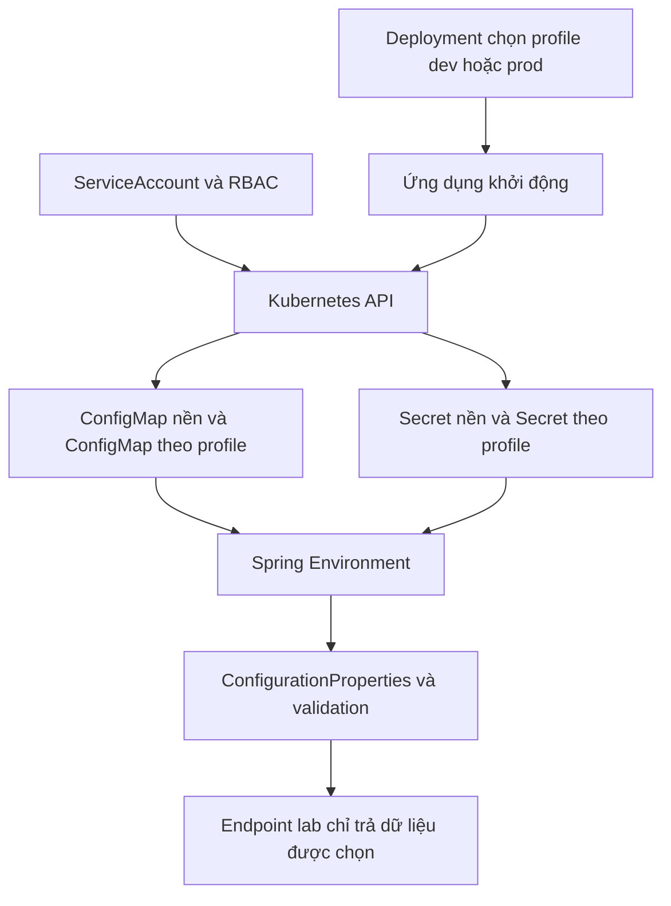

# Nạp ConfigMap, Secret và cấu hình theo profile

## Mục tiêu thực hành

Trong chương **Thực hành tổng hợp** của module **SPRING_CLOUD_KUBERNETES**, bạn sẽ tạo ứng dụng `warehouse-api`, nạp cấu hình từ ConfigMap và Secret qua Kubernetes API, rồi chạy cùng một image với profile `dev` và `prod`. Kết quả được kiểm chứng bằng giá trị cấu hình có hiệu lực, trạng thái Pod và các dấu đánh phiên bản không nhạy cảm.

Sau bài này, bạn có thể:

- Tách cấu hình nghiệp vụ khỏi thông tin xác thực.
- Khai báo đúng nguồn import, tên tài nguyên và namespace.
- Dùng ServiceAccount, Role và RoleBinding cho việc đọc cấu hình.
- Kết hợp cấu hình nền với phần ghi đè theo profile.
- Giải thích vì sao sửa tài nguyên chưa làm tiến trình hiện tại đổi giá trị.
- Xác định khi nào chỉ cần nạp lúc khởi động, khi nào mới cần Configuration Watcher hoặc tính năng khác.

Bài tập sử dụng dữ liệu xác thực giả lập. `prod` trong bài là tên profile mô phỏng trong namespace lab, không phải môi trường production thật. Các đoạn mã và lệnh là nội dung để bạn thực hành; chúng chưa được chạy trên cluster của bạn.

## 1. Chuẩn bị và kiến trúc của bài lab

### 1.1. Công cụ và mốc phiên bản

Bạn cần Java 17 trở lên, Maven, công cụ build container, `kubectl`, một cluster có thể chạy image của bạn và quyền tạo tài nguyên trong namespace lab.

Mẫu dự án dùng Spring Boot **3.5.16**, Spring Cloud BOM **2025.0.3** và starter Fabric8 Config. BOM này quản lý Spring Cloud Kubernetes **3.3.3**. Đây là bộ phiên bản cố định để các cấu hình trong bài nhất quán; khi ghép vào dự án sẵn có, giữ bộ Boot/Cloud tương thích của dự án. [BOM 2025.0.3](https://github.com/spring-cloud/spring-cloud-release/blob/v2025.0.3/spring-cloud-dependencies/pom.xml), [Spring Boot 3.5.16](https://github.com/spring-projects/spring-boot/releases/tag/v3.5.16)

Bài chọn **Config Data import**, không đồng thời thêm `spring-cloud-starter-bootstrap`. Spring Cloud Kubernetes yêu cầu chọn một trong hai cơ chế nạp này. [Kubernetes PropertySource implementations](https://docs.spring.io/spring-cloud-kubernetes/reference/3.3/property-source-config.html)

### 1.2. Đường đi của cấu hình



Không cần DiscoveryClient, Spring Cloud LoadBalancer hoặc Configuration Watcher để hoàn thành luồng nạp cấu hình lúc khởi động này. Ta sẽ tắt discovery và reload trong cấu hình mẫu để chức năng sử dụng khớp với quyền API được cấp.

### 1.3. Quy ước tài nguyên

| Thành phần | Tên hoặc giá trị |
| --- | --- |
| Namespace | `config-lab` |
| Ứng dụng Spring | `warehouse-api` |
| Deployment và Service | `warehouse-api` |
| ServiceAccount | `warehouse-api` |
| ConfigMap nền | `warehouse-api` |
| ConfigMap theo profile | `warehouse-api-dev`, `warehouse-api-prod` |
| Secret nền | `warehouse-api` |
| Secret theo profile | `warehouse-api-dev`, `warehouse-api-prod` |
| Cổng ứng dụng | `8080` |

ConfigMap và Secret có thể trùng tên vì là hai loại tài nguyên khác nhau. Profile là điều kiện chọn cấu hình của Spring, không phải một lớp phân quyền Kubernetes. Trong lab, ServiceAccount có quyền đọc tài nguyên cùng namespace, kể cả các Secret của cả hai profile.

## 2. Tạo ứng dụng Spring Boot

Các đường dẫn trong phần này là đường dẫn tương đối bên trong **dự án lab do bạn tạo**:

```text
warehouse-api/
  pom.xml
  Dockerfile
  src/main/java/example/warehouse/WarehouseApplication.java
  src/main/java/example/warehouse/DemoProperties.java
  src/main/java/example/warehouse/PartnerCredentials.java
  src/main/java/example/warehouse/LabConfigController.java
  src/main/resources/application.yaml
  k8s/00-namespace-rbac.yaml
  k8s/10-configmaps.yaml
  k8s/20-secrets.yaml
  k8s/30-app.yaml
```

### 2.1. Dependency

Nội dung `pom.xml`:

```xml
<?xml version="1.0" encoding="UTF-8"?>
<project xmlns="http://maven.apache.org/POM/4.0.0"
         xmlns:xsi="http://www.w3.org/2001/XMLSchema-instance"
         xsi:schemaLocation="http://maven.apache.org/POM/4.0.0 https://maven.apache.org/xsd/maven-4.0.0.xsd">
    <modelVersion>4.0.0</modelVersion>

    <parent>
        <groupId>org.springframework.boot</groupId>
        <artifactId>spring-boot-starter-parent</artifactId>
        <version>3.5.16</version>
        <relativePath/>
    </parent>

    <groupId>example</groupId>
    <artifactId>warehouse-api</artifactId>
    <version>0.0.1-SNAPSHOT</version>

    <properties>
        <java.version>17</java.version>
        <spring-cloud.version>2025.0.3</spring-cloud.version>
    </properties>

    <dependencyManagement>
        <dependencies>
            <dependency>
                <groupId>org.springframework.cloud</groupId>
                <artifactId>spring-cloud-dependencies</artifactId>
                <version>${spring-cloud.version}</version>
                <type>pom</type>
                <scope>import</scope>
            </dependency>
        </dependencies>
    </dependencyManagement>

    <dependencies>
        <dependency>
            <groupId>org.springframework.boot</groupId>
            <artifactId>spring-boot-starter-web</artifactId>
        </dependency>
        <dependency>
            <groupId>org.springframework.boot</groupId>
            <artifactId>spring-boot-starter-actuator</artifactId>
        </dependency>
        <dependency>
            <groupId>org.springframework.boot</groupId>
            <artifactId>spring-boot-starter-validation</artifactId>
        </dependency>
        <dependency>
            <groupId>org.springframework.cloud</groupId>
            <artifactId>spring-cloud-starter-kubernetes-fabric8-config</artifactId>
        </dependency>
    </dependencies>

    <build>
        <plugins>
            <plugin>
                <groupId>org.springframework.boot</groupId>
                <artifactId>spring-boot-maven-plugin</artifactId>
            </plugin>
        </plugins>
    </build>
</project>
```

Chỉ chọn một họ Kubernetes client cho lab. Starter `...-fabric8-config` cung cấp phần tích hợp cấu hình; không cần thêm starter discovery hoặc loadbalancer để đọc ConfigMap.

### 2.2. Cấu hình import và các nguồn cần tìm

Nội dung `src/main/resources/application.yaml`:

```yaml
server:
  port: 8080

spring:
  application:
    name: warehouse-api
  config:
    import: "kubernetes:"
  cloud:
    kubernetes:
      discovery:
        enabled: false
      config:
        enabled: true
        enable-api: true
        name: warehouse-api
        namespace: "${POD_NAMESPACE:config-lab}"
        include-profile-specific-sources: true
        fail-fast: true
      secrets:
        enabled: true
        enable-api: true
        name: warehouse-api
        namespace: "${POD_NAMESPACE:config-lab}"
        include-profile-specific-sources: true
        fail-fast: true
      reload:
        enabled: false
      sanitize:
        secrets: true

management:
  endpoints:
    web:
      exposure:
        include: health
  endpoint:
    health:
      probes:
        enabled: true
  health:
    kubernetes:
      enabled: false
  info:
    kubernetes:
      enabled: false

demo:
  banner: "Thông điệp mặc định trong JAR"
  batch-size: 10
  audit-enabled: false
  config-version: jar-v1
  region: local
```

Tên, namespace và quyền truy cập phải xác định được **trước khi** đọc nguồn ngoài. Ở đây tên nằm trong JAR; namespace lấy từ biến môi trường Downward API của Pod, với giá trị dự phòng dành riêng cho lab. Không đặt toàn bộ thông tin định vị nguồn vào chính nguồn mà ứng dụng chưa biết cách tìm.

`secrets.enabled` và `secrets.enable-api` có vai trò khác nhau. Bật phần tích hợp Secret chưa đồng nghĩa đã cho phép đọc qua API; lab khai báo rõ cả hai. [Secrets PropertySource](https://docs.spring.io/spring-cloud-kubernetes/reference/3.3/property-source-config/secrets-propertysource.html)

Hai nhánh config và secrets đều bật nguồn theo profile. Với profile `dev`, bộ nguồn cần quan sát là tên nền cộng phần có hậu tố `-dev`. Thuộc tính tương ứng của Secret được khai báo trong [SecretsConfigProperties v3.3.3](https://github.com/spring-cloud/spring-cloud-kubernetes/blob/v3.3.3/spring-cloud-kubernetes-commons/src/main/java/org/springframework/cloud/kubernetes/commons/config/SecretsConfigProperties.java).

`management.health.kubernetes.enabled=false` tắt health contributor chuyên hiển thị thông tin Kubernetes trong lab này; readiness và liveness của Spring Boot vẫn được bật. Ta không cần thêm quyền đọc Pod chỉ để phục vụ phần quan sát đó. [Pod Health Indicator](https://docs.spring.io/spring-cloud-kubernetes/reference/pod-health-indicator.html)

### 2.3. Đăng ký các lớp cấu hình

`WarehouseApplication.java`:

```java
package example.warehouse;

import org.springframework.boot.SpringApplication;
import org.springframework.boot.autoconfigure.SpringBootApplication;
import org.springframework.boot.context.properties.EnableConfigurationProperties;

@SpringBootApplication
@EnableConfigurationProperties({
        DemoProperties.class,
        PartnerCredentials.class
})
public class WarehouseApplication {

    public static void main(String[] args) {
        SpringApplication.run(WarehouseApplication.class, args);
    }
}
```

`DemoProperties.java` chỉ chứa cấu hình không nhạy cảm:

```java
package example.warehouse;

import jakarta.validation.constraints.Max;
import jakarta.validation.constraints.Min;
import jakarta.validation.constraints.NotBlank;

import org.springframework.boot.context.properties.ConfigurationProperties;
import org.springframework.validation.annotation.Validated;

@Validated
@ConfigurationProperties(prefix = "demo")
public record DemoProperties(
        @NotBlank String banner,
        @Min(1) @Max(500) int batchSize,
        boolean auditEnabled,
        @NotBlank String configVersion,
        @NotBlank String region) {
}
```

`PartnerCredentials.java` chứa thông tin xác thực. Lớp không sinh phương thức `toString()` in các trường:

```java
package example.warehouse;

import jakarta.validation.constraints.NotBlank;

import org.springframework.boot.context.properties.ConfigurationProperties;
import org.springframework.validation.annotation.Validated;

@Validated
@ConfigurationProperties(prefix = "demo.partner")
public class PartnerCredentials {

    @NotBlank
    private String username;

    @NotBlank
    private String token;

    @NotBlank
    private String credentialSet;

    public String getUsername() {
        return username;
    }

    public void setUsername(String username) {
        this.username = username;
    }

    public String getToken() {
        return token;
    }

    public void setToken(String token) {
        this.token = token;
    }

    public String getCredentialSet() {
        return credentialSet;
    }

    public void setCredentialSet(String credentialSet) {
        this.credentialSet = credentialSet;
    }

    public boolean isConfigured() {
        return username != null && !username.isBlank()
                && token != null && !token.isBlank();
    }
}
```

Không có username hoặc token mặc định trong JAR. Validation giúp phát hiện trường bắt buộc bị thiếu hoặc rỗng; nó không chứng minh token được một dịch vụ bên ngoài chấp nhận.

### 2.4. Endpoint kiểm chứng không trả thông tin xác thực

`LabConfigController.java`:

```java
package example.warehouse;

import java.util.Arrays;
import java.util.List;

import org.springframework.core.env.Environment;
import org.springframework.web.bind.annotation.GetMapping;
import org.springframework.web.bind.annotation.RestController;

@RestController
public class LabConfigController {

    private final DemoProperties demo;
    private final PartnerCredentials partner;
    private final Environment environment;

    public LabConfigController(
            DemoProperties demo,
            PartnerCredentials partner,
            Environment environment) {
        this.demo = demo;
        this.partner = partner;
        this.environment = environment;
    }

    @GetMapping("/lab/config")
    public ConfigView configuration() {
        return new ConfigView(
                System.getenv().getOrDefault("HOSTNAME", "local"),
                environment.getProperty("POD_NAMESPACE", "unknown"),
                environment.getProperty("spring.application.name", "unknown"),
                Arrays.asList(environment.getActiveProfiles()),
                demo.banner(),
                demo.batchSize(),
                demo.auditEnabled(),
                demo.configVersion(),
                demo.region(),
                partner.getCredentialSet(),
                partner.isConfigured());
    }

    public record ConfigView(
            String pod,
            String namespace,
            String application,
            List<String> profiles,
            String banner,
            int batchSize,
            boolean auditEnabled,
            String configVersion,
            String region,
            String credentialSet,
            boolean credentialsConfigured) {
    }
}
```

`credentialSet` là dấu đánh phiên bản được chủ ý thiết kế là không nhạy cảm, chẳng hạn `dev-v1`. Endpoint không trả username, token, độ dài token hoặc hash của token. Chỉ thêm những trường đã được chọn vào DTO; không trả thẳng đối tượng `PartnerCredentials`.

## 3. Tạo namespace và phân quyền đọc cấu hình

Lưu phần sau thành `k8s/00-namespace-rbac.yaml` trong dự án lab:

```yaml
apiVersion: v1
kind: Namespace
metadata:
  name: config-lab
---
apiVersion: v1
kind: ServiceAccount
metadata:
  name: warehouse-api
  namespace: config-lab
---
apiVersion: rbac.authorization.k8s.io/v1
kind: Role
metadata:
  name: warehouse-config-reader
  namespace: config-lab
rules:
  - apiGroups: [""]
    resources: ["configmaps", "secrets"]
    verbs: ["get", "list"]
---
apiVersion: rbac.authorization.k8s.io/v1
kind: RoleBinding
metadata:
  name: warehouse-config-reader
  namespace: config-lab
subjects:
  - kind: ServiceAccount
    name: warehouse-api
    namespace: config-lab
roleRef:
  apiGroup: rbac.authorization.k8s.io
  kind: Role
  name: warehouse-config-reader
```

Lab chỉ nạp lúc khởi động nên không cấp `watch`, không cấp quyền ghi và không dùng ClusterRole. Quyền `list` với Secret cho phép đọc dữ liệu Secret trong namespace; cấu hình chọn một tên nguồn không tự thu hẹp quyền đó.

Vai trò của từng phần:

| Thành phần | Việc thực hiện |
| --- | --- |
| ServiceAccount | Xác định danh tính ứng dụng khi gọi API |
| Role | Cho đọc các loại tài nguyên cấu hình trong `config-lab` |
| RoleBinding | Gắn Role với đúng ServiceAccount |
| Deployment | Chỉ định Pod chạy bằng ServiceAccount này |

Các lệnh thực hành tiếp theo dùng PowerShell tại thư mục gốc dự án lab:

```powershell
kubectl config current-context
kubectl apply -f k8s/00-namespace-rbac.yaml
kubectl auth can-i get configmaps -n config-lab --as=system:serviceaccount:config-lab:warehouse-api
kubectl auth can-i list configmaps -n config-lab --as=system:serviceaccount:config-lab:warehouse-api
kubectl auth can-i get secrets -n config-lab --as=system:serviceaccount:config-lab:warehouse-api
kubectl auth can-i list secrets -n config-lab --as=system:serviceaccount:config-lab:warehouse-api
```

Kỳ vọng bốn phép kiểm tra quyền đều trả `yes`. Các phép kiểm tra `--as` yêu cầu người điều tra có quyền impersonation. Nếu tài khoản hiện tại không được phép impersonate, nhờ quản trị viên kiểm tra thay; không nhầm lỗi đó với quyền của Pod.

## 4. Tạo ConfigMap nền và phần ghi đè theo profile

Lưu vào `k8s/10-configmaps.yaml`:

```yaml
apiVersion: v1
kind: ConfigMap
metadata:
  name: warehouse-api
  namespace: config-lab
data:
  demo.banner: "Kho dùng cấu hình nền"
  demo.batch-size: "20"
  demo.audit-enabled: "false"
  demo.config-version: "base-v1"
  demo.region: "ap-southeast-1"
---
apiVersion: v1
kind: ConfigMap
metadata:
  name: warehouse-api-dev
  namespace: config-lab
data:
  demo.banner: "Kho thử nghiệm"
  demo.batch-size: "8"
  demo.audit-enabled: "true"
  demo.config-version: "dev-v1"
---
apiVersion: v1
kind: ConfigMap
metadata:
  name: warehouse-api-prod
  namespace: config-lab
data:
  demo.banner: "Kho mô phỏng production"
  demo.batch-size: "100"
  demo.audit-enabled: "true"
  demo.config-version: "prod-v1"
```

Tất cả giá trị trong `ConfigMap.data` là chuỗi; binder của Spring chuyển chúng sang kiểu `int` hoặc `boolean` trong `DemoProperties`. Vì thế phải đặt `"20"`, `"true"` trong manifest thay vì trông chờ Kubernetes nhận kiểu YAML tùy ý.

Ở nhánh 3.3, nguồn theo profile có thể bổ sung và ghi đè nguồn nền. Với `dev`, các trường trong `warehouse-api-dev` thay giá trị tương ứng từ `warehouse-api`; `demo.region` vẫn được kế thừa vì nguồn dev không định nghĩa khóa đó. [ConfigMap PropertySource](https://docs.spring.io/spring-cloud-kubernetes/reference/3.3/property-source-config/configmap-propertysource.html)

Không cần gắn label của Configuration Watcher để nạp các nguồn này bằng tên lúc khởi động. Label phục vụ chọn nguồn của Watcher là một chức năng khác.

### 4.1. Đừng nhầm tên tài nguyên và tên file nhúng

Lab dùng các khóa cấu hình phẳng để nhìn rõ việc ghi đè. Nếu dùng YAML nhúng, `data` có thể chứa một khóa file như `application.yaml`, còn nội dung bên dưới là tài liệu cấu hình.

Ví dụ **thay thế cách biểu diễn nguồn nền**, không tạo thêm một nguồn nền thứ hai:

```yaml
apiVersion: v1
kind: ConfigMap
metadata:
  name: warehouse-api
  namespace: config-lab
data:
  application.yaml: |
    demo:
      banner: "Kho dùng cấu hình nền"
      batch-size: 20
      audit-enabled: false
      config-version: base-v1
      region: ap-southeast-1
```

`metadata.name: warehouse-api-dev` chọn tài nguyên Kubernetes theo profile; `application-dev.yaml` bên trong `data` lại là một khóa nội dung file. Đây là hai cách tổ chức có liên quan nhưng không phải cùng một tên. Khi bắt đầu, giữ một quy ước nhất quán như các tài nguyên tách riêng của lab.

Không vừa giữ khóa phẳng `demo.banner` vừa thêm cùng giá trị trong YAML nhúng rồi đoán theo vị trí hiển thị. Bộ nạp có thứ tự xử lý các dạng dữ liệu; việc trùng khóa làm nguồn hiệu lực khó nhận biết hơn.

## 5. Tạo Secret bằng dữ liệu giả lập

Lưu vào `k8s/20-secrets.yaml`:

```yaml
apiVersion: v1
kind: Secret
metadata:
  name: warehouse-api
  namespace: config-lab
type: Opaque
stringData:
  demo.partner.username: "workshop-user"
  demo.partner.token: "fake-base-token-for-workshop"
  demo.partner.credential-set: "base-v1"
---
apiVersion: v1
kind: Secret
metadata:
  name: warehouse-api-dev
  namespace: config-lab
type: Opaque
stringData:
  demo.partner.token: "fake-dev-token-for-workshop"
  demo.partner.credential-set: "dev-v1"
---
apiVersion: v1
kind: Secret
metadata:
  name: warehouse-api-prod
  namespace: config-lab
type: Opaque
stringData:
  demo.partner.token: "fake-prod-token-for-workshop"
  demo.partner.credential-set: "prod-v1"
```

`stringData` cho phép khai báo chuỗi trong manifest; API chuyển chúng sang dữ liệu Secret. `data` thường hiển thị giá trị đã mã hóa Base64, nhưng Base64 không phải cơ chế mã hóa bảo mật. Những giá trị mẫu ở đây đều là giả lập. [Kubernetes Secrets](https://kubernetes.io/docs/concepts/configuration/secret/)

Ở profile dev, username được kế thừa từ Secret nền, còn token và marker lấy từ phần theo profile. Không đặt cùng các khóa `demo.partner.*` trong ConfigMap.

Khi một khóa có ở cả ConfigMap và Secret, tài liệu nhánh 3.3 quy định giá trị ConfigMap có ưu tiên cao hơn. Đừng suy rằng Secret luôn thắng chỉ vì chứa dữ liệu nhạy cảm. Lab chủ động dùng các nhóm khóa khác nhau để tránh xung đột đó. [Order of ConfigMaps and Secrets](https://docs.spring.io/spring-cloud-kubernetes/reference/3.3/property-source-config/order_of_configMaps_and_secrets.html)

Áp dụng và kiểm tra sự tồn tại của các nguồn:

```powershell
kubectl apply -f k8s/10-configmaps.yaml
kubectl apply -f k8s/20-secrets.yaml
kubectl -n config-lab get configmaps
kubectl -n config-lab get secrets
```

Danh sách Secret cho biết tên và số lượng key mà không cần giải mã giá trị. Khi kiểm tra luồng ứng dụng, dùng `credentialSet` và kết quả validation thay vì in token.

## 6. Build image và triển khai ứng dụng

### 6.1. Đóng gói một image dùng cho cả hai profile

Nội dung `Dockerfile`:

```dockerfile
FROM eclipse-temurin:17-jre
WORKDIR /opt/app
COPY target/warehouse-api-0.0.1-SNAPSHOT.jar app.jar
USER 10001:10001
EXPOSE 8080
ENTRYPOINT ["java", "-jar", "/opt/app/app.jar"]
```

Tại thư mục dự án lab:

```powershell
mvn package
$LabImage = 'registry.example.com/training/warehouse-api:config-lab-v1'
docker build -t $LabImage .
docker push $LabImage
```

Thay `registry.example.com/training` bằng registry mà cluster của bạn đọc được. Nếu dùng cluster local với cơ chế nạp image trực tiếp, nạp image theo công cụ đã thiết lập cho cluster đó. Dùng đúng tên image tương ứng trong manifest; tên registry mẫu không phải địa chỉ cung cấp sẵn ứng dụng.

Profile được chọn lúc triển khai, nên không build riêng một image dev và một image prod chỉ để thay giá trị cấu hình.

### 6.2. Deployment và Service

Lưu vào `k8s/30-app.yaml`, thay image bằng tên bạn đã build:

```yaml
apiVersion: apps/v1
kind: Deployment
metadata:
  name: warehouse-api
  namespace: config-lab
spec:
  replicas: 2
  strategy:
    type: RollingUpdate
    rollingUpdate:
      maxSurge: 1
      maxUnavailable: 0
  selector:
    matchLabels:
      app: warehouse-api
  template:
    metadata:
      labels:
        app: warehouse-api
    spec:
      serviceAccountName: warehouse-api
      automountServiceAccountToken: true
      containers:
        - name: app
          image: registry.example.com/training/warehouse-api:config-lab-v1
          imagePullPolicy: IfNotPresent
          ports:
            - name: http
              containerPort: 8080
          env:
            - name: POD_NAMESPACE
              valueFrom:
                fieldRef:
                  fieldPath: metadata.namespace
            - name: SPRING_PROFILES_ACTIVE
              value: dev
          startupProbe:
            httpGet:
              path: /actuator/health/liveness
              port: http
            periodSeconds: 5
            timeoutSeconds: 2
            failureThreshold: 30
          readinessProbe:
            httpGet:
              path: /actuator/health/readiness
              port: http
            periodSeconds: 5
            timeoutSeconds: 2
          livenessProbe:
            httpGet:
              path: /actuator/health/liveness
              port: http
            periodSeconds: 10
            timeoutSeconds: 2
---
apiVersion: v1
kind: Service
metadata:
  name: warehouse-api
  namespace: config-lab
spec:
  selector:
    app: warehouse-api
  ports:
    - name: http
      port: 8080
      targetPort: http
  type: ClusterIP
```

Pod cần token ServiceAccount vì ứng dụng đang gọi Kubernetes API. Không có `envFrom` hoặc volume cấu hình trong Deployment này: ConfigMap và Secret được đưa vào Spring Environment qua starter và import đã khai báo.

Bật profile qua `SPRING_PROFILES_ACTIVE` để thông tin này có trước khi lựa chọn nguồn profile. Không đặt `spring.profiles.active=prod` trong nguồn đang chờ profile prod được chọn. Spring Boot cũng có các giới hạn đối với việc khai báo active profile trong tài liệu cấu hình theo profile. [Spring Boot Profiles](https://docs.spring.io/spring-boot/3.5/reference/features/profiles.html)

Triển khai:

```powershell
kubectl apply -f k8s/30-app.yaml
kubectl -n config-lab rollout status deployment/warehouse-api --timeout=180s
kubectl -n config-lab get pods -l app=warehouse-api -o wide
kubectl -n config-lab logs deployment/warehouse-api --since=10m --timestamps=true
```

Kỳ vọng rollout hoàn tất và hai Pod Ready. Nếu rollout chưa hoàn tất, xem log của Pod mới trước khi kết luận cấu hình đã có hiệu lực.

## 7. Kiểm chứng profile dev

### 7.1. Đọc cấu hình đang có hiệu lực

Mở một terminal để chuyển tiếp cổng:

```powershell
kubectl -n config-lab port-forward service/warehouse-api 18080:8080
```

Trong terminal PowerShell khác:

```powershell
$Dev = Invoke-RestMethod -Uri 'http://localhost:18080/lab/config'
$Dev | ConvertTo-Json -Depth 4
```

Ví dụ kết quả, với tên Pod và thứ tự profile có thể khác:

```json
{
  "pod": "warehouse-api-7c8d9f-example",
  "namespace": "config-lab",
  "application": "warehouse-api",
  "profiles": ["dev", "kubernetes"],
  "banner": "Kho thử nghiệm",
  "batchSize": 8,
  "auditEnabled": true,
  "configVersion": "dev-v1",
  "region": "ap-southeast-1",
  "credentialSet": "dev-v1",
  "credentialsConfigured": true
}
```

Spring Cloud Kubernetes có thể kích hoạt thêm profile nền tảng `kubernetes`. Vì thế kiểm tra danh sách **có** `dev` và **không có** `prod`, không bắt buộc mảng phải chỉ gồm một phần tử hoặc giữ một thứ tự nhất định.

Một phép kiểm tra bằng PowerShell:

```powershell
if ($Dev.profiles -notcontains 'dev' -or
    $Dev.profiles -contains 'prod' -or
    $Dev.configVersion -ne 'dev-v1' -or
    $Dev.credentialSet -ne 'dev-v1' -or
    $Dev.batchSize -ne 8 -or
    $Dev.region -ne 'ap-southeast-1' -or
    $Dev.credentialsConfigured -ne $true) {
    throw 'Cấu hình dev chưa đáp ứng kỳ vọng của lab.'
}
```

Kết quả thể hiện ba lớp:

| Giá trị | Nguồn kỳ vọng |
| --- | --- |
| `banner`, `batchSize`, `configVersion` | ConfigMap `warehouse-api-dev` |
| `region` | ConfigMap nền `warehouse-api` |
| `credentialSet` | Secret `warehouse-api-dev` |
| Trạng thái thông tin xác thực đầy đủ | Bind và validation của `PartnerCredentials` |

Marker xác nhận trường đánh phiên bản đã được nạp, không phải phép xác thực token với đối tác. Khi tích hợp dịch vụ thật, kiểm tra thêm chức năng sử dụng thông tin xác thực theo yêu cầu của dịch vụ đó.

### 7.2. Xác minh cả hai replica

Port-forward tới Service chọn một Pod tại lúc thiết lập; gọi nhiều lần qua đường đó không chứng minh hai replica đều đúng.

Liệt kê các Pod, rồi lần lượt chuyển tiếp tới từng Pod:

```powershell
kubectl -n config-lab get pods -l app=warehouse-api -o wide
$LabPod = 'THAY_BANG_TEN_POD_THUC_TE'
kubectl -n config-lab port-forward pod/$LabPod 18081:8080
```

Trong terminal khác:

```powershell
Invoke-RestMethod -Uri 'http://localhost:18081/lab/config'
```

Dừng port-forward và lặp với Pod thứ hai. Kỳ vọng Pod khác tên nhưng có cùng bộ giá trị cấu hình dev.

Sau mỗi rollout ở các phần tiếp theo, ngắt port-forward cũ và mở lại tới Pod đang chạy. Một tunnel gắn với Pod cũ không tự trở thành bằng chứng cho Pod mới.

## 8. Chuyển sang profile prod mà giữ nguyên image

```powershell
kubectl -n config-lab set env deployment/warehouse-api SPRING_PROFILES_ACTIVE=prod
kubectl -n config-lab rollout status deployment/warehouse-api --timeout=180s
kubectl -n config-lab get deployment warehouse-api -o 'jsonpath={.spec.template.spec.containers[0].image}'
```

Thay biến môi trường trong Pod template tạo rollout mới; không cần chạy lại lệnh build image. Mở lại port-forward như phần trước, sau đó:

```powershell
$Prod = Invoke-RestMethod -Uri 'http://localhost:18080/lab/config'

if ($Prod.profiles -notcontains 'prod' -or
    $Prod.profiles -contains 'dev' -or
    $Prod.configVersion -ne 'prod-v1' -or
    $Prod.credentialSet -ne 'prod-v1' -or
    $Prod.batchSize -ne 100 -or
    $Prod.credentialsConfigured -ne $true) {
    throw 'Cấu hình prod mô phỏng chưa đáp ứng kỳ vọng.'
}
```

Bảng kỳ vọng ban đầu:

| Thành phần | Không chọn dev/prod | Profile dev | Profile prod |
| --- | --- | --- | --- |
| ConfigMap bổ sung | Không có phần dev/prod | `warehouse-api-dev` | `warehouse-api-prod` |
| `batchSize` | 20 | 8 | 100 |
| `auditEnabled` | false | true | true |
| `configVersion` | base-v1 | dev-v1 | prod-v1 |
| `credentialSet` | base-v1 | dev-v1 | prod-v1 |
| `region` | ap-southeast-1 | ap-southeast-1 | ap-southeast-1 |

Nếu muốn kiểm tra cột nền, bỏ riêng biến môi trường active profile:

```powershell
kubectl -n config-lab set env deployment/warehouse-api SPRING_PROFILES_ACTIVE-
kubectl -n config-lab rollout status deployment/warehouse-api --timeout=180s
```

Ứng dụng vẫn có thể có profile nền tảng. Điều cần kiểm tra là không có dev/prod và các marker trở về `base-v1`.

Trước khi làm phần tiếp theo, chuyển lại dev và chờ rollout:

```powershell
kubectl -n config-lab set env deployment/warehouse-api SPRING_PROFILES_ACTIVE=dev
kubectl -n config-lab rollout status deployment/warehouse-api --timeout=180s
```

Các lệnh `set env` thay đổi Deployment đang chạy, không sửa file manifest lab. Khi muốn lưu trạng thái triển khai lâu dài, cập nhật giá trị tương ứng trong nguồn manifest. Việc apply lại manifest ban đầu sẽ đưa profile về `dev`.

## 9. Thực nghiệm thứ tự ưu tiên bằng một khóa không nhạy cảm

Trong luồng Config Data của bài, biến môi trường có thể ghi đè cấu hình từ file/import. Ta thử với banner để không đụng tới thông tin xác thực. [Spring Boot Externalized Configuration](https://docs.spring.io/spring-boot/3.5/reference/features/external-config.html)

Đảm bảo ứng dụng đang ở profile dev, rồi chạy:

```powershell
kubectl -n config-lab set env deployment/warehouse-api DEMO_BANNER=BannerFromEnvironment
kubectl -n config-lab rollout status deployment/warehouse-api --timeout=180s
```

Sau khi mở lại port-forward, đọc:

```powershell
$Override = Invoke-RestMethod -Uri 'http://localhost:18080/lab/config'
$Override | Select-Object banner, batchSize, configVersion, credentialSet
```

Kỳ vọng:

```text
banner        : BannerFromEnvironment
batchSize     : 8
configVersion : dev-v1
credentialSet : dev-v1
```

Đây là một khóa bị ghi đè, không phải toàn bộ ConfigMap bị bỏ qua. Nếu chỉ nhìn banner, bạn có thể kết luận nhầm rằng ứng dụng không đọc ConfigMap.

Xóa phần ghi đè để khôi phục trạng thái lab:

```powershell
kubectl -n config-lab set env deployment/warehouse-api DEMO_BANNER-
kubectl -n config-lab rollout status deployment/warehouse-api --timeout=180s
```

Tóm tắt những quan hệ ưu tiên đã quan sát:

| Phạm vi | Quan hệ trong bài |
| --- | --- |
| Cùng một họ nguồn | Nguồn theo profile bổ sung/ghi đè nguồn nền |
| Giữa ConfigMap và Secret có cùng khóa | ConfigMap ưu tiên hơn theo mốc SCK 3.3 |
| Luồng Config Data và env | Giá trị env có thể ghi đè dữ liệu import |
| Validation | Kiểm tra kết quả cuối sau khi các nguồn được kết hợp |

Không suy từ thứ tự các tài nguyên xuất hiện trong `kubectl get` ra thứ tự ưu tiên. Cũng không bật đồng thời dev và prod để thử mô phỏng hai môi trường; các nguồn của nhiều profile có thể cùng tham gia và tạo bộ cấu hình khó giải thích.

Nếu cần kết hợp nhiều profile cho các chức năng độc lập, chẳng hạn `dev` và `metrics`, xác định khóa nào thuộc từng profile và kiểm tra bộ giá trị cuối. Lab này giữ một profile môi trường tại một thời điểm.

## 10. Sửa ConfigMap hoặc Secret và quan sát thời điểm có hiệu lực

### 10.1. ConfigMap thay đổi nhưng Pod chưa được thay thế

Đang ở dev, sửa **riêng tài nguyên `warehouse-api-dev`** trong `k8s/10-configmaps.yaml`:

```yaml
data:
  demo.banner: "Kho thử nghiệm đã cập nhật"
  demo.batch-size: "12"
  demo.audit-enabled: "true"
  demo.config-version: "dev-v2"
```

Phần trên là nội dung `data` thay thế của ConfigMap dev; giữ nguyên metadata và hai tài nguyên còn lại trong file.

Áp dụng:

```powershell
kubectl apply -f k8s/10-configmaps.yaml
```

Đọc lại `/lab/config` trên một Pod đang chạy. Lab không bật cơ chế reload hoặc triển khai Watcher, nên bean đã bind vẫn giữ bộ giá trị lúc khởi động, chẳng hạn `batchSize=8` và `configVersion=dev-v1`.

API đã nhận dữ liệu mới không đồng nghĩa đối tượng Java đã được bind lại. `kubectl apply` ConfigMap cũng không tự thay Pod template của Deployment để tạo rollout.

Cho ứng dụng nạp lại qua quá trình khởi động:

```powershell
kubectl -n config-lab rollout restart deployment/warehouse-api
kubectl -n config-lab rollout status deployment/warehouse-api --timeout=180s
kubectl -n config-lab get pods -l app=warehouse-api
```

Mở lại port-forward, rồi kiểm tra cả hai replica. Kỳ vọng `batchSize=12`, `configVersion=dev-v2`, còn `credentialSet` vẫn là `dev-v1` vì chưa đổi Secret.

### 10.2. Secret có vòng đời cập nhật riêng

Trong tài nguyên Secret `warehouse-api-dev` của `k8s/20-secrets.yaml`, thay phần tương ứng bằng:

```yaml
stringData:
  demo.partner.token: "fake-dev-token-v2-for-workshop"
  demo.partner.credential-set: "dev-v2"
```

Đây vẫn là dữ liệu giả lập. Áp dụng file, quan sát marker trước rollout, rồi khởi động lại:

```powershell
kubectl apply -f k8s/20-secrets.yaml
kubectl -n config-lab rollout restart deployment/warehouse-api
kubectl -n config-lab rollout status deployment/warehouse-api --timeout=180s
```

Sau khi mở lại port-forward tới Pod mới, kỳ vọng `credentialSet=dev-v2` và `credentialsConfigured=true`. Không cần giải mã hoặc in token để quan sát vòng đời nạp cấu hình.

ConfigMap và Secret là các tài nguyên khác nhau; cập nhật hai tài nguyên không phải một giao dịch nguyên tử. Nếu chúng phải đi cùng nhau, dùng quy ước phiên bản và kiểm tra tính tương thích trước khi thay workload. Hai marker trong lab giúp nhìn thấy một bộ dữ liệu như `configVersion=dev-v2`, `credentialSet=dev-v1` thay vì gọi chung là “đã cập nhật cấu hình”.

Với việc xoay thông tin xác thực thật, còn cần tính đến thời điểm phía đối tác chấp nhận hoặc thu hồi credential. Marker của bài chỉ xác nhận dữ liệu được nạp, không thay cho kiểm thử nghiệp vụ đó.

### 10.3. Khi nào cần Configuration Watcher?

Nếu hệ thống chấp nhận nạp cấu hình khi tạo Pod, quy trình apply nguồn rồi rollout có thể đáp ứng yêu cầu. Nếu cần cập nhật mà không thay Pod, phải thiết kế thêm:

- Đường thông báo tới đúng instance.
- Cách đọc lại nguồn mới.
- Loại bean và thành phần có thể thay đổi nóng.
- Cách kiểm chứng hiệu lực trên các replica.

Không chỉ thêm endpoint refresh rồi giả định mọi đối tượng trong bài sẽ tự cập nhật. Mẫu `DemoProperties` ở đây được thiết kế cho nạp lúc khởi động, không phải một cam kết về khả năng refresh của các bean bất biến.

DiscoveryClient và Spring Cloud LoadBalancer không quyết định nguồn ConfigMap/Secret mà lab này đọc. Chỉ bổ sung các tính năng đó khi ứng dụng có nhu cầu tương ứng.

## 11. Chẩn đoán lỗi theo đúng giai đoạn

### 11.1. Kubernetes từ chối manifest

**Dấu hiệu:** `kubectl apply` thất bại trước khi ứng dụng khởi động.

Kiểm tra schema, namespace và kiểu dữ liệu. Chẳng hạn `ConfigMap.data.demo.batch-size` phải là chuỗi, còn `spec.replicas` của Deployment là số. Phân biệt lỗi YAML của manifest với lỗi YAML nằm trong chuỗi file nhúng.

Nếu dùng YAML nhúng, cần phân biệt hai lớp thụt lề: cấu trúc ConfigMap bên ngoài và tài liệu ứng dụng trong block scalar. Dùng UTF-8 cho các file có nội dung tiếng Việt.

### 11.2. Ứng dụng không nạp nguồn Kubernetes

**Dấu hiệu:** banner và version còn là `jar-v1`, hoặc các trường Secret bắt buộc không bind được.

Kiểm tra theo thứ tự:

1. Starter config có trong artifact đã build không?
2. `spring.config.import: "kubernetes:"` có trong cấu hình hiệu lực không?
3. Có đang trộn bootstrap cũ và Config Data import không?
4. `config.enabled`, `config.enable-api`, `secrets.enabled`, `secrets.enable-api` có đúng không?
5. Namespace của cả hai họ nguồn có đúng với tài nguyên không?
6. Tên nguồn có bị đổi bởi `config.name`, `secrets.name` hoặc danh sách `sources` không?

Trong lab, hai tên nguồn đã được đặt rõ thành `warehouse-api`. Chỉ thay `spring.application.name` không tự đổi hai giá trị đã cấu hình riêng này.

Không đổi sang `optional:` hoặc thêm credential mặc định vào JAR chỉ để làm Pod chạy được. Trước hết xác định vì sao nguồn cần thiết không được nạp.

### 11.3. Forbidden khi gọi Kubernetes API

**Dấu hiệu:** log ghi lỗi 403 liên quan `configmaps` hoặc `secrets`.

```powershell
kubectl -n config-lab get deployment warehouse-api -o 'jsonpath={.spec.template.spec.serviceAccountName}'
kubectl -n config-lab get role warehouse-config-reader -o yaml
kubectl -n config-lab get rolebinding warehouse-config-reader -o yaml
kubectl -n config-lab get pods -l app=warehouse-api
```

Đối chiếu ServiceAccount thực, namespace của RoleBinding, `subjects[].namespace` và resource đang bị từ chối. Nếu cần log của một Pod mới đang lỗi, chọn đúng tên:

```powershell
$LabPod = 'THAY_BANG_TEN_POD_MOI_DANG_LOI'
kubectl -n config-lab logs $LabPod -c app --timestamps=true
kubectl -n config-lab logs $LabPod -c app --previous --timestamps=true
```

`--previous` chỉ có dữ liệu khi container có lần chạy trước. Lỗi kết nối API, CA hoặc token cũng cần được phân biệt với Forbidden; không tắt kiểm tra TLS để thay cho sửa đường truy cập.

Lab có bật fail-fast cho lỗi nạp nguồn. Không coi fail-fast là bằng chứng mọi tài nguyên theo profile mong muốn đều đã được chọn; việc chọn nguồn và việc giá trị đáp ứng yêu cầu còn cần marker cùng các phép kiểm tra đầu ra.

### 11.4. Profile không đúng hoặc nguồn theo profile không tham gia

**Dấu hiệu:** active profile không có dev/prod như dự kiến, hoặc marker trở về base.

Kiểm tra env của **Deployment/Pod đang thực sự phục vụ**, tên tài nguyên có hậu tố, namespace và `include-profile-specific-sources` của cả config lẫn secrets.

Ví dụ dễ gặp:

| Sai lệch | Hệ quả cần kiểm tra |
| --- | --- |
| Đặt nhầm tên `warehouse-dev` | Không khớp gốc nguồn `warehouse-api` |
| Chọn profile `production` nhưng chỉ tạo `-prod` | Không cùng tên profile |
| ConfigMap ở namespace khác | Không nằm trong phạm vi lookup đã cấu hình |
| Chỉ tắt nguồn profile của secrets | ConfigMap và Secret có thể đến từ hai lớp khác nhau |
| Đã đổi Deployment nhưng tunnel còn gắn Pod cũ | Kết quả quan sát chưa đại diện Pod mới |

Tài nguyên còn tồn tại và ứng dụng còn chạy chưa đủ chứng minh cấu hình dev hoặc prod đã được chọn. Giá trị kế thừa có thể che một nguồn profile bị thiếu.

### 11.5. Nguồn được đọc nhưng binding hoặc validation thất bại

**Dấu hiệu:** log báo không chuyển được `batch-size` sang số, hoặc validation không đạt.

Lab yêu cầu `batch-size` trong khoảng 1–500. Giá trị `"many"` là lỗi chuyển kiểu; `"0"` có thể chuyển thành số nhưng không đạt ràng buộc. Phân biệt hai nguyên nhân để sửa đúng lớp.

Nếu bật `use-name-as-prefix` hoặc đặt `explicit-prefix` trong bài mở rộng dùng nhiều nguồn, tên khóa kết quả có thể đổi. Khi đó phải đổi prefix binding cho phù hợp hoặc bỏ việc thêm prefix theo hợp đồng dự kiến.

Startup validation phát hiện thiếu/rỗng và một số giá trị sai miền. Nó không biết bạn đang muốn `dev-v1` thay vì `base-v1`; kỳ vọng môi trường vẫn cần được kiểm chứng riêng.

### 11.6. Rollout lỗi nhưng Service vẫn trả HTTP 200

Với `maxUnavailable: 0`, Pod cũ có thể còn phục vụ trong khi Pod mới không khởi động được. Vì thế HTTP 200 từ Service không thay thế kết quả `rollout status`.

Đọc Pod name trong DTO, so với Pod mới và kiểm tra log của đúng revision. Sau khi khôi phục nguồn cấu hình hợp lệ, chờ rollout hoàn tất rồi mở lại tunnel để xác nhận lần nữa.

## 12. So sánh API, volume và biến môi trường

| Cách cung cấp cấu hình | Ai đọc dữ liệu Kubernetes? | Điểm cần hiểu |
| --- | --- | --- |
| SCK PropertySource qua API như lab | Tiến trình ứng dụng qua ServiceAccount | Cần bật đúng nhánh và RBAC; nguồn được bind khi khởi động |
| Mount file rồi import file/config tree | Kubernetes đưa dữ liệu vào volume, ứng dụng đọc file | Không cần quyền API của ứng dụng chỉ cho việc đọc volume |
| `env` hoặc `envFrom` | Kubernetes thiết lập môi trường container | Giá trị của tiến trình đang chạy không tự đổi theo tài nguyên |

Với volume ConfigMap, file được lan truyền cập nhật theo thời gian, còn mount bằng `subPath` không nhận các cập nhật ConfigMap như mount volume thông thường. Dữ liệu môi trường từ ConfigMap cần Pod được khởi động lại để nhận giá trị mới. [Kubernetes ConfigMaps](https://kubernetes.io/docs/concepts/configuration/configmap/#mounted-configmaps-are-updated-automatically)

Nếu chuyển lab sang volume, cần thay đồng bộ import, Pod volume/mount và cách chọn tài nguyên theo môi trường. Một profile Spring không tự đổi `secretName` hoặc `configMap.name` trong Pod spec. Nếu không còn đọc cấu hình qua API, có thể thu hẹp quyền và tắt các nhánh API tương ứng.

Cách chọn tính năng phải gắn với nhu cầu triển khai. API giúp thấy rõ cơ chế PropertySource và RBAC của Spring Cloud Kubernetes; volume tận dụng cơ chế cung cấp file của Kubernetes. Cả hai đều cần một quyết định riêng về thời điểm ứng dụng nạp lại dữ liệu.

## 13. Bảng nghiệm thu bài thực hành

Hoàn thành lab bằng các bằng chứng sau:

| Phép kiểm chứng | Kỳ vọng |
| --- | --- |
| Khởi động dev | Hai Pod Ready, configVersion và credentialSet đúng dev |
| Kế thừa cấu hình nền | Region vẫn lấy từ nguồn nền |
| Chuyển prod | Cùng image, giá trị và marker đổi theo profile |
| Bỏ dev/prod | Giá trị trở về lớp nền, không yêu cầu mảng profile rỗng |
| Ghi đè banner bằng env | Banner đổi, các trường khác vẫn đúng nguồn |
| Apply ConfigMap/Secret khi Pod chưa đổi | Bean đang chạy chưa tự nhận giá trị mới trong lab này |
| Rollout sau cập nhật | Các Pod mới nạp bộ giá trị mong muốn |
| Quan sát dữ liệu | Không trả username/token hoặc đối tượng chứa credential |
| Phân quyền | Chỉ có quyền đọc cấu hình trong namespace lab |
| Điều tra sự cố | Xác định được lỗi ở manifest, truy cập API, chọn profile, binding hoặc rollout |

Bản ghi kết quả có thể ngắn gọn như sau:

```text
Ứng dụng / namespace: warehouse-api / config-lab
Image: <tag hoặc digest thực tế>
Bộ phiên bản: Boot 3.5.16 / Cloud 2025.0.3 / SCK 3.3.3
Nguồn: ConfigMap + Secret, đọc bằng API
ServiceAccount: warehouse-api
Profile đang kiểm tra: <dev hoặc prod>
configVersion / credentialSet: <hai marker không nhạy cảm>
Region kế thừa: <giá trị quan sát>
Replica đã kiểm tra: <số Pod>
Cơ chế nhận cập nhật: khởi động Pod qua rollout
Kết quả: <đạt hoặc lỗi cùng bằng chứng cụ thể>
```

Ứng dụng đạt mục tiêu khi bạn giải thích được từng giá trị quan sát đến từ nguồn nào và vì sao nó có hiệu lực tại thời điểm đó. Đây là nền tảng để tiếp tục lựa chọn DiscoveryClient, LoadBalancer hoặc Configuration Watcher cho những nhu cầu thực sự xuất hiện trong triển khai.
