# Cập nhật cấu hình qua refresh và so sánh với rolling restart

Trong chương **Thực hành tổng hợp** của **SPRING_CLOUD_KUBERNETES**, bài này xây dựng một ứng dụng hai replica, thay đổi ConfigMap và áp dụng cùng loại cấu hình bằng hai cách:

1. Gọi `POST /actuator/refresh` vào từng Pod.
2. Thực hiện rolling restart của Deployment.

Bạn sẽ quan sát giá trị trong Spring `Environment`, giá trị của bean `@RefreshScope`, giá trị singleton đã giữ từ lúc khởi động và danh tính của Pod/JVM. Mục tiêu là chọn cách cập nhật phù hợp dựa trên bằng chứng, thay vì chỉ thấy endpoint trả HTTP 200 hoặc Pod ở trạng thái Running.

## 1. Kết quả cần đạt

Sau thực hành, bạn cần chứng minh được:

- Sửa ConfigMap chưa có nghĩa ứng dụng đang chạy đã đọc lại cấu hình.
- Refresh có thể cập nhật bean phù hợp mà vẫn giữ Pod và JVM.
- Singleton thông thường có thể giữ giá trị cũ sau refresh.
- Một lần refresh vào một Pod không tự refresh mọi replica.
- Rolling restart tạo Pod mới, đọc cấu hình khi khởi động và tạo lại toàn bộ bean.
- Cả hai cách đều có giai đoạn chưa đồng nhất giữa replica và cần phép kiểm tra kết thúc.

Lab dùng **Spring Boot 3.5, Spring Cloud release train 2025.0 và Spring Cloud Kubernetes 3.3** làm nền minh họa. Chọn bản patch tương thích trong nền đó và ghi lại phiên bản thực tế; đây không phải khuyến nghị coi các nhánh này là bản mới nhất. Nếu dùng nền khác, đối chiếu tài liệu đúng phiên bản. Quan hệ Spring Boot/Spring Cloud được công bố tại [Spring Cloud](https://spring.io/projects/spring-cloud/).

Các lệnh dưới đây dùng PowerShell ở máy đã có kubectl. Cần một cluster thử nghiệm, quyền tạo tài nguyên trong namespace lab và image ứng dụng mà cluster kéo được. Toàn bộ mã và manifest trong bài là phần bạn tạo trong dự án thực hành của mình.

## 2. Kiến trúc và điều kiện kiểm soát thí nghiệm

| Thành phần | Giá trị của lab |
| --- | --- |
| Namespace | `sck-config-lab` |
| Application/Deployment/Service | `config-update-lab` |
| ConfigMap | `config-update-lab` |
| ServiceAccount | `config-update-reader` |
| Container | `app` |
| Replica | 2 |
| Cổng nghiệp vụ | 8080 |
| Cổng management | 9090, chỉ nghe loopback của Pod |
| Endpoint quan sát | `GET /lab/state` |
| Endpoint cập nhật | `POST /actuator/refresh` qua port-forward tới Pod |
| Dữ liệu demo | `demo.revision`, `demo.message`, `demo.max-items` |

```mermaid
flowchart TD
    C["ConfigMap qua Kubernetes API"] --> E["Environment của từng ứng dụng"]
    E --> L["Bean RefreshScope"]
    E --> S["Singleton giữ giá trị lúc tạo"]
    P["POST refresh vào đúng Pod"] --> E
    R["Rolling restart Deployment"] --> N["Pod và JVM mới"]
    N --> E
```



Lab đọc ConfigMap qua **Spring Cloud Kubernetes API**, không mount tệp và không đưa dữ liệu demo thành biến môi trường. Vì vậy không có độ trễ đồng bộ volume trong thí nghiệm chính.

Tắt reload tích hợp trong ứng dụng, không triển khai Configuration Watcher/Bus cho nguồn lab trong hai lượt đo. Nếu có tác nhân tự refresh ngoài thí nghiệm, bạn sẽ không tách được hiệu ứng của lệnh thủ công.

Không thêm DiscoveryClient hoặc Spring Cloud LoadBalancer chỉ để làm bài này. Service Kubernetes đủ cho đường gọi nghiệp vụ; truy cập từng Pod giúp chứng minh phạm vi refresh.

## 3. Chuẩn bị ứng dụng

### 3.1. Dependency

Trong dự án Maven Spring Boot có Java 21, dependency management và Spring Boot Maven Plugin phù hợp, thêm:

```xml
<dependency>
    <groupId>org.springframework.boot</groupId>
    <artifactId>spring-boot-starter-web</artifactId>
</dependency>
<dependency>
    <groupId>org.springframework.boot</groupId>
    <artifactId>spring-boot-starter-actuator</artifactId>
</dependency>
<dependency>
    <groupId>org.springframework.cloud</groupId>
    <artifactId>spring-cloud-starter-kubernetes-fabric8-config</artifactId>
</dependency>
```

Phiên bản dependency do Spring Boot parent/BOM và Spring Cloud BOM tương thích quản lý. Starter config cung cấp đường đọc ConfigMap; không thêm đồng thời starter config của hai loại Kubernetes client.

### 3.2. application.yaml đóng gói

```yaml
spring:
  application:
    name: config-update-lab
  config:
    import: "kubernetes:"
  lifecycle:
    timeout-per-shutdown-phase: 20s
  cloud:
    kubernetes:
      config:
        enabled: true
        enable-api: true
        name: config-update-lab
        namespace: sck-config-lab
        include-profile-specific-sources: false
        fail-fast: true
      secrets:
        enabled: false
      reload:
        enabled: false

server:
  port: 8080
  shutdown: graceful

management:
  server:
    port: 9090
    address: 127.0.0.1
  endpoints:
    web:
      exposure:
        include: health,refresh
  endpoint:
    health:
      probes:
        enabled: true
        add-additional-paths: true
```

Chọn Config Data với `"kubernetes:"`; không bật thêm bootstrap cũ. Cơ chế này được mô tả trong [Kubernetes PropertySource implementations 3.3](https://docs.spring.io/spring-cloud-kubernetes/reference/3.3/property-source-config.html).

Management chỉ nghe loopback của Pod, nên Service không công khai cổng refresh. Người làm lab cần quyền port-forward để gọi endpoint. Khi tích hợp Watcher sau này, cần thiết kế lại đường mạng và xác thực vì controller ở Pod khác không gọi được loopback này.

Các probe `/livez` và `/readyz` xuất hiện trên cổng nghiệp vụ nhờ `add-additional-paths`. Như vậy kubelet có thể kiểm tra cổng 8080 trong khi management vẫn dùng cổng riêng. Xem [Kubernetes Probes của Spring Boot 3.5](https://docs.spring.io/spring-boot/3.5/reference/actuator/endpoints.html#actuator.endpoints.kubernetes-probes).

Không đặt giá trị mặc định cho ba thuộc tính demo trong image. Nếu nguồn bắt buộc bị thiếu, cần nhìn thấy lỗi thay vì âm thầm dùng dữ liệu khác.

### 3.3. Lớp chạy chính

Tất cả lớp Java sau nằm trong package `vn.example.configupdate`; mỗi lớp public được đặt trong tệp trùng tên.

```java
package vn.example.configupdate;

import org.springframework.boot.SpringApplication;
import org.springframework.boot.autoconfigure.SpringBootApplication;

@SpringBootApplication
public class ConfigUpdateApplication {
    public static void main(String[] args) {
        SpringApplication.run(ConfigUpdateApplication.class, args);
    }
}
```

### 3.4. Kiểu dữ liệu quan sát

```java
package vn.example.configupdate;

public record SettingsView(String revision, String message, int maxItems) {
}
```

Record này chỉ là dữ liệu trả về của lab, không phải bean `@ConfigurationProperties` cần bind lại.

### 3.5. Singleton giữ giá trị lúc khởi động

```java
package vn.example.configupdate;

import org.springframework.beans.factory.annotation.Value;
import org.springframework.stereotype.Component;

@Component
public class StartupSettings {
    private final SettingsView value;

    public StartupSettings(
            @Value("${demo.revision}") String revision,
            @Value("${demo.message}") String message,
            @Value("${demo.max-items}") int maxItems) {
        this.value = new SettingsView(revision, message, maxItems);
    }

    public SettingsView snapshot() {
        return value;
    }
}
```

Bean này cố ý giữ một bản chụp trong trường final. Sau khi nó được tạo, đọc `snapshot()` không đọc lại `Environment`.

### 3.6. Bean được tạo lại qua RefreshScope

```java
package vn.example.configupdate;

import org.springframework.beans.factory.annotation.Value;
import org.springframework.cloud.context.config.annotation.RefreshScope;
import org.springframework.stereotype.Component;

@Component
@RefreshScope
public class LiveSettings {
    private final SettingsView value;

    public LiveSettings(
            @Value("${demo.revision}") String revision,
            @Value("${demo.message}") String message,
            @Value("${demo.max-items}") int maxItems) {
        this.value = new SettingsView(revision, message, maxItems);
    }

    public SettingsView snapshot() {
        return value;
    }
}
```

Hai bean có cùng cách nhận cấu hình, nhưng `LiveSettings` có refresh scope. Controller sẽ gọi nó qua proxy, không chép giá trị từ proxy vào trường riêng.

RefreshScope giữ target theo cơ chế cache và có thể tạo target mới ở lần sử dụng tiếp theo sau refresh. Nó không khởi động lại JVM và không tự đưa mọi singleton vào scope này. Xem [Refresh Scope của Spring Cloud Context 4.3](https://docs.spring.io/spring-cloud-commons/reference/4.3/spring-cloud-commons/application-context-services.html#refresh-scope).

### 3.7. Danh tính Pod và lần chạy ứng dụng

```java
package vn.example.configupdate;

import java.lang.management.ManagementFactory;
import java.time.Instant;
import java.util.Map;
import java.util.UUID;

import org.springframework.beans.factory.annotation.Value;
import org.springframework.stereotype.Component;

@Component
public class ProcessIdentity {
    private final String podName;
    private final String podUid;
    private final String applicationInstanceId = UUID.randomUUID().toString();
    private final String jvmStartedAt = Instant.ofEpochMilli(
            ManagementFactory.getRuntimeMXBean().getStartTime()).toString();

    public ProcessIdentity(
            @Value("${POD_NAME:local}") String podName,
            @Value("${POD_UID:local}") String podUid) {
        this.podName = podName;
        this.podUid = podUid;
    }

    public Map<String, String> snapshot() {
        return Map.of(
                "podName", podName,
                "podUid", podUid,
                "applicationInstanceId", applicationInstanceId,
                "jvmStartedAt", jvmStartedAt);
    }
}
```

`applicationInstanceId` được tạo lúc singleton này được tạo, còn `jvmStartedAt` lấy thời điểm bắt đầu JVM. Dùng chúng cùng Pod UID để quan sát vòng đời; không dùng riêng một UUID như định danh tiến trình ở mọi loại restart context.

### 3.8. Endpoint đối chiếu ba cách đọc

```java
package vn.example.configupdate;

import java.util.Map;

import org.springframework.core.env.Environment;
import org.springframework.web.bind.annotation.GetMapping;
import org.springframework.web.bind.annotation.RestController;

@RestController
public class StateController {
    private final Environment environment;
    private final StartupSettings startupSettings;
    private final LiveSettings liveSettings;
    private final ProcessIdentity processIdentity;

    public StateController(
            Environment environment,
            StartupSettings startupSettings,
            LiveSettings liveSettings,
            ProcessIdentity processIdentity) {
        this.environment = environment;
        this.startupSettings = startupSettings;
        this.liveSettings = liveSettings;
        this.processIdentity = processIdentity;
    }

    @GetMapping("/lab/state")
    public Map<String, Object> state() {
        SettingsView environmentView = new SettingsView(
                environment.getRequiredProperty("demo.revision"),
                environment.getRequiredProperty("demo.message"),
                environment.getRequiredProperty("demo.max-items", Integer.class));

        return Map.of(
                "instance", processIdentity.snapshot(),
                "environment", environmentView,
                "refreshBean", liveSettings.snapshot(),
                "startupBean", startupSettings.snapshot());
    }
}
```

Endpoint chỉ trả dữ liệu demo và thông tin nhận diện. Không mở rộng nó thành endpoint xuất mọi thuộc tính, đặc biệt khi ứng dụng có Secret.

Các trường trả về phục vụ quan sát trong thí nghiệm tuần tự. Chúng không tạo giao dịch nguyên tử cho toàn bộ `Environment` và mọi bean nếu nhiều thay đổi cấu hình xảy ra đồng thời.

Build executable JAR và container image bằng quy trình của dự án thực hành. Image cần chạy bằng lệnh Java ở dạng nhận được tín hiệu kết thúc đúng, chẳng hạn exec-form entrypoint. Đặt image đã build vào chỗ giữ chỗ trong manifest tiếp theo.

## 4. Tài nguyên Kubernetes

Lưu manifest dưới đây thành `lab.yaml` trong dự án thực hành. Thay `APP_IMAGE_DA_BUILD` bằng image thực tế, dùng tag cố định hoặc digest đã kiểm chứng.

```yaml
apiVersion: v1
kind: Namespace
metadata:
  name: sck-config-lab
---
apiVersion: v1
kind: ServiceAccount
metadata:
  name: config-update-reader
  namespace: sck-config-lab
---
apiVersion: rbac.authorization.k8s.io/v1
kind: Role
metadata:
  name: config-update-reader
  namespace: sck-config-lab
rules:
  - apiGroups: [""]
    resources: ["configmaps"]
    verbs: ["get", "list"]
---
apiVersion: rbac.authorization.k8s.io/v1
kind: RoleBinding
metadata:
  name: config-update-reader
  namespace: sck-config-lab
subjects:
  - kind: ServiceAccount
    name: config-update-reader
    namespace: sck-config-lab
roleRef:
  apiGroup: rbac.authorization.k8s.io
  kind: Role
  name: config-update-reader
---
apiVersion: v1
kind: ConfigMap
metadata:
  name: config-update-lab
  namespace: sck-config-lab
data:
  demo.revision: "r1"
  demo.message: "baseline"
  demo.max-items: "20"
---
apiVersion: apps/v1
kind: Deployment
metadata:
  name: config-update-lab
  namespace: sck-config-lab
spec:
  replicas: 2
  revisionHistoryLimit: 5
  minReadySeconds: 10
  progressDeadlineSeconds: 600
  strategy:
    type: RollingUpdate
    rollingUpdate:
      maxUnavailable: 0
      maxSurge: 1
  selector:
    matchLabels:
      app: config-update-lab
  template:
    metadata:
      labels:
        app: config-update-lab
    spec:
      serviceAccountName: config-update-reader
      terminationGracePeriodSeconds: 40
      containers:
        - name: app
          image: APP_IMAGE_DA_BUILD
          ports:
            - name: http
              containerPort: 8080
          env:
            - name: POD_NAME
              valueFrom:
                fieldRef:
                  fieldPath: metadata.name
            - name: POD_UID
              valueFrom:
                fieldRef:
                  fieldPath: metadata.uid
          startupProbe:
            httpGet:
              path: /livez
              port: http
            periodSeconds: 5
            failureThreshold: 24
          readinessProbe:
            httpGet:
              path: /readyz
              port: http
            periodSeconds: 5
          livenessProbe:
            httpGet:
              path: /livez
              port: http
            periodSeconds: 10
---
apiVersion: v1
kind: Service
metadata:
  name: config-update-lab
  namespace: sck-config-lab
spec:
  selector:
    app: config-update-lab
  ports:
    - name: http
      port: 8080
      targetPort: http
```

Role chỉ cấp quyền đọc ConfigMap trong namespace lab. Không có quyền sửa nguồn, đọc Secret hoặc watch vì thí nghiệm dùng đọc lúc khởi động/refresh và không bật bộ theo dõi thay đổi. Quyền của starter theo chức năng được trình bày tại [Security Configurations Inside Kubernetes](https://docs.spring.io/spring-cloud-kubernetes/reference/3.3/security-service-accounts.html).

Pod name và UID được đưa vào container bằng [Downward API](https://kubernetes.io/docs/concepts/workloads/pods/downward-api/), không cần thêm quyền đọc Pod chỉ để biết danh tính của chính nó.

ConfigMap dùng các khóa trực tiếp, giá trị đều là chuỗi. Spring Cloud Kubernetes chuyển chúng thành thuộc tính Spring; quy tắc của nguồn được mô tả tại [ConfigMap PropertySource 3.3](https://docs.spring.io/spring-cloud-kubernetes/reference/3.3/property-source-config/configmap-propertysource.html).

## 5. Khởi động và ghi lại trạng thái r1

```powershell
kubectl config current-context
kubectl apply -f .\lab.yaml
kubectl -n sck-config-lab rollout status deployment/config-update-lab --timeout=180s
kubectl -n sck-config-lab get pods -l app=config-update-lab -o wide
```

Chờ đủ hai Pod Ready. Ghi lại tên và UID:

```powershell
kubectl -n sck-config-lab get pods -l app=config-update-lab -o custom-columns='NAME:.metadata.name,UID:.metadata.uid,RESTARTS:.status.containerStatuses[0].restartCount'
```

Đặt tên hai Pod vào biến để dùng ở terminal tương ứng:

```powershell
$podA = 'TEN_POD_A_DA_CHON'
$podB = 'TEN_POD_B_DA_CHON'
```

Trong terminal thứ nhất, đặt `$podA` rồi mở:

```powershell
kubectl -n sck-config-lab port-forward pod/$podA 18080:8080 19090:9090
```

Trong terminal thứ hai, đặt `$podB` rồi mở:

```powershell
kubectl -n sck-config-lab port-forward pod/$podB 28080:8080 29090:9090
```

Giữ hai terminal này mở. Trong terminal thứ ba:

```powershell
$beforeA = Invoke-RestMethod 'http://127.0.0.1:18080/lab/state'
$beforeB = Invoke-RestMethod 'http://127.0.0.1:28080/lab/state'
$beforeA | ConvertTo-Json -Depth 6
$beforeB | ConvertTo-Json -Depth 6
```

Biến PowerShell thuộc từng phiên terminal; nếu dùng terminal mới, đặt lại các biến cần thiết.

Kết quả mong đợi ở cả hai Pod:

```json
{
  "environment": {
    "revision": "r1",
    "message": "baseline",
    "maxItems": 20
  },
  "refreshBean": {
    "revision": "r1",
    "message": "baseline",
    "maxItems": 20
  },
  "startupBean": {
    "revision": "r1",
    "message": "baseline",
    "maxItems": 20
  }
}
```

JSON trên lược bỏ `instance` vì các ID phụ thuộc mỗi lần chạy. Lưu thông tin `instance` thực tế từ hai biến trước để so sánh về sau.

**Phải gọi endpoint trên cả hai Pod trước khi sửa ConfigMap.** Lần gọi này cũng bảo đảm target lazy của `LiveSettings` đã được tạo ở r1; nếu bỏ qua, bạn có thể hiểu sai kết quả lần tạo đầu tiên thành một lần refresh.

Port-forward tới một Pod là đường quan sát chính xác Pod đó. Dùng port-forward tới Service cũng chỉ chọn một Pod cho phiên kết nối, không phải phép đo cân bằng tải của toàn Service. Xem [Use Port Forwarding](https://kubernetes.io/docs/tasks/access-application-cluster/port-forward-access-application-cluster/).

## 6. Lượt một: cập nhật r2 bằng refresh

### 6.1. Chỉ sửa dữ liệu nguồn

Từ terminal điều khiển, thay ba khóa của ConfigMap lab bằng dữ liệu r2:

```powershell
kubectl -n sck-config-lab create configmap config-update-lab --from-literal=demo.revision=r2 --from-literal=demo.message=after-refresh --from-literal=demo.max-items=30 --dry-run=client -o yaml | kubectl apply -f -
kubectl -n sck-config-lab get configmap config-update-lab -o yaml
```

Lệnh tạo YAML ở phía client rồi apply; không xóa ConfigMap đang được ứng dụng dùng. Nguồn lab chỉ có ba khóa này, nên lệnh được thiết kế cho đúng ConfigMap của bài.

Gọi lại hai endpoint:

```powershell
Invoke-RestMethod 'http://127.0.0.1:18080/lab/state' | ConvertTo-Json -Depth 6
Invoke-RestMethod 'http://127.0.0.1:28080/lab/state' | ConvertTo-Json -Depth 6
```

Trong điều kiện lab đã kiểm soát, cả ba cách đọc ở mỗi Pod vẫn là r1. API Kubernetes đã có r2, nhưng ứng dụng chưa được yêu cầu đọc lại nguồn. Nếu thấy tự đổi, kiểm tra có tác nhân reload/Watcher/Bus hoặc restart ngoài thí nghiệm hay không.

### 6.2. Refresh riêng Pod A

```powershell
$changedA = Invoke-RestMethod -Method Post -Uri 'http://127.0.0.1:19090/actuator/refresh'
$changedA
$afterA = Invoke-RestMethod 'http://127.0.0.1:18080/lab/state'
$stillB = Invoke-RestMethod 'http://127.0.0.1:28080/lab/state'
$afterA | ConvertTo-Json -Depth 6
$stillB | ConvertTo-Json -Depth 6
```

Phản hồi refresh có thể chứa danh sách khóa thay đổi. Hãy dùng nó như thông tin hỗ trợ, không làm tiêu chí duy nhất. Danh sách rỗng hoặc HTTP 200 chưa chứng minh bean nghiệp vụ đã có dữ liệu mong muốn.

Kết quả cần đối chiếu:

| Đối tượng | Pod A sau POST | Pod B chưa POST |
| --- | --- | --- |
| `environment.revision` | r2 | r1 |
| `refreshBean.revision` | r2 | r1 |
| `startupBean.revision` | r1 | r1 |
| `maxItems` của Environment/refresh bean | 30 | 20 |
| Pod UID | Giữ nguyên | Giữ nguyên |
| `applicationInstanceId` | Giữ nguyên | Giữ nguyên |
| `jvmStartedAt` | Giữ nguyên | Giữ nguyên |

Có thể kiểm tra nhanh danh tính Pod A:

```powershell
$beforeA.instance.podUid -eq $afterA.instance.podUid
$beforeA.instance.applicationInstanceId -eq $afterA.instance.applicationInstanceId
$beforeA.instance.jvmStartedAt -eq $afterA.instance.jvmStartedAt
```

Các biểu thức mong đợi trả `True`. Đối chiếu thêm restart count của Kubernetes, nhưng luôn kiểm tra bạn đang so cùng Pod UID.

Kết luận của lượt này gồm hai điểm riêng:

1. Refresh vào Pod A chỉ tác động ứng dụng trong Pod A; Pod B còn r1.
2. Trong chính Pod A, bean hỗ trợ refresh đã dùng r2, còn singleton cố ý chụp cấu hình vẫn giữ r1.

Sự khác biệt thứ hai là hành vi có chủ đích của mã lab. Trong ứng dụng thật, nếu hai bean đó cùng quyết định một giao dịch nghiệp vụ, trạng thái trộn có thể không chấp nhận được.

### 6.3. Refresh Pod B và xác nhận phạm vi đầy đủ

```powershell
Invoke-RestMethod -Method Post -Uri 'http://127.0.0.1:29090/actuator/refresh'
$afterB = Invoke-RestMethod 'http://127.0.0.1:28080/lab/state'
$afterB | ConvertTo-Json -Depth 6
```

Sau khi hoàn tất:

| Nhóm giá trị | Pod A | Pod B |
| --- | --- | --- |
| Environment | r2 / after-refresh / 30 | r2 / after-refresh / 30 |
| Refresh bean | r2 / after-refresh / 30 | r2 / after-refresh / 30 |
| Startup bean | r1 / baseline / 20 | r1 / baseline / 20 |

Ghi lại bằng chứng cả hai Pod. Đừng gọi một lần vào Service rồi suy ra toàn bộ replica đã được cập nhật.

### 6.4. Điều gì vừa xảy ra?

Đường refresh của nền đang dùng đọc lại dữ liệu cấu hình và làm mới các thành phần phù hợp trong ứng dụng. Target của `LiveSettings` được tạo lại khi sử dụng, nhận r2 từ nguồn mới. `StartupSettings` không nằm trong refresh scope và không có logic cập nhật nên giữ bản chụp r1.

Điều này không đồng nghĩa mọi tài nguyên có `@Value` đều không thể cập nhật, hoặc chỉ cần thêm annotation là mọi tài nguyên đều an toàn. Phải xem vòng đời từng bean, proxy, thao tác đang chạy và cách đóng target cũ.

Các giới hạn như bean cấu hình kiểu record, HikariDataSource hoặc AOT/native cần đối chiếu riêng với phiên bản Spring Cloud Context. Không suy rộng kết quả của bean demo đơn giản sang pool kết nối, TLS context, consumer hoặc scheduler.

## 7. Lượt hai: cập nhật r3 bằng rolling restart

### 7.1. Chuẩn bị nguồn r3, chưa refresh

```powershell
kubectl -n sck-config-lab create configmap config-update-lab --from-literal=demo.revision=r3 --from-literal=demo.message=after-rolling-restart --from-literal=demo.max-items=40 --dry-run=client -o yaml | kubectl apply -f -
kubectl -n sck-config-lab get configmap config-update-lab -o yaml
```

Không POST refresh trong lượt này. Trên hai Pod hiện tại, trạng thái dự kiến vẫn là:

- Environment và refresh bean: r2.
- Startup bean: r1.
- Danh tính Pod/JVM: như trước.

Trước khi rollout, ghi một bảng gồm Pod UID, `applicationInstanceId`, `jvmStartedAt`, các revision và restart count của cả hai Pod. Giữ dữ liệu ConfigMap ổn định ở r3 trong toàn bộ rollout để tránh Pod mới đọc các bản khác nhau.

### 7.2. Quan sát Deployment tạo Pod mới

Dừng hai phiên port-forward tới Pod A/B trước khi chúng kết thúc. Trong một terminal quan sát:

```powershell
kubectl -n sck-config-lab get pods -l app=config-update-lab -w
```

Trong terminal điều khiển:

```powershell
kubectl -n sck-config-lab rollout restart deployment/config-update-lab
kubectl -n sck-config-lab rollout status deployment/config-update-lab --timeout=180s
```

Lệnh restart yêu cầu khởi động lại workload; với Deployment trong lab, Pod template thay đổi và Deployment triển khai theo chiến lược RollingUpdate đã cấu hình. Nó không phải một lệnh POST refresh bên trong Pod. Xem [kubectl rollout restart](https://kubernetes.io/docs/reference/kubectl/generated/kubectl_rollout/kubectl_rollout_restart/).

Với `replicas: 2`, `maxUnavailable: 0`, `maxSurge: 1` và đủ tài nguyên:

- Deployment có thể tạo một Pod bổ sung trong quá trình thay thế.
- Pod mới cần Ready và đáp ứng `minReadySeconds` trước khi được tính là available.
- Pod cũ được thay dần, không phải chủ động xóa cả hai Pod cùng lúc.

Không coi mô tả này là bảo đảm tuyệt đối không có lỗi request. Quota, scheduling, sức chứa, thời gian cập nhật endpoint, kết nối đang mở và hành vi ứng dụng đều ảnh hưởng kết quả.

Graceful shutdown cho phép ứng dụng có khoảng thời gian hoàn thành request đang chạy theo cơ chế web server. Thời gian grace của Kubernetes cũng phải đủ cho toàn bộ quy trình kết thúc; timeout Spring cho một shutdown phase không phải thời gian tối đa của mọi hoạt động cộng lại. Xem [Graceful Shutdown](https://docs.spring.io/spring-boot/3.5/reference/web/graceful-shutdown.html).

### 7.3. Kiểm tra hai Pod thay thế

```powershell
kubectl -n sck-config-lab get pods -l app=config-update-lab -o wide
kubectl -n sck-config-lab get pods -l app=config-update-lab -o custom-columns='NAME:.metadata.name,UID:.metadata.uid,RESTARTS:.status.containerStatuses[0].restartCount'
```

Chọn hai Pod mới đã Ready. Mở lại port-forward với tên mới, rồi gọi `/lab/state` trên từng Pod như phần 5.

Kết quả mong đợi:

| Đối tượng | Sau rolling restart |
| --- | --- |
| Environment | r3 / after-rolling-restart / 40 |
| Refresh bean | r3 / after-rolling-restart / 40 |
| Startup bean | r3 / after-rolling-restart / 40 |
| Pod name/UID | Khác Pod cũ |
| `applicationInstanceId` | Mới |
| `jvmStartedAt` | Mới |
| Restart count của container mới | Có thể vẫn bằng 0 |

**Restart count bằng 0 không phủ nhận đã có rolling restart.** Deployment thay Pod bằng Pod mới; bộ đếm restart của container thuộc Pod mới không kế thừa số đếm của Pod cũ.

Trong giai đoạn giao nhau, một request có thể tới Pod cũ còn r2/r1, request khác tới Pod mới có r3 ở cả ba nơi. Sau rollout, phải kiểm tra từng Pod còn phục vụ thay vì chỉ kiểm tra một phản hồi.

## 8. Ghi kết quả và so sánh đúng đại lượng

Dùng bảng sau với số liệu bạn thu thập, không điền số thời gian giả định:

| Đại lượng | Refresh từng Pod | Rolling restart |
| --- | --- | --- |
| Revision nguồn trước/sau | r1 → r2 | r2 → r3 |
| Environment cuối | r2 | r3 |
| Bean refresh cuối | r2 | r3 |
| Singleton chụp cấu hình cuối | Còn r1 | r3 |
| Pod UID | Giữ nguyên | Thay đổi |
| JVM | Giữ nguyên | JVM mới |
| Phạm vi tác động | Các ứng dụng nhận refresh | Các Pod của Deployment được thay |
| Điểm kết thúc | Đủ Pod đích có trạng thái mong muốn | Rollout xong và đủ Pod mới có cấu hình đúng |
| Thời gian hội tụ | Tự đo | Tự đo |
| Lỗi/độ trễ request | Cần client qua đường phục vụ thật | Cần client qua đường phục vụ thật |

### 8.1. Không so thời gian POST với thời gian rollout toàn bộ

Nếu đo từ lúc thay nguồn đến khi mọi replica phục vụ đúng revision:

```text
Thời gian hội tụ refresh =
  thời gian phát hiện/ra lệnh
  + thời gian các instance đọc lại nguồn và cập nhật bean
  + thời gian xác nhận đủ instance

Thời gian hội tụ rolling restart =
  thời gian phát hiện/ra lệnh
  + thời gian scheduling, khởi động, readiness và thay Pod
  + thời gian xác nhận đủ instance
```

Một POST trả về nhanh chỉ là một phần của phép đo. Với refresh scope lazy, target mới còn có thể được tạo ở lần gọi tiếp theo; vì thế endpoint nghiệp vụ phải nằm trong phép xác nhận.

Trong lab thủ công, thời gian đọc hướng dẫn hoặc đổi terminal làm sai lệch so sánh hiệu năng. Nếu cần đo, chuẩn bị một lượt lặp có cùng phạm vi và script tự động, ghi riêng thời gian ra lệnh và thời gian hội tụ; không đưa thời gian thao tác của người dùng vào kết luận về tốc độ của cơ chế.

Hai revision r2/r3 có cùng cấu trúc và chỉ đổi dữ liệu đơn giản để so hành vi. Kết quả thời gian vẫn chỉ có ý nghĩa trong điều kiện cluster, số replica và tải đã đo.

### 8.2. Đo khả năng phục vụ qua Service

Port-forward tới Pod là công cụ quan sát vòng đời, không phải phép đo availability của Service trong rolling restart. Khi Pod đó kết thúc, phiên port-forward có thể mất dù Service vẫn còn Pod khác đang Ready.

Nếu muốn đánh giá gián đoạn, dùng một client trong cluster hoặc đường ingress thật để liên tục gọi:

```text
http://config-update-lab.sck-config-lab.svc:8080/lab/state
```

Client thử cần ghi thời điểm, kết quả request, độ trễ và Pod/revision trong phản hồi. Đặt timeout hợp lý, tạo kết nối theo cách gần với client thật và ghi rõ cơ chế retry vì retry có thể che lỗi của lần gọi đầu.

Không dùng một phiên port-forward tới Service làm bằng chứng cân bằng tải: phiên đó vẫn được gắn vào một Pod đã chọn. Cũng không kết luận chắc chắn mọi Pod đều đúng chỉ vì một chuỗi request tình cờ gặp vài Pod.

### 8.3. Tính nhất quán là tiêu chí riêng

Refresh không tạo giao dịch nguyên tử giữa mọi bean hoặc giữa mọi replica. Rolling restart cũng có giai đoạn Pod cũ/mới cùng tồn tại.

Nếu thay đổi yêu cầu mọi request phải dùng một bộ quy tắc đồng nhất, cần thiết kế thêm: revision cấu hình, tương thích giữa hai bản, lấy bản chụp nhất quán cho một thao tác hoặc chuyển traffic theo nhóm đã chuẩn bị. Không dùng sự khác biệt “giữ JVM hay tạo JVM” làm bằng chứng cho tính nhất quán nghiệp vụ.

## 9. Các thí nghiệm bổ sung sau khi hoàn thành hai lượt chính

Chỉ thực hiện trên lab và hoàn nguyên từng thay đổi trước lượt tiếp theo để không trộn nguyên nhân.

### 9.1. Nguồn ưu tiên cao hơn

Thêm một biến môi trường vào template của Deployment:

```powershell
kubectl -n sck-config-lab set env deployment/config-update-lab DEMO_MESSAGE=forced-by-env
kubectl -n sck-config-lab rollout status deployment/config-update-lab --timeout=180s
```

Lệnh này tự thay template và gây rollout; chọn lại Pod và port-forward trước khi kiểm tra. Thay `demo.message` trong ConfigMap rồi refresh Pod thử nghiệm.

Dự kiến `message` hiệu lực vẫn là `forced-by-env` trên nền Config Data của lab. Refresh không làm mất ưu tiên của biến môi trường. Xem [PropertySource order của Spring Boot](https://docs.spring.io/spring-boot/3.5/reference/features/external-config.html).

Gỡ nguồn ghi đè rồi chờ rollout để trở lại thí nghiệm:

```powershell
kubectl -n sck-config-lab set env deployment/config-update-lab DEMO_MESSAGE-
kubectl -n sck-config-lab rollout status deployment/config-update-lab --timeout=180s
```

Đây là phép thử nguồn thắng, không phải phép đo refresh giữ nguyên Pod.

### 9.2. Giá trị sai kiểu

Trong một lượt thử riêng, đổi `demo.max-items` thành chuỗi không chuyển được sang số. Quan sát sự khác nhau:

- Với refresh, target mới của `LiveSettings` có thể chỉ báo lỗi khi endpoint gọi bean ở lần tiếp theo.
- Với rolling restart, lỗi tạo singleton `StartupSettings` có thể làm Pod mới không khởi động thành công, trong khi Pod cũ còn phục vụ theo chiến lược rollout.

Không coi Ready hoặc POST thành công là xác nhận cấu hình hợp lệ ở mọi đường lazy. Quan sát log, trạng thái nguồn và request nghiệp vụ thực tế.

Khôi phục đủ ba khóa bằng một bộ dữ liệu đúng đã ghi nhận. Sau đó dùng refresh hoặc rollout phù hợp để đưa toàn bộ lab về trạng thái mong muốn; không để nguồn sai tồn tại trong lúc tiếp tục các lượt đo.

### 9.3. Nếu thay đường nạp bằng env hoặc volume

Thí nghiệm chính dùng API. Khi đổi sang đường khác, phải thay dự đoán:

| Đường nạp | Điều cần biết khi áp dụng cấu hình mới |
| --- | --- |
| `env`/`envFrom` từ ConfigMap | Môi trường container hiện tại không tự đổi; POST refresh không tạo lại các biến đó |
| Volume ConfigMap thông thường | Tệp được đồng bộ theo cơ chế kubelet; cần biết tệp mới đã tới trước khi đọc lại |
| Mount `subPath` | Không nhận cập nhật ConfigMap theo cách mount thông thường |
| ConfigMap API như lab | Kiểm tra quyền đọc và dữ liệu được nạp lại, không lấy đồng bộ volume làm nguyên nhân mặc định |

Các quy tắc env, volume và `subPath` được mô tả trong [ConfigMaps](https://kubernetes.io/docs/concepts/configuration/configmap/).

## 10. Vai trò của Configuration Watcher trong phương án tự động

Sau khi đã hiểu và chứng minh refresh thủ công, có thể bổ sung Configuration Watcher để phát hiện thay đổi và thông báo cho các ứng dụng theo thiết kế.

Trong nhánh 3.3, Watcher có thể dùng HTTP hoặc Spring Cloud Bus. Khi dùng HTTP, cần discovery và đường management tới đúng các instance; một lần POST qua Service không thay thế việc thông báo đầy đủ.

Để đưa Watcher vào lab này, cần chuẩn bị riêng:

1. Nguồn được chọn bằng nhãn và ánh xạ tới đúng ứng dụng.
2. Namespace, quyền list/watch và discovery của controller.
3. Management endpoint có thể được controller truy cập với quyền phù hợp.
4. Phép kiểm tra từng Pod nhận đúng revision.
5. Cách dừng tác nhân tự động khi cần thử rolling restart có kiểm soát.

Đặc biệt, phải thay thiết kế management chỉ nghe loopback hiện tại bằng một kênh nội bộ được bảo vệ. Không đơn giản expose cổng 9090 công khai rồi coi việc tích hợp đã hoàn tất.

Watcher tự động hóa thông báo, không mở rộng khả năng cập nhật của mọi bean. Singleton của lab vẫn không có logic đổi dữ liệu chỉ vì thông báo đến từ controller thay vì từ terminal. Xem [Configuration Watcher 3.3](https://docs.spring.io/spring-cloud-kubernetes/reference/3.3/spring-cloud-kubernetes-configuration-watcher.html).

Nếu dùng chiến lược shutdown ở một controller, cần phân biệt nó với Deployment rolling restart: gửi shutdown tới nhiều instance không tự nhận được giới hạn `maxSurge/maxUnavailable` của một đợt rolling update do Deployment điều phối.

## 11. Khi nào chọn refresh, khi nào chọn rolling restart?

| Nhu cầu | Hướng lựa chọn | Cần chứng minh |
| --- | --- | --- |
| Đổi banner, giới hạn đơn giản đã thiết kế động | Refresh có thể phù hợp | Bean dùng giá trị mới và mọi instance đích được cập nhật |
| Singleton/tài nguyên chưa có cơ chế cập nhật an toàn | Rolling restart hoặc thiết kế lại vòng đời | Khởi động lại tạo đúng trạng thái và giữ khả năng phục vụ |
| Đổi biến môi trường của container | Tạo lại Pod qua rollout | Pod mới có biến đúng |
| Đổi cấu hình khởi tạo sâu, thư viện hoặc image | Rollout theo quy trình triển khai | Tương thích phiên bản, readiness và trạng thái mới |
| Xoay thông tin kết nối/Secret | Quy trình riêng, có thể gồm refresh hoặc rollout | Credential mới dùng được và client/kết nối được chuyển đúng |
| Thay đổi cần phối hợp nhiều dịch vụ | Chuyển theo revision/giai đoạn | Hai bản có thể cùng tồn tại và có cách quay lại |

Refresh thường tránh chi phí khởi động lại tiến trình, nhưng có thể cần thiết kế vòng đời tài nguyên kỹ hơn. Rolling restart tái tạo tiến trình rõ ràng hơn, nhưng cần thời gian khởi động, sức chứa bổ sung và xử lý kết nối/tác vụ đang chạy.

Chọn theo loại thay đổi và mức đảm bảo đã kiểm chứng. Không dùng một quy tắc chung như “cấu hình luôn refresh” hoặc “restart luôn an toàn”.

## 12. Chẩn đoán và khôi phục trong lab

| Triệu chứng | Kiểm tra đầu tiên |
| --- | --- |
| POST refresh 404 | Đúng cổng 9090, đường endpoint, dependency Actuator/Cloud Context và exposure |
| Không nối được 9090 từ Pod khác | Management của lab cố ý chỉ nghe loopback |
| Pod báo 403 khi đọc ConfigMap | ServiceAccount, RoleBinding, verb và namespace đích |
| Sửa ConfigMap rồi tự đổi dù chưa POST | Tác nhân reload/Watcher/Bus hoặc Pod đã bị thay ngoài thí nghiệm |
| POST xong `startupBean` vẫn cũ | Hành vi đối chứng dự kiến của singleton |
| Environment mới nhưng refresh bean lỗi | Giá trị/binding, target lazy và log tạo bean |
| Pod A đúng, Pod B cũ | Chưa thông báo đủ replica hoặc đang gọi nhầm Pod |
| Rolling restart đứng chờ | Quota, image pull, API, probe và lỗi cấu hình khi khởi động |
| Port-forward ngắt khi rollout | Pod đích đã kết thúc, không đủ để kết luận Service mất toàn bộ khả năng phục vụ |
| Rollback image nhưng dữ liệu vẫn mới | ConfigMap là tài nguyên riêng, chưa được khôi phục |

Khi rollout không tiến triển, `progressDeadlineSeconds` có thể tạo điều kiện `ProgressDeadlineExceeded`; Deployment không tự quay lại chỉ vì điều kiện này xuất hiện. Xem [Failed Deployment](https://kubernetes.io/docs/concepts/workloads/controllers/deployment/#failed-deployment).

Muốn khôi phục nội dung demo trước đó, phát hành lại đủ ba khóa đã biết tốt và chọn cách áp dụng cho các bean cần thiết. `kubectl rollout undo` chỉ quay lại Pod template đã lưu; nó không tự khôi phục nội dung ConfigMap mutable.

Để có đường khôi phục rõ trong triển khai thực tế, có thể dùng ConfigMap có tên theo phiên bản và giữ tham chiếu cấu hình trong Pod template, đồng thời bảo đảm nguồn cũ còn tồn tại. Không xóa một khóa rồi kỳ vọng mọi bean tự quay về mặc định.

## 13. Bài nộp và tiêu chí hoàn thành

Bài nộp nên có:

- Phiên bản Spring Boot, Spring Cloud, Spring Cloud Kubernetes và image đã dùng.
- Trạng thái r1 của cả hai Pod, bao gồm UID và thời điểm JVM bắt đầu.
- Trạng thái sau khi chỉ refresh Pod A, chứng minh Pod B còn cũ.
- Trạng thái sau khi refresh cả hai Pod, chứng minh singleton vẫn giữ r1.
- Trạng thái r3 trên hai Pod mới sau rolling restart.
- Bảng so sánh phạm vi, vòng đời, thời gian hội tụ đã đo và giới hạn của phép đo.
- Quyết định cho ít nhất hai loại cấu hình thực tế: loại được phép refresh và loại cần rollout/quy trình riêng.

Bài đạt khi bằng chứng khớp với vòng đời của ứng dụng và bạn giải thích được các khác biệt, không chỉ khi mọi câu lệnh trả thành công.

## 14. Dọn tài nguyên thực hành

Dừng các phiên port-forward và tiến trình quan sát. Kiểm tra namespace trước khi dọn:

```powershell
kubectl -n sck-config-lab get deployment,service,configmap,serviceaccount,role,rolebinding
```

Nếu namespace được tạo riêng cho bài và không có tài nguyên cần giữ, có thể xóa toàn bộ lab:

```powershell
kubectl delete namespace sck-config-lab
```

Nếu dùng namespace chung, chỉ dọn các tài nguyên của bài theo quy trình môi trường; không xóa namespace chung.

Kết quả cần nhớ là một chuỗi quan sát cụ thể: **nguồn đã đổi → ứng dụng đọc lại → bean phù hợp đổi → mọi replica cần phục vụ đạt trạng thái mong muốn**. Refresh và rolling restart đi qua chuỗi này bằng các vòng đời khác nhau.
