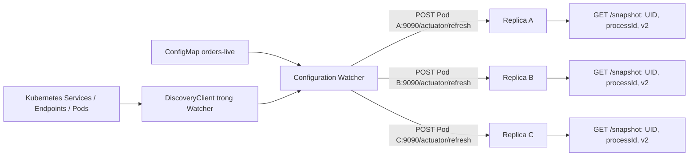

# Triển khai watcher và kiểm chứng cập nhật trên tất cả bản sao

Trong chương **Thực hành tổng hợp** của module **SPRING_CLOUD_KUBERNETES**, bài này triển khai Spring Cloud Kubernetes Configuration Watcher và kiểm chứng một thay đổi ConfigMap đến được cả ba replica của ứng dụng.

Kết quả cần chứng minh là: mỗi Pod đang chạy trả về phiên bản cấu hình mới, UID Pod và định danh tiến trình giữ nguyên, số lần restart không tăng. Một log “đã gửi refresh” hoặc vài request qua Service chưa đủ để kết luận mọi replica đã cập nhật.

Bài dùng cơ chế **HTTP refresh**, không cần message broker. Ứng dụng đọc ConfigMap qua API để cô lập độ trễ cập nhật volume. Các manifest và script dưới đây là nội dung thực hành, chưa phải kết quả đã chạy trên cluster của bạn.

## 1. Chuẩn bị môi trường và phạm vi

Bộ minh họa được ghim theo Spring Cloud Kubernetes/Watcher **3.3.3**. Ứng dụng dùng Java 17 trở lên, Spring Boot 3.5.x và Spring Cloud BOM tương thích thuộc nhánh 2025.0.x; bản BOM 2025.0.3 bao gồm Kubernetes 3.3.3. Ghi lại patch Boot, BOM và image digest thực tế để tái hiện kết quả. [Release notes Spring Cloud 2025.0.3](https://github.com/spring-cloud/spring-cloud-release/wiki/Spring-Cloud-2025.0-Release-Notes/da235e57370c0eb323cee9c6bb0acf56ffd78d22)

Cần có:

- Cluster thử nghiệm, namespace riêng `watcher-lab` và công cụ `kubectl`.
- Bash 4 trở lên, `jq` và quyền quản trị tài nguyên trong namespace học tập.
- Công cụ build Java/container và registry hoặc cơ chế nạp image cho cluster.
- CNI thực thi NetworkPolicy để giới hạn cổng quản trị trong bài.
- Quyền operator đọc Pod và sử dụng Pod proxy cho bước kiểm chứng từng replica.

Các file được nhắc bên dưới là file người học chuẩn bị trong project thực hành. Image `registry.example.com/learning/orders-api:watcher-lab` là tên mẫu cần thay bằng image đã build và cluster kéo được.

Bài chỉ chứa dữ liệu giả. Không đưa Secret thật vào namespace này: Watcher 3.3.3 có cấu hình theo dõi Secret mặc định, nên Role Watcher trong mẫu cho phép đọc/theo dõi cả Secret trong namespace học tập.

## 2. Hiểu luồng cần quan sát



Trong chế độ HTTP, Watcher tìm các instance của ứng dụng qua DiscoveryClient rồi gửi request đến từng instance. Nó không chỉ gọi một lần vào Service và trông chờ cân bằng tải phân phối đủ đến mọi Pod.

Các định danh của bài được cố ý tách rõ:

| Thành phần | Giá trị |
| --- | --- |
| Namespace | `watcher-lab` |
| Tên ứng dụng Spring và Service | `orders-api` |
| ConfigMap chứa dữ liệu | `orders-live` |
| Annotation chọn ứng dụng đích | `spring.cloud.kubernetes.configmap.apps: orders-api` |
| Cổng ứng dụng | `8080` |
| Cổng quản trị | `9090` |
| Số replica | `3` |

Label nguồn kích hoạt sự kiện, annotation chọn ứng dụng và Service selector có vai trò khác nhau. Tên ConfigMap không tự trở thành tên ứng dụng nếu không có ánh xạ phù hợp. [Định tuyến và HTTP implementation của Watcher](https://docs.spring.io/spring-cloud-kubernetes/reference/3.3/spring-cloud-kubernetes-configuration-watcher.html)

## 3. Chuẩn bị ứng dụng có thể quan sát được refresh

Ứng dụng cần các starter Spring MVC, Actuator và `spring-cloud-starter-kubernetes-fabric8-config`, được BOM quản lý. Không cần starter DiscoveryClient hay Spring Cloud LoadBalancer trong ứng dụng đích chỉ để nhận refresh; Watcher thực hiện discovery từ bên ngoài.

### 3.1. Bean chứa cấu hình có thể được tạo lại

Tạo lớp sau trong package ứng dụng:

```java
import org.springframework.beans.factory.annotation.Value;
import org.springframework.cloud.context.config.annotation.RefreshScope;
import org.springframework.stereotype.Component;

@Component
@RefreshScope
public class LiveMessage {

    private final String version;
    private final String message;

    public LiveMessage(
        @Value("${lab.version:missing}") String version,
        @Value("${lab.message:missing}") String message
    ) {
        this.version = version;
        this.message = message;
    }

    public View current() {
        return new View(version, message);
    }

    public record View(String version, String message) {
    }
}
```

`LiveMessage` không khai báo `final`, để proxy theo lớp của refresh scope hoạt động. DTO `View` là record chứa dữ liệu trả về, không phải một record `@ConfigurationProperties` cần refresh.

Spring Cloud có thể làm mất hiệu lực instance được cache trong refresh scope; lần gọi sau tạo instance với cấu hình mới. Đây là lý do không giữ giá trị cấu hình trong một singleton thông thường rồi kỳ vọng nó tự đổi. [Refresh Scope](https://docs.spring.io/spring-cloud-commons/reference/4.3/spring-cloud-commons/application-context-services.html#_refresh_scope)

### 3.2. Endpoint trả về cấu hình cùng định danh replica

```java
import java.util.UUID;
import org.springframework.beans.factory.annotation.Value;
import org.springframework.web.bind.annotation.GetMapping;
import org.springframework.web.bind.annotation.RestController;

@RestController
public class SnapshotController {

    private final LiveMessage liveMessage;
    private final String podName;
    private final String podUid;
    private final String processId = UUID.randomUUID().toString();

    public SnapshotController(
        LiveMessage liveMessage,
        @Value("${POD_NAME:local}") String podName,
        @Value("${POD_UID:local}") String podUid
    ) {
        this.liveMessage = liveMessage;
        this.podName = podName;
        this.podUid = podUid;
    }

    @GetMapping("/snapshot")
    public Snapshot snapshot() {
        LiveMessage.View view = liveMessage.current();
        return new Snapshot(
            podName, podUid, processId, view.version(), view.message()
        );
    }

    public record Snapshot(
        String podName,
        String podUid,
        String processId,
        String version,
        String message
    ) {
    }
}
```

Đặt hai lớp cùng package hoặc dưới package được lớp `@SpringBootApplication` quét. Nếu tạo project mới, lớp main tối thiểu là:

```java
import org.springframework.boot.SpringApplication;
import org.springframework.boot.autoconfigure.SpringBootApplication;

@SpringBootApplication
public class WatcherLabApplication {
    public static void main(String[] args) {
        SpringApplication.run(WatcherLabApplication.class, args);
    }
}
```

Controller là singleton bình thường; refresh bean `LiveMessage` không tạo lại `processId`. Vì vậy `processId` giúp phát hiện trường hợp cấu hình mới xuất hiện do tiến trình khởi động lại.

Endpoint này chỉ xuất dữ liệu giả của bài. Không biến nó thành endpoint trả tất cả cấu hình hay Secret trong ứng dụng thật.

### 3.3. Cấu hình ứng dụng

Đặt trong `application.yaml`:

```yaml
server:
  port: 8080

spring:
  application:
    name: orders-api
  config:
    import: "kubernetes:"
  cloud:
    kubernetes:
      discovery:
        enabled: false
      config:
        enabled: true
        enable-api: true
        name: orders-live
        namespace: watcher-lab
        include-profile-specific-sources: false
        fail-fast: true
        retry:
          enabled: false
      secrets:
        enabled: false

management:
  server:
    port: 9090
  endpoints:
    web:
      exposure:
        include: health,refresh
  endpoint:
    health:
      show-details: never
      probes:
        enabled: true
        add-additional-paths: true
```

Mẫu dùng Config Data và không bật legacy bootstrap. Không khai báo `lab.version` hoặc `lab.message` bằng biến môi trường, vì nguồn có ưu tiên cao hơn có thể làm thay đổi ConfigMap không còn tác dụng. [Kubernetes PropertySource](https://docs.spring.io/spring-cloud-kubernetes/reference/3.3/property-source-config.html)

Các probe bổ sung `/livez`, `/readyz` được cung cấp trên cổng ứng dụng 8080; Actuator chính nằm ở 9090. [Probe trên cổng ứng dụng](https://docs.spring.io/spring-boot/3.5/reference/actuator/endpoints.html#actuator.endpoints.kubernetes-probes)

Bài tối giản không thêm Spring Security; refresh được giới hạn bằng cổng riêng và NetworkPolicy trong namespace học tập. Không tạo Ingress hoặc Service công khai cho cổng 9090. Với ứng dụng có xác thực HTTP/CSRF, phải thiết kế credential và khả năng gọi của Watcher tương ứng; mẫu không tự vượt qua các lớp bảo vệ đó.

Build ứng dụng bằng quy trình của project, tạo image và đẩy vào registry hoặc nạp image vào cluster trước khi áp dụng Deployment.

## 4. Tạo ConfigMap và RBAC riêng cho từng thành phần

Các manifest trong bài có thể được lưu vào những file mang tên minh họa ở các lệnh apply.

### 4.1. ConfigMap nguồn: configmap.yaml

```yaml
apiVersion: v1
kind: ConfigMap
metadata:
  name: orders-live
  namespace: watcher-lab
  labels:
    spring.cloud.kubernetes.config: "true"
  annotations:
    spring.cloud.kubernetes.configmap.apps: "orders-api"
data:
  lab.version: "v1"
  lab.message: "Xin chào từ v1"
```

Hai trường dữ liệu sẽ được đổi trong cùng một lệnh patch để biểu diễn một phiên bản logic. Đây là quy ước quan sát của bài; không dùng `resourceVersion` của API server như phiên bản nghiệp vụ trong bean.

### 4.2. ServiceAccount, Role và RoleBinding: rbac.yaml

```yaml
apiVersion: v1
kind: ServiceAccount
metadata:
  name: orders-api
  namespace: watcher-lab
---
apiVersion: rbac.authorization.k8s.io/v1
kind: Role
metadata:
  name: orders-config-reader
  namespace: watcher-lab
rules:
  - apiGroups: [""]
    resources: ["configmaps"]
    verbs: ["get", "list"]
---
apiVersion: rbac.authorization.k8s.io/v1
kind: RoleBinding
metadata:
  name: orders-config-reader
  namespace: watcher-lab
subjects:
  - kind: ServiceAccount
    name: orders-api
    namespace: watcher-lab
roleRef:
  apiGroup: rbac.authorization.k8s.io
  kind: Role
  name: orders-config-reader
---
apiVersion: v1
kind: ServiceAccount
metadata:
  name: configuration-watcher
  namespace: watcher-lab
---
apiVersion: rbac.authorization.k8s.io/v1
kind: Role
metadata:
  name: configuration-watcher-reader
  namespace: watcher-lab
rules:
  - apiGroups: [""]
    resources: ["configmaps", "secrets", "pods", "services", "endpoints"]
    verbs: ["get", "list", "watch"]
---
apiVersion: rbac.authorization.k8s.io/v1
kind: RoleBinding
metadata:
  name: configuration-watcher-reader
  namespace: watcher-lab
subjects:
  - kind: ServiceAccount
    name: configuration-watcher
    namespace: watcher-lab
roleRef:
  apiGroup: rbac.authorization.k8s.io
  kind: Role
  name: configuration-watcher-reader
```

Ứng dụng chỉ cần đọc nguồn của nó; Watcher cần theo dõi nguồn và tìm instance. Không dùng chung ServiceAccount để tránh làm mờ ranh giới quyền.

Image Watcher 3.3.3 bật theo dõi Secret trong cấu hình đóng gói, nên mẫu Role giữ quyền tương ứng trong namespace chỉ có dữ liệu giả. `list/watch secrets` có thể trả dữ liệu Secret, không chỉ metadata. Nếu muốn bỏ quyền này, cần vô hiệu hóa đúng phần theo dõi và kiểm chứng image thực tế; tắt Secret PropertySource của ứng dụng đích không tắt theo dõi Secret của Watcher. [Cấu hình đóng gói của Watcher 3.3.3](https://raw.githubusercontent.com/spring-cloud/spring-cloud-kubernetes/v3.3.3/spring-cloud-kubernetes-controllers/spring-cloud-kubernetes-configuration-watcher/src/main/resources/application.yml)

Bài dùng discovery mặc định qua `Endpoints` của nhánh 3.3. Nếu đổi sang EndpointSlice, cần bật cấu hình tương ứng và cấp quyền trên `discovery.k8s.io/endpointslices`; không chỉ sửa Role mà quên chế độ client. [DiscoveryClient và EndpointSlice](https://docs.spring.io/spring-cloud-kubernetes/reference/3.3/discovery-client.html)

## 5. Triển khai ba replica và Service

Lưu thành `application-deployment.yaml`, thay image bằng image của bạn:

```yaml
apiVersion: apps/v1
kind: Deployment
metadata:
  name: orders-api
  namespace: watcher-lab
spec:
  replicas: 3
  selector:
    matchLabels:
      app: orders-api
  template:
    metadata:
      labels:
        app: orders-api
        refresh-enabled: "true"
    spec:
      serviceAccountName: orders-api
      containers:
        - name: app
          image: registry.example.com/learning/orders-api:watcher-lab
          ports:
            - name: http
              containerPort: 8080
            - name: management
              containerPort: 9090
          env:
            - name: POD_NAME
              valueFrom:
                fieldRef:
                  fieldPath: metadata.name
            - name: POD_UID
              valueFrom:
                fieldRef:
                  fieldPath: metadata.uid
          startupProbe:
            httpGet:
              path: /livez
              port: http
            periodSeconds: 2
            failureThreshold: 60
          livenessProbe:
            httpGet:
              path: /livez
              port: http
            periodSeconds: 10
          readinessProbe:
            httpGet:
              path: /readyz
              port: http
            periodSeconds: 3
---
apiVersion: v1
kind: Service
metadata:
  name: orders-api
  namespace: watcher-lab
  annotations:
    boot.spring.io/actuator: "http://:9090/actuator"
spec:
  selector:
    app: orders-api
  ports:
    - name: http
      port: 8080
      targetPort: http
```

Downward API cấp tên và UID Pod cho endpoint quan sát. [Đưa thông tin Pod vào biến môi trường](https://kubernetes.io/docs/tasks/inject-data-application/environment-variable-expose-pod-information/)

Service chọn cả ba replica bằng label `app`; label `refresh-enabled` dùng riêng cho NetworkPolicy ở mục sau. Annotation `boot.spring.io/actuator` giúp Watcher dùng cổng quản trị 9090 thay vì cổng HTTP 8080 của Service.

Ứng dụng không bật DiscoveryClient vẫn có thể được Watcher phát hiện qua tài nguyên Service/Endpoints. Cũng không cần mở một Service quản trị riêng chỉ để Watcher gọi Pod.

## 6. Giới hạn cổng quản trị bằng NetworkPolicy

Lưu thành `network-policy.yaml`:

```yaml
apiVersion: networking.k8s.io/v1
kind: NetworkPolicy
metadata:
  name: orders-http
  namespace: watcher-lab
spec:
  podSelector:
    matchLabels:
      app: orders-api
  policyTypes: ["Ingress"]
  ingress:
    - ports:
        - protocol: TCP
          port: 8080
---
apiVersion: networking.k8s.io/v1
kind: NetworkPolicy
metadata:
  name: orders-refresh-from-watcher
  namespace: watcher-lab
spec:
  podSelector:
    matchLabels:
      app: orders-api
      refresh-enabled: "true"
  policyTypes: ["Ingress"]
  ingress:
    - from:
        - podSelector:
            matchLabels:
              app: configuration-watcher
      ports:
        - protocol: TCP
          port: 9090
```

Policy đầu cho phép vào cổng ứng dụng 8080, gồm endpoint quan sát và probe. Policy thứ hai cho phép Pod Watcher cùng namespace vào 9090 của các replica có label phù hợp.

NetworkPolicy cộng các quyền cho phép từ các policy chọn Pod; một policy “deny” bổ sung không tự ghi đè một rule allow khác. CNI phải thực thi policy và cần kiểm tra không có policy khác mở rộng quyền ngoài dự kiến. [Ngữ nghĩa NetworkPolicy](https://kubernetes.io/docs/concepts/services-networking/network-policies/)

Các label dùng để cấp đường quản trị phải nằm dưới quyền kiểm soát của người vận hành; người được tùy ý tạo/sửa Pod trong namespace không thể bị xem như một đối tượng hoàn toàn không tin cậy trong thiết kế đơn giản này.

## 7. Triển khai Configuration Watcher

Lưu thành `watcher-deployment.yaml`:

```yaml
apiVersion: apps/v1
kind: Deployment
metadata:
  name: configuration-watcher
  namespace: watcher-lab
spec:
  replicas: 1
  selector:
    matchLabels:
      app: configuration-watcher
  template:
    metadata:
      labels:
        app: configuration-watcher
    spec:
      serviceAccountName: configuration-watcher
      containers:
        - name: watcher
          image: springcloud/spring-cloud-kubernetes-configuration-watcher:3.3.3
          ports:
            - name: management
              containerPort: 8888
          env:
            - name: SPRING_CLOUD_KUBERNETES_CLIENT_NAMESPACE
              value: watcher-lab
            - name: SPRING_CLOUD_KUBERNETES_RELOAD_NAMESPACES_0
              value: watcher-lab
            - name: SPRING_CLOUD_KUBERNETES_CONFIGURATION_WATCHER_REFRESHDELAY
              value: "1000"
          startupProbe:
            httpGet:
              path: /actuator/health/liveness
              port: management
            periodSeconds: 2
            failureThreshold: 60
          livenessProbe:
            httpGet:
              path: /actuator/health/liveness
              port: management
            periodSeconds: 10
          readinessProbe:
            httpGet:
              path: /actuator/health/readiness
              port: management
            periodSeconds: 3
```

Không bật profile `bus-amqp` hoặc `bus-kafka` vì bài dùng HTTP. Một Watcher đủ cho bài học; không mặc định rằng tăng số replica Watcher tự tạo cơ chế xử lý đúng một lần.

`REFRESHDELAY=1000` đặt độ trễ trước gửi sự kiện là 1000 ms, không phải cam kết toàn bộ replica hội tụ trong một giây. Với nguồn mount, còn phải tính độ trễ chiếu dữ liệu; bài đọc API để giảm một biến số.

Áp dụng tài nguyên bằng Bash trong thư mục manifest thực hành:

```bash
kubectl create namespace watcher-lab
kubectl apply -f configmap.yaml
kubectl apply -f rbac.yaml
kubectl apply -f network-policy.yaml
kubectl apply -f application-deployment.yaml
kubectl rollout status deployment/orders-api -n watcher-lab --timeout=180s
kubectl apply -f watcher-deployment.yaml
kubectl rollout status deployment/configuration-watcher -n watcher-lab --timeout=180s
```

Nếu namespace đã tồn tại, bỏ lệnh tạo namespace. Không đặt ConfigMap nghiệp vụ và Pod Watcher vào các namespace khác nhau mà giữ nguyên RBAC hoặc cấu hình discovery của ví dụ.

Kiểm tra:

```bash
kubectl get pods -n watcher-lab -o wide
kubectl get service orders-api -n watcher-lab
kubectl get endpoints orders-api -n watcher-lab
kubectl logs deployment/configuration-watcher -n watcher-lab -c watcher --tail=100
```

Phải thấy ba replica ứng dụng Ready, một Watcher Ready và các địa chỉ đích tương ứng trong discovery. Tài nguyên Service mô tả tập backend; một lần gọi qua Service không bao quát chắc chắn cả tập đó. [Service và backend](https://kubernetes.io/docs/concepts/services-networking/service/)

## 8. Kiểm tra quyền trước khi thay đổi dữ liệu

Nếu operator có quyền impersonation, kiểm tra tối thiểu:

```bash
kubectl auth can-i list configmaps -n watcher-lab --as=system:serviceaccount:watcher-lab:orders-api
kubectl auth can-i list secrets -n watcher-lab --as=system:serviceaccount:watcher-lab:orders-api

kubectl auth can-i watch configmaps -n watcher-lab --as=system:serviceaccount:watcher-lab:configuration-watcher
kubectl auth can-i list services -n watcher-lab --as=system:serviceaccount:watcher-lab:configuration-watcher
kubectl auth can-i list endpoints -n watcher-lab --as=system:serviceaccount:watcher-lab:configuration-watcher
```

Theo Role mẫu, ứng dụng được đọc ConfigMap nhưng không đọc Secret API; Watcher có các quyền nêu trên. Kiểm tra thêm `pods`, `secrets` và các verb khác nếu log client cho thấy chúng được sử dụng.

Nếu quyền được cấp qua nhóm, đánh giá cả các nhóm ServiceAccount tương ứng. Lỗi thiếu quyền impersonation của operator không phải bằng chứng ứng dụng bị từ chối đúng chính sách. [Lệnh kubectl auth can-i](https://kubernetes.io/docs/reference/kubectl/generated/kubectl_auth/kubectl_auth_can-i/)

Script sau đọc endpoint ứng dụng qua Pod proxy bằng danh tính operator. Kiểm tra quyền của operator:

```bash
kubectl auth can-i get pods --subresource=proxy -n watcher-lab
```

Đường proxy phục vụ thu thập bằng chứng; nó không thay thế phép thử đường mạng Watcher tới cổng 9090.

## 9. Kiểm chứng trực tiếp từng Pod và không cho restart che kết quả

Chạy script Bash sau trong cùng một phiên. Script dùng biến trong bộ nhớ, chụp tập Pod trước cập nhật, xác nhận v1, patch sang v2 rồi đợi mọi Pod trả về v2.

```bash
set -u

NS=watcher-lab
SELECTOR=app=orders-api
EXPECTED_REPLICAS=3

inventory() {
  jq -cS '
    [.items[]
      | select(.metadata.deletionTimestamp == null)
      | {
          name: .metadata.name,
          uid: .metadata.uid,
          containers: (
            [.status.containerStatuses[]?
              | {
                  name: .name,
                  restarts: .restartCount,
                  startedAt: .state.running.startedAt
                }]
            | sort_by(.name)
          )
        }]
    | sort_by(.name)
  '
}

PODS_JSON=$(kubectl get pods -n "$NS" -l "$SELECTOR" -o json) || exit 1
BASELINE=$(printf '%s' "$PODS_JSON" | inventory) || exit 1

if [ "$(printf '%s' "$BASELINE" | jq 'length')" -ne "$EXPECTED_REPLICAS" ]; then
  echo "FAIL: tập Pod ban đầu không có đúng ba replica"
  exit 1
fi

if ! printf '%s' "$PODS_JSON" | jq -e '
  all(.items[];
    .metadata.deletionTimestamp == null
    and any(.status.conditions[]?; .type == "Ready" and .status == "True")
  )
' >/dev/null; then
  echo "FAIL: chưa có đủ Pod Ready để chụp mốc ban đầu"
  exit 1
fi

declare -A PROCESS_IDS

verify_all() {
  local expected_version=$1
  local expected_message=$2
  local pods_json current failed name uid body process_id
  failed=0

  pods_json=$(kubectl get pods -n "$NS" -l "$SELECTOR" -o json) || return 2
  current=$(printf '%s' "$pods_json" | inventory) || return 2

  if [ "$current" != "$BASELINE" ]; then
    echo "FAIL: tập Pod, UID, thời điểm chạy hoặc restartCount đã đổi"
    return 2
  fi

  if ! printf '%s' "$pods_json" | jq -e '
    all(.items[];
      any(.status.conditions[]?; .type == "Ready" and .status == "True")
    )
  ' >/dev/null; then
    echo "WAIT: có replica chưa Ready"
    return 1
  fi

  while IFS=$'\t' read -r name uid; do
    if ! body=$(kubectl --request-timeout=5s get --raw "/api/v1/namespaces/$NS/pods/${name}:8080/proxy/snapshot"); then
      echo "WAIT: chưa đọc được $name"
      failed=1
      continue
    fi

    if ! printf '%s' "$body" | jq -e       --arg name "$name"       --arg uid "$uid"       --arg version "$expected_version"       --arg message "$expected_message" '
        .podName == $name
        and .podUid == $uid
        and .version == $version
        and .message == $message
        and (.processId | type == "string" and length > 0)
      ' >/dev/null; then
      printf 'WAIT: %s chưa trả đúng %s\n' "$name" "$expected_version"
      failed=1
      continue
    fi

    process_id=$(printf '%s' "$body" | jq -r '.processId')
    if [ -z "${PROCESS_IDS[$name]+present}" ]; then
      PROCESS_IDS[$name]=$process_id
    elif [ "${PROCESS_IDS[$name]}" != "$process_id" ]; then
      echo "FAIL: processId của $name đã đổi"
      return 2
    fi

    printf 'PASS %s\t%s\t%s\t%s\n'       "$name" "$uid" "$process_id" "$expected_version"
  done < <(printf '%s' "$BASELINE" | jq -r '.[] | [.name, .uid] | @tsv')

  return "$failed"
}

if ! verify_all v1 "Xin chào từ v1"; then
  echo "FAIL: không xác nhận được v1 trên toàn bộ tập ban đầu"
  exit 1
fi

kubectl patch configmap orders-live -n "$NS" --type merge   -p '{"data":{"lab.version":"v2","lab.message":"Xin chào từ v2"}}' || exit 1

deadline=$((SECONDS + 90))
while true; do
  if verify_all v2 "Xin chào từ v2"; then
    echo "PASS: mọi replica đã hội tụ về v2, không restart hoặc thay Pod"
    break
  else
    result=$?
  fi

  if [ "$result" -eq 2 ]; then
    echo "FAIL: bằng chứng so sánh không còn hợp lệ"
    exit 1
  fi

  if [ "$SECONDS" -ge "$deadline" ]; then
    echo "FAIL: hết thời gian chờ toàn bộ replica nhận v2"
    exit 1
  fi

  sleep 2
done
```

Script yêu cầu Bash, không phải PowerShell hoặc `sh`. Các lần gọi API có timeout; thời điểm kết thúc vòng đợi còn phụ thuộc thời gian request đang chạy.

Điểm cần đọc trong kết quả:

- Mỗi vòng PASS đầy đủ có ba tên Pod khác nhau.
- Response của từng Pod phải khớp UID đã lấy từ Kubernetes.
- `version` và `message` phải khớp cùng phiên bản logic.
- `processId`, UID và thông tin restart giữ nguyên.
- Việc một Pod cũ biến mất không được coi là “đã cập nhật”; script dừng để chụp lại một phép thử có phạm vi rõ ràng.

Trong thời gian phép thử, giữ nguyên replicas, không rollout và không bật HPA thay đổi tập Pod. Nếu có sự cố hạ tầng hoặc rollout song song, ghi nhận phép thử bị gián đoạn; không dùng tập Pod mới để âm thầm thay thế tập cần chứng minh.

Kết quả kỳ vọng, chỉ để minh họa định dạng:

```text
PASS orders-api-...-aaa  <uid-a>  <process-a>  v2
PASS orders-api-...-bbb  <uid-b>  <process-b>  v2
PASS orders-api-...-ccc  <uid-c>  <process-c>  v2
PASS: mọi replica đã hội tụ về v2, không restart hoặc thay Pod
```

Đây là kiểm chứng hội tụ trong một cửa sổ quan sát, không phải bằng chứng mọi Pod chuyển đổi cùng một thời điểm. Trong giai đoạn chuyển tiếp, một số Pod có thể trả v1 trong khi Pod khác đã trả v2.

## 10. Gây lỗi để chứng minh phép kiểm tra phát hiện được replica bị bỏ sót

Chỉ thực hiện sau khi v2 đã hội tụ và không còn phép cập nhật trước đang diễn ra.

### 10.1. Chặn refresh đến một replica

Chọn một Pod thực tế từ danh sách:

```bash
kubectl get pods -n watcher-lab -l app=orders-api
TARGET_POD=orders-api-xxxxxxxxxx-yyyyy

kubectl label pod "$TARGET_POD" -n watcher-lab refresh-enabled=false --overwrite

kubectl patch configmap orders-live -n watcher-lab --type merge   -p '{"data":{"lab.version":"v3","lab.message":"Xin chào từ v3"}}'
```

Thay tên mẫu bằng Pod được chọn. Policy cho cổng 8080 vẫn áp dụng, nên có thể tiếp tục đọc `/snapshot`; policy cho cổng 9090 không còn chọn Pod đó.

Dùng `verify_all v3 "Xin chào từ v3"` trong phiên Bash đang giữ baseline để quan sát. Khi CNI thực thi đúng policy và không có rule khác mở 9090, kết quả dự kiến là các replica nhận được refresh chuyển sang v3, replica bị chặn còn v2. Log Watcher có thể báo timeout hoặc lỗi kết nối đến đích đó.

Không khẳng định các replica còn lại chắc chắn cập nhật chỉ từ log gửi: đọc response của từng Pod. Nếu tất cả vẫn nhận v3, kiểm tra CNI, policy khác, đường quản trị thực tế hoặc nguyên nhân tiến trình đã được cập nhật ngoài phép thử.

Khôi phục label rồi tạo một thay đổi mới:

```bash
kubectl label pod "$TARGET_POD" -n watcher-lab refresh-enabled=true --overwrite

kubectl patch configmap orders-live -n watcher-lab --type merge   -p '{"data":{"lab.version":"v4","lab.message":"Xin chào từ v4"}}'
```

Chạy lại kiểm chứng toàn bộ với v4. Không giả định việc mở lại đường mạng tự phát lại mọi sự kiện đã bỏ lỡ; patch mới tạo mốc kiểm tra rõ ràng.

### 10.2. Bỏ label kích hoạt của ConfigMap

Một bài thử khác là bỏ label `spring.cloud.kubernetes.config`, rồi đổi dữ liệu sang một phiên bản thử mới. Ứng dụng vẫn có thể đọc dữ liệu mới khi được refresh bằng một con đường khác, nhưng Watcher không được kỳ vọng phát thông báo theo quy tắc label của bài.

Xác nhận mọi replica giữ phiên bản cũ trong khoảng quan sát; sau đó khôi phục label và đổi sang một phiên bản tiếp theo để kiểm chứng lại. Tách các mốc, không chạy đồng thời với thử chặn mạng.

### 10.3. Đặt sai bean cập nhật

Có thể bỏ `@RefreshScope` khỏi `LiveMessage` trong một image thử riêng rồi lặp lại bài. Khi đó phân biệt:

- Request refresh đã đến ứng dụng.
- `Environment` có thể đã được tải lại.
- Bean singleton giữ giá trị từ constructor vẫn trả dữ liệu cũ.

Tình huống này cho thấy HTTP 200 chưa chứng minh hành vi nghiệp vụ đã sử dụng cấu hình mới.

## 11. Chẩn đoán theo từng chặng

| Bằng chứng | Chặng nên kiểm tra |
| --- | --- |
| Watcher nhận 403 từ API server | ServiceAccount, resource/verb, namespace và RoleBinding của Watcher |
| Không có thông báo sau patch | Namespace theo dõi, label nguồn, bộ lọc và dữ liệu thay đổi |
| Watcher không tìm thấy instance | Annotation apps, tên Service, selector, Endpoints và trạng thái Ready |
| Refresh đi vào 8080 hoặc sai path | Annotation Actuator hoặc cấu hình cổng/path của Watcher |
| Timeout tới một replica | Pod IP, cổng 9090, NetworkPolicy và kết nối từ Watcher |
| HTTP 401/403 từ ứng dụng | Cơ chế xác thực, vai trò và CSRF của endpoint quản trị |
| HTTP 404 | Endpoint có được cung cấp/expose, path và cổng thực tế |
| HTTP 200 nhưng snapshot vẫn cũ | Nguồn có hiệu lực, bean refresh scope và dữ liệu mới có được tải |
| Chỉ vài response qua Service có v2 | Chưa có bằng chứng trên từng replica |
| v2 xuất hiện cùng UID/processId mới | Có khởi động lại hoặc thay Pod; chưa chứng minh refresh tại chỗ |

Khi cần bật DEBUG, giới hạn vào các logger Watcher được tài liệu phiên bản hỗ trợ và chỉ dùng dữ liệu giả. Thu hồi cấu hình log tạm sau khi đã có bằng chứng.

Nếu chuyển bài sang ConfigMap/Secret mount, cần bổ sung kiểm tra thời điểm tệp cập nhật, tránh `subPath` nếu cần cập nhật tự động và điều chỉnh refresh delay theo cluster. Tệp đổi không tự bảo đảm bean đã bind lại. [Cập nhật ConfigMap được mount](https://kubernetes.io/docs/concepts/configuration/configmap/#mounted-configmaps-are-updated-automatically)

Không dùng refresh làm giải pháp cho mọi cấu hình: đổi cổng server, tài nguyên không hỗ trợ refresh hoặc credential của một số pool có thể cần quy trình rollout riêng.

## 12. Bằng chứng nộp bài và hoàn trả môi trường

Báo cáo tối thiểu gồm:

| Nội dung | Bằng chứng cần lưu |
| --- | --- |
| Phiên bản thực hành | Boot, BOM, Watcher image tag/digest, image ứng dụng |
| Mốc ban đầu | Ba tên Pod, UID, processId, restartCount, v1 |
| Lần cập nhật thành công | Thời điểm patch, phiên bản logic, kết quả trên từng Pod |
| Ca lỗi một replica | Pod bị chặn, trạng thái các replica, lỗi ở Watcher |
| Lần khôi phục | Label được trả lại, phiên bản mới và hội tụ đủ ba replica |
| Phạm vi kết luận | Refresh tại chỗ đạt hay phép thử bị gián đoạn bởi restart/rollout |

Không coi `kubectl rollout status` hoặc Watcher Ready là bằng chứng cấu hình đã đồng bộ. Không sửa Deployment trong phép thử rồi dùng restart làm cách đạt yêu cầu.

Sau thực hành, trả lại label bị thay đổi, dừng port-forward nếu có và xóa đúng các tài nguyên đã tạo trong namespace học tập bằng các manifest tương ứng. Chỉ xóa cả namespace khi nó được tạo riêng cho bài và không chứa tài nguyên cần giữ.

Bài đạt khi cả ba replica trong tập đã chụp nhận cùng phiên bản cấu hình mới, vẫn là cùng Pod và tiến trình, các quyền được tách theo vai trò, cổng refresh được giới hạn đúng, đồng thời ca lỗi chứng minh được phép kiểm tra phát hiện một replica chưa cập nhật.
