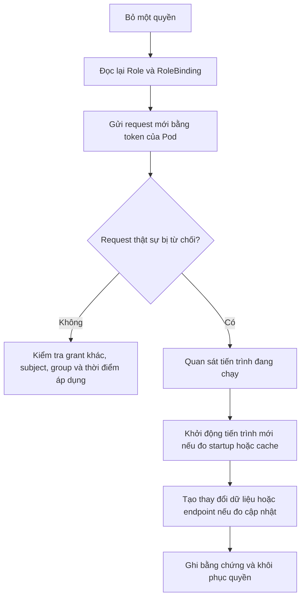

# Thử RBAC tối thiểu rồi quan sát lỗi khi thiếu từng quyền

Trong phần **Thực hành tổng hợp** của **SPRING_CLOUD_KUBERNETES**, bài này xây dựng một thí nghiệm RBAC có đối chứng: cấp đúng quyền cho một thao tác, kiểm tra bằng danh tính của Pod, rồi bỏ riêng từng quyền để quan sát lỗi. Sau đó, áp dụng cách làm ấy cho ứng dụng Spring đọc ConfigMap và dùng DiscoveryClient.

Kết quả cần đạt không phải một Role có thể sao chép vào mọi dự án. Người học cần giải thích được **danh tính nào thực hiện verb nào trên resource nào, thuộc API group và namespace nào**, cùng bằng chứng cho bộ quyền tối thiểu của tính năng đang sử dụng.

Các manifest, script và lệnh dưới đây dành cho một lab riêng. Các mã trạng thái và thông báo minh họa là kết quả mong đợi theo điều kiện được nêu, không phải số liệu đã đo trên cluster của người đọc.

## 1. Xác định đơn vị của một quyền

Một quyết định phân quyền có thể hình dung bằng bộ thông tin:

```text
subject + verb + apiGroup + resource + namespace + resourceName
```

Ví dụ:

```text
system:serviceaccount:sck-rbac-lab:rbac-demo
get
""
configmaps
sck-rbac-lab
rbac-demo
```

| Yêu cầu HTTP đến Kubernetes API | Verb RBAC cần kiểm tra |
| --- | --- |
| GET `/api/v1/namespaces/sck-rbac-lab/configmaps/rbac-demo` | `get` một ConfigMap |
| GET `/api/v1/namespaces/sck-rbac-lab/configmaps` | `list` ConfigMap |
| GET cùng collection với `?watch=1` | `watch` ConfigMap |

Cùng dùng HTTP GET nhưng ba yêu cầu không có cùng ý nghĩa phân quyền. Danh sách rỗng với HTTP `200` khác với bị từ chối `403`. [Tài liệu Kubernetes Authorization](https://kubernetes.io/docs/reference/access-authn-authz/authorization/).

Phải phân biệt ba danh tính:

- Người vận hành dùng kubeconfig trên máy để tạo resource và thực hiện `kubectl exec`.
- ServiceAccount của Pod probe dùng token trong Pod để gửi yêu cầu thử.
- ServiceAccount của ứng dụng Spring; trong lab này ứng dụng và probe cố ý dùng chung `rbac-demo` để đối chiếu quyền.

Quyền của người chạy `kubectl` không tự trở thành quyền của ứng dụng. Ngược lại, ứng dụng không cần quyền tạo Pod chỉ vì người vận hành cần tạo Pod để triển khai nó.

### Quyền RBAC được cộng dồn

RBAC cấp quyền theo các Role/ClusterRole được binding tới chủ thể hoặc các group của chủ thể; không có quy tắc deny để trừ quyền. Bỏ `watch` khỏi một Role không có tác dụng nếu binding khác vẫn cấp nó. Role giới hạn namespace, còn ClusterRole có thể được binding theo phạm vi khác nhau. [Tài liệu Kubernetes RBAC](https://kubernetes.io/docs/reference/access-authn-authz/rbac/).

Vì vậy, chỉ kết luận phép thử thiếu quyền là hợp lệ khi yêu cầu mới thực sự bị từ chối dưới danh tính đang đo.

## 2. Chuẩn bị môi trường và tài nguyên thử

Dùng cluster lab có RBAC và EndpointSlice API. Ví dụ chọn kind với context `kind-sck-lab`; có thể tạo bằng `kind create cluster --name sck-lab` khi chưa có cluster đó. Không thay quyền trên workload đang phục vụ người dùng.

Cần `kubectl`, PowerShell và quyền quản trị namespace lab để tạo Role/RoleBinding, Pod và Deployment. Phần ứng dụng Spring phía sau cần JDK 21, Maven và Docker Linux container. Người học tạo các tệp minh họa trong thư mục lab riêng, chạy lệnh từ gốc thư mục đó.

```powershell
kubectl --context kind-sck-lab cluster-info
kubectl --context kind-sck-lab api-resources --api-group=discovery.k8s.io
```

### 2.1. Namespace, ServiceAccount và ConfigMap

Lưu thành `00-fixtures.yaml`:

```yaml
apiVersion: v1
kind: Namespace
metadata:
  name: sck-rbac-lab
---
apiVersion: v1
kind: ServiceAccount
metadata:
  name: rbac-demo
  namespace: sck-rbac-lab
---
apiVersion: v1
kind: ConfigMap
metadata:
  name: rbac-demo
  namespace: sck-rbac-lab
data:
  application.yaml: |-
    demo:
      revision: "rbac-v1"
---
apiVersion: v1
kind: ConfigMap
metadata:
  name: other-config
  namespace: sck-rbac-lab
data:
  marker: "Du lieu gia de thu quyen theo ten"
```

Chưa tạo RoleBinding. ServiceAccount mới không được cấp quyền đọc các resource ứng dụng chỉ vì nó tồn tại. Pod sử dụng danh tính ấy khi `spec.serviceAccountName` được khai báo đúng. [Tài liệu ServiceAccount](https://kubernetes.io/docs/concepts/security/service-accounts/).

### 2.2. Probe gửi request với token thật trong Pod

Lưu `01-probe.yaml`:

```yaml
apiVersion: v1
kind: ConfigMap
metadata:
  name: api-probe-script
  namespace: sck-rbac-lab
data:
  probe.sh: |-
    #!/bin/sh
    set -eu
    umask 077
    sa_dir=/var/run/secrets/kubernetes.io/serviceaccount
    api=https://kubernetes.default.svc
    path=${1:?Provide a Kubernetes resource path}
    auth_file=$(mktemp)
    body_file=$(mktemp)
    cleanup() {
      rm -f "$auth_file" "$body_file"
    }
    trap cleanup EXIT HUP INT TERM
    printf 'Authorization: Bearer %s\n' "$(cat "$sa_dir/token")" > "$auth_file"
    set +e
    status=$(curl --silent --show-error \
      --cacert "$sa_dir/ca.crt" \
      --header "@$auth_file" \
      --connect-timeout 3 --max-time 8 \
      --output "$body_file" --write-out '%{http_code}' \
      "$api$path")
    curl_exit=$?
    set -e
    printf 'http=%s curl_exit=%s body_bytes=%s\n' \
      "$status" "$curl_exit" "$(wc -c < "$body_file")"
    case "$status" in
      2??) ;;
      *) cat "$body_file"; printf '\n' ;;
    esac
    exit "$curl_exit"
---
apiVersion: v1
kind: Pod
metadata:
  name: sa-probe
  namespace: sck-rbac-lab
spec:
  serviceAccountName: rbac-demo
  automountServiceAccountToken: true
  restartPolicy: Never
  containers:
    - name: curl
      image: curlimages/curl:8.17.0
      command: ["sh", "-c", "sleep 86400"]
      resources:
        requests:
          cpu: 10m
          memory: 16Mi
        limits:
          cpu: 100m
          memory: 64Mi
      volumeMounts:
        - name: script
          mountPath: /scripts
          readOnly: true
  volumes:
    - name: script
      configMap:
        name: api-probe-script
```

Script dùng CA và token ServiceAccount đang mount; không tắt kiểm tra TLS, không in Authorization header. Body thành công không được in để có thể tái dùng khi thử Secret giả. Với lỗi API, body Status giúp nhận diện subject và verb bị từ chối. Cách truy cập API từ Pod được mô tả trong [tài liệu Kubernetes](https://kubernetes.io/docs/tasks/run-application/access-api-from-pod/).

Probe dùng image curl của [dự án curl-container](https://github.com/curl/curl-container). Nếu môi trường cần image mirror, thay reference theo quy trình của môi trường và giữ các tiện ích `sh`, `curl`, `mktemp`, `cat`, `wc`.

Khởi tạo:

```powershell
kubectl --context kind-sck-lab apply -f 00-fixtures.yaml
kubectl --context kind-sck-lab -n sck-rbac-lab apply -f 01-probe.yaml
kubectl --context kind-sck-lab -n sck-rbac-lab wait --for=condition=Ready pod/sa-probe --timeout=120s
kubectl --context kind-sck-lab -n sck-rbac-lab get pod sa-probe -o jsonpath='{.spec.serviceAccountName}'
```

Việc mount script ConfigMap thành công không chứng minh ServiceAccount được GET ConfigMap qua API. Mount volume và request do ứng dụng tự gửi là hai đường khác nhau.

Định nghĩa hàm tiện dụng trong terminal PowerShell đang dùng:

```powershell
function Invoke-LabProbe {
    param([Parameter(Mandatory)][string]$Path)
    kubectl --context kind-sck-lab -n sck-rbac-lab exec sa-probe -- sh /scripts/probe.sh $Path
}
```

Mọi lần gọi hàm mở một request mới với token đọc trong Pod. `curl_exit=0` chỉ chứng minh curl hoàn tất giao tiếp; do script không bật `--fail`, HTTP `403` vẫn có thể đi cùng exit code `0`. Dùng trường `http` để đánh giá phân quyền.

## 3. Thử khi chưa có quyền ứng dụng

```powershell
Invoke-LabProbe '/api/v1/namespaces/sck-rbac-lab/configmaps/rbac-demo'
Invoke-LabProbe '/api/v1/namespaces/sck-rbac-lab/configmaps'
Invoke-LabProbe '/api/v1/namespaces/sck-rbac-lab/configmaps?watch=1&timeoutSeconds=3'
```

Nếu không có binding bổ sung cấp quyền resource này, cả ba trả HTTP `403`. Ví dụ body đã rút gọn:

```json
{
  "kind": "Status",
  "status": "Failure",
  "reason": "Forbidden",
  "message": "configmaps is forbidden: User \"system:serviceaccount:sck-rbac-lab:rbac-demo\" cannot list resource \"configmaps\" in API group \"\" in the namespace \"sck-rbac-lab\"",
  "code": 403
}
```

Đọc đủ user, verb, resource, group và namespace. Nếu user là `system:anonymous`, hãy điều tra token/xác thực trước; không coi đó là lỗi quyền của `rbac-demo`.

Nếu request đã trả `200`, chưa được tiếp tục với giả định danh tính không có quyền. Dùng quyền vận hành để xem RoleBinding trong namespace, ClusterRoleBinding liên quan và binding tới các group ServiceAccount. Cluster dùng chung có thể đã cấp thêm quyền ngoài lab.

## 4. Bắt đầu với quyền tối thiểu cho đúng một thao tác

### 4.1. Hàm cấp quyền có phạm vi cố định

Hàm sau chỉ tạo/sửa Role và RoleBinding của lab, mỗi resource có một cặp tên riêng. Chạy định nghĩa trong cùng terminal với `Invoke-LabProbe`:

```powershell
function Set-LabGrant {
    param(
        [Parameter(Mandatory)]
        [ValidateSet('configmaps','services','pods','endpointslices','secrets')]
        [string]$Resource,
        [Parameter(Mandatory)]
        [ValidateSet('get','list','watch')]
        [string[]]$Verbs,
        [string[]]$ResourceNames = @()
    )
    $group = if ($Resource -eq 'endpointslices') { 'discovery.k8s.io' } else { '' }
    $roleName = "lab-$Resource-reader"
    $rule = @{
        apiGroups = @($group)
        resources = @($Resource)
        verbs = @($Verbs)
    }
    if ($ResourceNames.Count -gt 0) {
        $rule['resourceNames'] = @($ResourceNames)
    }
    $role = @{
        apiVersion = 'rbac.authorization.k8s.io/v1'
        kind = 'Role'
        metadata = @{ name = $roleName; namespace = 'sck-rbac-lab' }
        rules = @($rule)
    }
    $binding = @{
        apiVersion = 'rbac.authorization.k8s.io/v1'
        kind = 'RoleBinding'
        metadata = @{ name = $roleName; namespace = 'sck-rbac-lab' }
        subjects = @(@{
            kind = 'ServiceAccount'
            name = 'rbac-demo'
            namespace = 'sck-rbac-lab'
        })
        roleRef = @{
            apiGroup = 'rbac.authorization.k8s.io'
            kind = 'Role'
            name = $roleName
        }
    }
    @{
        apiVersion = 'v1'
        kind = 'List'
        items = @($role, $binding)
    } | ConvertTo-Json -Depth 12 | kubectl --context kind-sck-lab -n sck-rbac-lab apply -f -
    if ($LASTEXITCODE -ne 0) {
        throw 'Apply RBAC lab failed; inspect the error before continuing'
    }
}
```

Hàm thay tập verb của đúng một resource, giúp tránh vô tình bỏ cùng lúc nhiều quyền. Mỗi lần gọi không cộng thêm một Role mới cho cùng resource. Kiểm tra trạng thái thực tế sau khi apply:

```powershell
Set-LabGrant -Resource configmaps -Verbs @('get') -ResourceNames @('rbac-demo')
kubectl --context kind-sck-lab -n sck-rbac-lab get role lab-configmaps-reader -o yaml
kubectl --context kind-sck-lab -n sck-rbac-lab get rolebinding lab-configmaps-reader -o yaml
```

Rule quan trọng sẽ có dạng:

```yaml
apiGroups: [""]
resources: ["configmaps"]
resourceNames: ["rbac-demo"]
verbs: ["get"]
```

### 4.2. Chứng minh phạm vi quyền

Chạy lại ba probe ở mục 3 và thêm GET ConfigMap còn lại:

```powershell
Invoke-LabProbe '/api/v1/namespaces/sck-rbac-lab/configmaps/other-config'
```

| Yêu cầu | Kết quả mong đợi với đúng grant này |
| --- | --- |
| GET ConfigMap `rbac-demo` | `200` |
| GET ConfigMap `other-config` | `403` |
| LIST ConfigMap trong namespace | `403` |
| WATCH ConfigMap trong namespace | `403` |

Đây là quyền tối thiểu cho **GET đúng một ConfigMap** trong thí nghiệm. Chưa thể khẳng định nó đủ cho starter cấu hình của Spring, vì SDK có thể LIST một collection rồi lọc theo tên.

## 5. Bỏ riêng từng verb và ghi bảng đối chứng

### 5.1. Tạo bộ quyền đối chứng cho ba phép thử

```powershell
Set-LabGrant -Resource configmaps -Verbs @('get','list','watch')
Invoke-LabProbe '/api/v1/namespaces/sck-rbac-lab/configmaps/rbac-demo'
Invoke-LabProbe '/api/v1/namespaces/sck-rbac-lab/configmaps'
Invoke-LabProbe '/api/v1/namespaces/sck-rbac-lab/configmaps?watch=1&timeoutSeconds=3'
```

Lần gọi không truyền `ResourceNames` bỏ giới hạn theo tên của giai đoạn trước. Xem lại Role để xác nhận. Cả ba request mới phải được phép khi các điều kiện kết nối và resource đúng.

Watch được giới hạn bằng `timeoutSeconds=3`; curl cho tối đa tám giây để hoàn tất. Có thể nhận `200` mà không có event nếu không có thay đổi. Nếu curl timeout, ghi cả HTTP status và exit code; timeout không tự chứng minh thiếu quyền. [Tài liệu list/watch của Kubernetes API](https://kubernetes.io/docs/reference/using-api/api-concepts/).

### 5.2. Mỗi lần chỉ thiếu một verb

Thực hiện từng trường hợp, chạy lại cả ba request sau mỗi lần đổi. Khôi phục bộ đối chứng trước khi bắt đầu trường hợp kế tiếp:

```powershell
# Thieu GET
Set-LabGrant -Resource configmaps -Verbs @('list','watch')
# Chay lai ba probe, ghi ket qua
Set-LabGrant -Resource configmaps -Verbs @('get','list','watch')

# Thieu LIST
Set-LabGrant -Resource configmaps -Verbs @('get','watch')
# Chay lai ba probe, ghi ket qua
Set-LabGrant -Resource configmaps -Verbs @('get','list','watch')

# Thieu WATCH
Set-LabGrant -Resource configmaps -Verbs @('get','list')
# Chay lai ba probe, ghi ket qua
Set-LabGrant -Resource configmaps -Verbs @('get','list','watch')
```

Các comment là vị trí người học thực hiện probe, không phải phép kiểm tra đã tự chạy.

| Tập verb | GET theo tên | LIST | WATCH mới |
| --- | --- | --- | --- |
| `get,list,watch` | `200` | `200` | `200` |
| `list,watch` | `403` | `200` | `200` |
| `get,watch` | `200` | `403` | `200` |
| `get,list` | `200` | `200` | `403` |

Bảng áp dụng cho **các request trực tiếp đang nêu**, không nói rằng informer có thể hoạt động chỉ với `watch`. Informer thường cần lấy dữ liệu ban đầu và theo dõi thay đổi; yêu cầu thực của implementation phải được kiểm tra riêng.

Sau mỗi thay đổi Role, đợi quyết định phân quyền của các request mới phản ánh trạng thái mới trước khi đo tác động ứng dụng. Nếu kết quả chưa đúng, kiểm tra binding cộng dồn và thời điểm áp dụng; đừng tiếp tục ghi kết luận từ trạng thái chưa xác định.

## 6. Đưa ứng dụng Spring vào cùng thí nghiệm

Phần này dùng một ứng dụng nhỏ để tách ba phép quan sát: cấu hình đã nạp, danh sách service và các instance của một service. Không cần hệ thống nghiệp vụ khác để thử RBAC.

Ví dụ cố định Java 21, Spring Boot `3.5.16`, Spring Cloud BOM `2025.0.3`; BOM quản lý Spring Cloud Kubernetes `3.3.3`. Khi dùng thế hệ khác, kiểm tra đúng API call và cấu hình của thế hệ đó. [BOM Spring Cloud 2025.0.3](https://github.com/spring-cloud/spring-cloud-release/blob/v2025.0.3/spring-cloud-dependencies/pom.xml).

### 6.1. Dự án tối giản

Tạo cấu trúc trong thư mục lab:

```text
pom.xml
Dockerfile
src/main/java/vn/example/rbac/RbacApplication.java
src/main/resources/application.yaml
02-spring.yaml
```

Các tệp fixture/probe ở phần trước giữ nguyên trong cùng thư mục.

Nội dung `pom.xml`:

```xml
<project xmlns="http://maven.apache.org/POM/4.0.0"
         xmlns:xsi="http://www.w3.org/2001/XMLSchema-instance"
         xsi:schemaLocation="http://maven.apache.org/POM/4.0.0 https://maven.apache.org/xsd/maven-4.0.0.xsd">
    <modelVersion>4.0.0</modelVersion>
    <parent>
        <groupId>org.springframework.boot</groupId>
        <artifactId>spring-boot-starter-parent</artifactId>
        <version>3.5.16</version>
        <relativePath/>
    </parent>
    <groupId>vn.example</groupId>
    <artifactId>rbac-demo</artifactId>
    <version>1.0.0</version>
    <properties>
        <java.version>21</java.version>
        <spring-cloud.version>2025.0.3</spring-cloud.version>
    </properties>
    <dependencyManagement>
        <dependencies>
            <dependency>
                <groupId>org.springframework.cloud</groupId>
                <artifactId>spring-cloud-dependencies</artifactId>
                <version>${spring-cloud.version}</version>
                <type>pom</type>
                <scope>import</scope>
            </dependency>
        </dependencies>
    </dependencyManagement>
    <dependencies>
        <dependency>
            <groupId>org.springframework.boot</groupId>
            <artifactId>spring-boot-starter-web</artifactId>
        </dependency>
        <dependency>
            <groupId>org.springframework.boot</groupId>
            <artifactId>spring-boot-starter-actuator</artifactId>
        </dependency>
        <dependency>
            <groupId>org.springframework.cloud</groupId>
            <artifactId>spring-cloud-starter-kubernetes-fabric8</artifactId>
        </dependency>
        <dependency>
            <groupId>org.springframework.cloud</groupId>
            <artifactId>spring-cloud-starter-kubernetes-fabric8-config</artifactId>
        </dependency>
    </dependencies>
    <build>
        <plugins>
            <plugin>
                <groupId>org.springframework.boot</groupId>
                <artifactId>spring-boot-maven-plugin</artifactId>
            </plugin>
        </plugins>
    </build>
</project>
```

Không thêm starter Kubernetes Java Client cùng Fabric8 và không thêm LoadBalancer nếu chỉ đo DiscoveryClient.

Nội dung `RbacApplication.java`:

```java
package vn.example.rbac;

import java.util.List;

import org.springframework.beans.factory.annotation.Value;
import org.springframework.boot.SpringApplication;
import org.springframework.boot.autoconfigure.SpringBootApplication;
import org.springframework.cloud.client.discovery.DiscoveryClient;
import org.springframework.web.bind.annotation.GetMapping;
import org.springframework.web.bind.annotation.RestController;

@SpringBootApplication
@RestController
public class RbacApplication {
    private final DiscoveryClient discoveryClient;
    private final String revision;
    private final String podName;

    public RbacApplication(
            DiscoveryClient discoveryClient,
            @Value("${demo.revision}") String revision,
            @Value("${POD_NAME:local}") String podName) {
        this.discoveryClient = discoveryClient;
        this.revision = revision;
        this.podName = podName;
    }

    public static void main(String[] args) {
        SpringApplication.run(RbacApplication.class, args);
    }

    @GetMapping("/config")
    public ConfigView config() {
        return new ConfigView(podName, revision);
    }

    @GetMapping("/services")
    public List<String> services() {
        return discoveryClient.getServices();
    }

    @GetMapping("/instances")
    public List<Endpoint> instances() {
        return discoveryClient.getInstances("catalog-api").stream()
                .map(instance -> new Endpoint(instance.getHost(), instance.getPort()))
                .toList();
    }

    public record ConfigView(String podName, String revision) {
    }

    public record Endpoint(String host, int port) {
    }
}
```

API chỉ công bố revision không nhạy cảm và địa chỉ nội bộ phục vụ lab. Không mở các endpoint chẩn đoán ra mạng ngoài trong một triển khai thật mà chưa có chính sách truy cập phù hợp.

Nội dung `src/main/resources/application.yaml`:

```yaml
spring:
  application:
    name: rbac-demo
  config:
    import: "kubernetes:"
  cloud:
    kubernetes:
      client:
        namespace: ${POD_NAMESPACE}
      config:
        namespace: ${POD_NAMESPACE}
        sources:
          - name: rbac-demo
        include-profile-specific-sources: false
        fail-fast: true
      secrets:
        enabled: false
      discovery:
        all-namespaces: false
        namespaces:
          - ${POD_NAMESPACE}
        use-endpoint-slices: true
        primary-port-name: http
management:
  endpoints:
    web:
      exposure:
        include: health
  endpoint:
    health:
      probes:
        enabled: true
```

Config Data `kubernetes:` là đường nạp được chọn; không bật bootstrap cũ đồng thời. [Tài liệu Kubernetes PropertySource](https://docs.spring.io/spring-cloud-kubernetes/reference/3.3/property-source-config.html). Tắt nguồn Secret và không triển khai Configuration Watcher trong ứng dụng mẫu để không tạo thêm nhu cầu quyền ngoài phép thử.

### 6.2. Image và Deployment cho phép thử khởi động mới

Nội dung `Dockerfile`:

```dockerfile
FROM eclipse-temurin:21-jre
WORKDIR /app
COPY target/*.jar app.jar
USER 10001
EXPOSE 8080
ENTRYPOINT ["java", "-jar", "/app/app.jar"]
```

Build và nạp vào kind:

```powershell
mvn -B package
docker build -t rbac-demo:lab-001 .
kind load docker-image rbac-demo:lab-001 --name sck-lab
```

Nội dung `02-spring.yaml`:

```yaml
apiVersion: apps/v1
kind: Deployment
metadata:
  name: rbac-demo
  namespace: sck-rbac-lab
spec:
  replicas: 1
  strategy:
    type: Recreate
  selector:
    matchLabels:
      app: rbac-demo
  template:
    metadata:
      labels:
        app: rbac-demo
    spec:
      serviceAccountName: rbac-demo
      automountServiceAccountToken: true
      containers:
        - name: app
          image: rbac-demo:lab-001
          imagePullPolicy: IfNotPresent
          ports:
            - name: http
              containerPort: 8080
          env:
            - name: POD_NAME
              valueFrom:
                fieldRef:
                  fieldPath: metadata.name
            - name: POD_NAMESPACE
              valueFrom:
                fieldRef:
                  fieldPath: metadata.namespace
          resources:
            requests:
              cpu: 100m
              memory: 192Mi
            limits:
              cpu: 500m
              memory: 512Mi
          startupProbe:
            httpGet:
              path: /actuator/health/liveness
              port: http
            periodSeconds: 5
            failureThreshold: 30
          readinessProbe:
            httpGet:
              path: /actuator/health/readiness
              port: http
            periodSeconds: 5
---
apiVersion: v1
kind: Service
metadata:
  name: catalog-api
  namespace: sck-rbac-lab
spec:
  selector:
    app: rbac-demo
  ports:
    - name: http
      port: 8080
      targetPort: http
```

Trong lab này, tên Service `catalog-api` cố ý trỏ tới replica của chính ứng dụng mẫu để tạo endpoint thật cho discovery. Nó không đại diện một hệ thống catalog nghiệp vụ riêng.

Chiến lược `Recreate` giúp khởi động lại toàn bộ bản thử, tránh Pod cũ tiếp tục phục vụ với dữ liệu đã nạp. Nó tạo gián đoạn có chủ đích trong lab, không phải khuyến nghị triển khai ứng dụng phục vụ liên tục.

### 6.3. Bộ quyền đối chứng cho ứng dụng

Tạo từng grant riêng, vẫn dùng đúng ServiceAccount từ phần probe:

```powershell
Set-LabGrant -Resource configmaps -Verbs @('get','list','watch')
Set-LabGrant -Resource services -Verbs @('get','list','watch')
Set-LabGrant -Resource pods -Verbs @('get','list','watch')
Set-LabGrant -Resource endpointslices -Verbs @('get','list','watch')
kubectl --context kind-sck-lab -n sck-rbac-lab apply -f 02-spring.yaml
kubectl --context kind-sck-lab -n sck-rbac-lab rollout status deployment/rbac-demo --timeout=240s
```

Đây là **bộ quyền đối chứng có chủ đích**, chưa được gọi là tối thiểu cho ứng dụng. Cấu hình theo EndpointSlice dùng resource thuộc `discovery.k8s.io`; thay `endpointslices` bằng `endpoints` không tương đương. [Tài liệu DiscoveryClient](https://docs.spring.io/spring-cloud-kubernetes/reference/3.3/discovery-client.html).

Mở port-forward trong terminal riêng:

```powershell
kubectl --context kind-sck-lab -n sck-rbac-lab port-forward deployment/rbac-demo 18080:8080
```

Ở terminal khác:

```powershell
curl.exe --fail-with-body -sS http://127.0.0.1:18080/config
curl.exe --fail-with-body -sS http://127.0.0.1:18080/services
curl.exe --fail-with-body -sS http://127.0.0.1:18080/instances
```

Mong đợi revision `rbac-v1`, danh sách service có `catalog-api`, và instance trỏ đến Pod mẫu ready. Nếu chưa đạt với bộ đối chứng, sửa đường nạp, image, selector và kết nối trước khi bỏ quyền.

## 7. Thử thiếu quyền ở ConfigMap và quan sát Spring

Với mỗi trường hợp trong ma trận mục 5:

1. Đặt lại bộ quyền ConfigMap đối chứng và xác nhận ứng dụng khởi động được.
2. Bỏ duy nhất một verb trên `configmaps`.
3. Chạy probe mới để xác nhận verb đó thực sự bị từ chối.
4. Khởi động một tiến trình ứng dụng mới và quan sát log.
5. Ghi kết quả rồi khôi phục quyền trước trường hợp kế tiếp.

Lệnh khởi động lại bản thử:

```powershell
kubectl --context kind-sck-lab -n sck-rbac-lab rollout restart deployment/rbac-demo
kubectl --context kind-sck-lab -n sck-rbac-lab rollout status deployment/rbac-demo --timeout=180s
kubectl --context kind-sck-lab -n sck-rbac-lab get pods -l app=rbac-demo
kubectl --context kind-sck-lab -n sck-rbac-lab logs deployment/rbac-demo --tail=100
```

Rollout timeout hoặc Pod không ready là một kết quả cần ghi nhận, không phải lý do cấp thêm mọi quyền để thử lại. Nếu container đã restart, xem thêm log `--previous` trên đúng Pod. Mở lại port-forward sau khi Pod bị thay.

### Vì sao không thể đồng nhất thiếu GET với không đọc được cấu hình?

Trong code Fabric8 của Spring Cloud Kubernetes `v3.3.3`, đường xử lý nguồn theo tên lấy dữ liệu từ cache theo namespace rồi lọc tên. Khai báo `sources.name` không tự chứng minh request HTTP là GET một object. [Mã nguồn Fabric8ConfigUtils](https://github.com/spring-cloud/spring-cloud-kubernetes/blob/v3.3.3/spring-cloud-kubernetes-fabric8-config/src/main/java/org/springframework/cloud/kubernetes/fabric8/config/Fabric8ConfigUtils.java).

Vì vậy:

- Probe GET bị `403` nhưng Spring vẫn khởi động được là một kết quả hợp lệ nếu đường nạp thực tế dùng LIST.
- GET được phép nhưng Spring báo không được LIST cũng hợp lệ; grant tối thiểu ở mục 4 chỉ đủ cho request đã định nghĩa ở đó.
- Thiếu WATCH có thể chưa ảnh hưởng ứng dụng chỉ nạp cấu hình lúc startup và không theo dõi thay đổi.

Bật `fail-fast` và không cung cấp revision mặc định giúp tránh nhầm một lần khởi động bằng fallback với lần đọc Kubernetes thành công. Đối chiếu log, nguồn và revision; không chỉ nhìn HTTP health. [Tài liệu ConfigMap PropertySource](https://docs.spring.io/spring-cloud-kubernetes/reference/3.3/property-source-config/configmap-propertysource.html).

Nếu log hoặc audit không có request cho verb đã bỏ, kết luận phù hợp là **chưa thấy verb được dùng trong kịch bản đã chạy**. Cần thử đầy đủ các giai đoạn liên quan trước khi loại quyền khỏi chính sách vận hành.

## 8. Mở rộng phép thử sang từng resource discovery

### 8.1. Thiếu GET trên Service

Giữ các grant khác ở trạng thái đối chứng:

```powershell
Set-LabGrant -Resource services -Verbs @('list','watch')
Invoke-LabProbe '/api/v1/namespaces/sck-rbac-lab/services/catalog-api'
Invoke-LabProbe '/api/v1/namespaces/sck-rbac-lab/services'
```

Mong đợi probe GET `403`, LIST `200`. Gọi `/services` và `/instances` để xem hai đường ứng dụng có khác nhau không; một thao tác có thể liệt kê được service nhưng lỗi khi cần đọc chi tiết hoặc metadata.

Ghi kết quả rồi khôi phục:

```powershell
Set-LabGrant -Resource services -Verbs @('get','list','watch')
```

### 8.2. Thiếu LIST trên Service

```powershell
Set-LabGrant -Resource services -Verbs @('get','watch')
Invoke-LabProbe '/api/v1/namespaces/sck-rbac-lab/services/catalog-api'
Invoke-LabProbe '/api/v1/namespaces/sck-rbac-lab/services'
```

GET có thể trả `200` trong khi LIST trả `403`. Đo `/services`, `/instances`, trạng thái startup mới và log của client. Không kết luận mọi thao tác discovery đều phải hỏng chỉ vì một đường liệt kê hỏng.

Khôi phục bằng grant `get,list,watch` trên `services` trước bước sau.

### 8.3. Thiếu WATCH trên EndpointSlice

```powershell
Set-LabGrant -Resource endpointslices -Verbs @('get','list')
Invoke-LabProbe '/apis/discovery.k8s.io/v1/namespaces/sck-rbac-lab/endpointslices'
Invoke-LabProbe '/apis/discovery.k8s.io/v1/namespaces/sck-rbac-lab/endpointslices?watch=1&timeoutSeconds=3'
```

Probe LIST phải được phép, WATCH mới bị từ chối. Khởi động lại ứng dụng dưới grant này để đo startup mới; sau đó, nếu ứng dụng hoạt động, scale từ một lên hai replica:

```powershell
kubectl --context kind-sck-lab -n sck-rbac-lab scale deployment/rbac-demo --replicas=2
kubectl --context kind-sck-lab -n sck-rbac-lab rollout status deployment/rbac-demo --timeout=240s
kubectl --context kind-sck-lab -n sck-rbac-lab get endpointslices -l kubernetes.io/service-name=catalog-api -o yaml
```

Gọi `/instances` theo thời gian trên từng replica và so với trạng thái EndpointSlice thật. Nếu client truy vấn lại qua LIST/GET, kết quả vẫn có thể cập nhật khi không có WATCH. Nếu tính năng dùng informer/watch, có thể thấy lỗi theo dõi hoặc không cập nhật. Cần log/audit và tên implementation để giải thích; không giả định một cơ chế cho mọi client/release.

Khôi phục WATCH, đưa replica về `1`, restart bản thử và kiểm tra lại bộ đối chứng:

```powershell
Set-LabGrant -Resource endpointslices -Verbs @('get','list','watch')
kubectl --context kind-sck-lab -n sck-rbac-lab scale deployment/rbac-demo --replicas=1
kubectl --context kind-sck-lab -n sck-rbac-lab rollout restart deployment/rbac-demo
kubectl --context kind-sck-lab -n sck-rbac-lab rollout status deployment/rbac-demo --timeout=240s
```

### 8.4. Bỏ quyền đọc Pod

Để loại riêng grant trên Pod, xóa đúng RoleBinding do lab tạo:

```powershell
kubectl --context kind-sck-lab -n sck-rbac-lab delete rolebinding lab-pods-reader
Invoke-LabProbe '/api/v1/namespaces/sck-rbac-lab/pods'
```

Nếu không có grant bổ sung, LIST Pod mới trả `403`. Kiểm tra discovery, metadata cần dùng và log. Ứng dụng nhận tên Pod từ Downward API không đồng nghĩa nó cần GET Pod để đọc chính biến env đó.

Khi cần khôi phục:

```powershell
Set-LabGrant -Resource pods -Verbs @('get','list','watch')
```

Với các resource khác, lặp lại ma trận GET/LIST/WATCH giống ConfigMap nhưng giữ đúng API group và đường dẫn. Muốn thử GET một EndpointSlice, lấy tên slice có thật bằng quyền vận hành, rồi gọi probe tới đúng object. Không dùng một tên giả khiến lỗi `404` bị nhầm với thí nghiệm quyền.

## 9. Thử sai API group, namespace và giới hạn theo tên

### 9.1. Resource đúng nhưng API group sai

Dùng quyền vận hành sửa đúng Role của lab:

```powershell
kubectl --context kind-sck-lab -n sck-rbac-lab edit role lab-endpointslices-reader
```

Trong rule `endpointslices`, tạm đổi `apiGroups: ["discovery.k8s.io"]` thành `apiGroups: [""]`, giữ nguyên verb. Sau đó:

```powershell
Invoke-LabProbe '/apis/discovery.k8s.io/v1/namespaces/sck-rbac-lab/endpointslices'
```

Nếu không có quyền khác bù vào, request mới trả `403`. API group trong Role là `discovery.k8s.io`, không phải `discovery.k8s.io/v1`; version nằm trong đường API, không nằm trong trường `apiGroups`.

Khôi phục ngay sau khi ghi nhận:

```powershell
Set-LabGrant -Resource endpointslices -Verbs @('get','list','watch')
```

Đừng đổi resource thành `*` để làm lỗi biến mất; việc đó xóa mất thông tin cần dùng để sửa rule đúng.

### 9.2. Namespace đích không trùng phạm vi grant

```powershell
Invoke-LabProbe '/api/v1/namespaces/default/configmaps/rbac-demo'
```

Các grant trong `sck-rbac-lab` không cấp quyền đọc object ở `default`. Với đúng bộ quyền lab, mong đợi `403`, bất kể có ConfigMap cùng tên ở namespace đích hay không. Phải có quyền phù hợp trước mới dùng được kết quả `404` để diễn giải việc object không tồn tại.

Phân biệt namespace của RoleBinding với namespace trong subject ServiceAccount. Một RoleBinding ở namespace B có thể cố ý tham chiếu ServiceAccount ở namespace A để cấp quyền tại B. `subjects[].namespace` xác định danh tính ServiceAccount; nó không chuyển phạm vi resource được cấp quyền sang A.

Nếu tên/namespace subject bị gõ sai, Role và RoleBinding vẫn có thể tồn tại nhưng ứng dụng đúng danh tính không được grant. Xem lại cả ba object thay vì chỉ nhìn tên Role:

```powershell
kubectl --context kind-sck-lab -n sck-rbac-lab get serviceaccount rbac-demo -o yaml
kubectl --context kind-sck-lab -n sck-rbac-lab get role lab-configmaps-reader -o yaml
kubectl --context kind-sck-lab -n sck-rbac-lab get rolebinding lab-configmaps-reader -o yaml
```

### 9.3. `resourceNames` không phải bộ lọc tự động của client

Giới hạn lại ConfigMap theo tên, nhưng lần này cho cả ba verb:

```powershell
Set-LabGrant -Resource configmaps -Verbs @('get','list','watch') -ResourceNames @('rbac-demo')
Invoke-LabProbe '/api/v1/namespaces/sck-rbac-lab/configmaps'
Invoke-LabProbe '/api/v1/namespaces/sck-rbac-lab/configmaps?fieldSelector=metadata.name%3Drbac-demo'
Invoke-LabProbe '/api/v1/namespaces/sck-rbac-lab/configmaps?watch=1&timeoutSeconds=3&fieldSelector=metadata.name%3Drbac-demo'
```

Với rule này và không có grant khác:

| Request | Kết quả mong đợi |
| --- | --- |
| LIST không có selector theo tên | `403` |
| LIST có `metadata.name=rbac-demo` | `200` |
| WATCH mới có selector theo tên khớp grant | `200` |

Khi giới hạn LIST/WATCH bằng `resourceNames`, client phải gửi field selector theo `metadata.name` phù hợp. Kubernetes không tự lọc một yêu cầu LIST rộng thành phần dữ liệu được phép. [Tài liệu giới hạn RBAC theo tên resource](https://kubernetes.io/docs/reference/access-authn-authz/rbac/#referring-to-resources).

Label selector của ứng dụng cũng không thay cho yêu cầu này. Nếu SDK LIST cả namespace rồi lọc trong tiến trình, cần đổi cách truy cập, kiến trúc phân phối cấu hình hoặc phạm vi namespace; chỉ thêm `resourceNames` vào Role có thể làm chức năng ngừng hoạt động.

Khôi phục bộ quyền đối chứng trước khi tiếp tục:

```powershell
Set-LabGrant -Resource configmaps -Verbs @('get','list','watch')
```

## 10. Kiểm tra Secret mà không lộ dữ liệu

Phần mở rộng này chỉ dùng Secret giả, không thay cấu hình Spring của ứng dụng mẫu. Tạo bằng quyền vận hành:

```powershell
kubectl --context kind-sck-lab -n sck-rbac-lab create secret generic lab-only-secret --from-literal=token=not-a-real-secret --dry-run=client -o yaml | kubectl --context kind-sck-lab -n sck-rbac-lab apply -f -
Invoke-LabProbe '/api/v1/namespaces/sck-rbac-lab/secrets/lab-only-secret'
```

Chưa cấp quyền Secret thì mong đợi `403`. Cấp quyền GET đúng object giả:

```powershell
Set-LabGrant -Resource secrets -Verbs @('get') -ResourceNames @('lab-only-secret')
Invoke-LabProbe '/api/v1/namespaces/sck-rbac-lab/secrets/lab-only-secret'
Invoke-LabProbe '/api/v1/namespaces/sck-rbac-lab/secrets'
```

GET đúng Secret được phép, LIST vẫn bị từ chối. Script chỉ in status và số byte khi thành công, không in nội dung Secret. LIST Secret không phải một quyền chỉ đọc tên an toàn; response có thể chứa dữ liệu Secret nên chỉ cấp khi thật sự cần.

Kết thúc phần mở rộng bằng việc bỏ đúng grant Secret của lab:

```powershell
kubectl --context kind-sck-lab -n sck-rbac-lab delete rolebinding lab-secrets-reader
kubectl --context kind-sck-lab -n sck-rbac-lab delete role lab-secrets-reader
kubectl --context kind-sck-lab -n sck-rbac-lab delete secret lab-only-secret
```

Nếu ứng dụng thật nhận Secret qua volume hoặc env, việc kubelet phân phối dữ liệu không chứng minh ứng dụng cần quyền đọc Secret API. Đánh giá đúng đường phân phối và vòng đời cập nhật, tránh cấp API quyền vì chỉ thấy một `secretKeyRef` trong Deployment.

## 11. Dùng `kubectl auth can-i` đúng vai trò

`can-i` giúp kiểm tra một quyết định phân quyền, nhưng không thay request thực về TLS, token, mạng và hành vi SDK.

Ví dụ với đầy đủ group ServiceAccount khi người vận hành được phép impersonate user và các group tương ứng:

```powershell
kubectl --context kind-sck-lab auth can-i list configmaps --as=system:serviceaccount:sck-rbac-lab:rbac-demo --as-group=system:serviceaccounts --as-group=system:serviceaccounts:sck-rbac-lab --as-group=system:authenticated -n sck-rbac-lab
```

Nếu chỉ dùng `--as`, cần lưu ý các quyền cấp qua group có thể không được mô phỏng đầy đủ theo cách đang impersonate. Trong bài, probe dùng token thật trong Pod là bằng chứng trực tiếp cho danh tính runtime.

Các trường hợp không nên nhầm:

| Hiện tượng | Ý nghĩa cần kiểm tra |
| --- | --- |
| `can-i` dưới kubeconfig quản trị trả `yes` | Chỉ nói về người quản trị nếu chưa impersonate đúng chủ thể |
| Lỗi không được impersonate user/group | Quyền của người làm phép thử, chưa phải kết quả của ServiceAccount đích |
| `kubectl exec` bị Forbidden | Quyền của người vận hành trên subresource liên quan, không phải ConfigMap grant của ứng dụng |
| `kubectl logs` bị Forbidden | Quyền đọc log của người vận hành; xem riêng `pods/log` |
| HTTP Actuator trả `401/403` | Chính sách HTTP của ứng dụng; không tự đồng nghĩa Kubernetes API RBAC bị thiếu |

Nếu có quyền đọc audit, lọc theo username ServiceAccount và thời gian phép thử. Các trường hữu ích gồm verb, request URI, objectRef, namespace và response status. Không cần log body Secret hoặc Authorization header để tìm một quyền bị thiếu. [Tài liệu Kubernetes Auditing](https://kubernetes.io/docs/tasks/debug/debug-cluster/audit/).

## 12. Loại trừ cache, phiên watch cũ và quyền cộng dồn



### 12.1. Thu hồi quyền không xóa dữ liệu đã đọc

Ứng dụng có thể tiếp tục trả revision cũ từ bean hoặc cache sau khi quyền API bị bỏ. Điều đó không chứng minh quyền đã còn hiệu lực, cũng không chứng minh ứng dụng có thể đọc revision tiếp theo.

Để phân biệt, xác nhận probe mới bị từ chối rồi thử startup mới hoặc một đường đọc mới. Nếu cần kiểm tra cập nhật, tạo thay đổi có revision rõ ràng. Đừng thêm quyền để sửa một bean giữ snapshot khi nguồn dữ liệu đã được đọc thành công.

### 12.2. Kết nối watch đã mở là biến số riêng

Không giả định đổi Role sẽ lập tức đóng mọi stream watch đã được chấp nhận. Đo watch mới và, khi cần, khởi động lại watcher/client để kiểm tra từ đầu. Với tính năng phục hồi sau gián đoạn, phải thử cả đường nối lại; một stream đang hoạt động chưa chứng minh quyền đủ cho lần LIST/WATCH tiếp theo.

Thiết kế bài thử theo trạng thái cuối và thời gian hội tụ, không yêu cầu nhận đúng một callback cho mỗi chỉnh sửa nếu tính năng chỉ bảo đảm hội tụ. [Cơ chế watch trong Kubernetes API](https://kubernetes.io/docs/reference/using-api/api-concepts/).

### 12.3. Mỗi ca chỉ thay một yếu tố

Không cùng lúc bỏ LIST, đổi namespace, đổi client và tắt token mount. Khi đó một lỗi `403` hoặc startup thất bại không còn giúp xác định nguyên nhân.

Giữ một bảng đối chứng có thể khôi phục và chụp log theo thời điểm. Nếu một ca làm ứng dụng không khởi động, phục hồi quyền trước, chờ baseline hoạt động lại rồi mới chạy ca khác.

## 13. Liên hệ với Configuration Watcher và LoadBalancer

Configuration Watcher là thành phần riêng. Nó có danh tính và nhu cầu đọc/theo dõi resource riêng; ứng dụng nhận refresh có thể dùng danh tính khác để đọc lại cấu hình. Cần thử thiếu quyền trên đúng ServiceAccount của thành phần đang gửi request. [Tài liệu Configuration Watcher](https://docs.spring.io/spring-cloud-kubernetes/reference/3.3/spring-cloud-kubernetes-configuration-watcher.html).

| Đường hoạt động | Quyền hoặc ranh giới cần xem |
| --- | --- |
| Ứng dụng đọc ConfigMap qua API | Request thật của client cấu hình ở startup/refresh |
| Watcher theo dõi thay đổi | LIST/WATCH theo resource và namespace được theo dõi |
| Watcher tìm ứng dụng đích | Resource discovery và phạm vi namespace tương ứng |
| Watcher gọi HTTP refresh | Mạng và phân quyền HTTP của ứng dụng, tách với Kubernetes RBAC |
| Spring Cloud LoadBalancer dùng discovery | Quyền của đường discovery đang được chọn |
| Gọi DNS Service thông thường | Không tự cần quyền đọc Service qua Kubernetes API chỉ để phân giải DNS/gửi HTTP |

Nếu chỉ dùng cấu hình khi khởi động rồi rollout, có thể không cần quyền watch ConfigMap của ứng dụng. Nếu chuyển sang một client informer hoặc thêm Watcher, bộ quyền có thể thay đổi. Đánh giá lại khi đổi tính năng hoặc version, không dùng bộ tối thiểu đo từ một luồng khác.

Tài liệu bảo mật của Spring Cloud Kubernetes liệt kê nhóm resource thường liên quan discovery và config. Hãy dùng đó để lập giả thuyết thử, rồi rút gọn theo tính năng và request đã quan sát, thay vì cấp toàn bộ nhóm resource cho mọi ứng dụng. [Tài liệu bảo mật Spring Cloud Kubernetes](https://docs.spring.io/spring-cloud-kubernetes/reference/3.3/security-service-accounts.html).

## 14. Phân loại lỗi trước khi sửa Role

| Bằng chứng | Hướng điều tra |
| --- | --- |
| HTTP `403`, đúng username, message `cannot list/watch/get` | Verb/resource/group/namespace/name và các binding |
| HTTP `401` | Token, audience, hết hạn hoặc đường xác thực |
| HTTP `403` nhưng user là anonymous hoặc user khác | Danh tính gửi request không đúng giả định |
| HTTP `404` sau khi đã xác nhận quyền | Resource/name/API path, version hoặc object đã bị thay |
| `http=000`, curl exit `6` | Phân giải DNS |
| Curl exit `60` | Kiểm tra CA/chứng chỉ/hostname |
| Curl exit `28` | Timeout/kết nối hoặc deadline watch, chưa phải bằng chứng RBAC |
| Spring endpoint trả `500` | Xem lỗi Kubernetes trong log; mã HTTP bên ngoài không phải mã API server |
| Pod `Ready`, config/discovery cũ | Probe chưa đo nghiệp vụ, cache hoặc bean vẫn giữ snapshot |
| Kết quả không đổi sau khi sửa Role | Request cũ, binding khác, sai chủ thể hoặc chưa quan sát quyết định mới |

Tăng retry không làm một quyền bị thiếu trở thành được phép. Bỏ kiểm tra TLS cũng không sửa lỗi phân quyền. Đọc bằng chứng ở đúng lớp rồi thay một rule có mục tiêu.

## 15. Kết luận bộ quyền tối thiểu từ dữ liệu thử

Với mỗi tính năng đang giữ, ghi rõ phạm vi bằng chứng:

| Hạng mục | Nội dung cần ghi |
| --- | --- |
| Bộ phiên bản | Boot, Cloud BOM, Spring Cloud Kubernetes, họ client, cluster |
| Cấu hình tính năng | Config Data, namespace, profile, Endpoints/EndpointSlice, watcher/reload nếu có |
| Chủ thể | ServiceAccount đầy đủ và Pod thực sự dùng nó |
| Bộ quyền đối chứng | Role/RoleBinding đã đọc lại và các grant bổ sung đã loại trừ |
| Ca bị thiếu | Chỉ một verb/resource hoặc một điều kiện scope thay đổi |
| Request kiểm chứng | Method, path, status, verb mà API server báo |
| Tác động ứng dụng | Startup, config revision, service/instance, cập nhật hoặc phục hồi |
| Khôi phục | Quyền được phục hồi và baseline chạy lại thành công |
| Quyền giữ lại | Lý do cụ thể cùng giai đoạn vòng đời cần dùng |
| Giới hạn | Tính năng chưa thử, credential rotation, reconnect hoặc phiên bản khác |

Mẫu một dòng kết quả, cần điền bằng số liệu thực:

```text
CA=CM_NO_LIST
SUBJECT=system:serviceaccount:sck-rbac-lab:rbac-demo
CHANGE=configmaps: get,list,watch -> get,watch
PROBE=list configmaps -> 403
SPRING_STARTUP=<kết quả quan sát>
API_EVIDENCE=<verb, path, thời điểm/log>
RESTORE=<kết quả sau phục hồi>
DECISION=<giữ hoặc bỏ quyền, với phạm vi giải thích>
```

Chỉ gọi bộ quyền là tối thiểu **cho hợp đồng đã kiểm chứng** khi từng quyền giữ lại có lý do, những quyền bỏ đi đã được thử qua các giai đoạn cần thiết, và không có grant khác che kết quả. Nếu không thể bỏ một quyền mà SDK cần, cân nhắc giảm tính năng, đổi cách nạp cấu hình hoặc tách namespace/danh tính để giảm phạm vi truy cập.

Không cấp quyền ghi `create`, `update`, `patch`, `delete` chỉ vì application có discovery hoặc ConfigMap đọc. Quyền tạo Service/Deployment thuộc quá trình triển khai trong lab, không tự thuộc workload runtime.

## 16. Khôi phục và dọn lab

Trước khi kết thúc, phục hồi bộ đối chứng nếu còn cần giữ môi trường để học tiếp:

```powershell
Set-LabGrant -Resource configmaps -Verbs @('get','list','watch')
Set-LabGrant -Resource services -Verbs @('get','list','watch')
Set-LabGrant -Resource pods -Verbs @('get','list','watch')
Set-LabGrant -Resource endpointslices -Verbs @('get','list','watch')
kubectl --context kind-sck-lab -n sck-rbac-lab rollout restart deployment/rbac-demo
kubectl --context kind-sck-lab -n sck-rbac-lab rollout status deployment/rbac-demo --timeout=240s
```

Bộ đối chứng chỉ dùng để xác nhận môi trường đã phục hồi; chính sách tối thiểu được chọn cho một ứng dụng thật phải xuất phát từ báo cáo phép thử, không mặc định giữ cả bộ này.

Khi đã lưu bằng chứng và không cần môi trường nữa, dừng port-forward, kiểm tra đúng namespace rồi xóa:

```powershell
kubectl --context kind-sck-lab get namespace sck-rbac-lab
kubectl --context kind-sck-lab -n sck-rbac-lab get deployments,pods,roles,rolebindings
kubectl --context kind-sck-lab delete namespace sck-rbac-lab
```

Lệnh cuối xóa tài nguyên trong namespace lab. Chỉ thực hiện với môi trường riêng của bài; không xóa Role/ClusterRoleBinding dùng chung để làm một phép đo trở nên thuận tiện.
