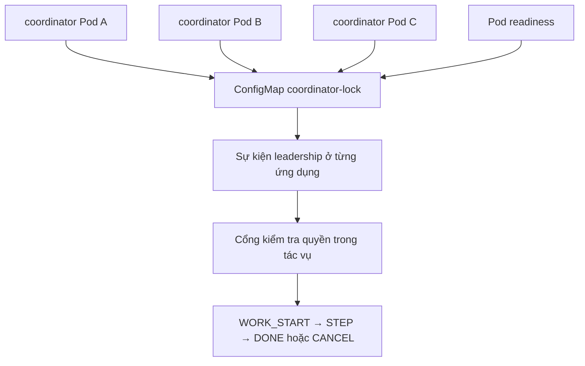

# Chạy tác vụ điều phối bằng leader election và mô phỏng failover

Trong chương **Thực hành tổng hợp** của module Spring Cloud Kubernetes (`SPRING_CLOUD_KUBERNETES`), bạn sẽ triển khai ba replica của một ứng dụng điều phối. Các replica cùng tranh quyền leader, nhưng chỉ replica có quyền mới bắt đầu một đợt công việc giả lập. Sau đó bạn làm leader mất readiness, xóa Pod leader và quan sát quá trình chuyển quyền.

Bài tập kết nối bốn phần: khóa dùng chung trên Kubernetes, RBAC, trạng thái sức khỏe Pod và vòng đời tác vụ trong Spring. Công việc minh họa chỉ ghi log theo từng bước, giúp quan sát failover mà không tạo giao dịch nghiệp vụ bên ngoài.

Sau bài học, bạn cần:

- Xác định đúng implementation, resource khóa và phạm vi tranh quyền.
- Dùng sự kiện cấp/thu hồi quyền để điều khiển tác vụ.
- Giữ follower sẵn sàng tranh quyền mà không tạo vòng phụ thuộc readiness.
- Đối chiếu bản ghi khóa, trạng thái từng Pod và log công việc khi failover.
- Giải thích vì sao leader election chưa cung cấp exactly-once hoặc fencing cho hệ thống nghiệp vụ.

## 1. Chọn rõ implementation cho thí nghiệm

Bài cố định Spring Boot 4.0.0, Spring Cloud BOM 2025.1.0 và module `spring-cloud-kubernetes-fabric8-leader` 5.0.0 do BOM quản lý. Đây là mốc GA dùng để tái lập ví dụ; khi triển khai hệ thống thật, cần đối chiếu bản vá và phạm vi hỗ trợ hiện hành. [Spring Cloud BOM 2025.1.0](https://raw.githubusercontent.com/spring-cloud/spring-cloud-release/v2025.1.0/spring-cloud-dependencies/pom.xml)

Implementation được sử dụng là **Fabric8 leader dựa trên ConfigMap**, với các sự kiện Spring Integration:

| Thành phần | Giá trị trong lab |
| --- | --- |
| Namespace | `sck-leader-lab` |
| Deployment | `coordinator`, ba replica |
| ConfigMap khóa | `coordinator-lock`, tạo trước |
| Role nghiệp vụ | `coordinator` |
| Key ghi leader | `leader.id.coordinator` |
| Nhận quyền | `OnGrantedEvent` |
| Mất quyền | `OnRevokedEvent` |

Role nghiệp vụ là tên nhóm tranh quyền, khác với Kubernetes RBAC Role. Các replica cần thống nhất namespace, tên ConfigMap và role nghiệp vụ để cùng tham gia một cuộc bầu chọn.

Tài liệu mới còn mô tả cơ chế native có các thuộc tính `spring.cloud.kubernetes.leader.election.*`, có thể dùng Lease và phát sự kiện khác. Không ghép cấu hình timeout hoặc listener của cơ chế đó vào ví dụ ConfigMap này. [Leader Election — Spring Cloud Kubernetes](https://docs.spring.io/spring-cloud-kubernetes/reference/leader-election.html)

Trong implementation Fabric8 tại tag 5.0.0, controller kiểm tra Pod leader hiện tại có Ready không; khi cần tranh quyền, candidate cũng phải Ready. Việc cập nhật ConfigMap sử dụng resourceVersion để kiểm soát cập nhật cạnh tranh. [Fabric8LeadershipController 5.0.0](https://raw.githubusercontent.com/spring-cloud/spring-cloud-kubernetes/v5.0.0/spring-cloud-kubernetes-fabric8-leader/src/main/java/org/springframework/cloud/kubernetes/fabric8/leader/Fabric8LeadershipController.java)

`update-period` của cơ chế này là chu kỳ kiểm tra trạng thái, không phải TTL của Lease. Không dùng công thức lease duration để cam kết thời gian failover cho lab.

## 2. Kiến trúc và điều kiện hoàn thành



Ở trạng thái ổn định, cần quan sát:

- Ba Pod đều Ready, gồm cả follower.
- Bản ghi khóa chỉ ra một leader cho role `coordinator`.
- Pod leader có log công việc; follower không bắt đầu công việc chỉ vì scheduler đến kỳ.
- Khi chuyển quyền, replica mới bắt đầu công việc và replica cũ ngừng nhận đợt mới sau khi nhận biết mất quyền.

Thí nghiệm kiểm tra hành vi trong môi trường lab và những tình huống được tạo ra. Nó không chứng minh không có hai tiến trình cùng thực hiện một side effect trong mọi tình huống mạng hoặc dừng JVM.

Chuẩn bị JDK 17 phù hợp với bộ phiên bản, Maven, Docker, `kubectl`, kind và đủ tài nguyên chạy ba JVM. Các lệnh dưới đây dùng PowerShell và một cluster kind riêng tên `sck-leader`.

Tạo dự án học tập:

```text
sck-leader-lab/
  pom.xml
  Dockerfile
  src/main/java/vn/example/leaderlab/LeaderLabApplication.java
  src/main/resources/application.yml
  k8s/lab.yml
```

## 3. Khai báo dependency vừa đủ

Nội dung `pom.xml`:

```xml
<project xmlns="http://maven.apache.org/POM/4.0.0"
         xmlns:xsi="http://www.w3.org/2001/XMLSchema-instance"
         xsi:schemaLocation="http://maven.apache.org/POM/4.0.0
                             https://maven.apache.org/xsd/maven-4.0.0.xsd">
    <modelVersion>4.0.0</modelVersion>
    <parent>
        <groupId>org.springframework.boot</groupId>
        <artifactId>spring-boot-starter-parent</artifactId>
        <version>4.0.0</version>
        <relativePath/>
    </parent>

    <groupId>vn.example</groupId>
    <artifactId>sck-leader-lab</artifactId>
    <version>1.0.0</version>

    <properties>
        <java.version>17</java.version>
        <spring-cloud.version>2025.1.0</spring-cloud.version>
    </properties>

    <dependencyManagement>
        <dependencies>
            <dependency>
                <groupId>org.springframework.cloud</groupId>
                <artifactId>spring-cloud-dependencies</artifactId>
                <version>${spring-cloud.version}</version>
                <type>pom</type>
                <scope>import</scope>
            </dependency>
        </dependencies>
    </dependencyManagement>

    <dependencies>
        <dependency>
            <groupId>org.springframework.boot</groupId>
            <artifactId>spring-boot-starter-webmvc</artifactId>
        </dependency>
        <dependency>
            <groupId>org.springframework.boot</groupId>
            <artifactId>spring-boot-starter-actuator</artifactId>
        </dependency>
        <dependency>
            <groupId>org.springframework.cloud</groupId>
            <artifactId>spring-cloud-kubernetes-fabric8-leader</artifactId>
        </dependency>
    </dependencies>

    <build>
        <plugins>
            <plugin>
                <groupId>org.springframework.boot</groupId>
                <artifactId>spring-boot-maven-plugin</artifactId>
            </plugin>
        </plugins>
    </build>
</project>
```

Module leader kéo theo Fabric8 auto-configuration và Spring Integration Core. Lab không cần thêm discovery starter hoặc starter `-all`. [POM module Fabric8 leader 5.0.0](https://raw.githubusercontent.com/spring-cloud/spring-cloud-kubernetes/v5.0.0/spring-cloud-kubernetes-fabric8-leader/pom.xml)

Leader election phục vụ nhu cầu điều phối. DiscoveryClient, Spring Cloud LoadBalancer và Configuration Watcher có mục đích riêng; việc ứng dụng dùng các tính năng đó không tự giới hạn một tác vụ `@Scheduled` về một replica.

## 4. Viết tác vụ biết nhận và mất quyền

Nội dung `LeaderLabApplication.java`:

```java
package vn.example.leaderlab;

import java.util.UUID;
import java.util.concurrent.atomic.AtomicBoolean;
import java.util.concurrent.atomic.AtomicLong;
import java.util.concurrent.atomic.AtomicReference;

import org.slf4j.Logger;
import org.slf4j.LoggerFactory;
import org.springframework.beans.factory.annotation.Value;
import org.springframework.boot.SpringApplication;
import org.springframework.boot.autoconfigure.SpringBootApplication;
import org.springframework.boot.availability.ApplicationAvailability;
import org.springframework.boot.availability.AvailabilityChangeEvent;
import org.springframework.boot.availability.ReadinessState;
import org.springframework.context.ApplicationContext;
import org.springframework.context.event.ContextClosedEvent;
import org.springframework.context.event.EventListener;
import org.springframework.integration.leader.Context;
import org.springframework.integration.leader.event.OnGrantedEvent;
import org.springframework.integration.leader.event.OnRevokedEvent;
import org.springframework.scheduling.annotation.EnableScheduling;
import org.springframework.scheduling.annotation.Scheduled;
import org.springframework.stereotype.Component;
import org.springframework.web.bind.annotation.GetMapping;
import org.springframework.web.bind.annotation.PostMapping;
import org.springframework.web.bind.annotation.RequestParam;
import org.springframework.web.bind.annotation.RestController;

@SpringBootApplication
@EnableScheduling
public class LeaderLabApplication {
    public static void main(String[] args) {
        SpringApplication.run(LeaderLabApplication.class, args);
    }

    public record State(
            String pod, String uid, String role,
            boolean localLeader, String readiness,
            long localGeneration, long started,
            long completed, boolean closing) {
    }

    @Component
    public static class CoordinatorTask {
        private static final Logger LOG =
                LoggerFactory.getLogger(CoordinatorTask.class);

        private record Session(Context context, long generation) {
        }

        private final AtomicReference<Session> active =
                new AtomicReference<>();
        private final AtomicLong generation = new AtomicLong();
        private final AtomicLong started = new AtomicLong();
        private final AtomicLong completed = new AtomicLong();
        private final AtomicBoolean closing = new AtomicBoolean();

        private final String pod;
        private final String uid;
        private final String role;
        private final ApplicationAvailability availability;

        public CoordinatorTask(
                @Value("${POD_NAME:local}") String pod,
                @Value("${POD_UID:local}") String uid,
                @Value("${spring.cloud.kubernetes.leader.role}") String role,
                ApplicationAvailability availability) {
            this.pod = pod;
            this.uid = uid;
            this.role = role;
            this.availability = availability;
        }

        @EventListener
        public void granted(OnGrantedEvent event) {
            if (!role.equals(event.getRole()) || closing.get()) {
                return;
            }
            Session session = new Session(
                    event.getContext(), generation.incrementAndGet());
            active.set(session);
            LOG.info("LEADER_GRANTED pod={} uid={} role={} generation={}",
                    pod, uid, role, session.generation());
        }

        @EventListener
        public void revoked(OnRevokedEvent event) {
            if (!role.equals(event.getRole())) {
                return;
            }
            active.set(null);
            LOG.info("LEADER_REVOKED pod={} uid={} role={}",
                    pod, uid, role);
        }

        @EventListener
        public void closing(ContextClosedEvent event) {
            closing.set(true);
            active.set(null);
            LOG.info("APP_CLOSING pod={} uid={}", pod, uid);
        }

        private boolean mayContinue(Session session) {
            return session != null
                    && !closing.get()
                    && active.get() == session
                    && session.context().isLeader();
        }

        @Scheduled(fixedDelayString = "${demo.task.delay-ms:2000}")
        public void coordinate() {
            Session session = active.get();
            if (!mayContinue(session)) {
                return;
            }

            String runId = UUID.randomUUID().toString();
            started.incrementAndGet();
            LOG.info("WORK_START pod={} uid={} role={} runId={} generation={}",
                    pod, uid, role, runId, session.generation());

            for (int step = 1; step <= 6; step++) {
                try {
                    Thread.sleep(1000);
                }
                catch (InterruptedException ex) {
                    Thread.currentThread().interrupt();
                    LOG.info("WORK_INTERRUPTED pod={} runId={}", pod, runId);
                    return;
                }

                if (!mayContinue(session)) {
                    LOG.info("WORK_CANCEL pod={} uid={} runId={} step={}",
                            pod, uid, runId, step);
                    return;
                }

                LOG.info("WORK_STEP pod={} runId={} step={}",
                        pod, runId, step);
            }

            if (!mayContinue(session)) {
                LOG.info("WORK_CANCEL pod={} uid={} runId={} beforeDone=true",
                        pod, uid, runId);
                return;
            }
            completed.incrementAndGet();
            LOG.info("WORK_DONE pod={} uid={} runId={}", pod, uid, runId);
        }

        public State state() {
            Session session = active.get();
            return new State(
                    pod, uid, role, mayContinue(session),
                    availability.getReadinessState().name(),
                    generation.get(), started.get(), completed.get(),
                    closing.get());
        }
    }

    @RestController
    public static class LabController {
        private final CoordinatorTask task;
        private final ApplicationContext applicationContext;

        public LabController(
                CoordinatorTask task,
                ApplicationContext applicationContext) {
            this.task = task;
            this.applicationContext = applicationContext;
        }

        @GetMapping("/lab/state")
        public State state() {
            return task.state();
        }

        @PostMapping("/lab/ready")
        public State ready(@RequestParam("ready") boolean ready) {
            AvailabilityChangeEvent.publish(
                    applicationContext,
                    ready ? ReadinessState.ACCEPTING_TRAFFIC
                            : ReadinessState.REFUSING_TRAFFIC);
            return task.state();
        }
    }
}
```

Các listener chỉ cập nhật cổng kiểm tra quyền và ghi log; không chạy toàn bộ tác vụ dài ngay trong listener. Scheduler thực hiện công việc trên luồng riêng của nó. Spring Integration cung cấp sự kiện cùng `Context` để ứng dụng phản ứng khi quyền thay đổi. [Leadership Event Handling — Spring Integration](https://docs.spring.io/spring-integration/reference/7.0/leadership-event-handling.html)

Mỗi lần nhận quyền tạo một `Session` mới. Một đợt cũ giữ session cũ sẽ dừng khi kiểm tra thấy session không còn hiện hành, kể cả Pod đã mất rồi nhận lại quyền. `localGeneration` chỉ là số lần nhận quyền trong JVM đó, không phải fencing token dùng chung toàn cluster.

Cổng kiểm tra được gọi trước khi bắt đầu và giữa các bước. Điều này hỗ trợ hủy hợp tác, không thể thu hồi một HTTP request hay giao dịch đã gửi ra ngoài. Một tác vụ thực tế cần chia nhỏ công việc và kiểm tra quyền ở những ranh giới phù hợp.

`/lab/ready` phát thay đổi trạng thái readiness để tạo lỗi có kiểm soát. [AvailabilityChangeEvent API — Spring Boot](https://docs.spring.io/spring-boot/4.0/api/java/org/springframework/boot/availability/AvailabilityChangeEvent.html)

Không công khai endpoint thay đổi readiness ra Internet. Lab chỉ truy cập trực tiếp từng Pod bằng port-forward.

## 5. Cấu hình leader và probe

Nội dung `application.yml`:

```yaml
server:
  port: 8080
  shutdown: graceful

spring:
  application:
    name: coordinator
  lifecycle:
    timeout-per-shutdown-phase: 15s
  task:
    scheduling:
      pool:
        size: 1
  cloud:
    kubernetes:
      client:
        namespace: ${POD_NAMESPACE:sck-leader-lab}
      leader:
        enabled: true
        auto-startup: true
        namespace: ${POD_NAMESPACE:sck-leader-lab}
        role: coordinator
        config-map-name: coordinator-lock
        create-config-map: false
        update-period: 2s
        publish-failed-events: true

management:
  endpoints:
    web:
      exposure:
        include: health,info
  endpoint:
    health:
      probes:
        enabled: true
        add-additional-paths: true
      group:
        liveness:
          include: livenessState
        readiness:
          include: readinessState
  info:
    leader:
      enabled: true

demo:
  task:
    delay-ms: 2000
```

Các thuộc tính ConfigMap, role và `update-period` thuộc cơ chế Fabric8 được chọn. Chu kỳ mặc định trong mã nguồn là 60 giây; lab đặt 2 giây để dễ quan sát. Đây không phải khuyến nghị giảm chu kỳ cho mọi hệ thống. [LeaderProperties tại tag 5.0.0](https://raw.githubusercontent.com/spring-cloud/spring-cloud-kubernetes/v5.0.0/spring-cloud-kubernetes-commons/src/main/java/org/springframework/cloud/kubernetes/commons/leader/LeaderProperties.java)

**Follower phải có thể Ready.** Nếu readiness chỉ trả thành công khi `localLeader=true`, các candidate có thể không đủ điều kiện tranh quyền, tạo vòng phụ thuộc: phải là leader mới Ready nhưng phải Ready mới được bầu.

Liveness cũng không nên dựa vào việc đang giữ quyền. Một follower khỏe mạnh vẫn là tiến trình hợp lệ và không cần bị kubelet restart chỉ vì chưa được bầu. [Kubernetes Probes — Spring Boot 4.0](https://docs.spring.io/spring-boot/4.0/reference/actuator/endpoints.html#actuator.endpoints.kubernetes-probes)

ConfigMap khóa không phải ConfigMap chứa cấu hình nghiệp vụ. Không import nó thành PropertySource hoặc dùng thay đổi khóa để refresh toàn bộ ứng dụng.

## 6. Tạo khóa trước và cấp quyền RBAC

Nội dung `k8s/lab.yml`:

```yaml
apiVersion: v1
kind: Namespace
metadata:
  name: sck-leader-lab
---
apiVersion: v1
kind: ServiceAccount
metadata:
  name: coordinator
  namespace: sck-leader-lab
---
apiVersion: v1
kind: ConfigMap
metadata:
  name: coordinator-lock
  namespace: sck-leader-lab
  labels:
    lab: leader-election
data: {}
---
apiVersion: rbac.authorization.k8s.io/v1
kind: Role
metadata:
  name: coordinator-election
  namespace: sck-leader-lab
rules:
  - apiGroups: [""]
    resources: ["configmaps"]
    resourceNames: ["coordinator-lock"]
    verbs: ["get", "list", "watch", "update"]
  - apiGroups: [""]
    resources: ["pods"]
    verbs: ["get", "watch"]
---
apiVersion: rbac.authorization.k8s.io/v1
kind: RoleBinding
metadata:
  name: coordinator-election
  namespace: sck-leader-lab
subjects:
  - kind: ServiceAccount
    name: coordinator
    namespace: sck-leader-lab
roleRef:
  apiGroup: rbac.authorization.k8s.io
  kind: Role
  name: coordinator-election
---
apiVersion: apps/v1
kind: Deployment
metadata:
  name: coordinator
  namespace: sck-leader-lab
spec:
  replicas: 3
  selector:
    matchLabels:
      app: coordinator
  template:
    metadata:
      labels:
        app: coordinator
    spec:
      serviceAccountName: coordinator
      terminationGracePeriodSeconds: 25
      containers:
        - name: app
          image: sck-leader-lab:1.0.0
          imagePullPolicy: IfNotPresent
          ports:
            - name: http
              containerPort: 8080
          env:
            - name: POD_NAME
              valueFrom:
                fieldRef:
                  fieldPath: metadata.name
            - name: POD_UID
              valueFrom:
                fieldRef:
                  fieldPath: metadata.uid
            - name: POD_NAMESPACE
              valueFrom:
                fieldRef:
                  fieldPath: metadata.namespace
          resources:
            requests:
              cpu: 100m
              memory: 192Mi
            limits:
              cpu: "1"
              memory: 512Mi
          startupProbe:
            httpGet:
              path: /livez
              port: http
            periodSeconds: 5
            timeoutSeconds: 2
            failureThreshold: 60
          livenessProbe:
            httpGet:
              path: /livez
              port: http
            periodSeconds: 10
            timeoutSeconds: 2
          readinessProbe:
            httpGet:
              path: /readyz
              port: http
            periodSeconds: 2
            timeoutSeconds: 2
            failureThreshold: 1
```

Ứng dụng được đọc/cập nhật đúng ConfigMap khóa và theo dõi Pod để kiểm tra readiness. Không cần cấp quyền đọc Secret, xóa Pod hoặc sửa Deployment cho ServiceAccount ứng dụng.

ConfigMap được tạo trước nên `create-config-map=false` và ứng dụng không có verb `create`. Không thêm `create` rồi cho rằng `resourceNames` có thể giới hạn tên cho thao tác tạo theo cùng cách với `get/update`. Với list/watch bị giới hạn tên, request cần bộ lọc tên tương ứng; watcher của implementation được chọn theo dõi ConfigMap theo tên. [RBAC Authorization — Kubernetes](https://kubernetes.io/docs/reference/access-authn-authz/rbac/), [Fabric8LeaderRecordWatcher 5.0.0](https://raw.githubusercontent.com/spring-cloud/spring-cloud-kubernetes/v5.0.0/spring-cloud-kubernetes-fabric8-leader/src/main/java/org/springframework/cloud/kubernetes/fabric8/leader/Fabric8LeaderRecordWatcher.java)

Downward API cung cấp Pod name, UID và namespace. Trong lab không ghi đè hostname của Pod; candidate mặc định của Fabric8 dùng hostname làm ID. [Fabric8LeaderAutoConfiguration 5.0.0](https://raw.githubusercontent.com/spring-cloud/spring-cloud-kubernetes/v5.0.0/spring-cloud-kubernetes-fabric8-leader/src/main/java/org/springframework/cloud/kubernetes/fabric8/leader/Fabric8LeaderAutoConfiguration.java)

## 7. Build và triển khai

`Dockerfile`:

```dockerfile
FROM eclipse-temurin:17-jre
WORKDIR /app
COPY target/sck-leader-lab-1.0.0.jar app.jar
EXPOSE 8080
ENTRYPOINT ["java", "-jar", "/app/app.jar"]
```

Tại thư mục gốc dự án:

```powershell
java -version
mvn -version
mvn clean package
docker build -t sck-leader-lab:1.0.0 .

kind get clusters
```

Nếu chưa có cluster lab:

```powershell
kind create cluster --name sck-leader
```

Nếu cluster đã tồn tại và là môi trường lab bạn muốn dùng, bỏ qua lệnh tạo. Nạp image và triển khai:

```powershell
kind load docker-image sck-leader-lab:1.0.0 --name sck-leader

$labContext = 'kind-sck-leader'
$labNamespace = 'sck-leader-lab'

kubectl --context $labContext cluster-info
kubectl --context $labContext apply -f k8s/lab.yml
kubectl --context $labContext -n $labNamespace rollout status deployment/coordinator --timeout=360s
kubectl --context $labContext -n $labNamespace get pods -l app=coordinator -o wide
```

Nạp image là bước riêng vì image ở Docker trên máy chưa tự có trong node kind. [kind Quick Start](https://kind.sigs.k8s.io/docs/user/quick-start/#loading-an-image-into-your-cluster)

Manifest chứa ConfigMap khóa ban đầu. Không dùng việc áp dụng lại bản `data: {}` như một cách reset cuộc bầu chọn trong lúc ứng dụng đang hoạt động. Việc chủ động sửa/xóa bản ghi khóa có thể làm nhiều tiến trình thay đổi nhận thức về quyền ở các thời điểm khác nhau.

Kiểm tra quyền nếu log báo 403:

```powershell
$candidateIdentity = 'system:serviceaccount:sck-leader-lab:coordinator'
kubectl --context $labContext auth can-i get configmaps/coordinator-lock -n $labNamespace --as=$candidateIdentity
kubectl --context $labContext auth can-i update configmaps/coordinator-lock -n $labNamespace --as=$candidateIdentity
kubectl --context $labContext auth can-i watch pods -n $labNamespace --as=$candidateIdentity
kubectl --context $labContext -n $labNamespace logs -l app=coordinator --prefix --tail=100
```

`--as` yêu cầu người vận hành có quyền impersonation. Một lỗi impersonation không tự trả lời quyền của ServiceAccount. Nếu lỗi nằm ở watch, đối chiếu thêm verb, resource, field selector và tên mà client thực sự yêu cầu.

## 8. Xác định leader và quan sát trạng thái ổn định

Tạo hai hàm tiện ích trong terminal thao tác cluster:

```powershell
function Get-LabLeader {
    $lockJson = kubectl --context $labContext -n $labNamespace get configmap coordinator-lock -o json
    if ($LASTEXITCODE -ne 0) {
        throw 'Không đọc được ConfigMap khóa.'
    }
    $lockObject = $lockJson | ConvertFrom-Json
    $lockObject.data.'leader.id.coordinator'
}

function Wait-LabLeaderChange {
    param(
        [string] $Previous,
        [int] $TimeoutSeconds = 60
    )
    $deadline = [DateTime]::UtcNow.AddSeconds($TimeoutSeconds)
    do {
        $candidateName = Get-LabLeader
        if ($candidateName -and $candidateName -ne $Previous) {
            return $candidateName
        }
        Start-Sleep -Seconds 1
    } while ([DateTime]::UtcNow -lt $deadline)
    throw 'Chưa quan sát được leader khác trong cửa sổ kiểm tra.'
}

$leaderPod = Wait-LabLeaderChange -Previous ''
$leaderPod
kubectl --context $labContext -n $labNamespace get configmap coordinator-lock -o yaml
```

Key `leader.id.coordinator` có dấu chấm nên cần truy cập như một tên property đầy đủ khi dùng PowerShell. Trong lab, giá trị của key phải khớp tên một Pod candidate.

Ở terminal quan sát log:

```powershell
kubectl --context $labContext -n $labNamespace logs -l app=coordinator --prefix --timestamps --tail=200 -f --max-log-requests=10
```

Các biến PowerShell không tự truyền sang terminal khác; khai báo lại `$labContext` và `$labNamespace` khi cần. Với log theo selector, không mặc định stream đang mở sẽ tự theo mọi Pod mới xuất hiện; mở lại hoặc truy vấn riêng Pod mới sau rollout.

Kỳ vọng ở giai đoạn ổn định:

```text
Pod A: LEADER_GRANTED ... role=coordinator generation=1
Pod A: WORK_START ... runId=...
Pod A: WORK_STEP ... step=1
Pod A: ...
Pod A: WORK_DONE ...
Pod B, Pod C: không có WORK_START cho role này
```

Đây là ví dụ định dạng, không phải kết quả đã chạy sẵn. Không yêu cầu Pod A luôn thắng hoặc thứ tự bầu chọn phải cố định.

Mở port-forward trực tiếp vào Pod leader ở một terminal khác, dùng tên vừa đọc:

```powershell
kubectl --context $labContext -n $labNamespace port-forward pod/$leaderPod 18080:8080
```

Ở terminal gọi HTTP:

```powershell
$labUrl = 'http://127.0.0.1:18080'
Invoke-RestMethod "$labUrl/lab/state" | ConvertTo-Json
Invoke-RestMethod "$labUrl/actuator/info" | ConvertTo-Json -Depth 5
```

Đối chiếu `localLeader` của ứng dụng, bản ghi ConfigMap và log. `localLeader` là góc nhìn tại tiến trình; nó không phải phép đọc đồng bộ API server ở mỗi request. Các counter `started/completed` cũng chỉ thuộc JVM đang truy vấn.

## 9. Failover có kiểm soát: leader mất readiness

Chờ leader ghi `WORK_START` rồi thực hiện phép thử để có cơ hội quan sát hủy giữa đợt công việc. Giữ port-forward vào **leader cũ**, không đổi sang một Pod ngẫu nhiên.

Trong terminal thao tác cluster, giữ tên leader ban đầu:

```powershell
$oldLeaderPod = Get-LabLeader
$oldLeaderPod
```

Trong terminal HTTP:

```powershell
Invoke-RestMethod -Method Post "$labUrl/lab/ready?ready=false"
curl.exe -i --max-time 5 "$labUrl/readyz"
curl.exe -i --max-time 5 "$labUrl/livez"
```

Sau thay đổi, readiness trả thất bại còn liveness vẫn thành công. Pod không cần restart chỉ vì readiness bị từ chối.

Trong terminal cluster:

```powershell
kubectl --context $labContext -n $labNamespace wait --for=condition=Ready=false pod/$oldLeaderPod --timeout=60s
$newLeaderPod = Wait-LabLeaderChange -Previous $oldLeaderPod
$newLeaderPod
kubectl --context $labContext -n $labNamespace get pods -l app=coordinator
kubectl --context $labContext -n $labNamespace logs pod/$oldLeaderPod --timestamps --tail=100
kubectl --context $labContext -n $labNamespace logs pod/$newLeaderPod --timestamps --tail=100
```

Cần tìm chuỗi bằng chứng:

1. Leader cũ vẫn là cùng Pod nhưng chuyển sang không Ready.
2. Bản ghi khóa đổi sang một candidate khác.
3. Leader cũ nhận `LEADER_REVOKED`; đợt đang chạy có thể ghi `WORK_CANCEL` nếu chưa kết thúc.
4. Leader mới ghi `LEADER_GRANTED` rồi bắt đầu đợt của nó.
5. Sau khi leader cũ đã nhận biết mất quyền, nó không tiếp tục khởi tạo đợt mới với session cũ.

Thay đổi trạng thái HTTP, kubelet cập nhật Pod, watcher quan sát và tác vụ kiểm tra quyền diễn ra ở các thời điểm khác nhau. Không khẳng định quyền được chuyển ngay tại thời điểm POST trả về.

Port-forward trực tiếp tới Pod có thể tiếp tục hoạt động khi Pod không Ready. Do đó, vẫn có thể kiểm tra trạng thái leader cũ:

```powershell
Invoke-RestMethod "$labUrl/lab/state" | ConvertTo-Json
```

Khôi phục readiness của Pod cũ qua port-forward đang giữ:

```powershell
Invoke-RestMethod -Method Post "$labUrl/lab/ready?ready=true"
```

Sau đó chờ Pod Ready trở lại. Nó có thể ở vai trò follower; không có yêu cầu phải giành lại leadership:

```powershell
kubectl --context $labContext -n $labNamespace wait --for=condition=Ready pod/$oldLeaderPod --timeout=60s
```

## 10. Failover khi xóa Pod leader

Đọc lại leader hiện tại, vì kết quả sau phép thử trước có thể đã thay đổi:

```powershell
$deletedLeaderPod = Get-LabLeader
if (-not $deletedLeaderPod) {
    throw 'Chưa có leader để mô phỏng mất Pod.'
}

kubectl --context $labContext -n $labNamespace get pod $deletedLeaderPod -o wide
kubectl --context $labContext -n $labNamespace logs pod/$deletedLeaderPod --timestamps --tail=50

$handoverTimer = [System.Diagnostics.Stopwatch]::StartNew()
kubectl --context $labContext -n $labNamespace delete pod $deletedLeaderPod --wait=false
$replacementLeaderPod = Wait-LabLeaderChange -Previous $deletedLeaderPod
$handoverTimer.Stop()

[pscustomobject]@{
    PreviousLeader = $deletedLeaderPod
    ObservedLeader = $replacementLeaderPod
    LockChangeSeconds = $handoverTimer.Elapsed.TotalSeconds
}
```

Lệnh xóa Pod thông thường cho phép quá trình kết thúc có thời gian graceful; nó không tương đương máy chủ mất điện hoặc JVM bị SIGKILL. Kubernetes và Deployment còn tạo Pod thay thế để giữ số replica. [Pod Lifecycle — Kubernetes](https://kubernetes.io/docs/concepts/workloads/pods/pod-lifecycle/)

Implementation lab cố gắng thu hồi quyền khi leader initiator được dừng bình thường. [LeaderInitiator tại tag 5.0.0](https://raw.githubusercontent.com/spring-cloud/spring-cloud-kubernetes/v5.0.0/spring-cloud-kubernetes-commons/src/main/java/org/springframework/cloud/kubernetes/commons/leader/LeaderInitiator.java)

Xác minh sau chuyển quyền:

```powershell
kubectl --context $labContext -n $labNamespace rollout status deployment/coordinator --timeout=360s
kubectl --context $labContext -n $labNamespace get pods -l app=coordinator -o wide
kubectl --context $labContext -n $labNamespace get configmap coordinator-lock -o yaml
kubectl --context $labContext -n $labNamespace logs pod/$replacementLeaderPod --timestamps --tail=100
```

`LockChangeSeconds` đo thời gian quan sát bản ghi đổi, chưa phải thời gian tác vụ phục hồi hoàn toàn. Ghi thêm thời điểm `WORK_START` đầu tiên của leader mới và thời điểm `WORK_DONE` đầu tiên sau sự cố.

Công việc giả lập không có checkpoint dùng chung. Leader mới bắt đầu đợt mới; nó không tiếp tục chính xác bước còn dang dở của leader đã mất.

### Mở rộng: JVM dừng đột ngột

Trong đúng namespace lab, có thể thử dừng JVM PID 1 trong image đã dựng:

```powershell
$crashedLeaderPod = Get-LabLeader
if (-not $crashedLeaderPod) {
    throw 'Chưa có leader để thử dừng JVM.'
}
kubectl --context $labContext -n $labNamespace exec $crashedLeaderPod -- sh -c 'kill -9 1'
```

Lệnh có thể kết thúc với mã lỗi do container bị dừng. Quan sát `restartCount`, log `--previous` và bản ghi khóa:

```powershell
kubectl --context $labContext -n $labNamespace get pod $crashedLeaderPod
kubectl --context $labContext -n $labNamespace logs $crashedLeaderPod --previous --timestamps --tail=100
kubectl --context $labContext -n $labNamespace get configmap coordinator-lock -o yaml
```

Không mong đợi JVM đã bị SIGKILL phát `OnRevokedEvent` hoặc log shutdown. Container có thể restart trong cùng Pod và cùng candidate ID; Pod đó có thể giành lại quyền. Do đó, việc holder cuối cùng giữ nguyên tên không chứng minh không có gián đoạn.

## 11. Ghi nhận kết quả và phân loại lỗi

Với mỗi lần thử, ghi lại:

| Dữ liệu | Mục đích |
| --- | --- |
| Pod name và UID trước/sau | Phân biệt container restart với Pod thay thế |
| Role, namespace, tên khóa | Xác nhận đúng phạm vi tranh quyền |
| Thời điểm tạo lỗi | Mốc bắt đầu quan sát |
| Thời điểm bản ghi đổi leader | Đo chuyển quyền ở lớp khóa |
| Sự kiện cấp/thu hồi quyền | Kiểm tra phản ứng của ứng dụng |
| `WORK_START/CANCEL/DONE` cùng runId | Kiểm tra vòng đời từng lần chạy |
| Readiness, restartCount và lỗi API | Phân biệt lỗi sức khỏe với lỗi coordination |

Theo dõi cửa sổ đủ dài qua nhiều lần chạy, không chỉ chụp một thời điểm thấy một leader.

| Hiện tượng | Hướng điều tra |
| --- | --- |
| Cả ba Pod Ready nhưng không có leader | ConfigMap thiếu, role/key sai, RBAC hoặc leader module chưa được kích hoạt |
| Cả ba Pod không Ready và không ai được bầu | Readiness có đang phụ thuộc leadership không? |
| Có leader trong khóa nhưng không có `WORK_START` | Listener, role filter, scheduler và session tại JVM |
| Follower vẫn chạy công việc | Đường thực thi nào bỏ qua cổng kiểm tra quyền? |
| 403 khi cập nhật khóa | Verb update, đúng tên ConfigMap và RoleBinding |
| Khóa ghi một Pod nhưng có log từ hai Pod | Kiểm tra thời điểm, role, runId, độ trễ thông báo và công việc đang chạy dở |
| Restart nhưng tên holder không đổi | Có thể là cùng Pod/candidate khởi động lại |
| Failover chậm | Pod readiness, watch, chu kỳ kiểm tra, độ trễ API hoặc thiếu candidate đủ điều kiện |
| Có nhiều leader thuộc các nhóm khác nhau | Kiểm tra khác namespace, ConfigMap hoặc role trước khi kết luận split-brain |

Nếu API server không truy cập được, không mặc định cổng kiểm tra trong lab lập tức đóng. `Context.isLeader()` của implementation này đọc nhận thức local của controller, không thực hiện một round-trip tới API server cho mỗi bước công việc. Từ đó có thể thấy cần đánh giá riêng tình huống mất kết nối và trạng thái local bị cũ. [LeaderContext 5.0.0](https://raw.githubusercontent.com/spring-cloud/spring-cloud-kubernetes/v5.0.0/spring-cloud-kubernetes-commons/src/main/java/org/springframework/cloud/kubernetes/commons/leader/LeaderContext.java)

## 12. Giới hạn cần giải quyết trước khi chạy công việc thật

### Leader election không tự cung cấp exactly-once

Giả sử leader đã gửi yêu cầu tạo báo cáo hoặc thanh toán, rồi chết trước khi ghi nhận hoàn thành. Leader mới không thể suy ra từ bản ghi khóa rằng side effect đó đã xảy ra hay chưa.

Một thiết kế nghiệp vụ cần thêm:

- Khóa định danh công việc ổn định, chẳng hạn loại tác vụ cộng kỳ xử lý.
- Bản ghi công việc và trạng thái hoàn thành bền vững.
- Idempotency hoặc unique constraint được thực thi nguyên tử.
- Quy tắc nhận lại công việc dang dở và checkpoint.
- Xử lý nhất quán giữa giao dịch cơ sở dữ liệu và tác động tới hệ thống bên ngoài.

`runId` trong lab định danh một lần thử để đọc log. UUID mới cho mỗi lần chạy không thay thế business idempotency key.

### Cần phân biệt cổng local với fencing

Một tiến trình có thể bị pause, giữ nhận thức leader cũ rồi tiếp tục sau khi tiến trình khác đã nhận quyền. Kiểm tra biến local trước side effect vẫn có khoảng đua giữa lúc kiểm tra và lúc tài nguyên nhận yêu cầu.

Fencing yêu cầu tài nguyên đích xác thực quyền của lần sở hữu hiện hành, ví dụ token tăng đơn điệu được kiểm tra nguyên tử khi ghi. Nguồn phát token và quy tắc chấp nhận phải được thiết kế rõ; không dùng `localGeneration`, Pod UID hay chuỗi resourceVersion như một số thứ tự toàn cục tự suy đoán.

### Không giữ tác vụ dài trong listener

Listener cần nhanh để quyền mới được phản ánh kịp thời. Công việc dài nên có timeout, điểm hủy hợp tác và ranh giới commit rõ. Thu hồi quyền không hoàn tác một giao dịch đã commit.

### Không thay thế bằng replica hoặc cân bằng tải

Một Deployment có một replica không giải quyết mọi khoảng chồng lấn khi rollout hoặc sự cố. Một HTTP Service hay LoadBalancer cũng không ngăn scheduler chạy trong mọi replica. Leader election chỉ nên được thêm khi có nhu cầu điều phối và khi cơ chế bảo vệ nghiệp vụ tương ứng đã rõ.

Trong triển khai có Configuration Watcher, việc cần leader cho controller đó là một quyết định riêng theo tính năng HA của phiên bản đang dùng. Bầu leader cho ứng dụng lab không tự biến một watcher khác thành một controller chỉ chạy ở một replica.

## 13. Tiêu chí hoàn thành và dọn lab

Bài hoàn thành khi bạn trình bày được:

- Cấu hình và khóa nào làm ba replica cùng tranh một role.
- Vì sao follower vẫn Ready nhưng không chạy tác vụ.
- Cách listener và session ngăn một đợt cũ tiếp tục sau khi nhận biết mất quyền.
- Bằng chứng chuyển quyền khi leader mất readiness và khi Pod bị xóa.
- Sự khác biệt giữa đổi holder, khởi động công việc mới và phục hồi nghiệp vụ.
- Những phần lab chưa chứng minh về partition, exactly-once và fencing.

Dừng các lệnh theo dõi log và port-forward bằng Ctrl+C. Nếu namespace chỉ chứa tài nguyên của bài này:

```powershell
kubectl --context $labContext get namespace sck-leader-lab
kubectl --context $labContext delete namespace sck-leader-lab
```

Nếu cluster được tạo riêng cho bài và không còn dùng:

```powershell
kind delete cluster --name sck-leader
```

Chỉ dọn namespace hoặc cluster lab thuộc phạm vi thí nghiệm; không áp dụng các lệnh xóa này cho môi trường chia sẻ.
