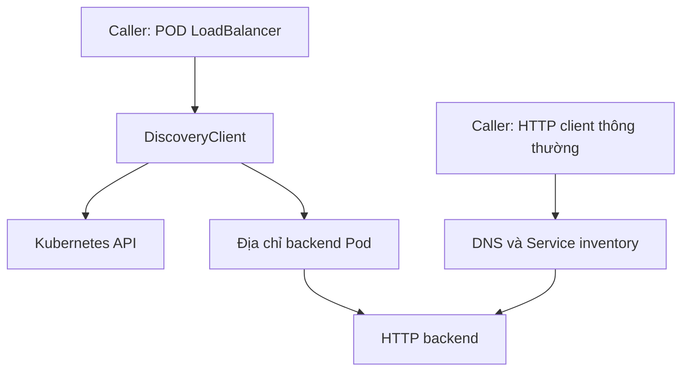

# Mô phỏng thay đổi endpoint, API server lỗi và Pod bị dừng

Trong chương **Thực hành tổng hợp** của **SPRING_CLOUD_KUBERNETES**, bài này dựng một caller và hai Pod backend để quan sát ba tình huống:

1. Một backend không còn Ready nhưng tiến trình vẫn chạy.
2. Caller không gọi được Kubernetes API trong khi đường nghiệp vụ vẫn được cho phép.
3. Một Pod backend bị dừng và Deployment tạo Pod thay thế.

Mục tiêu là phân biệt **trạng thái Kubernetes**, **danh sách instance của Spring**, **instance thực sự được chọn** và **kết quả request**. Không suy ra khả năng chịu lỗi chỉ từ trạng thái Running hoặc từ một lần gọi thành công.

## 1. Phạm vi và kết quả cần đạt

Lab dùng namespace riêng `sck-failure-lab`. Chỉ thay đổi tài nguyên của lab; không dừng control plane, sửa mạng của node hoặc tác động API server thật.

| Thành phần | Vai trò |
| --- | --- |
| `inventory` | Deployment hai replica và Service backend |
| `caller` | Deployment một replica, dùng DiscoveryClient và Spring Cloud LoadBalancer |
| `caller-discovery` | ServiceAccount đọc tài nguyên discovery trong namespace lab |
| `/lab/instances` | Xem danh sách Spring DiscoveryClient đang trả về |
| `/lab/api-check` | Thực hiện một lệnh đọc trực tiếp Kubernetes API |
| `/lab/call/lb` | Gọi backend bằng LoadBalancer ở chế độ POD |
| `/lab/call/dns` | Gọi trực tiếp DNS/Service bằng HTTP client không gắn LoadBalancer |

Các ví dụ dùng Java 21, Spring Boot 3.5, Spring Cloud release train 2025.0 và Spring Cloud Kubernetes 3.3 làm nền minh họa. Chọn bản patch tương thích và ghi lại dependency thực tế. Đây là một nền thí nghiệm cụ thể, không phải tuyên bố về phiên bản mới nhất.

Cần chuẩn bị cluster thử nghiệm, kubectl, hai image ứng dụng mà cluster kéo được và CNI thực thi NetworkPolicy. Riêng thí nghiệm mất Kubernetes API phải được kiểm chứng trên cách triển khai mạng của cluster; tạo policy thành công chưa chứng minh lưu lượng đã bị chặn.

Bài không cần ConfigMap, Secret hoặc Configuration Watcher để tạo lỗi discovery. Không thêm những tính năng này nếu không thuộc mục tiêu thí nghiệm.

## 2. Tách đường discovery khỏi đường phục vụ request



Ở chế độ POD, LoadBalancer dùng DiscoveryClient để lấy các instance. Đường DNS trực tiếp gọi Service Kubernetes và không thực hiện Spring DiscoveryClient lookup cho mỗi request. Cả hai cuối cùng vẫn phụ thuộc các thành phần mạng thực tế của cluster.

Không đồng nhất chế độ `SERVICE` của Spring Cloud Kubernetes LoadBalancer với một HTTP client gọi DNS trực tiếp: chế độ SERVICE vẫn có logic tìm Service của chính thư viện. Lab sử dụng một client hoàn toàn không gắn `@LoadBalanced` để tạo đường đối chứng. Xem [LoadBalancer for Kubernetes 3.3](https://docs.spring.io/spring-cloud-kubernetes/reference/3.3/load-balancer.html).

Khi API không tới được, data plane có thể tiếp tục dùng trạng thái đã được thiết lập. Điều đó không bảo đảm endpoint mới sẽ được cập nhật, và cũng không bảo đảm mọi loại DiscoveryClient đều tiếp tục trả danh sách cũ. Phải đo hành vi của đúng client, phiên bản và cấu hình cache.

## 3. Ứng dụng backend inventory

Tạo một ứng dụng Spring Boot có `spring-boot-starter-web` và `spring-boot-starter-actuator`. Backend không gọi Kubernetes API nên không cần starter discovery.

### 3.1. Lớp chạy chính

```java
package vn.example.inventory;

import org.springframework.boot.SpringApplication;
import org.springframework.boot.autoconfigure.SpringBootApplication;

@SpringBootApplication
public class InventoryApplication {
    public static void main(String[] args) {
        SpringApplication.run(InventoryApplication.class, args);
    }
}
```

### 3.2. API và công tắc readiness cho lab

```java
package vn.example.inventory;

import java.util.Map;
import java.util.UUID;

import org.springframework.beans.factory.annotation.Value;
import org.springframework.boot.availability.AvailabilityChangeEvent;
import org.springframework.boot.availability.ReadinessState;
import org.springframework.context.ApplicationContext;
import org.springframework.web.bind.annotation.GetMapping;
import org.springframework.web.bind.annotation.PathVariable;
import org.springframework.web.bind.annotation.PostMapping;
import org.springframework.web.bind.annotation.RestController;

@RestController
public class InventoryController {
    private final ApplicationContext context;
    private final String pod;
    private final String uid;
    private final String bootId = UUID.randomUUID().toString();

    public InventoryController(
            ApplicationContext context,
            @Value("${POD_NAME:local}") String pod,
            @Value("${POD_UID:local}") String uid) {
        this.context = context;
        this.pod = pod;
        this.uid = uid;
    }

    @GetMapping("/item")
    public Map<String, String> item() {
        return Map.of(
                "item", "sample-item",
                "pod", pod,
                "uid", uid,
                "bootId", bootId);
    }

    @PostMapping("/lab/readiness/{ready}")
    public Map<String, Object> readiness(@PathVariable boolean ready) {
        ReadinessState state = ready
                ? ReadinessState.ACCEPTING_TRAFFIC
                : ReadinessState.REFUSING_TRAFFIC;
        AvailabilityChangeEvent.publish(context, state);
        return Map.of("pod", pod, "ready", ready);
    }
}
```

Công tắc này phục vụ thí nghiệm trong namespace cô lập. Không triển khai endpoint điều khiển readiness công khai trong ứng dụng nghiệp vụ. Endpoint chỉ đổi readiness; không chủ động làm tiến trình chết và không đổi liveness.

### 3.3. Cấu hình backend

```yaml
spring:
  application:
    name: inventory
  lifecycle:
    timeout-per-shutdown-phase: 20s

server:
  port: 8080
  shutdown: graceful

management:
  endpoints:
    web:
      exposure:
        include: health
  endpoint:
    health:
      probes:
        enabled: true
        add-additional-paths: true
```

`/readyz` và `/livez` là các đường probe trên cổng ứng dụng. Readiness phản ánh khả năng nhận traffic, còn liveness không nên phụ thuộc lỗi tạm thời của API server hoặc downstream dùng chung. Xem [Kubernetes Probes của Spring Boot 3.5](https://docs.spring.io/spring-boot/3.5/reference/actuator/endpoints.html#actuator.endpoints.kubernetes-probes).

## 4. Ứng dụng caller

### 4.1. Dependency

Trong ứng dụng Spring Boot có BOM Spring Cloud tương thích, thêm:

```xml
<dependency>
    <groupId>org.springframework.boot</groupId>
    <artifactId>spring-boot-starter-web</artifactId>
</dependency>
<dependency>
    <groupId>org.springframework.boot</groupId>
    <artifactId>spring-boot-starter-actuator</artifactId>
</dependency>
<dependency>
    <groupId>org.springframework.cloud</groupId>
    <artifactId>spring-cloud-starter-kubernetes-fabric8</artifactId>
</dependency>
<dependency>
    <groupId>org.springframework.cloud</groupId>
    <artifactId>spring-cloud-starter-kubernetes-fabric8-loadbalancer</artifactId>
</dependency>
```

Lab chọn một loại client là Fabric8. Không thêm Kubernetes Java Client để tạo một DiscoveryClient thứ hai trong cùng thí nghiệm.

### 4.2. Cấu hình caller

```yaml
spring:
  application:
    name: caller
  cloud:
    kubernetes:
      client:
        namespace: sck-failure-lab
      discovery:
        namespaces:
          - sck-failure-lab
        all-namespaces: false
        include-not-ready-addresses: false
        use-endpoint-slices: true
      loadbalancer:
        mode: POD
    loadbalancer:
      cache:
        enabled: false
      retry:
        enabled: false
    discovery:
      client:
        health-indicator:
          enabled: false

server:
  port: 8080

management:
  endpoints:
    web:
      exposure:
        include: health
  endpoint:
    health:
      probes:
        enabled: true
        add-additional-paths: true
```

Tắt lớp cache chung của Spring Cloud LoadBalancer để giảm một biến số; điều này không đồng nghĩa xóa mọi cache/lister bên trong client Kubernetes. Tắt retry ở tầng LoadBalancer giúp nhìn rõ lần gọi lỗi, nhưng không khẳng định mọi thư viện HTTP/Kubernetes đều không có retry.

Tài liệu [DiscoveryClient 3.3](https://docs.spring.io/spring-cloud-kubernetes/reference/3.3/discovery-client.html) mô tả namespace, instance và EndpointSlice. Cấu hình cache/retry của tầng LoadBalancer cần đối chiếu riêng tại [Spring Cloud LoadBalancer 4.3](https://docs.spring.io/spring-cloud-commons/reference/4.3/spring-cloud-commons/loadbalancer.html).

### 4.3. Lớp chạy chính

```java
package vn.example.caller;

import org.springframework.boot.SpringApplication;
import org.springframework.boot.autoconfigure.SpringBootApplication;
import org.springframework.cloud.client.discovery.EnableDiscoveryClient;

@SpringBootApplication
@EnableDiscoveryClient
public class CallerApplication {
    public static void main(String[] args) {
        SpringApplication.run(CallerApplication.class, args);
    }
}
```

### 4.4. Hai HTTP client có vai trò khác nhau

```java
package vn.example.caller;

import org.springframework.cloud.client.loadbalancer.LoadBalanced;
import org.springframework.context.annotation.Bean;
import org.springframework.context.annotation.Configuration;
import org.springframework.http.client.SimpleClientHttpRequestFactory;
import org.springframework.web.client.RestTemplate;

@Configuration
public class HttpClients {
    private RestTemplate createClient() {
        SimpleClientHttpRequestFactory factory =
                new SimpleClientHttpRequestFactory();
        factory.setConnectTimeout(1000);
        factory.setReadTimeout(2000);
        return new RestTemplate(factory);
    }

    @Bean("podClient")
    @LoadBalanced
    RestTemplate podClient() {
        return createClient();
    }

    @Bean("dnsClient")
    RestTemplate dnsClient() {
        return createClient();
    }
}
```

Connect/read timeout này giới hạn phần HTTP tới backend. Tổng thời gian một request còn có thể gồm discovery, chọn instance và các cơ chế của thư viện; không diễn giải hai timeout thành một deadline tổng cố định.

### 4.5. Endpoint quan sát và endpoint gọi backend

```java
package vn.example.caller;

import java.util.List;
import java.util.Map;

import io.fabric8.kubernetes.client.KubernetesClient;

import org.springframework.beans.factory.annotation.Qualifier;
import org.springframework.beans.factory.annotation.Value;
import org.springframework.cloud.client.discovery.DiscoveryClient;
import org.springframework.http.ResponseEntity;
import org.springframework.web.bind.annotation.GetMapping;
import org.springframework.web.bind.annotation.RestController;
import org.springframework.web.client.RestTemplate;

@RestController
public class CallerController {
    private static final String NAMESPACE = "sck-failure-lab";

    private final DiscoveryClient discovery;
    private final KubernetesClient kubernetes;
    private final RestTemplate podClient;
    private final RestTemplate dnsClient;
    private final String callerPod;

    public CallerController(
            DiscoveryClient discovery,
            KubernetesClient kubernetes,
            @Qualifier("podClient") RestTemplate podClient,
            @Qualifier("dnsClient") RestTemplate dnsClient,
            @Value("${POD_NAME:local}") String callerPod) {
        this.discovery = discovery;
        this.kubernetes = kubernetes;
        this.podClient = podClient;
        this.dnsClient = dnsClient;
        this.callerPod = callerPod;
    }

    public record InstanceView(String id, String host, int port) {
    }

    @GetMapping("/lab/instances")
    public List<InstanceView> instances() {
        return discovery.getInstances("inventory").stream()
                .map(instance -> new InstanceView(
                        instance.getInstanceId(),
                        instance.getHost(),
                        instance.getPort()))
                .toList();
    }

    @GetMapping("/lab/api-check")
    public Map<String, Object> apiCheck() {
        long begin = System.nanoTime();
        int count = kubernetes.pods()
                .inNamespace(NAMESPACE)
                .withLabel("app", "inventory")
                .list()
                .getItems()
                .size();
        return Map.of(
                "caller", callerPod,
                "apiReachable", true,
                "podCount", count,
                "elapsedMs", (System.nanoTime() - begin) / 1_000_000);
    }

    @GetMapping("/lab/call/lb")
    public ResponseEntity<?> throughLoadBalancer() {
        return call("pod-lb", podClient, "http://inventory/item");
    }

    @GetMapping("/lab/call/dns")
    public ResponseEntity<?> throughDns() {
        return call(
                "dns-service",
                dnsClient,
                "http://inventory.sck-failure-lab.svc:8080/item");
    }

    private ResponseEntity<?> call(
            String mode, RestTemplate client, String url) {
        long begin = System.nanoTime();
        try {
            Map<?, ?> backend = client.getForObject(url, Map.class);
            return ResponseEntity.ok(Map.of(
                    "mode", mode,
                    "caller", callerPod,
                    "elapsedMs", (System.nanoTime() - begin) / 1_000_000,
                    "backend", backend == null ? Map.of() : backend));
        }
        catch (RuntimeException ex) {
            return ResponseEntity.status(503).body(Map.of(
                    "mode", mode,
                    "caller", callerPod,
                    "elapsedMs", (System.nanoTime() - begin) / 1_000_000,
                    "errorType", ex.getClass().getSimpleName()));
        }
    }
}
```

`/lab/api-check` thực hiện lệnh list trực tiếp, không chỉ đọc danh sách discovery đã có. Khi lỗi, endpoint này có thể trả lỗi HTTP của ứng dụng và ghi exception trong log; không coi một mã HTTP duy nhất là chẩn đoán đầy đủ.

Các endpoint call chuẩn hóa lỗi ở caller thành HTTP 503, đồng thời giữ loại exception và thời gian. Đây là quy ước của mã lab, không phải cam kết mọi thư viện sẽ mặc định trả 503 khi không có instance. Không trả dữ liệu giả như kết quả backend thật để che lỗi.

Build hai image riêng bằng quy trình của dự án thực hành; thay các chỗ giữ chỗ trong manifest bằng image đã build/chốt phiên bản.

## 5. Manifest nền của lab

Lưu thành `lab.yaml` trong dự án thực hành. Hai image `INVENTORY_IMAGE_DA_BUILD` và `CALLER_IMAGE_DA_BUILD` là chỗ giữ chỗ, cần thay trước khi apply.

```yaml
apiVersion: v1
kind: Namespace
metadata:
  name: sck-failure-lab
---
apiVersion: v1
kind: ServiceAccount
metadata:
  name: caller-discovery
  namespace: sck-failure-lab
---
apiVersion: rbac.authorization.k8s.io/v1
kind: Role
metadata:
  name: caller-discovery
  namespace: sck-failure-lab
rules:
  - apiGroups: [""]
    resources: ["pods", "services", "endpoints"]
    verbs: ["get", "list", "watch"]
  - apiGroups: ["discovery.k8s.io"]
    resources: ["endpointslices"]
    verbs: ["get", "list", "watch"]
---
apiVersion: rbac.authorization.k8s.io/v1
kind: RoleBinding
metadata:
  name: caller-discovery
  namespace: sck-failure-lab
subjects:
  - kind: ServiceAccount
    name: caller-discovery
    namespace: sck-failure-lab
roleRef:
  apiGroup: rbac.authorization.k8s.io
  kind: Role
  name: caller-discovery
---
apiVersion: apps/v1
kind: Deployment
metadata:
  name: inventory
  namespace: sck-failure-lab
spec:
  replicas: 2
  selector:
    matchLabels:
      app: inventory
  template:
    metadata:
      labels:
        app: inventory
        role: backend
    spec:
      automountServiceAccountToken: false
      terminationGracePeriodSeconds: 40
      containers:
        - name: app
          image: INVENTORY_IMAGE_DA_BUILD
          ports:
            - name: http
              containerPort: 8080
          env:
            - name: POD_NAME
              valueFrom:
                fieldRef:
                  fieldPath: metadata.name
            - name: POD_UID
              valueFrom:
                fieldRef:
                  fieldPath: metadata.uid
          startupProbe:
            httpGet:
              path: /livez
              port: http
            periodSeconds: 5
            failureThreshold: 24
          readinessProbe:
            httpGet:
              path: /readyz
              port: http
            periodSeconds: 2
          livenessProbe:
            httpGet:
              path: /livez
              port: http
            periodSeconds: 5
---
apiVersion: v1
kind: Service
metadata:
  name: inventory
  namespace: sck-failure-lab
spec:
  selector:
    app: inventory
  ports:
    - name: http
      port: 8080
      targetPort: http
---
apiVersion: apps/v1
kind: Deployment
metadata:
  name: caller
  namespace: sck-failure-lab
spec:
  replicas: 1
  selector:
    matchLabels:
      app: caller
  template:
    metadata:
      labels:
        app: caller
        role: caller
    spec:
      serviceAccountName: caller-discovery
      containers:
        - name: app
          image: CALLER_IMAGE_DA_BUILD
          ports:
            - name: http
              containerPort: 8080
          env:
            - name: POD_NAME
              valueFrom:
                fieldRef:
                  fieldPath: metadata.name
            - name: KUBERNETES_CONNECTION_TIMEOUT
              value: "1000"
            - name: KUBERNETES_REQUEST_TIMEOUT
              value: "2000"
            - name: KUBERNETES_REQUEST_RETRY_BACKOFFLIMIT
              value: "0"
          startupProbe:
            httpGet:
              path: /livez
              port: http
            periodSeconds: 5
            failureThreshold: 24
          readinessProbe:
            httpGet:
              path: /readyz
              port: http
            periodSeconds: 2
          livenessProbe:
            httpGet:
              path: /livez
              port: http
            periodSeconds: 5
```

Role bao phủ đường discovery đã chọn và phép đọc Pod trực tiếp của lab, chỉ trong namespace này. Backend không cần token vì danh tính Pod được đưa qua Downward API và nó không gọi Kubernetes API.

Các biến timeout/retry của Fabric8 cần đối chiếu phiên bản thực tế trong dependency tree. Tài liệu client mô tả đơn vị millisecond và các nhóm cấu hình tương ứng tại [Fabric8 Kubernetes Client](https://github.com/fabric8io/kubernetes-client#configuring-the-client). Không dùng timeout backend thay cho timeout Kubernetes API.

## 6. Xác nhận trạng thái nền

Các lệnh dùng PowerShell:

```powershell
kubectl config current-context
kubectl apply -f .\lab.yaml
kubectl -n sck-failure-lab rollout status deployment/inventory --timeout=180s
kubectl -n sck-failure-lab rollout status deployment/caller --timeout=180s
kubectl -n sck-failure-lab get pods -o wide
kubectl -n sck-failure-lab get endpointslice -l kubernetes.io/service-name=inventory -o yaml
```

Chọn rõ tên Pod caller và một backend, ghi lại IP/UID của cả hai backend:

```powershell
kubectl -n sck-failure-lab get pods -l app=inventory -o custom-columns='NAME:.metadata.name,UID:.metadata.uid,IP:.status.podIP,RESTARTS:.status.containerStatuses[0].restartCount'
```

Trong một terminal riêng, đặt tên caller và mở port-forward:

```powershell
$callerPod = 'TEN_POD_CALLER'
kubectl -n sck-failure-lab port-forward pod/$callerPod 18080:8080
```

Trong terminal điều khiển:

```powershell
Invoke-RestMethod 'http://127.0.0.1:18080/lab/api-check'
Invoke-RestMethod 'http://127.0.0.1:18080/lab/instances'
Invoke-RestMethod 'http://127.0.0.1:18080/lab/call/lb'
Invoke-RestMethod 'http://127.0.0.1:18080/lab/call/dns'
```

Trước khi tạo lỗi, phải có đủ bằng chứng:

- Hai backend Ready và địa chỉ đủ điều kiện phục vụ hiện diện trong EndpointSlice.
- `api-check` thành công bằng danh tính của caller.
- Danh sách instance phản ánh backend dự kiến.
- Cả hai đường gọi đều trả được backend, kèm Pod/UID/bootId.
- Không có lỗi RBAC, DNS hoặc probe từ trước.

EndpointSlice là đối tượng điều khiển mô tả địa chỉ và các condition như ready/serving/terminating; không chỉ xem số lượng địa chỉ rồi kết luận chúng đều được dùng. Xem [EndpointSlices](https://kubernetes.io/docs/concepts/services-networking/endpoint-slices/).

## 7. Công cụ lấy mẫu request

Trong terminal không chạy port-forward, định nghĩa hàm:

```powershell
function Invoke-LabSample {
    param([ValidateSet('lb', 'dns')][string]$Mode)

    $at = (Get-Date).ToUniversalTime().ToString('o')
    $timer = [System.Diagnostics.Stopwatch]::StartNew()
    $code = 200
    $backendPod = ''
    $backendUid = ''
    $errorType = ''

    try {
        $reply = Invoke-RestMethod -Uri "http://127.0.0.1:18080/lab/call/$Mode" -TimeoutSec 8 -ErrorAction Stop
        $backendPod = $reply.backend.pod
        $backendUid = $reply.backend.uid
    }
    catch {
        $code = 0
        if ($null -ne $_.Exception.Response) {
            $code = [int]$_.Exception.Response.StatusCode
        }
        $errorType = $_.Exception.GetType().Name
    }

    $timer.Stop()
    [pscustomobject]@{
        At = $at
        Mode = $Mode
        Code = $code
        Backend = $backendPod
        Uid = $backendUid
        ElapsedMs = $timer.ElapsedMilliseconds
        ClientError = $errorType
    }
}
```

Sau đó bắt đầu một lượt lấy mẫu có giới hạn:

```powershell
& {
    for ($i = 0; $i -lt 40; $i++) {
        Invoke-LabSample -Mode lb
        Invoke-LabSample -Mode dns
        Start-Sleep -Milliseconds 500
    }
} | Tee-Object -Variable samples | Format-Table -AutoSize
```

Thực hiện thay đổi ở terminal khác trong lúc lấy mẫu. Ghi thời điểm UTC ngay trước mỗi lệnh gây lỗi/khôi phục:

```powershell
(Get-Date).ToUniversalTime().ToString('o')
```

`Code=0` nghĩa client quan sát không nhận được phản hồi HTTP dùng được, ví dụ timeout hoặc lỗi port-forward. Nó không phải mã trạng thái của Kubernetes API hay backend.

Hai đường được gọi tuần tự nên thời điểm không hoàn toàn trùng nhau; mỗi dòng có timestamp riêng. Mẫu này phù hợp học cách quan sát, không phải công cụ đo tải hoặc chứng minh SLO. Không thêm retry vào script khi đang đo lỗi lần gọi đầu.

Port-forward chỉ tới caller cố định; từ đó caller thực hiện đường gọi trong cluster. Nếu chính caller bị thay Pod, cần mở lại port-forward và tách khoảng đứt đường quan sát khỏi lỗi backend.

## 8. Thí nghiệm A: đổi tập endpoint bằng readiness

### 8.1. Đưa một backend ra khỏi tập nhận traffic

Chọn một Pod inventory đang Ready và ghi tên vào `$target`. Trong terminal riêng:

```powershell
$target = 'TEN_POD_INVENTORY_DA_CHON'
kubectl -n sck-failure-lab port-forward pod/$target 28080:8080
```

Trong terminal điều khiển, chạy một lượt lấy mẫu rồi đổi readiness của đúng Pod được forward:

```powershell
Invoke-RestMethod -Method Post -Uri 'http://127.0.0.1:28080/lab/readiness/false'
```

Quan sát trạng thái từ terminal có kubectl:

```powershell
kubectl -n sck-failure-lab get pods -l app=inventory -o wide
kubectl -n sck-failure-lab get endpointslice -l kubernetes.io/service-name=inventory -o yaml
```

Đợi kubelet ghi nhận Pod không Ready. Trong EndpointSlice, địa chỉ đó có thể vẫn tồn tại nhưng condition thay đổi; cần phân biệt **có địa chỉ trong đối tượng** và **đủ điều kiện nhận traffic**.

Gọi lại các điểm quan sát:

```powershell
Invoke-RestMethod 'http://127.0.0.1:18080/lab/instances'
Invoke-RestMethod 'http://127.0.0.1:18080/lab/call/lb'
Invoke-RestMethod 'http://127.0.0.1:18080/lab/call/dns'
Invoke-RestMethod 'http://127.0.0.1:28080/item'
```

### 8.2. Giải thích kết quả

Kỳ vọng cần kiểm chứng:

| Tầng quan sát | Điều cần thấy |
| --- | --- |
| Pod | Vẫn Running, nhưng Pod đích không Ready |
| UID/bootId | Không đổi do thao tác readiness |
| EndpointSlice | Tập endpoint đủ điều kiện phục vụ giảm |
| DiscoveryClient | Sau hội tụ, không chọn địa chỉ không Ready theo cấu hình lab |
| Request mới | Chuyển sang backend còn Ready sau quá trình cập nhật |
| Truy cập trực tiếp Pod qua port-forward | `/item` vẫn có thể trả lời |

Readiness không tự đóng HTTP server và không phải lệnh kill. Deployment cũng không nhất thiết thay một Pod chỉ vì nó không Ready; liveness của lab vẫn bình thường nên không có lý do chủ động restart container từ probe đó.

Các kết nối đã thiết lập, cache hoặc trạng thái mạng có thể làm quan sát chuyển tiếp không tức thời. Nếu một request vẫn về Pod đó, ghi thời điểm, loại đường gọi và trạng thái endpoint thay vì kết luận ngay rằng readiness không hoạt động.

Không sửa tay EndpointSlice do controller quản lý để ép kết quả. Đổi trạng thái Pod hoặc cấu hình nguồn được controller sử dụng rồi quan sát reconciliation.

### 8.3. Khôi phục trước lượt tiếp theo

```powershell
Invoke-RestMethod -Method Post -Uri 'http://127.0.0.1:28080/lab/readiness/true'
kubectl -n sck-failure-lab get pods -l app=inventory -o wide
kubectl -n sck-failure-lab get endpointslice -l kubernetes.io/service-name=inventory -o yaml
```

Xác nhận đủ hai backend Ready, danh sách discovery đúng và cả hai đường gọi trở lại bình thường. Sau đó dừng port-forward backend nếu không dùng nữa.

## 9. Thí nghiệm B: caller mất đường tới Kubernetes API

Đây là mô phỏng **lỗi kết nối Kubernetes API từ caller**, không phải làm API server toàn cluster bị hỏng. kubectl của người vận hành và control plane vẫn hoạt động để tạo lỗi, quan sát và khôi phục.

### 9.1. Chuẩn bị policy chỉ chọn caller

Lưu manifest sau thành `caller-api-cut.yaml` trong dự án thực hành. Chưa apply cho tới khi đã có trạng thái nền tốt.

```yaml
apiVersion: networking.k8s.io/v1
kind: NetworkPolicy
metadata:
  name: caller-without-apiserver
  namespace: sck-failure-lab
spec:
  podSelector:
    matchLabels:
      role: caller
  policyTypes:
    - Egress
  egress:
    - ports:
        - protocol: UDP
          port: 53
        - protocol: TCP
          port: 53
    - to:
        - podSelector:
            matchLabels:
              role: backend
      ports:
        - protocol: TCP
          port: 8080
```

Policy cho caller gửi DNS trên cổng 53 và gửi HTTP tới Pod backend trong cùng namespace. Nó không thêm đường cho Kubernetes API. Backend và máy chạy kubectl không nằm trong selector.

Các điều kiện phải hiểu trước:

- NetworkPolicy chỉ có hiệu lực khi CNI hỗ trợ và thực thi nó.
- Quyền allow của nhiều policy được cộng lại; một policy khác có thể vẫn cho caller tới API.
- Việc áp dụng lên kết nối đã tồn tại phụ thuộc implementation.
- Traffic liên quan node/hostNetwork và thời điểm NAT có thể làm kết quả khác giữa cluster.

Vì vậy đây là phương pháp có **bước kiểm chứng bắt buộc**, không phải công thức chặn API đúng trên mọi cluster. Xem [Network Policies](https://kubernetes.io/docs/concepts/services-networking/network-policies/).

Nếu cluster không thực hiện được phạm vi cô lập này, đánh dấu thí nghiệm mạng là chưa hợp lệ và khôi phục policy. Dùng môi trường thử có cơ chế fault injection được kiểm chứng; không tự mở rộng sang sửa iptables/node hoặc dừng control plane.

### 9.2. Gây lỗi khi caller đã hoạt động

Trước khi apply:

1. Xác nhận hai backend Ready, API check thành công.
2. Gọi LB/DNS nhiều lần để hệ thống đã chạy qua đường discovery/chọn instance.
3. Ghi nhận cache/retry thực tế, log và danh sách instance.
4. Chuẩn bị sẵn terminal cùng lệnh gỡ policy.

Dùng một cửa sổ lỗi ngắn đã định, ví dụ tối đa 30 giây cho lượt đầu; đây là giới hạn của bài thực hành, không phải SLO chung.

```powershell
kubectl apply -f .\caller-api-cut.yaml
```

Sau đó gọi phép kiểm tra trực tiếp:

```powershell
Invoke-RestMethod -Uri 'http://127.0.0.1:18080/lab/api-check' -TimeoutSec 8
Invoke-RestMethod -Uri 'http://127.0.0.1:18080/lab/call/dns' -TimeoutSec 8
```

Đọc log của đúng caller:

```powershell
$callerPod = 'TEN_POD_CALLER'
kubectl -n sck-failure-lab logs $callerPod -c app --tail=200
```

Chỉ coi lỗi API được tạo thành công khi:

- Phép đọc trực tiếp `api-check` không hoàn thành bình thường, có lỗi kết nối/timeout phù hợp.
- Đường backend/DNS đối chứng vẫn hoạt động theo mục tiêu cô lập.
- Liveness caller không bị gắn vào điều kiện API và không có vòng restart do probe sai.

Nếu cả DNS/backend cũng hỏng, thí nghiệm đang chặn nhiều hơn mục tiêu; chưa dùng nó để kết luận về riêng dependency API.

Nếu `api-check` vẫn thành công, không kết luận ứng dụng “chịu mất API”. Có thể policy chưa hiệu lực, kết nối cũ còn được giữ hoặc topology có ngoại lệ. Gỡ policy sau cửa sổ lỗi và đánh dấu kết quả không đủ bằng chứng.

### 9.3. Quan sát hành vi discovery và LoadBalancer

Trong khoảng lỗi, lấy mẫu hai đường gọi và thử:

```powershell
Invoke-RestMethod -Uri 'http://127.0.0.1:18080/lab/instances' -TimeoutSec 8
```

Có thể quan sát các dạng kết quả khác nhau tùy đường client và trạng thái:

| Kết quả | Cách diễn giải |
| --- | --- |
| DNS còn chạy, LB lỗi | Đường phục vụ backend còn tốt nhưng đường discovery/chọn instance không đáp ứng |
| LB còn chạy với tập instance cũ | Có trạng thái được tái sử dụng; chưa chứng minh danh sách vẫn mới |
| Discovery trả rỗng hoặc ném lỗi | Phân biệt không có instance với lookup thất bại qua log |
| Danh sách trả nhanh nhưng request lỗi | Instance được biết không đồng nghĩa backend còn tới được |
| Caller vẫn Ready | Probe hiện tại không kiểm chứng mọi đường nghiệp vụ; cần đọc kết quả request |

Không khẳng định mặc định mọi Fabric8/Kubernetes Java Client đều có cùng hành vi cache khi API lỗi. Tắt cache LoadBalancer cũng không chứng minh mỗi request chỉ thực hiện đúng một API call.

Một HTTP 500 ở `api-check` có thể do ứng dụng xử lý exception kết nối rồi trả lỗi, không phải bằng chứng Kubernetes API server đã gửi HTTP 500. Đối chiếu nguyên nhân gốc:

| Lỗi gốc | Phạm vi |
| --- | --- |
| 401/403 từ Kubernetes API | Chứng thực/ủy quyền; không tương đương lỗi mạng |
| Timeout/connect failure | Đường kết nối không hoạt động hoặc không đáp ứng trong ngân sách |
| HTTP 5xx thực sự từ API | API/proxy upstream đã trả phản hồi lỗi |
| HTTP 503 của endpoint call lab | Caller chuẩn hóa một lỗi lookup/chọn instance/backend thành 503 |

### 9.4. Khôi phục API và xác nhận hội tụ

Không giữ lỗi quá cửa sổ đã chọn để tiếp tục đọc log. Gỡ đúng policy:

```powershell
kubectl -n sck-failure-lab delete networkpolicy caller-without-apiserver --ignore-not-found
```

Sau đó kiểm tra:

```powershell
Invoke-RestMethod -Uri 'http://127.0.0.1:18080/lab/api-check' -TimeoutSec 8
Invoke-RestMethod -Uri 'http://127.0.0.1:18080/lab/instances' -TimeoutSec 8
Invoke-RestMethod -Uri 'http://127.0.0.1:18080/lab/call/lb' -TimeoutSec 8
Invoke-RestMethod -Uri 'http://127.0.0.1:18080/lab/call/dns' -TimeoutSec 8
```

Nếu client cần reconnect/relist, cho nó thời gian theo cấu hình đã chốt và quan sát log. Ghi thời gian từ khi khôi phục đường mạng đến khi danh sách và request phục hồi.

Không chỉ kiểm tra hết lỗi log: danh sách instance phải khớp trạng thái backend hiện tại và caller phải gọi được dịch vụ trở lại.

### 9.5. Phân biệt warm state và cold start

Lượt trên bắt đầu từ caller đã hoạt động. Nó không chứng minh caller khởi động mới được khi API không tới được.

Một lượt mở rộng có thể dùng Deployment `caller-cold` riêng, giữ `role: caller` để nhận cùng policy nhưng dùng selector/nhãn `app` riêng không chồng với Deployment chính. Tạo lỗi trước khi khởi động bản này rồi quan sát startup, readiness, discovery và request.

Ứng dụng có thể lỗi khởi động, chờ khởi tạo cache, hoặc lên Ready nhưng chưa thực hiện được đường discovery. Kết luận phải theo kết quả thực tế, không suy từ readiness đơn thuần. Không restart caller nền để thay thế phép thử warm state vì bạn sẽ mất trạng thái cần so sánh.

## 10. Thí nghiệm C: dừng một Pod backend

Thực hiện sau khi đã gỡ policy và khôi phục đủ hai backend Ready.

### 10.1. Dừng có kiểm soát một Pod

Chọn một Pod inventory cụ thể, ghi tên, UID, IP và bootId. Mở một terminal theo dõi:

```powershell
kubectl -n sck-failure-lab get pods -l app=inventory -w
```

Trong terminal khác, bắt đầu lấy mẫu LB/DNS. Sau đó xóa đúng Pod đã chọn theo thời gian grace bình thường:

```powershell
$victim = 'TEN_POD_INVENTORY_CAN_DUNG'
kubectl -n sck-failure-lab delete pod $victim --wait=false
```

Không dùng `--force --grace-period=0` trong lượt này. Thí nghiệm đang đo graceful termination và thay Pod, không phải mất điện node hoặc crash tức thời. Mức độ và loại lỗi phải được ghi rõ trong báo cáo.

### 10.2. Quan sát quá trình thay thế

Deployment/ReplicaSet cố duy trì số replica nên có thể tạo Pod mới. Theo dõi:

- Pod cũ có deletion timestamp và bắt đầu kết thúc.
- Endpoint condition thay đổi; không coi Pod terminating như một endpoint Ready bình thường.
- Pod thay thế khởi động, nhận UID mới và chỉ được đưa vào tập phục vụ khi đáp ứng readiness.
- Discovery/LoadBalancer và đường Service hội tụ về tập backend hiện tại.

Xem [Pod Lifecycle](https://kubernetes.io/docs/concepts/workloads/pods/pod-lifecycle/) và [Deployments](https://kubernetes.io/docs/concepts/workloads/controllers/deployment/).

Một số request chuyển tiếp có thể lỗi do còn địa chỉ hoặc kết nối tới Pod đang kết thúc. Hai replica giúp có backend thay thế, nhưng không tạo bảo đảm tuyệt đối không lỗi.

Pod UID mới phải khác Pod đã xóa. IP có thể được tái sử dụng nên chỉ so IP là chưa đủ. Restart count của Pod mới có thể bằng 0; điều đó không phủ nhận Pod cũ đã bị thay thế.

### 10.3. Xác nhận kết thúc lượt thử

```powershell
kubectl -n sck-failure-lab get pods -l app=inventory -o wide
kubectl -n sck-failure-lab get endpointslice -l kubernetes.io/service-name=inventory -o yaml
```

Chỉ kết thúc khi:

1. Pod UID đã chọn không còn thuộc tập phục vụ.
2. Có đúng số backend mong muốn đang Ready và không trong trạng thái terminating.
3. Danh sách instance hiện tại khớp tập endpoint dự kiến.
4. Lượt lấy mẫu sau hội tụ không còn lỗi ngoài tiêu chí đã định.
5. Có bằng chứng caller không còn gọi backend đã bị loại, theo khả năng quan sát của phép đo.

Một lệnh wait hoặc rollout status riêng lẻ chưa chứng minh đủ những điều này, nhất là khi Deployment template không thay đổi và ReplicaSet đang bù một Pod vừa bị xóa.

## 11. Hai lượt mở rộng để hiểu giới hạn

### 11.1. Không còn backend nào

Trong một lượt riêng sau khi đã lưu số replica nền, có thể scale inventory về 0:

```powershell
kubectl -n sck-failure-lab scale deployment/inventory --replicas=0
```

Sau khi endpoint thực sự rỗng, so sánh lỗi của LB với lỗi của DNS/Service. Mã lab không tạo fallback thành công giả. Một Service không có backend không nhất thiết tự trả cùng một mã HTTP như caller; lỗi có thể ở mức kết nối rồi được caller chuyển thành 503.

Khôi phục và đợi đủ hai backend Ready trước khi tiếp tục:

```powershell
kubectl -n sck-failure-lab scale deployment/inventory --replicas=2
kubectl -n sck-failure-lab get pods -l app=inventory -o wide
```

### 11.2. Endpoint thay đổi trong lúc caller mất API

Chỉ thực hiện sau khi ba thí nghiệm đơn đã được kiểm chứng. Tạo lỗi mạng riêng caller, xác nhận API check thất bại nhưng đường backend còn hoạt động, rồi thay một backend trong khi control plane vẫn chạy.

So sánh:

- EndpointSlice thật của Kubernetes đã đổi thế nào?
- DiscoveryClient trả dữ liệu mới, dữ liệu cũ, rỗng hay lỗi?
- Caller có tiếp tục chọn địa chỉ không còn dùng được không?
- Sau khi gỡ lỗi mạng, caller có tự hội tụ về tập endpoint mới không?

Đây là phép thử giới hạn của việc dùng trạng thái cũ. “Vẫn gọi được backend khi API tạm mất” không đồng nghĩa “tự theo kịp backend bị thay trong thời gian đó”.

Ghi lượt kết hợp riêng, không dùng kết quả của nó để suy ra nguyên nhân cho một thí nghiệm chỉ có một biến thay đổi.

## 12. Bảng kết quả và tiêu chí đánh giá

| Thí nghiệm | Trạng thái Kubernetes | DiscoveryClient | Kết quả LB/DNS | Điều kiện khôi phục |
| --- | --- | --- | --- | --- |
| Readiness false | Pod sống nhưng không Ready | Tập instance đủ điều kiện giảm sau hội tụ | Ghi đích và lỗi trong chuyển tiếp | Ready true, đủ hai backend |
| API bị cô lập với caller | Backend/control plane vẫn hoạt động | Ghi đúng hành vi lookup/cache thực tế | Đối chiếu đường POD và DNS | Gỡ policy, API đọc được, danh sách hiện hành |
| Dừng một Pod | Pod cũ kết thúc, Pod mới có UID khác | Theo kịp thay đổi theo cơ chế client | Ghi lỗi và backend đã chọn | Đủ hai backend Ready, không còn chọn đích cũ |
| Không còn backend | Tập endpoint đủ điều kiện rỗng | Rỗng/lỗi theo đường thực tế | Không trả thành công giả | Scale về 2 và xác minh |
| Lượt kết hợp | Endpoint đổi trong lúc caller mất API | Kiểm tra độ cũ và khả năng phục hồi | Xác định giới hạn phục vụ | Mạng và danh sách đều hội tụ |

Một báo cáo tốt cần có:

- Phiên bản dependency, loại client, chế độ LoadBalancer, cache và retry thực tế.
- Tên namespace, caller, backend, Pod UID/IP và thời điểm tạo lỗi/khôi phục.
- Bằng chứng lỗi được tạo đúng phạm vi, đặc biệt ở lượt API.
- Trạng thái endpoint, danh sách discovery và kết quả request ở cùng các mốc thời gian.
- Số mẫu, lỗi lần gọi đầu, độ trễ và thời gian hội tụ sau thay đổi.
- Hành vi khi phục hồi, thay vì chỉ mô tả lúc bị lỗi.
- Giới hạn: kết nối cũ, cỡ mẫu nhỏ, CNI/topology, observer timeout và khác biệt warm/cold.

Có thể đặt ngân sách hội tụ minh họa cho cluster thử, chẳng hạn xác nhận ổn định trở lại trong 60 giây sau khôi phục. Con số đó phải được chọn trước và thay bằng yêu cầu của hệ thống thực tế. Nếu thiếu bằng chứng cô lập mạng, đánh dấu phép thử chưa hợp lệ thay vì ghi PASS.

Sự hội tụ không phải một tín hiệu duy nhất. Hết lỗi API, danh sách instance mới và request nghiệp vụ thành công là ba quan sát cần đối chiếu.

## 13. Chẩn đoán khi kết quả khác dự kiến

| Dấu hiệu | Cần xem trước |
| --- | --- |
| Baseline API check lỗi 403 | Role/RoleBinding và ServiceAccount trước khi tạo lỗi mạng |
| EndpointSlice có địa chỉ nhưng không được chọn | Condition ready/serving/terminating và tiêu chí của client |
| Readiness false nhưng Pod không restart | Có thể hoàn toàn đúng vì liveness vẫn tốt |
| Policy đã apply nhưng API vẫn gọi được | CNI, policy allow khác, kết nối đã có, node/hostNetwork |
| API cut làm DNS/backend cũng hỏng | Lỗi cô lập chưa đúng phạm vi hoặc tương tác NAT/CNI |
| Danh sách nhìn đúng nhưng request lỗi | Địa chỉ thực, port, kết nối và thời điểm quan sát |
| Request vẫn tới Pod không Ready | Kết nối cũ, cửa sổ hội tụ hoặc cấu hình include-not-ready |
| Caller liên tục restart khi API lỗi | Probe/liveness bị gắn sai vào dependency bên ngoài |
| Phục hồi API nhưng instance còn cũ | Reconnect/relist, các lớp cache và thời gian hội tụ |
| Lỗi sau khi xóa backend không biến mất | Endpoint còn cũ, caller chọn sai đích hoặc Pod mới chưa Ready |
| Mọi quan sát lỗi cùng lúc | Kiểm tra port-forward/caller, không mặc định cả cluster bị hỏng |

Không tăng retry để làm mất lỗi trước khi hiểu nguyên nhân. Retry có thể có ích cho request đọc có giới hạn, nhưng tạo thêm tải và không tự làm dữ liệu discovery mới hơn. Với thao tác ghi, còn cần xét tính idempotent và nguy cơ thực hiện lặp.

Nếu muốn tối ưu sau bài, thay một biến mỗi lượt: cache, timeout, retry hoặc chiến lược đường gọi. Dùng lại kịch bản và cách lấy mẫu để so sánh, không thay tất cả cùng lúc.

## 14. Dọn và rút ra quyết định triển khai

Trước hết gỡ fault policy nếu còn:

```powershell
kubectl -n sck-failure-lab delete networkpolicy caller-without-apiserver --ignore-not-found
kubectl -n sck-failure-lab get deployment,pod,service,networkpolicy
```

Dừng các phiên port-forward. Nếu namespace được tạo riêng cho bài và không chứa tài nguyên cần giữ, dọn bằng:

```powershell
kubectl delete namespace sck-failure-lab
```

Nếu dùng namespace chung, chỉ dọn các tài nguyên đã tạo cho bài theo quy trình của môi trường.

Kết luận triển khai cần dựa trên kết quả: ứng dụng nào thực sự cần DiscoveryClient/POD LoadBalancer, ứng dụng nào đủ dùng Service DNS, thời gian endpoint hội tụ có chấp nhận được không và chính sách khi API không tới được là gì. Bài hoàn thành khi bạn giải thích được đường đi từ **Pod/endpoint → danh sách instance → lựa chọn đích → kết quả request**, đồng thời chứng minh hệ thống quay lại trạng thái bình thường sau từng lỗi.
