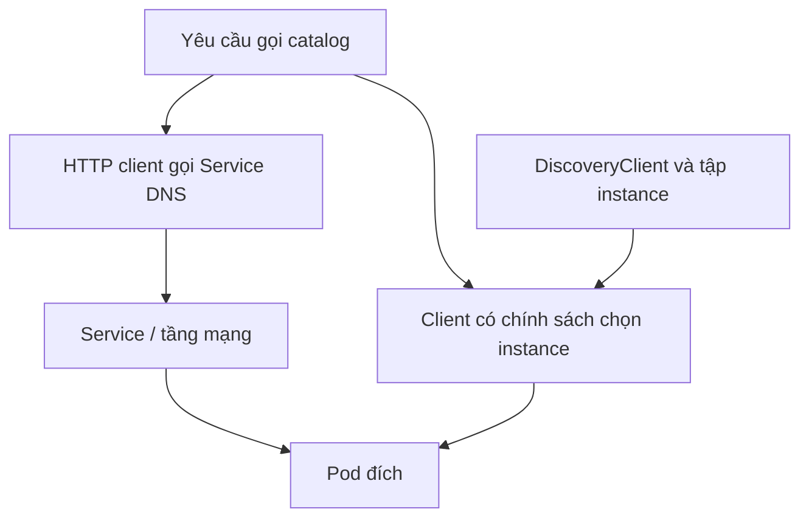

# Khi nên dùng Spring Cloud Kubernetes trong ứng dụng

Trong chương **Lựa chọn kiến trúc** của module **SPRING_CLOUD_KUBERNETES**, bài này giúp quyết định khi nào nên đưa DiscoveryClient, ConfigMap/Secret PropertySource, Spring Cloud LoadBalancer hoặc Configuration Watcher vào một ứng dụng Spring.

Nên dùng Spring Cloud Kubernetes khi có một yêu cầu cụ thể cần tích hợp thông tin hoặc thay đổi từ Kubernetes vào cơ chế của Spring, và lợi ích đó đủ để chấp nhận dependency, quyền truy cập cùng công việc vận hành bổ sung. Việc ứng dụng được triển khai lên Kubernetes tự nó chưa tạo ra yêu cầu này.

Sau bài học, bạn có thể mô tả nhu cầu, chọn từng tính năng cần dùng, so sánh với khả năng sẵn có của nền tảng và viết một quyết định kiến trúc có điều kiện kiểm chứng. Các tình huống và chỉ tiêu trong bài là ví dụ thiết kế, không phải kết quả benchmark hay cam kết hiệu năng của sản phẩm.

## 1. Phân biệt môi trường chạy và khả năng tích hợp

Kubernetes cung cấp các tài nguyên và cơ chế cho việc triển khai: Pod, Service, DNS, ConfigMap, Secret, probe và controller. Spring Boot có thể chạy trên nền tảng đó mà không cần Spring Cloud Kubernetes.

Spring Cloud Kubernetes cung cấp các triển khai giao diện Spring Cloud và tích hợp với Kubernetes. Giá trị của nó nằm ở việc ứng dụng cần sử dụng những khả năng tích hợp này, thay vì chỉ cần một nơi chạy container. Tài liệu dự án cũng xác định đây không phải điều kiện bắt buộc để triển khai ứng dụng Spring Boot lên Kubernetes. [Phạm vi Spring Cloud Kubernetes](https://docs.spring.io/spring-cloud-kubernetes/reference/index.html)

| Nhu cầu | Khả năng nền tảng có thể đáp ứng | Khi tích hợp vào Spring trở nên có ích |
| --- | --- | --- |
| Gọi một dịch vụ bằng địa chỉ ổn định | Service và DNS | Mã ứng dụng cần danh sách instance hoặc metadata để quyết định đích |
| Nhận cấu hình khi khởi động | Biến môi trường, file mount, Spring Boot Config Data | Cần lấy ConfigMap/Secret thành PropertySource qua provider Kubernetes |
| Cập nhật cấu hình | Thay nguồn và rollout theo quy trình | Cần thông báo refresh và cập nhật các bean được hỗ trợ khi đang chạy |
| Phân phối kết nối đến backend | Service và tầng mạng đang triển khai | Cần lựa chọn instance từ phía client theo chính sách đã xác định |
| Kiểm tra khả năng phục vụ của Pod | Probe và Spring Boot Actuator | Chỉ thêm tích hợp Kubernetes nếu có thông tin riêng thật sự cần dùng |

Không suy ra một dự án có nhiều microservice thì phải bật toàn bộ Spring Cloud Kubernetes. Một hệ thống lớn vẫn có thể gọi nhau qua Service DNS; một dịch vụ nhỏ lại có thể cần ConfigMap PropertySource cho một yêu cầu cấu hình rõ ràng.

Đơn vị ra quyết định nên là **từng khả năng**, không phải một lựa chọn bật/tắt chung cho cả bộ thư viện.

## 2. Xác định phương án nền để so sánh

Trước khi thêm integration, hãy mô tả phương án ứng dụng sử dụng Service DNS và cấu hình được cấp khi triển khai.

Ví dụ `orders-api` gọi `catalog` trong namespace `shop`:

```yaml
clients:
  catalog-base-url: "http://catalog.shop.svc.cluster.local:8080"
```

HTTP client thông thường có thể gọi địa chỉ này. Không cần biến hostname đó thành một service ID được xử lý bởi `@LoadBalanced` nếu yêu cầu chỉ là gọi Service đã biết.

`cluster.local` là miền của ví dụ; dùng cluster domain thực tế. Trong cùng namespace có thể dùng tên ngắn, còn khi cần phân biệt namespace thì dùng tên phù hợp hoặc FQDN. [DNS của Service và Pod](https://kubernetes.io/docs/concepts/services-networking/dns-pod-service/)

Nếu Secret đã được mount thành các file dưới `/etc/orders-secrets/`, Spring Boot có thể import:

```yaml
spring:
  config:
    import: "configtree:/etc/orders-secrets/"
```

Ví dụ giả định thư mục đã tồn tại và tiến trình đọc được. Tên file như `db.password` tạo thuộc tính tương ứng; file chứa toàn bộ tài liệu YAML lại cần cách import file phù hợp. Đây là khả năng Config Data của Spring Boot, không tự yêu cầu provider Kubernetes. [Configuration trees của Spring Boot](https://docs.spring.io/spring-boot/reference/features/external-config.html#features.external-config.files.configtree)

Với phương án này, JVM không cần quyền API đọc Secret chỉ để đọc file đã mount. Kubernetes vẫn có các phụ thuộc vận hành ở hạ tầng cấp dữ liệu, DNS và mạng; điều được giảm là việc ứng dụng tự gọi API cho công việc đó.

Phương án nền cần được đánh giá bằng yêu cầu thực tế:

- Địa chỉ dịch vụ có đủ rõ và ổn định không?
- Cấu hình có thể cập nhật qua rollout trong thời gian cho phép không?
- Thông tin xác thực được cấp và thay thế theo quy trình nào?
- Probe có phản ánh khả năng phục vụ của ứng dụng không?
- Đội vận hành có quan sát và khôi phục được khi một thành phần lỗi không?

Nếu phương án nền đáp ứng hợp đồng, nó là một lựa chọn kiến trúc hoàn chỉnh. Nếu thiếu một khả năng, xác định đúng phần thiếu trước khi chọn integration.

## 3. Khi DiscoveryClient mang lại giá trị

### 3.1. Ứng dụng cần nhìn thấy instance hoặc metadata

DiscoveryClient phù hợp khi mã ứng dụng cần làm việc với mô hình `ServiceInstance`, liệt kê đích hoặc sử dụng metadata Kubernetes để phục vụ một quyết định rõ ràng.

Ví dụ:

- Một thành phần điều phối cần lấy tập instance của một dịch vụ để thực hiện một thao tác đến từng instance.
- Ứng dụng có chính sách chọn đích riêng cần thông tin namespace hoặc metadata đã được cấu hình cung cấp.
- Hệ thống đang sử dụng các abstraction Spring Cloud và cần một implementation lấy dữ liệu dịch vụ từ Kubernetes.

Spring Cloud Kubernetes có thể trả thông tin instance cùng metadata, đồng thời hỗ trợ phạm vi namespace và bộ lọc dịch vụ. Cần kiểm tra metadata nào thực sự được bật, thuộc về Service hay Pod và được sử dụng ở đâu. [DiscoveryClient cho Kubernetes](https://docs.spring.io/spring-cloud-kubernetes/reference/discovery-client.html)

Có metadata không đồng nghĩa đã có một chính sách routing hoàn chỉnh. Nếu muốn chọn đích theo shard, phiên bản hoặc thuộc tính nghiệp vụ, phải xác định thuật toán, trường hợp không có đích phù hợp và kiểm thử hành vi đó. Label selector cho Service không mặc nhiên tạo ra mọi dạng lọc instance mà ứng dụng mong muốn.

### 3.2. Một tên dịch vụ cố định có thể chưa cần DiscoveryClient

Nếu yêu cầu là “orders gọi catalog trong namespace shop”, Service DNS đã là một cách discovery ở nền tảng. Việc gọi qua một tên có thể phân giải không yêu cầu JVM phải liệt kê Pod. [Discovery bằng cơ chế Kubernetes](https://docs.spring.io/spring-cloud-kubernetes/reference/discovery-kubernetes-native.html)

Tương tự, gọi dịch vụ ở namespace khác có thể dùng tên DNS đủ rõ. Không bật tìm kiếm mọi namespace chỉ để tránh khai báo tên đích.

Cần quan tâm thêm tới cách định danh: nhiều namespace có thể có Service cùng tên. Khi ứng dụng chỉ dùng service ID ngắn, phải làm rõ phạm vi tìm kiếm và cách xử lý kết quả trùng tên.

### 3.3. Xác định nơi đặt quyền đọc Kubernetes

Với client trực tiếp, ứng dụng cần credential và quyền đọc tài nguyên mà implementation sử dụng. Phạm vi được chọn còn ảnh hưởng tới lượng dữ liệu cần theo dõi và cache.

Một lựa chọn khác là HTTP DiscoveryClient sử dụng Spring Cloud Kubernetes Discovery Server. Khi đó server đọc Kubernetes và cung cấp dữ liệu qua HTTP cho client. Cách bố trí này thay đổi nơi đặt quyền và bổ sung một dịch vụ cần vận hành; không làm mất phụ thuộc discovery. [Spring Cloud Kubernetes Discovery Server](https://docs.spring.io/spring-cloud-kubernetes/reference/spring-cloud-kubernetes-discoveryserver.html)

Vì vậy, không đồng nhất mọi cách dùng Spring Cloud Kubernetes với việc mọi JVM đều phải có cùng một bộ quyền API.

## 4. Khi nên cân nhắc Spring Cloud LoadBalancer

### 4.1. Trước hết xác định tầng đang chọn backend

Gọi Service, chọn Pod ở client và routing tại một tầng mạng khác là những cơ chế có thể tồn tại trong cùng hệ thống. Cần vẽ đường đi thực tế của request:



Hai đường minh họa cách đặt trách nhiệm khác nhau. Trong môi trường có proxy hoặc mesh, bổ sung thành phần đó vào sơ đồ và xác định nó nhìn thấy địa chỉ nào.

Service thông thường cung cấp địa chỉ truy cập ổn định; việc phân phối backend ở tầng mạng không phải cam kết mọi HTTP request sẽ chia đều. Connection pool, kết nối dài và giao thức sử dụng có thể ảnh hưởng đến phân bố quan sát được. [Virtual IP và Service proxy](https://kubernetes.io/docs/reference/networking/virtual-ips/)

Nếu thấy một Pod nhận nhiều request, hãy đo cách tạo và tái sử dụng kết nối trước khi kết luận cần thêm client-side load balancing.

### 4.2. Chọn đúng chế độ nếu có nhu cầu ở client

Spring Cloud Kubernetes LoadBalancer có hai chế độ cần phân biệt:

| Chế độ | Đích được lựa chọn ở lớp tích hợp | Điều cần đánh giá |
| --- | --- | --- |
| `POD` | Instance được lấy qua DiscoveryClient | Độ mới của tập instance, readiness, địa chỉ/port, chính sách chọn đích |
| `SERVICE` | Kubernetes Service được phân giải theo cấu hình | Namespace, port, tên Service và cách tầng nền tảng tiếp tục chọn backend |

Không suy ra chế độ `SERVICE` sẽ cho ứng dụng quyền chọn một Pod cụ thể. Ngược lại, khi chọn `POD`, hãy kiểm chứng đường đi tới Pod với TLS, chính sách mạng và proxy đang có. [LoadBalancer cho Kubernetes](https://docs.spring.io/spring-cloud-kubernetes/reference/load-balancer.html)

Việc chọn tính năng này hợp lý khi yêu cầu thực sự nằm ở client, chẳng hạn cần một implementation Spring Cloud phù hợp với chính sách chọn instance đã được thiết kế. Nó không tự thay thế timeout, circuit breaker hoặc xử lý tính idempotent của thao tác.

### 4.3. Tránh để các tầng có chính sách không được phối hợp

Nếu client và proxy đều retry, phải tính ngân sách tổng. Ví dụ giả định mỗi tầng có tối đa ba lần thử và cả hai đều chạy hết ngân sách, một thao tác từ client có thể tạo tới chín lần gọi xuống dưới. Đây là phép tính từ giả định thiết kế, không phải giá trị mặc định của Spring Cloud Kubernetes.

Trước khi bật load balancing hoặc retry ở thêm một tầng, chốt:

- Tầng nào chịu trách nhiệm chọn đích?
- Timeout tổng và số lần thử tối đa là bao nhiêu?
- Request nào được phép gửi lại?
- Metric và trace nào cho biết request đã đi qua những đích nào?

## 5. Khi ConfigMap hoặc Secret PropertySource là lựa chọn phù hợp

### 5.1. Nhu cầu là tích hợp nguồn vào cấu hình Spring

ConfigMap/Secret PropertySource đáng cân nhắc khi ứng dụng cần provider Kubernetes tải dữ liệu thành thuộc tính Spring, với quy tắc tên nguồn, namespace, profile hoặc nhiều nguồn đã được xác định.

Ví dụ ứng dụng chỉ cần ConfigMap nguồn `orders-policy`:

```yaml
spring:
  application:
    name: orders-api
  config:
    import: "kubernetes:"
  cloud:
    kubernetes:
      discovery:
        enabled: false
      config:
        enabled: true
        name: orders-policy
        namespace: shop
      secrets:
        enabled: false
```

Đây là phác thảo cho phương án chỉ dùng ConfigMap PropertySource, không phải toàn bộ cấu hình triển khai. Cần đúng starter, bộ phiên bản, credential, quyền và chính sách lỗi của provider. Không sao chép việc tắt discovery nếu ứng dụng thật đang cần tính năng đó.

`kubernetes:` là vị trí import do integration cung cấp; `configtree:` là cách đọc cây file của Boot. Hai tiền tố biểu diễn hai đường lấy dữ liệu khác nhau. Với Kubernetes PropertySource, cũng phải kiểm tra thứ tự ưu tiên khi nguồn import, môi trường và đối số cùng có một key. [Kubernetes PropertySource và Config Data](https://docs.spring.io/spring-cloud-kubernetes/reference/property-source-config.html)

### 5.2. Nhu cầu chỉ là cấp giá trị cho container

Nếu môi trường đã cấp cấu hình qua biến môi trường hoặc volume và cách đó đáp ứng yêu cầu, việc thêm một client API vào JVM cần có lý do riêng.

Câu hỏi nên là: “Ứng dụng thiếu hành vi nào nếu tiếp tục dùng cách cấp dữ liệu hiện tại?” Các câu trả lời như “muốn có cùng PropertySource API trong Spring” hoặc “cần một tập nguồn động cụ thể” có thể dẫn tới một phương án tích hợp. Câu trả lời “ConfigMap nằm trong Kubernetes” chưa đủ để xác định nó phải được đọc qua API.

ConfigMap trong biến môi trường và ConfigMap trong volume có hành vi cập nhật khác nhau. Biến môi trường của tiến trình đang chạy không tự đổi; volume được cập nhật theo cơ chế của Kubernetes nhưng ứng dụng vẫn cần cách đọc và áp dụng lại dữ liệu. [Các cách sử dụng ConfigMap](https://kubernetes.io/docs/concepts/configuration/configmap/)

### 5.3. Secret cần một quyết định riêng

Không bật đọc Secret qua API chỉ vì đã bật ConfigMap. Hãy xác định từng đường cấp Secret: volume, biến môi trường, provider API hoặc cơ chế quản lý bí mật của tổ chức.

Khi đọc qua API, `list secrets` có thể cho thấy dữ liệu Secret trong phạm vi được cấp. Một bộ lọc label ở ứng dụng không phải ranh giới phân quyền. Chế độ đọc và phiên bản client có thể quyết định cần named `get`, `list` hay theo dõi; không mặc định khai báo tên nguồn luôn đủ để dùng Role chỉ có `get`. [Secret PropertySource](https://docs.spring.io/spring-cloud-kubernetes/reference/property-source-config/secrets-propertysource.html)

Mount Secret không tự giải quyết việc thay credential trong connection pool, cũng như API PropertySource không tự bảo đảm credential mới được dùng an toàn. Quy trình xoay vòng cần tính đến thời gian credential cũ/mới cùng hợp lệ và hành vi của tài nguyên sử dụng chúng. [Thực hành quản lý Secret](https://kubernetes.io/docs/concepts/security/secrets-good-practices/)

## 6. Khi Configuration Watcher mang lại giá trị

Watcher phù hợp khi có yêu cầu cập nhật cấu hình trong lúc ứng dụng chạy, những thuộc tính đích hỗ trợ thay đổi và quy trình rollout hiện tại không đáp ứng hợp đồng vận hành.

Ví dụ một quy tắc xử lý có thể thay đổi giữa hai request; đội vận hành muốn các replica hội tụ về cấu hình mới trong một khoảng thời gian đo được. Trường hợp đó có thể xem xét Watcher gửi thông báo HTTP refresh hoặc dùng Spring Cloud Bus theo thiết kế.

Watcher bổ sung các thành phần cần quản lý: controller, quyền theo dõi, phạm vi namespace, cách chọn ứng dụng đích, đường gửi thông báo và khả năng refresh của bên nhận. HTTP cần endpoint quản trị mà controller gọi được; Bus cần hạ tầng messaging tương ứng. [Configuration Watcher](https://docs.spring.io/spring-cloud-kubernetes/reference/spring-cloud-kubernetes-configuration-watcher.html)

Cần phân biệt các mốc:

1. ConfigMap/Secret trên API server đã đổi.
2. Ứng dụng đã nhìn thấy dữ liệu nguồn mới.
3. Bean hoặc client cần dùng đã nhận giá trị mới.
4. Hành vi nghiệp vụ trên các replica đã phản ánh thay đổi.

Refresh Scope hoặc cơ chế bind lại chỉ áp dụng cho các trường hợp được hỗ trợ; không biến mọi singleton và tài nguyên có trạng thái thành đối tượng cập nhật an toàn. [Refresh Scope và cập nhật cấu hình](https://docs.spring.io/spring-cloud-commons/reference/spring-cloud-commons/application-context-services.html#_refresh_scope)

Do đó, trước khi chọn Watcher phải trả lời:

- Thuộc tính nào được thay đổi tại chỗ, thuộc tính nào cần rollout?
- Ai kiểm tra tính hợp lệ trước khi thay đổi được phát ra?
- Nếu một replica không nhận thông báo, phát hiện và khôi phục bằng cách nào?
- Hệ thống chấp nhận khoảng thời gian các replica dùng hai phiên bản khác nhau không?
- Có cần theo dõi phiên bản cấu hình trong metric hoặc endpoint chẩn đoán không?

Nếu yêu cầu là mọi replica phải chuyển sang một chính sách tại cùng một thời điểm, không được xem refresh fan-out là bằng chứng đã đạt tính nguyên tử. Cần thiết kế một giao thức hoặc cách quản lý phiên bản đáp ứng yêu cầu đó.

Tần suất thay đổi cao chỉ là một dữ kiện; nó không tự chứng minh refresh thích hợp. Ngược lại, một thay đổi hiếm nhưng có ngân sách thời gian rất ngắn vẫn cần được phân tích theo tác động và cách khôi phục.

## 7. Theo dõi sức khỏe Pod là một trục quyết định độc lập

Spring Boot Actuator và Kubernetes probe có thể cung cấp liveness/readiness mà không cần bật DiscoveryClient hay ConfigMap API.

Liveness trả lời câu hỏi về tình trạng sống của ứng dụng; readiness gắn với việc có nhận traffic hay không. Không dùng việc Kubernetes API tạm thời không khả dụng làm lý do tự động restart một JVM vẫn có thể phục vụ bằng dữ liệu đã nạp, trừ khi hợp đồng của ứng dụng thực sự yêu cầu hành vi đó. [Actuator và Kubernetes probes](https://docs.spring.io/spring-boot/reference/actuator/endpoints.html#actuator.endpoints.kubernetes-probes)

Nếu sử dụng discovery theo instance, phải kiểm tra cách instance Ready hoặc chưa Ready tham gia tập đích, cùng độ trễ cập nhật ở client. “Có dữ liệu discovery” và “có thể phục vụ nghiệp vụ” là hai bằng chứng khác nhau.

Tương tự, Pod Running không chứng minh đã nhận cấu hình mới. Readiness chỉ phản ánh các kiểm tra được thiết kế, không tự kiểm tra mọi bean đang giữ đúng phiên bản cấu hình. [Vòng đời Pod và probe](https://kubernetes.io/docs/concepts/workloads/pods/pod-lifecycle/#container-probes)

Đây là lý do quyết định về discovery, refresh và health cần liên kết nhưng không nên gộp thành một công tắc bật tất cả.

## 8. Đánh giá chi phí đi kèm với từng tính năng

### 8.1. Phụ thuộc lúc khởi động và khi đang chạy

Với phương án đọc API, lỗi credential, quyền, timeout hoặc nguồn cấu hình thiếu có thể ảnh hưởng tới khởi động. Với discovery, dữ liệu cache có thể tiếp tục được dùng trong một số tình huống nhưng cũng có thể trở nên cũ. Hành vi cụ thể phụ thuộc phiên bản, client, chế độ và cấu hình.

Không giả định “API server lỗi thì mọi request nghiệp vụ lỗi ngay”, cũng không giả định cache cho phép chạy vô hạn. Hãy thử riêng:

- Tiến trình đã chạy và mất khả năng cập nhật nguồn.
- Một Pod mới cần khởi động trong lúc API bị lỗi.
- Backend cũ bị xóa nhưng client còn giữ dữ liệu cũ.
- Kết nối API phục hồi và các thành phần đồng bộ lại.

Phương án nền dùng Service DNS hoặc mount cũng có phụ thuộc hạ tầng. So sánh phải dựa trên đường đi thực tế, không gán cho một phương án tính độc lập tuyệt đối.

### 8.2. Danh tính, quyền và phạm vi ảnh hưởng

Lập bảng resource, verb và namespace cho từng thành phần trực tiếp dùng API. Discovery, cấu hình và Watcher có nhu cầu khác nhau; đừng dùng một ServiceAccount quyền rộng cho mọi workload chỉ để giảm số manifest. [Quyền theo thành phần](https://docs.spring.io/spring-cloud-kubernetes/reference/security-service-accounts.html)

RBAC cộng các quyền được cấp. Các ca kiểm tra từ chối giúp phát hiện RoleBinding hoặc ClusterRoleBinding khác đã mở rộng quyền ngoài thiết kế. Quy tắc chọn nguồn trong mã không thay thế kiểm tra phân quyền của API server. [RBAC trong Kubernetes](https://kubernetes.io/docs/reference/access-authn-authz/rbac/)

Khi ứng dụng chỉ đọc file hoặc dùng DNS, có thể đánh giá việc không tự động mount token ServiceAccount nếu không còn thành phần nào cần token đó. Đây là quyết định dựa trên toàn bộ Pod và cơ chế danh tính đang dùng, không phải thao tác bắt buộc cho mọi ứng dụng. [ServiceAccount](https://kubernetes.io/docs/concepts/security/service-accounts/)

### 8.3. Chi phí vận hành và tương thích

Các chi phí cần có người chịu trách nhiệm gồm:

| Nhóm chi phí | Câu hỏi cần trả lời |
| --- | --- |
| Dependency | Ai quản lý BOM, starter và kế hoạch nâng cấp? |
| API/cache | Phạm vi theo dõi bao lớn, có bao nhiêu replica và dữ liệu cần cache? |
| Controller | Ai vận hành Watcher/Discovery Server và kiểm tra phục hồi? |
| Bảo vệ endpoint | Ai quản lý credential, quyền HTTP và đường mạng quản trị? |
| Chẩn đoán | Làm sao phân biệt cấu hình sai, RBAC sai và dữ liệu chưa hội tụ? |
| Khôi phục | Artifact và phiên bản cấu hình nào cần trả lại cùng nhau? |

Chọn Spring Cloud release train theo phiên bản Spring Boot được hỗ trợ và để BOM quản lý dependency. Không tắt kiểm tra tương thích để thay cho việc xác định bộ phiên bản đúng. [Tương thích Boot và Spring Cloud](https://spring.io/projects/spring-cloud/)

Nếu native image hoặc AOT là yêu cầu bắt buộc, phải kiểm tra sớm. Tài liệu tham chiếu Spring Cloud Kubernetes 5.1 ghi nhận chưa hỗ trợ Spring Boot AOT transformations/native images; không suy từ kết quả chạy trên JVM rằng cùng cấu hình sẽ dùng được cho target đó. [Phạm vi hỗ trợ trong tài liệu 5.1](https://docs.spring.io/spring-cloud-kubernetes/reference/index.html#_aot_and_native_image_support)

## 9. Ma trận chọn tính năng theo nhu cầu

Bảng sau là hướng bắt đầu đánh giá, không phải công thức thay thế kiểm chứng:

| Nhu cầu đã xác định | Phương án đầu tiên cần đánh giá | Điều kiện để chọn thêm Spring Cloud Kubernetes |
| --- | --- | --- |
| Gọi một Service có tên đã biết | DNS và HTTP client thông thường | Cần dữ liệu instance hoặc abstraction discovery phục vụ hành vi cụ thể |
| Đọc ConfigMap khi khởi động | Biến môi trường/file hoặc provider API theo chính sách | PropertySource Kubernetes tạo ra lợi ích rõ về cách chọn và sử dụng nguồn |
| Dùng Secret đã mount | Config Data hoặc cách đọc file được hỗ trợ | Có yêu cầu riêng cho Secret API, quyền và quy trình xoay vòng |
| Chọn backend trong mã client | Xác định chính sách và tầng routing hiện tại | DiscoveryClient/LoadBalancer phù hợp với chính sách đó và đã được thử |
| Đổi cấu hình mà không rollout | Phân loại thuộc tính có thể thay đổi an toàn | Watcher cùng cơ chế refresh đạt thời gian hội tụ và khả năng khôi phục |
| Kiểm tra sức khỏe Pod | Actuator và probe | Chỉ thêm tích hợp nếu có thông tin Kubernetes đặc thù cần dùng |
| Gọi qua nhiều namespace | Tên DNS rõ hoặc tập namespace tường minh | Cần discovery động và kiểm soát được trùng tên/phạm vi quyền |

Không bắt buộc chọn chung một phương án cho mọi ứng dụng. Một workload có thể dùng ConfigMap PropertySource trong khi giao tiếp dịch vụ vẫn qua DNS và Secret vẫn được mount.

Các starter theo tính năng giúp thể hiện quyết định này. Chọn họ Fabric8 hoặc Kubernetes Java Client phù hợp; không trộn hai họ starter, và chỉ dùng starter `all` khi đã có lý do cho tập tính năng mà nó đưa vào. [Các starter theo tính năng](https://docs.spring.io/spring-cloud-kubernetes/reference/getting-started.html)

## 10. Ba tình huống ra quyết định

### Tình huống A: dịch vụ CRUD với cấu hình theo lần triển khai

`orders-api` gọi hai Service đã biết. Cấu hình được thay cùng lần phát hành; Secret được mount và quy trình rollout đáp ứng yêu cầu.

Một lựa chọn có cơ sở là dùng Service DNS, Config Data cho file và Actuator/probe. Chưa có nhu cầu liệt kê instance hoặc refresh tại chỗ để biện minh cho các integration tương ứng.

Bằng chứng cần thu thập gồm gọi dịch vụ khi scale hoặc thay Pod, khởi động với dữ liệu bắt buộc và rollout cấu hình trong thời gian cho phép. Nếu các kiểm tra đạt, việc chưa thêm Spring Cloud Kubernetes không làm kiến trúc thiếu một thành phần bắt buộc.

### Tình huống B: cần cập nhật một nhóm tham số trong lúc phục vụ

Một ứng dụng xử lý tác vụ muốn thay đổi giới hạn xử lý giữa các request. Ví dụ đội sản phẩm đặt mục tiêu tất cả replica nhận phiên bản cấu hình mới trong 60 giây ở điều kiện vận hành đã mô tả.

Có thể đánh giá ConfigMap PropertySource kết hợp Watcher và các bean hỗ trợ cập nhật. Giao tiếp tới các dịch vụ khác vẫn có thể dùng Service DNS.

Mốc 60 giây là yêu cầu của tình huống, không phải bảo đảm của Watcher. PoC cần đo từng replica, phát hiện replica bị bỏ sót và xác nhận thay đổi không làm hỏng tác vụ đang xử lý. Nếu không đạt, xem lại yêu cầu hoặc phương án rollout thay vì chỉ tăng retry.

### Tình huống C: cần áp dụng chính sách chọn instance trong JVM

Một thành phần phải chọn đích dựa trên dữ liệu mà ứng dụng sử dụng để điều phối, và nhóm đã xác định chính sách đó thuộc trách nhiệm client.

Có thể đánh giá DiscoveryClient và LoadBalancer phù hợp, kèm phần xử lý chính sách tùy biến nếu cần. Kiểm tra metadata thực tế, tập namespace, port, readiness và trường hợp không có đích phù hợp.

Bằng chứng quyết định là chính sách chọn đích hoạt động đúng khi scale, Pod thay đổi hoặc dữ liệu discovery trễ. Việc chỉ nhận được danh sách instance chưa hoàn tất yêu cầu.

Trong cả ba tình huống, quyết định có thể thay đổi khi ràng buộc thay đổi. Chẳng hạn một mục tiêu native image bắt buộc hoặc chính sách không cấp credential API cho ứng dụng có thể làm tập phương án cần đánh giá khác đi.

## 11. Viết ADR để quyết định có thể được xem xét lại

ADR là bản ghi quyết định kiến trúc. Một ADR hữu ích cần nêu vấn đề, phương án, lý do chọn, hệ quả và điều kiện xem xét lại; không chỉ ghi tên dependency.

Ví dụ cho tình huống B:

```text
ADR-012: Cập nhật nhóm tham số xử lý tác vụ

Bối cảnh
- Ứng dụng có nhiều replica và một nhóm tham số thay đổi giữa các request.
- Mục tiêu thiết kế: các replica nhận cấu hình hợp lệ mới trong 60 giây.
- Giao tiếp dịch vụ hiện tại qua Service DNS đang đáp ứng yêu cầu.

Quyết định dự kiến
- Đánh giá ConfigMap PropertySource và Configuration Watcher.
- Dùng cơ chế bean hỗ trợ refresh cho đúng nhóm thuộc tính được phép đổi.
- Tiếp tục cấp Secret theo đường hiện tại.
- Giữ routing qua Service DNS.

Lý do
- Nhu cầu mới nằm ở cập nhật cấu hình khi đang chạy.
- Chưa có yêu cầu chọn instance trong JVM.

Điều kiện chấp thuận
- PoC đo được hội tụ trên từng replica trong phạm vi thử nghiệm.
- Ca mất thông báo hoặc mất kết nối được phát hiện và khôi phục.
- Credential API, quyền controller và endpoint quản trị được giới hạn rõ.
- Có kiểm tra dữ liệu trước áp dụng và cách trả về phiên bản cấu hình trước.

Hệ quả
- Bổ sung controller và trách nhiệm trực vận hành.
- Chấp nhận cửa sổ replica dùng hai phiên bản trong quá trình hội tụ.
- Theo dõi riêng phiên bản cấu hình và tình trạng phục vụ.

Xem xét lại khi
- Có thuộc tính cần thay đổi nguyên tử trên toàn bộ replica.
- Target triển khai hoặc bộ phiên bản không hỗ trợ cơ chế đã chọn.
- Chi phí vận hành hay kết quả đo không đáp ứng hợp đồng.
```

Trạng thái “dự kiến” cần được đổi dựa trên bằng chứng thực nghiệm. Không ghi ADR đã chấp thuận khi các điều kiện còn là giả định.

Quyền API và quyền HTTP quản trị phải được xét riêng. Một ServiceAccount đọc được ConfigMap không có nghĩa nó đã được xác thực để gọi endpoint refresh của ứng dụng; expose endpoint cũng chưa thay thế kiểm soát người gọi. [Access và bảo vệ endpoint Actuator](https://docs.spring.io/spring-boot/reference/actuator/endpoints.html)

## 12. Thử nghiệm nhỏ trước khi chốt kiến trúc

Không cần triển khai toàn bộ nền tảng để thử một tính năng. Chọn một ứng dụng đại diện và một tập yêu cầu giới hạn.

| Giả thuyết cần xác nhận | Thử nghiệm có ý nghĩa |
| --- | --- |
| DNS đủ cho giao tiếp hiện tại | Scale/thay Pod đích và đo hành vi client với connection pool đang dùng |
| Discovery cung cấp đúng dữ liệu cần thiết | Kiểm tra instance, metadata, namespace, readiness và độ trễ thay đổi |
| PropertySource giúp quản lý cấu hình đúng | Tạo key thử xung đột để xác nhận nguồn có hiệu lực và validation |
| Quyền phù hợp với thiết kế | Có ca được phép và ca phải bị từ chối cho từng danh tính |
| Refresh đạt mục tiêu | Đọc phiên bản và hành vi trên từng replica, giữ rõ UID/process identity |
| Khôi phục được khi nguồn lỗi | Thử mất API/controller, phục hồi và trả về phiên bản cấu hình trước |
| Tính năng không phá sức khỏe Pod | Quan sát readiness, restart và thao tác nghiệp vụ dưới tình huống lỗi |

Ghi rõ điều kiện đầu vào, phiên bản, kết quả kỳ vọng, kết quả quan sát và giới hạn của phép thử. Khi mô phỏng lỗi, tách môi trường thử nghiệm và không dùng giá trị Secret thật làm dữ liệu hiển thị.

Đối với cập nhật qua volume, tính cả độ trễ chiếu dữ liệu và cách ứng dụng áp dụng lại. Mount `subPath` không có cùng hành vi cập nhật tự động như mount Secret thông thường; kiểm tra chính xác đường cấp dữ liệu đã chọn. [Cập nhật Secret qua volume](https://kubernetes.io/docs/concepts/configuration/secret/#using-secrets-as-files-from-a-pod)

Kết quả PoC nên trả lời được “tính năng này giúp đạt yêu cầu nào, với chi phí nào”. Các chỉ số chung như ứng dụng đã khởi động hoặc API trả 200 chưa đủ để thay thế câu trả lời đó.

## 13. Bài tập lựa chọn kiến trúc

Với mỗi yêu cầu sau, viết một quyết định ngắn gồm phương án nền, tính năng đề xuất, quyền cần có và phép thử chấp thuận:

1. Ứng dụng gọi một Service cố định và chỉ đổi cấu hình khi phát hành.
2. Ứng dụng cần thay một nhóm tham số khi đang chạy trên sáu replica.
3. Một thành phần cần danh sách instance và metadata để chọn đích theo chính sách riêng.
4. Ứng dụng bắt buộc tạo native image và không được tự đọc Kubernetes API.
5. Hệ thống đã có một tầng routing với retry, còn đội ứng dụng muốn thêm LoadBalancer trong JVM.

Không chỉ trả lời “có” hoặc “không”. Nêu phần yêu cầu dẫn đến quyết định, giả định cần kiểm chứng và điều kiện làm quyết định thay đổi.

Một quyết định dùng Spring Cloud Kubernetes có cơ sở khi bạn đã xác định được:

- Khả năng tích hợp cụ thể cần có trong Spring.
- Giới hạn của phương án nền đối với yêu cầu đó.
- Tập tính năng và dependency thực sự cần dùng.
- Phạm vi dữ liệu, danh tính và quyền của từng thành phần.
- Hành vi khi nguồn lỗi, dữ liệu trễ hoặc replica chưa cập nhật.
- Người chịu trách nhiệm vận hành, cách đo kết quả và quy trình khôi phục.
- Bộ phiên bản/target được hỗ trợ và điều kiện xem xét lại quyết định.
