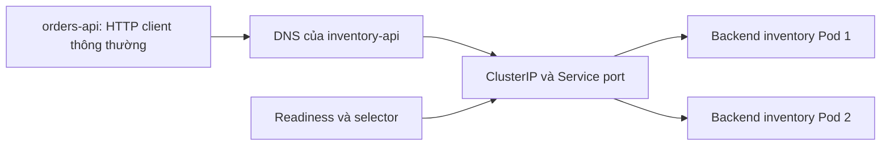
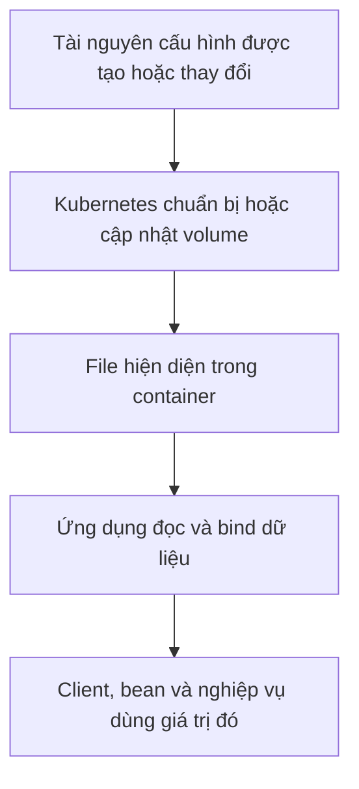

# Khi Kubernetes Service, DNS và cấu hình qua volume đã đủ

## Mục tiêu của quyết định kiến trúc

Trong chương **Lựa chọn kiến trúc** của module **SPRING_CLOUD_KUBERNETES**, bài này giúp xác định khi nào một ứng dụng Spring có thể dựa vào Kubernetes Service, DNS và các file cấu hình được mount vào Pod để đáp ứng yêu cầu triển khai.

Cách triển khai này phù hợp khi ứng dụng gọi một tập dịch vụ đã biết qua địa chỉ ổn định, không cần tự chọn Pod bằng metadata, và có thể nhận cấu hình mới qua một đợt rollout có kiểm soát. Spring Boot cung cấp HTTP client, cơ chế đọc file cấu hình và health endpoint; Kubernetes cung cấp đường tới backend cùng việc đưa ConfigMap, Secret vào container.

Sau bài học, bạn có thể giải thích ranh giới trách nhiệm giữa nền tảng và ứng dụng, dựng một cấu hình minh họa, kiểm chứng hành vi khi thay Pod hoặc cấu hình, và ghi lại điều kiện cần để mở lại quyết định. Những phần như DiscoveryClient, Spring Cloud LoadBalancer và Configuration Watcher sẽ được xem xét theo yêu cầu cụ thể.

Các ví dụ Spring dùng Java 17 và API của Spring Boot 3.5/Spring Framework 6.2. Đây là nội dung minh họa kiến trúc, chưa được thực thi trên cluster của bạn.

## 1. “Đã đủ” nghĩa là đáp ứng những yêu cầu nào?

Đánh giá từng yêu cầu thay vì đếm số lượng microservice:

| Câu hỏi | Điều kiện phù hợp với Service/DNS và volume |
| --- | --- |
| Ứng dụng cần tìm gì? | Một địa chỉ dịch vụ đã biết, chẳng hạn `inventory-api` |
| Ai chọn backend? | Cơ chế Service của cluster có thể đáp ứng đường gọi |
| Có cần biết từng Pod không? | Không cần danh sách instance hoặc metadata của từng instance |
| Khi nào cấu hình mới phải có hiệu lực? | Có thể thông qua khởi động Pod mới và rollout |
| Có cần đổi cấu hình đồng thời tuyệt đối không? | Chấp nhận giai đoạn chuyển tiếp đã được thiết kế |
| Ứng dụng có cần đọc Kubernetes API không? | Không cần cho việc gọi dịch vụ và đọc file đã mount |
| Yêu cầu quan sát là gì? | Có thể đo đường gọi, health và phiên bản cấu hình mà không truy vấn API từ ứng dụng |

Ví dụ, một API xử lý đơn hàng cần gọi kho qua một Service ổn định; cấu hình vận hành thay đổi vài lần trong một đợt phát hành và có thể rollout. Tập yêu cầu đó có thể được đáp ứng bằng nền tảng Kubernetes cùng Spring Boot.

Ngược lại, yêu cầu “định tuyến từng request theo một nhãn Pod thay đổi trong runtime” hoặc “áp dụng cấu hình mới mà không thay Pod trong một khoảng trễ rất ngắn” cần được phân tích thêm. Đó là khác biệt về hành vi cần đạt, không chỉ khác biệt về quy mô.

Đặt tiêu chí có thể đo. Ví dụ “cấu hình có hiệu lực sau khi rollout hoàn tất” đủ rõ để kiểm chứng; “cấu hình phải tự đồng bộ” còn thiếu thời hạn, cơ chế và phạm vi replica.

## 2. Service và DNS đảm nhiệm phần nào của đường gọi?

### 2.1. Địa chỉ ổn định cho tập backend

Giả sử `orders-api` gọi `inventory-api` trong namespace `shop`:



Service thông thường có DNS trỏ tới ClusterIP. Việc thay Pod không yêu cầu ứng dụng gọi phải nhận biết từng địa chỉ Pod mới, miễn Service và đường mạng tương ứng vẫn hoạt động. [Kubernetes DNS for Services](https://kubernetes.io/docs/concepts/services-networking/dns-pod-service/#a-aaaa-records)

Ví dụ Service cho backend có listener nghiệp vụ `8080`:

```yaml
apiVersion: v1
kind: Service
metadata:
  name: inventory-api
  namespace: shop
spec:
  type: ClusterIP
  selector:
    app: inventory-api
  ports:
    - name: http
      port: 80
      targetPort: 8080
```

HTTP client gọi Service port `80`, còn Kubernetes chuyển tới target port `8080` của backend. Không ghép DNS của Service với một cổng container bất kỳ rồi giả định chúng tương đương. [Kubernetes Service](https://kubernetes.io/docs/concepts/services-networking/service/#defining-a-service)

Các dạng tên cần phân biệt:

| Địa chỉ | Ý nghĩa |
| --- | --- |
| `inventory-api` | Tên ngắn, được phân giải theo namespace và search domain của Pod |
| `inventory-api.shop` | Chỉ rõ namespace `shop` trong môi trường DNS Kubernetes thông thường |
| `inventory-api.shop.svc.cluster.local` | Tên đầy đủ khi cluster domain là `cluster.local` |
| `10.x.x.x` của một Pod | Địa chỉ instance có vòng đời theo Pod, không phải địa chỉ dịch vụ ổn định |

Ví dụ trong bài dùng `cluster.local`; thay bằng cluster domain thực nếu môi trường dùng giá trị khác. DNS nội bộ cluster cũng không mặc nhiên truy cập được từ máy ngoài cluster.

Một port có tên `http` có thể có bản ghi SRV, nhưng HTTP client thông thường không vì thế tự truy vấn SRV và tìm cổng cho URL của bạn. Vẫn phải cấu hình địa chỉ và Service port đúng.

### 2.2. HTTP client sử dụng DNS, không cần truy vấn Kubernetes API

Ứng dụng có thể dùng `RestClient`, `WebClient` hoặc thư viện HTTP phù hợp với đường gọi hiện tại. Với URL DNS thông thường, resolver của môi trường xử lý tên; ứng dụng không cần gọi `DiscoveryClient.getInstances(...)` chỉ để gửi request tới Service.

Spring Boot cung cấp builder cho các HTTP client tích hợp. [Spring Boot REST Clients](https://docs.spring.io/spring-boot/3.5/reference/io/rest-client.html)

Trong quyết định này:

- URL chứa tên DNS có thể phân giải được trong Pod.
- Client được cấu hình timeout và hành vi lỗi của ứng dụng.
- Không gắn `@LoadBalanced` vào builder của ví dụ.
- Không diễn giải hostname URL như một service ID do Spring Cloud chọn instance.

Cùng một chuỗi `inventory-api` có thể xuất hiện trong hai mô hình, nhưng đường phân giải khác nhau. Khi chẩn đoán, phải biết request đang đi qua DNS hay một cơ chế discovery phía client.

### 2.3. Cân bằng tải của Service có giới hạn cần chấp nhận

Service không cam kết chia đều mọi HTTP request giữa các Pod. Kết nối được giữ lại, HTTP/2, pool kết nối và đặc điểm của cơ chế mạng đều ảnh hưởng phân bố tải. Một kết nối đã chọn backend không mặc nhiên được chuyển sang backend khác chỉ vì request tiếp theo bắt đầu. [Virtual IPs and Service Proxies](https://kubernetes.io/docs/reference/networking/virtual-ips/)

Vì vậy, tiêu chí “thay Pod mà caller vẫn gọi được qua địa chỉ Service sau giai đoạn chuyển tiếp” khác tiêu chí “mỗi request luân phiên giữa hai Pod”.

Không thêm cơ chế cân bằng tải phía client chỉ vì một lần quan sát cho thấy một Pod nhận nhiều request. Trước hết kiểm tra kết nối, tải thực và yêu cầu phân phối. Nếu cần điều khiển chọn instance theo request, đó là một yêu cầu riêng để đánh giá giải pháp.

### 2.4. Headless Service là một tình huống khác

Với headless Service, DNS có thể trả tập địa chỉ Pod thay vì một ClusterIP. Caller hoặc thư viện giao thức phải tiêu thụ tập địa chỉ đó theo cách phù hợp.

Do đó, kết luận về Service ClusterIP trong bài không tự áp dụng cho headless Service, cơ chế peer discovery hoặc giao thức cần nhận diện từng thành viên. Cần kiểm tra cả resolver, cache và hành vi reconnect của thư viện giao thức đang dùng.

## 3. Volume cung cấp dữ liệu; Spring quyết định thời điểm sử dụng

### 3.1. Hai kiểu file phù hợp với Spring Boot

Kubernetes có thể mount ConfigMap thành một file YAML và Secret thành các file theo key. Spring Boot đọc chúng bằng Config Data:

```yaml
spring:
  application:
    name: orders-api
  config:
    import:
      - "file:/etc/orders-config/application.yaml"
      - "configtree:/etc/orders-secrets/"
```

Hai import có ý nghĩa khác nhau:

| Import | Cách hiểu |
| --- | --- |
| `file:.../application.yaml` | Phân tích nội dung file như tài liệu cấu hình YAML |
| `configtree:.../` | Tên file và thư mục tạo thành tên property, nội dung file là giá trị |

Ví dụ file `/etc/orders-secrets/partner.token` trở thành property `partner.token` với import config tree trên. Không coi nội dung file Secret là Base64 cần ứng dụng giải mã lần nữa: file mount đã cung cấp dữ liệu được Kubernetes giải mã từ đối tượng Secret. [Spring Boot Configuration Trees](https://docs.spring.io/spring-boot/3.5/reference/features/external-config.html#features.external-config.files.configtree)

Ví dụ cố ý không dùng `optional:` cho hai nguồn bắt buộc. Import tìm thấy file không có nghĩa mọi property đều hợp lệ; ứng dụng vẫn cần validation hoặc kiểm tra giá trị bắt buộc.

### 3.2. Ba thời điểm không đồng nhất



Sự kiện ở bước đầu không bảo đảm mọi bước sau đã xảy ra. Với cấu hình nạp lúc khởi động, ứng dụng đọc nguồn và khởi tạo bean; một lần đổi file sau đó không tự tái tạo client đã giữ giá trị trong bộ nhớ.

ConfigMap mutable được mount dạng volume có thể được cập nhật sau một khoảng lan truyền; biến môi trường từ ConfigMap không tự đổi trong tiến trình đang chạy. Mount qua `subPath` cũng không nhận cập nhật ConfigMap như mount volume thông thường. [Mounted ConfigMaps](https://kubernetes.io/docs/concepts/configuration/configmap/#mounted-configmaps-are-updated-automatically)

Secret volume có cơ chế cập nhật theo thời gian tương tự và cũng có giới hạn khi dùng `subPath`. [Secrets as files](https://kubernetes.io/docs/concepts/configuration/secret/#using-secrets-as-files-from-a-pod)

“File có thể được cập nhật” và “ứng dụng hỗ trợ thay đổi nóng” là hai thuộc tính riêng. Khi kiến trúc chọn rollout, hãy làm rõ đây là cơ chế nhận cấu hình mới, thay vì chờ một hành vi refresh chưa được triển khai.

### 3.3. Dùng phiên bản cấu hình để có rollout dễ kiểm chứng

Một lựa chọn phù hợp là tạo tài nguyên theo phiên bản, chẳng hạn:

```text
orders-config-prod-v1
orders-credentials-prod-v1
```

Mỗi bản phát hành Pod tham chiếu một bộ nguồn đã xác định. Khi cần thay đổi, tạo bộ v2 rồi thay tham chiếu trong Pod template.

Có thể đặt `immutable: true` để không sửa dữ liệu của tài nguyên đã phát hành. Khi đó, thay cấu hình nghĩa là tạo tài nguyên mới chứ không edit dữ liệu của v1. [Immutable ConfigMaps](https://kubernetes.io/docs/concepts/configuration/configmap/#immutable-configmaps), [Immutable Secrets](https://kubernetes.io/docs/concepts/configuration/secret/#immutable-secrets)

Đây là một quy ước phát hành, không phải yêu cầu bắt buộc cho mọi ứng dụng. Lợi ích cần đánh giá là khả năng xác định bộ dữ liệu của từng Pod và khôi phục một bản đã biết.

## 4. Ví dụ triển khai bằng Spring Boot và tài nguyên Kubernetes

Ví dụ giả định namespace lab `shop` đã tồn tại, có backend `inventory-api` với các Pod Ready lắng nghe cổng `8080`. NetworkPolicy và DNS của môi trường cho phép đường gọi đã mô tả. Các image trong manifest là tên minh họa để thay bằng image bạn đã build.

### 4.1. Dependency và cấu hình trong JAR của orders-api

Ứng dụng cần Spring Boot web và Actuator; không cần starter Spring Cloud Kubernetes cho những chức năng trong ví dụ. Phần dependency tương ứng trong dự án Boot đã quản lý phiên bản:

```xml
<dependencies>
    <dependency>
        <groupId>org.springframework.boot</groupId>
        <artifactId>spring-boot-starter-web</artifactId>
    </dependency>
    <dependency>
        <groupId>org.springframework.boot</groupId>
        <artifactId>spring-boot-starter-actuator</artifactId>
    </dependency>
</dependencies>
```

`application.yaml` đóng gói cùng ứng dụng:

```yaml
spring:
  application:
    name: orders-api
  config:
    import:
      - "file:/etc/orders-config/application.yaml"
      - "configtree:/etc/orders-secrets/"
  lifecycle:
    timeout-per-shutdown-phase: 20s

server:
  port: 8080
  shutdown: graceful

management:
  endpoints:
    web:
      exposure:
        include: health
  endpoint:
    health:
      probes:
        enabled: true
```

Các lớp tiếp theo đặt dưới package mà lớp `@SpringBootApplication` của dự án quét. Namespace của manifest và package Java là hai khái niệm độc lập.

### 4.2. HTTP client với URL từ file và token từ Secret

```java
package example.orders;

import java.net.URI;

import org.springframework.beans.factory.annotation.Value;
import org.springframework.http.HttpHeaders;
import org.springframework.http.client.SimpleClientHttpRequestFactory;
import org.springframework.stereotype.Component;
import org.springframework.web.client.RestClient;

@Component
public class InventoryClient {

    private final RestClient client;

    public InventoryClient(
            RestClient.Builder builder,
            @Value("${app.inventory-base-url}") URI baseUrl,
            @Value("${partner.token}") String token) {
        if (token.isBlank()) {
            throw new IllegalStateException("partner.token chưa được cung cấp");
        }

        SimpleClientHttpRequestFactory factory =
                new SimpleClientHttpRequestFactory();
        factory.setConnectTimeout(2000);
        factory.setReadTimeout(3000);

        this.client = builder
                .requestFactory(factory)
                .baseUrl(baseUrl.toString())
                .defaultHeader(HttpHeaders.AUTHORIZATION, "Bearer " + token)
                .build();
    }

    public InventoryReply ping() {
        InventoryReply reply = client.get()
                .uri("/api/inventory/ping")
                .retrieve()
                .body(InventoryReply.class);

        if (reply == null || !"inventory".equals(reply.component())) {
            throw new IllegalStateException("Phản hồi inventory không đúng hợp đồng");
        }
        return reply;
    }

    public record InventoryReply(String component, String pod) {
    }
}
```

Hai timeout là giá trị minh họa, tính bằng mili giây trong API được dùng. Chúng không đại diện toàn bộ ngân sách thời gian của một nghiệp vụ. Khi ứng dụng có nhiều lớp gọi hoặc retry, cần thiết kế deadline và ngân sách tương ứng. [SimpleClientHttpRequestFactory](https://docs.spring.io/spring-framework/docs/6.2.x/javadoc-api/org/springframework/http/client/SimpleClientHttpRequestFactory.html)

Ví dụ HTTP giúp nhìn rõ Service port và backend port. Quyết định TLS/mTLS, danh tính và quyền gọi nghiệp vụ phải theo yêu cầu triển khai; dùng DNS không tự cung cấp xác thực hoặc mã hóa.

### 4.3. Endpoint quan sát của orders-api

```java
package example.orders;

import java.util.Map;

import org.springframework.beans.factory.annotation.Value;
import org.springframework.web.bind.annotation.GetMapping;
import org.springframework.web.bind.annotation.RestController;

@RestController
public class OrdersProbeController {

    private final InventoryClient inventory;
    private final String configVersion;
    private final String credentialKeyId;

    public OrdersProbeController(
            InventoryClient inventory,
            @Value("${app.config-version}") String configVersion,
            @Value("${partner.key-id}") String credentialKeyId) {
        this.inventory = inventory;
        this.configVersion = configVersion;
        this.credentialKeyId = credentialKeyId;
    }

    @GetMapping("/lab/upstream")
    public InventoryClient.InventoryReply upstream() {
        return inventory.ping();
    }

    @GetMapping("/lab/config-version")
    public Map<String, String> configurationVersion() {
        return Map.of(
                "pod", System.getenv().getOrDefault("HOSTNAME", "local"),
                "configVersion", configVersion,
                "credentialKeyId", credentialKeyId);
    }
}
```

`partner.key-id` là marker công khai của lab, không phải token. Endpoint không trả nội dung Secret hoặc HTTP client chứa thông tin xác thực.

Backend inventory minh họa cần trả JSON có `component` bằng `inventory` và một trường `pod`. Nó có thể dùng controller đơn giản trong **ứng dụng inventory riêng**:

```java
package example.inventory;

import java.util.Map;

import org.springframework.web.bind.annotation.GetMapping;
import org.springframework.web.bind.annotation.RestController;

@RestController
public class InventoryProbeController {

    @GetMapping("/api/inventory/ping")
    public Map<String, String> ping() {
        return Map.of(
                "component", "inventory",
                "pod", System.getenv().getOrDefault("HOSTNAME", "local"));
    }
}
```

Controller inventory mẫu chỉ trả dữ liệu kiểm chứng, chưa thực hiện xác thực token. HTTP thành công trong ví dụ không được dùng để kết luận credential đã được xác thực bởi một dịch vụ thật.

### 4.4. ConfigMap và Secret được mount theo phiên bản

```yaml
apiVersion: v1
kind: ConfigMap
metadata:
  name: orders-config-prod-v1
  namespace: shop
immutable: true
data:
  application.yaml: |
    app:
      inventory-base-url: "http://inventory-api.shop.svc.cluster.local:80"
      config-version: cfg-v1
---
apiVersion: v1
kind: Secret
metadata:
  name: orders-credentials-prod-v1
  namespace: shop
type: Opaque
immutable: true
stringData:
  partner.token: "fake-token-for-architecture-lab"
  partner.key-id: "lab-key-v1"
```

Token trên là dữ liệu giả lập. Khi ứng dụng đọc file `partner.token`, nó nhận chuỗi token, còn key trong ConfigMap chứa nguyên file YAML. Không dùng cùng một cách import cho hai dạng dữ liệu này.

### 4.5. Pod không cần quyền đọc API để đọc volume đã mount

```yaml
apiVersion: v1
kind: ServiceAccount
metadata:
  name: orders-api
  namespace: shop
automountServiceAccountToken: false
---
apiVersion: apps/v1
kind: Deployment
metadata:
  name: orders-api
  namespace: shop
spec:
  replicas: 2
  strategy:
    type: RollingUpdate
    rollingUpdate:
      maxSurge: 1
      maxUnavailable: 0
  selector:
    matchLabels:
      app: orders-api
  template:
    metadata:
      labels:
        app: orders-api
    spec:
      serviceAccountName: orders-api
      automountServiceAccountToken: false
      terminationGracePeriodSeconds: 30
      containers:
        - name: app
          image: registry.example.com/learning/orders-api:volume-v1
          ports:
            - name: http
              containerPort: 8080
          env:
            - name: SPRING_PROFILES_ACTIVE
              value: prod
          volumeMounts:
            - name: app-config
              mountPath: /etc/orders-config
              readOnly: true
            - name: app-secrets
              mountPath: /etc/orders-secrets
              readOnly: true
          startupProbe:
            httpGet:
              path: /actuator/health/liveness
              port: http
            periodSeconds: 5
            timeoutSeconds: 2
            failureThreshold: 30
          readinessProbe:
            httpGet:
              path: /actuator/health/readiness
              port: http
            periodSeconds: 5
            timeoutSeconds: 2
          livenessProbe:
            httpGet:
              path: /actuator/health/liveness
              port: http
            periodSeconds: 10
            timeoutSeconds: 2
      volumes:
        - name: app-config
          configMap:
            name: orders-config-prod-v1
            items:
              - key: application.yaml
                path: application.yaml
        - name: app-secrets
          secret:
            secretName: orders-credentials-prod-v1
            items:
              - key: partner.token
                path: partner.token
              - key: partner.key-id
                path: partner.key-id
---
apiVersion: v1
kind: Service
metadata:
  name: orders-api
  namespace: shop
spec:
  selector:
    app: orders-api
  ports:
    - name: http
      port: 80
      targetPort: http
  type: ClusterIP
```

Thay image mẫu bằng image ứng dụng chứa các đoạn cấu hình và code đã tích hợp. Tạo các nguồn cấu hình trước, rồi áp dụng workload.

Volume tham chiếu tài nguyên cùng namespace với Pod. Secret và các key được chỉ định không được đánh dấu optional, nên việc thiếu chúng ngăn container khởi động như mong muốn, thay vì âm thầm chạy với credential mặc định.

Không có Role hoặc RoleBinding cấp quyền `get/list/watch` tài nguyên cho ứng dụng trong mẫu này. Kubelet và cơ chế nền tảng chuẩn bị volume; việc đọc file trong container không phải một lần gọi API bằng danh tính của ứng dụng.

`automountServiceAccountToken: false` ngăn tự mount credential API. [Configure Service Accounts for Pods](https://kubernetes.io/docs/tasks/configure-pod-container/configure-service-account/#opt-out-of-api-credential-automounting)

Chỉ áp dụng lựa chọn đó khi các thành phần thực sự không cần token được mount theo cơ chế này. Nếu workload identity hoặc thành phần khác có yêu cầu danh tính riêng, phải xét yêu cầu đó. Token nghiệp vụ trong Secret và credential dùng gọi Kubernetes API cũng không phải cùng loại thông tin.

Việc ứng dụng không cần quyền đọc Secret qua API không có nghĩa Secret không cần được bảo vệ. Quyền tạo/sửa workload, quyền truy cập container và cách mount dữ liệu vẫn quyết định ai có thể sử dụng nó. [Kubernetes Secret access](https://kubernetes.io/docs/concepts/configuration/secret/#information-security-for-secrets)

## 5. Profile và phiên bản cấu hình là hai quyết định phối hợp

`SPRING_PROFILES_ACTIVE=prod` chọn profile trong Spring. Nó không tự đổi:

```yaml
volumes:
  - name: app-config
    configMap:
      name: orders-config-prod-v1
```

sang một tài nguyên khác nếu bạn thay profile thành dev.

Trong mô hình volume, công cụ triển khai chọn ConfigMap/Secret cho môi trường, còn Spring có thể chọn bean hoặc tài liệu file theo profile:

| Lớp quyết định | Ví dụ |
| --- | --- |
| Môi trường triển khai | Manifest/overlay chọn `orders-config-dev-v1` |
| Profile ứng dụng | Env chọn `dev` |
| Phiên bản phát hành | Pod template tham chiếu bộ nguồn v1 hoặc v2 |
| Binding dữ liệu | Spring đọc các file đã mount tại những đường dẫn import |

Nếu volume có `application.yaml` cùng `application-prod.yaml`, Spring Boot có thể xét biến thể theo profile trong luồng import. Đó là lựa chọn file trên filesystem đã có sẵn, không phải một phép tìm kiếm tên ConfigMap qua Kubernetes API.

Quy ước cần đơn giản để người vận hành biết dữ liệu nào được sử dụng. Có thể dùng một file đã được render cho từng môi trường như ví dụ, hoặc dùng file nền và file theo profile. Tránh vừa tạo nhiều lớp ghi đè vừa thiếu cách quan sát giá trị cuối.

## 6. Quy trình cập nhật và rollback là một phần của kiến trúc

### 6.1. Phát hành bộ cấu hình mới

Với mô hình tài nguyên bất biến của ví dụ:

1. Tạo `orders-config-prod-v2` với marker `cfg-v2`.
2. Nếu credential cũng thay, tạo `orders-credentials-prod-v2` với marker công khai tương ứng.
3. Kiểm tra bộ cấu hình và credential có thể dùng cùng nhau.
4. Thay các tham chiếu cần thiết trong **một bản cập nhật Pod template**.
5. Chờ Pod mới khởi động, Ready và rollout hoàn tất.
6. Kiểm chứng đường gọi cùng marker trên từng Pod.
7. Giữ các tài nguyên cũ còn cần cho rollback theo chính sách lưu trữ.

Chỉ đổi ConfigMap reference cũng đủ làm Pod template khác và tạo rollout. Không cần sửa dữ liệu trong v1 hoặc gửi refresh event cho từng Pod.

Một lần cập nhật Pod template chứa được cả hai reference, nhưng việc tạo nhiều tài nguyên cấu hình không phải giao dịch nguyên tử của Kubernetes. Chuẩn bị các tài nguyên trước để Pod mới tham chiếu đúng bộ đã sẵn sàng.

### 6.2. Chấp nhận giai đoạn hai phiên bản cùng chạy

Trong rolling update, có thể đồng thời có:

```text
Pod cũ: cfg-v1 + lab-key-v1
Pod mới: cfg-v2 + lab-key-v2
```

`maxUnavailable: 0` hỗ trợ giữ Pod khả dụng trong rollout, nhưng không tạo cam kết cấu hình đổi đồng thời ở mọi replica.

Nếu một thay đổi nghiệp vụ yêu cầu mọi instance cắt sang trạng thái mới đúng một thời điểm, cần thiết kế giao thức phối hợp, tương thích dữ liệu hoặc cơ chế điều khiển khác. Việc gửi nhiều sự kiện refresh cũng không tự tạo tính nguyên tử toàn hệ thống.

Khi xoay credential, phải xét cả hệ thống xác thực phía đối tác và khoảng thời gian hai bộ được chấp nhận. Lịch rollout chỉ mô tả vòng đời Pod, không tự điều khiển thời điểm thu hồi credential ở nơi khác.

### 6.3. Rollback phải khôi phục dữ liệu, không chỉ image

Khi phát hành theo tên tài nguyên bất biến, khôi phục Pod template về reference v1 giúp Pod mới dùng lại dữ liệu v1, với điều kiện tài nguyên đó vẫn còn và dịch vụ bên ngoài còn chấp nhận credential tương ứng.

Ngược lại, nếu giữ một ConfigMap mutable có tên cố định rồi sửa dữ liệu bên trong, rollback image hoặc Deployment revision không tự phục hồi nội dung ConfigMap cũ.

Bản ghi một release nên liên kết:

```text
image digest
+ ConfigMap reference
+ Secret reference hoặc phiên bản credential
+ profile
+ marker quan sát được
```

Khi đã có bộ thông tin này, quyết định dùng cấu hình qua volume đi cùng một cơ chế truy vết và phục hồi cụ thể.

## 7. Sức khỏe Pod và độ tin cậy của đường gọi

### 7.1. Readiness phục vụ chọn backend

Service selector phải khớp Pod label. Readiness cho biết Pod có nên nhận traffic qua cơ chế Service hay không; liveness phục vụ quyết định khởi động lại container khi trạng thái tiến trình không còn phù hợp.

Mẫu dùng Actuator probe trên cùng cổng `8080` của ứng dụng. Nó giúp tránh tình trạng cổng quản trị riêng vẫn trả health trong khi listener nghiệp vụ không hoạt động.

Không đưa kiểm tra inventory vào liveness của orders chỉ vì orders có gọi inventory. Một sự cố upstream chung không nên làm mọi Pod caller bị restart hàng loạt. Việc đưa phụ thuộc ngoài vào readiness cũng phải xét khả năng phục vụ phần chức năng còn lại. [Spring Boot Kubernetes Probes](https://docs.spring.io/spring-boot/3.5/reference/actuator/endpoints.html#actuator.endpoints.kubernetes-probes.external-state)

Một health endpoint không cần DiscoveryClient hoặc quyền đọc Pod qua API chỉ để phản ánh trạng thái nội bộ của ứng dụng.

### 7.2. Endpoint bị loại không bảo đảm mọi kết nối cũ biến mất

Khi một Pod dừng hoặc mất readiness, hệ thống cần thời gian cập nhật đường mới. Các kết nối đã tồn tại, request đang chạy và cách client tái kết nối vẫn có vai trò.

Vì vậy, ứng dụng cần:

- Timeout phù hợp ngân sách nghiệp vụ.
- Hành vi shutdown và thời gian grace phù hợp request đang xử lý.
- Cách xử lý lỗi upstream rõ ràng.
- Retry có giới hạn nếu thao tác và giao thức cho phép.

Service không tự quyết định một lệnh tạo đơn hàng có an toàn để gửi lại hay không. Khi thử lại thao tác ghi, cần cơ chế idempotency hoặc quy tắc nghiệp vụ tương ứng. Đây vẫn là trách nhiệm của ứng dụng dù backend được chọn bởi nền tảng hay client.

### 7.3. Phụ thuộc nền tảng vẫn tồn tại

Không đưa Kubernetes API client vào ứng dụng làm thay đổi nơi đặt trách nhiệm; nó không loại bỏ mọi phụ thuộc vào cluster:

| Thành phần gặp lỗi | Ảnh hưởng cần xét |
| --- | --- |
| DNS | Tên mới hoặc kết nối cần phân giải có thể thất bại; kết nối/cache sẵn có có hành vi riêng |
| Service dataplane hoặc đường mạng | Request có thể timeout hoặc không tới backend dù DNS đúng |
| Kubernetes API/control plane | Tạo Pod, chuẩn bị volume hoặc cập nhật trạng thái có thể bị ảnh hưởng |
| Nguồn ConfigMap/Secret bắt buộc bị thiếu | Pod mới có thể chưa khởi động được |
| Một Pod backend dừng | Caller cần xử lý giai đoạn cập nhật và kết nối lỗi |
| Tất cả backend không Ready | Một địa chỉ DNS vẫn có thể tồn tại nhưng không có backend phục vụ |

Không ghi trong ADR rằng mô hình này “hoạt động độc lập hoàn toàn với API server”. Mô tả chính xác hơn là ứng dụng không chủ động list/watch tài nguyên cho hai chức năng đang xét; các bộ phận nền tảng vẫn có các trách nhiệm của chúng.

## 8. Thu bằng chứng để kết luận mô hình này đáp ứng yêu cầu

Các lệnh sau dành cho môi trường minh họa đã triển khai các ứng dụng và tài nguyên tương ứng; chúng không phải kết quả chạy sẵn.

### 8.1. Xác nhận đường Service và backend

```powershell
kubectl -n shop get service inventory-api -o yaml
kubectl -n shop get pods -l app=inventory-api -o wide
kubectl -n shop get endpointslices -l kubernetes.io/service-name=inventory-api -o yaml
kubectl -n shop rollout status deployment/orders-api --timeout=180s
```

Kiểm tra selector, địa chỉ backend Ready và port. Không chỉ nhìn Service tồn tại.

Mở đường tới caller:

```powershell
kubectl -n shop port-forward service/orders-api 18080:80
```

Trong terminal khác:

```powershell
$Config = Invoke-RestMethod -Uri 'http://localhost:18080/lab/config-version'
$Upstream = Invoke-RestMethod -Uri 'http://localhost:18080/lab/upstream'
$Config
$Upstream
```

Kỳ vọng:

```text
configVersion: cfg-v1
credentialKeyId: lab-key-v1
component của phản hồi upstream: inventory
pod của upstream: một backend inventory đang phục vụ
```

Request tới `/lab/upstream` làm orders gọi inventory từ trong cluster. Phép thử này khác với việc máy của bạn tự gọi trực tiếp inventory qua một tunnel khác.

Nếu cần tách riêng lỗi DNS, chạy công cụ phân giải tên trong network context phù hợp với Pod caller. Ví dụ trong một container chẩn đoán có sẵn các công cụ cần thiết:

```sh
nslookup inventory-api.shop.svc.cluster.local
wget -qO- http://inventory-api.shop.svc.cluster.local:80/api/inventory/ping
```

Không dùng kết quả phân giải tên trên laptop để kết luận DNS của Pod đã đúng. Nếu dùng debug container, xét thêm chính sách mạng hoặc proxy theo danh tính thực của request.

### 8.2. Thay Pod backend và giữ địa chỉ cấu hình

Trong lab có backend nhiều replica và quy trình rollout phù hợp:

```powershell
kubectl -n shop rollout restart deployment/inventory-api
kubectl -n shop rollout status deployment/inventory-api --timeout=180s
```

Quan sát đường `/lab/upstream` trước, trong và sau rollout. Điều cần chứng minh là caller tiếp tục sử dụng cùng URL Service và ổn định sau chuyển tiếp, không cần cập nhật IP Pod trong cấu hình.

Có thể xuất hiện lỗi chuyển tiếp theo cách draining, kết nối và retry đã thiết kế. Nếu yêu cầu là không có request lỗi, phải kiểm chứng SLO đó với tải và vòng đời kết nối đại diện; chỉ có hai replica chưa đủ để suy ra cam kết này.

Tên Pod trả về có thể thay đổi sau rollout. Không yêu cầu một chuỗi Pod cố định và không yêu cầu các lần gọi phải luân phiên đều giữa tất cả backend.

### 8.3. Phát hành cấu hình v2 và đối chiếu từng caller

Sau khi tạo nguồn v2 và cập nhật reference:

```powershell
kubectl -n shop rollout status deployment/orders-api --timeout=180s
kubectl -n shop get pods -l app=orders-api -o wide
kubectl -n shop get deployment orders-api -o yaml
```

Kiểm tra reference trong Pod template và marker trên từng Pod mới. Port-forward tới Service thường chọn một Pod; để kiểm tra từng replica, chọn từng tên Pod và mở tunnel riêng.

Kết quả cần gắn được:

```text
Pod UID / image / ConfigMap ref / Secret ref / configVersion / credentialKeyId
```

Ngắt tunnel gắn với Pod cũ sau rollout và mở lại tới Pod cần kiểm tra. Một request trả 200 từ Pod cũ không chứng minh revision mới đã chạy.

Đồng thời kiểm tra rằng ứng dụng thực sự không cần quyền list/watch cho những chức năng này: bản build không mang thêm thành phần tự truy vấn API, manifest không cấp quyền đọc tài nguyên chỉ để nạp file, và đường gọi vẫn hoạt động với credential API không được automount.

## 9. Những dấu hiệu cần thêm khả năng khác

### 9.1. Khi nào xem xét DiscoveryClient?

Cân nhắc discovery ở phía ứng dụng nếu consumer thực sự cần danh sách instance hoặc metadata để thực hiện hành vi đã xác định. Ví dụ, một chức năng cần chọn một nhóm instance theo thuộc tính được kiểm soát và không thể biểu diễn hợp lý bằng các Service hiện có.

Spring Cloud Kubernetes DiscoveryClient cung cấp dữ liệu instance và metadata, với các lựa chọn client cùng phạm vi namespace. Việc sử dụng nó kéo theo nhu cầu quản lý dữ liệu discovery, quyền đọc hoặc một dịch vụ trung gian tương ứng. [DiscoveryClient for Kubernetes](https://docs.spring.io/spring-cloud-kubernetes/reference/3.3/discovery-client.html)

Trước khi thêm, mô tả rõ:

- Metadata nào quyết định hành vi?
- Dữ liệu cần mới tới mức nào?
- Ai chịu trách nhiệm xử lý instance biến mất hoặc không sẵn sàng?
- Phạm vi namespace và quyền nào cần thiết?
- Làm sao kiểm chứng đường gọi cuối vẫn đúng port và scheme?

Chỉ cần gọi sang namespace khác chưa tự tạo yêu cầu đọc Kubernetes API; tên DNS có namespace và chính sách mạng phù hợp có thể đáp ứng. Đa cluster cũng cần giải quyết kết nối và địa chỉ giữa cluster; thêm một DiscoveryClient không tự tạo đường mạng đó.

### 9.2. Khi nào xem xét Spring Cloud LoadBalancer?

Cân nhắc khi ứng dụng cần chính sách chọn đích phía client mà đường Service đang dùng chưa đáp ứng, và bạn đã xác định lớp nào nên sở hữu chính sách đó.

Trong Spring Cloud Kubernetes 3.3, mode `POD` dùng dữ liệu DiscoveryClient; mode `SERVICE` đi qua địa chỉ Service và có quy tắc chọn Service port riêng. Hai mode không đồng nghĩa và không dùng cùng mọi thuộc tính chọn cổng. [LoadBalancer for Kubernetes](https://docs.spring.io/spring-cloud-kubernetes/reference/3.3/load-balancer.html)

Nếu yêu cầu là phân traffic giữa hai phiên bản rõ ràng, hai Service có selector riêng có thể là một phương án. Nếu nền tảng đã cung cấp một cơ chế routing phù hợp, đánh giá phần còn thiếu ở ứng dụng trước khi bổ sung một lớp quyết định khác.

Trường hợp có hai lớp cùng chọn đích cần được mô tả rõ. Người vận hành phải biết nơi nào quyết định phiên bản, backend và retry để giải thích được kết quả.

### 9.3. Khi nào xem xét Configuration Watcher?

Cân nhắc khi yêu cầu thay đổi cấu hình tại chỗ vượt quá khả năng đáp ứng của rollout và ứng dụng có thể nạp lại an toàn.

Cần giải quyết đồng thời nguồn thay đổi, thông báo, đọc dữ liệu mới và thành phần tiêu thụ. Configuration Watcher có thể gửi thông báo refresh, nhưng không tự biến mọi singleton hoặc connection pool thành thành phần thay đổi nóng.

Các câu hỏi phải có đáp án:

| Câu hỏi | Vì sao cần xác định |
| --- | --- |
| Cấu hình nào được phép đổi nóng? | Một số thay đổi cần khởi tạo lại tài nguyên hoặc tương thích dữ liệu |
| Thời hạn có hiệu lực là bao lâu? | Thời gian lan truyền và xử lý phải đáp ứng yêu cầu |
| Có chấp nhận các replica khác phiên bản tạm thời không? | Fan-out thông báo không tạo giao dịch đồng thời |
| Dùng HTTP hay bus để thông báo? | Đường mạng, quyền gọi và thành phần vận hành khác nhau |
| Làm sao nhận biết thất bại trên một Pod? | Gửi sự kiện thành công chưa chứng minh hành vi đã đổi |
| Có cách phục hồi khi cấu hình mới không hợp lệ không? | Cần tránh tiếp tục phân phối một thay đổi gây lỗi |

Nếu yêu cầu cập nhật vẫn được đáp ứng bằng một đợt rollout đã kiểm chứng, có thể tiếp tục giữ cơ chế đó.

### 9.4. Bảng lựa chọn theo yêu cầu

| Yêu cầu | Bước đánh giá phù hợp |
| --- | --- |
| Gọi một backend đã biết trong cluster | Service DNS và HTTP client |
| Cấu hình riêng theo môi trường, nạp khi khởi động | Volume, file import và lựa chọn nguồn ở manifest |
| Cập nhật cấu hình theo release, có rollback | Nguồn theo phiên bản và Pod template reference |
| Cần danh sách instance, nhãn hoặc metadata | DiscoveryClient hoặc cơ chế cung cấp dữ liệu đã kiểm soát |
| Cần điều khiển chọn đích phía client | Chính sách client/loadbalancer và dữ liệu đầu vào của nó |
| Cần routing theo header hoặc phiên bản | Đánh giá khả năng routing của nền tảng và vị trí sở hữu quyết định |
| Cần cập nhật nóng trên các Pod đang chạy | Nguồn có thể đọc lại, bean hỗ trợ và cơ chế thông báo |
| Cần nhận diện từng thành viên với headless Service | Hành vi resolver và thư viện giao thức |
| Muốn quan sát sức khỏe Pod | Probe, metrics và công cụ quan sát; xem ứng dụng có thật sự cần API không |

Bảng là hướng bắt đầu phân tích. Không phải cứ xuất hiện một từ khóa là phải cài một starter cụ thể.

## 10. Ghi lại quyết định bằng ADR có điều kiện xem xét lại

Một ADR hữu ích nêu hành vi cần đạt, trách nhiệm từng lớp, hệ quả và bằng chứng. Mẫu sau áp dụng cho bối cảnh giả định của bài.

### ADR: Dùng Service DNS và cấu hình qua volume cho orders-api

**Trạng thái:** Chấp nhận cho giai đoạn hiện tại, sau khi các phép kiểm chứng của môi trường triển khai đạt yêu cầu.

**Bối cảnh:** Orders gọi inventory qua một endpoint nghiệp vụ đã biết. Backend nằm trong cluster, có Service riêng và readiness phù hợp. Cấu hình mới được phép có hiệu lực qua rollout. Ứng dụng chưa có nhu cầu chọn Pod theo metadata hoặc cập nhật bean tại chỗ.

**Quyết định:** Orders gọi `inventory-api.shop.svc.<cluster-domain>:80` bằng HTTP client thông thường. ConfigMap YAML và Secret được mount thành volume, nhập qua Spring Boot Config Data. Mỗi release tham chiếu các nguồn theo phiên bản; dữ liệu nhạy cảm không được trả qua endpoint quan sát.

**Trách nhiệm nền tảng:** Duy trì DNS, Service và backend endpoint; cung cấp volume; thực hiện vòng đời Pod theo manifest và probe.

**Trách nhiệm ứng dụng:** Cấu hình đúng URL, giao thức và timeout; xử lý lỗi theo hợp đồng nghiệp vụ; đọc/kiểm tra dữ liệu lúc khởi động; hỗ trợ shutdown; công bố marker cấu hình và sức khỏe cần thiết.

**Hệ quả được chấp nhận:** Cấu hình đổi khi Pod mới khởi động. Trong rollout có thể có nhiều phiên bản cùng tồn tại. Phân bố tải còn phụ thuộc kết nối và cơ chế mạng; không có cam kết round-robin từng request từ quyết định này.

**Quyền truy cập:** Chức năng gọi Service và đọc volume không cần ứng dụng list/watch tài nguyên Kubernetes. Không automount credential API cho workload minh họa. Quyền tạo/sửa workload và Secret vẫn do hệ thống phân quyền triển khai kiểm soát.

**Bằng chứng trước khi mở rộng triển khai:** Đường nghiệp vụ qua Service hoạt động; thay Pod backend không đòi thay URL; version cấu hình của từng caller khớp reference; rollout/rollback được quan sát; hành vi lỗi đáp ứng ngân sách đã xác định.

**Điều kiện mở lại quyết định:**

- Có yêu cầu dùng metadata instance để chọn đích mà cấu trúc Service hiện tại không đáp ứng.
- Cần cập nhật cấu hình tại chỗ trong thời hạn rollout không đáp ứng.
- Kết quả đo cho thấy cơ chế kết nối/phân phối hiện tại vi phạm yêu cầu mà điều chỉnh hợp lý chưa giải quyết.
- Mô hình giao thức hoặc kết nối chuyển sang cần nhận diện từng thành viên.
- Yêu cầu về đồng bộ cấu hình, credential hoặc hoạt động giữa cluster thay đổi.

**Cách tiến hóa:** Bổ sung từng khả năng cho yêu cầu đã xuất hiện và đo lại hành vi. Giữ marker, hợp đồng URL/cổng và trách nhiệm rõ ràng để có thể kiểm chứng trước và sau thay đổi.

Không viết “Service/DNS luôn đủ” vào ADR. Quyết định có hiệu lực trong bối cảnh và tập yêu cầu được ghi nhận; chính điều kiện mở lại giúp nó tiếp tục hữu ích khi hệ thống thay đổi.

## 11. Tiêu chí để chốt lựa chọn hiện tại

Có thể chấp nhận mô hình của bài khi nhóm triển khai có bằng chứng cho các điểm sau:

1. Consumer gọi đúng Service, namespace, Service port và giao thức.
2. Hệ thống không cần một danh sách Pod hoặc metadata để thực hiện hành vi đang xét.
3. File được mount đúng, dữ liệu bắt buộc được kiểm tra và marker có thể quan sát.
4. Cấu hình mới nhận qua rollout trong thời hạn được yêu cầu.
5. Giai đoạn nhiều phiên bản và rollback được thiết kế cùng vòng đời credential.
6. Readiness, timeout, shutdown và lỗi kết nối được kiểm chứng với tải đại diện.
7. Quyền API, thành phần client và controller vận hành khớp nhu cầu thực.
8. Có người chịu trách nhiệm cùng điều kiện rõ ràng để xem xét lại quyết định.

Một quyết định tốt giúp giải thích được đường đi của request và dữ liệu cấu hình. Khi Service, DNS và volume đáp ứng các điều kiện đó, ứng dụng Spring có thể dựa vào chúng, đồng thời giữ khả năng bổ sung đúng tính năng Spring Cloud Kubernetes khi yêu cầu triển khai thay đổi.
