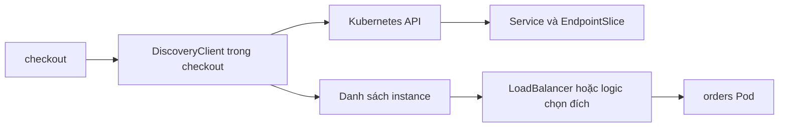
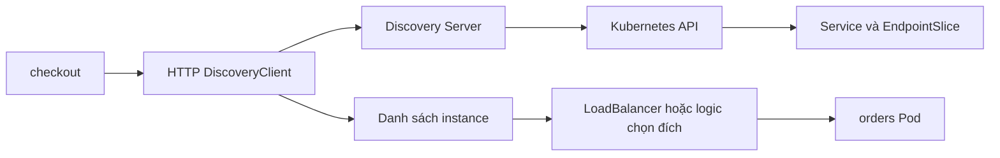

# Chọn truy cập API trực tiếp hay dùng Discovery Server

Trong chương **Lựa chọn kiến trúc** của module Spring Cloud Kubernetes (`SPRING_CLOUD_KUBERNETES`), bài học này hướng dẫn quyết định nơi đặt việc đọc dữ liệu discovery: bên trong từng ứng dụng hay trong một Spring Cloud Kubernetes Discovery Server dùng chung.

Hai phương án đều có thể cung cấp `DiscoveryClient` cho ứng dụng Spring. Khác biệt nằm ở danh tính gọi Kubernetes API, nơi giữ dữ liệu discovery, đường truyền cập nhật, phạm vi ảnh hưởng khi lỗi và trách nhiệm vận hành.

Tình huống xuyên suốt: dịch vụ `checkout` cần tìm các instance của `orders` trong namespace `commerce`. Một phương án cho `checkout` tự đọc Service và EndpointSlice; phương án còn lại cho nó hỏi Discovery Server đặt trong namespace `platform-discovery`.

Sau bài học, bạn cần:

- Vẽ đúng đường lấy thông tin instance và đường gọi nghiệp vụ.
- So sánh hai phương án theo quyền, khả năng chịu lỗi, độ mới dữ liệu và chi phí vận hành.
- Nhận biết khi Kubernetes Service DNS đã đáp ứng nhu cầu.
- Đặt tiêu chí kiểm chứng và viết một quyết định kiến trúc có thể xem xét lại.

## 1. Xác định nhu cầu discovery trước khi chọn nơi triển khai

Trước hết, phân biệt hai yêu cầu:

| Yêu cầu | Cách tiếp cận cần xem xét |
| --- | --- |
| Gọi một Service ổn định trong cluster, không cần biết từng Pod | Kubernetes Service DNS có thể đã đủ |
| Lấy danh sách instance, metadata hoặc áp dụng chính sách chọn instance phía client | Cần đánh giá DiscoveryClient và nguồn dữ liệu của nó |

Với Service ClusterIP thông thường, DNS trả địa chỉ Service; hạ tầng mạng Service chuyển traffic tới backend. Headless Service có ngữ nghĩa DNS khác và cần đánh giá riêng. [DNS for Services and Pods — Kubernetes](https://kubernetes.io/docs/concepts/services-networking/dns-pod-service/)

Nếu yêu cầu chỉ là gọi `http://orders.commerce.svc.cluster.local`, việc đưa một Discovery Server vào thiết kế cần có lý do bổ sung rõ ràng. Không chọn một lớp discovery trung gian chỉ vì ứng dụng chạy trên Kubernetes.

Trong phần còn lại, giả định ứng dụng thực sự cần `DiscoveryClient`, ví dụ muốn lấy danh sách instance và sử dụng Spring Cloud LoadBalancer để chọn Pod đích.

## 2. Hai kiến trúc khác nhau ở đường lấy dữ liệu

### 2.1. Ứng dụng đọc Kubernetes API trực tiếp

Ứng dụng dùng implementation Fabric8 hoặc Kubernetes Java Client. Nó có cấu hình namespace, quyền API và cơ chế quan sát dữ liệu tương ứng.



Mỗi replica consumer có client và trạng thái discovery của nó. Việc truy cập trực tiếp không có nghĩa mỗi request nghiệp vụ đều gọi Kubernetes API: implementation có thể dùng informer, watch hoặc cache để phục vụ truy vấn tại ứng dụng.

### 2.2. Ứng dụng hỏi Discovery Server qua HTTP

Ứng dụng dùng HTTP DiscoveryClient. Discovery Server là thành phần gọi Kubernetes API và cung cấp dữ liệu qua HTTP.



Spring Cloud Kubernetes cung cấp các starter riêng cho hai implementation gọi API trực tiếp và cho HTTP DiscoveryClient. [DiscoveryClient for Kubernetes](https://docs.spring.io/spring-cloud-kubernetes/reference/5.0/discovery-client.html)

Discovery Server xuất bản thông tin Service và instance qua HTTP. Nó không tự trở thành proxy cho mọi request nghiệp vụ. Sau khi lấy được instance, caller vẫn cần đường mạng tới host và port được trả về. [Spring Cloud Kubernetes Discovery Server](https://docs.spring.io/spring-cloud-kubernetes/reference/5.0/spring-cloud-kubernetes-discoveryserver.html)

Ví dụ, laptop có thể gọi được Discovery Server nhưng không định tuyến được tới Pod IP `10.244.2.18:8080`. Discovery thành công trong trường hợp đó chưa tạo ra khả năng gọi backend.

## 3. Bảng so sánh để bắt đầu quyết định

| Tiêu chí | API trực tiếp tại ứng dụng | Discovery Server |
| --- | --- | --- |
| Kubernetes client | Phân tán trong consumer | Tập trung ở các replica server cho đường discovery |
| Danh tính đọc API | ServiceAccount của từng consumer | ServiceAccount của server |
| Quyền consumer cần | Quyền đọc tài nguyên discovery theo phạm vi | Quyền truy cập HTTP discovery; chưa chắc hết nhu cầu API khác |
| Thành phần phải vận hành | Client, cấu hình và quyền của các ứng dụng | Thêm server, Service, bảo vệ HTTP, quan sát và nâng cấp server |
| Đường lấy instance | Ứng dụng đọc dữ liệu client/informer | Có thêm đường HTTP tới server, tùy cache |
| Phạm vi lỗi riêng | Sai quyền/cấu hình có thể ảnh hưởng một consumer | Lỗi server hoặc cấu hình dùng chung có thể ảnh hưởng nhiều consumer |
| Tải Kubernetes API | Phụ thuộc số replica consumer và phạm vi theo dõi | Có thể gom số reader API về các replica server |
| Đồng bộ chính sách | Cần phân phối cấu hình tới các consumer | Dễ tập trung phạm vi catalog, nhưng phải bảo vệ đúng ranh giới |
| Độ mới dữ liệu | Phụ thuộc client, watch và cache tại ứng dụng | Phụ thuộc thêm server, HTTP client và các cache liên quan |
| Nâng cấp | Đi cùng chu kỳ phát hành consumer | Có thêm hợp đồng phiên bản giữa server và client |

Không dùng bảng như thang điểm cộng máy móc. Một yêu cầu bắt buộc, chẳng hạn consumer không được đọc Kubernetes API, có thể loại phương án trực tiếp dù phương án đó đơn giản hơn ở các tiêu chí khác.

Ngược lại, nếu không có đội sở hữu Discovery Server hoặc chưa xác định được quyền xem catalog, việc gom client về một server không tự làm hệ thống dễ vận hành.

## 4. Quyền đọc API được chuyển chỗ, không biến mất

### Với phương án trực tiếp

ServiceAccount của `checkout` cần quyền đọc các tài nguyên mà implementation sử dụng trong `commerce`. Với discovery bằng EndpointSlice, phải xét API group `discovery.k8s.io`, không chỉ core `endpoints`.

### Với Discovery Server

Server cần quyền đọc nguồn discovery. Consumer có thể không cần quyền đó nữa, nhưng vẫn cần được phép truy cập HTTP và được phép xem đúng dữ liệu.

Ví dụ bổ sung quyền đọc tại namespace nghiệp vụ cho một server đặt ở namespace nền tảng:

```yaml
apiVersion: rbac.authorization.k8s.io/v1
kind: Role
metadata:
  name: discovery-reader
  namespace: commerce
rules:
  - apiGroups: [""]
    resources: ["services", "pods"]
    verbs: ["get", "list", "watch"]
  - apiGroups: ["discovery.k8s.io"]
    resources: ["endpointslices"]
    verbs: ["get", "list", "watch"]
---
apiVersion: rbac.authorization.k8s.io/v1
kind: RoleBinding
metadata:
  name: platform-discovery-reader
  namespace: commerce
subjects:
  - kind: ServiceAccount
    name: discovery
    namespace: platform-discovery
roleRef:
  apiGroup: rbac.authorization.k8s.io
  kind: Role
  name: discovery-reader
```

Đây là ví dụ quyền discovery cho thiết kế sử dụng EndpointSlice. Cần đối chiếu chính xác tài nguyên được phiên bản và tính năng đang chạy truy vấn. Không cấp quyền đọc Secret hoặc ghi tài nguyên chỉ để giải quyết một lỗi discovery.

RoleBinding nằm trong `commerce` và tham chiếu ServiceAccount ở `platform-discovery`. Nếu server đọc thêm namespace, phân quyền thêm đúng phạm vi đó; tránh chọn `all-namespaces` chỉ để bỏ qua việc thiết kế quyền. [Using RBAC Authorization — Kubernetes](https://kubernetes.io/docs/reference/access-authn-authz/rbac/)

### Hai lớp phân quyền độc lập

Kubernetes API nhìn thấy danh tính server khi server đọc catalog. Nó không tự biết caller HTTP nào sẽ nhận từng phần dữ liệu đó. Vì vậy, cần xác định:

1. Server được đọc namespace và tài nguyên nào?
2. Mỗi caller được xem catalog nào?
3. Ai xác thực và phân quyền tại đường HTTP?
4. Metadata nào được phép trả về?

Một filter phía client không phải ranh giới bảo mật. Ở HTTP client 5.0.0, một số thao tác lọc namespace được thực hiện sau khi nhận dữ liệu từ server; việc lọc đó không thu hồi dữ liệu đã truyền qua mạng. [HTTP DiscoveryClient tại tag 5.0.0](https://raw.githubusercontent.com/spring-cloud/spring-cloud-kubernetes/v5.0.0/spring-cloud-kubernetes-discovery/src/main/java/org/springframework/cloud/kubernetes/discovery/KubernetesAbstractBlockingDiscoveryClient.java)

Đối với các tenant không tin cậy lẫn nhau, cân nhắc catalog/server riêng theo miền tin cậy hoặc một lớp phân quyền HTTP đã được kiểm chứng. Đừng mặc định một server đọc mọi namespace đã cung cấp phân quyền chi tiết cho mọi caller.

## 5. Giảm số reader API có đánh đổi gì?

Một hệ thống nhiều replica có thể tạo nhiều reader, watch và bản sao dữ liệu discovery. Gom việc đọc về server có thể giảm phần phân tán đó, nhưng tạo thêm tài nguyên HTTP và server cần quản lý.

Một mô hình ước lượng đơn giản:

```text
N = số replica consumer
M = số replica Discovery Server
S = số namespace theo dõi
R = số nhóm tài nguyên được theo dõi

API trực tiếp:   cỡ N × S × R luồng theo dõi logic
Qua server:     cỡ M × S × R luồng theo dõi logic
                cộng lưu lượng HTTP consumer → server
```

Ví dụ giả định `N=120`, `M=3`, `S=2`, `R=3`: hai phép tính là 720 và 18. Đây là minh họa quy mô reader logic, không phải số kết nối TCP thực đo hoặc cam kết giảm tải theo đúng tỷ lệ đó.

Kết quả thực tế còn phụ thuộc:

- Client tổ chức informer, cache và list/watch như thế nào.
- Namespace có bao nhiêu Service, Pod và slice.
- Tần suất endpoint thay đổi và watch phải đồng bộ lại.
- Consumer gọi `getServices` hay `getInstances` bao nhiêu lần.
- Kích thước metadata trả về qua HTTP.
- Mỗi replica server có reader riêng hay cơ chế phối hợp nào khác.

Scale server lên ba replica không mặc định có một replica duy nhất đọc API. Nếu mỗi replica giữ informer riêng, phần API reader tăng cùng số replica server.

### Không nhầm discovery QPS với business QPS

Một ứng dụng xử lý 1.000 request nghiệp vụ mỗi giây không nhất thiết tạo 1.000 request tới Kubernetes API hoặc Discovery Server. Ngược lại, nếu mỗi lần chọn instance gọi HTTP discovery và không có cache thích hợp, server có thể trở thành một phần đáng kể của đường xử lý.

Với HTTP blocking client tại tag 5.0.0, phương thức không cache gọi endpoint server để lấy dữ liệu. Muốn kết luận nó có nằm trên mỗi lần chọn đích hay không, phải xem cả supplier và cache LoadBalancer đang được sử dụng. [Nguồn HTTP client 5.0.0](https://raw.githubusercontent.com/spring-cloud/spring-cloud-kubernetes/v5.0.0/spring-cloud-kubernetes-discovery/src/main/java/org/springframework/cloud/kubernetes/discovery/KubernetesAbstractBlockingDiscoveryClient.java)

Spring Cloud LoadBalancer có cơ chế cache riêng. Cần tránh cấu hình cache chồng lên nhau mà không biết độ trễ tổng thể; đồng thời không tắt mọi cache rồi giả định tải vẫn như cũ. [LoadBalancer Caching — Spring Cloud Commons](https://docs.spring.io/spring-cloud-commons/reference/5.0/spring-cloud-commons/loadbalancer.html)

## 6. Thiết kế theo độ mới dữ liệu và hành vi khi lỗi

Đặt câu hỏi cụ thể: sau khi một Pod không còn đủ điều kiện nhận traffic, bao lâu caller ngừng chọn Pod đó?

Với Discovery Server, chuỗi quan sát có thể gồm:

```text
Pod đổi trạng thái
→ Kubernetes cập nhật dữ liệu endpoint
→ server quan sát thay đổi
→ HTTP client nhận dữ liệu mới
→ cache/supplier của LoadBalancer phản ánh thay đổi
→ request mới chọn đích từ tập đã cập nhật
```

Không lấy trạng thái health HTTP 200 của server làm bằng chứng dữ liệu đã mới. Cũng không cộng vài giá trị TTL rồi xem đó là cam kết chính xác nếu chưa hiểu cơ chế invalidation của từng lớp.

| Sự cố | API trực tiếp | Qua Discovery Server |
| --- | --- | --- |
| Một consumer sai quyền | Consumer đó có thể không khởi tạo/cập nhật được discovery | Caller không trực tiếp đọc API; cần xem quyền HTTP và server |
| Kubernetes API tạm gián đoạn | Reader bị ảnh hưởng; khả năng dùng dữ liệu cũ tùy implementation | Server cũng bị ảnh hưởng ở nguồn; nó không tạo ra dữ liệu mới độc lập |
| Discovery Server không truy cập được | Không có dependency server này | Lookup mới có thể lỗi; khả năng dùng dữ liệu cũ phải được kiểm chứng |
| Tất cả replica server vừa restart | Không áp dụng | Có thể cần thời gian làm đầy lại trạng thái/cache |
| Hai replica server đồng bộ khác thời điểm | Không áp dụng theo dạng server dùng chung | Caller có thể quan sát các snapshot hơi khác nhau |
| Đường tới Pod backend lỗi | Lookup vẫn có thể thành công | Lookup vẫn có thể thành công; server không sửa đường mạng nghiệp vụ |

Các hành vi “giữ danh sách cuối cùng”, “fail startup” hoặc “trả lỗi khi dữ liệu cũ” cần được xác nhận ở phiên bản và cấu hình cụ thể. Không tự coi chúng là bảo đảm mặc định của một phương án.

### Chốt chính sách stale data

Quyết định cần ghi rõ:

- Có được dùng last-known-good khi không cập nhật được nguồn không?
- Thời gian cũ tối đa được chấp nhận là bao lâu?
- Khi không còn instance hợp lệ, trả lỗi hay dùng đường gọi khác?
- Ai chịu trách nhiệm phát hiện dữ liệu không cập nhật?
- Điều gì xảy ra khi tiến trình khởi động mà chưa có snapshot nào?

Fallback qua DNS chỉ hợp lệ khi giữ được ngữ nghĩa cần thiết về namespace, Service, port, bảo mật và chọn đích. Không âm thầm đổi từ chọn Pod theo metadata sang một Service khác phạm vi chỉ để tránh lỗi lookup.

## 7. Cấu hình minh họa hai phương án

Các đoạn dưới đây minh họa vị trí cấu hình, không phải một bộ triển khai hoàn chỉnh. Thuộc tính URL được đối chiếu với mã nguồn Spring Cloud Kubernetes 5.0.0; dependency cần được quản lý bởi Cloud BOM tương thích với Boot của dự án.

### 7.1. API trực tiếp

Chọn một họ client, ví dụ Kubernetes Java Client:

```xml
<dependency>
    <groupId>org.springframework.cloud</groupId>
    <artifactId>spring-cloud-starter-kubernetes-client</artifactId>
</dependency>
```

Cấu hình tại ứng dụng `checkout`:

```yaml
spring:
  cloud:
    kubernetes:
      discovery:
        all-namespaces: false
        namespaces:
          - commerce
        use-endpoint-slices: true
        include-not-ready-addresses: false
        primary-port-name: http
        metadata:
          add-annotations: false
```

ServiceAccount của ứng dụng phải có quyền phù hợp trong `commerce`. Nếu chọn Fabric8, thay bằng starter tương ứng và giữ một họ client nhất quán.

### 7.2. HTTP DiscoveryClient

Tại ứng dụng consumer:

```xml
<dependency>
    <groupId>org.springframework.cloud</groupId>
    <artifactId>spring-cloud-starter-kubernetes-discoveryclient</artifactId>
</dependency>
```

```yaml
spring:
  cloud:
    kubernetes:
      discovery:
        discovery-server-url: "http://discovery.platform-discovery.svc.cluster.local:80"
```

Địa chỉ phải là URL của Discovery Server, có scheme phù hợp. Không trỏ thuộc tính này vào `https://kubernetes.default.svc`, vì giao thức HTTP discovery khác Kubernetes API.

Tên canonical tại mốc được kiểm chứng là `spring.cloud.kubernetes.discovery.discovery-server-url`; kiểm tra metadata cấu hình đúng phiên bản thay vì sao chép một đường dẫn property từ ví dụ cũ. [KubernetesDiscoveryProperties 5.0.0](https://raw.githubusercontent.com/spring-cloud/spring-cloud-kubernetes/v5.0.0/spring-cloud-kubernetes-commons/src/main/java/org/springframework/cloud/kubernetes/commons/discovery/KubernetesDiscoveryProperties.java)

URL ví dụ dùng Service `discovery`, namespace `platform-discovery`, Service port 80 và cluster domain `cluster.local`. Thay các giá trị theo môi trường thực tế.

Bootstrap tới server nên dựa trên địa chỉ đã biết, chẳng hạn Service DNS. Đừng tạo vòng phụ thuộc bằng cách yêu cầu chính Discovery Server giải quyết địa chỉ của nó trước khi client kết nối lần đầu.

### 7.3. Phạm vi đọc API đặt tại server

Cấu hình tương ứng trong tiến trình Discovery Server:

```yaml
spring:
  cloud:
    kubernetes:
      discovery:
        all-namespaces: false
        namespaces:
          - commerce
        use-endpoint-slices: true
        include-not-ready-addresses: false
        primary-port-name: http
        metadata:
          add-annotations: false
```

Đây là phạm vi server đọc và xuất bản. Bộ lọc phía consumer, nếu được hỗ trợ, không làm thay đổi quyền API của server hoặc thay thế phân quyền HTTP.

Nếu dựa vào heartbeat/catalog watcher để phản ánh thay đổi, kiểm tra yêu cầu bật tính năng ở cả server và HTTP client theo phiên bản. Cũng cần thống nhất cơ chế cache/invalidation; chỉ đặt URL chưa chứng minh caller nhận được thay đổi đúng thời hạn. [Discovery Catalog Watch](https://docs.spring.io/spring-cloud-kubernetes/reference/5.0/discovery-client.html)

### 7.4. Ứng dụng có thực sự hết nhu cầu token Kubernetes không?

Chuyển riêng discovery sang HTTP có thể cho phép bỏ quyền đọc Service/EndpointSlice ở consumer. Tuy nhiên, ứng dụng còn đọc ConfigMap/Secret qua API hoặc tham gia leader election thì vẫn có nhu cầu truy cập khác.

Chỉ tắt việc mount token API mặc định khi đã kiểm kê các tính năng và cơ chế xác thực thực tế. HTTP discovery cũng có thể cần danh tính workload theo thiết kế bảo vệ endpoint. [Service Accounts — Kubernetes](https://kubernetes.io/docs/concepts/security/service-accounts/)

## 8. Ranh giới mạng, tenant và namespace

### Discovery thành công chưa chứng minh backend có thể truy cập

Đường cần kiểm tra gồm:

1. Consumer → Discovery Server.
2. Discovery Server → Kubernetes API.
3. Consumer → host/port backend được trả về.

HTTP server chỉ tham gia đường thứ nhất và đường thứ hai. Consumer ngoài cluster hoặc ở cluster khác cần thiết kế riêng cho đường thứ ba: định tuyến phù hợp, gateway hoặc một cơ chế data plane đã được chọn.

### NetworkPolicy không thay thế phân quyền catalog

NetworkPolicy có thể giới hạn kết nối theo khả năng của plugin mạng. Nó không tự diễn giải quyền được xem `orders` trong từng HTTP request. Khi cần xác thực danh tính hoặc phân quyền catalog, phải có cơ chế tương ứng tại tầng được lựa chọn. [Network Policies — Kubernetes](https://kubernetes.io/docs/concepts/services-networking/network-policies/)

Đối với server đọc nhiều namespace, cần xử lý cả thông tin nội bộ trong host, port, label và annotation. Không công khai catalog tổng hợp chỉ vì consumer không giữ Kubernetes token.

### Trùng Service ID giữa namespace

Giả sử `commerce` và `sandbox` đều có Service `orders`. Một thao tác `getInstances("orders")` không tự biểu đạt rằng caller chỉ muốn môi trường production.

Thiết kế cần thống nhất:

- Phạm vi namespace mà server công bố.
- Quy tắc đặt tên và lọc Service.
- Metadata namespace được bảo toàn.
- Cách consumer chọn đúng miền nghiệp vụ.
- Ranh giới xác thực/phân quyền để client không tự mở rộng phạm vi.

Không dựa vào việc “client hiện tại đang lọc đúng” để bảo vệ dữ liệu của tenant khác.

## 9. Vận hành Discovery Server như một dependency dùng chung

Nếu chọn server, hãy chỉ định đội sở hữu trước khi triển khai. Cần có:

- Endpoint ổn định và đường bootstrap không vòng phụ thuộc.
- Số replica, phân bố lỗi và khả năng phục vụ khi mất một replica.
- Chính sách readiness khi server chưa đồng bộ được nguồn.
- Liveness phản ánh sức khỏe tiến trình, tránh restart hàng loạt chỉ vì nguồn bên ngoài gián đoạn.
- Giới hạn tài nguyên, timeout và retry có ngân sách.
- Quan sát HTTP lookup, lỗi API, đồng bộ cache và dữ liệu cũ.
- Quy trình nâng cấp, quay lui và quản lý image.

Thêm replica giúp tránh mất một tiến trình nhưng không sửa được cấu hình RBAC sai dùng chung hoặc việc tất cả replica đọc cùng một nguồn đã gián đoạn.

Phân biệt ba câu hỏi sức khỏe:

| Câu hỏi | Bằng chứng |
| --- | --- |
| Tiến trình còn phục vụ HTTP không? | Probe, lỗi HTTP, tài nguyên và log |
| Catalog đã khởi tạo hoặc cập nhật được chưa? | Trạng thái đồng bộ, thời điểm thay đổi được quan sát, lỗi list/watch |
| Caller gọi được đúng backend không? | Kết quả DiscoveryClient, đích được chọn và request nghiệp vụ |

Khi thiết kế probe, lưu ý health tổng hợp có thể bao gồm phụ thuộc ngoài. Dùng health group có mục đích rõ và kiểm tra ngữ nghĩa của readiness trong chính sách stale data đã chọn. [Kubernetes Probes — Spring Boot](https://docs.spring.io/spring-boot/4.0/reference/actuator/endpoints.html#actuator.endpoints.kubernetes-probes)

Nâng cấp server và client cũng cần kiểm chứng hợp đồng JSON, metadata, chọn port, trạng thái endpoint và catalog watch. Không coi việc cùng có số major là đủ bằng chứng tương thích.

## 10. Ba tình huống để luyện quyết định

### Tình huống A: ít consumer, phạm vi hẹp

Có hai ứng dụng Spring trong `commerce`, mỗi ứng dụng hai replica. Chỉ một ứng dụng cần danh sách instance để thực hiện logic chọn đích. Nhóm có thể cấp quyền đọc giới hạn và chưa có đội vận hành dịch vụ discovery dùng chung.

**Lựa chọn hợp lý:** dùng client API trực tiếp cho ứng dụng thực sự cần discovery; các đường gọi Service thông thường tiếp tục dùng DNS.

**Lý do:** phạm vi quyền và client còn nhỏ; chưa có lợi ích đủ rõ để nhận thêm dependency server. Vẫn phải đo startup, tải API và độ trễ cập nhật.

### Tình huống B: nhiều consumer, có đội nền tảng

Có khoảng 120 replica consumer thuộc cùng miền tin cậy. Chính sách tổ chức hạn chế cấp quyền discovery API cho từng ứng dụng. Đội nền tảng có khả năng vận hành HTTP discovery, bảo vệ endpoint và quản lý nâng cấp.

**Lựa chọn đáng thử nghiệm:** Discovery Server theo miền tin cậy, với phạm vi namespace rõ và quyền đọc API tập trung.

**Điều kiện chấp nhận:** chứng minh caller không cần quyền discovery API, dữ liệu không vượt catalog được phép, đáp ứng độ mới và hành vi khi server/API lỗi.

Số consumer lớn là động lực để đo, không tự quyết định số replica hoặc bảo đảm hiệu năng của server.

### Tình huống C: caller ngoài cluster

Một ứng dụng ngoài cluster gọi được endpoint HTTP Discovery Server nhưng các instance trả về là Pod IP không thể định tuyến từ vị trí caller.

**Kết luận:** thêm Discovery Server chưa hoàn thành yêu cầu kết nối.

**Việc cần giải quyết:** lựa chọn đường data plane và địa chỉ backend có thể truy cập. Nếu nhu cầu chỉ là gọi API nghiệp vụ từ ngoài cluster, xem xét endpoint nghiệp vụ/gateway phù hợp thay vì công khai catalog Pod.

## 11. ADR mẫu có tiêu chí kiểm chứng

ADR là bản ghi quyết định kiến trúc. Nó cần mô tả lý do, hệ quả và điều kiện xem xét lại, không chỉ ghi tên công nghệ.

Ví dụ cho tình huống B:

```text
Quyết định:
  Dùng Spring Cloud Kubernetes Discovery Server cho catalog commerce.

Bối cảnh:
  Nhiều replica consumer cần DiscoveryClient.
  Consumer không được cấp quyền đọc Service/EndpointSlice.
  Đội nền tảng sở hữu HTTP discovery và quy trình nâng cấp.

Phạm vi:
  Chỉ Service thuộc namespace commerce được công bố.
  Chưa gộp catalog của tenant không cùng miền tin cậy.
  Discovery Server không proxy request nghiệp vụ.

Phương án đã cân nhắc:
  Service DNS: đáp ứng đường gọi thông thường nhưng không đủ nhu cầu instance.
  API trực tiếp: ít thành phần hơn, không phù hợp chính sách quyền consumer.
  Discovery Server: phù hợp vị trí đặt quyền, thêm dependency cần vận hành.

Hệ quả:
  Cần endpoint HTTP được bảo vệ, replica và quan sát độ mới dữ liệu.
  Cần quản lý cả phiên bản server lẫn dependency client.
  Caller vẫn phải kết nối được tới địa chỉ instance được trả về.

Tiêu chí chấp nhận giả định:
  p95 lookup trong lab tải mục tiêu nhỏ hơn 100 ms.
  Thay đổi endpoint phản ánh tới lựa chọn đích trong 10 giây ở phép thử chuẩn.
  Mất một replica server không làm gián đoạn lookup vượt ngân sách đã chốt.
  Không caller nào nhận catalog ngoài phạm vi cho phép.
  Có quy tắc rõ cho dữ liệu cũ, lookup lỗi và startup chưa có dữ liệu.

Xem xét lại khi:
  Thay đổi yêu cầu namespace/tenant hoặc đường mạng.
  Không đạt độ mới, lỗi dùng chung hoặc chi phí vận hành chấp nhận được.
  Nhu cầu instance biến mất và Service DNS đã đủ.
```

Các con số trên là mục tiêu giả định để viết tiêu chí, không phải benchmark hoặc mặc định của Spring Cloud Kubernetes. Cần thay bằng ngân sách và kết quả đo của hệ thống.

## 12. Kiểm chứng hai phương án trước khi chuyển đổi

### 12.1. So sánh cùng một hợp đồng discovery

Tạo hai consumer canary độc lập: một dùng API trực tiếp, một dùng HTTP DiscoveryClient. Cả hai đọc cùng phạm vi và có cùng quy tắc readiness, primary port, metadata và EndpointSlice.

Không chỉ thêm cả hai starter vào một ứng dụng rồi coi đó là phép thử hai đường độc lập. Khi có nhiều implementation DiscoveryClient hoặc auto-configuration cùng xuất hiện, cần biết bean nào và thứ tự nào đang phục vụ truy vấn.

Chuẩn hóa kết quả theo:

```text
namespace + serviceId + host + port + secure
```

So sánh theo tập dữ liệu sau khi loại trùng hợp lệ; không so thứ tự JSON hoặc đếm tên Service mà bỏ qua namespace.

### 12.2. Quan sát API của server và kết quả tại caller

Ví dụ lệnh PowerShell chỉ để kiểm tra, thay context bằng môi trường thử nghiệm thực tế:

```powershell
$validationContext = 'my-test-context'
$businessNamespace = 'commerce'
$serverNamespace = 'platform-discovery'
$serverIdentity = 'system:serviceaccount:platform-discovery:discovery'

kubectl --context $validationContext -n $businessNamespace get service orders
kubectl --context $validationContext -n $businessNamespace get endpointslices -l kubernetes.io/service-name=orders -o yaml
kubectl --context $validationContext auth can-i list services -n $businessNamespace --as=$serverIdentity
kubectl --context $validationContext auth can-i watch endpointslices.discovery.k8s.io -n $businessNamespace --as=$serverIdentity
kubectl --context $validationContext -n $serverNamespace port-forward service/discovery 18761:80
```

Phép thử `--as` yêu cầu quyền impersonation. Ở terminal khác, sau khi thiết lập cơ chế xác thực nếu môi trường yêu cầu:

```powershell
curl.exe --max-time 5 http://127.0.0.1:18761/apps/orders
```

`/apps/orders` là endpoint liệt kê instance trong API server được kiểm chứng tại tag 5.0.0. Gọi được nó chỉ chứng minh một phần đường discovery; tiếp tục kiểm tra `getInstances("orders")` ở ứng dụng và request nghiệp vụ tới đích. [DiscoveryServerController 5.0.0](https://raw.githubusercontent.com/spring-cloud/spring-cloud-kubernetes/v5.0.0/spring-cloud-kubernetes-controllers/spring-cloud-kubernetes-discoveryserver/src/main/java/org/springframework/cloud/kubernetes/discoveryserver/DiscoveryServerController.java)

Không đưa bearer token hoặc mật khẩu vào log chia sẻ khi kiểm chứng.

### 12.3. Thử thay đổi và sự cố

| Phép thử | Điều cần đo |
| --- | --- |
| Scale backend tăng/giảm | Độ trễ thêm hoặc loại instance ở từng lớp |
| Pod chuyển không Ready | Caller ngừng chọn đích theo chính sách đã chốt |
| Service có nhiều port | Đúng target port và thuộc tính secure |
| Consumer mới startup | Hành vi khi chưa có snapshot |
| Mất một replica server | Thời gian phục hồi lookup và ảnh hưởng tới các caller |
| API tạm không truy cập được | Độ mới dữ liệu, stale policy và lỗi cập nhật |
| Server hết quyền ở một namespace | Không âm thầm coi catalog thiếu là catalog hợp lệ |
| Trùng Service ID giữa namespace | Không chọn sai miền hoặc môi trường |
| Caller ngoài cluster, nếu hỗ trợ | Kết nối thực tế tới địa chỉ backend |
| Nâng cấp một phần server/client | Hợp đồng response và cập nhật vẫn đúng |

Theo dõi riêng cold start và warm state. Shadow test nên so sánh truy vấn discovery; không gửi lặp giao dịch nghiệp vụ có side effect chỉ để đối chiếu hai phương án.

## 13. Chuyển đổi và quay lui có phạm vi rõ

Một lộ trình chuyển từ API trực tiếp sang server có thể gồm:

1. Kiểm kê namespace, Service, quyền và tính năng API hiện có của consumer.
2. Triển khai server, giới hạn catalog và kiểm tra dữ liệu trước khi đưa caller thật vào.
3. Chạy hai canary độc lập, so sánh dữ liệu và hành vi lỗi.
4. Chuyển một nhóm consumer; quan sát lookup, đích thực tế và thay đổi backend.
5. Mở rộng khi các tiêu chí ADR đạt yêu cầu.
6. Thu hồi quyền discovery API không còn cần ở consumer sau khi kiểm tra tính năng khác.

Quay lui về API trực tiếp cần artifact có client phù hợp, quyền đọc và đường tới API server. Nếu quyền đã bị thu hồi, đổi lại một property URL không đủ khôi phục phương án cũ.

Quay lui qua DNS cần kiểm tra lại Service port, phạm vi chọn backend và ngữ nghĩa routing. Không coi nó là fallback tự động tương đương với mọi chính sách chọn instance.

Việc đổi discovery cũng không chuyển ConfigMap/Secret PropertySource sang một server khác. Nếu ứng dụng đọc cấu hình qua API, đường quyền và nguồn cấu hình đó vẫn tồn tại riêng. [Kubernetes PropertySource Implementations](https://docs.spring.io/spring-cloud-kubernetes/reference/5.0/property-source-config.html)

Tương tự, Configuration Watcher là controller cập nhật cấu hình. Nếu cách refresh đang dùng discovery để tìm instance, kiểm tra chính đường discovery, phiên bản và quyền của watcher; đổi starter của một consumer không tự đổi controller này. [Configuration Watcher](https://docs.spring.io/spring-cloud-kubernetes/reference/5.0/spring-cloud-kubernetes-configuration-watcher.html)

## 14. Những kết luận cần tránh

| Kết luận vội | Câu hỏi cần thay thế |
| --- | --- |
| “Có server thì không cần RBAC” | Danh tính nào đang đọc Kubernetes API và phạm vi nào được cấp? |
| “Có hai replica là hết điểm lỗi chung” | Cấu hình, quyền, nguồn dữ liệu và đường mạng nào vẫn dùng chung? |
| “Server trả HTTP 200 nên discovery đúng” | Catalog có đủ, đúng namespace, đúng port và đủ mới không? |
| “Consumer không có token nên dữ liệu đã được bảo vệ” | Ai được gọi HTTP và xem phần catalog nào? |
| “Mọi business request đều phải đi qua server” | Lookup được gọi lúc nào, cache ở đâu, traffic nghiệp vụ đi đường nào? |
| “Discovery được là gọi Pod được” | Caller có định tuyến, port, giao thức và quyền kết nối tới backend không? |
| “Server nhiều tính năng hơn nên luôn tốt hơn” | Nhu cầu cụ thể nào bù được dependency và chi phí vận hành bổ sung? |

Một quyết định đầy đủ phải chỉ ra **ai đọc API, ai được xem dữ liệu, dữ liệu mới đến đâu, chuyện gì xảy ra khi nguồn lỗi và ai vận hành phần dùng chung**. Hai phương án có thể cùng đúng trong những phạm vi khác nhau; ranh giới và bằng chứng kiểm chứng mới làm lựa chọn có giá trị.
