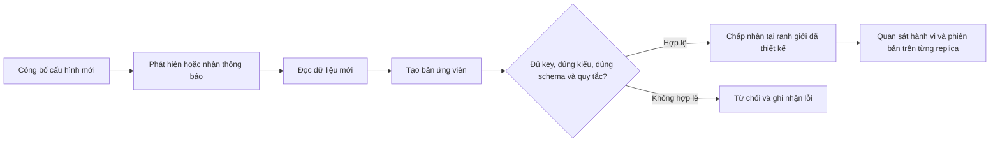

# Chọn cấu hình nạp lúc khởi động hay cập nhật động

Trong chương **Lựa chọn kiến trúc** của module **SPRING_CLOUD_KUBERNETES**, bài này giúp chọn thời điểm áp dụng cấu hình cho ứng dụng Spring: nạp thành một bộ giá trị khi khởi động, hoặc chấp nhận thay đổi trong lúc tiến trình đang phục vụ.

Hãy quyết định theo từng nhóm thuộc tính. Cấu hình gắn với vòng đời server, tài nguyên hoặc một tác vụ dài thường cần một mốc áp dụng rõ ràng. Cập nhật động phù hợp khi ứng dụng có thể kiểm tra, chuyển đổi và sử dụng giá trị mới an toàn, đồng thời quan sát và khôi phục được khi một phần replica chưa cập nhật.

Lựa chọn này liên quan đến ConfigMap, Secret, Spring Cloud Kubernetes PropertySource và Configuration Watcher, nhưng không đồng nghĩa phải bật tất cả tính năng trong module. DiscoveryClient hoặc Spring Cloud LoadBalancer có vòng đời dữ liệu discovery riêng; thay đổi danh sách Pod không phải lý do tự động refresh toàn bộ cấu hình ứng dụng.

## 1. Tách nguồn cấu hình khỏi thời điểm áp dụng

Có hai câu hỏi độc lập:

1. Dữ liệu được lấy từ đâu: file, biến môi trường, ConfigMap/Secret qua API hay một hệ thống khác?
2. Ứng dụng áp dụng dữ liệu mới vào lúc nào và bằng cơ chế nào?

| Đường lấy dữ liệu | Chỉ áp dụng khi khởi động | Có thể tham gia cập nhật động khi có cơ chế phù hợp |
| --- | --- | --- |
| ConfigMap/Secret được đưa vào biến môi trường | Tiến trình mới nhận bộ giá trị được cấp | Không thể tự thay biến môi trường của tiến trình hiện tại |
| File được mount | Ứng dụng đọc một lần và giữ bộ giá trị | Phải có cách đọc lại, kiểm tra và áp dụng dữ liệu |
| PropertySource qua Kubernetes API | Provider nạp lúc khởi động | Cần cơ chế thông báo/tải lại và đối tượng sử dụng hỗ trợ cập nhật |
| Nguồn do ứng dụng tự quản lý | Nạp một bản hợp lệ khi tạo tiến trình/tác vụ | Ứng dụng chịu trách nhiệm toàn bộ giao thức áp dụng |

Kubernetes không tự sửa biến môi trường của container đang chạy khi ConfigMap nguồn đổi. Pod được tạo sau đó có thể nhận giá trị khác Pod cũ nếu cùng tham chiếu một nguồn đã bị sửa tại chỗ. [Cập nhật ConfigMap dùng làm biến môi trường](https://kubernetes.io/docs/tutorials/configuration/updating-configuration-via-a-configmap/)

Ngược lại, file dưới volume có thể được cập nhật mà bean vẫn giữ giá trị đã đọc từ constructor. Việc có dữ liệu mới và việc sử dụng dữ liệu mới là hai mốc khác nhau.

Trong bài:

- **Nạp lúc khởi động**: nhóm thuộc tính được chốt cho một vòng đời tiến trình hoặc tài nguyên đã xác định; thay đổi được áp dụng khi tạo vòng đời mới.
- **Cập nhật động**: tiến trình đang chạy chấp nhận một phiên bản cấu hình mới cho các lần sử dụng tiếp theo mà không cần khởi động lại JVM.

Một controller phát hiện thay đổi rồi restart ứng dụng vẫn áp dụng cấu hình qua lần khởi động mới. Không gọi đó là bằng chứng refresh tại chỗ chỉ vì việc restart được tự động hóa.

## 2. Phân loại nhóm thuộc tính trước khi chọn cơ chế

Cùng một ứng dụng có thể dùng cả hai phương án.

| Nhóm thuộc tính | Câu hỏi về vòng đời | Hướng đánh giá |
| --- | --- | --- |
| Cổng server, cấu hình khởi tạo framework | Thành phần có đọc lại và tái cấu hình được không? | Thường gắn với khởi động hoặc tái tạo thành phần |
| URL, driver và cấu trúc tài nguyên kết nối | Kết nối đang mở được xử lý ra sao? | Cần quy trình thay tài nguyên hoặc rollout đã kiểm chứng |
| Giới hạn xử lý giữa các request | Request mới có thể dùng giá trị mới độc lập không? | Có thể là ứng viên cập nhật động |
| Một nhóm quy tắc liên quan nhiều key | Có thể chấp nhận từng key đổi riêng không? | Cần kiểm tra và áp dụng nguyên nhóm |
| Tham số của một tác vụ dài | Tác vụ có phải giữ cùng phiên bản đến khi hoàn tất không? | Chụp một bộ giá trị cho tác vụ; áp dụng bản mới ở ranh giới phù hợp |
| Credential hoặc chứng chỉ | Thư viện và hệ thống đích hỗ trợ thay thế như thế nào? | Thiết kế quy trình xoay vòng riêng |
| Thuộc tính được nhiều phiên bản mã cùng đọc | Schema mới có tương thích với mã cũ không? | Kiểm tra hợp đồng trong cả rollout và refresh |

“Thường” trong bảng không phải giới hạn cố định của mọi thư viện. Một client có API đổi timeout an toàn có thể khác một client chỉ đọc timeout khi tạo instance. Quyết định phải dựa trên implementation và phiên bản thực tế.

Lập danh mục cho từng nhóm:

```text
Nhóm: policy.*
Đối tượng sử dụng: bộ xử lý request
Ranh giới áp dụng: trước khi bắt đầu request mới
Điều kiện hợp lệ: giới hạn nằm trong miền cho phép, đủ các key liên quan
Mức nhất quán: một request dùng một bộ giá trị
Chính sách khi bản mới lỗi: giữ bản đã chấp nhận nếu hợp đồng cho phép
```

Danh mục này hữu ích hơn một cờ “dynamic=true” cho toàn ứng dụng, vì nó chỉ rõ điều gì được phép thay đổi và khi nào.

## 3. Phương án nạp lúc khởi động: một bộ cấu hình cho vòng đời mới

### 3.1. Khi phương án này phù hợp

Ưu tiên đánh giá nạp lúc khởi động khi:

- Thay đổi ít hoặc quy trình rollout hiện tại đáp ứng thời gian áp dụng.
- Thuộc tính gắn với tài nguyên khó thay thế an toàn trong tiến trình.
- Cần tái hiện rõ bộ mã và bộ cấu hình của từng replica.
- Tác vụ cần giữ cùng tham số trong suốt vòng đời.
- Đội vận hành muốn dùng quy trình phát hành, readiness và rollback hiện có.

Không cần build lại image chỉ để đổi cấu hình ngoài ứng dụng. Có thể giữ image và thay nguồn hoặc tham chiếu cấu hình, sau đó tạo Pod mới theo quy trình phát hành.

### 3.2. Gắn cấu hình với phiên bản có thể truy vết

Ví dụ một ConfigMap chứa dữ liệu giả:

```yaml
apiVersion: v1
kind: ConfigMap
metadata:
  name: orders-runtime-v17
  namespace: shop
immutable: true
data:
  POLICY_VERSION: "policy-v17"
  POLICY_LIMIT: "40"
```

Fragment sau nằm trong Deployment của ứng dụng:

```yaml
spec:
  template:
    spec:
      containers:
        - name: app
          envFrom:
            - configMapRef:
                name: orders-runtime-v17
```

Ứng dụng ánh xạ các biến này vào những thuộc tính tương ứng, chẳng hạn `policy.version` và `policy.limit`, rồi kiểm tra chúng trước khi phục vụ. Đây là phần cấu hình minh họa, không phải một Deployment hoàn chỉnh.

Khi phát hành bản cấu hình tiếp theo:

1. Tạo `orders-runtime-v18` với nội dung đã kiểm tra.
2. Đổi tham chiếu trong Pod template sang tên mới.
3. Rollout với chiến lược sẵn sàng và khả năng phục vụ đã thiết kế.
4. Xác nhận từng Pod mới nhận đúng phiên bản.
5. Giữ bản cấu hình cũ trong khoảng thời gian cần rollback.

`immutable: true` ngăn sửa nội dung dữ liệu của đối tượng đó. Nó không tự cấm một người có quyền xóa rồi tạo lại tài nguyên; quy trình quản lý tên và quyền vẫn phải bảo đảm phiên bản được giữ đúng nội dung. [Immutable ConfigMap](https://kubernetes.io/docs/concepts/configuration/configmap/#immutable-configmaps)

Đổi Pod template làm Deployment thực hiện rollout. Chỉ sửa dữ liệu của một ConfigMap được tham chiếu không tự tạo rollout Deployment. [Điều kiện kích hoạt rollout](https://kubernetes.io/docs/concepts/workloads/controllers/deployment/#updating-a-deployment)

### 3.3. Giới hạn cần chấp nhận

Rolling update có thể tạo một khoảng thời gian Pod cũ và Pod mới cùng phục vụ. Vì vậy nạp lúc khởi động cũng không tự cho tính nguyên tử trên toàn bộ replica.

Cần xác định:

- Hai phiên bản cấu hình có được phép cùng tồn tại không?
- Request đang xử lý có tiếp tục bằng bộ giá trị cũ không?
- Pod mới phải kiểm tra gì trước khi nhận traffic?
- Mã và schema cấu hình cũ/mới có tương thích trong giai đoạn chuyển không?

Nếu không thể chấp nhận hai phiên bản cùng hoạt động, cần thiết kế cách điều phối áp dụng hoặc chuyển traffic riêng. Chỉ chọn startup thay cho refresh chưa giải quyết yêu cầu đó.

## 4. Phương án cập nhật động: một luồng chấp nhận cấu hình mới

### 4.1. Khi cập nhật động đáng cân nhắc

Cập nhật động có giá trị khi thời điểm áp dụng cần độc lập với rollout, phạm vi thuộc tính có thể thay an toàn và lợi ích vận hành đủ để xây dựng cơ chế quan sát cùng khôi phục.

Ví dụ một nhóm tham số xử lý request cần được điều chỉnh trong thời gian ngắn. Nếu mỗi request có thể dùng một bộ giá trị hoàn chỉnh và việc thay đổi không phá tác vụ đang chạy, nhóm đó có thể phù hợp với cập nhật động.

Tần suất thay đổi không phải tiêu chí duy nhất. Một thay đổi hiếm nhưng cần phản ứng nhanh vẫn có thể cần cơ chế này; một tham số đổi thường xuyên nhưng gắn với tài nguyên chưa hỗ trợ thay thế vẫn cần một quy trình khác.

### 4.2. Phân biệt thông báo, tải nguồn và áp dụng



Sơ đồ mô tả một hợp đồng áp dụng mà hệ thống cần bảo đảm. Không suy ra mọi bước, đặc biệt validation và giữ bản tốt trước đó, đều đã được một annotation thực hiện sẵn.

Spring Cloud Kubernetes Configuration Watcher có thể gửi thông báo qua HTTP refresh hoặc Spring Cloud Bus. Ứng dụng cần đường lấy dữ liệu mới và cơ chế cập nhật đối tượng sử dụng phù hợp; file mount đổi cũng không tự khiến Spring Boot áp dụng lại toàn bộ cấu hình. [Configuration Watcher](https://docs.spring.io/spring-cloud-kubernetes/reference/spring-cloud-kubernetes-configuration-watcher.html)

Nếu nguồn là volume, thông báo có thể đến trước lúc dữ liệu chiếu vào file đã đổi. Nếu nguồn là API, vẫn cần xem xét lỗi tải, quyền và nguồn thuộc tính có hiệu lực.

### 4.3. Refresh có phạm vi và giới hạn

`@RefreshScope` dùng proxy và làm mất hiệu lực đối tượng được cache để đối tượng đích được khởi tạo lại khi sử dụng. Một singleton đã giữ bản sao giá trị không tự có cùng hành vi. Spring Cloud cũng ghi nhận `HikariDataSource` thuộc nhóm không refresh được theo cơ chế này. [Phạm vi Refresh Scope](https://docs.spring.io/spring-cloud-commons/reference/spring-cloud-commons/application-context-services.html#_refresh_scope)

Vì vậy, phải kiểm tra **bean và tài nguyên cụ thể** thay vì chỉ kiểm tra endpoint refresh trả 200.

Với yêu cầu AOT/native image, kiểm tra hỗ trợ ngay từ đầu. Tài liệu Spring Cloud Kubernetes 5.1 nêu chưa hỗ trợ target AOT/native; không dùng kết quả chạy JVM để kết luận target khác có cùng khả năng. [Giới hạn target trong tài liệu 5.1](https://docs.spring.io/spring-cloud-kubernetes/reference/index.html#_aot_and_native_image_support)

## 5. Chọn mức nhất quán cần có

### 5.1. Nhất quán giữa các key trong một lần xử lý

Giả sử `policy.min`, `policy.max` và `policy.version` thuộc cùng một quy tắc. Nếu cập nhật hoặc đọc từng giá trị ở những thời điểm khác nhau, một request có thể thấy một tổ hợp chưa từng được chấp thuận.

Cách thiết kế có thể là tạo một bộ giá trị bất biến sau validation rồi thay tham chiếu đang dùng. Request lấy bộ giá trị một lần và sử dụng nó đến khi hoàn tất.

Thay dữ liệu trong cùng một ConfigMap chỉ giải quyết một phần ở nguồn. Nó không tự chứng minh mọi trường của các bean và tài nguyên đích đã chuyển cùng nhau.

### 5.2. Nhất quán của tác vụ đang chạy

Với một tác vụ kéo dài, cần xác định rõ phiên bản cấu hình được chốt:

- Khi tác vụ bắt đầu.
- Khi bắt đầu từng đơn vị công việc nhỏ.
- Hoặc tại một ranh giới chuyển đổi được thiết kế riêng.

Ví dụ một batch có thể lưu `policyVersion` trong thông tin thực thi và tiếp tục bằng bản đó, trong khi batch mới dùng bản vừa chấp nhận. Đây là chính sách của ứng dụng; không mặc định refresh sẽ biết ranh giới nghiệp vụ này.

### 5.3. Nhất quán giữa các replica

Watcher gửi thông báo đến nhiều instance không tạo giao dịch phân tán để tất cả chuyển đổi cùng một thời điểm. Một replica có thể chậm, mất kết nối hoặc từ chối bản ứng viên.

Đặt một thời hạn hội tụ, ví dụ mục tiêu thử nghiệm “tất cả replica thuộc phạm vi quan sát áp dụng generation mới trong 45 giây”. Đây là yêu cầu thiết kế để đo, không phải bảo đảm của Watcher.

Ngân sách thời gian cần tính đến phát hiện thay đổi, khả năng nhìn thấy nguồn mới, truyền thông báo, áp dụng và quan sát. Replica không báo nhận phải được coi là chưa hội tụ; không bỏ nó khỏi mẫu đo để làm kết quả đạt.

Nếu hệ thống không chấp nhận cửa sổ hai phiên bản cùng tồn tại, cần cách điều phối theo phiên bản, ranh giới tác vụ hoặc giao thức khác phù hợp. Cả rolling update thông thường lẫn refresh fan-out đều cần được đánh giá lại.

## 6. Ví dụ chấp nhận một snapshot động trong JVM

Ví dụ Java 17 sau minh họa phần **chấp nhận dữ liệu nghiệp vụ**. Nó không phải một provider Spring Cloud Kubernetes và không tự đăng ký listener refresh.

Hợp đồng giả định:

- `maxItems` nằm trong khoảng 1 đến 1000.
- `generation` do quy trình công bố của ứng dụng cấp theo thứ tự tăng.
- Cùng một generation phải có cùng nội dung.
- Gửi lại đúng bản đã chấp nhận là thao tác không đổi trạng thái.
- Một request đọc snapshot một lần.

```java
import java.util.Objects;
import java.util.concurrent.atomic.AtomicReference;

public final class PolicyStore {

    public record PolicySnapshot(
        long generation,
        String policyVersion,
        int maxItems
    ) {
        public PolicySnapshot {
            if (generation < 1) {
                throw new IllegalArgumentException(
                    "generation phải lớn hơn hoặc bằng 1"
                );
            }
            if (policyVersion == null || policyVersion.isBlank()) {
                throw new IllegalArgumentException(
                    "Thiếu policyVersion"
                );
            }
            if (maxItems < 1 || maxItems > 1000) {
                throw new IllegalArgumentException(
                    "maxItems nằm ngoài miền cho phép"
                );
            }
        }
    }

    private final AtomicReference<PolicySnapshot> current;

    public PolicyStore(PolicySnapshot initial) {
        current = new AtomicReference<>(
            Objects.requireNonNull(initial)
        );
    }

    public PolicySnapshot snapshot() {
        return current.get();
    }

    public PolicySnapshot install(PolicySnapshot candidate) {
        Objects.requireNonNull(candidate);

        return current.updateAndGet(previous -> {
            if (candidate.equals(previous)) {
                return previous;
            }
            if (candidate.generation() <= previous.generation()) {
                throw new IllegalArgumentException(
                    "Bản ứng viên cũ hoặc xung đột generation"
                );
            }
            return candidate;
        });
    }
}
```

Adapter lấy cấu hình cần đọc đủ dữ liệu, tạo `PolicySnapshot` rồi mới gọi `install`. Nếu tạo bản ứng viên không hợp lệ hoặc bị từ chối, tham chiếu chính sách trong ví dụ vẫn giữ bản đã chấp nhận.

Hàm cập nhật của `AtomicReference` có thể được gọi lại khi cạnh tranh giữa các luồng, nên không đặt side effect như mở kết nối, gửi sự kiện hoặc ghi audit bắt buộc bên trong lambda. [AtomicReference.updateAndGet](https://docs.oracle.com/en/java/javase/17/docs/api/java.base/java/util/concurrent/atomic/AtomicReference.html#updateAndGet(java.util.function.UnaryOperator))

Phần xử lý request cần giữ một biến snapshot:

```java
PolicyStore.PolicySnapshot policy = policyStore.snapshot();
// Dùng policy.maxItems() và policy.policyVersion()
// cho toàn bộ đơn vị xử lý đã chọn.
```

Record trong ví dụ là dữ liệu bất biến do ứng dụng quản lý, không phải một record `@ConfigurationProperties` được giả định có thể refresh.

Giới hạn của mẫu phải được giữ rõ:

- Thao tác thay tham chiếu chỉ nguyên tử trong một tiến trình.
- Không làm các replica khác đồng thời chuyển đổi.
- Không thay thế việc chuẩn bị/drain tài nguyên có trạng thái.
- Không rollback toàn bộ Spring Environment hoặc những bean khác đã đổi trước đó.
- Không tự giải quyết schema mới không tương thích với mã cũ.

Nếu Spring đã tải một giá trị sai vào Environment nhưng adapter giữ snapshot nghiệp vụ cũ, cần quan sát cả hai trạng thái đó. Không gọi việc giữ snapshot là “rollback cấu hình toàn ứng dụng”.

### Generation và phiên bản nội dung phục vụ các mục đích khác nhau

Ví dụ generation 17 dùng nội dung `policy-v17`, generation 18 dùng `policy-v18`. Nếu cần phục hồi nội dung v17, có thể công bố generation 19 với nội dung phục hồi từ v17.

Như vậy vẫn có thứ tự công bố mới mà không cho một thông báo cũ ghi đè bản mới. Đây là quy ước riêng của thiết kế mẫu; hệ thống công bố phải cấp generation đúng.

Không dùng `resourceVersion` hoặc tự suy từ metadata Kubernetes thành thứ tự chính sách nghiệp vụ. Resource version thuộc giao thức đọc/cập nhật/theo dõi tài nguyên; vòng đời phiên bản nghiệp vụ cần được định nghĩa riêng. [Kubernetes API concepts](https://kubernetes.io/docs/reference/using-api/api-concepts/)

## 7. Rollback và xử lý Secret cần được thiết kế từ đầu

| Nội dung | Nạp lúc khởi động | Cập nhật động |
| --- | --- | --- |
| Đơn vị khôi phục | Artifact, tham chiếu nguồn và phiên bản cấu hình tương thích | Một lần công bố/áp dụng mới với nội dung phục hồi |
| Đối tượng đang phục vụ | Pod cũ có thể tiếp tục trong chiến lược rollout | Tiến trình hiện tại cần giữ hoặc chuyển về bản hợp lệ |
| Bằng chứng | Pod mới/được khôi phục dùng đúng bộ mã và cấu hình | Từng replica báo generation và hành vi đã phục hồi |
| Điểm dễ nhầm | Rollback Deployment không khôi phục nguồn đã bị sửa tại chỗ | Trả dữ liệu nguồn về cũ chưa chứng minh bean đã nhận lại |

Lịch sử Deployment chỉ lưu phần Pod template của revision. Nếu nguồn cùng tên bị sửa tại chỗ, quay lại template cũ không tự trả nguồn về nội dung cũ. Giữ tài nguyên theo phiên bản hoặc lưu khả năng khôi phục tương ứng. [Rollback Deployment](https://kubernetes.io/docs/concepts/workloads/controllers/deployment/#rolling-back-a-deployment)

Với cập nhật động, việc xóa một key cũng cần được thử riêng. Đừng mặc định “không còn key” tương đương một giá trị vô hiệu hóa rõ ràng hoặc refresh sẽ xóa hết mọi giá trị cũ ở đối tượng đích.

### Secret không chỉ là một chuỗi cần bind lại

Đổi mật khẩu cơ sở dữ liệu hoặc chứng chỉ có thể tác động tới kết nối đang mở và hệ thống bên ngoài. Quy trình cần xác định:

1. Khi nào credential mới được phía đích chấp nhận.
2. Khoảng thời gian credential cũ/mới cùng có hiệu lực, nếu có.
3. Cách tạo hoặc cập nhật client/pool theo khả năng được hỗ trợ.
4. Khi nào dừng sử dụng và đóng tài nguyên cũ.
5. Cách kiểm tra thao tác xác thực mới trước khi thu hồi credential cũ.

Trả Secret Kubernetes về giá trị cũ không bảo đảm hệ thống đích vẫn chấp nhận credential đó. Không công bố nội dung Secret trong log, metric hoặc endpoint dùng để quan sát phiên bản. [Quản lý Secret an toàn](https://kubernetes.io/docs/concepts/security/secrets-good-practices/)

Volume Secret được cập nhật theo cơ chế nhất quán cuối cùng; mount `subPath` không nhận cập nhật tự động theo cùng cách. Dù file đã đổi, thư viện tiêu thụ vẫn phải hỗ trợ đọc và áp dụng lại. [Secret qua volume](https://kubernetes.io/docs/concepts/configuration/secret/#using-secrets-as-files-from-a-pod)

## 8. Ma trận chọn phương án theo ràng buộc

| Ràng buộc đã xác định | Hướng nghiêng về nạp lúc khởi động | Điều kiện để chọn cập nhật động |
| --- | --- | --- |
| Thời gian áp dụng | Rollout đạt thời gian cho phép | Cần tách thời điểm áp dụng khỏi rollout và đã đo đạt mục tiêu |
| Vòng đời tài nguyên | Đối tượng chỉ hỗ trợ tạo mới an toàn | Có cơ chế thay/bind lại được hỗ trợ và xử lý đối tượng đang dùng |
| Tính nhất quán | Chốt một bộ theo tiến trình hoặc tác vụ là phù hợp | Có ranh giới chấp nhận và nhất quán giữa các key rõ ràng |
| Nhiều replica | Chấp nhận chiến lược rollout đã có | Chấp nhận hội tụ hoặc có giao thức phối hợp phù hợp |
| Validation | Kiểm tra trước khi Pod Ready | Có kiểm tra bản ứng viên và chính sách từ chối trong runtime |
| Khôi phục | Bộ artifact/cấu hình có thể tái triển khai | Công bố bản phục hồi và xác nhận đủ replica được |
| Vận hành | Muốn dùng quy trình phát hành hiện tại | Có người vận hành controller, endpoint và theo dõi cấu hình |
| Hỗ trợ phiên bản/target | Startup đáp ứng các giới hạn hiện có | Bộ thư viện, target và bean thực sự hỗ trợ cơ chế động |

Không chuyển bảng thành một tổng điểm tùy ý. Một ràng buộc cứng như tài nguyên không hỗ trợ thay thế hoặc yêu cầu nhất quán chưa có giải pháp có thể quyết định phương án dù các mục khác đều hấp dẫn.

Một ứng dụng cũng có thể chọn theo từng nhóm:

```text
runtime.*       -> nạp theo vòng đời tiến trình
policy.*        -> chấp nhận snapshot mới trước request tiếp theo
batch.*         -> chụp theo lần bắt đầu tác vụ
credential.*    -> quy trình thay tài nguyên và xác thực riêng
```

Tách nhóm hoặc tách file chưa tự bảo đảm phạm vi refresh. Cần kiểm tra nguồn nào tham gia Environment, bean nào bị bind lại và có đường nào thay đổi nhóm vốn được coi là tĩnh hay không.

## 9. Quyền truy cập, sức khỏe và quan sát

### 9.1. RBAC phụ thuộc đường lấy dữ liệu

Ứng dụng đọc ConfigMap qua API cần quyền của client/chế độ đã chọn, dù chỉ đọc lúc khởi động. Ứng dụng đọc volume không cần quyền API tương ứng chỉ để đọc file.

Nếu dùng Watcher, phân biệt danh tính của controller với danh tính ứng dụng. Controller có thể cần quyền theo dõi và discovery; ứng dụng còn cần quyền riêng nếu chính nó tải nguồn API. [Quyền theo thành phần](https://docs.spring.io/spring-cloud-kubernetes/reference/security-service-accounts.html)

Quyền Kubernetes không thay thế phân quyền HTTP trên endpoint refresh. Với đường HTTP phải kiểm tra expose, danh tính người gọi, vai trò, CSRF khi áp dụng và đường mạng thực tế. Chỉ cấu hình `include: refresh` chưa hoàn thành chính sách quản trị. [Endpoint Actuator](https://docs.spring.io/spring-boot/reference/actuator/endpoints.html)

### 9.2. Chọn chính sách khi nguồn không khả dụng

Tách hai trường hợp:

- **Khởi động mới**: cấu hình bắt buộc không tải được hoặc không hợp lệ thì có được phục vụ không?
- **Tiến trình đã chạy**: có được tiếp tục bằng bản đã chấp nhận không, trong bao lâu và với loại tác vụ nào?

Giữ bản tốt trước đó chỉ phù hợp khi hợp đồng cho phép. Nếu cấu hình đã quá hạn sử dụng hoặc tác vụ bắt buộc có dữ liệu mới, cần một hành vi rõ như từ chối đúng nhóm thao tác hoặc thay đổi readiness theo thiết kế.

Không dùng thời điểm lần cuối nội dung đổi để kết luận nguồn bị lỗi. Cấu hình có thể hợp lệ và không đổi rất lâu; thời điểm kiểm tra nguồn thành công, thời điểm chấp nhận bản mới và phiên bản đang dùng là các dữ liệu khác nhau.

### 9.3. Đo cấu hình được áp dụng, không chỉ dữ liệu được công bố

Thông tin quan sát có thể gồm:

| Thông tin | Mục đích |
| --- | --- |
| Phiên bản/generation mong muốn | Biết nguồn đã công bố mốc nào |
| Phiên bản/generation được chấp nhận ở từng Pod | Phát hiện replica chưa hội tụ |
| Lần đọc nguồn thành công gần nhất | Phân biệt dữ liệu không đổi với không kiểm tra được nguồn |
| Lần áp dụng và nguyên nhân từ chối | Chẩn đoán validation, schema hoặc dữ liệu cũ |
| UID Pod, định danh tiến trình, restartCount | Phân biệt refresh tại chỗ với thay tiến trình |
| Hành vi nghiệp vụ đại diện | Xác nhận đối tượng tiêu thụ thực sự dùng cấu hình |

Chỉ xuất metadata không nhạy cảm; nếu đưa version vào label metric, quản lý số lượng giá trị sinh ra.

Readiness cần phản ánh hợp đồng phục vụ đã thiết kế. Liveness không nên mặc định hỏng chỉ vì controller hoặc API server tạm thời không truy cập được trong khi ứng dụng vẫn đủ điều kiện xử lý. Đồng thời, Pod Ready không tự chứng minh mọi bean đã nhận cấu hình mới; cần bằng chứng cấu hình riêng.

## 10. Ví dụ quyết định kết hợp cho orders-api

Giả sử một ứng dụng có sáu replica và ba nhóm cấu hình:

- `runtime.*`: thông số tạo tài nguyên kết nối.
- `policy.*`: giới hạn số phần tử xử lý cho request mới.
- Credential: cấp theo quy trình quản lý Secret của tổ chức.

Đội vận hành đã có rollout đáp ứng yêu cầu cho `runtime.*`. Riêng `policy.*` có mục tiêu thử nghiệm hội tụ trong 45 giây mà không thay JVM, chấp nhận khoảng chuyển tiếp hai phiên bản.

Một phương án dự kiến là:

1. Giữ `runtime.*` theo nguồn có phiên bản, áp dụng bằng rollout.
2. Dùng ConfigMap PropertySource và Watcher cho đường thông báo/tải lại `policy.*` nếu PoC chứng minh phù hợp.
3. Chỉ chấp nhận nhóm policy sau validation và tại ranh giới request mới.
4. Giữ credential trong quy trình thay thế riêng.
5. Tiếp tục sử dụng DiscoveryClient/LoadBalancer theo quyết định routing hiện tại; không thay đổi chúng chỉ để refresh policy.

Khi nguồn Kubernetes được import bằng Config Data, phải kiểm tra nguồn có hiệu lực. Biến môi trường hoặc đối số có cùng key có thể ghi đè dữ liệu import, khiến thay đổi ConfigMap không thay đổi hành vi. [Ưu tiên Kubernetes PropertySource](https://docs.spring.io/spring-cloud-kubernetes/reference/property-source-config.html#_property_source_precedence)

Một bản ghi quyết định có thể là:

```text
ADR: Thời điểm áp dụng cấu hình orders-api

Trạng thái: Dự kiến, chờ kiểm chứng

Quyết định
- runtime.*: theo vòng đời tiến trình, dùng nguồn cấu hình có phiên bản.
- policy.*: cập nhật động theo snapshot hợp lệ.
- Credential: quy trình thay tài nguyên riêng.

Hợp đồng
- Một request dùng một snapshot policy.
- Chấp nhận các replica dùng hai phiên bản trong thời gian hội tụ.
- Mục tiêu thử nghiệm: đủ sáu replica áp dụng trong 45 giây.
- Bản ứng viên lỗi không được thay snapshot nghiệp vụ đã chấp nhận.

Điều kiện chấp thuận
- Kiểm chứng validation, sự kiện lặp, bản cũ và mất thông báo.
- Theo dõi phiên bản đang dùng trên từng Pod.
- Có cách công bố nội dung phục hồi.
- Chứng minh phạm vi cập nhật không làm thay nhóm runtime ngoài dự kiến.

Xem xét lại khi
- Thay đổi không còn an toàn tại ranh giới request.
- Tài nguyên hoặc target mới không hỗ trợ cơ chế đang dùng.
- Yêu cầu chuyển thành áp dụng đồng thời trên toàn hệ thống.
```

Mục tiêu 45 giây và miền giá trị trong ví dụ là yêu cầu giả định. Chỉ đổi ADR sang đã chấp thuận khi có kết quả đo và bằng chứng khôi phục.

## 11. Kiểm chứng hai phương án bằng tình huống thực tế

Các ca dưới đây là kế hoạch thực hành, không phải kết quả đã chạy sẵn:

| Ca | Điều cần chứng minh |
| --- | --- |
| Pod mới với cấu hình hợp lệ | Đúng nguồn, đúng kiểu và đủ key trước khi phục vụ |
| Pod mới với cấu hình lỗi | Không Ready hoặc thất bại đúng chính sách |
| Chỉ đổi ConfigMap, giữ Deployment | Không nhầm cập nhật nguồn với tự động rollout |
| Công bố dynamic hợp lệ | Hành vi trên từng replica chuyển sang bản mới đúng thời hạn |
| Bản ứng viên ngoài miền hoặc thiếu key | Bị từ chối theo chính sách, quan sát được nguyên nhân |
| Thông báo lặp hoặc bản cũ | Không gây side effect lặp hoặc ghi đè ngược |
| Một replica mất kết nối | Phát hiện chưa hội tụ và kiểm chứng đường phục hồi |
| Tác vụ dài đang chạy | Tác vụ giữ hoặc chuyển phiên bản đúng ranh giới đã định |
| Khôi phục nội dung trước | Mã và cấu hình tương thích, hành vi được xác nhận lại |
| Thay Secret | Kết nối mới dùng credential đúng, tài nguyên cũ được xử lý theo kế hoạch |

Với phương án startup, lưu mối liên hệ giữa image digest, tham chiếu ConfigMap/Secret và phiên bản mã. Với phương án dynamic, chụp phạm vi replica, phiên bản ứng dụng, generation trước/sau cùng định danh tiến trình.

Không chỉ gọi nhiều lần qua một Service rồi kết luận mọi replica cập nhật. Đọc trực tiếp hoặc có bằng chứng tương đương cho từng Pod trong phạm vi đã xác định; nếu Pod được thay hoặc autoscale, ghi rõ cách tập quan sát được cập nhật.

Với file mount, thử cả thời điểm nguồn vừa đổi, sau khi file đã cập nhật và sau bước ứng dụng áp dụng. Cấu hình mount dưới `subPath` không có cùng hành vi cập nhật tự động; kiểm tra đường cấp file thực tế. [Dùng ConfigMap trong Pod](https://kubernetes.io/docs/tasks/configure-pod-container/configure-pod-configmap/)

## 12. Bài tập và điều kiện chốt quyết định

Phân loại các yêu cầu sau, rồi viết phương án cùng bằng chứng cần có:

1. Một batch kéo dài nhiều giờ phải giữ cùng bộ tham số từ đầu đến cuối.
2. Một giới hạn xử lý cần đổi cho request mới trong thời gian ngắn.
3. Một URL cơ sở dữ liệu được đọc khi tạo pool chưa có quy trình thay thế tại chỗ.
4. Một nhóm quy tắc phải chuyển đồng thời trên mọi replica.
5. Một credential sắp được thu hồi ở hệ thống đích.
6. Một ứng dụng có rollout nhanh, thay cấu hình ít và chưa có người vận hành Watcher.

Mỗi câu trả lời cần nêu nguồn dữ liệu, đối tượng sử dụng, ranh giới áp dụng, mức nhất quán, hành vi lỗi và cách phục hồi. Không chỉ dựa vào số lần cấu hình thay đổi trong ngày.

Chỉ chốt phương án khi đã xác định được:

- Những thuộc tính nào nạp theo vòng đời mới và những thuộc tính nào được phép đổi tại chỗ.
- Implementation/phiên bản/target hỗ trợ cơ chế áp dụng đã chọn.
- Validation, schema và cách xử lý một bản ứng viên không hợp lệ.
- Chính sách cho request/tác vụ đang chạy và thời gian hội tụ giữa replica.
- Quyền API, quyền endpoint quản trị và trách nhiệm vận hành.
- Phiên bản đang được áp dụng có thể quan sát trên các replica liên quan.
- Rollback hoặc công bố bản phục hồi đã được kiểm chứng với cả mã và tài nguyên bên ngoài.
