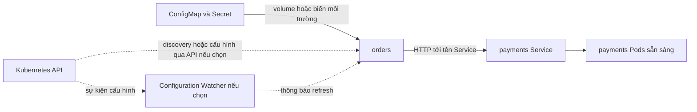

# Đánh đổi giữa khả năng tích hợp và sự phụ thuộc nền tảng

## 1. Bài toán kiến trúc cần quyết định

Spring Cloud Kubernetes giúp ứng dụng Spring khai thác thông tin và dịch vụ của Kubernetes: tìm instance qua `DiscoveryClient`, nạp ConfigMap/Secret, phối hợp Spring Cloud LoadBalancer và nhận thông báo thay đổi cấu hình từ Configuration Watcher. Mỗi khả năng có thể giảm công sức tích hợp, đồng thời thêm một hợp đồng với nền tảng triển khai.

Trong chương **Lựa chọn kiến trúc** của module **SPRING_CLOUD_KUBERNETES**, câu hỏi cần trả lời là: **tính năng nào đem lại lợi ích đủ lớn để chấp nhận các quyền truy cập, chế độ lỗi và trách nhiệm vận hành đi kèm?**

Xét hệ thống bán hàng có dịch vụ `orders` gọi `payments`, chạy trong namespace `shop`. Nhóm phát triển muốn dùng cùng một image ở máy cá nhân và trên cluster. Họ còn muốn đổi một số ngưỡng nghiệp vụ mà không phát hành lại mã. Tuy nhiên, nhóm vận hành yêu cầu hạn chế quyền đọc Secret và cần biết hệ thống sẽ phản ứng thế nào khi Kubernetes API tạm thời không truy cập được.

Sau bài học, bạn cần có khả năng:

- Phân biệt tích hợp qua giao thức thông thường với tích hợp trực tiếp Kubernetes API.
- Chọn riêng từng cơ chế discovery, cân bằng tải và cấp cấu hình theo yêu cầu cụ thể.
- Giải thích chi phí của refresh động, RBAC và trạng thái không đồng nhất giữa các replica.
- Đặt ranh giới để logic nghiệp vụ không phụ thuộc vào tài nguyên Kubernetes.
- Ghi lại quyết định, điều kiện xem xét lại và phương án thay thế bằng một ADR ngắn.

Bài học tập trung vào cách ra quyết định. Khi triển khai, cần chọn Spring Boot, Spring Cloud release train và Spring Cloud Kubernetes tương thích, quản lý dependency theo BOM phù hợp và tra thuộc tính của đúng phiên bản đang dùng.

## 2. Phụ thuộc nền tảng không chỉ nằm trong dependency

Một ứng dụng không import thư viện Kubernetes vẫn có thể phụ thuộc sâu vào tên Service, đường dẫn volume và quy trình rollout của cluster. Ngược lại, một ứng dụng dùng `DiscoveryClient` vẫn có thể giữ phần lớn nghiệp vụ độc lập nếu việc tích hợp được giới hạn trong adapter.

Nên đánh giá sự phụ thuộc trên nhiều phương diện:

| Phương diện | Ví dụ phụ thuộc | Chi phí khi thay nền tảng |
| --- | --- | --- |
| Mã nguồn | Logic đơn hàng tự đọc label, namespace hoặc tên Pod | Sửa và kiểm thử lại logic đang gắn với metadata Kubernetes |
| Cấu hình | URL theo Service DNS, cấu hình import từ Kubernetes | Cung cấp nguồn tương đương và xác minh thứ tự ưu tiên |
| Quyền truy cập | ServiceAccount cần đọc ConfigMap, Service hoặc Secret | Thiết kế cơ chế danh tính và quyền mới |
| Lúc chạy | Khởi động phải đọc API; discovery cần cập nhật danh sách instance | Xử lý lại mất kết nối, cache và phục hồi |
| Vận hành | Watcher, Actuator, NetworkPolicy và quy trình refresh | Thay controller, kênh thông báo và cách chẩn đoán lỗi |
| Phát hành | Phiên bản cấu hình gắn với Pod template | Tái tạo cách quảng bá và quay lui cấu hình |

**Khả năng di chuyển** vì thế không phải một giá trị có hoặc không. Cần nói rõ đang muốn giữ nguyên mã nghiệp vụ, dùng lại image, chạy trên Kubernetes của nhiều nhà cung cấp, hay chạy cả khi không có Kubernetes.

Ví dụ, ConfigMap và Service là API chuẩn Kubernetes, nên thường dễ chuyển giữa các cluster Kubernetes hơn một tích hợp gắn với dịch vụ riêng của nhà cung cấp. Nhưng nếu đích đến là máy ảo, phần triển khai vẫn phải có cơ chế thay thế. Đây là suy luận kiến trúc từ các hợp đồng đã chọn, không phải bảo đảm rằng chuyển nền tảng sẽ không có chi phí.

## 3. Ba mức tích hợp để so sánh

| Mức | Cách làm điển hình | Giá trị chính | Chi phí cần chấp nhận |
| --- | --- | --- | --- |
| A — Dùng hợp đồng thông thường | HTTP qua Service DNS; biến môi trường hoặc file cấu hình; cập nhật bằng rollout | Ứng dụng có ít kiến thức về cluster, dễ chạy ngoài cluster | Ít khả năng truy vấn topology; thay đổi cấu hình thường cần tạo Pod mới |
| B — Dùng adapter Spring Cloud Kubernetes | DiscoveryClient hoặc PropertySource qua API theo nhu cầu | Tận dụng abstraction Spring và metadata của cluster | Thêm dependency, cấu hình client, RBAC và kiểm thử tích hợp |
| C — Phối hợp thành phần vận hành | Configuration Watcher thông báo refresh cho ứng dụng | Có thể giảm thời gian áp dụng một số thay đổi mà không khởi động lại Pod | Thêm controller, đường quản trị, quan sát hội tụ và xử lý thay đổi thất bại |

Các mức này có thể kết hợp. Một ứng dụng có thể dùng Service DNS cho giao tiếp, mount cấu hình thành file và chỉ bật Watcher cho một nhóm thuộc tính có thể refresh. Không cần đưa toàn bộ hệ thống lên cùng một mức tích hợp.



Đường HTTP phục vụ giao dịch là **luồng dữ liệu**. Discovery, nạp cấu hình và thông báo thay đổi là những hoạt động **điều phối**. Thiết kế cần chỉ rõ hoạt động điều phối nào là điều kiện khởi động và hoạt động nào chỉ giúp cập nhật trạng thái sau đó.

## 4. Discovery: khi nào DNS đã đủ?

### 4.1. Trường hợp chỉ cần một địa chỉ dịch vụ ổn định

Nếu `orders` chỉ cần gọi `payments` trong namespace `shop`, một địa chỉ như `http://payments.shop.svc:8080` có thể đáp ứng yêu cầu. Với Service `ClusterIP` thông thường, client gọi tên Service, còn hạ tầng mạng của cluster đưa kết nối đến backend thích hợp. Ứng dụng gọi DNS/HTTP không cần quyền `get` hay `list` Service chỉ để thực hiện việc đó. Cần phân biệt trường hợp này với headless Service, nơi DNS có thể trả địa chỉ backend thay vì một ClusterIP. Xem [Kubernetes Service](https://kubernetes.io/docs/concepts/services-networking/service/).

Lựa chọn này vẫn cần timeout, xử lý lỗi và chính sách retry đúng. Service không tự bảo đảm retry an toàn cho giao dịch thanh toán. Cũng không nên suy ra rằng mỗi HTTP request được chia đều giữa các Pod: cơ chế mạng thường quyết định theo kết nối, còn HTTP keep-alive hoặc HTTP/2 có thể giữ nhiều request trên một kết nối.

### 4.2. Khi nào DiscoveryClient có thêm giá trị?

DiscoveryClient đáng cân nhắc khi một thành phần Spring thực sự cần danh sách instance, metadata hoặc bộ lọc discovery. Spring Cloud Kubernetes cung cấp các cách triển khai dùng Kubernetes client hoặc qua DiscoveryServer. Lớp abstraction giúp caller dùng mô hình Spring Cloud, nhưng backend Kubernetes vẫn quyết định dữ liệu và hành vi thực tế. Tham khảo [DiscoveryClient for Kubernetes](https://docs.spring.io/spring-cloud-kubernetes/reference/discovery-client.html).

Trước khi chọn, cần trả lời:

1. Thành phần nào tiêu thụ danh sách instance và vì sao một URL Service chưa đủ?
2. Chỉ cần namespace hiện tại hay cần một danh sách namespace xác định?
3. Instance được lọc theo tiêu chí nào, và nếu hai namespace có Service trùng tên thì xử lý ra sao?
4. Khi API lỗi, ứng dụng dùng được dữ liệu đã có bao lâu? Lần khởi động mới có hoạt động được không?
5. Khi Pod chuyển sang không sẵn sàng, bao lâu sau client ngừng chọn instance đó?

Không đưa tên Pod hoặc label hạ tầng vào quy tắc nghiệp vụ chỉ vì discovery trả được chúng. Metadata chỉ nên phục vụ chính sách hạ tầng đã có mục đích rõ ràng.

### 4.3. Spring Cloud LoadBalancer thêm một điểm quyết định

Spring Cloud Kubernetes có các chế độ cân bằng tải `POD` và `SERVICE`. Với `POD`, lựa chọn instance dựa vào discovery; với `SERVICE`, việc chọn hướng đến Kubernetes Service. Đây là cơ chế của thư viện client, khác với tài nguyên Kubernetes Service có `type: LoadBalancer`. Xem [LoadBalancer for Kubernetes](https://docs.spring.io/spring-cloud-kubernetes/reference/load-balancer.html).

Một phép cân nhắc thực tế:

- Nếu chỉ cần gọi `payments`, bắt đầu bằng Service DNS và đo hành vi kết nối.
- Nếu cần chính sách chọn instance ở phía client, xác định thuật toán, nguồn metadata và cách xử lý instance cũ trước khi thêm LoadBalancer.
- Nếu dùng chế độ hướng tới Service, kiểm tra giá trị bổ sung so với việc gọi thẳng Service DNS.

Thêm thư viện không tự tạo ra canary, định tuyến theo tenant hay trọng số nghiệp vụ. Những yêu cầu đó cần chính sách riêng, kiểm thử riêng và so sánh với phương án tách Service hoặc dùng thành phần định tuyến của nền tảng.

## 5. ConfigMap và Secret: chọn cách cấp dữ liệu trước khi chọn refresh

Cần tách ba câu hỏi: **dữ liệu được đưa vào container thế nào, Spring đọc lúc nào, và đối tượng đang phục vụ request có nhận thay đổi không?**

| Cách cấp cấu hình | Thay đổi nguồn có ý nghĩa gì? | Hệ quả kiến trúc |
| --- | --- | --- |
| Biến môi trường lấy từ ConfigMap/Secret | Môi trường của tiến trình đang chạy không tự đổi theo tài nguyên | Tạo Pod mới để áp dụng; hành vi phát hành tương đối rõ |
| Volume thông thường | File được chiếu từ ConfigMap/Secret có thể cập nhật sau một khoảng trễ; mount bằng `subPath` không nhận cập nhật kiểu này | File đổi chưa có nghĩa Spring đã nạp lại hoặc bean đã được tạo lại |
| PropertySource qua Kubernetes API | Cách nạp, thứ tự ưu tiên và hành vi lỗi phụ thuộc cấu hình tích hợp | Ứng dụng cần quyền và kết nối API; nạp được lần đầu không đồng nghĩa có refresh động |

Kubernetes mô tả cơ chế cập nhật của [ConfigMap](https://kubernetes.io/docs/concepts/configuration/configmap/) và [Secret](https://kubernetes.io/docs/concepts/configuration/secret/). Spring Boot hỗ trợ cấu hình ngoài bằng file, biến môi trường và các nguồn khác; việc đó không mặc nhiên tạo cơ chế theo dõi file. Xem [Externalized Configuration](https://docs.spring.io/spring-boot/reference/features/external-config.html).

Với nguồn Kubernetes của Spring Cloud, cần kiểm soát cả cách import và độ ưu tiên. Một giá trị trong biến môi trường có thể tiếp tục ghi đè giá trị bạn vừa thay trong nguồn cấu hình. Việc cùng tồn tại cơ chế bootstrap cũ và Config Data import cũng cần tuân thủ hỗ trợ của phiên bản, thay vì ghép cấu hình từ nhiều tài liệu khác nhau. Tham khảo [Kubernetes PropertySource implementations](https://docs.spring.io/spring-cloud-kubernetes/reference/property-source-config.html).

### 5.1. Phân loại theo khả năng thay đổi an toàn

| Nhóm thuộc tính | Ví dụ | Cách áp dụng nên xem xét |
| --- | --- | --- |
| Hành vi đơn giản, chấp nhận lệch tạm thời | Ngưỡng cảnh báo, thông báo hiển thị | Refresh có kiểm soát nếu đường đọc giá trị đã hỗ trợ |
| Giá trị ảnh hưởng tài nguyên đang mở | Endpoint của client, thông số pool | Đánh giá cách tạo lại client/pool và xử lý request đang chạy |
| Giá trị nhạy với tương thích | Chế độ xử lý thanh toán, định dạng thông điệp | Phát hành có phiên bản, kiểm thử tương thích và kế hoạch quay lui |
| Bí mật cần xoay vòng | Mật khẩu hoặc chứng thư | Phối hợp cấp credential mới, chuyển kết nối và thu hồi credential cũ |

Secret giúp quản lý dữ liệu nhạy cảm trong Kubernetes; base64 của trường dữ liệu không phải mã hóa bảo mật. Quyền đọc Secret và cách mã hóa lưu trữ phải được quản lý riêng. Mount Secret giúp tránh cấp quyền đọc Secret qua API cho chính ứng dụng nếu ứng dụng chỉ đọc file được cung cấp, nhưng tiến trình vẫn tiếp cận được nội dung file đó.

## 6. Configuration Watcher: đổi restart lấy một giao thức cập nhật

Configuration Watcher theo dõi các nguồn được cấu hình và gửi thông báo để ứng dụng refresh, chẳng hạn qua HTTP đến Actuator hoặc qua Spring Cloud Bus. Trong phương án HTTP, cần cấu hình discovery đích, phạm vi theo dõi, nhãn tương ứng và đường quản trị có thể truy cập. Nếu chọn Bus thì có thêm hạ tầng truyền thông điệp. Với cấu hình mount qua volume, phải tính đến độ trễ cập nhật file. Xem [Configuration Watcher](https://docs.spring.io/spring-cloud-kubernetes/reference/spring-cloud-kubernetes-configuration-watcher.html).

Xét thay đổi `alert.threshold` từ `100` lên `120` trên ba replica:

```text
T0: Nguồn cấu hình được cập nhật.
T1: Watcher nhận thay đổi.
T2: Replica A đọc được cấu hình mới và áp dụng thành công.
T3: Replica B chưa thấy file mới hoặc chưa xử lý xong thông báo.
T4: Replica C chưa nhận được thông báo do lỗi đường quản trị.
T5: Hệ thống cần xác định replica nào còn dùng phiên bản cũ.
```

Các mốc trên là một tình huống thiết kế minh họa. Chúng cho thấy vì sao một thông báo refresh thành công chưa đủ chứng minh cả hệ thống đã chuyển sang cùng trạng thái.

Nếu bean hỗ trợ `@RefreshScope`, cơ chế refresh có thể làm mất đối tượng đích đã cache để tạo lại ở lần sử dụng sau. Điều đó không có nghĩa mọi singleton, mọi connection pool hay mọi tài nguyên đều đổi được an toàn. Chẳng hạn tài liệu Spring Cloud nêu giới hạn với `HikariDataSource`. Xem [Spring Cloud Context — Refresh Scope](https://docs.spring.io/spring-cloud-commons/reference/spring-cloud-commons/application-context-services.html).

Trước khi chọn Watcher, nhóm cần thống nhất một giao thức cập nhật:

1. **Định danh phiên bản:** mỗi thay đổi có mã phiên bản không chứa bí mật; mỗi replica cho biết phiên bản đã áp dụng.
2. **Kiểm tra giá trị:** từ chối cấu hình ngoài miền hợp lệ trước khi đưa vào phục vụ. Validation lúc khởi động không tự chứng minh đường refresh có cùng bảo đảm.
3. **Quan sát hội tụ:** biết được số replica đã áp dụng, còn thiếu và thời gian chờ tối đa.
4. **Xử lý thất bại:** có cách gửi lại hoặc đối soát trạng thái; việc áp dụng lặp lại cùng phiên bản phải có hành vi xác định.
5. **Quay lui:** có nguồn cấu hình cũ và biết cách đưa các replica về phiên bản đó; kiểm tra lại việc tạo lại tài nguyên nếu cần.

Nếu cần đồng bộ tuyệt đối một quy tắc giữa mọi replica trước khi tiếp nhận giao dịch, refresh thông thường không đáp ứng điều kiện đó. Khi ấy cần giao thức phiên bản trong nghiệp vụ hoặc cơ chế điều phối riêng. Rolling update cũng có giai đoạn nhiều phiên bản cùng tồn tại; lợi thế của rollout là cách quản lý vòng đời Pod rõ hơn, không phải bảo đảm cập nhật đồng thời.

Một mô hình ước lượng hữu ích cho **trường hợp đọc cấu hình qua volume** là:

```text
Thời gian áp dụng xấp xỉ
  = độ trễ phát hiện thay đổi
  + thời gian chờ file có dữ liệu mới
  + độ trễ chuyển thông báo
  + thời gian nạp và áp dụng trong ứng dụng.
```

Các thành phần có thể chồng lấp, nên công thức là công cụ phân tích, không phải cam kết thời gian của framework. Cần đo từ lúc thay đổi nguồn đến lúc tất cả replica mục tiêu báo phiên bản mới. Độ trễ refresh được cấu hình chỉ là một tham số, không phải bằng chứng về hội tụ.

## 7. RBAC: quyền truy cập là một phần của giá phải trả

| Lựa chọn | Quyền API cần cân nhắc cho tiến trình ứng dụng |
| --- | --- |
| HTTP qua Service DNS | Không cần quyền đọc Service chỉ để phân giải DNS và gọi HTTP |
| Đọc file ConfigMap/Secret được mount | Không cần quyền API đọc các tài nguyên đó cho thao tác đọc file |
| Đọc cấu hình trực tiếp qua API | Quyền trên nguồn cấu hình theo thao tác client thực sự dùng |
| Discovery trực tiếp | Quyền đọc tài nguyên discovery theo implementation và chế độ đã chọn |
| Dùng Watcher ngoài ứng dụng | Watcher có danh tính/quyền riêng; ứng dụng có thể vẫn cần quyền nếu nó tự nạp lại qua API |

Đối với discovery, có thể phải làm việc với Service, Endpoints hoặc EndpointSlice và metadata Pod tùy implementation. EndpointSlice thuộc API group `discovery.k8s.io`, khác tài nguyên trong core group. Không nên sao chép một Role rộng rồi cho rằng mọi mục đều cần thiết cho ứng dụng của mình.

Ví dụ dưới đây minh họa **chỉ một hợp đồng truy cập**: một adapter đọc trực tiếp đúng ConfigMap `orders-runtime` bằng tên, trong namespace `shop`.

```yaml
apiVersion: rbac.authorization.k8s.io/v1
kind: Role
metadata:
  name: orders-read-one-config
  namespace: shop
rules:
  - apiGroups: [""]
    resources: ["configmaps"]
    resourceNames: ["orders-runtime"]
    verbs: ["get"]
---
apiVersion: rbac.authorization.k8s.io/v1
kind: RoleBinding
metadata:
  name: orders-read-one-config
  namespace: shop
subjects:
  - kind: ServiceAccount
    name: orders-runtime
    namespace: shop
roleRef:
  apiGroup: rbac.authorization.k8s.io
  kind: Role
  name: orders-read-one-config
```

ServiceAccount trong ví dụ phải tồn tại và được gán cho Pod. Role này **không phải manifest hoàn chỉnh cho mọi client Spring Cloud Kubernetes**. Một client dùng informer hoặc thao tác `list`/`watch` cần quyền tương ứng; với `resourceNames`, các yêu cầu list/watch còn phải kèm bộ lọc tên phù hợp. Phải kiểm tra hành vi client trước khi áp dụng. Xem [Using RBAC Authorization](https://kubernetes.io/docs/reference/access-authn-authz/rbac/).

Có thể kiểm chứng hợp đồng của ví dụ bằng các lệnh sau trên môi trường thực hành:

```bash
kubectl auth can-i get configmap/orders-runtime -n shop --as=system:serviceaccount:shop:orders-runtime
kubectl auth can-i list configmaps -n shop --as=system:serviceaccount:shop:orders-runtime
kubectl auth can-i get secrets -n shop --as=system:serviceaccount:shop:orders-runtime
```

Kết quả mong đợi lần lượt là `yes`, `no`, `no` nếu không có binding khác cấp thêm quyền. Người chạy lệnh cần quyền impersonation để kiểm tra bằng `--as`. Với phương án chỉ mount file, không áp dụng Role/RoleBinding này chỉ vì thấy nó xuất hiện trong ví dụ.

Bộ lọc label trong ứng dụng chỉ quyết định dữ liệu ứng dụng muốn xử lý. Nó không tự thu hẹp quyền RBAC đã cấp. Nếu watcher được cấp quyền đọc tất cả Secret của một namespace, việc chọn theo label không biến quyền đó thành quyền chỉ đọc một Secret.

## 8. Ví dụ thiết kế ban đầu: Service DNS và cấu hình theo phiên bản

Giả sử yêu cầu của `orders` là:

- Chấp nhận áp dụng cấu hình trong một đợt rollout, chưa cần refresh không restart.
- Gọi `payments` qua một địa chỉ ổn định, chưa có yêu cầu chọn từng Pod.
- Dùng cùng image ở máy cá nhân và trên cluster.

Một thiết kế ban đầu hợp lý là Service DNS cho HTTP và ConfigMap có phiên bản cho cấu hình không nhạy cảm:

```yaml
apiVersion: v1
kind: ConfigMap
metadata:
  name: orders-runtime-r1
  namespace: shop
immutable: true
data:
  application.yaml: |
    lesson:
      config-version: "r1"
    payments:
      base-url: "http://payments.shop.svc:8080"
```

Trong Deployment, ứng dụng chỉ cần nhận file bằng cấu hình bên ngoài của Spring Boot. Đây là **trích đoạn Pod template để ghép vào Deployment đã có**, không phải manifest triển khai độc lập:

```yaml
spec:
  template:
    spec:
      serviceAccountName: orders-runtime
      automountServiceAccountToken: false
      containers:
        - name: orders
          # Giữ image và các thuộc tính container của Deployment thực tế.
          env:
            - name: SPRING_CONFIG_ADDITIONAL_LOCATION
              value: "file:/etc/orders/config/"
          volumeMounts:
            - name: app-config
              mountPath: /etc/orders/config
              readOnly: true
      volumes:
        - name: app-config
          configMap:
            name: orders-runtime-r1
```

Spring Boot đọc `application.yaml` trong thư mục được chỉ định khi khởi động. URL và `lesson.config-version` là các thuộc tính ứng dụng phải chủ động bind/đọc; framework không tự tạo client thanh toán từ tên thuộc tính. Khi chạy cục bộ, cung cấp `payments.base-url` trỏ đến dịch vụ thử nghiệm bằng nguồn cấu hình tương đương.

Việc tắt tự mount token phù hợp với ví dụ vì tiến trình không gọi Kubernetes API. Nếu bổ sung client API sau này, cần xem xét lại cả danh tính, cách cấp token và RBAC. ServiceAccount vẫn phải tồn tại; tác nhân triển khai ứng dụng có quyền tạo/cập nhật tài nguyên riêng với quyền của tiến trình đang chạy.

Để chuyển sang `r2`:

1. Tạo ConfigMap bất biến `orders-runtime-r2` qua quy trình phát hành đã chọn.
2. Đổi tham chiếu ConfigMap trong Pod template sang `orders-runtime-r2`.
3. Theo dõi rollout và phiên bản cấu hình các replica đang sử dụng.
4. Khi cần quay lui, khôi phục cả tham chiếu cấu hình và phiên bản image tương thích.

Đổi tham chiếu trong Pod template tạo một thay đổi Deployment có thể rollout. Nếu chỉ sửa một ConfigMap có tên giữ nguyên thì Deployment không tự sinh đợt rollout vì nội dung ConfigMap đổi. Với Secret, không công khai giá trị trong log hoặc mã phiên bản; xác định vòng đời và quyền truy cập riêng cho bí mật.

Thiết kế trên chấp nhận phải tạo Pod mới để đổi cấu hình, đổi lại có mối liên hệ rõ giữa Pod và cấu hình được cấp. Hạn chế vẫn còn: cần bảo đảm năng lực trong rollout, quản lý tài nguyên phiên bản cũ và kiểm tra tương thích giữa các replica.

## 9. Giữ ranh giới để còn thay được adapter

Hướng phụ thuộc nên giữ như sau:

```text
Nghiệp vụ đặt hàng
    -> hợp đồng PaymentGateway
        -> adapter HTTP
            -> base URL từ cấu hình HOẶC client dùng discovery
```

`PaymentGateway` nhận thông tin thanh toán và trả kết quả nghiệp vụ. Nó không nhận `namespace`, tên Service hay đối tượng Kubernetes client. Phần adapter quyết định dùng URL trực tiếp hay Spring Cloud LoadBalancer.

Tương tự, tầng nghiệp vụ nên nhận một cấu hình đã được kiểm tra, chẳng hạn `OrderPolicy`, thay vì tự gọi API lấy ConfigMap mỗi khi xử lý đơn. Quy tắc này giúp:

- Kiểm thử nghiệp vụ mà không cần cluster.
- Thay nguồn cấu hình mà không sửa các nhánh xử lý đơn hàng.
- Đặt chính sách lỗi, chuyển phiên bản và quan sát cập nhật tại một nơi.

Abstraction không xóa khác biệt vận hành. Adapter có thể thay được ở mã nguồn, nhưng thay đổi từ discovery sang URL vẫn phải kiểm tra timeout, cách chọn backend, cache và hành vi kết nối. Chi phí thay thế thấp hơn chỉ có giá trị khi đã kiểm chứng được đường thay thế.

## 10. Sức khỏe Pod và các chế độ lỗi cần đưa vào quyết định

Không nên biến lỗi điều phối thành việc khởi động lại hàng loạt tiến trình còn phục vụ được. Spring Boot cung cấp nhóm health cho liveness/readiness; liveness không nên phụ thuộc vào hệ thống bên ngoài. Readiness cần được chọn theo khả năng phục vụ của ứng dụng, thay vì thêm mọi dependency vào một cách máy móc. Xem [Spring Boot Kubernetes Probes](https://docs.spring.io/spring-boot/reference/actuator/endpoints.html#actuator.endpoints.kubernetes-probes).

Ví dụ, nếu `orders` đã có cấu hình hợp lệ và đang gọi `payments` qua Service, việc watcher tạm dừng không nhất thiết làm `orders` mất khả năng xử lý đơn hiện tại. Có thể báo tình trạng cập nhật cấu hình bị trễ qua cảnh báo riêng. Ngược lại, nếu chưa có một cấu hình bắt buộc để phục vụ an toàn, khởi động thất bại hoặc chưa sẵn sàng có thể là lựa chọn đúng.

| Tình huống | Câu hỏi kiến trúc | Bằng chứng nên thu thập |
| --- | --- | --- |
| API không truy cập được khi khởi động | Nguồn nào bắt buộc? Có được dùng cấu hình mặc định hay cache không? | Thời gian khởi động, lỗi nguồn cấu hình, trạng thái readiness |
| API lỗi khi ứng dụng đang chạy | Request hiện tại có cần API không? Client giữ trạng thái gì? | Tỷ lệ lỗi nghiệp vụ, tuổi dữ liệu discovery/cấu hình và lỗi kết nối API |
| Watcher ngừng hoạt động | Dịch vụ có tiếp tục dùng phiên bản đã xác nhận được không? | Phiên bản đang áp dụng trên từng replica và độ trễ cập nhật |
| Chỉ một replica refresh thất bại | Chấp nhận trạng thái hỗn hợp trong bao lâu? | Danh sách replica chưa hội tụ và kết quả đối soát |
| Pod chuyển sang không sẵn sàng | Đường Service và đường client discovery có loại Pod kịp thời không? | Request lỗi, kết nối còn mở và thời gian cập nhật danh sách backend |
| Secret đã được thay nhưng kết nối còn dùng credential cũ | Pool/client có thực sự được chuyển không? | Thành công của kết nối mới, lỗi xác thực và thời điểm thu hồi credential cũ |

Nếu cần endpoint refresh, phải thiết kế xác thực, phân quyền và đường mạng cho thành phần gọi nó. Kubernetes RBAC cấp quyền với Kubernetes API; nó không thay thế việc bảo vệ HTTP endpoint của Actuator. Chỉ mở endpoint quản trị cần thiết và kiểm chứng watcher gọi được dưới chính sách mạng/bảo mật thực tế.

## 11. Cách so sánh các phương án bằng tiêu chí đo được

Đừng chọn theo số tính năng. Có thể dùng bảng sau cho tình huống `orders`:

| Tiêu chí | DNS + file + rollout | Discovery/PropertySource qua API | Bổ sung Configuration Watcher |
| --- | --- | --- | --- |
| Đáp ứng gọi dịch vụ bằng tên | Có | Có, thêm mô hình instance nếu cần | Không phải mục đích chính |
| Đổi cấu hình không tạo Pod mới | Chưa cung cấp | Cần thêm cơ chế áp dụng thay đổi | Có thể đáp ứng với thuộc tính và bean phù hợp |
| Quyền của tiến trình ứng dụng | Có thể tránh quyền đọc API | Tăng theo tính năng được bật | Tùy ứng dụng dùng file hay API để nạp lại |
| Thành phần phải vận hành | Cơ chế rollout hiện có | Client trong từng ứng dụng hoặc DiscoveryServer nếu chọn | Watcher, đường thông báo và theo dõi hội tụ |
| Chạy ngoài Kubernetes | Đổi URL và nguồn file/env | Cần profile/adapter thay thế | Cần thay cơ chế thông báo hoặc chọn rollout |
| Quay lui | Khôi phục tham chiếu cấu hình/image | Cần xác minh cơ chế nạp lại | Cần áp dụng lại phiên bản cũ và kiểm tra mọi replica |

Có thể biểu diễn cách cân nhắc bằng một công thức định tính:

```text
Giá trị ròng của tính năng
  = lợi ích chức năng + phần công sức được giảm
  - chi phí quyền truy cập
  - chi phí vận hành và xử lý sự cố
  - chi phí thay thế trong tương lai.
```

Không cộng các đại lượng khác đơn vị thành một con số giả chính xác. Hãy ghi giả định và bằng chứng cho từng vế. Chẳng hạn, “cần áp dụng ngưỡng mới trong 30 giây” là một yêu cầu giả định có thể thử nghiệm; “refresh nhanh hơn nên tốt hơn” chưa phải tiêu chí đủ để quyết định.

## 12. Bài thực hành: chứng minh phần tích hợp thực sự cần thiết

Thực hiện trong namespace thử nghiệm, với ứng dụng mẫu đã có Deployment, Actuator health, một đường gọi `payments` và cách quan sát `lesson.config-version` không chứa dữ liệu nhạy cảm. Các lệnh dưới đây là hướng dẫn cho người học, không phải yêu cầu tác động vào cluster sản xuất.

### Bước 1 — Ghi kết quả với phương án ít thành phần

Dùng Service DNS và ConfigMap `orders-runtime-r1` như ví dụ. Ứng dụng không có dependency Spring Cloud Kubernetes trong phương án này. Xác minh khởi động, request nghiệp vụ và phiên bản cấu hình.

```bash
kubectl -n shop rollout status deployment/orders
kubectl -n shop get pods -l app=orders
kubectl -n shop get service payments
kubectl -n shop get endpointslices -l kubernetes.io/service-name=payments
```

Các lệnh quan sát do tài khoản người vận hành chạy. Chúng không có nghĩa ServiceAccount của ứng dụng phải được cấp các quyền tương ứng.

### Bước 2 — Chuyển phiên bản cấu hình bằng rollout

Phát hành ConfigMap `r2`, đổi tham chiếu trong Pod template rồi kiểm tra các replica. Ghi lại thời gian để hoàn tất, số request lỗi và hành vi trong khoảng `r1`/`r2` cùng tồn tại. Giữ đủ thông tin để quay về `r1`; kiểm tra lại thay vì chỉ nhìn trạng thái rollout thành công.

### Bước 3 — Chỉ bổ sung refresh khi có mục tiêu riêng

Nếu thời gian hoặc chi phí rollout không đáp ứng yêu cầu, thử một thuộc tính vô hại với Watcher và đường refresh đã được bảo vệ. Đo thời điểm từng replica áp dụng cấu hình, kể cả replica bị bỏ lỡ thông báo. Nếu dùng volume, xác minh thứ tự file đổi và thông báo đến; không mặc định thời gian chờ luôn đủ.

So sánh với mục tiêu đã đặt. Chưa chứng minh được lợi ích thì chưa có cơ sở bật cơ chế này cho toàn bộ cấu hình, đặc biệt là bí mật và tài nguyên có kết nối đang mở.

### Bước 4 — Chỉ bổ sung discovery khi cần danh sách instance

Nêu một yêu cầu cụ thể mà URL Service không đáp ứng, chẳng hạn một thành phần Spring cần metadata instance để áp dụng chính sách đã thiết kế. Chọn implementation, giới hạn namespace, cấp quyền tương ứng và kiểm tra lỗi API trong môi trường cô lập. Quan sát cả lần khởi động mới lẫn ứng dụng đã chạy ổn định; hai trường hợp có thể khác nhau.

Báo cáo thực hành nên chứa phương án, giả định, quyền API, số thành phần vận hành, độ trễ áp dụng cấu hình và các kết quả khi có lỗi. Mục đích là thu được bằng chứng để quyết định, không phải cài hết tính năng của thư viện.

## 13. ADR minh họa cho dịch vụ orders

> **Quyết định:** Dùng Service DNS cho giao tiếp `orders` → `payments`; cấp cấu hình không nhạy cảm qua ConfigMap bất biến có phiên bản và áp dụng bằng rollout. Chưa thêm DiscoveryClient, Spring Cloud LoadBalancer hoặc Configuration Watcher.
>
> **Bối cảnh:** Chưa cần metadata instance; thay đổi cấu hình chấp nhận đi qua đợt phát hành. Cần dùng lại image ngoài cluster và hạn chế quyền API của tiến trình.
>
> **Lợi ích:** Ít thành phần điều phối, ít quyền truy cập và biết Pod được cấp phiên bản cấu hình nào. Logic nghiệp vụ chỉ phụ thuộc hợp đồng thanh toán và cấu hình đã kiểm tra.
>
> **Chi phí chấp nhận:** Thay cấu hình cần tạo Pod mới; phải có dung lượng cho rollout và quản lý nhiều phiên bản tài nguyên. Vẫn phải xử lý giai đoạn hai phiên bản cùng phục vụ.
>
> **Phương án đã cân nhắc:** DiscoveryClient để lấy instance; nạp cấu hình qua API; Watcher để refresh. Chưa chọn vì các yêu cầu hiện tại chưa cần lợi ích bổ sung của chúng.
>
> **Điều kiện xem xét lại:** Có yêu cầu metadata không giải quyết hợp lý bằng Service, hoặc thời gian áp dụng cấu hình đo được không đạt mục tiêu. Khi xem xét lại, thử từng tính năng riêng và ghi cả RBAC, lỗi API, bảo vệ Actuator, hội tụ và quay lui.
>
> **Đường thay thế:** Giữ `PaymentGateway` và nguồn cấu hình sau adapter; duy trì khả năng chạy bằng URL/file bên ngoài cluster. Nếu thử Watcher, giữ phương án quay về cấu hình theo phiên bản và rollout sau khi kiểm tra tương thích.

ADR này phù hợp với giả định của ví dụ. Một hệ thống khác có yêu cầu cập nhật liên tục hoặc đã dùng nhiều thành phần Spring Cloud có thể ra quyết định khác, miễn là lợi ích và chi phí được chứng minh trên cùng tiêu chí.

## 14. Nguyên tắc áp dụng cho quyết định tiếp theo

Chọn tích hợp theo từng nhu cầu: địa chỉ dịch vụ, metadata instance, nguồn cấu hình và thời điểm áp dụng cấu hình là các quyết định liên quan nhưng khác nhau. Bắt đầu từ hợp đồng đáp ứng yêu cầu hiện tại, rồi mở rộng khi có bằng chứng về phần thiếu.

Mỗi tính năng thêm vào nên có câu trả lời rõ cho bốn việc: nó giải quyết yêu cầu nào; nó cần danh tính và quyền gì; hệ thống làm gì khi thành phần đó lỗi; và làm sao quay về một phương án đơn giản hơn. Đó là cách dùng Spring Cloud Kubernetes có chủ đích, đồng thời giữ chi phí phụ thuộc nền tảng trong phạm vi có thể quản lý.
