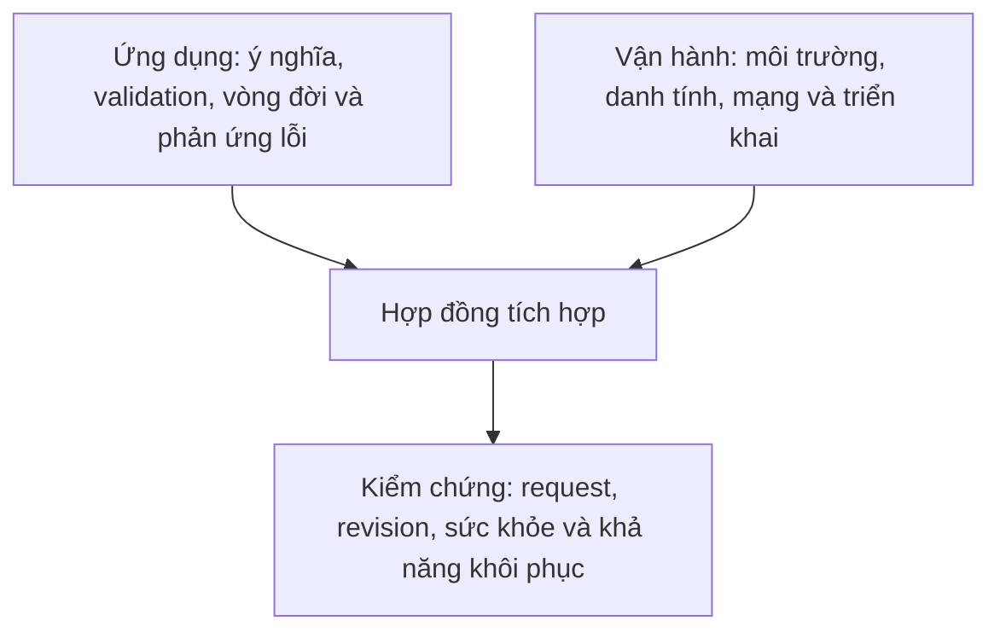

# Phân chia trách nhiệm giữa mã ứng dụng và đội vận hành

Trong chương **Lựa chọn kiến trúc** của **SPRING_CLOUD_KUBERNETES**, bài này trả lời câu hỏi: phần nào cần được thiết kế trong ứng dụng Spring, phần nào thuộc môi trường Kubernetes, và hai bên phải thống nhất điều gì để hệ thống hoạt động đúng?

Một cách phân chia thực dụng là:

> Ứng dụng định nghĩa ý nghĩa cấu hình, hành vi nghiệp vụ và cách phản ứng khi điều kiện thay đổi. Vận hành cung cấp môi trường, danh tính, đường kết nối và cơ chế triển khai. Tại mỗi giao điểm, hai bên thống nhất đầu vào, giới hạn, tín hiệu thành công và cách khôi phục.

“Mã ứng dụng” là nơi thực thi hành vi, không phải một chủ thể chịu trách nhiệm con người. Trong bài, **nhóm ứng dụng** chịu trách nhiệm cho mã và kết quả của dịch vụ; **đội vận hành/nền tảng** chịu trách nhiệm cho các khả năng môi trường đã cam kết. Một tổ chức có thể để cùng một nhóm giữ cả hai vai trò.

Sau bài học, bạn có thể:

- Phân chia trách nhiệm cho DiscoveryClient, ConfigMap, Secret, LoadBalancer, Configuration Watcher và sức khỏe Pod.
- Viết hợp đồng cấu hình và cập nhật có thể kiểm chứng.
- Xác định chủ sở hữu cho quyền Kubernetes, hành vi lỗi, rollout và quan sát.
- Tránh hai bên cùng điều khiển một trạng thái mà không có quy tắc phối hợp.
- Chọn những tính năng Spring Cloud Kubernetes thực sự cần cho triển khai.

Các bảng phân công trong bài là mô hình tham khảo. Cần điều chỉnh theo cách tổ chức và công cụ của đội, đồng thời giữ rõ người chịu trách nhiệm cuối cho từng kết quả.

## 1. Chia theo quyết định và hành vi

Một biến đặt trong ConfigMap vẫn có thể mang ý nghĩa nghiệp vụ. Một giá trị đặt trong `application.yaml` vẫn có thể là tham số môi trường do nền tảng cung cấp. Vị trí lưu tệp không đủ để quyết định ai sở hữu nội dung.

Ví dụ `catalog.search.max-results=200`:

- Nhóm ứng dụng xác định “200” có ý nghĩa gì, miền giá trị hợp lệ và ảnh hưởng tới kết quả tìm kiếm.
- Mã ứng dụng kiểm tra đầu vào và thực hiện giới hạn đó.
- Vận hành đưa revision cấu hình vào đúng môi trường, theo cách cập nhật đã thống nhất.
- Hai bên kiểm chứng dịch vụ dùng revision nào và có tác động gì lên thời gian đáp ứng/tài nguyên.

Nếu chỉ đổi nơi lưu từ tệp trong image sang ConfigMap, trách nhiệm giải thích nghiệp vụ không tự chuyển sang vận hành.

### 1.1. Ba lớp cần có chủ sở hữu



| Lớp | Câu hỏi chính | Sản phẩm cần có |
| --- | --- | --- |
| Khả năng của ứng dụng | Dịch vụ hiểu cấu hình và xử lý thay đổi như thế nào? | Mã, schema, validation, hành vi lỗi và tín hiệu quan sát |
| Khả năng của nền tảng | Dịch vụ được cấp gì và được chạy như thế nào? | Workload, quyền, mạng, nguồn cấu hình và quy trình triển khai |
| Hợp đồng tích hợp | Hai khả năng gặp nhau theo quy tắc nào? | Tên/định dạng, phạm vi, thời điểm áp dụng, kiểm tra và khôi phục |

“Hai bên cùng chịu trách nhiệm” cần được diễn đạt bằng các đầu việc cụ thể. Nếu không, nó dễ trở thành khoảng trống khi xảy ra sự cố.

## 2. Ma trận phân công theo tính năng

| Phạm vi | Nhóm ứng dụng và mã | Vận hành/nền tảng | Điều cần thống nhất |
| --- | --- | --- | --- |
| DiscoveryClient | Chọn nhu cầu discovery, cách dùng metadata và phản ứng khi lookup lỗi | Service, endpoint, namespace, danh tính và quyền đọc | Service ID, port, phạm vi tra cứu và tiêu chí instance được dùng |
| ConfigMap | Tên khóa, kiểu, validation, giá trị bắt buộc và cách áp dụng | Cấp nguồn, giá trị theo môi trường và quy trình cập nhật | Nguồn thắng, revision, refresh hay rollout |
| Secret | Cách nạp/sử dụng, vòng đời client và xử lý credential không hợp lệ | Cấp phát, bảo vệ, phân phối và xoay theo cơ chế đã chọn | Thời gian chồng lấn, kiểm chứng sử dụng được và thu hồi |
| Spring Cloud LoadBalancer | Chọn chế độ, thuật toán cần thiết, timeout/retry và tính idempotent | Tập backend, năng lực mạng và điều phối workload | Đường gọi, ngân sách lỗi và cách phản ứng khi endpoint thay đổi |
| Configuration Watcher | Khả năng refresh của bean, endpoint/Bus và kết quả áp dụng | Chạy controller, quyền, phạm vi theo dõi và đường thông báo | Nguồn nào tác động ứng dụng nào, thời gian hội tụ và cách phục hồi |
| Sức khỏe Pod | Ý nghĩa startup/readiness/liveness và đóng tài nguyên | Probe, grace period, replica, tài nguyên và rollout | Điều kiện nhận traffic, dừng traffic và ngân sách khởi động |
| Quan sát | Tín hiệu nghiệp vụ, lỗi có ngữ cảnh và revision đã dùng | Thu thập, lưu giữ, dashboard và đường cảnh báo | Bằng chứng nào đủ kết luận thành công |
| Khôi phục | Tương thích image/cấu hình/dữ liệu và cơ chế phục hồi trong mã | Triển khai bộ trạng thái đã biết tốt | Điểm dừng, phạm vi quay lại và xác minh sau phục hồi |

Phân công theo vai trò không bắt buộc phải tách hai repository hoặc buộc mọi thay đổi đều qua thao tác thủ công. Nhóm ứng dụng có thể tự triển khai qua nền tảng tự phục vụ trong các giới hạn đã chốt.

## 3. Discovery và LoadBalancer: ai biết điều gì?

### 3.1. Nhu cầu discovery phải xuất phát từ ứng dụng

Ứng dụng cần trả lời:

- Chỉ cần gọi một Service ổn định hay cần danh sách từng instance?
- Có thực sự dùng metadata để chọn backend không?
- Khi không có instance, request thất bại theo cách nào?
- Có thể phục vụ với trạng thái đã biết trước trong bao lâu, nếu có thiết kế đó?
- Retry một request có thể tạo tác động lặp hay không?

Vận hành trả lời các câu hỏi môi trường:

- Service và port nào được cung cấp?
- Caller được phép nhìn namespace/tài nguyên nào?
- Endpoint Ready được cập nhật theo cơ chế nào?
- Đường mạng nào được cho phép và theo dõi ra sao?

DiscoveryClient có các lựa chọn namespace, filter và dữ liệu instance; cần kiểm tra đúng client/phiên bản đang dùng. Xem [DiscoveryClient for Kubernetes](https://docs.spring.io/spring-cloud-kubernetes/reference/discovery-client.html).

Không mở tra cứu mọi namespace chỉ để tránh phải thống nhất phạm vi. Phạm vi rộng hơn làm tăng quyền và ảnh hưởng của một lỗi chọn Service.

### 3.2. Phân biệt ba đường gọi

| Đường gọi | Ứng dụng cần hiểu | Nền tảng cần cung cấp |
| --- | --- | --- |
| HTTP trực tiếp tới Service DNS | Tên đích, timeout, lỗi và hợp đồng API | DNS, Service, endpoint và mạng |
| Spring Cloud Kubernetes LoadBalancer chế độ POD | DiscoveryClient, tập Pod, cách chọn và trạng thái cũ | Quyền discovery và đường gọi Pod phù hợp |
| Spring Cloud Kubernetes LoadBalancer chế độ SERVICE | Logic tìm Service của thư viện và port/namespace liên quan | Service, quyền theo nhu cầu và đường mạng |

Chế độ SERVICE của thư viện vẫn có logic tìm Service; không tự đồng nhất nó với một client HTTP thông thường chỉ dùng DNS. Xem [LoadBalancer for Kubernetes](https://docs.spring.io/spring-cloud-kubernetes/reference/load-balancer.html).

Nếu Service DNS đã đáp ứng nhu cầu, có thể giảm phần tích hợp trực tiếp Kubernetes API trong ứng dụng. Nếu cần metadata hoặc lựa chọn instance riêng, nhóm ứng dụng cần nêu rõ lợi ích và hành vi cần kiểm chứng.

### 3.3. Chính sách retry và sức chứa cần phối hợp

Mã ứng dụng biết thao tác nào đọc an toàn, thao tác nào cần idempotency key và thao tác nào không được lặp tự động. Vận hành biết giới hạn kết nối, quota, sức chứa và tình trạng downstream.

Ví dụ, tăng retry từ một lần lên nhiều lần có thể tăng tải khi downstream đang suy giảm. Vì vậy hợp đồng cần có timeout/deadline tổng, giới hạn thử lại và tín hiệu quan sát; không để mỗi tầng độc lập tăng retry mà không nhìn tổng thể.

Cấp thêm replica có thể tăng sức chứa nhưng không sửa được logic retry sai. Ngược lại, mã xử lý lỗi tốt cũng không thay cho đường mạng hoặc backend còn khả dụng.

## 4. ConfigMap: phân biệt schema với giá trị môi trường

### 4.1. Ai sở hữu từng phần?

| Thành phần cấu hình | Chủ sở hữu nội dung chính | Ví dụ trách nhiệm |
| --- | --- | --- |
| Ý nghĩa khóa và đơn vị | Nhóm ứng dụng | `read-timeout` là timeout của thao tác nào, dùng duration hay millisecond |
| Kiểu và miền giá trị | Nhóm ứng dụng | `max-results` là số nguyên trong khoảng đã hỗ trợ |
| Giá trị của môi trường | Vai trò đã được chỉ định theo loại khóa | Chọn giá trị trong miền cho phép và ghi lý do |
| Tên/namespace nguồn | Theo hợp đồng tích hợp | Tránh ứng dụng tìm một tên nhưng môi trường cấp tên khác |
| Cơ chế nạp | Hai bên chốt; ứng dụng hiện thực đường đọc | API, env hoặc tệp mount |
| Cách phân phối/cập nhật | Vận hành theo quy trình phát hành | Bản cấu hình, phạm vi áp dụng và khả năng quay lại |
| Kết quả áp dụng | Ứng dụng cung cấp tín hiệu; vận hành kiểm chứng | Từng Pod đang dùng revision nào |

ConfigMap cung cấp dữ liệu; nó không tự định nghĩa validation, thứ tự nguồn của Spring hoặc cách bean dùng dữ liệu đó.

Nếu đưa ConfigMap vào env, volume hay API, hành vi cập nhật khác nhau. Kubernetes mô tả env không tự đổi trong container hiện tại, volume đồng bộ theo cơ chế kubelet và giới hạn của `subPath` tại [ConfigMaps](https://kubernetes.io/docs/concepts/configuration/configmap/).

### 4.2. Mẫu hợp đồng cấu hình

Bảng sau minh họa một dịch vụ `catalog-api`; các con số là lựa chọn giả định để thảo luận, không phải mặc định của Spring:

| Khóa | Ý nghĩa và miền hợp lệ | Cách áp dụng đã chọn | Chủ thể chốt giá trị |
| --- | --- | --- | --- |
| `catalog.search.max-results` | Số kết quả tối đa, 1–1.000 | Cập nhật snapshot động đã hiện thực | Nhóm ứng dụng/nghiệp vụ trong giới hạn tải đã thống nhất |
| `catalog.inventory.read-timeout` | Thời gian chờ đọc của client, 100 ms–2 s | Rollout trong phiên bản hiện tại | Nhóm ứng dụng phối hợp vận hành |
| `catalog.config-revision` | Mã bản cấu hình dùng để quan sát | Đi cùng dữ liệu cần áp dụng | Quy trình phát hành cấu hình |
| `spring.cloud.kubernetes.discovery.namespaces` | Phạm vi discovery môi trường | Cấu hình khởi động theo thiết kế | Vận hành cùng nhóm ứng dụng xác nhận phạm vi |
| Secret reference | Nơi cấp credential, không phải giá trị bí mật trong bảng | Theo quy trình xoay riêng | Đơn vị cấp credential/nền tảng |

Một giá trị được đưa ra ngoài image không có nghĩa nó được phép đổi bất kỳ lúc nào. Nếu phiên bản hiện tại chỉ dựng HTTP client một lần, thay timeout trong nguồn chưa chứng minh client đã dùng timeout mới.

### 4.3. Nguồn hiệu lực cũng là một phần hợp đồng

Cần thống nhất khóa nào được đặt trong image, ConfigMap, biến môi trường hoặc tham số khởi động. Khi một khóa tồn tại nhiều nơi, việc sửa nguồn ưu tiên thấp có thể không đổi giá trị hiệu lực.

Với Config Data, Kubernetes import tuân theo thứ tự nguồn của Spring Boot; các nguồn như env, system property hoặc CLI còn có ưu tiên riêng. Không để hai đội duy trì hai nguồn cùng khóa mà không biết nguồn nào thắng. Xem [Kubernetes PropertySource implementations](https://docs.spring.io/spring-cloud-kubernetes/reference/property-source-config.html).

Cách quan sát nên cho biết nguồn/revision hiệu lực của các khóa không nhạy cảm. Quyền xem cấu hình cần tách khỏi quyền xem bí mật; không dùng việc mở toàn bộ `/actuator/env` như cách bàn giao vận hành.

## 5. Cập nhật động: nền tảng gửi thông báo, ứng dụng bảo đảm điều gì?

Cần tách bốn mốc:

1. Dữ liệu đã được xuất bản.
2. Thông báo refresh đã tới ứng dụng.
3. Ứng dụng đã đọc và chấp nhận dữ liệu.
4. Request nghiệp vụ đã sử dụng trạng thái mới.

Một controller thành công ở mốc 2 chưa đủ chứng minh mốc 4.

### 5.1. Trách nhiệm của nhóm ứng dụng

Ứng dụng cần công bố:

- Khóa nào hỗ trợ thay đổi động, khóa nào chỉ nhận khi khởi động.
- Bean/tài nguyên nào được tạo lại và tài nguyên cũ được đóng thế nào.
- Giá trị không hợp lệ làm ứng dụng từ chối bản mới, dừng phục vụ hay thất bại theo phạm vi nào.
- Một request có dùng bản chụp cấu hình nhất quán không.
- Trạng thái đã áp dụng được quan sát ở đâu.
- Cách phục hồi khi một số replica đổi được, số khác chưa đổi.

`@RefreshScope` và cơ chế bind cấu hình có phạm vi cùng giới hạn cụ thể. Không gắn annotation rồi coi việc tái tạo pool, scheduler hoặc client đang có request là tự động an toàn. Xem [Spring Cloud Context](https://docs.spring.io/spring-cloud-commons/reference/spring-cloud-commons/application-context-services.html#refresh-scope).

### 5.2. Ví dụ một hành vi giữ cấu hình hợp lệ gần nhất

Mã Java dưới đây minh họa **một cơ chế do ứng dụng thiết kế**, không phải hành vi mặc định của ConfigMap hay endpoint refresh:

```java
import java.util.Objects;
import java.util.concurrent.atomic.AtomicReference;

public final class SearchPolicyStore {
    public record Snapshot(String revision, int maxResults) {
    }

    private final AtomicReference<Snapshot> active;

    public SearchPolicyStore(Snapshot initial) {
        this.active = new AtomicReference<>(validate(initial));
    }

    public void apply(Snapshot candidate) {
        Snapshot accepted = validate(candidate);
        active.set(accepted);
    }

    public Snapshot snapshot() {
        return active.get();
    }

    private static Snapshot validate(Snapshot value) {
        Objects.requireNonNull(value, "policy");
        if (value.revision() == null || value.revision().isBlank()) {
            throw new IllegalArgumentException("revision is required");
        }
        if (value.maxResults() < 1 || value.maxResults() > 1000) {
            throw new IllegalArgumentException(
                    "maxResults must be between 1 and 1000");
        }
        return value;
    }
}
```

Ở ví dụ này, validation diễn ra trước khi thay snapshot. Nếu candidate sai, snapshot đang hoạt động không bị thay bởi lệnh `apply` đó. Một thao tác nghiệp vụ lấy snapshot một lần có thể dùng cùng revision trong suốt thao tác.

Nhóm ứng dụng vẫn phải hiện thực đường parse, gọi `apply`, ghi kết quả chấp nhận/từ chối và xử lý đồng thời phù hợp. Đoạn mã không tự nối vào Spring refresh, không bảo đảm revision đến theo thứ tự và không tạo giao dịch giữa nhiều bean hoặc nhiều Pod.

Vận hành cần thấy revision đã áp dụng và lỗi từ chối, rồi thực hiện khôi phục theo quy trình. Không mặc định framework tự rollback nguyên tử `Environment` và tất cả tài nguyên về bản trước.

### 5.3. Trách nhiệm với Configuration Watcher

| Đội vận hành/nền tảng | Nhóm ứng dụng |
| --- | --- |
| Triển khai/chốt phiên bản controller | Chốt khả năng nhận và áp dụng refresh của dịch vụ |
| Phạm vi namespace, nguồn và bộ lọc | Công bố nguồn nào ứng dụng thực sự sử dụng |
| Danh tính, quyền và đường mạng | Hiện thực endpoint/Bus và quyền truy cập trong ứng dụng |
| Ánh xạ nguồn tới đúng ứng dụng | Kiểm chứng bean/hành vi sau thông báo |
| Theo dõi controller và khôi phục đường thông báo | Báo revision đã áp dụng, bị từ chối hoặc còn cũ |

Hai bên cùng xác nhận ánh xạ nguồn–ứng dụng, port/path management và ngân sách hội tụ. Chủ vận hành controller không tự quyết mọi dữ liệu của tất cả ứng dụng mà controller có thể tác động.

Khi dùng volume, phải đối chiếu thời điểm dữ liệu đến với thời điểm refresh. Tăng một delay cố định không tạo bảo đảm đồng bộ cho mọi cluster. Các lựa chọn HTTP/Bus và cấu hình controller cần đối chiếu theo phiên bản tại [Configuration Watcher](https://docs.spring.io/spring-cloud-kubernetes/reference/spring-cloud-kubernetes-configuration-watcher.html).

## 6. Secret và RBAC: cấp quyền tách khỏi sử dụng đúng

### 6.1. Một danh tính có hợp đồng quyền rõ

Ứng dụng cần kê khai nhu cầu theo **resource, verb và namespace**, thay vì yêu cầu một quyền rộng để tránh gặp lỗi.

Ví dụ một ứng dụng chỉ đọc ConfigMap qua API khi khởi động có nhu cầu khác một controller theo dõi nhiều nguồn. Một ứng dụng chỉ đọc tệp do kubelet mount cũng khác ứng dụng trực tiếp gọi API.

Vận hành cấp ServiceAccount và binding phù hợp, kiểm soát phạm vi theo chính sách môi trường, và giữ khả năng kiểm tra quyền của đúng danh tính. Xem [Service Accounts](https://kubernetes.io/docs/concepts/security/service-accounts/) và [RBAC Authorization](https://kubernetes.io/docs/reference/access-authn-authz/rbac/).

Mã nghiệp vụ không nên tự nâng quyền, tự tạo RoleBinding rộng hoặc tự sửa tài nguyên triển khai chỉ để vượt qua lỗi đọc nguồn. Nếu một thành phần thật sự là controller quản trị, quyền và phạm vi điều khiển đó phải được thiết kế riêng.

### 6.2. Quy trình xoay Secret có hai nửa không thay thế nhau

| Giai đoạn | Năng lực môi trường | Năng lực ứng dụng |
| --- | --- | --- |
| Chuẩn bị | Cấp credential và kênh phân phối | Hỗ trợ định dạng/cơ chế xác thực |
| Đưa bản mới vào | Xuất bản đúng nguồn và quyền | Đọc giá trị mới theo đường đã chọn |
| Chuyển sử dụng | Giữ điều kiện chuyển đổi đã cam kết | Tạo/đổi client hoặc kết nối cần thiết |
| Xác minh | Quan sát hạ tầng và hệ thống cấp credential | Chứng minh request nghiệp vụ dùng được |
| Thu hồi bản cũ | Thu hồi theo mốc đã thống nhất | Không còn phụ thuộc kết nối/credential cũ |

Secret trên Kubernetes đã đổi không chứng minh pool kết nối đã đổi. Một client còn chạy bằng credential cũ không chứng minh rollout/refresh đã chuyển xong.

Hạn chế đọc bí mật theo nhu cầu thật, không đưa giá trị vào log và gói chẩn đoán. Các thực hành này được mô tả tại [Good practices for Kubernetes Secrets](https://kubernetes.io/docs/concepts/security/secrets-good-practices/).

Nếu credential cũ đã hết hiệu lực, việc khôi phục một Secret reference cũ chưa khôi phục được dịch vụ. Điều kiện quay lại phải tính cả khả năng sử dụng tại hệ thống đích.

## 7. Sức khỏe Pod: ứng dụng định nghĩa, Kubernetes thực hiện phản ứng

### 7.1. Tín hiệu và hành động là hai phần khác nhau

| Tín hiệu | Nhóm ứng dụng xác định | Vận hành cấu hình |
| --- | --- | --- |
| Startup | Khi nào khởi tạo cần thiết đã hoàn tất | Ngân sách startup và nhịp kiểm tra |
| Readiness | Khi nào instance được phép nhận traffic theo hợp đồng | Probe, Service và cách điều phối replica |
| Liveness | Khi nào tiến trình rơi vào trạng thái cần khởi động lại | Ngưỡng kiểm tra và hành vi restart |
| Graceful shutdown | Dừng nhận việc mới, xử lý việc đang chạy, đóng tài nguyên | Tín hiệu kết thúc và thời gian grace của workload |

Readiness không nhất thiết bao phủ mọi downstream hoặc mọi loại request. Nếu banner mới chưa được áp dụng nhưng API cốt lõi vẫn đáp ứng đúng, việc loại toàn bộ Pod khỏi Service có thể là phản ứng quá rộng.

Ngược lại, nếu không có cấu hình bắt buộc để xử lý nghiệp vụ đúng, chỉ báo Running không đủ để cho traffic vào. Nhóm ứng dụng phải công bố trạng thái nào cần chặn phục vụ.

Spring Boot mô tả health groups và lưu ý liveness không nên phụ thuộc kiểm tra hệ thống ngoài dùng chung tại [Kubernetes Probes](https://docs.spring.io/spring-boot/reference/actuator/endpoints.html#actuator.endpoints.kubernetes-probes).

### 7.2. Ví dụ phối hợp về thời gian

Giả sử dịch vụ cần tới 45 giây để khởi tạo trong điều kiện đã đo:

- Nhóm ứng dụng giải thích những bước cần hoàn tất và cung cấp số liệu startup.
- Vận hành chọn ngân sách startup/probe có khoảng phù hợp với điều kiện môi trường.
- Hai bên kiểm tra khi startup thật sự thất bại thì hệ thống phát hiện trong thời gian chấp nhận được.
- Khi ứng dụng đóng, kiểm chứng request/tác vụ đang chạy và tài nguyên được xử lý trong ngân sách grace.

Tăng timeout probe vô hạn làm chậm phát hiện lỗi; giảm quá thấp có thể tạo vòng khởi động lại. Những giá trị này cần số liệu và tiêu chí, không chỉ một mẫu YAML dùng cho mọi ứng dụng.

### 7.3. Replica và tài nguyên không thay thế thiết kế vòng đời

Vận hành quản lý replica, rollout, quota và tài nguyên theo mô hình nền tảng. Nhóm ứng dụng cung cấp hành vi chịu tải, nhu cầu bộ nhớ/CPU, metric phục vụ scaling và cách đóng request/tác vụ.

Với consumer hoặc scheduler, số Pod tăng/giảm còn tác động tới quyền xử lý việc, phân vùng và nguy cơ thực hiện lặp. Một Deployment đạt số replica mong muốn chưa chứng minh tác vụ nghiệp vụ được xử lý đúng một lần.

## 8. Hành vi khi lỗi: chốt trước lúc xảy ra sự cố

### 8.1. Lập bảng phản ứng theo dependency

| Tình huống | Hành vi ứng dụng cần định nghĩa | Việc vận hành cần làm |
| --- | --- | --- |
| Thiếu cấu hình bắt buộc khi khởi động | Thất bại rõ hoặc không nhận traffic theo hợp đồng | Kiểm tra nguồn, tham chiếu và quyền |
| Bản cấu hình động không hợp lệ | Từ chối/áp dụng theo chính sách đã hiện thực, có tín hiệu | Ngăn mở rộng, khôi phục dữ liệu phù hợp |
| Không tìm thấy instance | Lỗi có ngữ nghĩa, deadline và retry có giới hạn | Kiểm tra Service, endpoint, quyền và mạng |
| Kubernetes API tạm không tới được | Hành vi lookup/cache/startup đã kiểm chứng | Khôi phục đường API và quan sát hội tụ |
| Watcher không gửi thông báo | Tiếp tục trạng thái hiện tại theo giới hạn đã chốt | Phát hiện mất thông báo, xử lý cập nhật bù |
| Credential mới chưa dùng được | Lỗi rõ, không ghi bí mật và không âm thầm hạ cơ chế xác thực | Phối hợp hệ thống cấp credential để phục hồi |
| Pod bị kết thúc | Dừng nhận việc, xử lý việc đang chạy và khởi động lại đúng | Điều phối replica và xác nhận endpoint phục hồi |

Khả năng dùng trạng thái đã biết trước khi mất API phụ thuộc client và cache thực tế. Đội vận hành không nên hứa ứng dụng sẽ hoạt động bình thường nếu nhóm ứng dụng chưa đo điều đó; nhóm ứng dụng cũng không nên yêu cầu vận hành coi một cache cũ là dữ liệu luôn đúng.

### 8.2. Quyết định cuối cần gắn với phạm vi

Một cách phân vai tham khảo:

| Quyết định | Vai trò chịu trách nhiệm chính trong mô hình này | Bên cần phối hợp |
| --- | --- | --- |
| Ý nghĩa khóa và miền giá trị nghiệp vụ | Nhóm ứng dụng | Vận hành khi ảnh hưởng tải/tài nguyên |
| Cấp quyền và phạm vi mạng môi trường | Vận hành/nền tảng | Nhóm ứng dụng kê khai nhu cầu và kiểm chứng |
| Bật một tính năng Spring Cloud Kubernetes trong dịch vụ | Nhóm ứng dụng | Nền tảng xác nhận khả năng/quyền cần cung cấp |
| Phát hành controller dùng chung | Đơn vị vận hành controller | Các nhóm ứng dụng chịu ảnh hưởng |
| Phát hành image của dịch vụ | Chủ dịch vụ được chỉ định | Vận hành hoặc công cụ triển khai |
| Điều phối khi có sự cố nhiều thành phần | Người điều phối sự cố đã được chỉ định | Các chủ thành phần theo bằng chứng |

Đây là phân công về trách nhiệm kết quả, không bắt buộc một luồng xin phép thủ công cho mọi lần sửa cấu hình. Có thể dùng validation trong CI, policy và nền tảng tự phục vụ để thực hiện giới hạn đã thống nhất.

Khi khẩn cấp, cần biết ai được dừng promotion, ai được thay dữ liệu hoặc ngắt một đường thông báo, và ai xác nhận dịch vụ đã phục hồi. Không để hai người đồng thời sửa hai nguồn cùng khóa mà không ghi nhận.

## 9. Một hợp đồng vận hành có thể kiểm chứng

### 9.1. Những nội dung tối thiểu

Một dịch vụ nên cung cấp một bản mô tả gắn với phiên bản phát hành, gồm:

- Các chức năng Kubernetes mà ứng dụng thực sự dùng.
- Nguồn cấu hình, schema, revision và cách áp dụng từng nhóm khóa.
- Danh tính/quyền cần có và phạm vi namespace.
- Đường gọi, timeout, retry và hành vi khi dependency không đáp ứng.
- Probe, startup, shutdown và nhu cầu tài nguyên đã đo.
- Các tín hiệu phục vụ điều tra mà không lộ Secret.
- Điều kiện dừng triển khai, khôi phục và kiểm tra sau khôi phục.
- Chủ dịch vụ, chủ nền tảng và đầu mối của thành phần dùng chung.

Tài liệu đó nên đi cùng image/cấu hình đã kiểm chứng, không chỉ tồn tại trong một cuộc trao đổi chưa được cập nhật khi kiến trúc đổi.

### 9.2. Ví dụ hợp đồng cho catalog-api

Đoạn YAML sau là **mẫu tài liệu hợp đồng**, không phải Kubernetes resource hoặc tập thuộc tính Spring để apply trực tiếp:

```yaml
contractVersion: "2"
service: catalog-api

owners:
  application: catalog-team
  platform: runtime-team
  configurationWatcher: runtime-team

communication:
  inventory:
    path: service-dns
    serviceName: inventory
    namespace: catalog-prod
    requestSemantics: read-only
    retryPolicyReference: inventory-read-policy-v2

configuration:
  delivery: mounted-files
  source: catalog-runtime
  schema: catalog-config-v2
  observation: applied-revision-per-pod
  fields:
    catalog.search.max-results:
      owner: catalog-team
      range: "1..1000"
      apply: application-defined-dynamic-policy
      invalidCandidate: reject-and-report
    catalog.inventory.read-timeout:
      owner: catalog-team
      apply: rolling-restart

secrets:
  credentialReference: inventory-client
  apply: rolling-restart
  rotationPlanReference: inventory-rotation-v2

health:
  readinessMeaning: core-requests-can-be-served
  livenessMeaning: process-can-recover-by-restart

changes:
  applicationReleaseOwner: catalog-team
  platformControllerReleaseOwner: runtime-team
  rollbackPlanReference: catalog-rollback-v2
```

Tên tài liệu tham chiếu là minh họa cho những nội dung đội phải tạo/chốt, không phải tài nguyên có sẵn.

Hợp đồng chọn đường mount và Service DNS cho ví dụ. Nếu ứng dụng không có nhu cầu API Kubernetes khác, có thể tránh cấp token/quyền API cho chính Pod ứng dụng. Controller Watcher có danh tính và quyền riêng cho công việc của nó.

Nhóm ứng dụng vẫn cần hiện thực bộ tích hợp giữa tín hiệu cập nhật và cơ chế áp dụng policy, gồm parse, validation và báo revision. Mẫu hợp đồng không làm `SearchPolicyStore` ở phần 5 tự nhận sự kiện Spring.

### 9.3. Chốt tín hiệu đầu ra của ứng dụng

Ví dụ tín hiệu không nhạy cảm:

```json
{
  "service": "catalog-api",
  "releaseId": "release-candidate-17",
  "podUid": "uid-cua-pod",
  "configSchema": "catalog-config-v2",
  "appliedRevision": "r42",
  "lastAttemptedRevision": "r43",
  "lastApplyResult": "REJECTED",
  "reasonCode": "MAX_RESULTS_OUT_OF_RANGE"
}
```

Đây là giao diện quan sát do ứng dụng thiết kế. Một trường hợp như trên cho biết r43 đã được thử nhưng r42 vẫn là bản được ứng dụng chấp nhận theo chính sách của ví dụ.

Không đưa giá trị credential hoặc toàn bộ cấu hình vào đầu ra. Có thể dùng log/endpoint được bảo vệ cho revision; khi đưa thông tin vào metric cần kiểm soát số lượng giá trị nhãn.

Vận hành thu thập và hiển thị tín hiệu. Nhóm ứng dụng chịu trách nhiệm để tín hiệu phản ánh trạng thái thật, không chỉ trả revision lấy từ annotation mong muốn của Deployment.

## 10. Quy trình thay đổi từ yêu cầu tới xác nhận

### 10.1. Trước thay đổi

Chốt năm câu hỏi:

1. Đổi dữ liệu trong miền đã hỗ trợ, hay đổi schema/hành vi?
2. Tác động một dịch vụ hay thành phần dùng chung?
3. Thay đổi được áp dụng bằng refresh, thay tài nguyên hay rollout?
4. Thành công được xác nhận bằng request/revision nào và trong bao lâu?
5. Trạng thái trước còn có thể khôi phục không?

Nếu thay đổi vượt miền ứng dụng đã hỗ trợ, cần một thay đổi ứng dụng/hợp đồng. Không coi việc có quyền sửa ConfigMap là bằng chứng có thể đưa mọi giá trị vào an toàn.

### 10.2. Khi thực hiện

| Mốc | Nhóm ứng dụng cung cấp | Vận hành thực hiện/quan sát |
| --- | --- | --- |
| Chuẩn bị | Image/schema và khả năng tương thích | Môi trường, quyền, nguồn và tài nguyên sẵn sàng |
| Thử nhóm nhỏ | Phép kiểm tra nghiệp vụ và tiêu chí lỗi | Phạm vi traffic/nguồn/controller được cô lập |
| Áp dụng | Logic xử lý bản mới và tín hiệu trạng thái | Phát hành cấu hình, refresh hoặc rollout đã chọn |
| Xác nhận | Kết quả xử lý đúng, không chỉ phản hồi endpoint quản trị | Đủ Pod đích, sức khỏe, lỗi và độ trễ trong giới hạn |
| Khôi phục | Khả năng dùng tổ hợp image/cấu hình trước | Khôi phục các tài nguyên và định tuyến cần thiết |

Nếu một nguồn dùng chung tác động nhiều ứng dụng, danh sách bên nhận phải nằm trong phạm vi thay đổi. Một cập nhật “chỉ sửa ConfigMap” có thể rộng hơn một đợt phát hành image đơn lẻ.

### 10.3. Khi quay lại

Rollback cần tính các thành phần độc lập: image, ConfigMap/Secret reference, dữ liệu nguồn, RBAC, Service/định tuyến và controller.

Rollback Deployment chỉ khôi phục Pod template của revision; nó không tự khôi phục nội dung ConfigMap/Secret hay trạng thái hệ thống đích. Xem [Rolling Back a Deployment](https://kubernetes.io/docs/concepts/workloads/controllers/deployment/#rolling-back-a-deployment).

Do đó:

- Nhóm ứng dụng xác nhận phiên bản cũ còn đọc được dữ liệu/cấu hình cần thiết.
- Vận hành giữ và triển khai được bộ tham chiếu đã biết tốt.
- Hai bên xác nhận request nghiệp vụ phục hồi, không chỉ rollout hoàn tất.
- Với Secret, kiểm tra credential tương ứng còn được hệ thống đích chấp nhận.

## 11. Ba tình huống phối hợp cụ thể

### 11.1. ConfigMap mới vượt giới hạn nghiệp vụ

Giả sử vận hành phát hành r43 với `max-results=10000`, trong khi hợp đồng chỉ hỗ trợ tới 1000.

Trình tự xử lý phù hợp:

1. Ứng dụng từ chối candidate theo cơ chế đã hiện thực và báo reason code rõ.
2. Dashboard cho thấy từng Pod còn áp dụng r42 và đã thử r43.
3. Người thực hiện thay đổi khôi phục dữ liệu trong miền hợp lệ.
4. Nhóm ứng dụng kiểm tra kết quả, xác nhận không có đường xử lý nào đã dùng dữ liệu sai.
5. Hai bên bổ sung validation ở đường phát hành để phát hiện sớm lỗi tương tự.

Nếu nghiệp vụ thật sự cần 10000, cần đánh giá cách phân trang, giới hạn tải và tác động lên downstream. Vận hành có thể cung cấp số liệu/tài nguyên; việc đổi ý nghĩa và giới hạn vẫn cần thiết kế ứng dụng.

### 11.2. Watcher gửi được thông báo nhưng một số Pod còn cũ

Không phân công theo thông báo “controller đã thành công” rồi kết thúc.

Vận hành kiểm tra nguồn, namespace, ánh xạ ứng dụng, discovery, port/path và kết quả gửi tới từng instance. Nhóm ứng dụng kiểm tra nguồn đọc lại, validation, vòng đời bean và tín hiệu revision.

Phân loại các Pod:

| Trạng thái | Hướng xử lý chính |
| --- | --- |
| Chưa nhận thông báo | Điều tra đường Watcher/discovery/mạng |
| Đã nhận nhưng đọc nguồn lỗi | Cùng kiểm tra quyền, đường nạp và lỗi ứng dụng |
| Đã đọc nhưng từ chối dữ liệu | Điều tra schema/giá trị theo hợp đồng |
| Environment mới nhưng tài nguyên còn cũ | Điều tra vòng đời và logic áp dụng trong ứng dụng |
| Đã áp dụng nhưng request vẫn sai | Kiểm tra đường nghiệp vụ, cache hoặc đang quan sát nhầm Pod |

Kết thúc khi các Pod cần phục vụ đạt trạng thái mong muốn hoặc đã được cô lập/khôi phục theo quy trình. Không dùng một lần gọi qua Service làm bằng chứng mọi replica đã cập nhật.

### 11.3. Sau nâng cấp, ứng dụng gọi API và bị 403

Log chỉ ra request đọc một tài nguyên mà Role hiện tại chưa cấp.

Nhóm ứng dụng cung cấp phiên bản/client, tính năng đã bật và resource/verb/namespace cần thiết. Vận hành đối chiếu danh tính và binding, xác nhận quyền đó phù hợp phạm vi môi trường.

Nếu dependency mới bật thêm một tính năng không cần, cách sửa có thể là tắt/gỡ tính năng thay vì mở rộng quyền. Nếu tính năng cần thiết, cập nhật quyền cùng hợp đồng và kiểm chứng lại.

Không coi 403 là lý do tự cấp quyền toàn cluster; cũng không coi việc manifest không đổi là bằng chứng ứng dụng không thay nhu cầu API sau nâng cấp.

## 12. Ví dụ quyết định kiến trúc ngắn

### Bối cảnh giả định

`catalog-api` gọi `inventory`, chỉ cần đích Service ổn định. Một nhóm policy tìm kiếm cần cập nhật trong thời gian ngắn; timeout client và credential được thay theo đợt triển khai. Nền tảng đã có khả năng cung cấp tệp cấu hình và vận hành Watcher.

### Quyết định

- Gọi inventory bằng Service DNS vì chưa có yêu cầu chọn Pod theo metadata.
- Không thêm DiscoveryClient và POD LoadBalancer vào ứng dụng cho nhu cầu hiện tại.
- Cấp cấu hình bằng tệp, có schema/revision và phân biệt khóa động với khóa theo startup.
- Chỉ dùng Watcher cho nguồn policy đã được ánh xạ rõ tới catalog-api.
- Nhóm ứng dụng hiện thực và kiểm chứng đường áp dụng policy; controller không thay thế validation.
- Secret được cấp qua kênh nền tảng; credential/client đổi bằng quy trình rollout và xoay đã thống nhất.
- Tách danh tính/quyền của Watcher khỏi Pod ứng dụng.

### Trách nhiệm và hệ quả

Nhóm ứng dụng sở hữu schema, giới hạn, adapter áp dụng policy, tín hiệu revision, probe semantics và tương thích khi quay lại. Vận hành sở hữu nguồn môi trường, danh tính controller, mạng, triển khai và thu thập tín hiệu.

Hai bên chốt thời hạn hội tụ, cách cập nhật bù nếu bỏ lỡ thông báo, phạm vi dữ liệu được giữ trước đó và tiêu chí dừng thay đổi. Khi cần cập nhật credential không khởi động lại hoặc định tuyến dựa trên metadata, xem lại quyết định thay vì tự bật thêm tính năng trong một lớp cấu hình.

Đây là quyết định theo bối cảnh giả định, không phải mẫu bắt buộc cho mọi ứng dụng Spring trên Kubernetes.

## 13. Kiểm chứng trách nhiệm bằng các bài thử

| Bài thử | Điều ứng dụng cần chứng minh | Điều nền tảng cần chứng minh |
| --- | --- | --- |
| Cấu hình đúng | Hành vi nghiệp vụ và revision đúng | Dữ liệu tới đúng phạm vi |
| Cấu hình sai kiểu/vượt miền | Lỗi rõ, phản ứng đúng hợp đồng | Phát hiện, ngăn mở rộng và khôi phục được |
| Thiếu quyền nguồn | Báo lỗi có resource/namespace phù hợp | Cấp/kiểm tra đúng danh tính và giới hạn quyền |
| Một Pod bỏ lỡ cập nhật | Trạng thái cũ được nhìn thấy | Có cách phát hiện và cập nhật bù/cô lập |
| API không tới được | Hành vi startup/runtime đã công bố | Khôi phục đường API và quan sát hội tụ |
| Một backend không Ready/bị dừng | Timeout/lỗi và xử lý việc đang chạy phù hợp | Endpoint và replica được điều phối theo thiết kế |
| Xoay Secret | Request thật dùng credential mới thành công | Cấp phát, phân phối và thu hồi đúng mốc |
| Quay lại release trước | Tổ hợp cũ vẫn sử dụng được | Artifact/nguồn/quyền còn có thể triển khai |

Bài thử nền tảng và bài thử mã ứng dụng có thể tự động hóa ở các tầng khác nhau. Trước khi xác nhận một năng lực dùng chung, vẫn cần phép thử tích hợp trên đường thực tế, gồm failure và recovery.

Nếu một đội không thể mô tả bằng chứng cho đầu việc mình nhận, trách nhiệm đó đang quá chung hoặc chưa có giao diện quan sát.

## 14. Dấu hiệu phân chia trách nhiệm chưa rõ

| Dấu hiệu | Điều cần sửa trong thiết kế |
| --- | --- |
| Ops sửa giá trị nhưng không biết giới hạn | Bổ sung schema, đơn vị, miền hợp lệ và chủ giá trị |
| Dev nói “đã có refresh” nhưng không biết bean nào đổi | Công bố vòng đời, phạm vi và phép kiểm chứng |
| Cả pipeline và ứng dụng cùng sửa một nguồn | Chốt chủ điều khiển và cơ chế phối hợp |
| Mọi lỗi đều xử lý bằng restart | Bổ sung quan sát và phân loại nguyên nhân |
| Tăng retry ở nhiều tầng | Chốt ngân sách tổng và tính idempotent |
| Watcher dùng chung nhưng không biết danh sách bên nhận | Quản lý ánh xạ nguồn–ứng dụng và phạm vi thay đổi |
| Có dashboard hạ tầng nhưng không biết nghiệp vụ đúng chưa | Thêm tín hiệu từ request và trạng thái ứng dụng |
| Có log ứng dụng nhưng không biết Pod/image nào | Thêm thông tin release/Pod và đường thu thập |
| Rollback báo xong nhưng dịch vụ vẫn lỗi | Quản lý tổ hợp image, nguồn, quyền và credential |

Tránh biến phân công thành việc chuyển lỗi qua lại. Cùng một triệu chứng thường đi qua nhiều lớp, nhưng mỗi lớp vẫn có thể cung cấp bằng chứng và hành động cụ thể.

## 15. Tiêu chí một quyết định phân công đạt yêu cầu

Một thiết kế đủ rõ cần trả lời được:

- Ứng dụng thực sự cần những tính năng Spring Cloud Kubernetes nào?
- Ai định nghĩa schema, ai chốt giá trị và ai phân phối nó?
- Pod/controller dùng danh tính nào và cần quyền ở đâu?
- Cấu hình nào nhận bằng refresh, cấu hình nào nhận bằng rollout?
- Ứng dụng làm gì khi dữ liệu sai, nguồn mất hoặc instance thay đổi?
- Ai công bố ý nghĩa probe và ai cấu hình phản ứng của Kubernetes?
- Tín hiệu nào chứng minh dữ liệu mới đã được dùng trên từng Pod?
- Ai điều phối khi thay đổi ảnh hưởng nhiều dịch vụ?
- Khôi phục gồm những tài nguyên nào và có thể kiểm chứng ra sao?
- Khi thêm tính năng hoặc nâng phiên bản, hợp đồng nào phải xem lại?

Phân chia trách nhiệm có hiệu quả khi mỗi bên cung cấp một năng lực có đầu vào, giới hạn và bằng chứng đầu ra rõ ràng. Tại điểm giao giữa mã ứng dụng và Kubernetes, hợp đồng được kiểm chứng giúp hệ thống thay đổi và phục hồi có chủ đích.
