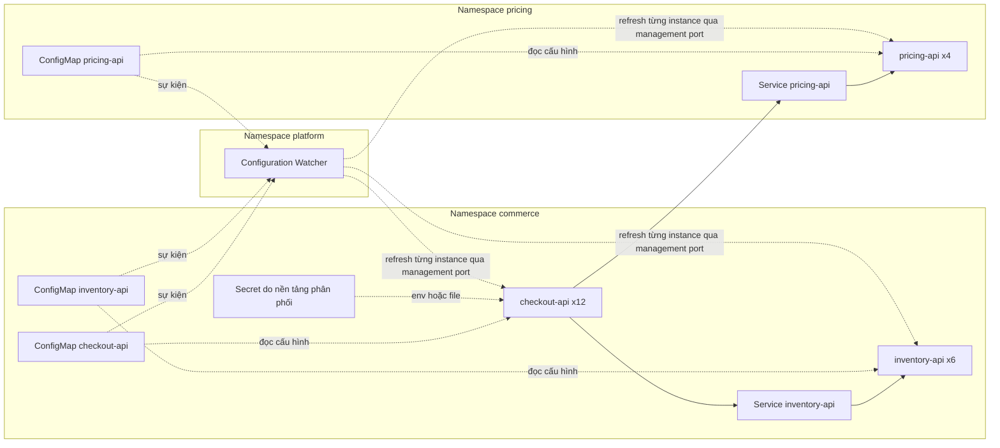

# Bài tập đánh giá kiến trúc với yêu cầu và giới hạn cụ thể

Trong chương **Lựa chọn kiến trúc** của **SPRING_CLOUD_KUBERNETES**, bài này yêu cầu chọn cách tích hợp Spring với Kubernetes dựa trên một hợp đồng cụ thể. Người học phải quyết định nơi cần DiscoveryClient, Spring Cloud LoadBalancer, nguồn ConfigMap/Secret, Configuration Watcher và RBAC; đồng thời chỉ ra tính năng có thể bỏ.

Đầu ra là một quyết định kiến trúc có bằng chứng và điều kiện chấp nhận. Một sơ đồ hợp lý chưa chứng minh đạt yêu cầu; một cấu hình triển khai được cũng chưa chứng minh có thể vận hành trong các giới hạn đã cho.

Các con số, tên ứng dụng và chính sách trong đề là dữ liệu giả định phục vụ bài tập. Lời giải tham khảo là một phương án đề xuất, không phải kết quả benchmark hoặc triển khai đã được xác nhận. Ví dụ cấu hình dựa trên Spring Cloud Kubernetes 3.3, Spring Cloud Commons 4.3 và ứng dụng JVM; khi triển khai phải dùng bộ version tương thích và kiểm tra hành vi của đúng release.

## 1. Đề bài: hệ thống đặt hàng trong một cluster

Đội có hai kỹ sư phụ trách ba ứng dụng:

| Ứng dụng | Namespace | Số Pod ổn định | Trách nhiệm |
| --- | --- | --- | --- |
| `checkout-api` | `commerce` | 12 | Nhận yêu cầu đặt hàng, gọi inventory và pricing |
| `inventory-api` | `commerce` | 6 | Tra cứu tồn kho |
| `pricing-api` | `pricing` | 4 | Trả giá theo nghiệp vụ hiện có |

Cluster có nhiều node, domain DNS `cluster.local`, ClusterIP Service cho từng ứng dụng, ingress/gateway sẵn có và CNI thực thi NetworkPolicy. Đội nền tảng quản lý namespace `platform`, DNS, network và telemetry control plane. Các luồng HTTP nghiệp vụ được phép đi qua namespace theo chính sách đã duyệt.

Tên ba Service trên là duy nhất trong hai namespace ứng dụng được xét. Hệ thống chưa có yêu cầu ứng dụng tự chọn Pod theo nhãn, vùng hoặc trọng số. Không có yêu cầu chia đều từng request trên mọi Pod; kết nối HTTP dài hạn và cơ chế connection pool phải được tính trong phép đo.

### 1.1. Yêu cầu hành vi

| Mã | Yêu cầu bắt buộc |
| --- | --- |
| R1 | Ở tải PoC 600 request/giây vào checkout, chuỗi nghiệp vụ đạt p95 không quá 250 ms trong điều kiện backend và dữ liệu thử đã thống nhất. Phải đo; đề không cung cấp sẵn năng lực mỗi Pod. |
| R2 | Mỗi ứng dụng có một ConfigMap không nhạy cảm, cùng tên Service. Cấu hình hiển thị/thông báo phải được dùng bởi mọi Pod đang phục vụ trong 90 giây sau khi bản hợp lệ được API server chấp nhận, khi API, mạng và thành phần cập nhật đều hoạt động bình thường. Không thay Pod chỉ để cập nhật nhóm cấu hình này. |
| R3 | Cho phép hai revision hiển thị cùng tồn tại trong cửa sổ 90 giây. Mỗi thao tác nghiệp vụ cần dùng một snapshot hợp lệ; không yêu cầu đổi đồng thời toàn cluster. |
| R4 | Khi API server gián đoạn tối đa năm phút, các Pod đã chạy tiếp tục phục vụ bằng cấu hình hợp lệ gần nhất nếu DNS, data plane, backend và credential hiện có vẫn hoạt động. Không yêu cầu tạo Pod mới hoặc phản ánh thay đổi endpoint trong khoảng gián đoạn này. |
| R5 | Secret chứa credential DB của checkout được xoay bằng quy trình có kiểm soát trong tối đa 10 phút ở điều kiện bình thường. Cho phép rollout; hệ thống DB chấp nhận credential cũ và mới đồng thời trong 20 phút. |
| R6 | Phải quan sát được Pod, revision, lỗi cập nhật và trạng thái phục hồi. Sau khi thành phần cập nhật phục hồi, có quy trình đối soát revision mới nhất; không mặc định một sự kiện bị bỏ lỡ tự được phát lại. |

R2 chỉ áp dụng cấu hình hiển thị không nhạy cảm. Nó không bao gồm URL database, credential, thay schema hay giá cần nhất quán giao dịch. Mỗi ConfigMap được cập nhật tối đa hai lần mỗi phút trong mô hình tải đề bài.

R4 không phải cam kết toàn bộ Kubernetes vẫn điều khiển bình thường khi control plane gián đoạn. Phạm vi của nó là tiếp tục dùng trạng thái đã có ở những điều kiện được ghi rõ.

### 1.2. Giới hạn kiến trúc

| Mã | Giới hạn cứng |
| --- | --- |
| G1 | Không thêm broker, service mesh hoặc một kho cấu hình ngoài mới. Có thể dùng tối đa hai Pod thành phần phụ trợ cho giải pháp cập nhật/discovery. |
| G2 | ServiceAccount ứng dụng không được đọc Secret qua API và không được đọc Services, Pods, Endpoints hoặc EndpointSlices. Được xét quyền GET/LIST ConfigMap không nhạy cảm trong chính namespace ứng dụng. Không dùng wildcard, `cluster-admin` hoặc `all-namespaces`. |
| G3 | Nếu có Watcher, nó dùng ServiceAccount riêng thuộc `platform`, chỉ đọc resource cần thiết trong `commerce` và `pricing`; không được đọc Secret. |
| G4 | Management endpoint không được công bố qua ingress nghiệp vụ. Luồng cập nhật được phép vào management port phải được giới hạn bằng chính sách mạng đã kiểm chứng; endpoint nghiệp vụ vẫn đáp ứng các luồng hợp lệ. |
| G5 | Tổng request API trực tiếp của ứng dụng và thành phần phụ trợ do giải pháp bổ sung không quá 8/giây trung bình trên cửa sổ 60 giây; burst không quá 60 request trong một giây; không quá 40 stream watch đồng thời. Phải kiểm tra startup, rollout và reconnect. |
| G6 | Có ngân sách cho tối đa bốn Pod ứng dụng tăng thêm trong đợt cập nhật. Phải xét cả Pod đang termination còn chiếm tài nguyên và khả năng scheduling. |

G5 không tính các request của kubelet, DNS hoặc controller nền tảng đã có vào ngân sách danh tính ứng dụng; vẫn phải ghi tác động gián tiếp lên chúng. Cấm Secret API của workload không ngăn nền tảng phân phối Secret bằng volume/env theo quy trình được phép.

## 2. Nhiệm vụ và sản phẩm người học cần nộp

Hãy đưa ra một phương án chính và ít nhất một phương án thay thế, kèm:

1. Sơ đồ đường gọi nghiệp vụ, đường cấu hình, đường Secret và chủ thể được cấp quyền.
2. Bảng đối chiếu R1–R6, G1–G6: đạt bằng cơ chế nào, chưa biết điểm nào, bằng chứng nào cần thu.
3. Danh sách dependency/tính năng Spring giữ lại và bỏ đi, cùng lý do.
4. Phân tích lỗi: API gián đoạn, Watcher dừng, refresh bị từ chối, một Pod giữ revision cũ và credential xoay chưa xong.
5. Mô hình tải API, giới hạn retry, số watch và kế hoạch cập nhật trong giới hạn Pod.
6. Một ADR ngắn ghi quyết định, điều kiện chấp nhận, hậu quả, phương án bị loại và tín hiệu cần xem lại.
7. Kế hoạch PoC có ca thành công, ca bị từ chối theo chính sách và ca phục hồi.

Trước khi xem lời giải, đánh dấu từng thông tin là **đã cho**, **giả định bổ sung** hoặc **cần đo**. Không tự thêm broker, nới RBAC hay bỏ yêu cầu không thay Pod để làm phương án yêu thích trở nên hợp lệ.

## 3. Những cơ chế không được đánh đồng

### 3.1. Kubernetes Service DNS và DiscoveryClient

Service thông thường có tên DNS theo namespace. Với domain được cho trong đề, checkout có thể dùng:

```text
http://inventory-api.commerce.svc.cluster.local:8080
http://pricing-api.pricing.svc.cluster.local:8080
```

Ứng dụng gửi HTTP tới Service không tự cần quyền đọc Kubernetes API để phân giải DNS hoặc chọn endpoint trong data plane. Chất lượng phân phối request còn phụ thuộc kết nối, protocol và hạ tầng mạng; không hứa chia đều từng request. [Tài liệu DNS cho Service và Pod](https://kubernetes.io/docs/concepts/services-networking/dns-pod-service/).

DiscoveryClient cung cấp tập instance cho ứng dụng, hữu ích khi có yêu cầu lựa chọn hoặc metadata cụ thể. Nó đi kèm cách truy cập dữ liệu, cache và quyền tương ứng. Spring Cloud Kubernetes không phải điều kiện bắt buộc để chạy Spring Boot trên Kubernetes. [Giới thiệu Spring Cloud Kubernetes](https://docs.spring.io/spring-cloud-kubernetes/reference/3.3/index.html).

### 3.2. LoadBalancer mode SERVICE và việc không dùng Kubernetes SDK

Spring Cloud Kubernetes hỗ trợ mode POD và SERVICE. Chọn SERVICE không tự chứng minh ứng dụng không còn gọi API: implementation vẫn có thể cần tìm Service, namespace và port. Nếu mục tiêu là không có quyền discovery API trong ứng dụng, đánh giá dependency và request thật, không chỉ đổi một thuộc tính. [Tài liệu LoadBalancer](https://docs.spring.io/spring-cloud-kubernetes/reference/3.3/load-balancer.html).

### 3.3. ConfigMap đã đổi, Environment đã đổi và nghiệp vụ đã đổi

Ba trạng thái này cần được quan sát riêng. File mount mới không tự làm mọi bean nhận giá trị mới. Endpoint refresh thành công cũng chưa chứng minh consumer không giữ bản sao cũ.

Refresh scope tạo lại target theo vòng đời của scope; `@ConfigurationProperties` phù hợp có thể được bind lại. Không áp dụng một cơ chế cho mọi loại pool/client. [Tài liệu Spring Cloud Context](https://docs.spring.io/spring-cloud-commons/reference/4.3/spring-cloud-commons/application-context-services.html#_refresh_scope).

### 3.4. RBAC, NetworkPolicy và xác thực HTTP

RBAC điều khiển request Kubernetes API. NetworkPolicy điều khiển các luồng mạng được CNI hỗ trợ. Xác thực/phân quyền HTTP áp dụng ở lớp ứng dụng. Không dùng một lớp làm bằng chứng cho lớp còn lại.

Trong G4, management port riêng giúp phân biệt luồng mạng cập nhật với luồng nghiệp vụ. Nếu hợp đồng còn đòi xác thực danh tính ở HTTP, phải kiểm chứng cơ chế đó ở cả Watcher và ứng dụng, không tự giả định cấu hình header đã được hỗ trợ. [Tài liệu NetworkPolicy](https://kubernetes.io/docs/concepts/services-networking/network-policies/).

## 4. Bốn phương án để đánh giá

### A — DNS Service, cấu hình lúc khởi động, rollout khi đổi

Ứng dụng gọi Service bằng DNS, đọc ConfigMap/Secret qua file hoặc env, không dùng Kubernetes SDK. Pipeline thay Pod sau khi thay cấu hình.

Ưu điểm: ít thành phần, không cấp API quyền cho ứng dụng, vòng đời tài nguyên rõ. Nhưng phương án gốc này **không đạt R2** vì cần thay Pod để cập nhật cấu hình hiển thị. Không thể dùng điểm đơn giản để bù vi phạm đó.

### B — DNS cho nghiệp vụ, ConfigMap API và HTTP Watcher cho refresh

Ứng dụng chỉ dùng tích hợp ConfigMap, đọc nguồn ở chính namespace, có bean cập nhật được. Watcher riêng phát hiện thay đổi và gửi refresh tới từng instance; nghiệp vụ vẫn gọi bằng DNS. Secret được phân phối qua env/file và đổi bằng rollout.

Đây là ứng viên có điều kiện: phải chứng minh RBAC không vượt G2, management path đúng, các replica thật sự cập nhật trong 90 giây và ngân sách API/Pod không bị vượt.

### C — Mỗi ứng dụng dùng discovery API và cân bằng tải theo Pod

Ứng dụng dùng DiscoveryClient, Spring Cloud LoadBalancer mode POD, đọc ConfigMap/Secret bằng API và tự theo dõi thay đổi.

Như mô tả, C vi phạm G2 do quyền discovery và Secret API ở workload. Nó cũng thêm cơ chế lựa chọn Pod mà đề chưa yêu cầu. Có thể thiết kế lại C khi chính sách/yêu cầu thay đổi, nhưng không được ghi là phù hợp với đề gốc.

### D — DNS, file ConfigMap mount và HTTP Watcher

Ứng dụng không đọc ConfigMap qua API; nó import file mount và có cơ chế refresh Spring. Watcher riêng gửi thông báo khi nguồn đổi. Secret vẫn theo vòng đời rollout.

D giảm quyền và SDK trong ứng dụng, nhưng có một chuỗi bất đồng bộ cần kiểm chứng: sự kiện API có thể đến trước khi kubelet cập nhật file. Một lần refresh quá sớm có thể đọc bản cũ. Khoảng đợi cố định chưa bảo đảm R2 trên mọi node. [Tài liệu ConfigMap](https://kubernetes.io/docs/concepts/configuration/configmap/).

### 4.1. Bảng sàng lọc trước khi chấm điểm

| Phương án | R2 không thay Pod | G2 quyền ứng dụng | G1 thành phần phụ trợ | Điểm phải chứng minh |
| --- | --- | --- | --- | --- |
| A | Không đạt | Có thể đạt | Có thể đạt | Chỉ hợp lệ nếu R2 được thay đổi chính thức |
| B | Có cơ chế, chưa đo | Có thể đạt với tích hợp config đúng phạm vi | Một Watcher là một lựa chọn | Refresh, API budget, lỗi và recovery |
| C như mô tả | Chưa đủ bằng chứng | Không đạt | Phụ thuộc thiết kế | Phải sửa thiết kế/chính sách trước |
| D | Có cơ chế, chưa đo | Có thể không cần API quyền workload | Một Watcher là một lựa chọn | Độ trễ file, thời điểm refresh, đối soát revision |

“Có thể đạt” không đồng nghĩa đã đạt. B và D chỉ được chuyển sang chấp nhận sau PoC phù hợp; nếu không có bằng chứng, giữ trạng thái đề xuất.

## 5. Tính toán sơ bộ thay vì đoán theo tên tính năng

### 5.1. Ngân sách cập nhật cấu hình

Tổng số Pod ổn định:

```text
N = 12 + 6 + 4 = 22
```

Giả sử phép đo cho thấy một lần refresh tạo trung bình `q=2` request API ở một Pod ứng dụng B. Với mỗi ứng dụng đổi ConfigMap hai lần/phút:

```text
R_refresh_mean = (12×2 + 6×2 + 4×2) × 2 / 60
               ≈ 1,47 request/giây
```

Đây mới là phần đọc lại nguồn theo giả định. Phải cộng startup, discovery của Watcher, reconnect, retry và mọi request khác của các chủ thể trong G5.

Nếu cả ba ConfigMap đổi gần nhau và mỗi Pod refresh một lần, phần ứng dụng có thể tạo khoảng `22×2=44` request trong một đợt. Con số 44 chưa chứng minh burst dưới 60 trong mọi giây: có thể có retry, request nền và phân trang. Cần đo và có cách giãn/coalesce/giới hạn đồng thời phù hợp nếu vượt ngân sách.

Không coi `q=2` là mặc định của Spring. Số request phụ thuộc client, nguồn, cache, profile và release; lấy từ log/audit/telemetry của PoC.

### 5.2. Số watch theo cấu trúc thiết kế

Nếu một thiết kế giả định mỗi trong 22 Pod mở watch cho bốn resource ở hai phạm vi độc lập:

```text
W = 22 × 4 × 2 = 176
```

Nó vượt giới hạn 40 của đề theo giả định ấy. Đây không phải số watch mặc định của starter; cần đo stream thực tế và tránh đếm heartbeat định kỳ như một stream watch.

Tập trung phần theo dõi vào Watcher có thể giảm số client trực tiếp. Tuy nhiên, cần tính cả Pod phụ trợ, stream theo namespace/resource và cơ chế HA thực tế. Hai Watcher không tự bảo đảm một sự kiện chỉ được xử lý một lần.

### 5.3. Ngân sách Secret rollout

Credential DB của checkout được phép đổi bằng rollout. Nếu mỗi đợt thay hai Pod, có sáu đợt cho 12 replica. Với giả định đã đo rằng mỗi đợt cần tối đa 45 giây để Pod mới sẵn sàng và 20 giây để kết thúc Pod cũ:

```text
T_planned ≈ 6 × (45 + 20) = 390 giây
```

Đây là ước lượng lập kế hoạch, chưa phải bảo đảm dưới 10 phút. Phải cộng bước phát hành credential, scheduling, validation, pipeline và xử lý lỗi. Cửa sổ cùng chấp nhận credential 20 phút phải bao phủ toàn bộ chuyển đổi và việc kết thúc kết nối cũ cần thiết.

`maxSurge` không tự là trần tổng số Pod còn chiếm tài nguyên khi có Pod đang termination. Kiểm tra G6 ở thời điểm cao nhất, không chỉ đọc `replicas + maxSurge` trên giấy. [Tài liệu Deployment và rolling update](https://kubernetes.io/docs/concepts/workloads/controllers/deployment/).

Không dùng tổng hoặc tổng p95 của các thành phần để khẳng định p95 toàn chuỗi đạt R1. Tải, tương quan latency, connection pool và retry cần được kiểm chứng bằng phép đo end-to-end.

## 6. Lời giải tham khảo: đề xuất B với điều kiện chấp nhận

Lựa chọn ban đầu là **B**, vì đề cần refresh không thay Pod nhưng chưa cần workload tự chọn backend theo metadata. Giữ DNS cho nghiệp vụ, chỉ dùng tích hợp cấu hình trong ứng dụng và dùng một Watcher riêng cho thông báo.



Một Watcher giữ giải pháp trong G1 nhưng tạo điểm phụ thuộc của **đường cập nhật**. Theo R2/R4, khi thành phần cập nhật lỗi thì các Pod hiện có vẫn dùng cấu hình hợp lệ gần nhất, có cảnh báo và quy trình đối soát sau phục hồi. Nếu doanh nghiệp muốn luôn giữ deadline 90 giây ngay cả khi Watcher dừng, đó là yêu cầu khác cần bổ sung HA và bằng chứng.

B chưa được đánh dấu chấp nhận chỉ từ sơ đồ này. Nếu PoC không đạt quyền hoặc thời gian/tải, xem lại thiết kế, trong đó D là một phương án thay thế đáng kiểm tra.
