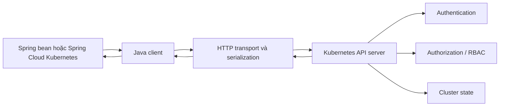
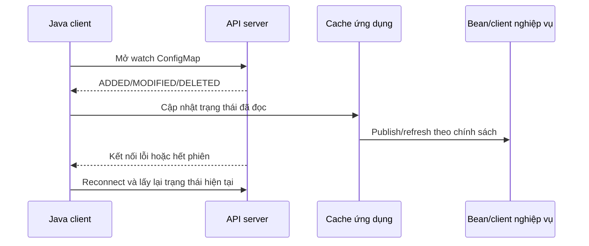

# Fabric8 Kubernetes Client và Kubernetes Java Client

Ứng dụng Spring chạy trong Kubernetes đôi khi cần đọc ConfigMap, theo dõi Secret, khám phá Service, kiểm tra Pod hoặc thực hiện một tác vụ quản trị có kiểm soát. Để làm việc với Kubernetes API từ Java, hai lựa chọn thường gặp là **Fabric8 Kubernetes Client** và **Kubernetes Java Client** do Kubernetes duy trì. Cả hai đều là thư viện client; chúng không thay thế API server, RBAC hay cơ chế mạng của cluster.

Bài học thuộc chương **Kubernetes client** của module **Spring Cloud Kubernetes** (`SPRING_CLOUD_KUBERNETES`). Module học tích hợp ứng dụng Spring với Kubernetes qua `DiscoveryClient`, ConfigMap, Secret, Spring Cloud LoadBalancer và Configuration Watcher, đồng thời thực hành RBAC và theo dõi sức khỏe Pod. Hiểu sự khác nhau giữa hai client giúp chọn đúng thư viện cho từng đường đi thay vì thêm cả hai vào project theo thói quen.

Mục tiêu của bài là:

- phân biệt mô hình API và phong cách lập trình của Fabric8 với Kubernetes Java Client;
- hiểu client lấy danh tính, namespace và endpoint API như thế nào;
- thiết kế quyền RBAC tối thiểu cho đọc, list và watch;
- chọn client theo nhu cầu của ứng dụng Spring;
- tránh các lỗi như block event-loop, watch không đóng, retry vô hạn hoặc dùng client quản trị quá rộng trong request path.

## 1. Client Java đứng ở đâu trong kiến trúc?

Một request từ ứng dụng tới Kubernetes thường đi qua các lớp sau:



Client chịu trách nhiệm tạo request, mã hóa/giải mã model, xử lý kết nối và cung cấp API Java. API server xác thực danh tính và kiểm tra quyền. Nếu ServiceAccount không được phép đọc ConfigMap, đổi từ Fabric8 sang Kubernetes Java Client không tự sửa lỗi `Forbidden`.

Ứng dụng Spring thường gặp ba loại đường đi:

| Đường đi | Dữ liệu | Client có thể tham gia ở đâu |
|---|---|---|
| Cấu hình | ConfigMap, Secret | Thành phần nạp cấu hình đọc API hoặc dùng cơ chế mount |
| Khám phá | Service, Endpoints, EndpointSlice | `DiscoveryClient` lấy dữ liệu và tạo `ServiceInstance` |
| Theo dõi | Watch resource, sự kiện thay đổi | Configuration Watcher hoặc bean theo dõi riêng |

Nếu Kubernetes đã mount ConfigMap thành file và ứng dụng chỉ đọc file, không cần thêm Java client để đọc cùng ConfigMap qua API. Client chỉ nên xuất hiện khi ứng dụng thật sự cần giao tiếp với API server.

## 2. Fabric8 Kubernetes Client là gì?

Fabric8 cung cấp một client Java với API fluent cho tài nguyên Kubernetes. Một object client thường là điểm vào để thao tác với nhiều loại resource, chọn namespace, gọi CRUD hoặc thiết lập watch.

Ví dụ đọc ConfigMap trong một namespace:

```java
try (KubernetesClient client = new KubernetesClientBuilder().build()) {
    ConfigMap configMap = client.configMaps()
            .inNamespace("shop")
            .withName("catalog-settings")
            .get();

    if (configMap != null) {
        String yaml = configMap.getData().get("application.yaml");
        // Chuyển yaml thành nguồn thuộc tính theo thiết kế ứng dụng.
    }
}
```

Tên package, builder và model có thể thay đổi theo major version; ví dụ minh họa tập trung vào ý tưởng fluent API. Cách đọc thường có dạng chọn resource → chọn namespace → chọn tên → thực hiện thao tác.

### Đặc điểm thường thấy

- API fluent mô tả khá gần với cấu trúc resource của Kubernetes.
- Hỗ trợ nhiều loại resource và custom resource theo cách thống nhất.
- Có cơ chế watch và các tiện ích làm việc với event hoặc resource lifecycle.
- Có thể cấu hình từ kubeconfig, biến môi trường hoặc thông tin in-cluster tùy runtime.
- Phù hợp với các ứng dụng cần thao tác nhiều resource mà muốn tránh tự ghép từng API class.

Fluent API dễ đọc nhưng không có nghĩa request là đồng bộ hay bất đồng bộ trong mọi trường hợp. Một lời gọi `.get()` có thể chờ HTTP response. Trong ứng dụng reactive, cần biết rõ API đang dùng có block hay không và cô lập nó nếu cần.

## 3. Kubernetes Java Client là gì?

Kubernetes Java Client là client Java sinh từ API Kubernetes/OpenAPI và các thành phần hỗ trợ của dự án Kubernetes. Client cung cấp các API Java theo nhóm tài nguyên, chẳng hạn API cho Core V1, Apps V1 hoặc Discovery V1. Mô hình này làm lộ rõ hơn operation và model tương ứng với Kubernetes API.

Ví dụ khái quát đọc ConfigMap:

```java
ApiClient apiClient = ClientBuilder.cluster().build();
Configuration.setDefaultApiClient(apiClient);

CoreV1Api coreApi = new CoreV1Api(apiClient);
V1ConfigMap configMap = coreApi.readNamespacedConfigMap(
        "catalog-settings",
        "shop"
).execute();

if (configMap != null && configMap.getData() != null) {
    String yaml = configMap.getData().get("application.yaml");
}
```

Chữ ký operation và cách gọi có thể thay đổi theo phiên bản client. Điểm cần nhận diện là ứng dụng chọn API class và operation rõ ràng, sau đó gọi API server thông qua `ApiClient`.

### Đặc điểm thường thấy

- API bám sát nhóm endpoint và model của Kubernetes.
- Dễ đối chiếu một operation Java với tài liệu API tương ứng.
- Hữu ích khi cần kiểm soát chi tiết request, model hoặc version API.
- Có thể tạo client cho các API Kubernetes và custom resource theo cơ chế được thư viện hỗ trợ.
- Cần quản lý rõ lifecycle của `ApiClient`, transport và cơ chế watch.

Kubernetes Java Client không phải một server embedded. Nó cũng không tự cấp quyền. Khi chạy trong Pod, nó thường dùng token và CA được cung cấp bởi ServiceAccount hoặc một cơ chế credential do môi trường thiết lập.

## 4. So sánh nhanh hai lựa chọn

| Tiêu chí | Fabric8 Kubernetes Client | Kubernetes Java Client |
|---|---|---|
| Phong cách | Fluent, chọn resource rồi thao tác | API class/operation theo nhóm endpoint |
| Mức trừu tượng | Tiện ích thao tác resource cao hơn | Gần API/model Kubernetes hơn |
| Đọc code CRUD | Thường ngắn và trực quan | Thường tường minh về API và operation |
| Watch | Có API fluent và tiện ích lifecycle | Có API watch theo client/model của dự án |
| Custom Resource | Có mô hình và DSL hỗ trợ tùy cách dùng | Có thể dùng model/API cơ chế tương ứng |
| Kiểm soát request | Trừu tượng hóa nhiều hơn | Có thể rõ hơn ở lớp API client |
| Tích hợp hiện hữu | Phù hợp khi hệ sinh thái dự án đã dùng Fabric8 | Phù hợp khi dự án chuẩn hóa client Kubernetes chính thức |
| Rủi ro chính | DSL che khuất request thực tế nếu thiếu hiểu biết nền tảng | Boilerplate và lifecycle phức tạp hơn nếu chỉ cần CRUD nhỏ |

Không có cột “tốt hơn tuyệt đối”. Quyết định nên dựa vào thư viện Spring Cloud Kubernetes đang dùng, nhu cầu API, cách nhóm muốn xử lý watch, yêu cầu tương thích và chi phí vận hành.

## 5. Cấu hình client trong và ngoài cluster

### Chạy trong cluster

Khi Pod gọi API server, client thường cần:

1. endpoint API server hoặc thông tin cluster do client tự phát hiện;
2. CA để xác thực TLS;
3. token hoặc credential của ServiceAccount;
4. namespace và quyền RBAC;
5. timeout, retry và connection pool.

Luồng khái quát:

```text
ServiceAccount của Pod
  → credential/CA và endpoint cluster
  → Java client
  → HTTPS tới Kubernetes API server
  → authentication + RBAC
  → resource hoặc lỗi
```

Client có thể có cơ chế tự cấu hình in-cluster, nhưng ứng dụng vẫn cần kiểm tra namespace và ServiceAccount mà Deployment thực sự sử dụng. Không giả định Pod luôn chạy dưới ServiceAccount mặc định có đủ quyền.

### Chạy ngoài cluster

Khi chạy local hoặc trong CI, client thường dùng kubeconfig, context và credential của môi trường đó. Không đưa token thật vào image hoặc commit vào repository. Nên cấp một identity giới hạn cho tác vụ kiểm thử và dọn credential sau khi dùng.

Một ứng dụng có thể dùng cùng mã Java nhưng hai nguồn cấu hình khác nhau:

```text
local/CI → kubeconfig và context được chọn
cluster → ServiceAccount của Pod
```

Đây là lý do lỗi local không luôn tái hiện lỗi trong cluster. Quyền, namespace, network route và CA có thể khác.

## 6. Mô hình đưa client vào ứng dụng Spring

Không nên tạo client mới cho từng HTTP request. Hãy tạo client như một bean có lifecycle phù hợp, tái sử dụng connection pool và đóng khi application context dừng.

Ví dụ khái quát với Fabric8:

```java
@Configuration
class KubernetesClientConfiguration {

    @Bean(destroyMethod = "close")
    KubernetesClient kubernetesClient() {
        return new KubernetesClientBuilder().build();
    }
}
```

Ví dụ khái quát với Kubernetes Java Client:

```java
@Configuration
class OfficialClientConfiguration {

    @Bean
    ApiClient kubernetesApiClient() {
        return ClientBuilder.cluster().build();
    }

    @Bean
    CoreV1Api coreV1Api(ApiClient apiClient) {
        return new CoreV1Api(apiClient);
    }
}
```

Builder và destroy method cần khớp version thực tế. Nếu client có transport hoặc executor riêng, phải xác định bean nào sở hữu và đóng tài nguyên khi context dừng.

Một service nghiệp vụ nên phụ thuộc vào interface nhỏ thay vì rải client Kubernetes khắp controller:

```java
interface CatalogSettingsReader {
    CatalogSettings read();
}

@Service
class KubernetesCatalogSettingsReader implements CatalogSettingsReader {
    private final KubernetesClient client;

    KubernetesCatalogSettingsReader(KubernetesClient client) {
        this.client = client;
    }

    @Override
    public CatalogSettings read() {
        ConfigMap value = client.configMaps()
                .inNamespace("shop")
                .withName("catalog-settings")
                .get();
        return CatalogSettings.from(value);
    }
}
```

Lớp adapter này giúp test nghiệp vụ mà không cần gọi API server và giúp thay client khi yêu cầu thay đổi. Đừng để controller biết chi tiết namespace, resource name và retry policy.

## 7. Đọc ConfigMap và Secret đúng cách

### ConfigMap

ConfigMap có thể chứa khóa đơn hoặc chuỗi file:

```yaml
data:
  application.yaml: |
    training:
      catalog:
        page-size: 20
```

Java client trả về object resource; ứng dụng vẫn phải quyết định cách parse `application.yaml` và hợp nhất thuộc tính. Lấy được object từ API chưa có nghĩa giá trị đã xuất hiện trong Spring `Environment`.

### Secret

Secret cần quyền riêng. Quyền đọc ConfigMap không tự bao gồm quyền đọc Secret. Nếu client đọc Secret qua API, RBAC phải chỉ rõ resource và namespace cần thiết.

Không ghi toàn bộ object Secret vào log. Một số model có thể chứa trường dữ liệu nhạy cảm sau decode hoặc serialization. Nếu cần chẩn đoán, chỉ log tên resource, thời điểm hoặc một fingerprint không thể đảo ngược theo chính sách của hệ thống.

### Cache và thời điểm đọc

Có ba cách tổ chức thường gặp:

| Cách đọc | Ưu điểm | Điều phải xử lý |
|---|---|---|
| Đọc lúc khởi động | Dễ hiểu, ít request API | Cần rollout khi cấu hình đổi |
| Đọc theo request | Luôn gần trạng thái mới | Tăng latency và tải API, cần cache |
| Watch rồi cập nhật cache | Phản ứng nhanh, giảm đọc lặp | Lifecycle watch, reconnect và đồng bộ cache |

Không chọn watch chỉ để tránh một lần đọc config. Watch có trạng thái, event, lỗi kết nối và yêu cầu quyền riêng. Nếu dùng cache, cần định nghĩa giá trị ban đầu, thời gian stale có thể chấp nhận và hành vi khi watch mất kết nối.

## 8. Watch resource và lifecycle

Watch cho phép client nhận sự kiện khi resource thay đổi. Một luồng tổng quát:



Watch không phải là một giao dịch đồng bộ. Event có thể bị trễ, kết nối có thể đóng và ứng dụng phải có cách khởi tạo lại từ trạng thái hiện tại. Khi reconnect, không nên chỉ tiếp tục từ cache cũ mà không kiểm tra resource version hoặc cơ chế resync mà client hỗ trợ.

Các quy tắc lifecycle quan trọng:

- đăng ký watch một lần theo lifecycle của bean, không đăng ký mỗi request;
- đóng watch khi application context dừng;
- xử lý event lỗi và reconnect có backoff;
- giới hạn số watch mở để tránh cạn connection;
- cập nhật cache theo thứ tự và xử lý trường hợp resource bị xóa;
- không coi event đã nhận là bằng chứng mọi replica đã áp dụng giá trị.

Fabric8 và Kubernetes Java Client có API watch khác nhau. Hãy đọc kỹ cách mỗi version biểu diễn event, close và exception; không sao chép lifecycle của một thư viện sang thư viện kia.

## 9. RBAC tối thiểu cho client

Nếu ứng dụng cần đọc và watch ConfigMap trong namespace `shop`, một Role có thể bắt đầu như sau:

```yaml
apiVersion: rbac.authorization.k8s.io/v1
kind: Role
metadata:
  name: catalog-settings-reader
  namespace: shop
rules:
  - apiGroups: [""]
    resources: ["configmaps"]
    verbs: ["get", "list", "watch"]
```

Gắn Role cho đúng ServiceAccount:

```yaml
apiVersion: rbac.authorization.k8s.io/v1
kind: RoleBinding
metadata:
  name: catalog-settings-reader
  namespace: shop
subjects:
  - kind: ServiceAccount
    name: catalog-app
    namespace: shop
roleRef:
  apiGroup: rbac.authorization.k8s.io
  kind: Role
  name: catalog-settings-reader
```

Deployment phải sử dụng `catalog-app`. Nếu client đọc Secret, thêm quyền `secrets` một cách có chủ đích. Nếu client khám phá Service và EndpointSlice, cần các resource và verb tương ứng với chế độ discovery.

`get`, `list` và `watch` không phải ba tên thay thế cho nhau:

- `get` đọc một resource cụ thể;
- `list` lấy tập resource hoặc trạng thái ban đầu;
- `watch` nhận thay đổi sau đó.

Một client chỉ cần `get` một ConfigMap cụ thể có thể không cần `list`/`watch`. Một cơ chế informer hoặc discovery thường cần chuỗi thao tác rộng hơn. Hãy xem request thực tế và cấp quyền theo đó.

## 10. Synchronous và reactive trong Java client

Phần lớn lỗi hiệu năng không đến từ tên thư viện mà từ việc gọi thao tác blocking trong sai runtime.

### Với Spring MVC

Client blocking thường phù hợp vì request đã có servlet thread. Vẫn cần timeout và giới hạn connection pool:

```text
servlet thread
  → client.get()
  → chờ API response trong timeout
  → xử lý resource
  → trả HTTP response
```

Không để một request giữ thread vô thời hạn khi API server chậm.

### Với Spring WebFlux

Nếu client operation blocking, không gọi trực tiếp trên event-loop. Có thể dùng scheduler cô lập khi chưa có API reactive thay thế:

```java
Mono<ConfigMap> readConfig() {
    return Mono.fromCallable(() -> client.configMaps()
                    .inNamespace("shop")
                    .withName("catalog-settings")
                    .get())
            .subscribeOn(Schedulers.boundedElastic())
            .timeout(Duration.ofSeconds(2));
}
```

Đây chỉ là adapter cho thao tác blocking. Cần đặt giới hạn concurrency, theo dõi scheduler và cân nhắc MVC nếu phần lớn hệ thống vẫn blocking. Không gọi `.block()` trong request path reactive để né thiết kế pipeline.

## 11. Fabric8 trong Spring Cloud Kubernetes và client chính thức

Spring Cloud Kubernetes có thể cung cấp các module tích hợp dùng một client hoặc transport nhất định tùy dòng phiên bản và lựa chọn dependency. Khi dự án đã dùng module tích hợp Fabric8, thêm Kubernetes Java Client cho cùng nhiệm vụ có thể tạo hai stack kết nối, hai cách cấu hình credential và hai bộ model.

Trước khi thêm client thứ hai, hãy trả lời:

1. Module Spring Cloud Kubernetes hiện tại dùng client nào trong bộ phiên bản của dự án?
2. Tác vụ mới có thể dùng abstraction hiện hữu không?
3. Có yêu cầu API/model mà abstraction hiện hữu không hỗ trợ không?
4. Ai sở hữu cấu hình endpoint, CA, token, timeout và lifecycle?
5. Hai client có cùng namespace, ServiceAccount và policy retry không?

Nếu chỉ cần `DiscoveryClient`, hãy ưu tiên abstraction đã được Spring Cloud Kubernetes cung cấp thay vì viết thêm code đọc Service/EndpointSlice. Nếu cần một API Kubernetes đặc thù mà abstraction không expose, tạo adapter riêng và ghi rõ lý do dùng client trực tiếp.

Không trộn model của hai thư viện trong domain model. Chuyển đổi về DTO nội bộ ngay tại adapter:

```text
Fabric8 model hoặc official model
  → adapter của ứng dụng
  → CatalogSettings / DiscoveredTarget nội bộ
  → service nghiệp vụ
```

Điều này giảm coupling và giúp test không phụ thuộc object có metadata, annotation hoặc method signature của một client cụ thể.

## 12. Xử lý lỗi và retry

Lỗi client cần được phân loại:

| Loại lỗi | Ví dụ | Cách xử lý |
|---|---|---|
| Cấu hình | Thiếu endpoint, CA hoặc kubeconfig | Fail fast khi cấu hình bắt buộc |
| Authentication | Token hết hạn hoặc sai credential | Sửa identity/credential, không retry vô hạn |
| Authorization | `Forbidden` | Sửa Role/RoleBinding theo resource cần dùng |
| Tìm resource | `NotFound` | Xác định đây là lỗi hay trạng thái hợp lệ |
| Kết nối | Timeout, reset, DNS API server | Timeout, backoff và kiểm tra network |
| Phiên bản API | Resource/field không được hỗ trợ | Kiểm tra version và API group |
| Dữ liệu | Model thiếu key hoặc YAML sai | Validate trước khi đưa vào bean |

Retry chỉ phù hợp với lỗi tạm thời. `Forbidden`, tên resource sai và YAML không hợp lệ không trở nên đúng sau mười lần retry. Với watch, reconnect có thể cần backoff; với request người dùng, timeout và fallback phải phù hợp SLO.

## 13. Kiểm thử client mà không cần cluster thật

Tách adapter Kubernetes khỏi logic nghiệp vụ giúp có hai tầng kiểm thử:

### Unit test

Mock interface nội bộ như `CatalogSettingsReader`, `ServiceEndpointReader` hoặc `SecretProvider`. Kiểm tra controller và service xử lý giá trị, lỗi và fallback.

### Integration test

Dùng một API server giả lập, môi trường test Kubernetes hoặc công cụ phù hợp với client đã chọn. Kiểm tra:

- serialization và deserialization model;
- namespace và resource name;
- `get`, `list`, `watch`;
- lỗi `Forbidden`, `NotFound`, timeout;
- reconnect sau khi watch đóng;
- Secret không xuất hiện trong log;
- client đóng đúng khi context dừng.

Không nên biến mọi unit test thành test phụ thuộc cluster dùng chung. Cluster dùng chung có thể thay đổi resource hoặc RBAC giữa các lần chạy. Nếu cần test thật, tạo namespace và identity riêng với cleanup rõ ràng.

## 14. Chọn client theo kịch bản

| Kịch bản | Hướng lựa chọn ban đầu |
|---|---|
| Ứng dụng đã tích hợp Spring Cloud Kubernetes theo Fabric8 | Dùng abstraction/bean hiện hữu; dùng Fabric8 trực tiếp nếu thật sự cần |
| Cần CRUD nhiều resource với API fluent | Đánh giá Fabric8 |
| Cần bám sát operation và model Kubernetes API | Đánh giá Kubernetes Java Client |
| Chỉ cần đọc cấu hình từ volume | Không thêm Java client |
| Chỉ cần gọi Service nội bộ qua DNS | Không cần client discovery trực tiếp |
| Cần discovery trong Spring | Ưu tiên `DiscoveryClient` tương thích với bộ dependency |
| Cần custom resource đặc thù | So sánh model, watch, codegen và ecosystem của hai client |
| Ứng dụng WebFlux nhưng client blocking | Cô lập blocking hoặc cân nhắc lại runtime |

Đây là ma trận định hướng, không thay thế kiểm tra version. Một lựa chọn phù hợp về API nhưng không phù hợp về dependency graph, CVE policy, JDK hoặc lifecycle vẫn là lựa chọn chưa hoàn chỉnh.

## 15. Checklist trước khi đưa vào production

Trước khi merge phần code dùng Kubernetes client, hãy xác nhận:

- [ ] Chỉ dùng một client cho một nhiệm vụ nếu không có lý do rõ ràng để dùng nhiều client.
- [ ] Version của client khớp BOM và JDK của ứng dụng.
- [ ] Client là bean tái sử dụng, không tạo mới trong từng request.
- [ ] Endpoint, CA, credential và namespace lấy từ nguồn phù hợp với môi trường.
- [ ] ServiceAccount của Pod được chỉ định rõ.
- [ ] Role chỉ cấp resource và verb cần thiết.
- [ ] Timeout, retry và backoff có giới hạn.
- [ ] Watch được đóng, reconnect và resync đúng lifecycle.
- [ ] Không log token, Secret hoặc toàn bộ resource nhạy cảm.
- [ ] Blocking call không chạy trên event-loop reactive.
- [ ] Metric/log/trace phân biệt lỗi API, RBAC, DNS, network và dữ liệu.
- [ ] Có test cho NotFound, Forbidden, timeout và watch reconnect.

## 16. Kết luận

Fabric8 Kubernetes Client và Kubernetes Java Client đều có thể giúp ứng dụng Java gọi Kubernetes API, nhưng chúng mang phong cách và mức trừu tượng khác nhau. Fabric8 thường thuận tiện khi muốn thao tác resource bằng fluent API và đã ở trong hệ sinh thái Spring Cloud Kubernetes tương ứng. Kubernetes Java Client phù hợp khi cần đối chiếu trực tiếp với operation và model của Kubernetes API hoặc dự án đã chuẩn hóa client đó.

Quyết định đúng bắt đầu từ nhu cầu: đọc ConfigMap, đọc Secret, discovery, watch hay quản trị resource. Sau đó mới chọn client, thiết kế bean lifecycle, cấp RBAC tối thiểu và kiểm tra mô hình blocking/reactive. Nếu DNS hoặc volume đã giải quyết bài toán, không thêm Java client chỉ để tăng số dependency.

Một client tốt không bù được quyền sai, namespace sai, timeout thiếu hoặc watch không có cơ chế resync. Hãy giữ client trong adapter rõ ràng, chuyển model về kiểu nội bộ, quan sát từng chặng và để Spring Cloud Kubernetes đảm nhiệm abstraction đã có sẵn khi nó đáp ứng đúng yêu cầu.
