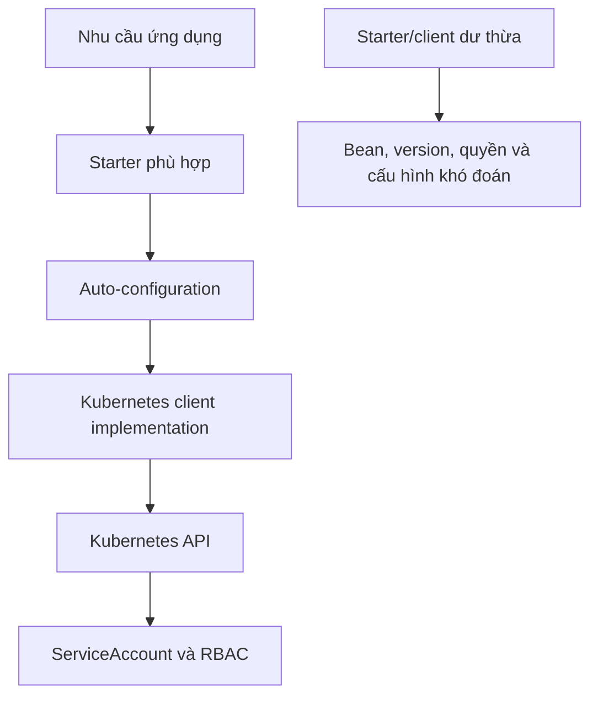
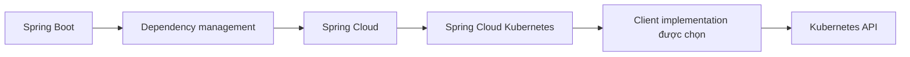
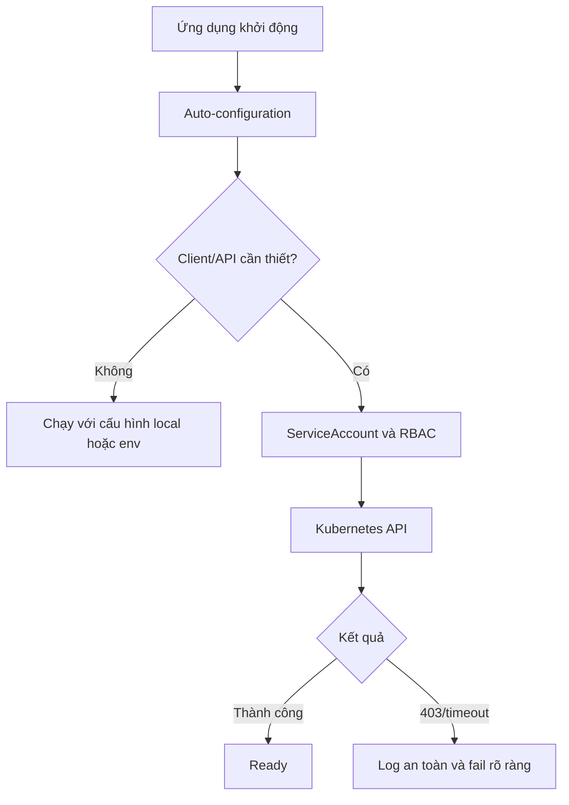

# Chọn starter nhất quán và tránh đưa nhiều client không cần thiết

## 1. Vì sao starter cần được chọn có chủ đích?

Trong `SPRING_CLOUD_KUBERNETES`, starter là điểm vào để đưa một nhóm auto-configuration và dependency vào ứng dụng Spring. Một starter phù hợp có thể giúp ứng dụng đọc ConfigMap, Secret, khám phá Service hoặc dùng Spring Cloud LoadBalancer. Một starter thừa có thể kéo thêm Kubernetes client, bean, quyền RBAC và đường cấu hình mà ứng dụng không cần.

Điều quan trọng không phải là thêm nhiều tính năng nhất, mà là giữ một đường tích hợp rõ ràng từ ứng dụng tới Kubernetes API. Code cần biết mình đang dùng implementation nào, dependency graph cần có một bộ client nhất quán và ServiceAccount cần đúng quyền cho đường đó.



Spring Cloud Kubernetes cung cấp các tích hợp liên quan DiscoveryClient, ConfigMap, Secret, Spring Cloud LoadBalancer và Configuration Watcher. Mỗi nhu cầu có thể cần module khác nhau. Không nên thêm toàn bộ starter chỉ vì module đang chạy trên Kubernetes.

## 2. Phân biệt starter, module và client

### Starter

Starter là dependency thuận tiện để đưa tập dependency và auto-configuration vào ứng dụng. Tên starter cho biết ý định tích hợp, nhưng cần đọc tài liệu của dòng Spring Boot và Spring Cloud đang dùng để biết chính xác nó kéo gì.

### Module tích hợp

Module Spring Cloud Kubernetes thực hiện một vai trò cụ thể như discovery hoặc config. Có module dành cho client Kubernetes, có module dành cho tính năng Spring Cloud. Không phải mọi module đều cần trong cùng một process.

### Kubernetes client

Client là thư viện Java giao tiếp với Kubernetes API. Một starter có thể kéo implementation client và các dependency nền. Khi ứng dụng đưa hai implementation không cần thiết vào cùng classpath, auto-configuration hoặc cách xác thực có thể trở nên khó đoán.

```text
Ứng dụng Spring
    ↓ starter
Spring Cloud Kubernetes integration
    ↓ implementation được chọn
Kubernetes Java client
    ↓ HTTP/TLS/authentication
Kubernetes API server
```

Ranh giới này giúp phân tích lỗi: lỗi thiếu bean có thể thuộc starter hoặc auto-configuration; lỗi `403` thuộc RBAC; lỗi TLS thuộc client và certificate; lỗi discovery rỗng có thể thuộc namespace, selector hoặc quyền API.

## 3. Bắt đầu từ nhu cầu nhỏ nhất

Trước khi thêm dependency, viết một câu trả lời cho nhu cầu:

| Nhu cầu | Câu hỏi quyết định |
| --- | --- |
| Gọi Service nội bộ | DNS Service đã đủ chưa? |
| DiscoveryClient | Ứng dụng có cần abstraction discovery không? |
| LoadBalancer | Có cần chọn instance phía client không? |
| ConfigMap/Secret | Có cần đọc Kubernetes API hay env/volume đã đủ? |
| Configuration Watcher | Cấu hình có cần áp dụng lúc chạy không? |
| Health | Actuator và probe đã đáp ứng chưa? |

Nếu ứng dụng chỉ gọi `http://inventory-service:8080`, Kubernetes Service và DNS có thể đã đủ. Thêm discovery client khi không có yêu cầu rõ ràng làm tăng dependency, quyền và số điểm cần quan sát.

Nếu Deployment đưa ConfigMap vào biến môi trường, ứng dụng không cần đọc ConfigMap qua API chỉ để lấy cùng giá trị. Nếu yêu cầu là refresh lúc chạy, mới xem xét cơ chế tích hợp và watcher phù hợp.

## 4. Chọn một họ client

Trong một ứng dụng, nên chọn một hướng client được starter và dòng Spring Cloud Kubernetes hỗ trợ. Không ghép tùy tiện các starter có hậu tố client khác nhau hoặc thêm trực tiếp nhiều thư viện client để thử.

Khi đọc tài liệu của dependency, cần xác định:

- Starter đó dùng implementation client nào.
- Module nào tạo bean client và bean discovery/config.
- Tên property và cơ chế xác thực.
- Có cần ServiceAccount token trong Pod không.
- Quyền `get`, `list`, `watch` trên loại tài nguyên nào.
- Client có hỗ trợ namespace và timeout theo nhu cầu không.
- Cách xử lý khi Kubernetes API không sẵn sàng.

Không suy luận từ tên artifact rằng hai starter có thể chạy đồng thời. Hai starter có thể cùng cung cấp một bean, cùng cấu hình một API hoặc kéo hai bộ model khác nhau. Nếu tài liệu yêu cầu một lựa chọn, coi đó là ràng buộc thiết kế.

## 5. Mô hình dependency nhất quán

Một dependency graph dễ vận hành có các đặc điểm:

1. Spring Boot và Spring Cloud Release Train nằm trong ma trận tương thích.
2. Spring Cloud Kubernetes cùng dòng hỗ trợ Boot và Cloud đã chọn.
3. Starter được chọn cho đúng tính năng.
4. Kubernetes client do starter quản lý, không bị override tùy tiện.
5. Không có hai implementation cùng auto-configure một vai trò.
6. Version được quản lý bởi BOM hoặc một nguồn duy nhất.
7. Dependency test và runtime được phân biệt rõ.



Version tương thích không bảo đảm mọi use case đúng, nhưng version bị trộn chắc chắn làm việc chẩn đoán khó hơn. Sau khi chọn starter, xem dependency tree để phát hiện version transitively bị kéo thêm.

## 6. Ví dụ khai báo theo nhu cầu

Giả sử `order-service` chỉ cần Actuator và gọi `inventory-service` bằng DNS. Dependency tối thiểu có thể chỉ gồm Boot Web, Actuator và client HTTP mà ứng dụng chọn. Không cần starter discovery hoặc Kubernetes client.

Khi `order-service` cần DiscoveryClient, thêm đúng module discovery được dòng Spring Cloud Kubernetes hỗ trợ. Khi cần chọn instance phía client, thêm Spring Cloud LoadBalancer và kiểm tra discovery implementation cung cấp service instance theo mô hình mà LoadBalancer hiểu.

Khi cần đọc ConfigMap hoặc Secret qua Kubernetes API, thêm module cấu hình tương ứng và cấp quyền tối thiểu. Nếu chỉ cần env hoặc volume, giữ đường triển khai đơn giản và bỏ module API khỏi process.

Ví dụ Maven minh họa, version chỉ là placeholder phải thay bằng BOM đã được xác nhận:

```xml
<dependencyManagement>
    <dependencies>
        <dependency>
            <groupId>org.springframework.cloud</groupId>
            <artifactId>spring-cloud-dependencies</artifactId>
            <version>CLOUD_TRAIN_VERSION</version>
            <type>pom</type>
            <scope>import</scope>
        </dependency>
    </dependencies>
</dependencyManagement>
```

```xml
<dependencies>
    <dependency>
        <groupId>org.springframework.boot</groupId>
        <artifactId>spring-boot-starter-actuator</artifactId>
    </dependency>
    <!-- Chỉ thêm starter Kubernetes nếu một tính năng yêu cầu -->
</dependencies>
```

Không sao chép danh sách starter từ một dự án khác mà không đối chiếu version, client implementation và nhu cầu thực tế.

## 7. Auto-configuration và điều kiện kích hoạt

Spring Boot auto-configuration thường được kích hoạt bởi classpath, property và bean có sẵn. Khi thêm starter, classpath thay đổi và ứng dụng có thể tạo bean mới dù code không gọi trực tiếp.

Những câu hỏi cần đặt ra:

- Starter có tạo `DiscoveryClient` bean không?
- Có tạo client Kubernetes khi ứng dụng chạy local không?
- Có yêu cầu ServiceAccount token hoặc namespace không?
- Property mặc định có bật watcher, discovery hoặc reload không?
- Có bean nào trùng với HTTP client hoặc load balancer đang dùng không?
- Có endpoint hoặc health indicator mới cần bảo vệ không?

Nếu ứng dụng local khởi động thất bại vì cố kết nối Kubernetes API, có thể starter đã bật integration ngoài ý muốn. Cách xử lý nên là cấu hình profile hoặc chọn dependency phù hợp, không phải tắt ngẫu nhiên các bean cho tới khi ứng dụng chạy.

Actuator có thể giúp quan sát condition và health trong môi trường kiểm thử, nhưng không nên mở endpoint nhạy cảm ra ngoài. Log startup cần được kiểm tra để biết auto-configuration nào được bật.

## 8. Discovery và client Kubernetes

DiscoveryClient có thể giúp ứng dụng truy vấn dịch vụ theo abstraction Spring Cloud. Khi dùng tích hợp Kubernetes, implementation cần lấy dữ liệu từ API server hoặc cơ chế đã cấu hình. Quyền và phạm vi discovery phụ thuộc loại resource mà implementation đọc.

Đường đi cần được vẽ rõ:

```text
HTTP client → DiscoveryClient → Kubernetes client → API server
                                      ↓
                              Service/Pod metadata
```

Không nên khẳng định mọi discovery implementation đều trả địa chỉ Pod, Service hoặc cùng một loại instance. Cần kiểm tra behavior mà ứng dụng dựa vào. Nếu LoadBalancer chọn instance trực tiếp, readiness, port và network policy có thể ảnh hưởng khác với trường hợp client chỉ gọi Service DNS.

Nếu Kubernetes API không truy cập được, discovery có thể trả lỗi, dữ liệu cũ hoặc danh sách rỗng tùy cấu hình. Timeout và fallback cần được test; không để mỗi request đồng bộ chờ API server vô hạn.

## 9. ConfigMap, Secret và quyền tối thiểu

Đọc ConfigMap hoặc Secret qua env/volume và đọc qua API là hai đường khác nhau. Đường env/volume do kubelet và Pod spec phân phối; ứng dụng không cần quyền API chỉ để đọc giá trị đã được mount.

Nếu starter đọc API, ServiceAccount cần Role phù hợp:

```yaml
apiVersion: rbac.authorization.k8s.io/v1
kind: Role
metadata:
  name: order-config-reader
  namespace: orders-test
rules:
  - apiGroups: [""]
    resources: ["configmaps"]
    resourceNames: ["order-settings"]
    verbs: ["get"]
```

Watcher thường cần theo dõi hoặc nhận event, nên có thể cần `watch` và phạm vi resource khác với lần đọc ban đầu. Không thêm `list` hoặc quyền cluster nếu tính năng chỉ đọc một resource namespaced.

Secret không nên được in vào log, annotation hoặc error message. Một starter làm ứng dụng đọc Secret qua API không biến dữ liệu đó thành an toàn tự động; RBAC, mã hóa lưu trữ và cách xử lý trong ứng dụng vẫn cần thiết.

## 10. Không trộn client trực tiếp với starter

Thêm trực tiếp một Kubernetes client để gọi API trong khi starter đã kéo client khác có thể tạo hai cách xác thực, hai model resource và hai bộ timeout. Nếu code nghiệp vụ thực sự cần gọi API trực tiếp, cần đánh giá xem có nên dùng abstraction mà integration đã cung cấp hay tách rõ module.

Trường hợp phải dùng thư viện trực tiếp, nên:

- Ghi rõ lý do không dùng abstraction đã có.
- Chọn version nằm trong dependency management.
- Định nghĩa bean client một lần và kiểm soát auto-configuration liên quan.
- Không để hai client cùng đọc một token hoặc cùng watch một resource.
- Test timeout, retry, TLS và cleanup watcher.
- Cấp RBAC theo thao tác thực tế.

Đừng dùng exclusion như một phép thử mù. Exclude một transitive dependency có thể làm starter thiếu class ở runtime. Mỗi exclusion cần được kiểm tra bằng dependency tree và test khởi động.

## 11. Kiểm tra dependency tree

Trong Maven, có thể dùng dependency tree để xem nguồn kéo dependency. Trong Gradle, xem dependency insight hoặc dependencies task theo quy ước của dự án. Bài này không chạy các lệnh build; mục tiêu là nêu cách kiểm tra sau khi người phát triển chọn starter.

```text
Maven:  mvn dependency:tree
Gradle: ./gradlew dependencies
```

Tìm các dấu hiệu:

| Dấu hiệu | Ý nghĩa cần điều tra |
| --- | --- |
| Hai version Spring Framework | BOM bị override hoặc train bị trộn |
| Hai Kubernetes client | Starter hoặc dependency trực tiếp chồng lấn |
| Hai `DiscoveryClient` implementation | Auto-configuration có thể mơ hồ |
| Client không dùng trong runtime | Image và surface quyền tăng không cần thiết |
| Version không được BOM quản lý | Rủi ro lệch compatibility |

Dependency tree cần được xem cùng file build, profile và artifact runtime. Một dependency chỉ có trong test scope không tạo hành vi trong Pod; ngược lại, dependency runtime có thể kích hoạt auto-configuration ngay khi ứng dụng khởi động.

## 12. Local profile và test profile

Ứng dụng local có thể không có ServiceAccount hoặc Kubernetes API. Nếu starter Kubernetes nằm trong runtime classpath, cấu hình profile cần kiểm soát việc bật integration theo mục tiêu. Local test discovery nên là test riêng, không để mọi unit test vô tình gọi cluster.

```yaml
# application-local.yml
spring:
  cloud:
    kubernetes:
      enabled: false
```

Tên property thực tế phải đối chiếu tài liệu của version đã chọn; không copy nguyên xi giữa các dòng release. Ý tưởng chính là phân biệt classpath với việc bật tính năng, đồng thời kiểm tra auto-configuration trong profile local.

Ở profile cluster, bật đúng module và cấu hình namespace, authentication, timeout. Không đặt token thủ công trong file local để giả lập Pod. Test dùng Kubernetes thật nên cấp ServiceAccount và Role riêng trong namespace test.

## 13. Configuration Watcher không phải client dùng cho mọi app

Configuration Watcher có thể phù hợp khi thay đổi ConfigMap hoặc Secret cần được phát hiện và truyền tới ứng dụng. Tuy nhiên, nó làm tăng thành phần vận hành, quyền `watch`, đường truyền sự kiện và yêu cầu refresh bean.

Nếu chỉ cần đổi cấu hình theo release, rollout Deployment tạo Pod mới có thể dễ đoán hơn. Nếu cần refresh nóng, kiểm tra ba bước:

1. Watcher đọc được đúng resource trong namespace.
2. Thông báo tới đúng ứng dụng và không lộ dữ liệu nhạy cảm.
3. Bean hoặc connection pool thực sự áp dụng giá trị mới.

Không thêm watcher chỉ vì ConfigMap tồn tại. ConfigMap qua biến môi trường, volume hoặc API là các đường khác nhau; starter cần được chọn theo đường mà ứng dụng thực sự dùng.

## 14. Starter và RBAC phải được thiết kế cùng nhau

Dependency quyết định hành vi client; RBAC quyết định hành vi đó có được phép hay không. Mỗi starter Kubernetes cần một bảng quyền:

| Tính năng | Resource có thể đọc | Verb có thể cần | Phạm vi nên xét |
| --- | --- | --- | --- |
| Discovery Service | services, endpoints hoặc resource tương ứng | get, list, watch | Namespace ứng dụng |
| Đọc ConfigMap | configmaps | get | Tên resource hoặc namespace |
| Đọc Secret | secrets | get | Tên resource hoặc namespace |
| Watch cấu hình | configmaps/secrets | get, watch | Namespace test/ứng dụng |

Bảng trên là khung phân tích, không thay thế tài liệu của implementation. Quyền chính xác phụ thuộc starter, client và cách cấu hình. Không cấp quyền rộng hơn chỉ vì chưa biết implementation đọc gì; hãy xem log, tài liệu và test `can-i` trong namespace test.

## 15. Xử lý lỗi và quan sát

Thêm starter có thể làm thay đổi startup time, log và health indicators. Khi kiểm thử, ghi nhận:

- Ứng dụng khởi động khi API server chậm hoặc không có.
- Lỗi `403` được phân biệt với lỗi DNS, TLS và timeout.
- Discovery không trả dữ liệu có làm request fail nhanh không.
- ConfigMap/Secret lỗi có làm ứng dụng fail fast hay dùng default.
- Watcher dừng có được phát hiện không.
- Log có chứa token, Secret hoặc header nhạy cảm không.



Health endpoint nên phản ánh mục tiêu vận hành. Discovery API không sẵn sàng có nhất thiết làm liveness fail không? Câu trả lời phụ thuộc ứng dụng; tránh biến lỗi tạm thời của API server thành restart hàng loạt nếu readiness hoặc fallback phù hợp hơn.

## 16. Nâng cấp client và starter

Khi nâng phiên bản, không chỉ đổi version artifact. Kiểm tra release notes, tên starter, property, client implementation, model resource, behavior của watch và yêu cầu RBAC.

Quy trình nâng cấp:

1. Ghi lại starter, BOM, Spring Boot, Spring Cloud và client hiện tại.
2. Chọn đích trong ma trận tương thích.
3. Xem module nào deprecated hoặc đổi implementation.
4. Cập nhật BOM trước, tránh pin riêng từng transitive dependency.
5. Kiểm tra dependency tree và startup condition.
6. Chạy test local không có cluster.
7. Chạy integration test trong namespace riêng.
8. Kiểm tra RBAC, timeout, discovery và config refresh.
9. Rollout image thật và quan sát readiness.
10. Chuẩn bị rollback cả artifact lẫn cấu hình.

Không nâng đồng thời JDK, Boot, Cloud train, client và manifest nếu không cần. Nhiều trục thay đổi làm khó xác định lỗi. Rollback image cũng có thể không đủ nếu version mới đã thay đổi schema hoặc format cấu hình.

## 17. Các lỗi thường gặp

### Thêm cả hai starter client

Có thể tạo bean trùng, dependency xung đột hoặc hành vi auto-configuration không rõ. Chọn một implementation được tài liệu hỗ trợ.

### Dùng discovery chỉ vì chạy trong Kubernetes

Service DNS có thể đã đủ. Discovery API thêm quyền, dependency và failure mode.

### Cấp `cluster-admin` để sửa `403`

Đây là cách che lỗi. Xác định resource, verb, namespace và ServiceAccount rồi cấp quyền tối thiểu.

### Pin version từng client

Pin riêng có thể phá BOM và compatibility của train. Chỉ làm khi có lý do, test và tài liệu.

### Exclude dependency mà không xem graph

Exclude mù có thể làm thiếu class hoặc đổi auto-configuration. Kiểm tra graph trước và sau thay đổi.

### Dùng watcher cho mọi ConfigMap

Watcher phù hợp khi có nhu cầu refresh được thiết kế. Nếu không, rollout là đường đơn giản và dễ quan sát hơn.

## 18. Tự kiểm tra

### Starter có phải chỉ là thư viện tiện ích không?

Không. Starter có thể kéo dependency và kích hoạt auto-configuration, từ đó tạo bean, mở đường gọi Kubernetes API và tạo yêu cầu RBAC.

### Vì sao không thêm nhiều client để dự phòng?

Nhiều client làm dependency graph, xác thực, bean và model resource khó đoán. Một implementation rõ ràng giúp vận hành và chẩn đoán dễ hơn.

### Ứng dụng gọi Service bằng DNS có cần Kubernetes client không?

Không nhất thiết. Nếu Service DNS đáp ứng nhu cầu, HTTP client thông thường có thể đủ.

### ConfigMap qua env có cần quyền get API không?

Không với tiến trình chỉ dùng biến môi trường đã được Pod spec tham chiếu. Quyền API chỉ cần khi ứng dụng hoặc thành phần tích hợp tự đọc resource.

### Discovery cần những quyền nào?

Phụ thuộc implementation và resource được đọc. Có thể là `get`, `list` hoặc `watch` trên resource namespaced. Phải xác minh theo starter và cấu hình thật.

### Làm sao biết starter nào đang hoạt động?

Xem dependency tree, log startup, condition evaluation trong môi trường kiểm thử và bean/health được tạo. Sau đó đối chiếu với resource và quyền mà ứng dụng sử dụng.

## Kết luận

Chọn starter Spring Cloud Kubernetes từ nhu cầu cụ thể, giữ một client implementation nhất quán và để BOM quản lý mặt bằng version. Discovery, ConfigMap, Secret, LoadBalancer và Configuration Watcher là các khả năng riêng; không nên đưa tất cả vào mọi ứng dụng.

Đánh giá starter cùng auto-configuration, dependency tree, ServiceAccount và RBAC. Kiểm thử cả local không có cluster lẫn integration trong namespace riêng, quan sát startup, timeout, `403`, readiness và refresh. Một dependency graph nhỏ và rõ giúp ứng dụng Spring trên Kubernetes dễ bảo mật, nâng cấp và vận hành hơn.

