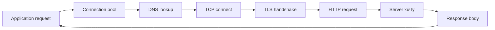
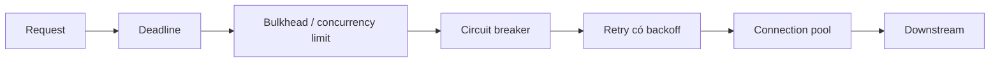

# Xử lý timeout, retry và giới hạn kết nối của client

Một Java client gọi Kubernetes API hoặc một dịch vụ nội bộ không chỉ có trạng thái thành công và thất bại. Request có thể chờ DNS, chờ thiết lập TCP/TLS, chờ connection pool, chờ API server xử lý hoặc chờ response body. Nếu không đặt giới hạn, một sự cố ngắn có thể giữ thread, chiếm connection và tạo thêm retry, rồi lan thành sự cố toàn hệ thống.

Bài học thuộc chương **Kubernetes client** của module **Spring Cloud Kubernetes** (`SPRING_CLOUD_KUBERNETES`). Module tích hợp Spring với Kubernetes qua `DiscoveryClient`, ConfigMap, Secret, Spring Cloud LoadBalancer và Configuration Watcher; vì vậy việc thiết kế timeout, retry và connection limit phải bao phủ cả Kubernetes API client lẫn HTTP client gọi service trong cluster.

Mục tiêu của bài là xây dựng chính sách có thể giải thích và đo được:

- phân biệt các loại timeout trong một request;
- chọn lỗi nào được retry và lỗi nào phải fail fast;
- đặt backoff, jitter, số lần retry và ngân sách thời gian;
- giới hạn connection pool, concurrency và watch;
- tránh retry storm, connection leak và blocking event-loop;
- phối hợp client, LoadBalancer, readiness và Kubernetes API trong cùng một hệ thống.

## 1. Nhìn request như một ngân sách thời gian

Một lời gọi từ `catalog-service` tới Kubernetes API hoặc `inventory-service` thường đi qua nhiều chặng:



Tổng thời gian không chỉ là thời gian server xử lý. Có thể mô hình hóa đơn giản:

```text
Tổng thời gian
  = chờ connection pool
  + DNS
  + TCP
  + TLS
  + gửi request
  + server xử lý
  + đọc response
  + xử lý trong ứng dụng
```

Nếu timeout tổng thể là 2 giây nhưng pool timeout đã dùng 1,8 giây, server chỉ còn rất ít thời gian. Nếu mỗi lần retry lại được cấp 2 giây mà request bên ngoài chỉ cho phép 3 giây, hai lần retry có thể làm hệ thống trả lời sau khi caller đã bỏ cuộc.

Vì vậy, hãy coi deadline của request là ngân sách chung. Các timeout bên trong phải nằm trong deadline đó, và retry phải tính cả thời gian đã tiêu thụ.

## 2. Các loại timeout cần phân biệt

| Loại timeout | Câu hỏi | Hậu quả khi quá hạn |
|---|---|---|
| Pool acquisition | Có lấy được connection rảnh trong thời gian cho phép không? | Bộc lộ concurrency hoặc pool quá nhỏ |
| DNS | Có phân giải được tên không? | Không biết địa chỉ đích |
| Connect | Có mở được TCP connection không? | Network, port hoặc backend có vấn đề |
| TLS handshake | Có hoàn tất bắt tay bảo mật không? | CA, certificate hoặc mạng có vấn đề |
| Write | Có gửi xong request không? | Client/server bị nghẽn hoặc kết nối hỏng |
| Response/header | Server có bắt đầu trả lời không? | Server chậm, queue dài hoặc endpoint lỗi |
| Read/body | Có đọc xong response không? | Body lớn, server stream lâu hoặc connection lỗi |
| Request/deadline | Toàn bộ thao tác có hoàn thành trong ngân sách không? | Dừng chuỗi retry và trả lỗi đúng hạn |

Không phải client nào cũng expose mọi timeout bằng cùng tên. Fabric8, Kubernetes Java Client, WebClient, RestClient và thư viện transport bên dưới có API cấu hình khác nhau theo phiên bản. Nguyên tắc quan trọng là xác định timeout nào đang được cấu hình và metric nào chứng minh nó có hiệu lực.

## 3. Timeout phải phù hợp với vai trò của client

### Client gọi Kubernetes API

Kubernetes API thường phục vụ thao tác điều khiển: đọc ConfigMap, đọc Service, list resource hoặc mở watch. Một request đọc cấu hình lúc khởi động có thể chấp nhận thời gian khác một request nằm trong đường đi HTTP của người dùng.

```text
Khởi động ứng dụng
  → đọc ConfigMap
  → binding bean
  → sẵn sàng nhận traffic
```

Nếu ConfigMap bắt buộc, timeout ngắn và fail fast giúp Pod không trở thành Pod “sống” nhưng sai cấu hình. Nếu ConfigMap là tùy chọn, cần fallback rõ ràng và log không nhạy cảm.

### Client gọi dịch vụ nghiệp vụ

Lời gọi `catalog-service` tới `inventory-service` nằm trong deadline của request người dùng. Timeout phải ngắn hơn thời gian mà người dùng hoặc upstream chấp nhận. Retry không được biến một timeout 500 ms thành một request kéo dài 10 giây.

### Watch client

Watch là kết nối dài hạn nên không dùng cùng một timeout response ngắn như request CRUD. Tuy vậy, watch vẫn cần timeout ở transport, phát hiện kết nối chết, reconnect và cơ chế resync. “Không có event trong một thời gian” không nhất thiết là lỗi; cần phân biệt idle hợp lệ với connection đã mất.

## 4. Chọn giá trị timeout bằng dữ liệu

Không nên bắt đầu bằng một con số quen thuộc rồi áp dụng cho mọi client. Hãy đo latency bình thường và latency khi downstream quá tải.

Một cách suy nghĩ:

```text
timeout client
  > p99 latency bình thường + độ trễ mạng dự kiến
  < deadline của caller
```

Ví dụ, nếu `inventory-service` thường trả trong 80 ms, p99 là 220 ms, caller cho phép 800 ms và có một lần retry, không thể cấp 800 ms cho mỗi attempt. Cần phân bổ cả timeout, backoff và thời gian xử lý response trong 800 ms.

| Thành phần | Câu hỏi cần đo |
|---|---|
| p50/p95/p99 | Downstream thường phản hồi nhanh đến mức nào? |
| Cold start | Kết nối đầu tiên có TLS/DNS chậm bao nhiêu? |
| Pool wait | Bao nhiêu request phải chờ connection? |
| API server | Kubernetes API có latency khác khi list/watch không? |
| Response size | Đọc body lớn mất bao lâu? |
| Retry | Một lỗi tạm thời kéo dài tổng request bao lâu? |

Timeout nên được ghi trong tài liệu vận hành cùng lý do và SLO. Khi thay đổi connection pool hoặc retry, phải xem lại ngân sách timeout.

## 5. Khi nào retry là đúng?

Retry chỉ phù hợp khi lỗi có khả năng tự hồi phục và thao tác có thể lặp lại an toàn. Một số lỗi thường có thể retry:

- mất kết nối TCP trong thời gian ngắn;
- timeout trước khi biết server đã xử lý;
- HTTP 429 khi server cung cấp cách chờ hoặc Retry-After phù hợp;
- một số lỗi 5xx tạm thời;
- watch bị đóng do reconnect hoặc hết phiên.

Một số lỗi thường không nên retry vô hạn:

- `401 Unauthorized` hoặc credential hết hạn;
- `403 Forbidden` do RBAC thiếu quyền;
- `404 Not Found` khi tên resource sai hoặc resource bắt buộc không tồn tại;
- lỗi validation do manifest/request sai;
- parse ConfigMap/Secret thất bại vì dữ liệu không hợp lệ;
- HTTP 4xx thể hiện request nghiệp vụ không thể sửa bằng cách gửi lại.

Retry không sửa được nguyên nhân cố định. Mười lần gửi lại một request bị `Forbidden` chỉ tạo thêm tải và làm chậm việc chẩn đoán.

## 6. Idempotency và rủi ro gửi lại

Đọc ConfigMap, đọc Service hoặc lấy danh sách Pod thường an toàn hơn để retry. Với thao tác thay đổi resource, cần cẩn thận hơn:

```text
GET ConfigMap       → thường có thể retry
LIST Services       → thường có thể retry
WATCH ConfigMap     → reconnect theo policy
CREATE resource     → có thể đã thành công nhưng response bị mất
DELETE resource     → cần xem trạng thái hiện tại
PATCH/UPDATE        → cần resourceVersion và điều kiện cạnh tranh
```

Nếu request `CREATE` timeout sau khi server đã tạo resource, retry mù có thể nhận `AlreadyExists` hoặc tạo tác động phụ hai lần. Với thao tác mutation, nên dùng khóa idempotency nếu API/nghiệp vụ hỗ trợ, đọc lại trạng thái hoặc thiết kế reconciliation thay vì lặp cùng một lệnh không điều kiện.

Trong ứng dụng Spring gọi dịch vụ nghiệp vụ, retry POST chỉ an toàn khi endpoint có hợp đồng idempotency. Retry GET cũng cần xem request có side effect ẩn hay không.

## 7. Backoff và jitter

Retry liên tiếp ngay lập tức khiến nhiều Pod cùng gửi lại trong cùng thời điểm. Đây là retry storm. Backoff làm khoảng cách giữa các attempt tăng dần:

```text
delay(n) = min(cap, base × 2^n) + jitter
```

Ví dụ minh họa:

```text
attempt 1 → chờ khoảng 100 ms + jitter
attempt 2 → chờ khoảng 200 ms + jitter
attempt 3 → chờ khoảng 400 ms + jitter
```

Giá trị cụ thể phải nằm trong deadline và phù hợp với tải. Jitter làm các Pod không đồng loạt retry vào cùng một millisecond.

```java
RetryBackoffSpec policy = Retry
        .backoff(2, Duration.ofMillis(100))
        .maxBackoff(Duration.ofMillis(500))
        .jitter(0.5)
        .filter(this::isTransientFailure);
```

Đây là ví dụ reactive; API thực tế và điều kiện phân loại lỗi cần khớp project. Với client blocking, dùng cơ chế retry tương ứng nhưng giữ cùng nguyên tắc: số attempt hữu hạn, backoff, jitter và filter lỗi.

## 8. Retry phải biết deadline

Một policy retry độc lập với deadline dễ tạo ra hành vi khó đoán. Hãy mô hình hóa:

```text
deadline của caller
  = timeout attempt 1
  + backoff 1
  + timeout attempt 2
  + thời gian xử lý/fallback
```

Nếu đã tiêu thụ gần hết deadline, không bắt đầu attempt mới. Trong request chain nhiều tầng, timeout của tầng ngoài phải lớn hơn tổng timeout của tầng trong cộng overhead; nếu mọi tầng đều retry, tích số attempt có thể tăng mạnh.

Ví dụ ba tầng đều retry tối đa ba lần có thể tạo tới 27 lời gọi ở trường hợp xấu. Vì vậy, nên quyết định retry ở một tầng có đủ ngữ cảnh, hoặc giảm retry ở các tầng bên dưới.

## 9. Connection pool và giới hạn concurrency

Connection pool tái sử dụng kết nối nhưng không phải vô hạn. Có ba giới hạn cần tách:

| Giới hạn | Ý nghĩa |
|---|---|
| Max connections per host | Số kết nối đồng thời tới một API/server đích |
| Max total connections | Tổng kết nối của client tới mọi host |
| Pending acquisition | Số request được phép chờ connection rảnh |

Nếu pool quá nhỏ, request chờ pool dù server còn khả năng xử lý. Nếu pool quá lớn, client có thể làm server, node hoặc network quá tải. Pending queue không giới hạn là một dạng memory pressure và latency ẩn.

```text
request burst
  → pool đầy
  → request chờ acquisition
  → pool timeout hoặc deadline hết
```

Connection limit phải được tính cùng số replica:

```text
tổng kết nối tiềm năng
  ≈ số Pod ứng dụng × max connection mỗi Pod × số downstream
```

Con số này chưa kể watcher, health check, connection của metrics hoặc các client khác. Khi scale Deployment từ 2 lên 20 replica, tổng kết nối có thể tăng gấp mười dù cấu hình mỗi Pod không đổi.

## 10. Pool timeout khác connect timeout

Một lỗi “timeout” có thể xảy ra trước khi client cố kết nối:

```text
pool acquisition timeout
  ≠ DNS timeout
  ≠ TCP connect timeout
  ≠ server response timeout
```

Nếu metric chỉ ghi “request timeout”, bạn có thể tăng timeout sai chỗ. Hãy phân loại thời gian:

- `connection.pending` hoặc thời gian chờ pool;
- DNS lookup duration;
- connect duration;
- TLS duration;
- time to first byte;
- response body duration;
- total request duration.

Các tên metric phụ thuộc transport. Nếu client không expose từng pha, hãy dùng tracing hoặc log timing có kiểm soát ở adapter.

## 11. Keep-alive và kết nối nhàn rỗi

Kết nối keep-alive giảm chi phí handshake nhưng có thể bị load balancer, proxy hoặc API server đóng khi idle. Client cần xử lý connection stale bằng pool eviction, idle timeout hoặc retry kết nối phù hợp.

Kết nối nhàn rỗi quá lâu có thể khiến attempt đầu tiên nhận reset, trong khi các attempt sau thành công. Điều đó khác với server đang chậm. Hãy quan sát:

```text
idle connection bị đóng
  → client phát hiện khi ghi/đọc
  → loại bỏ connection hỏng
  → mở connection mới
  → retry nếu thao tác an toàn và còn deadline
```

Không tắt keep-alive một cách mặc định để chữa mọi lỗi. Tắt có thể làm tăng CPU, TLS handshake và áp lực lên API server. Cần chọn idle policy dựa trên hạ tầng mạng và pattern traffic.

## 12. Kubernetes API client: CRUD và watch không giống nhau

Client gọi `get` ConfigMap là request ngắn. Watch ConfigMap là kết nối dài hạn và có vòng đời khác:

| Loại | Timeout | Retry/reconnect | Connection limit |
|---|---|---|---|
| `get`/`list` | Request/deadline ngắn | Retry lỗi tạm thời | Dùng pool chung hoặc pool được thiết kế |
| `create`/`patch` | Theo mutation và idempotency | Thận trọng vì server có thể đã áp dụng | Giới hạn để tránh burst mutation |
| `watch` | Transport/idle và detect disconnect | Reconnect + resync | Giới hạn số watch theo resource/namespace |

Không tạo một watch mới cho mỗi HTTP request. Một ứng dụng theo dõi ba ConfigMap nên có số watch ổn định theo thiết kế, không tăng theo số client gọi endpoint.

Khi watch mất kết nối, client cần lấy lại trạng thái hiện tại trước hoặc trong quá trình tiếp tục event. Nếu cache bị stale quá lâu, ứng dụng có thể dùng cấu hình cũ mà không biết.

## 13. Retry và Configuration Watcher

Configuration Watcher có thể theo dõi ConfigMap/Secret và khởi phát refresh hoặc rollout. Timeout/retry của watcher cần tách khỏi timeout request người dùng:

```text
Watcher
  → watch connection dài hạn
  → reconnect khi connection đóng
  → resync trạng thái hiện tại
  → phát thông báo thay đổi

Request nghiệp vụ
  → timeout ngắn theo SLO
  → retry hữu hạn theo idempotency
```

Không dùng retry policy của HTTP request trực tiếp cho watch. Watch có thể retry reconnect nhiều lần trong thời gian dài, nhưng phải có backoff, log mức phù hợp và cơ chế báo trạng thái stale. Request nghiệp vụ phải trả lời đúng deadline.

Khi watcher phát hiện thay đổi, việc refresh bean cũng có thể tạo burst connection nếu nhiều bean cùng khởi tạo client mới. Nên tái sử dụng client và kiểm soát concurrency khi refresh.

## 14. MVC, WebFlux và blocking client

### Servlet/MVC

Client blocking phù hợp tự nhiên với servlet thread, nhưng mỗi request chờ I/O sẽ giữ một thread. Nếu retry và pool queue tăng, thread pool có thể cạn:

```text
thread pool đầy
  → request chờ thread
  → thread chờ connection
  → connection chờ server
  → timeout dây chuyền
```

Đặt giới hạn cho cả thread pool, connection pool và pending request. Đừng chỉ tăng số thread để che latency downstream.

### WebFlux/reactive

Client reactive có thể dùng event-loop hiệu quả cho I/O, nhưng thao tác blocking phải được cô lập. Không gọi `.block()` trong request path. Nếu dùng Java client blocking để đọc Kubernetes API, bọc trên scheduler phù hợp và giới hạn concurrency:

```java
Mono<ConfigMap> readSettings() {
    return Mono.fromCallable(() -> kubernetesClient
                    .configMaps()
                    .inNamespace("shop")
                    .withName("catalog-settings")
                    .get())
            .subscribeOn(Schedulers.boundedElastic())
            .timeout(Duration.ofSeconds(2));
}
```

Scheduler bounded không phải một pool vô hạn. Nếu nhiều request cùng chờ client blocking, vẫn cần semaphore hoặc bulkhead để bảo vệ tài nguyên.

## 15. Spring Cloud LoadBalancer và retry

Khi dùng Spring Cloud LoadBalancer, có thể có nhiều lớp quyết định retry:

```text
controller
  → HTTP client
  → LoadBalancer chọn instance
  → retry của client/load balancer
  → inventory-service
```

Nếu mỗi lớp tự retry, một request có thể gọi nhiều instance hơn dự kiến. Hãy xác định:

- retry xảy ra trước hay sau khi chọn instance;
- retry cùng instance hay chọn instance khác;
- lỗi nào được coi là lỗi transport, lỗi HTTP và lỗi nghiệp vụ;
- deadline truyền qua các lớp hay bị reset;
- metrics đếm attempt hay đếm logical request.

Một instance readiness false có thể bị loại khỏi tập backend, nhưng cache discovery hoặc load balancer có thể cập nhật sau độ trễ. Retry không thay thế kiểm tra readiness và không được dùng để che selector hoặc port sai.

## 16. Circuit breaker, bulkhead và rate limit

Timeout và retry là nền tảng nhưng chưa đủ khi downstream hỏng kéo dài.

- **Circuit breaker** ngăn gửi request tới đích đang liên tục lỗi trong một khoảng thời gian.
- **Bulkhead** giới hạn số request đang chờ tới một dependency để lỗi không chiếm hết tài nguyên.
- **Rate limit** giới hạn tốc độ request theo caller hoặc dependency.
- **Load shedding** từ chối sớm khi hệ thống không còn capacity.



Đặt circuit breaker sau hay trước LoadBalancer phụ thuộc mục tiêu. Breaker theo logical service có thể ngắt toàn bộ đích khi dịch vụ chung hỏng; breaker theo instance giúp loại một instance lỗi nhưng cần nhiều state hơn. Hãy chọn theo topology và metric.

## 17. Các lỗi cấu hình hay gặp

### Timeout lớn để giảm lỗi

Timeout lớn làm tỷ lệ timeout giảm trên dashboard trong ngắn hạn nhưng tăng request đang chờ, thread/connection bị giữ và thời gian phục hồi. Hãy tìm chặng chậm và đặt timeout theo SLO.

### Retry tất cả exception

Retry `Forbidden`, validation error hoặc parse error chỉ tăng tải. Filter theo loại lỗi và HTTP status.

### Pool lớn hơn khả năng server

Mỗi Pod có 100 connection, 20 Pod có thể tạo 2.000 connection tới Kubernetes API hoặc database. API server và proxy có thể quá tải trước khi client thấy lỗi.

### Không có pool acquisition timeout

Request nằm trong queue vô hạn, latency tăng nhưng không có lỗi rõ ràng. Luôn giới hạn số request chờ pool.

### Watch reconnect không có jitter

Khi nhiều Pod mất watch cùng lúc, tất cả reconnect đồng loạt. Backoff và jitter giúp tránh burst.

### Retry mutation không idempotent

Timeout không cho biết server đã xử lý hay chưa. Gửi lại CREATE/PATCH có thể tạo tác động kép hoặc xung đột resourceVersion.

### Cấu hình client nhưng không kiểm tra transport thật

Ứng dụng có thể cấu hình một builder nhưng Spring Cloud Kubernetes hoặc HTTP client lại tạo transport khác. Cần xác định bean/transport đang được sử dụng và kiểm chứng bằng metric hoặc log timing.

## 18. Thiết kế policy minh họa

Giả sử `catalog-service` cần đọc ConfigMap lúc khởi động, theo dõi thay đổi và gọi `inventory-service` trong request path. Một policy minh họa:

| Luồng | Timeout | Retry | Pool/concurrency |
|---|---|---|---|
| Đọc ConfigMap khởi động | 2–5 giây theo SLO khởi động | Vài attempt lỗi transport, fail fast với RBAC | Pool nhỏ, không tạo theo request |
| Watch ConfigMap | Kết nối dài hạn + detect disconnect | Backoff/jitter + resync | Một watch có kiểm soát cho resource cần thiết |
| Gọi inventory | Theo deadline request | 1–2 attempt lỗi transient nếu idempotent | Bulkhead và pool theo capacity downstream |
| Discovery list | Timeout ngắn theo cache policy | Retry hạn chế | Cache và refresh không đồng loạt |
| Health check | Timeout rất ngắn | Thường không retry dài | Không để health check chiếm pool nghiệp vụ |

Đây không phải bộ số mặc định. Giá trị phải được đo bằng latency thực tế, số replica, capacity API server, SLO và traffic pattern.

## 19. Quan sát để biết policy có hiệu lực

Metric nên phân biệt ít nhất:

- logical request và số attempt;
- timeout ở pool, connect, response và deadline;
- số request đang chờ connection;
- active/idle connection theo host;
- retry theo nguyên nhân và status;
- circuit breaker open/half-open/closed;
- watch active, reconnect, stale duration và resync;
- số request API Kubernetes theo resource/verb;
- latency p50/p95/p99 và lỗi theo Pod/instance.

Log nên có request ID, resource/namespace không nhạy cảm, attempt number và elapsed time. Không log token, Secret value hoặc toàn bộ Authorization header.

Trace giúp trả lời câu hỏi: thời gian nằm ở pool, DNS, connect, server hay retry? Nếu trace chỉ có một span tổng, việc tăng timeout sẽ dựa trên phỏng đoán.

## 20. Quy trình kiểm thử

Một bài kiểm thử thực tế nên mô phỏng:

1. API server hoặc downstream trả lời nhanh.
2. DNS chậm hoặc không phân giải được.
3. TCP connect timeout và connection reset.
4. Server trả 429, 500, 403 và 404.
5. Response chậm hơn deadline.
6. Pool đầy và request chờ acquisition.
7. Watch đóng, reconnect và resync.
8. Nhiều Pod cùng retry sau một sự cố.
9. Scale số replica làm tổng connection tăng.
10. WebFlux gọi một operation blocking để xác nhận event-loop được bảo vệ.

Kết quả cần đo là latency, số attempt, số connection, tải server và trạng thái cuối cùng. Một test chỉ kiểm tra “có trả lỗi hay không” chưa đủ để xác nhận policy chống retry storm.

## 21. Checklist triển khai

- [ ] Có deadline rõ cho mỗi đường gọi.
- [ ] Phân biệt pool, connect, response và total timeout.
- [ ] Retry chỉ áp dụng cho lỗi transient và thao tác an toàn.
- [ ] Có số attempt tối đa, backoff, jitter và deadline budget.
- [ ] Mutation có idempotency hoặc reconciliation phù hợp.
- [ ] Connection pool có max size và acquisition timeout.
- [ ] Tổng connection được tính theo số replica và số downstream.
- [ ] Watch có reconnect, resync, close và giới hạn số lượng.
- [ ] WebFlux không chạy blocking client trên event-loop.
- [ ] LoadBalancer không tạo thêm lớp retry ngoài ý muốn.
- [ ] Có metric về pool wait, attempt, timeout và stale watch.
- [ ] Health check không dùng retry dài hoặc chiếm pool nghiệp vụ.
- [ ] Không log Secret, token hay header nhạy cảm.

## 22. Kết luận

Timeout đặt giới hạn thời gian, retry giúp vượt qua một số lỗi tạm thời, còn connection limit bảo vệ client và server khỏi quá tải. Ba cơ chế phải được thiết kế cùng nhau: retry không được vượt deadline, pool không được vượt capacity của downstream và watch không được dùng policy của request ngắn.

Trong Spring Cloud Kubernetes, hãy tách rõ đọc ConfigMap/Secret, discovery, watch và gọi dịch vụ nghiệp vụ. Chọn timeout theo vai trò, phân loại lỗi theo khả năng hồi phục, dùng backoff có jitter, bảo đảm idempotency và theo dõi từng pha của request. Khi scale Pod, tính lại tổng connection và retry load; khi dùng WebFlux, cô lập mọi thao tác blocking.

Một client đáng tin cậy không phải client luôn retry cho tới khi thành công. Đó là client biết khi nào chờ, khi nào thử lại, khi nào dừng sớm và cách trả lỗi để hệ thống còn lại có thể phục hồi.
