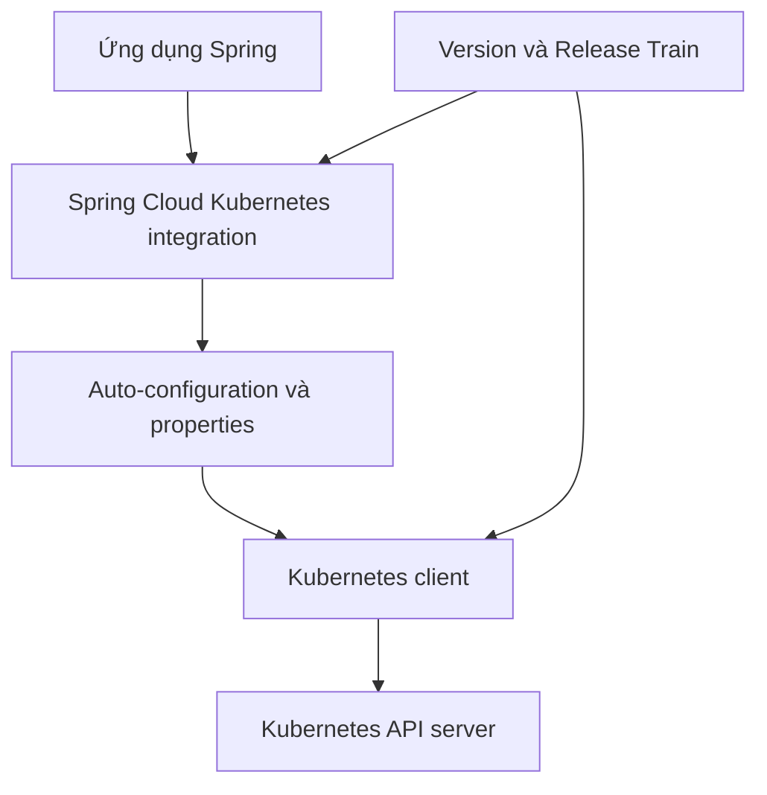
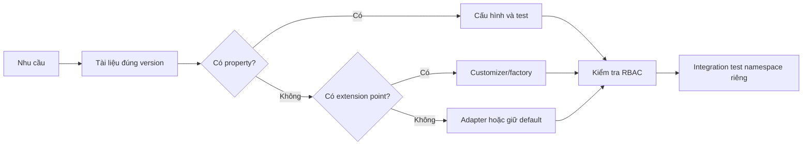

# Khả năng tùy biến client và giới hạn theo bản phát hành

## 1. Tùy biến client có phạm vi

Trong `SPRING_CLOUD_KUBERNETES`, starter kết nối ứng dụng Spring với Kubernetes thông qua một lớp integration và một Kubernetes client. Ứng dụng có thể cần tùy biến namespace, authentication, TLS, timeout, retry, watch hoặc transport, nhưng mỗi điểm đều phụ thuộc vào version Spring Boot, Spring Cloud, Spring Cloud Kubernetes và client implementation đang dùng.



Ba lớp cần được phân biệt:

- Ứng dụng quyết định nhu cầu như DiscoveryClient, ConfigMap, Secret, Spring Cloud LoadBalancer hoặc Configuration Watcher.
- Lớp integration tạo abstraction, bean và cách gọi Kubernetes API.
- Kubernetes client đảm nhiệm model resource, transport, TLS và một phần authentication.

Không phải mọi bean, property hoặc class transitively được kéo vào đều là API ổn định. Một cách tùy biến chạy ở bản phát hành này có thể không còn đúng sau khi đổi Release Train hoặc đổi client implementation.

## 2. Khóa contract của bản phát hành

Trước khi viết cấu hình client, ghi rõ:

| Thành phần | Cần xác định |
| --- | --- |
| JDK | Compiler và runtime trong image |
| Spring Boot | Dòng và patch |
| Spring Cloud | Release Train tương thích |
| Spring Cloud Kubernetes | Module và patch |
| Kubernetes client | Implementation và version được kéo |
| Cluster | API, authentication và policy |
| Starter | Artifact, auto-configuration và properties |

Quy trình chọn contract là: chọn Boot và Cloud trong ma trận tương thích; chọn dòng Spring Cloud Kubernetes được hỗ trợ; xác định client implementation; đọc configuration reference và migration notes; rồi kiểm tra dependency tree.

Không chọn property hoặc bean theo một bài hướng dẫn thuộc dòng version khác mà không đối chiếu tài liệu hiện tại. Tên class có thể giống nhau nhưng package, constructor, default hoặc cơ chế đăng ký bean có thể thay đổi.

## 3. Các điểm tùy biến thường gặp

| Nhóm | Ví dụ | Rủi ro |
| --- | --- | --- |
| Namespace | Namespace mặc định hoặc phạm vi nhiều namespace | Đọc nhầm môi trường hoặc thiếu quyền |
| Authentication | ServiceAccount, token, certificate | Lộ Secret hoặc client không xác thực |
| TLS | CA, trust store, hostname verification | Handshake lỗi hoặc giảm an toàn |
| Timeout | Connect, read, request timeout | Startup chậm hoặc request treo |
| Retry | Backoff, số lần, loại lỗi | Tăng tải API hoặc lặp thao tác |
| Watch | Resource, reconnect, resync | Mất event hoặc refresh sai phạm vi |
| Transport | Pool, proxy, compression | Khác biệt local và cluster |
| Serialization | Model resource và API version | Không tương thích server |

Không phải nhóm nào cũng được cấu hình bằng property. Một số cần customizer, factory hoặc bean extension point. Nếu extension point không được công bố, thay thế bean nội bộ là rủi ro nâng cấp.

## 4. Namespace và authentication

Discovery hoặc configuration integration có thể đọc namespace hiện tại, một namespace chỉ định hoặc nhiều namespace tùy version. Thiết kế an toàn thường bắt đầu bằng một namespace cụ thể rồi chỉ mở rộng khi có yêu cầu.

```yaml
apiVersion: v1
kind: ServiceAccount
metadata:
  name: order-service
  namespace: orders-test
---
apiVersion: apps/v1
kind: Deployment
metadata:
  name: order-service
  namespace: orders-test
spec:
  template:
    spec:
      serviceAccountName: order-service
      containers:
        - name: order-service
          image: registry.example.invalid/team/order-service:replace-me
```

Trong Pod, client thường dùng danh tính ServiceAccount. Không copy token production vào source hoặc image. Khi dùng token cho local, token phải thuộc secret store dành cho máy phát triển và có scope nhỏ.

Namespace không tự cấp quyền. Role, RoleBinding, ServiceAccount và phạm vi resource mới quyết định client được đọc gì. Kubeconfig local cũng không phải bằng chứng Pod production dùng cùng identity.

## 5. TLS, proxy và transport

Kubernetes API thường dùng HTTPS. Tùy biến CA, trust store hoặc proxy có thể cần khi cluster dùng CA riêng hoặc môi trường bắt buộc proxy. Tắt hostname verification để chữa lỗi local làm giảm an toàn và che nguyên nhân certificate.

Cần kiểm tra:

- CA được đọc từ đâu và có đúng cluster không.
- Hostname trong certificate có khớp endpoint không.
- Proxy có áp dụng cho API server không.
- Connection pool có được đóng khi application context dừng không.
- Connect timeout và read timeout có được tách không.
- Log có in token hoặc header authorization không.

Extension point cho transport phụ thuộc client implementation. Không truyền một HTTP client của thư viện khác vào factory nếu starter yêu cầu loại client cụ thể. Dùng property, bean hoặc customizer được version công bố.

## 6. Timeout và retry

API server là dependency ngoài tiến trình. Timeout giúp ứng dụng fail rõ ràng thay vì treo startup hoặc giữ request vô hạn. Retry cần phân biệt lỗi tạm thời với lỗi cấu hình và quyền.

| Lỗi | Retry có thể phù hợp? | Lưu ý |
| --- | --- | --- |
| Kết nối tạm thời reset | Có thể | Backoff và tổng thời gian giới hạn |
| API server bận | Có thể | Tránh mọi Pod retry cùng lúc |
| `403 Forbidden` | Thường không | Kiểm tra RBAC |
| `401 Unauthorized` | Thường không | Kiểm tra token hoặc certificate |
| Resource không tồn tại | Thường không | Kiểm tra tên và namespace |
| Validation lỗi | Không | Sửa request hoặc API model |

Discovery và watcher có thể tạo nhiều request nền. Retry nhanh từ mọi Pod có thể làm API server quá tải. Dùng backoff, jitter và giới hạn retry theo khả năng của version.

Retry cũng ảnh hưởng logic. Đọc resource có thể an toàn hơn thao tác ghi; reconnect watcher khác request nghiệp vụ. Không dùng một policy chung cho mọi request nếu không hiểu side effect.

## 7. Watch và Configuration Watcher

Watcher có thể giữ event stream hoặc reconnect khi resource thay đổi. Kết nối có thể bị đóng bởi API server, proxy, NetworkPolicy hoặc timeout. Thiết kế watcher phải trả lời:

1. Resource và namespace nào được theo dõi?
2. Thành phần nào nhận event?
3. Event bị mất có được bù bằng list hoặc resync không?
4. Reconnect dùng backoff nào?
5. Khi refresh bean lỗi, hệ thống giữ giá trị cũ hay fail?
6. Khi shutdown, watcher có được đóng không?

Không giả định mọi bản phát hành có cùng semantics. Một version có thể chạy watcher trong process; version khác có thể dùng Configuration Watcher riêng. Kiểm tra migration notes trước khi đổi cấu trúc.

Đổi ConfigMap không làm biến môi trường hiện có tự đổi. Nếu integration đọc ConfigMap hoặc Secret qua API, RBAC phải cho phép thao tác cần thiết. Nếu refresh bean không an toàn, rollout Pod thường dễ quan sát hơn.

## 8. Tùy biến bean client

Trước khi định nghĩa bean client, xác định đó là public extension point hay bean nội bộ. Ưu tiên property được tài liệu hỗ trợ; tiếp theo là customizer hoặc factory được công bố.

Nguyên tắc:

- Ghi rõ version mà custom code phụ thuộc.
- Không thay bean nội bộ chỉ vì thấy tên trong log.
- Kiểm tra `@ConditionalOnMissingBean` và điều kiện auto-configuration.
- Test cả trường hợp auto-configuration bật và tắt.
- Đóng resource và watcher khi application context dừng.
- Cấp RBAC theo thao tác thực tế.

Custom bean có thể khiến auto-configuration không tạo bean mặc định nữa. Điều này hữu ích khi có chủ ý nhưng dễ làm nâng cấp silently đổi behavior. Nếu startup lỗi sau nâng version, kiểm tra condition và thứ tự configuration trước khi thêm exclude.

Nếu không có extension point công bố, hãy giữ default hoặc tạo adapter ở phía ứng dụng. Adapter giúp che client implementation khỏi code nghiệp vụ và giảm phạm vi ảnh hưởng khi nâng version.

## 9. Mock client và test integration

Unit test không cần Kubernetes client thật. Mock abstraction mà service dùng hoặc fake adapter. Integration test mới kiểm tra HTTP, TLS, serialization, namespace và RBAC thật.

```java
class ServiceDiscoveryAdapterTest {
    // Mock abstraction discovery để kiểm tra fallback và timeout logic
}
```

Không mock sâu từng class nội bộ của client nếu mục tiêu là integration; test sẽ phụ thuộc package và constructor có thể đổi theo version. Mock ở ranh giới mà ứng dụng sở hữu, dùng cluster test cho hành vi thật.

Trong test context, nếu starter tự tạo client khi không có cluster, dùng profile hoặc cơ chế disable được version hỗ trợ. Không tự đặt một property mà starter không đọc chỉ để làm test xanh.

## 10. Discovery và LoadBalancer

DiscoveryClient có thể trả danh sách ServiceInstance cho Spring Cloud LoadBalancer. Khi custom client hoặc filter discovery, cần xác định địa chỉ là Service, Pod hay endpoint khác.

```text
DiscoveryClient → danh sách ServiceInstance
                    ↓
Spring Cloud LoadBalancer → chọn instance
                    ↓
HTTP client → endpoint đã chọn
```

Test cần kiểm tra instance không ready có bị loại, port lấy từ đâu, namespace có đúng, danh sách rỗng xử lý thế nào và retry HTTP có nhân với retry discovery không.

Đừng dùng customizer để che một mô hình endpoint không rõ. Nếu Service DNS đã đáp ứng, không cần thêm discovery client chỉ vì ứng dụng chạy trong Kubernetes.

## 11. ConfigMap, Secret và RBAC

Đọc ConfigMap hoặc Secret qua env/volume và đọc qua API là hai đường khác nhau. Đường env/volume do Pod spec và kubelet phân phối; ứng dụng không cần quyền API chỉ để đọc giá trị đã được mount.

Nếu client đọc API, Role cần giới hạn resource và verb:

```yaml
apiVersion: rbac.authorization.k8s.io/v1
kind: Role
metadata:
  name: order-config-reader
  namespace: orders-test
rules:
  - apiGroups: [""]
    resources: ["configmaps"]
    resourceNames: ["order-settings"]
    verbs: ["get"]
```

Watcher có thể cần `watch` và có thể cần `list` để resync. Quyền chính xác phụ thuộc starter và cấu hình. Không cấp `cluster-admin` chỉ để sửa `403`.

Secret không được in vào log, annotation hoặc error message. Client tùy biến không làm Secret tự an toàn; RBAC, bảo vệ lưu trữ và xử lý trong ứng dụng vẫn cần thiết.

## 12. Giới hạn theo bản phát hành

Một bản phát hành có thể thay đổi:

| Hạng mục | Tác động |
| --- | --- |
| Tên starter | Artifact không tồn tại hoặc module khác được dùng |
| Property | Cấu hình bị bỏ qua hoặc không bind |
| Client implementation | Bean, model và transport khác |
| Namespace handling | Phạm vi discovery/config thay đổi |
| Watcher architecture | In-process hoặc thành phần riêng |
| Default timeout | Startup và retry khác |
| RBAC requirement | Resource hoặc verb cần cấp khác |
| Extension point | Customizer cũ không còn được gọi |

Khi nâng version, đọc migration notes và configuration reference thay vì chỉ sửa version trong file build. Sau đó kiểm tra startup log, dependency tree, RBAC, discovery và test integration.

Không dựa vào class internal để giữ compatibility. Nếu cần behavior ổn định qua nhiều release, tạo adapter của ứng dụng và tập trung dependency vào adapter.

## 13. Dependency management

BOM giúp các module Spring Cloud dùng mặt bằng version đã thiết kế. Khi thêm client trực tiếp, kiểm tra nó có được BOM quản lý hay không. Pin một transitive client lên version khác có thể làm compile thành công nhưng runtime lỗi method hoặc model.

```xml
<dependencyManagement>
    <dependencies>
        <dependency>
            <groupId>org.springframework.cloud</groupId>
            <artifactId>spring-cloud-dependencies</artifactId>
            <version>CLOUD_TRAIN_VERSION</version>
            <type>pom</type>
            <scope>import</scope>
        </dependency>
    </dependencies>
</dependencyManagement>
```

Dependency trực tiếp của client chỉ nên xuất hiện khi ứng dụng thật sự gọi API hoặc cần extension được tài liệu yêu cầu. Nếu starter đã cung cấp client, không thêm bản thứ hai để ép version.

Các lệnh xem graph được nêu để người phát triển thực hiện trong môi trường build phù hợp:

```text
Maven:  mvn dependency:tree
Gradle: ./gradlew dependencies
```

## 14. Quan sát và chẩn đoán

| Hiện tượng | Kiểm tra |
| --- | --- |
| App không khởi động local | Auto-configuration, profile và client bật ngoài ý muốn |
| `NoSuchBeanDefinition` | Starter thiếu, bean bị exclude hoặc implementation lệch |
| `NoSuchMethodError` | Hai version client/Spring cùng xuất hiện |
| `403 Forbidden` | ServiceAccount, Role, namespace và resource |
| TLS handshake lỗi | CA, hostname, trust store và proxy |
| Discovery rỗng | Namespace, selector, readiness và quyền |
| Watcher không refresh | Resource scope, reconnect, event và bean áp dụng |
| API request treo | Timeout transport, proxy và retry |

Log nên chứa loại thao tác, resource và namespace ở mức an toàn. Không ghi token, Secret hoặc response nhạy cảm. Health endpoint phải phản ánh dependency theo mục tiêu vận hành, không biến mọi lỗi API tạm thời thành restart hàng loạt.

## 15. Quy trình tùy biến an toàn



1. Mô tả behavior cần thay đổi bằng test hoặc yêu cầu đo được.
2. Kiểm tra property trong đúng version.
3. Nếu không đủ, tìm extension point công bố.
4. Giữ một client implementation.
5. Kiểm tra BOM và dependency tree.
6. Cấp RBAC tối thiểu.
7. Test local, integration và rollback.
8. Ghi version contract cùng custom code.

Ép bean nội bộ thường tiết kiệm ít thời gian lúc đầu nhưng tạo chi phí lớn khi nâng version. Nếu behavior đặc biệt không được hỗ trợ, adapter riêng thường bền hơn.

## 16. Tự kiểm tra

### Có thể thay Kubernetes client bằng bất kỳ thư viện Java nào không?

Không. Starter và integration có contract với implementation, model và factory cụ thể. Thay client cần extension point hoặc adapter được thiết kế rõ.

### Vì sao property hoạt động ở bản cũ nhưng bị bỏ qua ở bản mới?

Property có thể đổi tên, đổi namespace cấu hình hoặc bị thay bằng cơ chế khác. Cần đọc migration notes và configuration reference của bản hiện tại.

### Timeout có chỉ là vấn đề performance không?

Không. Timeout quyết định fail nhanh hay treo, ảnh hưởng readiness, retry và tải API server.

### Có nên cấp quyền cluster để watcher hoạt động không?

Không mặc định. Xác định resource và namespace watcher cần theo dõi rồi cấp quyền hẹp nhất có thể.

### Khi nào nên viết adapter riêng?

Khi ứng dụng cần behavior ổn định qua nhiều phiên bản hoặc muốn che implementation client khỏi code nghiệp vụ. Adapter tập trung dependency và giúp nâng cấp dễ kiểm soát.

## Kết luận

Khả năng tùy biến Kubernetes client luôn bị giới hạn bởi bản phát hành. Ưu tiên property được hỗ trợ, tiếp theo là extension point công bố; tránh thay bean nội bộ hoặc đưa nhiều implementation client vào cùng ứng dụng.

Giữ một client implementation, quản lý version bằng BOM, cấp RBAC theo thao tác và kiểm tra timeout, TLS, namespace, watch, discovery cùng refresh. Khi cần behavior đặc biệt, adapter của ứng dụng thường bền hơn việc phụ thuộc chi tiết nội bộ của starter. Cách làm này giúp `SPRING_CLOUD_KUBERNETES` dễ nâng cấp, dễ chẩn đoán và giữ đúng phạm vi tích hợp cần thiết.

