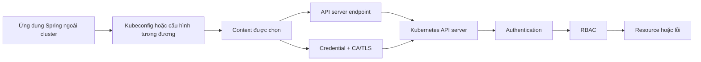
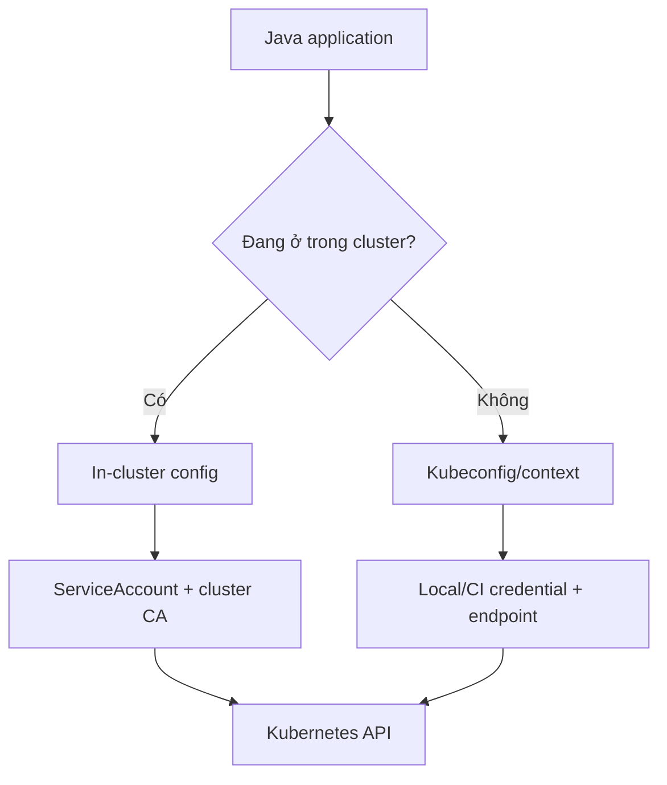

# Kubeconfig và context khi chạy ứng dụng ngoài cluster

Khi ứng dụng Spring chạy trong Kubernetes, Java client thường có thể dùng thông tin in-cluster và ServiceAccount của Pod. Khi chạy trên máy phát triển, trong CI hoặc trong một job bên ngoài cluster, ứng dụng không còn được cung cấp mặc định các thông tin đó. Nó cần biết API server nào, dùng credential nào, CA nào và namespace nào.

**Kubeconfig** là tài liệu cấu hình các cluster, user/credential và context. **Context** là lựa chọn kết hợp một cluster, một user và một namespace mặc định. Hiểu đúng hai khái niệm này giúp ứng dụng Spring Cloud Kubernetes gọi đúng API server và tránh dùng nhầm credential production.

Bài học thuộc chương **Kết nối Kubernetes API** của module **Spring Cloud Kubernetes** (`SPRING_CLOUD_KUBERNETES`). Module học tích hợp ứng dụng Spring với Kubernetes qua `DiscoveryClient`, ConfigMap, Secret, Spring Cloud LoadBalancer và Configuration Watcher; bài này tập trung vào trường hợp client Java chạy ngoài cluster và cần đọc cấu hình Kubernetes một cách an toàn, có thể kiểm tra.

## 1. Kubeconfig chứa những gì?

Một kubeconfig thường có ba nhóm dữ liệu:

| Nhóm | Vai trò | Ví dụ |
|---|---|---|
| `clusters` | Địa chỉ API server và thông tin CA/TLS | `https://api.dev.example` |
| `users` | Credential hoặc cơ chế lấy credential | token, client certificate, exec plugin |
| `contexts` | Ghép cluster, user và namespace | `dev-catalog` |

Ví dụ rút gọn:

```yaml
apiVersion: v1
kind: Config
clusters:
  - name: shop-dev
    cluster:
      server: https://api.dev.example.invalid:6443
      certificate-authority-data: BASE64_CA_DATA
users:
  - name: catalog-reader
    user:
      token: REDACTED
contexts:
  - name: shop-dev-catalog
    context:
      cluster: shop-dev
      user: catalog-reader
      namespace: shop
current-context: shop-dev-catalog
```

Kubeconfig không phải lúc nào cũng chứa token tĩnh. User có thể dùng client certificate, dữ liệu được mã hóa bởi công cụ quản lý credential hoặc `exec` plugin trả credential tạm thời. Cách xác thực phụ thuộc cluster và tổ chức.

Không commit kubeconfig thật vào repository, không đưa token production vào image và không in toàn bộ kubeconfig vào log. Ngay cả trường `certificate-authority-data` không phải secret theo cùng nghĩa token, nhưng toàn bộ file thường chứa thông tin nhạy cảm về endpoint và danh tính.

## 2. Context là lựa chọn triển khai, không phải một cluster mới

Một file có thể chứa nhiều cluster và user:

```text
context shop-dev-catalog
  → cluster shop-dev
  → user catalog-reader
  → namespace shop

context shop-prod-readonly
  → cluster shop-prod
  → user audit-reader
  → namespace shop
```

Context giúp công cụ và client chọn một bộ cấu hình. Đổi context có thể đổi cả API server lẫn credential. Đây là rủi ro lớn khi thao tác từ máy có nhiều môi trường.

Ứng dụng Java không nên âm thầm phụ thuộc vào “current context” của máy developer cho mọi môi trường. Khi chạy local, có thể dùng context để thuận tiện; khi chạy CI, nên chỉ định file hoặc context rõ ràng qua cấu hình pipeline. Khi tạo một tool quản trị, hãy hiển thị cluster/namespace đã chọn trong log an toàn để người vận hành nhận ra đích.

## 3. Namespace trong context hoạt động thế nào?

Namespace trong context thường là namespace mặc định cho request khi client không chỉ rõ namespace. Nó không cấp quyền và cũng không giới hạn tuyệt đối mọi request của client.

```text
context.namespace = shop
  → client gọi resource namespaced mà không truyền namespace
  → dùng shop theo cấu hình client
```

Một user vẫn có thể có quyền đọc namespace khác nếu RBAC cho phép. Ngược lại, context đặt `shop` không giúp client đọc được resource nếu user không có quyền.

Để tránh nhầm:

- xem namespace như default của request, không phải security boundary;
- adapter nghiệp vụ nên chỉ rõ namespace theo cấu hình đã kiểm soát;
- không lấy namespace từ input người dùng rồi ghép trực tiếp vào request quản trị;
- kiểm tra namespace thực tế khi test local, CI và production.

Nếu Spring Cloud Kubernetes được cấu hình đọc ConfigMap trong `shop`, một kubeconfig đang có context mặc định `default` có thể làm client đọc sai nơi hoặc nhận `NotFound`. Nếu context trỏ production nhưng tên resource giống development, ứng dụng có thể đọc dữ liệu hợp lệ từ sai cluster — đây là lỗi nguy hiểm hơn một lỗi kết nối rõ ràng.

## 4. Luồng kết nối ngoài cluster

Một Java client ngoài cluster thường đi theo luồng:



Cả năm chặng đều có thể gây lỗi:

1. Client không tìm thấy file kubeconfig.
2. Context không tồn tại hoặc chọn sai.
3. DNS, proxy, firewall hoặc route không tới API server.
4. TLS/CA hoặc credential không hợp lệ.
5. User đã xác thực nhưng không có quyền RBAC.

Một lỗi `Forbidden` chứng minh request đã tới API server và danh tính đã được nhận diện ở mức đủ để kiểm tra quyền. Nó khác với lỗi DNS, TLS hoặc `Unauthorized`.

## 5. Client Java tìm kubeconfig như thế nào?

Fabric8 và Kubernetes Java Client có cơ chế builder, thứ tự ưu tiên cấu hình và cách đặt tên API khác nhau theo version. Vì vậy, đừng giả định hai client sẽ chọn cùng một file hoặc cùng một context chỉ vì cùng chạy trên một máy.

Một builder thường có thể hỗ trợ các nguồn như:

```text
1. Cấu hình được truyền rõ trong code hoặc bean
2. Cờ/property chỉ định kubeconfig
3. Biến môi trường của tiến trình
4. Kubeconfig mặc định của user
5. In-cluster config nếu đang chạy trong Pod
```

Thứ tự chính xác phải được kiểm tra theo version client. Khi tích hợp vào Spring, nên làm cho nguồn cấu hình hiển thị rõ bằng property của ứng dụng:

```yaml
kubernetes:
  client:
    kubeconfig: ${KUBECONFIG:}
    context: ${KUBE_CONTEXT:}
    namespace: ${KUBE_NAMESPACE:shop}
```

Đây là cấu hình ứng dụng minh họa, không phải tên property bắt buộc của mọi starter. Adapter hoặc auto-configuration phải map property này vào builder đúng phiên bản. Không tự tạo một property rồi cho rằng thư viện tự hiểu nó.

## 6. Tách local, CI và production

Một thiết kế an toàn không dùng cùng một credential tĩnh cho mọi môi trường:

| Môi trường | Nguồn cấu hình | Danh tính nên dùng |
|---|---|---|
| Máy developer | kubeconfig local hoặc profile riêng | User dev giới hạn namespace |
| CI | Secret store/identity của pipeline | Service identity chỉ có quyền test/deploy cần thiết |
| Job ngoài cluster | File tạm hoặc workload identity | Identity riêng của job |
| Pod trong cluster | In-cluster ServiceAccount | ServiceAccount của workload |

CI không nên đọc kubeconfig production của developer được lưu trong artifact. Nếu pipeline cần nhiều cluster, mỗi job nên nhận đúng credential và context cần dùng, tránh một file lớn chứa quyền thừa.

Một quy trình có thể là:

```text
pipeline secret store
  → tạo file kubeconfig tạm với quyền tối thiểu
  → đặt context được chỉ định
  → chạy integration task
  → xóa file và revoke/expire credential
```

Không ghi nội dung file tạm vào log. Nếu pipeline fail, kiểm tra hệ thống log có thu thập environment variable hoặc command line chứa token không.

## 7. Authentication và TLS

Client ngoài cluster thường cần xác thực TLS tới API server. Kubeconfig có thể cung cấp CA dạng file hoặc `certificate-authority-data`. Nếu cluster dùng client certificate, user có thể có `client-certificate` và `client-key`. Nếu dùng token, token có thể là static hoặc được cấp tạm thời qua plugin.

Các lỗi thường gặp:

| Lỗi | Nguyên nhân cần xem xét |
|---|---|
| Certificate signed by unknown authority | Client chưa dùng đúng CA của cluster |
| Hostname verification failed | Endpoint trong kubeconfig không khớp certificate |
| Unauthorized | Token/certificate hết hạn hoặc sai user |
| Connection refused | API server không lắng nghe ở endpoint/port hoặc route sai |
| Timeout | Firewall, proxy, DNS hoặc API server quá tải |

Không tắt kiểm tra TLS để “làm cho chạy được”. Bỏ verify certificate khiến credential có thể bị gửi tới endpoint giả. Nếu local test cần CA khác, sửa cấu hình trust đúng cách hoặc dùng cluster test hợp lệ.

Proxy HTTP/HTTPS cũng cần được kiểm tra. Một số môi trường có proxy cho internet nhưng không cho API server nội bộ, hoặc proxy yêu cầu authentication riêng. Hãy xác định client Java có dùng proxy property, proxy của JVM hay cấu hình transport riêng.

## 8. RBAC ngoài cluster không khác về bản chất

Chạy ngoài cluster không làm user có nhiều quyền hơn. API server vẫn xác thực danh tính và áp dụng RBAC.

Ví dụ Role đọc ConfigMap trong namespace `shop`:

```yaml
apiVersion: rbac.authorization.k8s.io/v1
kind: Role
metadata:
  name: catalog-config-reader
  namespace: shop
rules:
  - apiGroups: [""]
    resources: ["configmaps"]
    verbs: ["get", "list", "watch"]
```

Với user/ServiceAccount ngoài cluster, RoleBinding trỏ tới subject phù hợp với identity cluster. Không cấp `cluster-admin` chỉ vì tool local cần đọc một ConfigMap.

Một client discovery có thể cần đọc Service, Endpoints hoặc EndpointSlice. Một client cấu hình có thể cần đọc ConfigMap/Secret. Quyền phải phản ánh đúng tính năng:

```text
DNS Service nội bộ        → không nhất thiết cần API RBAC
DiscoveryClient            → quyền đọc resource discovery
ConfigMap qua API          → quyền đọc ConfigMap
Secret qua API             → quyền đọc Secret riêng
Watch                      → thường cần watch, đôi khi list để resync
```

`list` và `watch` có thể làm lộ nhiều resource hơn `get` một tên cụ thể. Chỉ cấp chúng khi client thật sự cần.

## 9. Chọn context một cách kiểm soát trong Spring

Nếu ứng dụng khởi tạo client từ current context mà không ghi nhận lựa chọn, cùng một binary có thể đọc dev hôm nay và production ngày mai trên máy có kubeconfig khác. Nên làm cho lựa chọn context là input rõ ràng:

```java
@ConfigurationProperties(prefix = "kubernetes.client")
public class KubernetesClientProperties {
    private String kubeconfig;
    private String context;
    private String namespace;

    // getter/setter
}
```

Adapter xây dựng client có thể:

1. nhận path kubeconfig từ property được kiểm soát;
2. chọn context nếu property có giá trị;
3. xác định namespace mặc định;
4. log tên context/cluster đã chọn ở mức an toàn;
5. không log token, certificate key hoặc toàn bộ config.

Ví dụ pseudo-code:

```java
Client build(KubernetesClientProperties properties) {
    ClientBuilder builder = new ClientBuilder()
            .fromKubeconfigFile(properties.getKubeconfig());

    if (properties.getContext() != null) {
        builder.withContext(properties.getContext());
    }

    return builder.build();
}
```

Tên class và method phụ thuộc Fabric8 hay Kubernetes Java Client. Ý chính là không để current context ẩn quyết định môi trường của ứng dụng quan trọng.

## 10. Kubeconfig merge và nhiều file

Một số môi trường sử dụng nhiều kubeconfig được merge qua biến môi trường hoặc cơ chế của tool. Khi merge, cùng tên cluster/user/context có thể ghi đè hoặc tạo kết quả khó đoán tùy thứ tự file.

Rủi ro thường gặp:

- context trùng tên nhưng trỏ tới cluster khác;
- user cùng tên nhưng credential thuộc môi trường khác;
- current-context từ file cuối làm thay đổi lựa chọn;
- path certificate tương đối được hiểu theo file kubeconfig khác;
- file được tạo từ secret nhưng thiếu quyền đọc hoặc có line ending không phù hợp.

Đối với CI, file kubeconfig riêng cho job thường dễ review hơn một cấu hình merge nhiều nguồn. Nếu bắt buộc merge, hãy kiểm tra tên context, endpoint và namespace trước khi khởi chạy task.

## 11. Đường dẫn certificate và tính di động

Kubeconfig có thể tham chiếu file certificate bằng path thay vì nhúng dữ liệu base64:

```yaml
cluster:
  server: https://api.dev.example.invalid:6443
  certificate-authority: C:\secure\kubernetes\dev-ca.crt
```

Path tuyệt đối có thể hoạt động trên máy tạo file nhưng không hoạt động trong container hoặc agent CI. Path tương đối cũng phụ thuộc vị trí kubeconfig và working directory. Khi đóng gói cấu hình cho CI/job, ưu tiên cơ chế secret mount hoặc dữ liệu được quản lý rõ, rồi kiểm tra file có tồn tại trong runtime.

Không copy private key vào image. Nếu client certificate là cần thiết, mount từ secret store hoặc dùng identity tạm thời theo chính sách tổ chức.

## 12. Khác biệt giữa chạy ngoài cluster và chạy trong Pod

Một Spring Cloud Kubernetes application có thể chạy hai chế độ:



Khác biệt chính:

| Nội dung | Trong cluster | Ngoài cluster |
|---|---|---|
| Endpoint | Thường được cung cấp từ môi trường Pod | Kubeconfig hoặc property |
| Identity | ServiceAccount của Pod | User/certificate/plugin của kubeconfig |
| Network | Mạng Pod tới API server | VPN, proxy, firewall, route ngoài |
| Namespace | Có thể suy ra từ file mount/service account | Context hoặc property |
| Failure mode | RBAC, DNS cluster, token mount | File, context, TLS, VPN, credential |

Không nên giả định cấu hình local chứng minh production sẽ chạy. Hãy test cả hai mode nếu cùng một ứng dụng hỗ trợ.

## 13. Kết nối từ ứng dụng Spring Cloud Kubernetes

Nếu dùng `DiscoveryClient` hoặc configuration integration, hãy xác định abstraction đang tự xây client hay nhận một client bean đã cấu hình. Có ba mô hình:

1. Starter tự động tạo client từ in-cluster/kubeconfig.
2. Ứng dụng cung cấp bean client và starter dùng bean đó.
3. Ứng dụng giữ một client trực tiếp trong adapter riêng.

Không cấu hình cùng một property ở nhiều lớp rồi kỳ vọng biết lớp nào thắng. Khi kết nối ngoài cluster, cần lập bản đồ:

```text
Spring property
  → auto-configuration/builder
  → kubeconfig path/context
  → API endpoint và identity
  → RBAC request
```

Tên property, starter và khả năng override phụ thuộc bộ phiên bản Spring Boot/Spring Cloud/Spring Cloud Kubernetes. Hãy kiểm tra dependency và tài liệu của chính bộ phiên bản trong dự án trước khi triển khai; không copy tên property giữa các major version.

## 14. Chẩn đoán theo thứ tự

Khi app ngoài cluster không gọi được Kubernetes API, nên kiểm tra từ thấp tới cao:

### Bước 1: file và context

Xác nhận process thấy đúng path kubeconfig, context tồn tại và context trỏ tới endpoint mong đợi. Không in token để kiểm tra.

### Bước 2: endpoint và DNS

Kiểm tra hostname API server có phân giải từ máy/agent không. Địa chỉ có thể chỉ truy cập qua VPN hoặc private network.

### Bước 3: TCP/TLS

Phân biệt connection refused, timeout và certificate error. Một lỗi TLS không được sửa bằng cách tăng request timeout.

### Bước 4: authentication

Credential có hết hạn không? Exec plugin có chạy được trên agent không? Certificate key có tồn tại và có quyền đọc không?

### Bước 5: authorization

Nếu nhận `Forbidden`, xem resource, verb, namespace và subject trong RoleBinding. Đừng cấp quyền rộng chỉ để xác nhận một giả thuyết.

### Bước 6: application mapping

Client có đọc đúng ConfigMap/Service name, namespace và API group không? Kết quả API có được chuyển đúng vào Spring `Environment` hoặc `DiscoveryClient` không?

## 15. Ma trận lỗi

| Triệu chứng | Lớp cần kiểm tra | Hướng xử lý |
|---|---|---|
| Không tìm thấy kubeconfig | File/path/process environment | Chỉ định nguồn rõ ràng, kiểm tra quyền file |
| Context không tồn tại | Tên context hoặc file merge | Dùng context hợp lệ, tránh current-context ẩn |
| `no such host` | DNS/VPN/endpoint | Kiểm tra route và hostname API server |
| `connection timed out` | Firewall/proxy/API server | Xác nhận đường mạng, không tăng vô hạn timeout |
| `certificate verify failed` | CA/hostname/TLS | Dùng CA đúng, giữ verify TLS |
| `Unauthorized` | Token/certificate/plugin | Làm mới identity hoặc sửa exec environment |
| `Forbidden` | RBAC | Cấp đúng Role/RoleBinding/resource/verb |
| `NotFound` | Cluster/context/namespace/name | Xác nhận đang ở đúng môi trường |
| App đọc được nhưng sai dữ liệu | Context hoặc namespace sai | Log tên cluster/context/namespace an toàn |
| CI chạy khác local | Credential/network/plugin khác | Tạo kubeconfig job riêng và kiểm tra runtime |

## 16. Bảo mật khi dùng kubeconfig

Kubeconfig có thể cấp quyền rất lớn. Hãy áp dụng các nguyên tắc:

- dùng identity riêng cho từng người, job và môi trường;
- cấp quyền namespace/resource tối thiểu;
- ưu tiên credential ngắn hạn hoặc workload identity;
- bảo vệ file bằng permission của hệ điều hành và secret store;
- không commit, upload artifact hoặc paste kubeconfig vào issue/log;
- rotate/revoke credential khi mất máy hoặc thay đổi thành viên;
- kiểm tra exec plugin trước khi chạy trên CI không tin cậy;
- giữ hostname verification và CA validation;
- xác nhận context trước thao tác có thể thay đổi resource.

Đặc biệt, một context tên `prod` không đảm bảo nó thực sự trỏ production, và một context tên `dev` không đảm bảo quyền chỉ đọc. Endpoint, user và RBAC mới là dữ liệu cần kiểm chứng.

## 17. Mô hình triển khai cho integration test ngoài cluster

Một pipeline integration test có thể dùng namespace tạm:

```text
CI job
  → identity test-reader/test-writer giới hạn
  → kubeconfig tạm, context test-namespace
  → Java client
  → tạo/đọc resource trong namespace test
  → cleanup hoặc TTL
```

Nếu test chỉ đọc ConfigMap và Service, không cấp quyền quản trị cluster. Nếu test cần tạo resource, tách identity test khỏi identity deploy production. Khi test fail, artifact nên giữ log đã lọc và metadata context an toàn, không giữ token hay private key.

## 18. Checklist trước khi chạy ứng dụng ngoài cluster

- [ ] Đã xác định rõ API server, cluster và namespace mục tiêu.
- [ ] Kubeconfig được lấy từ nguồn an toàn và không commit vào repository.
- [ ] Context được chỉ định rõ, không phụ thuộc current-context ngẫu nhiên.
- [ ] Credential hợp lệ trong runtime thực tế của local/CI.
- [ ] CA và hostname verification được bật đúng.
- [ ] Proxy, VPN, firewall và DNS đã được kiểm tra.
- [ ] ServiceAccount/user có Role tối thiểu cho ConfigMap, Secret hoặc discovery.
- [ ] Client reuse connection và có lifecycle đóng đúng.
- [ ] Timeout và retry không che giấu lỗi TLS, authentication hoặc RBAC.
- [ ] Log có cluster/context/namespace đã lọc nhưng không có secret.
- [ ] Có test cho sai context, sai namespace, Unauthorized và Forbidden.
- [ ] Chế độ ngoài cluster và trong cluster được phân biệt trong cấu hình.

## 19. Kết luận

Kubeconfig cung cấp dữ liệu kết nối, còn context chọn một tổ hợp cluster, user và namespace. Khi ứng dụng Spring chạy ngoài cluster, mọi lỗi từ file, context, DNS, TLS, credential tới RBAC đều có thể xuất hiện trước khi code nghiệp vụ được thực thi.

Hãy làm cho lựa chọn context và namespace rõ ràng, tách credential theo môi trường, giữ TLS validation, cấp RBAC tối thiểu và kiểm tra đường mạng của runtime thực tế. Với Spring Cloud Kubernetes, cần biết starter hoặc adapter nào sở hữu việc tạo Java client để không cấu hình chồng chéo hoặc vô tình dùng current context của máy developer.

Một kết nối ngoài cluster đáng tin cậy là kết nối có thể trả lời chính xác ba câu hỏi: ứng dụng đang gọi API server nào, đang dùng identity nào và identity đó được phép đọc/thay đổi resource nào. Khi ba câu hỏi này được kiểm soát, `DiscoveryClient`, ConfigMap, Secret và Configuration Watcher mới có nền tảng vận hành an toàn.
