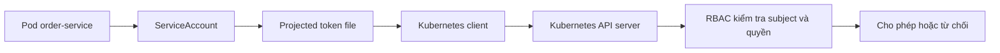
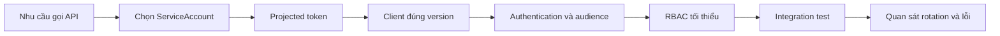

# Token được gắn vào Pod và thời hạn sử dụng

## 1. Token trong Pod dùng để làm gì?

Ứng dụng Spring trong `SPRING_CLOUD_KUBERNETES` có thể cần gọi Kubernetes API để discovery, đọc ConfigMap, đọc Secret hoặc theo dõi thay đổi. Khi chạy trong Pod, client thường xác thực bằng danh tính ServiceAccount. Kubernetes có thể cung cấp token cho Pod thông qua projected volume để client đọc token từ filesystem và gửi trong header `Authorization`.

Token không phải danh tính riêng của container. Token đại diện cho ServiceAccount được gắn vào Pod; quyền thực tế còn phụ thuộc Role, RoleBinding, ClusterRole hoặc ClusterRoleBinding. Có token chỉ chứng minh client có credential, không có nghĩa client được phép đọc mọi resource.



Với token hiện đại được project vào Pod, cần quan tâm thời hạn, audience, rotation và cách client đọc lại file. Không nên coi token là một chuỗi tĩnh được tạo một lần rồi giữ mãi trong image hoặc Secret.

## 2. ServiceAccount và projected token

Pod có thể khai báo `serviceAccountName` để chọn danh tính:

```yaml
apiVersion: v1
kind: ServiceAccount
metadata:
  name: order-service
  namespace: orders-test
---
apiVersion: apps/v1
kind: Deployment
metadata:
  name: order-service
  namespace: orders-test
spec:
  template:
    spec:
      serviceAccountName: order-service
      automountServiceAccountToken: true
      containers:
        - name: order-service
          image: registry.example.invalid/team/order-service:replace-me
```

Khi automount được bật theo chính sách cluster, token và thông tin CA/namespace có thể được cung cấp trong volume dành cho ServiceAccount. Đường dẫn thường được client trong cluster biết qua biến môi trường hoặc quy ước filesystem; ứng dụng không nên hard-code một đường dẫn chỉ vì thấy nó trong một môi trường cụ thể.

Pod có thể tắt automount bằng `automountServiceAccountToken: false` khi ứng dụng không gọi Kubernetes API. Đây là lựa chọn giảm credential trong container. Nếu bật integration discovery hoặc ConfigMap API mà tắt automount, client sẽ không xác thực được trừ khi có cơ chế credential khác được thiết kế.

## 3. Token có thời hạn và audience

Projected ServiceAccount token là token có thời hạn sử dụng và có audience. Audience cho biết token được phát hành để dùng với resource server nào. Kubernetes API server kiểm tra token còn hạn, đúng audience và đại diện cho subject hợp lệ trước khi áp dụng RBAC.

| Thuộc tính | Ý nghĩa |
| --- | --- |
| Subject | ServiceAccount mà token đại diện |
| Namespace | Phạm vi tên của ServiceAccount |
| Expiration | Thời điểm token không còn hợp lệ |
| Audience | Resource server dự kiến nhận token |
| RBAC | Quyền subject được phép thực hiện |

Audience không thay thế RBAC. Token đúng audience nhưng ServiceAccount không có quyền `get` ConfigMap vẫn nhận `403 Forbidden`. Token chưa hết hạn nhưng audience không khớp cũng có thể bị API server từ chối.

Thời hạn cụ thể phụ thuộc cấu hình cluster và cách token được yêu cầu. Ứng dụng không nên tự giả định một con số cố định; hãy xử lý token như credential ngắn hạn và sẵn sàng đọc token mới.

## 4. Rotation token trong Pod

Kubernetes có thể cập nhật projected token trước khi token cũ hết hạn. Cách cập nhật volume thường tạo nội dung mới thông qua cơ chế mount của kubelet. Client phải đọc token theo cách hỗ trợ rotation thay vì đọc một lần rồi giữ chuỗi mãi trong singleton.

Đường đi khi rotation:

1. Token hiện tại được mount vào Pod.
2. Kubelet hoặc cơ chế projection nhận token mới trước hạn.
3. Nội dung volume được cập nhật theo semantics của projected volume.
4. Request mới cần lấy token hiện hành.
5. Kubernetes API xác thực token mới.

Không nên tự ghi đè file token do kubelet quản lý. Ứng dụng chỉ đọc file qua client hoặc credential provider được hỗ trợ. Nếu client cache token trong memory đến hết process, request có thể bắt đầu nhận `401 Unauthorized` sau khi token hết hạn.

Rotation token khác với restart Pod. Pod có thể vẫn Running trong khi token file được cập nhật. Vì vậy readiness không nên chỉ kiểm tra token một lần lúc startup rồi coi credential luôn hợp lệ.

## 5. Client cần xử lý token file đúng cách

Một Kubernetes client in-cluster thường cần biết API server endpoint, CA certificate, namespace và token. Các thông tin này thường được lấy từ môi trường và filesystem do cluster cung cấp. Spring Cloud Kubernetes hoặc client implementation có thể tự cấu hình theo quy ước in-cluster.

Ứng dụng nên tránh:

- Đọc token một lần rồi lưu vô thời hạn.
- Ghi token vào log khi debug authentication.
- Copy token vào image hoặc file cấu hình version control.
- Dùng token của namespace khác trong Pod.
- Coi token tồn tại là bằng chứng request được phép.
- Tự retry vô hạn khi token hết hạn hoặc audience sai.

Nếu cần custom client, hãy dùng credential provider hoặc extension point của version đang dùng. Không tự mở file token trong business code nếu integration đã có cơ chế quản lý credential. Custom code phải có test rotation hoặc ít nhất test re-read khi credential thay đổi.

## 6. RBAC quyết định quyền sau khi xác thực

Ví dụ Role chỉ cho phép đọc một ConfigMap cụ thể:

```yaml
apiVersion: rbac.authorization.k8s.io/v1
kind: Role
metadata:
  name: order-settings-reader
  namespace: orders-test
rules:
  - apiGroups: [""]
    resources: ["configmaps"]
    resourceNames: ["order-settings"]
    verbs: ["get"]
---
apiVersion: rbac.authorization.k8s.io/v1
kind: RoleBinding
metadata:
  name: order-settings-reader
  namespace: orders-test
subjects:
  - kind: ServiceAccount
    name: order-service
    namespace: orders-test
roleRef:
  apiGroup: rbac.authorization.k8s.io
  kind: Role
  name: order-settings-reader
```

Token của `system:serviceaccount:orders-test:order-service` có thể xác thực nhưng chỉ được `get` resource trong phạm vi Role. Nếu Spring Cloud Kubernetes cần discovery Service, cần phân tích thêm resource và verb. Nếu Configuration Watcher cần theo dõi ConfigMap, có thể cần `watch` và cơ chế resync phù hợp.

Không cấp `cluster-admin` để chữa lỗi `403`. Xác định request nào bị từ chối, resource namespaced hay cluster-scoped, namespace nào và ServiceAccount nào đang dùng.

## 7. Token, Secret và legacy token

Không nên đồng nhất projected token với một Secret token tĩnh. Các cluster có thể hỗ trợ cơ chế token khác nhau, nhưng token dài hạn tạo rủi ro lớn hơn khi bị lộ và khó rotation.

Token tĩnh trong Secret có thể tồn tại lâu hơn vòng đời Pod và thường không phù hợp làm credential mặc định cho ứng dụng. Nếu môi trường cần token ngoài Pod, dùng cơ chế cấp phát và lưu trữ được quản trị, scope hẹp, thời hạn phù hợp và quy trình thu hồi rõ.

Projected token gắn với Pod và ServiceAccount theo cơ chế cluster. Khi Pod bị xóa hoặc ServiceAccount thay đổi, giả định về credential cũng thay đổi. Không đưa nội dung token vào ConfigMap, annotation, image layer hoặc error report.

## 8. Audience và resource server

Token được cấp cho một audience cụ thể. Nếu client gọi Kubernetes API nhưng token được cấp cho resource server khác, API có thể từ chối dù subject và thời hạn có vẻ đúng.

Khi tùy biến projected token, cần xác định:

- API server endpoint thực tế.
- Audience mà API server chấp nhận.
- Expiration được phép theo policy.
- ServiceAccount nào là subject.
- Client có gửi đúng token cho đúng host không.

Không dùng một token cho nhiều resource server chỉ vì tiện. Audience hẹp giúp giảm khả năng credential bị dùng sai nơi, nhưng phải khớp với client và server được thiết kế.

## 9. Namespace file và token file

Trong môi trường in-cluster, client thường cần cả token và namespace. Namespace file giúp client biết phạm vi mặc định, nhưng giá trị đó không tự cấp quyền. Nếu ứng dụng được cấu hình đọc một namespace khác, RBAC phải cho phép đúng namespace đó.

```text
ServiceAccount identity → token
Pod metadata          → namespace
CA certificate        → trust Kubernetes API
API server URL        → endpoint
RBAC                  → quyền thực tế
```

Một lỗi phổ biến là token thuộc ServiceAccount ở `orders-test` nhưng client cấu hình đọc ConfigMap ở `orders-prod`. Kết quả có thể là `403` hoặc resource không tồn tại tùy quyền và tên. Log nên ghi namespace và loại resource ở mức an toàn để chẩn đoán, không ghi token.

## 10. Spring Cloud Kubernetes và token lifecycle

Spring Cloud Kubernetes có thể tự dùng cấu hình in-cluster của client implementation. Khi ứng dụng dùng DiscoveryClient, ConfigMap, Secret hoặc Configuration Watcher, token lifecycle trở thành dependency runtime của integration.

Trước khi chọn starter, xác định:

| Câu hỏi | Ý nghĩa |
| --- | --- |
| Starter dùng client nào? | Cách đọc token và hỗ trợ rotation |
| Client có in-cluster mode không? | Cách lấy endpoint, CA và namespace |
| Watcher chạy ở đâu? | ServiceAccount nào cần quyền watch |
| Token hết hạn xử lý thế nào? | Re-read, refresh hoặc restart |
| Local profile ra sao? | Không ép local dùng token Pod |
| Version hỗ trợ property nào? | Tránh cấu hình bị bỏ qua |

Không copy property token từ một bản phát hành khác. Nếu cần custom credential provider, dùng extension point được công bố trong đúng version. Kiểm tra startup condition và integration test trong cluster test.

## 11. Tắt automount khi không cần API

Ứng dụng chỉ gọi Service DNS và không đọc Kubernetes API có thể tắt automount token:

```yaml
apiVersion: apps/v1
kind: Deployment
metadata:
  name: static-client
  namespace: orders-test
spec:
  template:
    spec:
      automountServiceAccountToken: false
      containers:
        - name: static-client
          image: registry.example.invalid/team/static-client:replace-me
```

Đây là quyết định theo nhu cầu. Nếu sau đó thêm DiscoveryClient hoặc ConfigMap API, cần bật credential và cấp RBAC tương ứng. Không bật automount cho mọi Pod theo thói quen, nhưng cũng không tắt mà không kiểm tra starter đang dùng.

## 12. Kiểm thử token và quyền

Unit test không cần token thật. Có thể mock abstraction để kiểm tra khi client trả `401`, `403`, timeout hoặc danh sách rỗng. Integration test trong namespace riêng nên kiểm tra identity và quyền thật.

```text
kubectl auth can-i get configmap/order-settings \
  --as=system:serviceaccount:orders-test:order-service \
  -n orders-test
```

Test nên bao gồm:

- Pod dùng đúng `serviceAccountName`.
- Client gọi đúng API server và namespace.
- Token chưa hết hạn được chấp nhận.
- Quyền thiếu trả lỗi rõ ràng.
- Token rotation không làm request mới dùng token cũ vô hạn.
- Shutdown đóng watcher và connection.
- Log lỗi không chứa token hoặc Secret.

Không đưa token production vào CI log để kiểm thử. Dùng ServiceAccount và Role riêng trong namespace test. Dọn tài nguyên test sau run để token, RoleBinding và Pod cũ không ảnh hưởng lần sau.

## 13. Xử lý lỗi authentication

| Lỗi | Khả năng cần kiểm tra |
| --- | --- |
| `401 Unauthorized` | Token hết hạn, sai audience, sai issuer hoặc client không đọc token mới |
| `403 Forbidden` | Subject hợp lệ nhưng RBAC không cho phép resource/verb |
| TLS handshake lỗi | CA, hostname, trust store hoặc proxy |
| Connection timeout | API server URL, network policy, proxy và timeout |
| Resource not found | Namespace, tên resource hoặc API group |
| Discovery rỗng | Quyền list/watch, selector, readiness và namespace |

Không dùng retry vô hạn để che `401` hoặc `403`. Authentication lỗi cần refresh credential hoặc sửa identity; authorization lỗi cần sửa RBAC. Retry có thể phù hợp cho network tạm thời nhưng phải có backoff và giới hạn.

## 14. Token rotation và connection pool

Token rotation không chỉ là việc đọc lại một file. Client có thể giữ connection pool hoặc request header trong object đã tạo. Khi token mới xuất hiện, request mới phải dùng credential mới theo contract của client.

Kiểm tra trong integration test:

1. Xác định cách client load token.
2. Mô phỏng token file thay đổi hoặc dùng cơ chế test được hỗ trợ.
3. Gửi request sau thay đổi.
4. Xác nhận header dùng credential hiện tại.
5. Kiểm tra connection reuse không giữ authorization cũ trái với thiết kế.

Nếu client version không hỗ trợ rotation theo cách cần thiết, có thể phải restart Pod theo chu kỳ hoặc chọn implementation được hỗ trợ. Không tự chỉnh file mount để ép rotation vì kubelet quản lý volume projection.

## 15. Bảo vệ log và chẩn đoán

Log có thể ghi:

- ServiceAccount name ở mức cần thiết.
- Namespace và resource type.
- Mã lỗi HTTP.
- Request correlation id.
- Thời điểm retry và tổng số lần.

Log không nên ghi:

- Nội dung token.
- Authorization header.
- Secret value.
- Toàn bộ response ConfigMap hoặc Secret.
- Certificate private key.

Trong môi trường debug, redaction phải được kiểm tra bằng test hoặc review cấu hình. Một exception từ HTTP client có thể chứa request headers; không trả nguyên exception đó ra API response.

## 16. Giới hạn theo bản phát hành

Khả năng token lifecycle có thể khác giữa các version vì starter, client implementation và auto-configuration thay đổi. Trước khi nâng cấp, kiểm tra:

| Hạng mục | Việc cần làm |
| --- | --- |
| Starter | Xác nhận artifact và module client |
| Property | Đối chiếu configuration reference |
| In-cluster mode | Kiểm tra cách lấy token, CA, namespace |
| Rotation | Xác minh client có đọc credential mới |
| Audience | Kiểm tra API server và token request |
| RBAC | Cập nhật resource và verb cần thiết |
| Watcher | Kiểm tra reconnect và shutdown |
| Test | Chạy lại `401`, `403`, timeout và rollout |

Không lấy một property từ blog cũ làm contract. Nếu custom code truy cập class nội bộ để đọc token, nên thay bằng extension point hoặc adapter riêng.

## 17. Quy trình thiết kế an toàn



Quy trình thực tế:

1. Xác định Pod có thật sự cần Kubernetes API không.
2. Chọn ServiceAccount riêng cho workload nếu cần.
3. Bật automount chỉ khi cần credential.
4. Chọn starter và client implementation theo version.
5. Xác định namespace, endpoint, CA và audience.
6. Cấp Role/RoleBinding tối thiểu.
7. Kiểm tra token hết hạn, rotation, `401` và `403`.
8. Kiểm tra log redaction và shutdown.
9. Chạy rollout trong namespace test trước.

## 18. Tự kiểm tra

### Token trong Pod đại diện cho ai?

Token đại diện cho ServiceAccount được gắn vào Pod. Quyền của token do RBAC quyết định.

### Token chưa hết hạn có chắc gọi được ConfigMap không?

Không. Token còn hạn nhưng sai audience, sai endpoint hoặc thiếu RBAC vẫn có thể bị từ chối.

### Có nên lưu token vào image không?

Không. Token cần được cấp động, có thời hạn và được quản lý bởi cơ chế credential của Pod/client.

### Đổi ConfigMap có đổi token không?

Không. ConfigMap và ServiceAccount token là các cơ chế khác nhau. Token được project và rotation theo lifecycle credential.

### Khi nào tắt automount?

Khi Pod không cần gọi Kubernetes API. Nếu dùng discovery, ConfigMap API, Secret API hoặc watcher, phải kiểm tra lại nhu cầu credential.

### Vì sao lỗi `403` không phải lỗi token hết hạn?

`403` thường cho biết subject đã xác thực nhưng không có quyền thực hiện thao tác. Token hết hạn hoặc không hợp lệ thường thuộc nhóm authentication như `401`, dù chi tiết còn phụ thuộc API gateway và client.

### Client phải làm gì khi token rotation?

Client phải dùng cơ chế credential hỗ trợ đọc token hiện hành hoặc có chiến lược refresh/restart phù hợp. Không giữ token cũ vô hạn trong memory.

## Kết luận

Token được gắn vào Pod là credential của ServiceAccount, không phải quyền tự do trên Kubernetes. Projected token có thời hạn, audience và có thể được rotation; client cần dùng đúng lifecycle thay vì coi token là chuỗi tĩnh.

Thiết kế an toàn kết hợp ServiceAccount riêng, automount có chủ đích, client đúng version, audience phù hợp, RBAC tối thiểu và test `401`, `403`, timeout, rotation. Khi ứng dụng `SPRING_CLOUD_KUBERNETES` dùng discovery, ConfigMap, Secret hoặc watcher, hãy kiểm tra cả cách client đọc token lẫn cách Pod được cấp quyền. Điều đó giúp kết nối Kubernetes API bền vững và giảm rủi ro credential.

