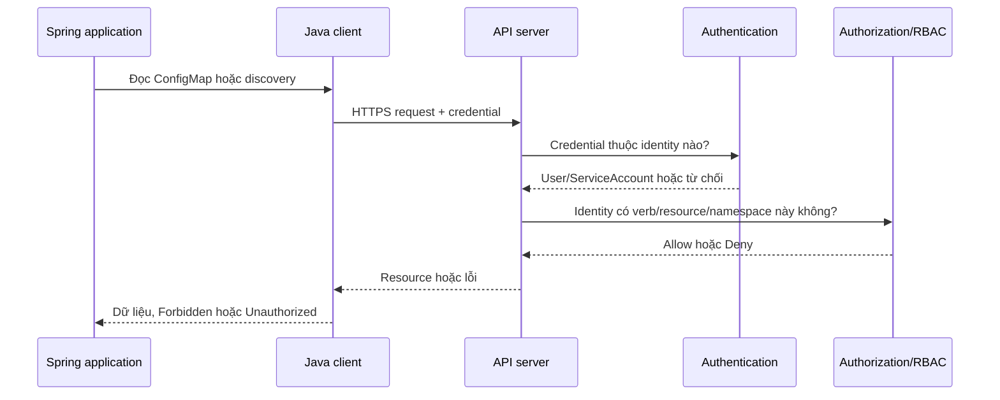
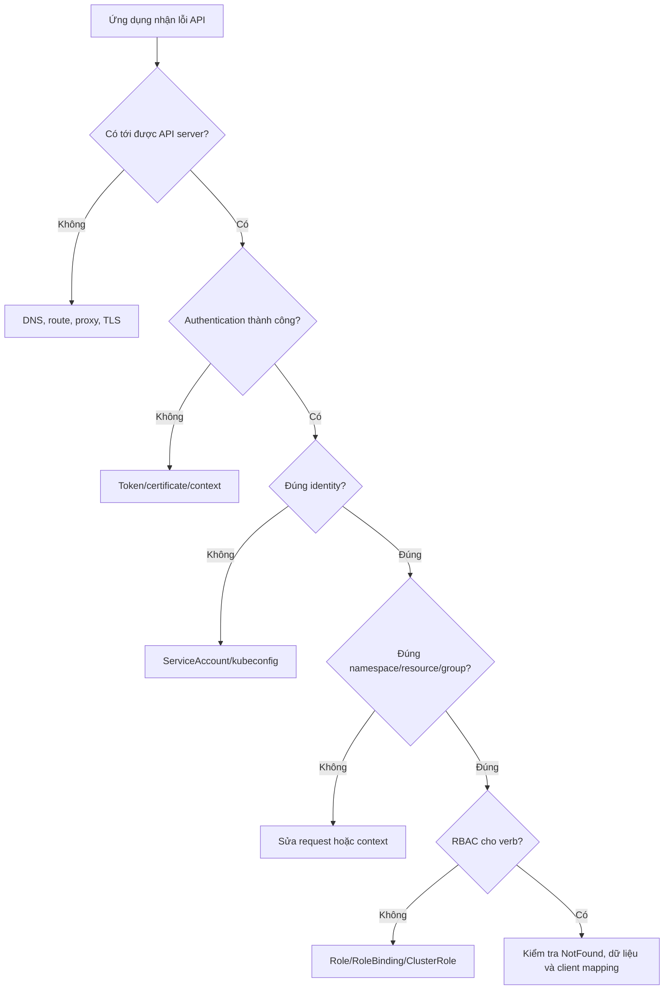

# Kiểm chứng danh tính và quyền truy cập thực tế của ứng dụng

Một ứng dụng Spring có thể gọi được Kubernetes API chỉ khi nhiều điều kiện cùng đúng: client kết nối tới đúng API server, credential được chấp nhận, request dùng đúng namespace/resource và identity có quyền tương ứng. Biết rằng Pod đang `Running` hoặc kubeconfig tồn tại chưa đủ để kết luận ứng dụng có thể đọc ConfigMap, Secret, Service hay EndpointSlice.

Bài học thuộc chương **Kết nối Kubernetes API** của module **Spring Cloud Kubernetes** (`SPRING_CLOUD_KUBERNETES`). Module tích hợp ứng dụng Spring với Kubernetes qua `DiscoveryClient`, ConfigMap, Secret, Spring Cloud LoadBalancer và Configuration Watcher; vì vậy cần kiểm chứng identity và quyền ngay trong runtime mà các tính năng đó sử dụng.

Mục tiêu của bài là phân biệt:

- ứng dụng đang chạy với identity nào;
- identity đã authentication thành công hay chưa;
- RBAC có cho phép đúng verb/resource/namespace hay không;
- quyền kiểm tra từ máy quản trị có giống quyền của Pod không;
- cách kiểm chứng an toàn mà không làm lộ token hoặc Secret.

## 1. Authentication và authorization là hai bước khác nhau

Luồng request tới Kubernetes API có thể tóm tắt:



**Authentication** trả lời “request đến từ ai?”. **Authorization** trả lời “identity đó được làm gì?”.

| Kết quả | Ý nghĩa thường gặp |
|---|---|
| Không kết nối được | DNS, route, proxy, API endpoint hoặc TLS |
| `401 Unauthorized` | Credential thiếu, sai hoặc hết hạn; identity chưa được xác nhận |
| `403 Forbidden` | Identity đã được nhận diện nhưng RBAC từ chối thao tác |
| `404 Not Found` | Resource/name/namespace không tồn tại hoặc API path không đúng |
| Thành công | Kết nối, authentication, authorization và request đều phù hợp |

Một lỗi `Forbidden` không được sửa bằng cách đổi Java client. Một lỗi `Unauthorized` cũng không được sửa bằng cách thêm `watch` vào Role.

## 2. Identity của ứng dụng đến từ đâu?

### Ứng dụng chạy trong Pod

Khi Pod dùng ServiceAccount, identity thường có dạng:

```text
system:serviceaccount:<namespace>:<service-account-name>
```

Ví dụ Pod trong namespace `shop` dùng ServiceAccount `catalog-app`:

```text
system:serviceaccount:shop:catalog-app
```

Deployment cần chỉ rõ ServiceAccount:

```yaml
apiVersion: apps/v1
kind: Deployment
metadata:
  name: catalog
  namespace: shop
spec:
  template:
    spec:
      serviceAccountName: catalog-app
      containers:
        - name: catalog
          image: example.invalid/catalog-service:demo
```

Không nên suy luận Pod dùng ServiceAccount nào từ tên Deployment. Nếu bỏ `serviceAccountName`, Pod có thể dùng ServiceAccount mặc định của namespace; quyền của account đó có thể khác với điều bạn thiết kế.

### Ứng dụng chạy ngoài cluster

Ứng dụng ngoài cluster có thể dùng user trong kubeconfig, client certificate, token tạm thời hoặc exec plugin. Identity thực tế phụ thuộc context và credential mà process chọn, không phụ thuộc tên file kubeconfig.

```text
kubeconfig
  → context
  → user/credential
  → API server nhận diện identity
  → RBAC quyết định quyền
```

Một context tên `prod-readonly` vẫn có thể trỏ sai endpoint nếu file bị merge hoặc bị đổi. Khi kiểm chứng ngoài cluster, phải ghi nhận endpoint, context và user ở mức an toàn, không log token/private key.

## 3. ServiceAccount không phải Role

Ba đối tượng thường bị nhầm:

| Đối tượng | Vai trò |
|---|---|
| ServiceAccount | Danh tính của workload trong cluster |
| Role/ClusterRole | Tập quy tắc verb trên resource |
| RoleBinding/ClusterRoleBinding | Gắn quy tắc cho subject |

ServiceAccount `catalog-app` không tự có quyền đọc ConfigMap. Role `catalog-config-reader` cũng không có tác dụng nếu không được binding cho đúng ServiceAccount.

Ví dụ đầy đủ trong một namespace:

```yaml
apiVersion: v1
kind: ServiceAccount
metadata:
  name: catalog-app
  namespace: shop
---
apiVersion: rbac.authorization.k8s.io/v1
kind: Role
metadata:
  name: catalog-config-reader
  namespace: shop
rules:
  - apiGroups: [""]
    resources: ["configmaps"]
    verbs: ["get", "list", "watch"]
---
apiVersion: rbac.authorization.k8s.io/v1
kind: RoleBinding
metadata:
  name: catalog-config-reader
  namespace: shop
subjects:
  - kind: ServiceAccount
    name: catalog-app
    namespace: shop
roleRef:
  apiGroup: rbac.authorization.k8s.io
  kind: Role
  name: catalog-config-reader
```

RoleBinding là namespaced. `roleRef` có thể trỏ tới Role trong namespace binding hoặc ClusterRole theo quy tắc Kubernetes, nhưng phải xem chính xác manifest thay vì suy đoán từ tên.

## 4. Quyền hiệu lực là tổ hợp nhiều yếu tố

Một quyền API có thể mô tả bằng tuple:

```text
(identity, verb, apiGroup, resource, namespace, resourceName, subresource)
```

Ví dụ:

```text
system:serviceaccount:shop:catalog-app
  + get
  + core API group
  + configmaps
  + namespace shop
  + catalog-settings
```

Role có `get` ConfigMap trong `shop` không cấp:

- quyền đọc Secret;
- quyền đọc ConfigMap trong namespace `test`;
- quyền `watch` nếu không khai báo `watch`;
- quyền đọc Service hoặc EndpointSlice;
- quyền cluster-wide;
- quyền trên resource khác chỉ vì tên giống nhau.

Một request thành công phụ thuộc cả API group và resource name. `services` thuộc core API group, còn `endpointslices` thuộc `discovery.k8s.io`. Ghi sai group trong Role có thể tạo manifest hợp lệ về cú pháp nhưng không cấp đúng quyền.

## 5. `get`, `list`, `watch` khác nhau thế nào?

| Verb | Thao tác | Rủi ro/phạm vi |
|---|---|---|
| `get` | Đọc một resource theo tên | Có thể giới hạn vào resource cần thiết tùy rule |
| `list` | Lấy danh sách resource | Có thể lộ nhiều object trong phạm vi |
| `watch` | Nhận thay đổi của resource | Duy trì stream và cần xử lý lifecycle |

Client đọc một ConfigMap cụ thể có thể chỉ cần `get` nếu không dùng list/watch. Discovery hoặc watcher thường cần `list` để lấy trạng thái ban đầu và `watch` để nhận thay đổi.

Không cấp `*` verbs chỉ vì một lỗi `Forbidden`. Hãy xác định request mà thư viện thực sự gửi và thêm đúng verb cần thiết.

## 6. Kiểm tra quyền bằng SelfSubjectAccessReview

Kubernetes cung cấp cơ chế kiểm tra một subject có được phép thực hiện một thao tác cụ thể hay không. `SelfSubjectAccessReview` dùng identity của chính request gửi review; đây là cách phù hợp để kiểm tra quyền hiệu lực mà không cần hỏi quyền của một user khác.

Ví dụ manifest:

```yaml
apiVersion: authorization.k8s.io/v1
kind: SelfSubjectAccessReview
spec:
  resourceAttributes:
    namespace: shop
    verb: get
    group: ""
    resource: configmaps
    name: catalog-settings
```

Kết quả có trường `status.allowed` và có thể có lý do/đánh giá bổ sung tùy server. Review chỉ trả lời câu hỏi quyền theo thuộc tính đã gửi; nó không đọc resource và không chứng minh ConfigMap thực sự tồn tại.

Có thể kiểm tra nhiều tuple riêng:

```text
get configmaps/catalog-settings trong shop
list configmaps trong shop
watch configmaps trong shop
get secrets/catalog-credentials trong shop
list services trong shop
watch endpointslices trong shop
```

Nếu review được gửi từ máy quản trị bằng admin credential, kết quả không đại diện cho Pod. Review phải chạy với chính identity của ứng dụng hoặc một identity có cùng quyền.

## 7. SelfSubjectRulesReview và giới hạn của nó

`SelfSubjectRulesReview` giúp xem các rule mà identity hiện tại có thể sử dụng trong một namespace. Đây là công cụ hữu ích để khám phá quyền hiệu lực, nhưng output không nên được coi là danh sách duy nhất để cấp quyền production.

```yaml
apiVersion: authorization.k8s.io/v1
kind: SelfSubjectRulesReview
spec:
  namespace: shop
```

Kết quả có thể cho biết identity được phép làm gì trong namespace. Dùng nó để đối chiếu với thiết kế RoleBinding, sau đó kiểm tra bằng các request thật ở mức tối thiểu. Không đưa toàn bộ output quyền vào log ứng dụng nếu output đó chứa thông tin về phạm vi cluster.

## 8. “Can I” từ máy quản trị có thể gây hiểu lầm

Các công cụ quản trị thường có lệnh kiểm tra quyền tương đương `can-i`. Chúng hữu ích khi biết rõ user và kubeconfig đang dùng, nhưng kết quả có thể sai ngữ cảnh nếu:

- máy quản trị dùng admin context;
- context trỏ namespace khác;
- kubeconfig merge chọn current-context khác;
- kiểm tra bằng user local thay vì ServiceAccount của Pod;
- command kiểm tra `list` trong khi ứng dụng cần `get` một resource;
- command không chỉ rõ API group.

Để kết quả có ý nghĩa, hãy ghi lại:

```text
identity kiểm tra
API server/cluster
namespace
verb
apiGroup
resource
resourceName nếu có
```

Sau đó lặp lại cùng tuple từ runtime ứng dụng hoặc một Pod debug có cùng ServiceAccount và network path.

## 9. Kiểm chứng trong runtime của Pod

Một quy trình an toàn không cần in token:

1. Xác định Pod và namespace.
2. Xác định `spec.serviceAccountName` của Pod.
3. Kiểm tra RoleBinding/ClusterRoleBinding trỏ tới ServiceAccount đó.
4. Gửi SelfSubjectAccessReview từ identity của Pod nếu quy trình cho phép.
5. Thử request đọc một resource không nhạy cảm đã được chỉ định.
6. Kiểm tra log lỗi và API audit ở mức phù hợp.

Sơ đồ chẩn đoán:



Một request `get` ConfigMap không nhạy cảm giúp kiểm chứng đường đi, nhưng không chứng minh ứng dụng được phép đọc Secret hoặc watch EndpointSlice. Mỗi tính năng cần tuple kiểm tra riêng.

## 10. Kiểm chứng trong ứng dụng Spring

Ứng dụng không nên expose endpoint công khai trả token, kubeconfig hoặc toàn bộ quyền. Nếu cần endpoint chẩn đoán nội bộ, chỉ trả thông tin đã lọc:

```json
{
  "cluster": "shop-dev",
  "namespace": "shop",
  "serviceAccount": "catalog-app",
  "checks": {
    "getConfigMap": "allowed",
    "watchConfigMap": "allowed",
    "getSecret": "denied"
  }
}
```

Các giá trị trên nên được tạo từ kiểm tra có kiểm soát, không lấy token để hiển thị. Endpoint phải được bảo vệ bởi authentication/authorization của ứng dụng và chỉ bật trong profile vận hành phù hợp.

Với `DiscoveryClient`, kiểm tra quyền cần phản ánh tài nguyên mà implementation dùng. Đừng chỉ kiểm tra `get services` nếu client khởi tạo bằng `list services` rồi `watch endpointslices`.

## 11. Kiểm chứng Secret mà không làm lộ Secret

Secret có mức nhạy cảm cao hơn ConfigMap. Khi kiểm tra:

- xác minh identity có quyền `get` Secret bằng AccessReview;
- kiểm tra request thực tế trả thành công hoặc bị từ chối;
- chỉ xác nhận key tồn tại và giá trị có thể parse nếu policy cho phép;
- không ghi plaintext vào log, exception message, metric label hoặc trace baggage;
- không dump object API server trả về;
- dùng dữ liệu test giả lập trong integration test.

Một lỗi `Forbidden` khi đọc Secret có thể là đúng thiết kế nếu ứng dụng chỉ dùng Secret mount file. Đừng thêm quyền API chỉ vì Secret có liên quan tới Pod.

## 12. ServiceAccount token và credential rotation

Credential của workload có thể được xoay vòng. Ứng dụng không nên giả định token là chuỗi tĩnh tồn tại mãi. Khi client tự đọc credential từ môi trường hoặc file, cần hiểu liệu nó có reload khi file thay đổi hay chỉ đọc một lần lúc tạo client.

Các câu hỏi cần trả lời:

1. Client lấy token ở đâu?
2. Token hết hạn thì client nhận lỗi nào?
3. Client có reload hoặc tạo lại credential không?
4. Connection pool có giữ connection với credential cũ không?
5. Watch có reconnect sau khi credential được xoay vòng không?

Nếu rotation không được client hỗ trợ tự động, cần thiết kế restart/refresh an toàn. Không giải quyết credential hết hạn bằng retry vô hạn; retry chỉ làm chậm việc phát hiện identity đã không còn hợp lệ.

## 13. Phân biệt identity của ứng dụng và identity của công cụ

Một lỗi phổ biến là chạy kiểm tra bằng `kubectl` hoặc tool local rồi kết luận ứng dụng có cùng quyền. Hãy lập bảng đối chiếu:

| Thành phần | Identity | Cluster | Namespace | Mục đích |
|---|---|---|---|---|
| Developer CLI | user trong kubeconfig | dev/prod tùy context | context hiện tại | chẩn đoán |
| CI job | pipeline identity | test hoặc deploy | namespace pipeline | kiểm thử/triển khai |
| catalog Pod | `system:serviceaccount:shop:catalog-app` | cluster runtime | shop | ConfigMap/discovery |
| watcher riêng | ServiceAccount riêng | cluster runtime | shop | watch/refresh |

Nếu watcher và ứng dụng dùng hai ServiceAccount, quyền của watcher không đại diện cho quyền của ứng dụng. Mỗi client cần được kiểm chứng bằng identity thật của nó.

## 14. Kiểm tra hiệu lực RoleBinding

Khi RBAC không hoạt động như mong đợi, kiểm tra chuỗi:

```text
Pod.spec.serviceAccountName
  → ServiceAccount tồn tại trong namespace Pod
  → RoleBinding subject kind/name/namespace
  → roleRef kind/name
  → Role/ClusterRole rule
  → apiGroup/resource/verb/namespace
  → request thực tế
```

Các lỗi hay gặp:

- RoleBinding ở namespace `shop` nhưng subject ServiceAccount thuộc `test`;
- tên ServiceAccount sai một ký tự;
- `roleRef` trỏ ClusterRole không tồn tại;
- resource viết sai số nhiều hoặc API group;
- Role có `get` nhưng client dùng `list`/`watch`;
- ứng dụng gọi namespace khác namespace mà Role bao phủ;
- Pod bị rollout dùng ServiceAccount mới nhưng manifest cũ vẫn được kiểm tra.

Không chỉ đọc YAML trên repository; quyền hiệu lực là resource đã apply trong cluster và Pod đang chạy.

## 15. Kiểm chứng DiscoveryClient

Discovery thường cần nhiều quyền hơn một request DNS Service. Một quy trình kiểm tra:

```text
1. Xác định client đọc Service, Endpoints hay EndpointSlice.
2. Xác định namespace và label filter.
3. Kiểm tra list/get/watch theo resource tương ứng.
4. Kiểm tra Service có backend và Pod có readiness.
5. So sánh ServiceInstance với địa chỉ, port và scheme ứng dụng dùng.
6. Kiểm tra cache sau khi endpoint thay đổi.
```

Một identity có thể được phép list Service nhưng không được phép list EndpointSlice. Khi đó discovery có thể tìm thấy tên dịch vụ nhưng không tạo được instance đầy đủ. Cũng có thể discovery thành công nhưng client gọi sai port hoặc đích chưa ready — đây không phải lỗi identity.

## 16. Kiểm chứng Configuration Watcher

Watcher cần ít nhất:

- identity đúng;
- quyền list/get để lấy trạng thái ban đầu nếu implementation cần;
- quyền watch resource;
- namespace/resource selector đúng;
- cơ chế reconnect và resync;
- đường áp dụng thay đổi vào bean hoặc rollout.

Kiểm tra theo bốn mốc:

```text
AccessReview allowed
  → watch connection mở thành công
  → event MODIFIED được nhận
  → bean/client/rollout áp dụng giá trị mới
```

Chỉ thấy `allowed: true` mới chứng minh quyền, chưa chứng minh watcher đang chạy. Chỉ thấy event cũng chưa chứng minh bean nghiệp vụ đã dùng giá trị mới.

## 17. Test matrix cho quyền hiệu lực

Một bộ kiểm thử có thể dùng resource không nhạy cảm và identity test riêng:

| Trường hợp | Kỳ vọng |
|---|---|
| `get` ConfigMap đúng namespace | Thành công |
| `get` ConfigMap namespace khác | `Forbidden` hoặc bị chặn theo thiết kế |
| `list` ConfigMap khi chỉ cấp `get` | Bị từ chối |
| `watch` ConfigMap khi chưa cấp watch | Bị từ chối |
| `get` Secret khi chỉ cấp ConfigMap | Bị từ chối |
| list Service cho discovery | Thành công nếu feature cần |
| watch EndpointSlice không được cấp | Bị từ chối rõ ràng |
| resource không tồn tại | `NotFound`, không nhầm với `Forbidden` |
| credential hết hạn | `Unauthorized`, refresh/restart theo policy |

Test phải chạy với identity gần production nhưng dữ liệu test, không dùng `cluster-admin` để làm cho mọi case đều pass.

## 18. Quan sát và audit

Khi quyền bị từ chối, log ứng dụng nên ghi:

```text
resource=ConfigMap
name=catalog-settings
namespace=shop
verb=get
feature=config-loading
error=Forbidden
```

Không ghi Authorization header, token hoặc Secret value. API audit log của cluster có thể cung cấp thêm subject, verb, resource và response status theo policy của tổ chức. Kết hợp audit với log client để biết request nào thực sự được gửi.

Metric nên phân biệt:

- `authentication_failed`;
- `authorization_denied`;
- `resource_not_found`;
- `api_timeout`;
- `watch_reconnect`;
- `config_apply_failed`.

Gộp tất cả thành `kubernetes_client_error` khiến việc phân biệt identity, RBAC và network trở nên khó.

## 19. Những cách kiểm chứng nguy hiểm

### Gắn `cluster-admin` để thử

Điều này làm mất thông tin về quyền tối thiểu và có thể tạo rủi ro thật. Hãy dùng AccessReview và Role test hẹp.

### In token để biết token có tồn tại

Token có thể bị lưu trong log, trace hoặc terminal history. Chỉ kiểm tra trạng thái credential và response status.

### Tắt TLS verification

Điều này có thể che giấu CA sai và làm lộ credential tới endpoint giả. Sửa CA/hostname đúng.

### Kiểm tra bằng admin context

Kết quả pass không đại diện cho ServiceAccount của Pod. Chạy check với identity đúng.

### Thêm quyền cho tới khi hết lỗi

Cách này tạo quyền dư thừa và không giải thích được request thật. Xác định verb, group, resource, namespace trước.

## 20. Quy trình chẩn đoán hoàn chỉnh

Khi `catalog-service` báo không đọc được ConfigMap:

1. Xác nhận app đang chạy Pod nào và ServiceAccount nào.
2. Xác nhận client đang tới cluster/API endpoint nào.
3. Phân biệt lỗi network/TLS, `Unauthorized`, `Forbidden` và `NotFound`.
4. Kiểm tra tuple request: `get`, core group, `configmaps`, namespace `shop`, tên resource.
5. Chạy SelfSubjectAccessReview với identity của app.
6. Đối chiếu RoleBinding đã apply và rule hiệu lực.
7. Thử resource không nhạy cảm hoặc tên sai có chủ ý để phân biệt response.
8. Nếu quyền đúng, kiểm tra client mapping, parse dữ liệu và binding Spring.
9. Nếu dùng watch, kiểm tra kết nối, event, reconnect và resync.
10. Sau khi sửa, kiểm tra lại bằng identity thật; không dừng ở việc `kubectl` của admin chạy được.

## 21. Checklist trước production

- [ ] Đã xác định identity thực tế của từng Pod/client.
- [ ] ServiceAccount được chỉ rõ trong Deployment khi cần.
- [ ] RoleBinding subject có đúng kind, name và namespace.
- [ ] Role/ClusterRole dùng đúng API group và resource.
- [ ] `get`, `list`, `watch` được cấp riêng theo nhu cầu.
- [ ] Quyền Secret tách khỏi quyền ConfigMap.
- [ ] Discovery và watcher có quyền đúng resource tương ứng.
- [ ] Có kiểm tra SelfSubjectAccessReview cho các thao tác chính.
- [ ] Test chạy với identity gần production, không dùng cluster-admin.
- [ ] Log không chứa token, Secret hoặc Authorization header.
- [ ] Credential rotation và lỗi Unauthorized có runbook.
- [ ] Phân biệt rõ Forbidden, NotFound, Unauthorized và lỗi network.
- [ ] Quyền được kiểm tra trong namespace/cluster thực tế của runtime.

## 22. Kết luận

Kiểm chứng danh tính và quyền không phải là bước phụ sau khi client đã viết xong. Đó là một phần của thiết kế tích hợp Spring Cloud Kubernetes. Ứng dụng cần biết mình là ai, đang gọi cluster nào, dùng namespace nào và được phép thực hiện verb trên resource nào.

Hãy kiểm tra authentication trước authorization, kiểm tra identity thật thay vì identity của công cụ quản trị, dùng SelfSubjectAccessReview cho từng tuple quan trọng và giữ Role tối thiểu. Khi quyền đã đúng, mới tiếp tục chẩn đoán namespace, resource name, parse ConfigMap/Secret, discovery hoặc watcher.

Một hệ thống an toàn không chứng minh quyền bằng cách cấp quyền tối đa. Nó chứng minh bằng request cụ thể, identity cụ thể, kết quả cụ thể và log đủ thông tin để truy nguyên mà không làm lộ credential.
