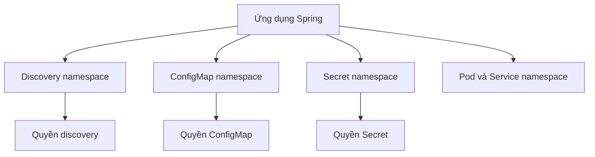
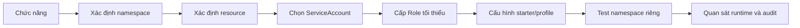

# Cấu hình namespace tường minh theo từng chức năng

## 1. Namespace không nên bị để mặc định

Trong Kubernetes, namespace là phạm vi logic cho các tài nguyên namespaced. Ứng dụng Spring trong `SPRING_CLOUD_KUBERNETES` có thể dùng namespace cho Deployment, Service, ConfigMap, Secret, ServiceAccount, Role và discovery. Nếu một thành phần tự dùng namespace mặc định còn thành phần khác dùng namespace được cấu hình, ứng dụng có thể khởi động nhưng đọc nhầm resource hoặc nhận danh sách rỗng.

Namespace tường minh không nhất thiết nghĩa mọi chức năng phải ở một namespace khác nhau. Nó nghĩa mỗi chức năng có nguồn namespace rõ ràng, được kiểm tra và có quyền tương ứng.



## 2. Phân loại chức năng và resource

| Chức năng | Resource thường dùng | Namespace cần xác định |
| --- | --- | --- |
| Chạy workload | Deployment, ReplicaSet, Pod | Namespace triển khai |
| Gọi service | Service, EndpointSlice | Namespace service đích |
| Discovery | Service hoặc resource discovery | Namespace được phép tìm |
| Cấu hình | ConfigMap | Namespace cấu hình |
| Dữ liệu nhạy cảm | Secret | Namespace Secret |
| Danh tính | ServiceAccount | Namespace của Pod |
| Quyền namespaced | Role, RoleBinding | Namespace được bảo vệ |
| Theo dõi thay đổi | ConfigMap/Secret watcher | Namespace resource được watch |

Một ứng dụng có thể dùng cùng `orders-test` cho mọi chức năng, nhưng vẫn nên ghi rõ để không phụ thuộc default. Nếu discovery đọc nhiều namespace còn Secret chỉ đọc một namespace, hai scope đó cần được biểu diễn và cấp quyền riêng.

## 3. Namespace của Deployment và Pod

Deployment, Pod, Service và ConfigMap thường là tài nguyên namespaced. Namespace của Pod được xác định khi Pod được tạo từ template của Deployment; `serviceAccountName` được tìm trong namespace của Pod.

```yaml
apiVersion: apps/v1
kind: Deployment
metadata:
  name: order-service
  namespace: orders-test
spec:
  replicas: 2
  selector:
    matchLabels:
      app.kubernetes.io/name: order-service
  template:
    metadata:
      labels:
        app.kubernetes.io/name: order-service
    spec:
      serviceAccountName: order-service
      containers:
        - name: order-service
          image: registry.example.invalid/team/order-service:replace-me
```

Pod không tự chuyển sang namespace khác vì ứng dụng đặt một property runtime. Việc chuyển workload là quyết định của manifest hoặc controller triển khai. ServiceAccount `order-service` trong `orders-test` khác ServiceAccount cùng tên trong `orders-prod`; client Kubernetes dùng identity của Pod nên hai thông tin phải được kiểm tra cùng nhau.

## 4. Service và DNS theo namespace

Service DNS ngắn thường được phân giải trong namespace hiện tại. Khi gọi Service ở namespace khác, chỉ rõ namespace trong tên DNS:

```text
http://inventory-service.orders-test.svc:8080
http://inventory-service.orders-prod.svc:8080
```

Profile cluster có thể đặt URL tường minh:

```yaml
inventory:
  base-url: http://inventory-service.orders-test.svc:8080
```

Service selector chỉ tìm Pod trong namespace của chính Service. Nếu `order-service` ở `orders-test` gọi Service cùng tên ở `orders-prod`, đó là request qua DNS tới namespace khác, không phải selector chéo namespace.

Cross-namespace call cần được xem xét về NetworkPolicy, routing, audit, ownership và nguy cơ gọi nhầm môi trường. URL đầy đủ làm ý định rõ hơn so với tên Service ngắn.

## 5. Discovery namespace tường minh

DiscoveryClient có thể tìm service trong namespace hiện tại, một namespace chỉ định hoặc nhiều namespace tùy implementation và version. Không nên giả định property của một release áp dụng cho mọi release.

```yaml
spring:
  cloud:
    kubernetes:
      discovery:
        enabled: true
        namespace: orders-test
```

Đoạn trên minh họa ý tưởng; tên property và khả năng nhiều namespace phải được đối chiếu với version đã chọn. Nếu property không được hỗ trợ, ứng dụng có thể bỏ qua nó và dùng default.

Khi discovery đọc nhiều namespace, cần trả lời:

- Namespace nào được phép tìm?
- Resource nào được đọc để tạo ServiceInstance?
- Có lọc theo label hay annotation không?
- Pod chưa readiness có bị loại không?
- ServiceAccount có quyền ở mọi namespace không?
- Một namespace lỗi làm discovery fail toàn bộ hay được bỏ qua?

Scope rộng làm tăng quyền và số request API. Nếu chỉ cần gọi hai service trong `orders-test`, một namespace cụ thể dễ bảo vệ hơn đọc toàn cluster.

## 6. ConfigMap namespace tường minh

ConfigMap phải nằm trong namespace mà Pod tham chiếu hoặc integration được cấu hình để đọc. Với `envFrom`, tên ConfigMap được phân giải trong namespace của Pod:

```yaml
apiVersion: v1
kind: ConfigMap
metadata:
  name: order-settings
  namespace: orders-test
data:
  INVENTORY_BASE_URL: http://inventory-service.orders-test.svc:8080
---
apiVersion: apps/v1
kind: Deployment
metadata:
  name: order-service
  namespace: orders-test
spec:
  template:
    spec:
      containers:
        - name: order-service
          image: registry.example.invalid/team/order-service:replace-me
          envFrom:
            - configMapRef:
                name: order-settings
```

Deployment ở `orders-prod` không thể chỉ tham chiếu `order-settings` ở `orders-test` qua `configMapRef`. Muốn dùng cấu hình khác namespace, cần tạo bản sao được quản lý ở namespace đích hoặc để integration đọc API với quyền rõ ràng.

Nếu Spring Cloud Kubernetes đọc ConfigMap qua API, namespace cấu hình cho integration và namespace resource phải khớp. Phân biệt `NotFound` với `Forbidden`; hai lỗi cần cách xử lý khác nhau.

## 7. Secret namespace và dữ liệu nhạy cảm

Secret của database ở `orders-test` không tự dùng được cho Pod ở `orders-prod` chỉ vì cùng tên:

```yaml
apiVersion: v1
kind: Secret
metadata:
  name: order-database
  namespace: orders-test
type: Opaque
stringData:
  username: orders_test
  password: replace-me
```

Manifest chỉ minh họa cấu trúc; không commit password thật. Namespace giúp phân vùng quản trị nhưng không thay thế mã hóa lưu trữ, RBAC và redaction log.

Nếu integration đọc Secret qua API, chỉ cấp quyền ở namespace chứa Secret. Nếu dùng env hoặc volume, Pod spec và kubelet phân phối dữ liệu; ứng dụng không cần quyền API chỉ để đọc giá trị đã mount.

## 8. RBAC theo namespace chức năng

Role namespaced chỉ cấp quyền trong namespace của Role. RoleBinding cũng được tạo trong namespace để gán quyền:

```yaml
apiVersion: rbac.authorization.k8s.io/v1
kind: Role
metadata:
  name: order-config-reader
  namespace: orders-test
rules:
  - apiGroups: [""]
    resources: ["configmaps"]
    resourceNames: ["order-settings"]
    verbs: ["get"]
---
apiVersion: rbac.authorization.k8s.io/v1
kind: RoleBinding
metadata:
  name: order-config-reader
  namespace: orders-test
subjects:
  - kind: ServiceAccount
    name: order-service
    namespace: orders-test
roleRef:
  apiGroup: rbac.authorization.k8s.io
  kind: Role
  name: order-config-reader
```

Subject là ServiceAccount của Pod; Role là quyền trong `orders-test`. Nếu discovery cần đọc Service ở `inventory-test`, phải cấp quyền ở namespace đó hoặc dùng thiết kế cluster-scoped có lý do rõ ràng.

Không giải quyết lỗi cross-namespace bằng `cluster-admin`. Ghi rõ mỗi chức năng cần resource nào, verb nào và namespace nào.

## 9. Configuration Watcher và scope

Watcher cần biết resource và namespace được theo dõi. Nếu ConfigMap `order-settings` ở `orders-test`, watcher phải đọc đúng namespace đó. Nếu watcher chạy trong Pod riêng, ServiceAccount của watcher có thể khác ServiceAccount của ứng dụng.

```text
Watcher ServiceAccount → get/list/watch ConfigMap trong orders-test
Ứng dụng ServiceAccount → quyền discovery hoặc Secret của ứng dụng
```

Không gộp mọi quyền vào ServiceAccount của ứng dụng chỉ vì watcher và ứng dụng cùng hệ thống. Tách identity giúp audit và thu hồi quyền dễ hơn.

Event watch, reconnect và resync có thể phụ thuộc version. Scope rộng khiến watcher nhận nhiều event hơn và tăng chi phí API. Chọn phạm vi nhỏ nhất đáp ứng refresh.

## 10. Namespace và profile Spring

Profile giúp local, test và cluster dùng namespace rõ ràng:

```yaml
# application-local.yml
spring:
  cloud:
    kubernetes:
      enabled: false
app:
  target-namespace: local
```

```yaml
# application-cluster.yml
app:
  target-namespace: orders-test
inventory:
  base-url: http://inventory-service.orders-test.svc:8080
```

`app.target-namespace` là property của ứng dụng trong ví dụ, không phải property cam kết của Spring Cloud Kubernetes. Nếu integration có property namespace riêng, phải dùng đúng tên được version hỗ trợ.

Không đặt namespace production cứng trong image. Deployment hoặc ConfigMap của môi trường nên truyền giá trị. Đồng thời không để mặc định rỗng rồi để client tự đoán khi việc đoán có thể đọc nhầm resource.

## 11. Cấu hình một namespace cho mỗi mục tiêu

| Mục tiêu | Cấu hình tường minh |
| --- | --- |
| Chạy Pod | `metadata.namespace` của Deployment |
| Gọi Service | URL có Service và namespace |
| Đọc ConfigMap | Tên và namespace ConfigMap |
| Đọc Secret | Tên và namespace Secret |
| Discovery | Danh sách namespace được phép tìm |
| Watcher | Namespace và resource cần watch |
| RBAC | Role/RoleBinding trong namespace liên quan |

Không dùng một biến `NAMESPACE` cho mọi chức năng nếu các chức năng có scope khác nhau. Nếu mọi chức năng thật sự cùng namespace, vẫn ghi rõ namespace trong manifest, profile hoặc cấu hình triển khai để contract có thể review.

## 12. Chẩn đoán lỗi namespace

| Hiện tượng | Kiểm tra trước |
| --- | --- |
| ConfigMap not found | Pod namespace, tên và namespace integration |
| Secret không bind | Secret có trong namespace Pod không, key đúng không |
| `403 Forbidden` | ServiceAccount, RoleBinding và namespace Role |
| Discovery rỗng | Scope, quyền list/watch, Service và readiness |
| Gọi nhầm môi trường | URL DNS, profile active và ConfigMap |
| Watcher không nhận event | Scope, quyền watch và reconnect |
| Service không có endpoint | Service namespace, selector và readiness |

```text
kubectl get deployment order-service -n orders-test
kubectl get service inventory-service -n orders-test
kubectl get configmap order-settings -n orders-test
kubectl get secret order-database -n orders-test
kubectl auth can-i get configmap/order-settings \
  --as=system:serviceaccount:orders-test:order-service \
  -n orders-test
```

Luôn chỉ rõ `-n` khi kiểm tra tài nguyên namespaced. Một lệnh thành công trong namespace mặc định không chứng minh workload test hoặc production đúng.

## 13. Cross-namespace có chủ đích

Cross-namespace có thể hợp lệ, nhưng cần ghi rõ namespace nguồn, namespace đích, Service name, port, NetworkPolicy, timeout, audit và ownership.

```text
order-service.orders-test.svc → inventory-service.shared.svc
```

Không để cross-namespace xảy ra chỉ vì tên Service ngắn được resolve theo search domain. URL đầy đủ giảm nguy cơ gọi nhầm service cùng tên.

Cross-namespace đọc ConfigMap hoặc Secret qua API cần quyền ở namespace đích. Nếu chỉ cần dữ liệu cấu hình, sao chép có kiểm soát vào namespace workload thường dễ audit hơn cấp quyền đọc chéo rộng.

## 14. Namespace và Spring Cloud LoadBalancer

LoadBalancer nhận ServiceInstance từ discovery hoặc nguồn khác. Namespace phải được quyết định trước khi tạo danh sách instance. Nếu cùng service name tồn tại ở nhiều namespace, tên ngắn có thể tạo ambiguity.

```text
DiscoveryClient → ServiceInstance thuộc scope đã chọn
Spring Cloud LoadBalancer → chọn instance
HTTP client → endpoint được chọn
```

Test cần xác minh instance thuộc namespace đúng, port đúng và Pod đủ readiness. Thêm LoadBalancer không sửa lỗi discovery scope; nó chỉ chọn trong danh sách nguồn discovery cung cấp.

## 15. Namespace trong integration test

Integration test nên dùng namespace riêng như `orders-it-<run-id>`. Tài nguyên test, ServiceAccount và Role cùng nằm trong scope rõ ràng; cleanup theo namespace hoặc label.

```yaml
apiVersion: v1
kind: Namespace
metadata:
  name: orders-it-example
  labels:
    environment: test
    purpose: integration
```

Không chạy test đọc Secret production. Không dùng namespace mặc định cho run song song nếu fixture có thể trùng tên. Nếu test cần discovery nhiều namespace, tạo namespace đích giả lập và cấp quyền đúng phạm vi.

## 16. Giới hạn bản phát hành

Tên property cho namespace, hỗ trợ nhiều namespace và behavior discovery/config có thể thay đổi theo version. Khi nâng Spring Cloud Kubernetes:

1. Đọc configuration reference của version mới.
2. Kiểm tra property namespace còn được hỗ trợ không.
3. Xác định default namespace và cách in-cluster client lấy namespace.
4. Kiểm tra RBAC cần resource và verb nào.
5. Test resource ở namespace khác nhau.
6. Kiểm tra cross-namespace URL và watcher.

Không copy property từ blog cũ rồi kết luận client đang dùng namespace tường minh. Startup log, dependency graph và integration test mới cung cấp bằng chứng phù hợp.

## 17. Quy trình cấu hình



Quy trình thực tế:

1. Liệt kê discovery, config, Secret, watcher và service call.
2. Ghi namespace của từng resource.
3. Xác định resource namespaced hay cluster-scoped.
4. Chọn ServiceAccount theo workload hoặc watcher.
5. Cấp quyền tối thiểu ở namespace cần thiết.
6. Ghi URL Service đầy đủ khi cross-namespace.
7. Đặt profile và property tường minh.
8. Test `NotFound`, `Forbidden`, discovery rỗng và gọi nhầm namespace.
9. Review log để không lộ Secret.

## 18. Tự kiểm tra

### Namespace của Pod được lấy từ đâu?

Namespace được khai báo trên resource tạo Pod, thường là Deployment. Ứng dụng không tự chuyển Pod bằng property runtime.

### Service có chọn Pod ở namespace khác không?

Service selector hoạt động trong namespace của Service. Muốn gọi service khác namespace, client dùng DNS hoặc endpoint cross-namespace theo thiết kế.

### ConfigMap cùng tên ở hai namespace có giống nhau không?

Không. Đó là hai resource khác nhau; Pod chỉ tham chiếu đúng resource trong phạm vi được thiết kế.

### Role ở `orders-test` có cấp quyền cho `orders-prod` không?

Không. Role namespaced chỉ cấp quyền trong namespace của nó. Cross-namespace cần quyền ở namespace đích hoặc thiết kế cluster-scoped có kiểm soát.

### Vì sao discovery có thể trả rỗng?

Client có thể tìm sai namespace, bị lọc bởi selector, thiếu quyền list/watch hoặc không thấy Service ready. Kiểm tra scope và RBAC trước khi thêm starter.

### Có nên dùng một biến namespace cho mọi chức năng?

Chỉ khi mọi chức năng thực sự cùng phạm vi. Nếu discovery, Secret hoặc watcher có scope khác, cấu hình riêng giúp tránh assumption ngầm.

## Kết luận

Cấu hình namespace tường minh giúp mỗi chức năng của `SPRING_CLOUD_KUBERNETES` có phạm vi, resource và quyền rõ ràng. Deployment/Pod có namespace runtime; Service cần DNS và selector đúng phạm vi; ConfigMap và Secret phải ở namespace được tham chiếu; DiscoveryClient và Configuration Watcher cần scope được version hỗ trợ; RBAC phải cấp quyền theo namespace thực tế.

Hãy biến namespace thành một phần của contract triển khai, không để client tự đoán từ context local hoặc default. Khi tách rõ scope, identity và resource, lỗi `NotFound`, `Forbidden`, discovery rỗng và gọi nhầm môi trường sẽ dễ phát hiện và sửa đúng lớp hơn.

