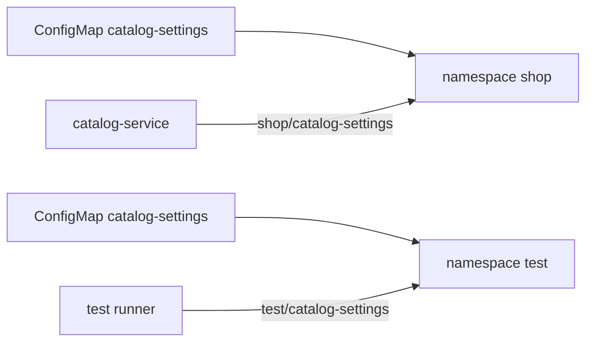
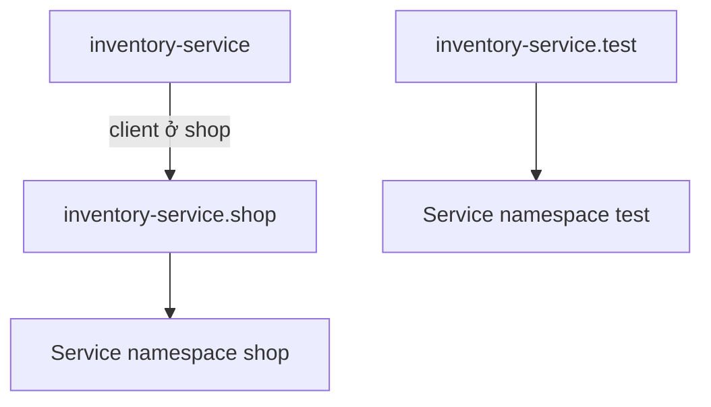

# Tên tài nguyên trùng giữa các namespace

Kubernetes cho phép nhiều namespace có tài nguyên cùng tên. `catalog-settings` trong namespace `shop` và `catalog-settings` trong namespace `test` là hai ConfigMap khác nhau. `inventory-service` trong `shop` và `inventory-service` trong `sandbox` cũng là hai Service khác nhau, dù cùng có `metadata.name`.

Bài học thuộc chương **Namespace và phạm vi** của module **Spring Cloud Kubernetes** (`SPRING_CLOUD_KUBERNETES`). Module học tích hợp ứng dụng Spring với Kubernetes qua `DiscoveryClient`, ConfigMap, Secret, Spring Cloud LoadBalancer và Configuration Watcher; hiểu phạm vi tên là điều kiện để các tính năng đó đọc đúng tài nguyên và không vô tình lấy cấu hình hoặc endpoint của môi trường khác.

Mục tiêu của bài là:

- phân biệt tên resource namespaced với resource cluster-scoped;
- hiểu namespace mặc định của request, DNS và Java client;
- thiết kế tên tham chiếu rõ ràng giữa các namespace;
- chẩn đoán `NotFound`, `Forbidden` và gọi nhầm tài nguyên cùng tên;
- giới hạn RBAC theo namespace và tránh dùng tên tài nguyên như một định danh toàn cluster.

## 1. Một tên ngắn không phải định danh đầy đủ

Định danh đầy đủ của một resource namespaced thường gồm:

```text
(apiGroup, resource, namespace, name)
```

Ví dụ hai ConfigMap:

```text
(core, configmaps, shop, catalog-settings)
(core, configmaps, test, catalog-settings)
```

Tên `catalog-settings` giống nhau nhưng namespace khác nên object khác. Với Service, địa chỉ DNS cũng chứa namespace khi cần gọi chéo namespace:

```text
inventory-service.shop
inventory-service.test
```



Một ứng dụng nhìn thấy tên ngắn qua cấu hình không thể biết đích nếu không biết namespace và API group. Vì vậy, mọi adapter Kubernetes nên coi namespace là một phần của input, không lấy ngầm từ tên resource.

## 2. Resource namespaced và cluster-scoped

Không phải mọi tài nguyên đều có namespace:

| Loại | Ví dụ | Namespace có ý nghĩa không? |
|---|---|---|
| Namespaced | Pod, Service, ConfigMap, Secret, Deployment, Role | Có |
| Cluster-scoped | Node, Namespace, PersistentVolume, ClusterRole | Không |

Một Role chỉ áp dụng trong namespace nơi Role tồn tại. Một ClusterRole không tự cấp quyền cho mọi subject nếu chưa có binding phù hợp. `RoleBinding` namespaced có thể tham chiếu ClusterRole nhưng phạm vi binding vẫn cần được đọc theo manifest thực tế.

Không thêm trường `namespace` vào resource cluster-scoped với giả định nó sẽ giới hạn object. Ngược lại, không bỏ namespace khi gọi resource namespaced nếu client không có default namespace chính xác.

## 3. Vì sao trùng tên hữu ích?

Trùng tên giữa namespace giúp mỗi môi trường giữ một hợp đồng nội bộ ổn định:

```text
shop/catalog-settings
test/catalog-settings
staging/catalog-settings
```

Deployment trong từng namespace có thể dùng cùng tên ConfigMap nhưng dữ liệu khác. Điều này thuận tiện khi manifest được template theo môi trường, nhưng cũng tạo rủi ro nếu ứng dụng gọi nhầm namespace.

Một mô hình thường gặp:

| Namespace | Ứng dụng | ConfigMap | Service |
|---|---|---|---|
| `shop` | catalog production-like | `catalog-settings` | `inventory-service` |
| `test` | catalog integration test | `catalog-settings` | `inventory-service` |
| `sandbox` | catalog developer | `catalog-settings` | `inventory-service` |

Tên ngắn ổn định giúp code không đổi giữa môi trường. Namespace phải được inject từ Deployment, context hoặc profile triển khai. Không đưa namespace production cố định vào mã Java nếu cùng image chạy nhiều môi trường.

## 4. Namespace trong ConfigMap và Secret

Một Pod chỉ có thể tham chiếu ConfigMap/Secret cùng namespace trong các trường `configMapKeyRef`, `secretKeyRef` hoặc volume reference thông thường. Ví dụ Deployment trong `shop` tham chiếu:

```yaml
env:
  - name: CATALOG_MESSAGE
    valueFrom:
      configMapKeyRef:
        name: catalog-settings
        key: welcome-message
```

Kubernetes tìm `catalog-settings` trong namespace của Pod, không tìm object cùng tên ở `test`.

Volume cũng dùng tên resource trong namespace của Pod:

```yaml
volumes:
  - name: catalog-config
    configMap:
      name: catalog-settings
```

Nếu Pod cần đọc ConfigMap/Secret khác namespace qua API, ứng dụng phải gọi API với namespace rõ ràng và ServiceAccount phải có quyền ở namespace đích. Không thể dùng volume reference để vượt qua phạm vi namespace.

## 5. DNS Service khi trùng tên

Service cung cấp DNS theo dạng ngắn và đầy đủ. Nếu `catalog-service` ở `shop` gọi `inventory-service`, resolver thường tìm trong namespace hiện tại trước. Nếu gọi Service cùng tên ở `test`, phải chỉ rõ namespace:

```text
http://inventory-service.shop:8080
http://inventory-service.test:8080
```

Tên đầy đủ thường có dạng:

```text
inventory-service.shop.svc.cluster.local
```

Miền cluster có thể được cấu hình khác, nên không coi `cluster.local` là giá trị bất biến trong mọi cluster.



Nếu client ở `shop` gọi `inventory-service` mà response sai, chưa thể kết luận Service hỏng. Có thể client đang gọi đúng tên nhưng backend của `shop` khác backend của `test`, hoặc cấu hình base URL trỏ nhầm namespace.

## 6. Namespace mặc định trong Java client

Java client thường có thể nhận namespace ở nhiều lớp:

```text
1. Namespace truyền trực tiếp trong request
2. Namespace đặt trên resource operation/client scope
3. Namespace từ kubeconfig context hoặc in-cluster config
4. Namespace default của thư viện
```

Thứ tự và API cụ thể phụ thuộc Fabric8, Kubernetes Java Client và version. Khi request không ghi namespace, hãy biết chắc giá trị nào được dùng.

Ví dụ ý tưởng với fluent client:

```java
ConfigMap settings = client.configMaps()
        .inNamespace("shop")
        .withName("catalog-settings")
        .get();
```

Đây an toàn hơn việc phụ thuộc vào namespace mặc định ẩn trong khi adapter nghiệp vụ đang xử lý nhiều môi trường. Nếu namespace lấy từ cấu hình, validate giá trị và không cho input người dùng tự do chọn namespace có quyền rộng.

Với client ngoài cluster, namespace trong kubeconfig context có thể chỉ là default. Nó không thay thế việc chỉ rõ namespace mà tính năng yêu cầu, đặc biệt khi discovery hoặc configuration đọc chéo namespace.

## 7. Tên trùng và Spring `Environment`

Spring có thể nhận cấu hình từ file đóng gói, biến môi trường, ConfigMap mount hoặc Kubernetes API. Nếu hai ConfigMap cùng tên ở hai namespace, Java client phải chọn namespace trước khi dữ liệu đến `Environment`.

```text
application startup
  → namespace được chọn
  → đọc namespace/catalog-settings
  → parse dữ liệu
  → Spring Environment
  → bean cấu hình
```

Một giá trị đúng định dạng từ sai namespace vẫn có thể bind thành công. Đây là dạng lỗi khó phát hiện: ứng dụng không crash nhưng hành vi khác môi trường mong đợi.

Nên ghi log an toàn các metadata như:

```text
config-resource=catalog-settings
config-namespace=shop
config-source=api
```

Không ghi Secret value hoặc toàn bộ object ConfigMap nếu có dữ liệu nhạy cảm. Nếu cấu hình được mount thành file, đường dẫn file không nói lên namespace; cần đối chiếu volume source của Pod.

## 8. Discovery và namespace

`DiscoveryClient` có thể tìm Service trong một namespace hoặc nhiều namespace tùy cấu hình và quyền. Khi có hai Service cùng tên, danh sách discovery cần giữ đủ thông tin namespace hoặc quy ước lọc rõ ràng.

```text
inventory-service/shop
inventory-service/test
```

Nếu adapter chỉ lưu tên `inventory-service` mà bỏ namespace, việc chọn instance có thể không xác định. Một DTO nội bộ nên giữ ít nhất:

```java
record DiscoveredTarget(
        String serviceName,
        String namespace,
        String host,
        int port,
        boolean ready) {
}
```

Khi dùng Spring Cloud LoadBalancer, service identifier thường cần một quy ước duy nhất. Nếu nhiều namespace cùng được khám phá, hãy quyết định namespace nằm trong service ID, trong filter hoặc trong một client riêng. Không để hai Service trùng tên cùng lọt vào một pool mà không có ý định.

Discovery cũng cần quyền đúng scope:

```yaml
rules:
  - apiGroups: [""]
    resources: ["services", "endpoints"]
    verbs: ["get", "list", "watch"]
  - apiGroups: ["discovery.k8s.io"]
    resources: ["endpointslices"]
    verbs: ["get", "list", "watch"]
```

Nếu Role chỉ ở `shop`, client không thể tự do list Service trong `test`. Cấp ClusterRole chỉ vì có nhiều namespace làm tăng phạm vi quyền và làm lỗi cấu hình khó phát hiện hơn.

## 9. RBAC và phạm vi namespace

Ví dụ Role chỉ đọc ConfigMap trong `shop`:

```yaml
apiVersion: rbac.authorization.k8s.io/v1
kind: Role
metadata:
  name: catalog-config-reader
  namespace: shop
rules:
  - apiGroups: [""]
    resources: ["configmaps"]
    verbs: ["get", "list", "watch"]
```

RoleBinding cũng phải nằm trong `shop` để cấp quyền namespaced cho Pod:

```yaml
apiVersion: rbac.authorization.k8s.io/v1
kind: RoleBinding
metadata:
  name: catalog-config-reader
  namespace: shop
subjects:
  - kind: ServiceAccount
    name: catalog-app
    namespace: shop
roleRef:
  apiGroup: rbac.authorization.k8s.io
  kind: Role
  name: catalog-config-reader
```

Binding này không cấp quyền đọc `test/catalog-settings`. Nếu ứng dụng thật sự cần hai namespace, có thể dùng hai RoleBinding giới hạn hoặc một thiết kế ClusterRoleBinding đã được review, nhưng phải coi đó là mở rộng phạm vi có chủ đích.

## 10. Cross-namespace reference không phải lúc nào cũng được phép

Một số resource field hỗ trợ tên resource nhưng không hỗ trợ namespace khác. Ví dụ Pod ở `shop` không thể dùng `configMapKeyRef` để tham chiếu ConfigMap ở `test` bằng cách viết `test/catalog-settings` trong trường `name`. Trường đó là tên object trong namespace của Pod.

Khi cần dùng dữ liệu khác namespace, có các hướng:

| Hướng | Đặc điểm |
|---|---|
| Sao chép dữ liệu vào namespace ứng dụng | Rõ phạm vi, cần cơ chế đồng bộ |
| Đọc qua Kubernetes API | Cần client, RBAC cross-namespace và xử lý cache |
| Dùng dịch vụ cấu hình trung tâm | Tách vòng đời, thêm dependency mạng |
| Dùng Secret/config mount của chính namespace | Đơn giản cho runtime, quản lý phân phối riêng |

Không nhúng namespace khác vào tên field rồi mong Kubernetes tự resolve. Đọc qua API cũng không nên mở quyền toàn cluster nếu chỉ cần một vài namespace.

## 11. Namespace trong môi trường triển khai

Có thể dùng cùng manifest logic cho nhiều namespace bằng cách template giá trị:

```yaml
metadata:
  name: catalog-settings
  namespace: ${TARGET_NAMESPACE}
```

Cách thay thế biến phụ thuộc công cụ triển khai; đoạn trên là minh họa. Điều cần kiểm soát là mọi resource liên quan dùng cùng namespace mục tiêu:

```text
Deployment namespace N
  → ServiceAccount namespace N
  → ConfigMap/Secret namespace N
  → Service namespace N
  → Role/RoleBinding namespace N
```

Một Deployment ở `shop` và Service ở `test` có thể đều apply thành công nhưng không tạo ra hệ thống như mong muốn. Tương tự, RoleBinding ở `shop` không cấp quyền cho ServiceAccount `catalog-app` ở `test` nếu subject namespace sai.

## 12. Kiểm chứng khi có tên trùng

Khi ứng dụng đọc nhầm tài nguyên, kiểm tra đầy đủ khóa định danh:

```text
cluster/API server
apiGroup
resource type
namespace
name
resourceVersion nếu cần
```

Một quy trình:

1. Xác định Pod và ServiceAccount đang chạy.
2. Xác định namespace Pod từ metadata runtime.
3. Xác định namespace client truyền vào request.
4. Ghi tên resource và API group.
5. Đối chiếu object ở từng namespace có cùng tên.
6. Kiểm tra Role/RoleBinding của identity.
7. Kiểm tra dữ liệu không nhạy cảm hoặc metadata để chứng minh nguồn.

Nếu dùng kubeconfig ngoài cluster, kiểm tra thêm context và endpoint. Nhiều lỗi “đọc nhầm namespace” thực chất là client đang gọi cluster khác nhưng resource name vẫn tồn tại.

## 13. Ma trận triệu chứng

| Triệu chứng | Nguyên nhân có thể | Cách phân biệt |
|---|---|---|
| `NotFound` dù resource “đang tồn tại” | Đúng tên nhưng sai namespace/cluster | In metadata cluster/namespace an toàn |
| Đọc thành công nhưng cấu hình sai | Trùng tên ở namespace khác | So sánh giá trị không nhạy cảm và namespace request |
| DNS gọi đúng tên nhưng backend sai | Service cùng tên ở namespace hiện tại | Dùng FQDN/namespace rõ ràng |
| `Forbidden` khi đọc namespace khác | Role chỉ bao phủ namespace hiện tại | AccessReview với namespace đích |
| Pod không mount được ConfigMap | ConfigMap khác namespace hoặc key sai | Volume reference luôn theo namespace Pod |
| Discovery thiếu instance | Quyền/resource/namespace filter sai | Kiểm tra Service, EndpointSlice và readiness |
| CI đọc khác local | Context/current namespace khác | Log context/endpoint đã lọc |
| Watch nhận thay đổi sai môi trường | Watch scope quá rộng hoặc namespace sai | Ghi resource + namespace trong event |

`NotFound` và `Forbidden` không nên gộp thành một lỗi “resource không dùng được”. `NotFound` có thể là tên sai hoặc namespace sai; `Forbidden` cho biết request đã bị từ chối bởi authorization.

## 14. Thiết kế configuration property rõ phạm vi

Một cấu hình ứng dụng có thể giữ namespace như một thuộc tính riêng:

```yaml
spring:
  cloud:
    kubernetes:
      client:
        namespace: shop

catalog:
  settings:
    name: catalog-settings
    namespace: shop
```

Tên property minh họa cần map theo starter/version thực tế. Nếu namespace dùng chung, tránh khai báo hai giá trị độc lập có thể lệch nhau. Có thể tạo một cấu hình nội bộ:

```java
record KubernetesResourceRef(String namespace, String name) {
    KubernetesResourceRef {
        if (namespace == null || namespace.isBlank()) {
            throw new IllegalArgumentException("namespace is required");
        }
        if (name == null || name.isBlank()) {
            throw new IllegalArgumentException("resource name is required");
        }
    }
}
```

Adapter nhận `KubernetesResourceRef` thay vì nhận riêng name rồi lấy namespace ngầm từ global context. Điều này làm test và review dễ hơn.

## 15. Tên resource trong ConfigMap, Secret và Service

Có thể dùng cùng quy ước tên trong mỗi namespace, nhưng không nên coi tên là duy nhất toàn hệ thống:

```text
shop/catalog-settings
shop/catalog-credentials
shop/inventory-service

test/catalog-settings
test/catalog-credentials
test/inventory-service
```

Một log chỉ ghi `resource=catalog-settings` không đủ để truy nguyên. Log nên ghi `namespace=shop` và `resourceType=ConfigMap`, nhưng không ghi Secret value.

Khi tạo cache, key phải bao gồm namespace:

```text
Sai:  cache["inventory-service"]
Đúng: cache["shop/inventory-service"]
```

Nếu cache discovery bỏ namespace, dữ liệu của môi trường này có thể ghi đè môi trường kia trong cùng process hoặc cùng cache backend.

## 16. Namespace và Configuration Watcher

Watcher phải có scope rõ ràng. Nếu watcher theo dõi `catalog-settings` trong `shop`, event từ `test/catalog-settings` không nên kích hoạt refresh của Pod `shop`.

```text
watch key = (apiGroup, resource, namespace, name)
  → event MODIFIED cùng key
  → cập nhật cache/bean đúng ứng dụng
```

Nếu watch nhiều namespace, event payload hoặc cache key phải giữ namespace. Khi reconnect, resync cũng phải giữ cùng scope; không list toàn cluster rồi lọc bằng tên ngắn.

Tách watcher riêng cho từng namespace có thể đơn giản hóa RBAC và xử lý, nhưng tăng số connection. Một watcher cluster-wide có thể giảm số watch nhưng mở rộng quyền và độ phức tạp. Lựa chọn phải dựa trên số namespace, số resource và yêu cầu bảo mật.

## 17. Namespace và Spring Cloud LoadBalancer

Nếu discovery trả nhiều Service cùng tên từ nhiều namespace, LoadBalancer cần một service ID không mơ hồ. Các hướng có thể là:

```text
inventory-service@shop
inventory-service@test
```

hoặc tạo client discovery đã cố định namespace, để service ID vẫn là `inventory-service` trong từng ứng dụng. Không nên trộn hai chiến lược trong cùng một process mà không có quy tắc ưu tiên.

Khi gọi DNS trực tiếp, namespace nằm trong hostname. Khi dùng discovery, namespace có thể nằm trong filter/metadata. Hai mô hình không nên bị coi là cùng một chuỗi cấu hình:

| Mô hình | Định danh đích |
|---|---|
| DNS | `inventory-service.shop` |
| Discovery một namespace | `inventory-service` với scope `shop` |
| Discovery nhiều namespace | service ID + namespace/metadata |

## 18. Cluster-scoped resource cùng tên khác gì?

Namespace là resource cluster-scoped. Hai Namespace không thể có cùng tên trong một cluster. Node, PersistentVolume và ClusterRole cũng không được tách bằng namespace.

Điều này ảnh hưởng RBAC:

- Role namespaced không quản lý Namespace resource;
- đọc Namespace cần quyền resource cluster-scoped;
- ClusterRoleBinding có thể tạo phạm vi rất lớn;
- không dùng namespace field để “giảm phạm vi” cho cluster-scoped resource.

Nếu ứng dụng chỉ cần đọc ConfigMap trong `shop`, không cấp quyền list Namespace hoặc cluster-wide discovery trừ khi tính năng thật sự cần.

## 19. Bài lab kiểm chứng tên trùng

Một bài thực hành an toàn có thể dùng dữ liệu không nhạy cảm:

1. Tạo namespace `shop` và `test`.
2. Tạo ConfigMap `catalog-settings` trong cả hai với `environment: shop` và `environment: test`.
3. Dùng cùng một tên ngắn trong hai client có namespace khác nhau.
4. Dùng tên Service đầy đủ để gọi chéo namespace.
5. Cấp Role chỉ trong `shop` và thử đọc `test`.
6. Kiểm tra discovery với filter namespace.
7. Đổi ConfigMap `test` và xác nhận watcher `shop` không refresh.

Kết quả cần ghi lại:

```text
request namespace
resource name
identity
response status
giá trị environment không nhạy cảm
```

Không dùng Secret thật và không dùng quyền cluster-admin để làm lab.

## 20. Checklist review manifest và code

- [ ] Mọi resource namespaced có namespace rõ hoặc được suy ra từ một nguồn kiểm soát được.
- [ ] Không coi `metadata.name` là duy nhất toàn cluster.
- [ ] DNS chéo namespace dùng hostname có namespace phù hợp.
- [ ] ConfigMap/Secret reference trong Pod trỏ tới cùng namespace theo quy tắc Kubernetes.
- [ ] Client API truyền namespace rõ cho request quan trọng.
- [ ] Cache key và discovery identity bao gồm namespace khi cần.
- [ ] Role/RoleBinding đặt đúng namespace và subject.
- [ ] Quyền cross-namespace được cấp có chủ đích, không dùng wildcard tùy tiện.
- [ ] Watch event và resync giữ đầy đủ namespace scope.
- [ ] Log có resource type/name/namespace nhưng không có dữ liệu bí mật.
- [ ] Test có hai resource cùng tên ở hai namespace.
- [ ] Phân biệt `NotFound`, `Forbidden`, `Unauthorized` và lỗi DNS.

## 21. Kết luận

Tên tài nguyên trong Kubernetes chỉ có ý nghĩa đầy đủ khi đi cùng loại resource, API group và namespace nếu resource đó namespaced. Việc hai namespace có cùng `catalog-settings` hoặc `inventory-service` là bình thường; lỗi xảy ra khi ứng dụng bỏ mất namespace trong request, DNS, cache, discovery hoặc watcher.

Spring Cloud Kubernetes cần coi namespace là một phần của cấu hình và quyền. Hãy truyền scope rõ ràng, dùng DNS đầy đủ khi gọi chéo namespace, giới hạn Role theo namespace, giữ namespace trong cache/discovery key và kiểm chứng bằng identity thực tế.

Khi review một tích hợp Kubernetes, câu hỏi “resource tên gì?” chưa đủ. Câu hỏi đúng là: resource loại gì, thuộc API group nào, ở cluster nào, namespace nào, được truy cập bằng identity nào và request đang dùng verb gì. Trả lời đủ các phần đó giúp tránh đọc nhầm môi trường và giữ phạm vi quyền ở mức cần thiết.
