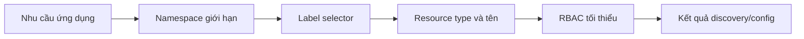

# Giảm phạm vi truy vấn bằng label và bộ lọc

## 1. Vì sao phạm vi truy vấn cần được giới hạn?

Ứng dụng Spring trong `SPRING_CLOUD_KUBERNETES` có thể truy vấn Kubernetes API để discovery, đọc ConfigMap, Secret hoặc theo dõi thay đổi. Nếu client tìm toàn bộ cluster khi chỉ cần một vài resource, chi phí request, lượng dữ liệu, quyền RBAC và nguy cơ lộ thông tin đều tăng.

Label, namespace và bộ lọc giúp biến nhu cầu mơ hồ như “tìm inventory service” thành truy vấn có phạm vi:



Giảm phạm vi không chỉ là tối ưu performance. Đây là quyết định bảo mật và correctness: client không nên thấy service của team khác, Secret không liên quan hoặc Pod của môi trường production khi đang chạy trong test.

## 2. Bốn lớp lọc nên phối hợp

| Lớp | Câu hỏi | Ví dụ |
| --- | --- | --- |
| Namespace | Tìm trong phạm vi nào? | `orders-test` |
| Resource type | Tìm loại object nào? | Service, ConfigMap, Secret |
| Label selector | Chỉ chọn nhóm nào? | `app.kubernetes.io/part-of=commerce` |
| Tên hoặc field | Có cần một object cụ thể? | `order-settings` |

Namespace thường là lớp lọc đầu tiên. Label giúp chọn nhóm resource trong namespace. Tên resource là bộ lọc hẹp nhất khi ứng dụng biết chính xác object cần đọc. Không phải mọi API hoặc starter hỗ trợ cùng một loại selector; phải kiểm tra implementation và version.

## 3. Thiết kế label có thể truy vấn

Label cần có ý nghĩa ổn định và được đặt nhất quán:

```yaml
metadata:
  labels:
    app.kubernetes.io/name: order-service
    app.kubernetes.io/instance: orders-test
    app.kubernetes.io/component: backend
    app.kubernetes.io/part-of: commerce
    environment: test
```

Label `name` nhận diện ứng dụng, `instance` phân biệt bản triển khai, `component` mô tả vai trò, `part-of` nhóm hệ thống và `environment` tách môi trường. Chọn các label mà controller và công cụ thực sự dùng; không nhồi thông tin dài hoặc nhạy cảm vào label.

Label selector dùng dữ liệu có cấu trúc để chọn object. Annotation phù hợp cho thông tin bổ sung nhưng không thay thế selector. Nếu cần lọc Service theo nhóm, đặt label trên Service; nếu cần lọc Pod, đặt label trên Pod template.

## 4. Namespace trước, label sau

Ví dụ chỉ tìm Service trong namespace test:

```text
Namespace: orders-test
Selector: app.kubernetes.io/part-of=commerce
Resource: Service
```

Trong ứng dụng, namespace cần được cấu hình tường minh theo profile hoặc môi trường. Không để local kubeconfig quyết định namespace production ngầm định. Namespace của Pod cũng cần khớp với nơi đặt ConfigMap, Secret và Service mà client cần đọc.

Đọc nhiều namespace có thể là yêu cầu hợp lệ, nhưng phải khai báo rõ danh sách và cấp quyền tương ứng. Đừng mở `all namespaces` chỉ vì một namespace cụ thể đang trả rỗng; trước hết kiểm tra tên, selector, RBAC và readiness.

## 5. Selector bằng và selector tập hợp

Selector bằng:

```text
app.kubernetes.io/name=order-service
environment=test
```

Selector tập hợp:

```text
environment in (test, staging)
tier notin (batch)
```

Selector bằng phù hợp khi muốn một giá trị chính xác. Selector tập hợp hữu ích khi một nhóm môi trường dùng cùng policy, nhưng phạm vi lớn hơn và dễ chọn nhầm nếu label không nhất quán.

Không phải mọi API client hoặc starter nhận selector dưới cùng một property. Một số integration lọc Service bằng label; một số chỉ hỗ trợ namespace, name hoặc annotation theo model riêng. Cần phân biệt selector được Kubernetes API hỗ trợ với bộ lọc mà Spring Cloud Kubernetes implementation thực sự truyền xuống.

## 6. DiscoveryClient và bộ lọc service

DiscoveryClient có thể cung cấp danh sách ServiceInstance cho ứng dụng. Khi dùng Spring Cloud Kubernetes, cần xác định resource nào được đọc, namespace nào được tìm và label nào lọc service.

```text
Discovery scope:
  namespace = orders-test
  service label = app.kubernetes.io/part-of=commerce
  environment = test
  readiness = chỉ nhận endpoint đủ điều kiện
```

Không suy luận rằng DiscoveryClient luôn đọc Pod trực tiếp. Một implementation có thể dựa trên Service hoặc resource liên quan. Vì vậy, bộ lọc label phải được đặt trên đúng object mà implementation dùng.

Spring Cloud LoadBalancer chỉ chọn trong danh sách instance discovery cung cấp. Nếu danh sách đã chứa resource sai namespace hoặc sai môi trường, LoadBalancer không tự sửa. Hãy kiểm tra scope trước khi tinh chỉnh chiến lược chọn instance.

## 7. ConfigMap và Secret: dùng tên khi biết chính xác

Nếu ứng dụng chỉ cần một ConfigMap cụ thể, đọc theo tên thường hẹp hơn list tất cả ConfigMap rồi lọc trong code:

```yaml
apiVersion: v1
kind: ConfigMap
metadata:
  name: order-settings
  namespace: orders-test
  labels:
    app.kubernetes.io/name: order-service
data:
  orders.max-items: "20"
```

Pod cùng namespace có thể tham chiếu ConfigMap theo tên:

```yaml
envFrom:
  - configMapRef:
      name: order-settings
```

Secret cũng cần scope tên và namespace rõ ràng. Không list mọi Secret để tìm key cần dùng. Với dữ liệu nhạy cảm, giảm phạm vi truy vấn cũng giảm khả năng client nhìn thấy dữ liệu không liên quan.

Nếu Configuration Watcher cần theo dõi nhóm ConfigMap, label selector có thể hữu ích khi implementation hỗ trợ. Nếu chỉ một ConfigMap, watch theo tên hoặc resource cụ thể thường dễ audit hơn watch toàn namespace.

## 8. RBAC phải khớp với bộ lọc

Label selector không thay thế RBAC. Selector giới hạn kết quả mà client yêu cầu; RBAC quyết định client có được gọi API hay không.

```yaml
apiVersion: rbac.authorization.k8s.io/v1
kind: Role
metadata:
  name: order-config-reader
  namespace: orders-test
rules:
  - apiGroups: [""]
    resources: ["configmaps"]
    resourceNames: ["order-settings"]
    verbs: ["get"]
```

Quyền `resourceNames` phù hợp khi ứng dụng biết chính xác ConfigMap. Nếu implementation cần `list` để lọc theo label, Role phải có quyền list; khi đó cần cân nhắc liệu list toàn namespace có lộ metadata quá rộng hay không.

Không cấp `cluster-admin` để sửa lỗi selector. Không cấp `list` trên Secret nếu ứng dụng chỉ cần `get` một Secret. Bộ lọc và quyền cần được thiết kế cùng nhau.

## 9. List, get và watch không giống nhau

| Thao tác | Mục đích | Rủi ro phạm vi |
| --- | --- | --- |
| `get` theo tên | Đọc một resource biết tên | Hẹp nhất |
| `list` có selector | Lấy nhóm resource | Có thể trả metadata lớn |
| `list` không selector | Lấy toàn bộ resource trong scope | Rộng, tốn API và quyền |
| `watch` có selector | Theo dõi thay đổi của nhóm | Kết nối dài và event liên tục |
| `watch` rộng | Theo dõi nhiều resource | Tăng tải và khó audit |

Chọn thao tác theo yêu cầu. Một watcher cần resync có thể dùng list định kỳ, nhưng khoảng scope phải được giới hạn. Một request khởi động chỉ cần một ConfigMap cụ thể không nên mở watch toàn namespace.

## 10. Bộ lọc và namespace theo profile

Profile local, test và cluster nên có scope riêng:

```yaml
# application-test.yml
app:
  kubernetes:
    namespace: orders-test
    service-selector: app.kubernetes.io/part-of=commerce
```

```yaml
# application-prod.yml
app:
  kubernetes:
    namespace: orders-prod
    service-selector: app.kubernetes.io/part-of=commerce
```

`app.kubernetes.*` trong ví dụ là cấu hình của ứng dụng, không phải tên property mặc định của integration. Property Spring Cloud Kubernetes phải dùng đúng tên được version hỗ trợ.

Không đặt selector production trong image dùng cho test. Deployment hoặc ConfigMap của môi trường nên cung cấp namespace và selector. Đồng thời cần kiểm tra giá trị hiệu lực khi nhiều nguồn cấu hình cùng có key.

## 11. Tránh lọc trong code sau khi list toàn bộ

Một anti-pattern là gọi list toàn namespace rồi dùng Java stream lọc `app` hoặc `environment`. Cách này làm client nhận dữ liệu không cần thiết, cần quyền rộng và có thể lộ metadata trước khi lọc.

Đường tốt hơn là đưa selector xuống API nếu client và implementation hỗ trợ:

```text
API request:
  namespace = orders-test
  labelSelector = app.kubernetes.io/name=order-service

Ứng dụng nhận:
  chỉ các resource phù hợp scope
```

Nếu starter không hỗ trợ selector cần thiết, cân nhắc đọc resource theo tên, thay đổi label contract hoặc tạo adapter giới hạn dữ liệu. Không coi lọc sau khi nhận dữ liệu là tương đương với giới hạn truy vấn ở server.

## 12. Annotation không phải selector

Annotation có thể chứa checksum, mã release hoặc chỉ thị cho controller. Service và DiscoveryClient chỉ lọc theo annotation nếu implementation cụ thể hỗ trợ điều đó. Không đặt tiêu chí chọn vào annotation rồi kỳ vọng selector label sẽ đọc được.

```yaml
metadata:
  labels:
    app.kubernetes.io/name: order-service
  annotations:
    app.example.com/release: "2026.11.24.1"
```

Trong ví dụ, label dùng để chọn service; annotation chỉ để quan sát hoặc xử lý bởi controller hỗ trợ khóa đó. Dữ liệu nhạy cảm không nên nằm ở label hoặc annotation.

## 13. Bộ lọc cho Service và Pod

Service selector thường chọn Pod. Discovery có thể đọc Service. Hai lớp này cần label nhất quán nhưng không nhất thiết cùng selector:

```yaml
apiVersion: v1
kind: Service
metadata:
  name: order-service
  namespace: orders-test
  labels:
    app.kubernetes.io/name: order-service
    app.kubernetes.io/part-of: commerce
spec:
  selector:
    app.kubernetes.io/name: order-service
    environment: test
```

Pod template phải có các label mà Service selector yêu cầu. Nếu DiscoveryClient lọc Service bằng `part-of=commerce`, Service cũng phải mang label đó. Nếu Service selector lọc Pod bằng `environment=test`, Pod phải có label tương ứng.

Thay đổi label nhận diện có thể làm endpoint biến mất hoặc discovery không còn thấy service. Review label change như thay đổi behavior, không chỉ là chỉnh metadata.

## 14. Bộ lọc và readiness

Label chỉ nói resource thuộc nhóm nào; readiness nói Pod có sẵn sàng phục vụ không. Discovery hoặc Service cần kết hợp hai khía cạnh theo behavior của implementation:

```text
Đúng namespace + đúng label + đúng selector + Pod Ready
        → endpoint có thể phục vụ
```

Pod có label đúng nhưng readiness fail không nên được coi là endpoint tốt. Ngược lại, Pod Ready không sửa được label sai. Khi discovery rỗng, kiểm tra cả scope, selector và trạng thái endpoint.

## 15. Configuration Watcher và bộ lọc

Watcher cần giới hạn namespace và resource để không nhận mọi thay đổi. Nếu watch theo label, label phải ổn định trong suốt vòng đời resource. Nếu label được thay đổi giữa rollout, watcher có thể ngừng theo dõi resource hoặc nhận resource mới ngoài dự kiến.

Kiểm thử watcher theo các trường hợp:

1. Resource đúng namespace và đúng label tạo event.
2. Resource namespace khác không tạo event cho ứng dụng.
3. Resource không có label không bị chọn nếu selector yêu cầu label.
4. Thay đổi data kích hoạt đúng đường refresh.
5. Reconnect không tạo watcher trùng.
6. Event không chứa Secret value trong log.

Không giả định mọi version có cùng property filter. Đọc tài liệu của release đang dùng và kiểm tra behavior trong namespace test.

## 16. Cross-namespace và bộ lọc

Đọc nhiều namespace có thể hợp lệ cho một nền tảng dùng chung, nhưng phải có danh sách rõ:

```text
discovery namespaces = [orders-test, inventory-test]
config namespace     = orders-test
secret namespace     = orders-test
```

Không dùng `all namespaces` nếu chỉ cần hai namespace. Multi-namespace có thể yêu cầu ClusterRole hoặc nhiều RoleBinding, làm quyền và audit phức tạp hơn.

Cross-namespace gọi Service bằng DNS là một chuyện; cross-namespace list Secret hoặc ConfigMap qua API là chuyện khác. Cả hai cần NetworkPolicy hoặc RBAC phù hợp theo đường đi tương ứng.

## 17. Quan sát và chẩn đoán

| Hiện tượng | Kiểm tra |
| --- | --- |
| Discovery thấy quá nhiều service | Namespace, label selector và resource type |
| Discovery rỗng | Namespace, selector, readiness, RBAC và implementation |
| ConfigMap không được đọc | Tên, namespace, key và quyền get/list |
| Watcher nhận event không liên quan | Scope, selector và label resource |
| `403 Forbidden` sau khi thêm filter | Verb cần cho selector và RoleBinding |
| API server quá tải | List/watch scope, số Pod và retry |
| Gọi nhầm môi trường | Profile, DNS đầy đủ và label environment |

Các lệnh chẩn đoán minh họa:

```text
kubectl get services -n orders-test -l app.kubernetes.io/part-of=commerce
kubectl get pods -n orders-test -l app.kubernetes.io/name=order-service
kubectl get configmaps -n orders-test -l app.kubernetes.io/name=order-service
kubectl auth can-i list services --as=system:serviceaccount:orders-test:order-service -n orders-test
```

Luôn chỉ rõ namespace và selector khi kiểm tra. Một kết quả từ namespace mặc định không đại diện cho workload test hoặc production.

## 18. Kiểm thử phạm vi truy vấn

Integration test nên dùng namespace riêng và fixture có label rõ:

```yaml
apiVersion: v1
kind: Namespace
metadata:
  name: orders-it-example
  labels:
    purpose: integration
---
apiVersion: v1
kind: Service
metadata:
  name: inventory-service
  namespace: orders-it-example
  labels:
    app.kubernetes.io/part-of: commerce
    environment: test
```

Test cần chứng minh service đúng label được chọn, service khác label không được chọn và service namespace khác không lọt vào kết quả. Test cũng nên kiểm tra quyền khi selector yêu cầu list thay vì get.

Không chạy test với namespace production hoặc dùng Secret production để chứng minh filter. Cleanup theo namespace test giúp tránh fixture cũ làm sai kết quả.

## 19. Giới hạn theo bản phát hành

Khả năng truyền label selector, namespace list, resource type và watcher filter có thể thay đổi theo version Spring Cloud Kubernetes và client implementation. Khi nâng version:

1. Đọc configuration reference của version đích.
2. Xác nhận property filter còn được hỗ trợ.
3. Kiểm tra selector được gửi xuống API hay lọc sau khi list.
4. Kiểm tra RBAC cần `get`, `list` hay `watch`.
5. Chạy test nhiều namespace và label.
6. Quan sát API request, startup log và discovery result.

Không copy property filter từ blog cũ. Nếu filter không được hỗ trợ, dùng resource name, adapter rõ ràng hoặc thay đổi label contract thay vì mở scope toàn cluster.

## 20. Tự kiểm tra

### Namespace và label khác nhau thế nào?

Namespace tạo phạm vi logic; label chọn và nhóm resource trong phạm vi đó. Hai cơ chế bổ sung, không thay thế nhau.

### Selector có thay thế RBAC không?

Không. Selector giới hạn kết quả truy vấn; RBAC quyết định client có được gọi API với resource và verb đó không.

### Vì sao list toàn namespace rồi lọc trong code không tốt?

Client đã nhận dữ liệu quá rộng, cần quyền lớn hơn, tốn API và có thể lộ metadata không cần thiết. Lọc ở API hoặc đọc theo tên thường hẹp hơn.

### Có thể dùng annotation để Service chọn Pod không?

Service selector dùng label. Annotation chỉ có tác dụng nếu controller hoặc implementation cụ thể hỗ trợ nó.

### Khi nào cần multi-namespace discovery?

Khi ứng dụng thật sự cần tìm service ở nhiều namespace. Phải cấu hình danh sách rõ, cấp quyền tương ứng và test tránh lẫn môi trường.

### Label đúng có bảo đảm endpoint sẵn sàng không?

Không. Còn phải kiểm tra readiness, Service selector, port và trạng thái endpoint.

## Kết luận

Giảm phạm vi truy vấn bằng namespace, resource type, label selector và tên resource giúp `SPRING_CLOUD_KUBERNETES` giảm tải API, giảm quyền RBAC và tránh đọc nhầm dữ liệu. DiscoveryClient, ConfigMap, Secret và Configuration Watcher cần scope riêng theo chức năng; Spring Cloud LoadBalancer chỉ làm việc trên danh sách instance mà discovery cung cấp.

Hãy đưa selector xuống API khi implementation hỗ trợ, dùng `get` theo tên khi biết resource, tránh list toàn scope rồi lọc trong code, và kiểm thử label, namespace, readiness cùng RBAC trong namespace riêng. Bộ lọc rõ ràng biến phạm vi truy vấn thành một contract có thể review và vận hành.

