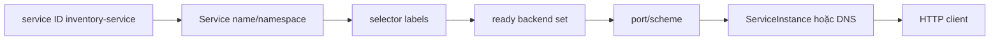

# Ánh xạ Kubernetes Service sang dịch vụ của ứng dụng

Kubernetes Service và “dịch vụ” trong ứng dụng Spring có liên quan nhưng không phải cùng một đối tượng. Kubernetes Service là tài nguyên cung cấp tên mạng, selector, port và tập backend. Dịch vụ của ứng dụng là một capability mà code gọi tới, thường được nhận diện bằng service ID, URL hoặc một client cụ thể.

Bài học thuộc chương **Khám phá dịch vụ** của module **Spring Cloud Kubernetes** (`SPRING_CLOUD_KUBERNETES`). Module học tích hợp ứng dụng Spring với Kubernetes qua `DiscoveryClient`, ConfigMap, Secret, Spring Cloud LoadBalancer và Configuration Watcher; bài này tập trung vào cách nối tên Service, namespace, port và instance Kubernetes với service identifier mà Spring dùng để gọi downstream.

Mục tiêu là hiểu đường ánh xạ:

```text
Kubernetes Service
  → Service metadata + namespace + port
  → DiscoveryClient / DNS
  → ServiceInstance hoặc base URL
  → HTTP client / LoadBalancer
  → lời gọi dịch vụ ứng dụng
```

Khi ánh xạ đúng, `catalog-service` có thể gọi `inventory-service` ổn định dù Pod backend thay đổi. Khi ánh xạ sai, ứng dụng có thể tìm thấy tên nhưng gọi nhầm port, nhầm namespace, nhầm scheme hoặc chọn instance chưa sẵn sàng.

## 1. Kubernetes Service là hợp đồng mạng

Một Service minh họa:

```yaml
apiVersion: v1
kind: Service
metadata:
  name: inventory-service
  namespace: shop
  labels:
    app.kubernetes.io/name: inventory
spec:
  selector:
    app.kubernetes.io/name: inventory
  ports:
    - name: http
      protocol: TCP
      port: 8080
      targetPort: 8081
  type: ClusterIP
```

Service này mô tả:

- tên logic là `inventory-service`;
- namespace là `shop`;
- selector chọn Pod có label `app.kubernetes.io/name: inventory`;
- client gọi cổng Service `8080`;
- backend Pod nhận ở `targetPort: 8081`;
- Service chỉ dùng nội bộ theo kiểu `ClusterIP`.

Kubernetes Service không biết controller Java nào sẽ xử lý request. Nó chỉ chuyển tiếp traffic tới backend phù hợp. Phần Spring cần biết tên logical service, scheme, port, path, timeout và cách chọn instance.

## 2. Hai mô hình ánh xạ chính

### Mô hình A: gọi DNS của Service

Ứng dụng dùng tên Service làm hostname:

```text
http://inventory-service:8080
```

Nếu `catalog-service` và `inventory-service` cùng namespace `shop`, tên ngắn thường đủ. Nếu khác namespace:

```text
http://inventory-service.shop:8080
```

Ở mô hình này, Kubernetes Service thực hiện việc chuyển tiếp tới backend. Ứng dụng không cần đọc Service/Endpoint qua Kubernetes API chỉ để biết địa chỉ.

### Mô hình B: DiscoveryClient tạo ServiceInstance

Ứng dụng đọc Service và dữ liệu endpoint qua Spring Cloud Kubernetes `DiscoveryClient`, rồi dùng `ServiceInstance` cho HTTP client hoặc Spring Cloud LoadBalancer:

```text
service ID inventory-service
  → DiscoveryClient
  → ServiceInstance(host, port, scheme, metadata)
  → LoadBalancer chọn instance
  → HTTP client gọi đích
```

Mô hình này cho phép ứng dụng có dữ liệu instance và logic chọn phía client, nhưng kéo theo RBAC, cache, watch/list và xử lý trạng thái endpoint.

| Nhu cầu | Mô hình khởi đầu phù hợp |
|---|---|
| Gọi một Service nội bộ theo tên ổn định | DNS của Kubernetes |
| Cần danh sách instance | DiscoveryClient |
| Cần chọn instance phía client | DiscoveryClient + LoadBalancer |
| Routing phức tạp ngoài code | Gateway/mesh hoặc hạ tầng routing phù hợp |

Không bật DiscoveryClient chỉ vì ứng dụng được chạy trên Kubernetes. Hãy bắt đầu từ yêu cầu ánh xạ thật.

## 3. Service name và service ID

Trong DiscoveryClient, service ID thường được dùng để tìm logical service. Service ID cần có quy tắc nhất quán:

```text
inventory-service
```

Tên này nên khớp với `metadata.name` của Kubernetes Service nếu không có lớp mapping riêng. Tránh để service ID là tên Deployment trong khi Service có tên khác, trừ khi adapter ghi rõ quy tắc chuyển đổi.

Nếu có nhiều namespace cùng chứa Service `inventory-service`, service ID chỉ có tên có thể không đủ:

```text
inventory-service@shop
inventory-service@test
```

Có thể giải quyết bằng cách cố định DiscoveryClient theo một namespace, đưa namespace vào service ID, hoặc lọc metadata trước khi LoadBalancer nhận danh sách. Điều quan trọng là không để hai Service cùng tên trộn vào cùng một pool không có quy tắc.

## 4. Từ Service tới ServiceInstance

Một `ServiceInstance` thường cần biểu diễn tối thiểu:

```text
serviceId = inventory-service
host      = địa chỉ Service hoặc địa chỉ backend
port      = cổng client được phép gọi
secure    = scheme có TLS hay không
metadata  = namespace, port name, label hoặc thông tin hỗ trợ
```

Địa chỉ và port cụ thể phụ thuộc chế độ discovery. Không được giả định `host` luôn là IP Pod. Một implementation có thể trả địa chỉ Service, một implementation/chế độ khác có thể trả endpoint backend.

Ứng dụng nên chuyển dữ liệu discovery về DTO nội bộ nếu cần:

```java
record ApplicationTarget(
        String serviceId,
        String namespace,
        String host,
        int port,
        boolean secure) {
}
```

Khi tạo target, phải kiểm tra `port` là port mà client có thể gọi. Nếu Service có `port: 8080` và `targetPort: 8081`, client DNS/Service thường gọi `8080`, không gọi trực tiếp `8081` trừ khi discovery mode chủ động trả endpoint Pod và hợp đồng đó được thiết kế rõ.

## 5. Ánh xạ port và scheme

Sai port là một lỗi ánh xạ phổ biến:

```text
Spring Boot inventory: server.port=8081
Service targetPort:    8081
Service port:          8080
Client URL:            inventory-service:8080
```

Bảng đối chiếu cần có trong review:

| Lớp | Giá trị |
|---|---|
| Tiến trình Spring Boot | Cổng bind thực tế, ví dụ `8081` |
| Pod/container | `containerPort`, tên cổng tài liệu |
| Service | `port`, ví dụ `8080` |
| Service | `targetPort`, ví dụ `8081` |
| ServiceInstance/client | Port mà client thực sự dùng |
| Probe | Port/path health check |

Nếu Service có port name `http`, adapter có thể dùng metadata để chọn đúng port khi Service có nhiều port. Không nên chọn port đầu tiên trong danh sách chỉ vì thứ tự manifest.

Scheme cũng là một phần mapping:

```text
http://inventory-service:8080
https://inventory-service:8443
```

`port: 8443` không tự chứng minh Service dùng TLS. Client cần biết scheme từ cấu hình, metadata hoặc hợp đồng ứng dụng. Gọi HTTPS tới endpoint HTTP tạo lỗi handshake; gọi HTTP tới endpoint HTTPS tạo lỗi protocol hoặc bảo mật.

## 6. Selector và tập backend

Service chỉ ánh xạ tới Pod có label khớp selector:

```yaml
spec:
  selector:
    app.kubernetes.io/name: inventory
```

Pod template phải có label tương ứng:

```yaml
spec:
  template:
    metadata:
      labels:
        app.kubernetes.io/name: inventory
```

Tên Service đúng và DNS phân giải được chưa đủ. Nếu selector sai, Service có thể không có endpoint ready. Nếu endpoint có nhưng port mapping sai, client vẫn thất bại ở tầng kết nối.



DiscoveryClient có thể cache tập instance. Khi label, readiness hoặc endpoint thay đổi, kết quả client có thể cập nhật sau một khoảng trễ. Timeout và retry phải xử lý được giai đoạn chuyển tiếp.

## 7. Readiness và instance được phép gọi

Pod `Running` không đồng nghĩa Pod đã sẵn sàng phục vụ. Readiness probe có thể loại Pod khỏi tập backend thông thường:

```yaml
readinessProbe:
  httpGet:
    path: /actuator/health/readiness
    port: 8081
  periodSeconds: 10
```

Một discovery implementation có thể trả endpoint theo cách riêng và mức độ phản ánh readiness phụ thuộc dữ liệu mà nó đọc. Ứng dụng không nên giả định mọi client đều loại Pod chưa ready ngay lập tức.

Khi endpoint đổi:

```text
readiness thay đổi
  → Kubernetes cập nhật backend
  → discovery/cache cập nhật
  → LoadBalancer chọn danh sách mới
```

Trong khoảng trễ, client có thể thử một instance cũ. Cần timeout, retry có giới hạn và xử lý lỗi kết nối. Retry không thay thế readiness hoặc sửa selector.

## 8. Namespace trong mapping

Service `inventory-service` trong `shop` và `test` là hai đích khác nhau:

```text
inventory-service.shop
inventory-service.test
```

Nếu DiscoveryClient được scope một namespace, service ID `inventory-service` có thể đủ. Nếu scope nhiều namespace, namespace phải nằm trong filter, metadata hoặc service ID.

Một cache discovery sai:

```java
Map<String, List<ServiceInstance>> cache;
// cache key chỉ dùng "inventory-service"
```

Cache đúng khi nhiều namespace:

```java
Map<String, List<ServiceInstance>> cache;
// key có dạng "shop/inventory-service"
```

Log cũng phải ghi namespace:

```text
serviceId=inventory-service namespace=shop port=8080
```

Không ghi Secret hoặc token vào metadata. Namespace là thông tin định tuyến/scope, không phải credential.

## 9. Mapping bằng DNS trong ứng dụng Spring

Nếu gọi DNS, giữ base URL trong cấu hình ngoài image:

```yaml
inventory:
  base-url: http://inventory-service.shop:8080
  connect-timeout: 500ms
  response-timeout: 2s
```

Controller/service nghiệp vụ dùng client được cấu hình theo base URL:

```java
@Service
class InventoryGateway {
    private final RestClient restClient;

    InventoryGateway(RestClient.Builder builder,
                     InventoryProperties properties) {
        this.restClient = builder
                .baseUrl(properties.baseUrl())
                .build();
    }

    Inventory find(String productId) {
        return restClient.get()
                .uri("/inventory/{id}", productId)
                .retrieve()
                .body(Inventory.class);
    }
}
```

Tên class chỉ minh họa cho mô hình MVC; client cụ thể có thể là `WebClient` hoặc client khác. Base URL phải bao gồm đúng namespace và Service port. Thời gian timeout, retry và path là một phần của mapping vận hành.

## 10. Mapping bằng DiscoveryClient

Khi dùng DiscoveryClient, ứng dụng thường gọi bằng service ID thay vì hard-code host:

```text
serviceId = inventory-service
  → discovery.getInstances(serviceId)
  → LoadBalancer chọn instance
  → HTTP client xây URI
```

Với ứng dụng reactive, pipeline có thể được biểu diễn bằng `Mono`/`Flux`; với MVC, client có thể nhận danh sách đồng bộ. Dù runtime nào, hãy xác định:

- service ID lấy từ đâu;
- DiscoveryClient scope namespace nào;
- host/port trả về là Service hay Pod;
- scheme và path được thêm ở đâu;
- ai chọn instance;
- cache cập nhật theo event hay polling.

Không để mỗi controller tự gọi DiscoveryClient và tự ghép URI. Nên có gateway/adapter duy nhất để giữ quy tắc mapping.

## 11. Spring Cloud LoadBalancer ở vị trí nào?

LoadBalancer thường nằm sau bước discovery và trước HTTP client:

```text
logical service ID
  → DiscoveryClient
  → danh sách ServiceInstance
  → Spring Cloud LoadBalancer
  → chosen instance
  → HTTP request
```

LoadBalancer không tự sửa metadata sai. Nếu danh sách có port `0`, scheme sai hoặc host không truy cập được, chiến lược chọn round-robin vẫn chọn một đích lỗi.

Khi có nhiều instance, cần xem:

| Câu hỏi | Ý nghĩa |
|---|---|
| Instance có ready không? | Tránh chọn backend chưa phục vụ |
| Port có phải port client không? | Tránh nhầm `targetPort` |
| Host có thể truy cập từ Pod nguồn không? | Network policy/routing |
| Scheme đúng không? | HTTP/TLS handshake |
| Cache có stale không? | Endpoint vừa thay đổi |

Nếu chỉ cần Kubernetes Service routing, gọi DNS có thể giảm số lớp và quyền cần thiết. Nếu cần chọn phía client, hãy xác định lý do rõ ràng và kiểm thử cache/failure.

## 12. Metadata và port name

Service có thể có nhiều port:

```yaml
ports:
  - name: http
    port: 8080
    targetPort: 8081
  - name: management
    port: 9090
    targetPort: 9091
```

Ứng dụng nghiệp vụ nên gọi port `http`, không gọi `management` chỉ vì port được liệt kê trước. Nếu discovery trả metadata port name, adapter nên lọc theo tên port yêu cầu:

```text
serviceId=inventory-service
requiredPortName=http
→ port=8080
```

Metadata label/annotation có thể hỗ trợ phân loại, nhưng không nên coi annotation tùy ý là một hợp đồng chuẩn nếu không có quy ước và validation. Khi metadata thiếu hoặc mâu thuẫn, fail fast hoặc loại instance theo policy thay vì đoán.

## 13. Cross-namespace và service ID

Nếu `catalog-service` ở `shop` gọi `inventory-service` ở `shared`, có hai cách:

```text
DNS: http://inventory-service.shared:8080
Discovery: scope=shared, serviceId=inventory-service
```

Cả hai đều cần quyền/network phù hợp. Với DiscoveryClient, Role của `catalog-app` phải cho phép đọc resource trong `shared`; Role chỉ ở `shop` không đủ.

Đừng cho phép namespace đến từ request người dùng rồi dùng nó để chọn Service tùy ý. Namespace đích nên đến từ cấu hình trusted hoặc mapping whitelist:

```yaml
downstreams:
  inventory:
    namespace: shared
    service: inventory-service
```

## 14. RBAC cho discovery

Một Role minh họa cho discovery trong namespace `shop`:

```yaml
apiVersion: rbac.authorization.k8s.io/v1
kind: Role
metadata:
  name: catalog-discovery-reader
  namespace: shop
rules:
  - apiGroups: [""]
    resources: ["services", "endpoints"]
    verbs: ["get", "list", "watch"]
  - apiGroups: ["discovery.k8s.io"]
    resources: ["endpointslices"]
    verbs: ["get", "list", "watch"]
```

Resource và verb thực tế phụ thuộc implementation/version. Nếu ứng dụng chỉ gọi DNS Service, không cần cấp quyền discovery qua API chỉ vì Service tồn tại. Nếu dùng Configuration Watcher và DiscoveryClient cùng một identity, hãy xem tổng quyền hai tính năng và cân nhắc tách ServiceAccount.

## 15. Chẩn đoán ánh xạ sai

Khi `catalog-service` không gọi được inventory, kiểm tra theo lớp:

### Lớp 1: logical mapping

Service ID hoặc base URL có đúng `inventory-service` không? Có typo hoặc tên Deployment thay cho Service không?

### Lớp 2: namespace

Client và Service ở namespace nào? Tên ngắn có trỏ đúng namespace không? Context ngoài cluster có đúng cluster không?

### Lớp 3: Service selector

Selector có khớp label Pod không? Service có endpoint ready không?

### Lớp 4: port/scheme

Client gọi `port` của Service hay nhầm `targetPort`? HTTP/HTTPS có khớp không? Path có đúng không?

### Lớp 5: discovery/RBAC

DiscoveryClient có đọc đúng resource/API group không? ServiceAccount có `list/watch` nếu implementation cần không?

### Lớp 6: runtime network

Pod nguồn có route tới host/port không? Network policy có chặn không? TLS certificate có phù hợp không?

## 16. Ma trận lỗi

| Triệu chứng | Chặng mapping cần kiểm tra |
|---|---|
| DNS không phân giải được | Tên Service, namespace, cluster DNS |
| DNS phân giải nhưng timeout | Endpoint, network policy, backend, readiness |
| Connection refused | `targetPort`, server port, listener interface |
| HTTP 404 | Path hoặc API contract của ứng dụng |
| Discovery rỗng | Service ID, namespace filter, RBAC, endpoint resource |
| Discovery có instance nhưng gọi sai | Host/port/scheme metadata |
| `Forbidden` khi list Service | Role/RoleBinding/API group/namespace |
| Gọi được test thay vì shop | Base URL, context hoặc cache key thiếu namespace |
| Một replica dùng đích khác | Cache/discovery update và thời điểm rollout |

Không sửa RBAC khi lỗi là `targetPort`. Không tăng retry khi Service selector không có backend. Không đổi service ID khi client chỉ đang gọi sai namespace.

## 17. Test mapping bằng resource không nhạy cảm

Một bài test integration có thể tạo:

```text
namespace shop
  Service inventory-service → backend shop
namespace test
  Service inventory-service → backend test
```

Client phải chứng minh:

- `inventory-service.shop` tới backend shop;
- `inventory-service.test` tới backend test;
- service ID scope `shop` không nhận instance test;
- Role chỉ đọc shop không đọc được test;
- thay đổi readiness của backend shop không làm ứng dụng gọi nhầm test.

Kết quả test nên ghi service ID, namespace, host/port đã chọn và response marker không nhạy cảm. Không dùng IP Pod cố định làm assertion vì Pod có thể thay đổi.

## 18. Một adapter mapping rõ ràng

Nên gom quy tắc mapping vào một lớp:

```java
final class InventoryServiceRef {
    private final String serviceId;
    private final String namespace;
    private final String portName;

    InventoryServiceRef(String serviceId, String namespace, String portName) {
        this.serviceId = requireText(serviceId);
        this.namespace = requireText(namespace);
        this.portName = requireText(portName);
    }

    // Adapter dùng ba giá trị này để gọi DNS hoặc DiscoveryClient.
}
```

Ở lớp adapter, kiểm tra:

```text
service ID không rỗng
namespace thuộc allowlist/cấu hình tin cậy
port name hoặc port số hợp lệ
scheme đúng policy
instance có host/port hợp lệ
```

Controller không nên tự ghép `http://` + service name + port. Cách ghép phân tán làm các endpoint khác nhau áp dụng rule khác nhau và khó audit.

## 19. Chọn DNS hay DiscoveryClient

| Câu hỏi | Nếu trả lời có | Hướng |
|---|---|---|
| Chỉ cần gọi một Service ổn định? | Có | DNS Service |
| Cần đọc danh sách instance? | Có | DiscoveryClient |
| Cần client tự chọn instance? | Có | Discovery + LoadBalancer |
| Cần routing theo namespace/metadata? | Có | Discovery với scope/filter rõ |
| Muốn giảm RBAC và connection tới API? | Có | Ưu tiên DNS nếu đáp ứng |
| Có gateway/mesh đảm nhiệm routing? | Có | Đánh giá dùng hạ tầng thay vì client-side |

DNS không cung cấp cho ứng dụng danh sách instance theo cùng cách DiscoveryClient, nhưng đổi lại mô hình đơn giản hơn. Discovery không tự tạo giá trị nếu ứng dụng không có nhu cầu sử dụng metadata/instance.

## 20. Checklist production

- [ ] Tên Service và service ID có mapping rõ ràng.
- [ ] Namespace là một phần của mapping khi cần.
- [ ] Client gọi đúng `port`, không nhầm `targetPort`.
- [ ] Scheme HTTP/HTTPS và port name được xác định rõ.
- [ ] Selector khớp label Pod.
- [ ] Readiness và endpoint cache được tính tới.
- [ ] Discovery scope không vô tình bao phủ namespace ngoài yêu cầu.
- [ ] RBAC có đúng resource, API group và verb.
- [ ] Cache key, log và event giữ namespace khi có thể trùng tên.
- [ ] Timeout, retry và connection pool có giới hạn.
- [ ] Không cho request người dùng tự chọn namespace tùy ý.
- [ ] Có test hai namespace dùng cùng tên Service.
- [ ] Log chẩn đoán không chứa Secret/token.

## 21. Kết luận

Ánh xạ Kubernetes Service sang dịch vụ ứng dụng là quá trình nối nhiều lớp: metadata và namespace của Service, selector và backend ready, port/scheme, DNS hoặc DiscoveryClient, rồi HTTP client/LoadBalancer. Tên Service đúng chỉ là điểm bắt đầu.

Ứng dụng Spring nên giữ một quy tắc mapping rõ ràng, coi namespace là một phần của định danh khi cần, dùng DNS nếu chỉ cần địa chỉ ổn định và chỉ thêm DiscoveryClient khi cần instance hoặc metadata. Khi dùng discovery, phải kiểm tra RBAC, cache, readiness và port mà `ServiceInstance` thật sự trả về.

Một mapping tốt cho phép thay Pod, scale Deployment và triển khai nhiều namespace mà caller không cần biết IP backend. Một mapping mơ hồ có thể vẫn khởi động thành công nhưng gọi sai môi trường. Hãy kiểm chứng bằng service ID, namespace, host, port, scheme và response thực tế ở đúng runtime của ứng dụng.
