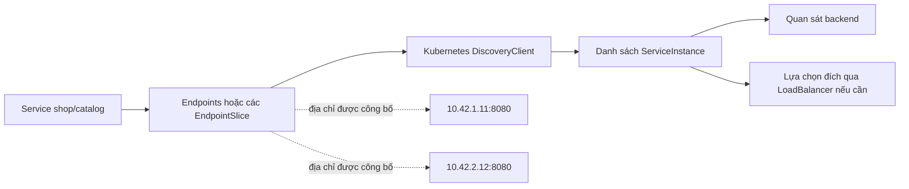

# Lấy danh sách bản sao từ tài nguyên endpoint

> Chương: Khám phá dịch vụ — Module: SPRING_CLOUD_KUBERNETES.

Một ứng dụng đặt hàng cần biết dịch vụ `catalog` hiện có những địa chỉ backend nào để quan sát hoặc lựa chọn một đích gọi. Đọc `Deployment.spec.replicas` chỉ cho biết số Pod mong muốn. Đọc địa chỉ ClusterIP của Service chỉ cho biết điểm truy cập chung. Để thấy những đích mạng cụ thể đứng sau Service, cần đọc tài nguyên endpoint hoặc sử dụng `DiscoveryClient` chuyển dữ liệu đó thành `ServiceInstance`.

Bài này tập trung vào phần khám phá dịch vụ trong Spring Cloud Kubernetes: đi từ Service đến danh sách địa chỉ, hiểu điều kiện đưa một địa chỉ vào danh sách và đọc kết quả trong ứng dụng Spring. Đây là dữ liệu đầu vào có thể dùng cho Spring Cloud LoadBalancer. ConfigMap, Secret và Configuration Watcher phục vụ bài toán cấu hình; không cần thêm các thành phần đó chỉ để liệt kê backend.

## 1. Mục tiêu và giả định của ví dụ

Sau bài học, bạn có thể:

- Phân biệt số replica mong muốn, số Pod và số đích mạng có thể khám phá.
- Đọc các nhóm địa chỉ và cổng của `Endpoints`, cũng như các địa chỉ trong `EndpointSlice`.
- Chọn địa chỉ sẵn sàng, ghép đúng cổng backend và tránh đếm trùng.
- Gọi `DiscoveryClient.getInstances("catalog")` và giải thích từng kết quả.
- Đối chiếu dữ liệu Kubernetes với kết quả Spring khi thiếu backend hoặc gặp lỗi quyền.

Ví dụ dùng namespace `shop`, Service `catalog` và các Pod ứng dụng nghe HTTP tại cổng `8080`. Các địa chỉ `10.42.x.x` bên dưới là dữ liệu minh họa. Các manifest trong bài dùng để đọc cấu trúc; chỉ những phần được ghi rõ là cấu hình triển khai mới dành cho việc áp dụng vào môi trường thực hành.

Ví dụ Java sử dụng cú pháp `record`, phù hợp với Java 17 trở lên. Ứng dụng quan sát chạy trong cluster, có Spring Web và một implementation Kubernetes DiscoveryClient. Khi khai báo dependency, cần dùng bộ phiên bản Spring Boot, Spring Cloud và Spring Cloud Kubernetes tương thích do dự án quản lý.

## 2. “Bản sao” trong kết quả khám phá thực chất là gì?

Trong bài này, một bản sao được khám phá thường tương ứng với một địa chỉ Pod và một cổng ứng dụng. Tuy nhiên, đơn vị mạng và đơn vị triển khai không luôn trùng nhau.

| Khái niệm | Ví dụ | Ý nghĩa khi đọc danh sách |
| --- | --- | --- |
| Replica mong muốn | `Deployment.spec.replicas: 3` | Mục tiêu của controller, chưa chứng minh có ba backend nhận được yêu cầu |
| Pod | `catalog-a` | Đơn vị chạy container; Pod có thể đang khởi động hoặc chưa Ready |
| Service | `shop/catalog` | Danh tính ổn định, định nghĩa selector và các cổng phục vụ |
| ClusterIP và Service port | `10.96.20.10:80` | Điểm truy cập chung của Service |
| Đích mạng backend | `10.42.1.11:8080/TCP` | Địa chỉ và cổng cụ thể được công bố qua tài nguyên endpoint |
| `ServiceInstance` | `host=10.42.1.11`, `port=8080` | Góc nhìn khám phá của Spring đối với một đích dịch vụ |

Hãy xét một Deployment mong muốn ba replica:

| Pod | Pod IP | Trạng thái tại thời điểm quan sát |
| --- | --- | --- |
| `catalog-a` | `10.42.1.11` | Ready |
| `catalog-b` | `10.42.2.12` | Ready |
| `catalog-c` | `10.42.3.13` | Chưa Ready |

Với chính sách thông thường chỉ nhận địa chỉ sẵn sàng, danh sách ứng viên HTTP có hai phần tử. Điều này không mâu thuẫn với `replicas: 3`. Một Pod đang khởi động có thể đã có IP nhưng chưa nên nhận yêu cầu nghiệp vụ.

Cũng không nên suy ngược rằng hai địa chỉ luôn là hai Pod: có thể gặp nhiều họ địa chỉ, nhiều cổng hoặc backend không phải Pod. Khi cần đếm Pod thật sự, phải xem tham chiếu Pod và UID, thay vì chỉ đếm dòng địa chỉ.

## 3. Từ Service đến tài nguyên endpoint

Service sau ánh xạ cổng truy cập `80` tới cổng có tên `http` trên các Pod mang nhãn `app: catalog`. Trong ví dụ, cổng có tên đó trên Pod là `8080`:

```yaml
apiVersion: v1
kind: Service
metadata:
  name: catalog
  namespace: shop
spec:
  selector:
    app: catalog
  ports:
    - name: http
      protocol: TCP
      port: 80
      targetPort: http
```

Với Service có selector, Kubernetes duy trì tài nguyên endpoint dựa trên các Pod phù hợp. `port: 80` là cổng của Service; khi kết nối thẳng đến Pod, địa chỉ đúng trong tình huống này là `PodIP:8080`. Không lấy `PodIP` rồi tự ghép với `80`. Cách Service liên kết selector, cổng và backend được mô tả trong [tài liệu Service của Kubernetes](https://kubernetes.io/docs/concepts/services-networking/service/).



Đây là sơ đồ luồng thông tin khám phá. Nó không biểu diễn rằng mọi HTTP request đều đi qua API server. API server cung cấp dữ liệu điều khiển; kết nối tới backend diễn ra trên đường mạng ứng dụng.

Kubernetes có hai dạng tài nguyên thường gặp:

- `Endpoints` thuộc core API `v1`, hữu ích khi đọc cấu hình hoặc hệ thống cũ.
- `EndpointSlice` thuộc `discovery.k8s.io/v1`, chia tập backend thành nhiều đối tượng.

`Endpoints` đã bị đánh dấu deprecated từ Kubernetes 1.33 và có thể bị cắt dữ liệu khi Service có hơn 1.000 backend. Khi thiết kế mới, nên ưu tiên đường đọc EndpointSlice nếu implementation đang dùng hỗ trợ. Không giả định mặc định của thư viện đã tự đổi theo lựa chọn này. Xem [giới hạn của Endpoints](https://kubernetes.io/docs/concepts/services-networking/service/#endpoints-deprecated).

## 4. Đọc cấu trúc Endpoints

Đối với Service có selector trong ví dụ, đối tượng `Endpoints` cùng tên và namespace có thể mang dữ liệu rút gọn như sau:

```yaml
apiVersion: v1
kind: Endpoints
metadata:
  name: catalog
  namespace: shop
subsets:
  - addresses:
      - ip: 10.42.1.11
        targetRef:
          kind: Pod
          namespace: shop
          name: catalog-a
      - ip: 10.42.2.12
        targetRef:
          kind: Pod
          namespace: shop
          name: catalog-b
    notReadyAddresses:
      - ip: 10.42.3.13
        targetRef:
          kind: Pod
          namespace: shop
          name: catalog-c
    ports:
      - name: http
        protocol: TCP
        port: 8080
```

Có thể đọc đối tượng thực tế bằng lệnh:

```powershell
kubectl -n shop get endpoints catalog -o yaml
```

Trong từng `subset`, `addresses` chứa địa chỉ được đánh dấu sẵn sàng, `notReadyAddresses` tách các địa chỉ chưa sẵn sàng, còn `ports` áp dụng cho nhóm đó. Một địa chỉ có thể kết hợp với nhiều cổng. `targetRef` giúp truy ngược tới đối tượng backend, nếu có. Đây là cấu trúc của [EndpointSubset trong Kubernetes API](https://kubernetes.io/docs/reference/kubernetes-api/core/endpoints-v1/#EndpointSubset).

Để lập danh sách HTTP của snapshot trên, ta chọn cổng `http/TCP` trong chính subset, ghép nó với hai địa chỉ thuộc `addresses`, rồi thu được:

```text
10.42.1.11:8080/TCP
10.42.2.12:8080/TCP
```

Một cách duyệt rõ ràng là:

```text
với mỗi subset:
    chọn port có name = http và protocol = TCP trong subset này
    nếu thiếu hoặc không xác định duy nhất được port: báo vấn đề cấu hình
    với mỗi address thuộc subset.addresses:
        thêm (namespace, service, address.ip, port.port, protocol)
loại các đích mạng trùng nhau
```

Ví dụ mở rộng: subset thứ hai có địa chỉ `10.42.4.14` và cổng `http:9090`. Kết quả cần thêm là `10.42.4.14:9090`; không được gán `8080` cho địa chỉ này chỉ vì subset đầu tiên có cổng `8080`.

Vì vậy, đọc riêng `subsets[0]` hoặc lấy một cổng dùng chung cho toàn bộ đối tượng đều có thể làm sai danh sách.

## 5. Đọc EndpointSlice và tổng hợp toàn bộ backend

Một snapshot EndpointSlice tương đương có thể là:

```yaml
apiVersion: discovery.k8s.io/v1
kind: EndpointSlice
metadata:
  name: catalog-demo-a
  namespace: shop
  labels:
    kubernetes.io/service-name: catalog
addressType: IPv4
ports:
  - name: http
    protocol: TCP
    port: 8080
endpoints:
  - addresses:
      - 10.42.1.11
    conditions:
      ready: true
      serving: true
      terminating: false
    targetRef:
      kind: Pod
      namespace: shop
      name: catalog-a
  - addresses:
      - 10.42.2.12
    conditions:
      ready: true
      serving: true
      terminating: false
    targetRef:
      kind: Pod
      namespace: shop
      name: catalog-b
  - addresses:
      - 10.42.3.13
    conditions:
      ready: false
      serving: false
      terminating: false
    targetRef:
      kind: Pod
      namespace: shop
      name: catalog-c
```

Đừng tìm EndpointSlice theo tên bằng đúng tên Service. Hãy chọn tất cả slice có nhãn liên kết với Service:

```powershell
kubectl -n shop get endpointslices -l kubernetes.io/service-name=catalog -o wide
kubectl -n shop get endpointslices -l kubernetes.io/service-name=catalog -o yaml
```

Một Service có thể liên quan nhiều slice, với các cổng hoặc họ địa chỉ khác nhau. Phải duyệt tất cả slice phù hợp và loại đích mạng trùng; trong lúc cập nhật, cùng một endpoint có thể xuất hiện ở nhiều slice. Cơ chế liên kết và yêu cầu tổng hợp này được giải thích trong [tài liệu EndpointSlices](https://kubernetes.io/docs/concepts/services-networking/endpoint-slices/).

### 5.1. Chọn endpoint theo điều kiện

| Điều kiện | Cách đọc |
| --- | --- |
| `ready` | Endpoint được đánh dấu có thể nhận lưu lượng thông thường |
| `serving` | Backend còn khả năng phục vụ, hữu ích khi xem quá trình kết thúc |
| `terminating` | Endpoint đang trong quá trình kết thúc |

Theo hợp đồng API, giá trị `ready` bị bỏ trống được diễn giải như `true`; `terminating` bị bỏ trống được diễn giải như `false`. Với bài toán tự chọn ứng viên cho yêu cầu mới, ví dụ này dùng chính sách: `ready` không phải `false` và `terminating` không phải `true`. Đây là chính sách của ví dụ, không phải cam kết mọi phiên bản DiscoveryClient lọc giống hệt. Xem [EndpointConditions](https://kubernetes.io/docs/reference/kubernetes-api/discovery/endpoint-slice-v1/#EndpointConditions).

Có một ngoại lệ cần hiểu khi diễn giải sức khỏe: nếu Service bật `publishNotReadyAddresses`, các endpoint có thể được công bố là ready dù Pod chưa thực sự sẵn sàng phục vụ nghiệp vụ. Do đó, luôn đọc điều kiện endpoint cùng cấu hình Service, không biến chữ `ready` thành bằng chứng rằng một HTTP request chắc chắn thành công. [Kubernetes mô tả ngoại lệ này trong điều kiện ready](https://kubernetes.io/docs/concepts/services-networking/endpoint-slices/#ready).

### 5.2. Khóa loại trùng phụ thuộc mục tiêu

Nếu mục tiêu là danh sách đích mạng, một khóa phù hợp là:

```text
(namespace, serviceName, addressType, address, port, protocol)
```

Nếu mục tiêu là số Pod, hãy cân nhắc khóa `(namespace, targetRef.uid)` khi `targetRef` thực sự trỏ tới Pod và có UID. Không gộp mọi endpoint thiếu UID thành cùng một Pod; cần giữ chúng trong nhóm chưa xác định được danh tính.

Ví dụ tự kiểm tra cách đếm: một Pod có một IPv4 và một IPv6 có thể đóng góp hai địa chỉ mạng nhưng vẫn chỉ là một Pod. Một backend có cổng HTTP và cổng quản trị cũng không vì vậy trở thành hai replica ứng dụng.

## 6. Tự dựng danh sách từ EndpointSlice bằng PowerShell

Đoạn sau là ví dụ dành cho người học chạy bằng tài khoản có quyền đọc namespace `shop`. Nó lấy toàn bộ slice của `catalog`, chọn IPv4 và cổng `http/TCP`, lọc endpoint theo chính sách đã nêu rồi loại trùng. Việc chỉ lấy IPv4 là lựa chọn có chủ ý cho bài thực hành này, không phải bộ đọc tổng quát cho mọi cluster.

```powershell
$namespace = 'shop'
$serviceName = 'catalog'
$portName = 'http'

$raw = kubectl -n $namespace get endpointslices `
    -l "kubernetes.io/service-name=$serviceName" -o json

if ($LASTEXITCODE -ne 0) {
    throw 'Không đọc được EndpointSlice; kiểm tra kết nối và RBAC.'
}

$sliceList = ($raw -join "`n") | ConvertFrom-Json

$candidates = foreach ($slice in @($sliceList.items)) {
    if ($slice.addressType -ne 'IPv4') {
        continue
    }

    $ports = @($slice.ports | Where-Object {
        $_.name -eq $portName -and
        $_.protocol -eq 'TCP' -and
        $null -ne $_.port
    })

    if ($ports.Count -ne 1) {
        throw "Slice $($slice.metadata.name): không xác định duy nhất cổng HTTP."
    }

    foreach ($endpoint in @($slice.endpoints)) {
        $ready = ($null -eq $endpoint.conditions.ready) -or
                 ($endpoint.conditions.ready -eq $true)
        $terminating = $endpoint.conditions.terminating -eq $true

        if (-not $ready -or $terminating) {
            continue
        }

        foreach ($address in @($endpoint.addresses)) {
            [pscustomobject]@{
                Namespace   = $namespace
                Service     = $serviceName
                AddressType = $slice.addressType
                Address     = $address
                Port        = $ports[0].port
                Protocol    = 'TCP'
            }
        }
    }
}

$instances = @($candidates | Sort-Object `
    Namespace, Service, AddressType, Address, Port, Protocol -Unique)

$instances | Format-Table
"Số đích HTTP IPv4: $($instances.Count)"
```

Với snapshot mẫu, đầu ra mong đợi là hai đích `10.42.1.11:8080` và `10.42.2.12:8080`. Đây là kết quả suy ra từ dữ liệu minh họa, không phải log chạy trên một cluster cụ thể.

Điểm cần quan sát trong mã là `$ports` được chọn bên trong vòng lặp từng slice. Một Service sử dụng named target port có thể có backend trên các cổng số khác nhau; cấu trúc mã này giữ đúng liên kết giữa địa chỉ và cổng của từng nhóm.

Lỗi API được báo bằng exception, thay vì bị biến thành “không có bản sao”. Nếu chỉ nhận được danh sách rỗng sau một lần đọc thành công, vẫn cần kiểm tra selector, namespace, họ địa chỉ và tên cổng trước khi kết luận toàn bộ ứng dụng đã dừng.

## 7. Đưa dữ liệu vào Spring DiscoveryClient

Trong ứng dụng Spring, thường nên dùng abstraction `DiscoveryClient` nếu nhu cầu chỉ là lấy các instance dịch vụ. Cách này giảm phần mã tự duyệt tài nguyên Kubernetes trong ứng dụng nghiệp vụ.

Ví dụ dưới dùng Fabric8, không triển khai thêm DiscoveryServer. Hai dependency cần có trong một dự án Spring Boot đã quản lý BOM tương thích là:

```xml
<dependency>
    <groupId>org.springframework.boot</groupId>
    <artifactId>spring-boot-starter-web</artifactId>
</dependency>
<dependency>
    <groupId>org.springframework.cloud</groupId>
    <artifactId>spring-cloud-starter-kubernetes-fabric8</artifactId>
</dependency>
```

Cấu hình sau chọn namespace `shop`, yêu cầu dùng EndpointSlice và giữ địa chỉ chưa sẵn sàng ngoài danh sách khám phá:

```yaml
spring:
  application:
    name: order-service
  cloud:
    kubernetes:
      discovery:
        enabled: true
        all-namespaces: false
        namespaces:
          - shop
        use-endpoint-slices: true
        include-not-ready-addresses: false
        primary-port-name: http
```

`primary-port-name` giúp chọn cổng khi Service có nhiều cổng; nếu Service có nhãn `primary-port-name`, cần kiểm tra cả giá trị nhãn đó. Việc bật EndpointSlice cũng đòi hỏi quyền đọc đúng API group. Các tùy chọn và starter ở đây được mô tả trong [DiscoveryClient for Kubernetes](https://docs.spring.io/spring-cloud-kubernetes/reference/discovery-client.html); hãy đối chiếu nhánh tài liệu tương ứng với phiên bản thư viện của dự án.

`spring.application.name: order-service` đặt tên ứng dụng gọi. Nó không tạo hoặc đổi tên Service `catalog` trong Kubernetes. Tên truyền cho `getInstances` trong ví dụ vẫn là tên Service cần khám phá: `catalog`.

Ứng dụng chính đặt trong package cha của controller bên dưới:

```java
package example.discovery;

import org.springframework.boot.SpringApplication;
import org.springframework.boot.autoconfigure.SpringBootApplication;
import org.springframework.cloud.client.discovery.EnableDiscoveryClient;

@SpringBootApplication
@EnableDiscoveryClient
public class DiscoveryApplication {
    public static void main(String[] args) {
        SpringApplication.run(DiscoveryApplication.class, args);
    }
}
```

Controller quan sát chỉ lấy thông tin từ danh sách khám phá, không gửi yêu cầu đến backend:

```java
package example.discovery;

import java.time.Instant;
import java.util.Comparator;
import java.util.List;

import org.springframework.cloud.client.discovery.DiscoveryClient;
import org.springframework.web.bind.annotation.GetMapping;
import org.springframework.web.bind.annotation.RestController;

@RestController
public class CatalogDiscoveryController {
    private final DiscoveryClient discoveryClient;

    public CatalogDiscoveryController(DiscoveryClient discoveryClient) {
        this.discoveryClient = discoveryClient;
    }

    @GetMapping("/internal/discovery/catalog")
    public DiscoverySnapshot catalog() {
        List<InstanceView> instances = discoveryClient.getInstances("catalog")
                .stream()
                .map(instance -> new InstanceView(
                        instance.getServiceId(),
                        instance.getInstanceId(),
                        instance.getHost(),
                        instance.getPort(),
                        instance.getUri().toString(),
                        instance.isSecure()))
                .sorted(Comparator.comparing(InstanceView::host)
                        .thenComparingInt(InstanceView::port))
                .toList();

        return new DiscoverySnapshot(Instant.now(), instances.size(), instances);
    }

    public record InstanceView(
            String serviceId,
            String instanceId,
            String host,
            int port,
            String uri,
            boolean secure) {
    }

    public record DiscoverySnapshot(
            Instant observedAt,
            int instanceCount,
            List<InstanceView> instances) {
    }
}
```

Một phần phản hồi minh họa có thể là:

```json
{
  "observedAt": "2026-11-24T03:00:00Z",
  "instanceCount": 2,
  "instances": [
    {
      "serviceId": "catalog",
      "instanceId": "example-instance-a",
      "host": "10.42.1.11",
      "port": 8080,
      "uri": "http://10.42.1.11:8080",
      "secure": false
    },
    {
      "serviceId": "catalog",
      "instanceId": "example-instance-b",
      "host": "10.42.2.12",
      "port": 8080,
      "uri": "http://10.42.2.12:8080",
      "secure": false
    }
  ]
}
```

Các `instanceId` trong JSON là giá trị giả lập; không viết mã phụ thuộc hình thức chuỗi đó. Dùng nó như một định danh do implementation cung cấp, thay vì tự phân tích chuỗi để suy tên Pod.

`observedAt` là thời điểm controller tạo phản hồi. Nó không phải thời điểm Kubernetes xác nhận sức khỏe backend, cũng không chứng minh cache vừa được đồng bộ. `instanceCount` là kích thước danh sách quan sát được, không phải trường replica của Deployment.

Endpoint `/internal/discovery/catalog` dành cho thực hành hoặc quan sát nội bộ; nếu đưa vào hệ thống thật, đặt sau cơ chế xác thực và giới hạn truy cập vì phản hồi chứa địa chỉ mạng bên trong.

## 8. Cấp quyền đọc cho ứng dụng quan sát

Một cấu hình triển khai minh họa dùng ServiceAccount riêng như sau:

```yaml
apiVersion: v1
kind: ServiceAccount
metadata:
  name: discovery-reader
  namespace: shop
---
apiVersion: rbac.authorization.k8s.io/v1
kind: Role
metadata:
  name: discovery-reader
  namespace: shop
rules:
  - apiGroups: [""]
    resources: ["services", "pods"]
    verbs: ["get", "list", "watch"]
  - apiGroups: ["discovery.k8s.io"]
    resources: ["endpointslices"]
    verbs: ["get", "list", "watch"]
---
apiVersion: rbac.authorization.k8s.io/v1
kind: RoleBinding
metadata:
  name: discovery-reader
  namespace: shop
subjects:
  - kind: ServiceAccount
    name: discovery-reader
    namespace: shop
roleRef:
  apiGroup: rbac.authorization.k8s.io
  kind: Role
  name: discovery-reader
```

Trong Pod template của Deployment chạy `order-service`, cần chỉ định:

```yaml
spec:
  template:
    spec:
      serviceAccountName: discovery-reader
```

Đoạn cuối là phần cần ghép vào Deployment hiện có, không phải một manifest Deployment đầy đủ.

Role minh họa có quyền đọc `pods` để đáp ứng các implementation hoặc tính năng metadata cần truy cập Pod; một chương trình chỉ tự đọc EndpointSlice như mục 6 không tự động cần quyền đó. Nếu dùng đường `Endpoints` cũ, bổ sung quyền đọc `endpoints` trong core API group theo nhu cầu thực tế.

Role chỉ có hiệu lực trong namespace `shop`; RoleBinding nối quyền đó với ServiceAccount. Quyền `get` một đối tượng không thay thế `list` và `watch` mà client có thể dùng để khởi tạo và duy trì dữ liệu. Không cần quyền sửa tài nguyên hay đọc Secret cho ví dụ này. Xem [hợp đồng Role và RoleBinding](https://kubernetes.io/docs/reference/access-authn-authz/rbac/).

Có thể kiểm tra quyền bằng tài khoản quản trị được phép impersonate ServiceAccount:

```powershell
kubectl auth can-i list services -n shop --as=system:serviceaccount:shop:discovery-reader
kubectl auth can-i list endpointslices.discovery.k8s.io -n shop --as=system:serviceaccount:shop:discovery-reader
kubectl auth can-i watch endpointslices.discovery.k8s.io -n shop --as=system:serviceaccount:shop:discovery-reader
```

Nếu tài khoản của bạn không có quyền impersonation, yêu cầu người vận hành thực hiện phép kiểm tra đó. Việc `kubectl get` thành công bằng tài khoản cá nhân không chứng minh Pod ứng dụng cũng đọc được API.

## 9. Đối chiếu kết quả khi backend thay đổi

Giả sử môi trường thực hành đã có Deployment `catalog`, Service ở mục 3 và Pod template khai báo đúng cổng `http:8080`. Tiến hành quan sát theo thứ tự:

```powershell
kubectl -n shop get service catalog -o yaml
kubectl -n shop get pods -l app=catalog -o wide
kubectl -n shop get endpointslices -l kubernetes.io/service-name=catalog -o yaml
```

Đầu tiên, đối chiếu selector của Service với nhãn Pod và đối chiếu tên target port. Sau đó ghi nhận địa chỉ nào được công bố, trạng thái của chúng và cổng backend thực tế. Cuối cùng so với phản hồi `/internal/discovery/catalog` của ứng dụng quan sát.

Trong một namespace thực hành được phép thay đổi số replica, có thể tăng số Pod và theo dõi:

```powershell
kubectl -n shop scale deployment catalog --replicas=4
kubectl -n shop get pods -l app=catalog -w
```

Dùng một cửa sổ terminal khác để quan sát tài nguyên endpoint:

```powershell
kubectl -n shop get endpointslices -l kubernetes.io/service-name=catalog -w
```

Sau khi kết thúc quan sát, dừng lệnh watch bằng `Ctrl+C`. Nếu bài thực hành yêu cầu khôi phục số replica, đưa Deployment về giá trị đã ghi nhận trước khi thay đổi.

Ví dụ diễn biến hợp lý khi tăng từ ba lên bốn replica:

| Thời điểm minh họa | Pod được tạo | Pod sẵn sàng | Đích HTTP có thể thấy sau khi dữ liệu hội tụ |
| --- | --- | --- | --- |
| Trước khi tăng | 3 | 3 | 3 |
| Pod mới vừa có IP | 4 | 3 | 3 |
| Pod mới vượt readiness | 4 | 4 | 4 |

Các dòng là ví dụ để giải thích, không phải cam kết thời gian cập nhật. Có độ trễ giữa trạng thái Pod, tài nguyên endpoint và dữ liệu client quan sát được. Hãy lấy các snapshot gần nhau về thời gian; đừng so dữ liệu trước khi scale với kết quả sau khi scale rồi coi đó là lỗi khám phá.

Nếu muốn thử tình huống không Ready, dùng backend thực hành có readiness probe và cơ chế làm probe thất bại một cách kiểm soát. Không tắt readiness chỉ để làm số instance bằng số replica mong muốn.

## 10. Chẩn đoán danh sách thiếu hoặc sai

| Hiện tượng | Điều cần kiểm tra trước | Cách hiểu phù hợp |
| --- | --- | --- |
| Không có slice của `catalog` | Namespace, Service có selector hay không, nhãn Pod | Có thể đang tìm nhầm phạm vi hoặc chưa có backend được công bố |
| Slice có địa chỉ nhưng danh sách HTTP rỗng | `ready`, `terminating`, `addressType`, tên và giao thức cổng | Bộ lọc có thể loại hết địa chỉ; chưa đủ để kết luận không còn Pod |
| API trả `403 Forbidden` | RoleBinding, ServiceAccount thực tế, API group và verb bị từ chối | Đây là lỗi quyền, cần xử lý riêng với kết quả rỗng hợp lệ |
| Spring thấy ít instance hơn số replica | Readiness, phạm vi discovery, snapshot và độ trễ | Số mục tiêu triển khai khác với tập backend hiện được khám phá |
| Có đúng IP nhưng gọi không được | Cổng backend, HTTP/HTTPS, listener và NetworkPolicy | Dữ liệu khám phá đúng vẫn chưa bảo đảm đường truyền thành công |
| Số đích tăng bất thường | Nhiều cổng, dual-stack, trùng slice hoặc nhiều namespace | Cần xác định lại đơn vị đếm và khóa loại trùng |
| Danh sách giữ địa chỉ cũ lâu | Watch bị ngắt, lỗi đồng bộ, lớp cache hoặc danh sách tự lưu | Kiểm tra nguồn dữ liệu và log trước khi thay đổi thời gian cache |

Đối với `403`, đọc chính tài nguyên bị từ chối trong log. Quyền đọc `endpoints` không đồng nghĩa quyền đọc `endpointslices`, vì chúng thuộc hai nhóm API khác nhau.

Với lỗi kết nối, thử từ vị trí chạy ứng dụng gọi. Việc máy cá nhân không truy cập được Pod IP không tự chứng minh Pod IP đó bị sai; đường mạng của máy cá nhân có thể khác với đường mạng bên trong cluster.

Không bắt mọi exception rồi trả danh sách rỗng để “ứng dụng vẫn chạy”. Cách xử lý đó khiến lỗi API, lỗi quyền và tình huống không còn backend trở nên khó phân biệt.

## 11. Dùng danh sách khám phá đúng mục đích

Danh sách endpoint phù hợp để quan sát backend, cung cấp ứng viên cho một bộ cân bằng tải hoặc đối chiếu hành vi khi Pod thay đổi. Nó không nên trở thành danh sách IP được sao chép vào cấu hình cố định.

Nếu ứng dụng chỉ cần gọi `http://catalog.shop.svc:80`, Service và DNS Kubernetes có thể đã đáp ứng nhu cầu. Chỉ thêm Spring Cloud Kubernetes DiscoveryClient khi cần danh sách instance hoặc cần tích hợp abstraction khám phá của Spring. Chỉ thêm Spring Cloud LoadBalancer khi thực sự cần ứng dụng tham gia lựa chọn instance.

Một danh sách có hai instance cũng không nói rằng instance đầu tiên là đích tốt nhất. Không mặc định lấy `getInstances("catalog").get(0)` cho mọi yêu cầu; thứ tự quan sát không phải thuật toán phân phối tải, và danh sách có thể rỗng.

Đối với triển khai có cache, tránh lưu vô thời hạn kết quả `getInstances` trong một biến rồi tái sử dụng. Khi Pod bị thay thế, địa chỉ cũ cần được loại khỏi tập ứng viên. Discovery phản ánh trạng thái quan sát được; timeout, xử lý lỗi kết nối và chính sách thử lại phù hợp vẫn thuộc trách nhiệm của luồng gọi dịch vụ.

Configuration Watcher theo dõi thay đổi cấu hình không phải công cụ cập nhật danh sách backend trong bài này. Không thêm quyền đọc ConfigMap hoặc Secret để sửa một lỗi thiếu quyền EndpointSlice.

## 12. Những điểm cần nhớ

- Bắt đầu từ Service và namespace cần khám phá; đi tiếp tới tài nguyên endpoint liên quan.
- Với `Endpoints`, giữ quan hệ địa chỉ–cổng trong từng subset. Với EndpointSlice, tổng hợp tất cả slice của Service.
- Chọn cổng backend và trạng thái endpoint theo mục tiêu sử dụng; đừng lấy Service port ghép tùy ý với Pod IP.
- Đếm đích mạng và đếm Pod là hai phép đo khác nhau; `replicas` còn là một số liệu khác nữa.
- `DiscoveryClient.getInstances` cung cấp góc nhìn Spring về tập instance quan sát được. Dùng RBAC đúng phạm vi và phân biệt lỗi đọc API với danh sách rỗng hợp lệ.
