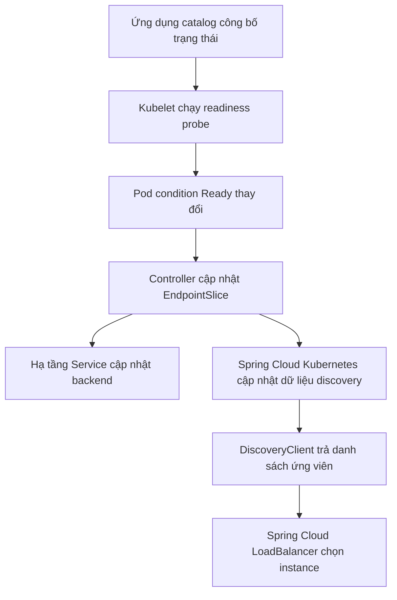

# Chỉ chọn các endpoint sẵn sàng và tác động của readiness

> Chương: Khám phá dịch vụ  
> Module: SPRING_CLOUD_KUBERNETES

Một ứng dụng có thể đã chạy, đã được cấp địa chỉ IP và đã khớp selector của Service nhưng vẫn chưa đủ điều kiện nhận yêu cầu. Với hệ thống Spring chạy trên Kubernetes, khám phá được địa chỉ chỉ là bước đầu; bên gọi còn cần một danh sách ứng viên phù hợp để chuyển lưu lượng nghiệp vụ.

Bài này tập trung vào quan hệ giữa readiness của Pod, dữ liệu endpoint của Kubernetes và các `ServiceInstance` mà Spring Cloud Kubernetes cung cấp. Các ví dụ dùng dịch vụ `orders` gọi `catalog`; cả hai nằm trong namespace `readiness-lab`. Nội dung nằm trong phạm vi tích hợp Spring với Kubernetes qua DiscoveryClient, theo dõi sức khỏe Pod, phân quyền RBAC và lựa chọn cách cân bằng tải thực sự cần thiết.

## 1. Mục tiêu và điều kiện thực hành

Sau bài học, bạn có thể:

- Giải thích vì sao `Running`, cổng TCP mở và `Ready` là những tín hiệu khác nhau.
- Theo dõi một thay đổi readiness từ ứng dụng đến EndpointSlice và DiscoveryClient.
- Giữ các địa chỉ chưa sẵn sàng ngoài danh sách dùng cho lưu lượng nghiệp vụ.
- Nhận diện ảnh hưởng của `publishNotReadyAddresses`, bộ nhớ đệm và kết nối đã tồn tại.
- Thiết kế hành vi khi không còn endpoint sẵn sàng.

Ví dụ Java giả định Java 17 trở lên, một bộ Spring Boot/Spring Cloud tương thích do BOM của dự án quản lý, Spring Boot Actuator và một Kubernetes cluster có EndpointSlice API `discovery.k8s.io/v1`. Không trộn các starter của Fabric8 và Kubernetes Java Client trong cùng ví dụ. Các tên thuộc tính cần được đối chiếu với tài liệu của đúng phiên bản mà ứng dụng sử dụng.

Các đoạn mã và lệnh dưới đây là tài liệu để người học triển khai trong môi trường thử nghiệm. Chúng không phải kết quả của một lần chạy cluster được ghi nhận trong bài.

## 2. Readiness là điều kiện tiếp nhận lưu lượng

### 2.1. Ba câu hỏi khác nhau

| Tín hiệu | Câu hỏi được trả lời | Điều chưa thể kết luận |
| --- | --- | --- |
| Pod có phase `Running` | Pod đã được gán node và có container đang chạy hoặc đang khởi động lại? | Chưa chứng minh ứng dụng xử lý được yêu cầu |
| Liveness probe thành công | Container có còn hoạt động theo phép kiểm tra đã định nghĩa? | Chưa chứng minh nên tiếp nhận lưu lượng nghiệp vụ |
| Readiness probe thành công | Container có vượt qua phép kiểm tra sẵn sàng? | Chưa bảo đảm mọi đường mạng từ caller đều thông |
| Pod condition `Ready=True` | Toàn Pod đã đủ điều kiện readiness? | Chưa bảo đảm mọi bản sao dữ liệu discovery đã cập nhật |

Pod có thể `Running` trong lúc đang nạp dữ liệu. Pod cũng có thể sống bình thường nhưng cần tạm rời nhóm nhận lưu lượng.

Nếu khai báo `readinessGates`, readiness của container chưa đủ: các condition được gate tham chiếu cũng phải đạt. Vì vậy, khi tìm nguyên nhân một Pod chưa sẵn sàng, cần đọc `status.conditions` thay vì chỉ nhìn phase hoặc một HTTP endpoint. Xem [vòng đời và readiness của Pod](https://kubernetes.io/docs/concepts/workloads/pods/pod-lifecycle/).

### 2.2. Phân biệt ba loại probe

| Probe | Vai trò | Khi thất bại đến ngưỡng |
| --- | --- | --- |
| `startupProbe` | Cho ứng dụng thời gian hoàn thành khởi động | Container có thể bị khởi động lại theo restart policy |
| `livenessProbe` | Phát hiện tình trạng cần phục hồi bằng cách khởi động lại | Container có thể bị khởi động lại |
| `readinessProbe` | Tạm cho phép hoặc tạm loại container khỏi nhóm sẵn sàng | Container tiếp tục chạy; trạng thái sẵn sàng thay đổi |

Khi có startup probe, kubelet chờ probe này thành công trước khi thực hiện liveness và readiness. Readiness thất bại tự nó không yêu cầu khởi động lại container. Tham khảo [cấu hình các loại probe của Kubernetes](https://kubernetes.io/docs/tasks/configure-pod-container/configure-liveness-readiness-startup-probes/).

Trong ví dụ `catalog`, một cache riêng của từng Pod đang được dựng lại có thể là lý do tạm ngừng nhận lưu lượng. Nếu cả ba Pod cùng phụ thuộc một dịch vụ dùng chung đang lỗi, việc rút cả ba khỏi nhóm cần được cân nhắc cùng khả năng trả dữ liệu dự phòng, giới hạn tải và hành vi mà `orders` mong đợi.

## 3. Readiness đi vào danh sách endpoint như thế nào?

`Service` khai báo selector và cổng phục vụ. Với Service có selector thông thường, controller quản lý danh sách backend trong EndpointSlice. Selector quyết định Pod thuộc tập đối tượng nào; readiness góp phần quyết định endpoint đó có nên nhận lưu lượng.

Có thể hình dung đường truyền tín hiệu như sau:



Mỗi mũi tên là một bước truyền hoặc xử lý dữ liệu, không phải một giao dịch nguyên tử. Khi quan sát sự cố, nên ghi thời điểm của từng bước.

### 3.1. Endpoints và EndpointSlice

| Dữ liệu | Địa chỉ phục vụ thông thường | Địa chỉ chưa sẵn sàng |
| --- | --- | --- |
| API `Endpoints` cũ | `subsets[].addresses` | `subsets[].notReadyAddresses` |
| API `EndpointSlice` | `endpoints[].conditions.ready` mô tả readiness | Endpoint có thể vẫn tồn tại với `ready: false` |

Vì vậy, nhìn thấy IP trong một EndpointSlice không đồng nghĩa IP đó đang là ứng viên nhận lưu lượng. Cần đọc cả condition của endpoint. API Endpoints đã bị đánh dấu deprecated từ Kubernetes 1.33; các triển khai mới nên đánh giá khả năng dùng EndpointSlice của thư viện đang chạy. Xem [Service và các API endpoint](https://kubernetes.io/docs/concepts/services-networking/service/) và [cấu trúc Endpoints](https://kubernetes.io/docs/reference/kubernetes-api/core/endpoints-v1/).

### 3.2. Đọc các condition của EndpointSlice

Ví dụ dữ liệu minh họa, không phải manifest để tự áp vào tài nguyên do controller quản lý:

```yaml
endpoints:
  - addresses: ["10.42.1.10"]
    conditions:
      ready: true
      serving: true
      terminating: false
    targetRef:
      kind: Pod
      name: catalog-a
  - addresses: ["10.42.2.11"]
    conditions:
      ready: false
      serving: false
      terminating: false
    targetRef:
      kind: Pod
      name: catalog-b
```

`ready` biểu thị khả năng nhận lưu lượng theo bên quản lý endpoint. `serving` phản ánh khả năng phục vụ, còn `terminating` cho biết endpoint đang kết thúc vòng đời. Với Service thông thường, một Pod đang kết thúc có thể còn `serving: true` nhưng `ready: false`.

Không đồng nhất trường bị thiếu với `false`: hợp đồng API quy định `ready` và `serving` không có giá trị được diễn giải là true, còn `terminating` không có giá trị được diễn giải là false. Nếu tự viết bộ đọc EndpointSlice, phải tuân thủ hợp đồng này và ghép đủ các slice của cùng Service. Xem [API EndpointSlice](https://kubernetes.io/docs/reference/kubernetes-api/discovery/endpoint-slice-v1/).

## 4. Chính sách của Spring Cloud Kubernetes

### 4.1. Loại các địa chỉ chưa sẵn sàng

Cấu hình trọng tâm của bài là:

```yaml
spring:
  cloud:
    kubernetes:
      discovery:
        enabled: true
        all-namespaces: false
        namespaces:
          - readiness-lab
        include-not-ready-addresses: false
        use-endpoint-slices: true
        primary-port-name: http
```

`include-not-ready-addresses` mặc định là `false` theo tài liệu Spring Cloud Kubernetes. Đặt tường minh giúp người đọc nhận ra chính sách của caller. `use-endpoint-slices: true` chọn nguồn dữ liệu EndpointSlice khi phiên bản thư viện và cluster hỗ trợ; nó không thay thế readiness probe.

Không bật `include-not-ready-addresses: true` chỉ để danh sách có thêm địa chỉ. Tùy chọn đó hữu ích cho công cụ quan sát cần nhìn thấy instance chưa sẵn sàng, nhưng danh sách quan sát không nên được dùng nguyên trạng cho yêu cầu nghiệp vụ. Tham khảo [DiscoveryClient của Spring Cloud Kubernetes](https://docs.spring.io/spring-cloud-kubernetes/reference/discovery-client.html).

Điểm cần xác định trước khi xử lý lỗi là discovery chạy ở đâu. Ví dụ bài này dùng Fabric8 DiscoveryClient ngay trong `orders`. Với kiến trúc sử dụng DiscoveryServer và HTTP DiscoveryClient, phải kiểm tra cả cấu hình và dữ liệu tại phía server cung cấp kết quả discovery.

### 4.2. Không có một phép kiểm tra HTTP cho mỗi lần getInstances

Lời gọi:

```java
List<ServiceInstance> instances = discoveryClient.getInstances("catalog");
```

đọc danh sách do cơ chế discovery cung cấp. Không nên diễn giải lời gọi này là việc caller vừa gửi HTTP readiness probe đến từng địa chỉ. Một instance xuất hiện trong danh sách vẫn có thể thất bại khi kết nối hoặc khi xử lý nghiệp vụ.

Đây là lý do cần đồng thời có thời hạn kết nối, thời hạn đọc phản hồi và chính sách xử lý lỗi. Khi cân nhắc retry, phải xét tính an toàn của thao tác: việc gửi lại một yêu cầu tạo đơn có thể tạo tác động lặp nếu chưa có cơ chế idempotency.

## 5. Hai đường chuyển lưu lượng cần phân biệt

### 5.1. Gọi qua Service

Ví dụ `orders` gọi:

```text
http://catalog.readiness-lab.svc.cluster.local:8080/whoami
```

Đây là tên DNS của một Service ClusterIP trong ví dụ. Hạ tầng mạng Service quyết định backend cho kết nối. DNS phân giải được tên chưa chứng minh còn backend sẵn sàng; IP của Service vẫn có thể tồn tại khi không còn Pod đủ điều kiện. Với headless Service, bản ghi DNS biểu diễn các địa chỉ backend nên còn phải xét readiness và bộ nhớ đệm DNS. Xem [DNS cho Service và Pod](https://kubernetes.io/docs/concepts/services-networking/dns-pod-service/).

### 5.2. Gọi trực tiếp endpoint từ DiscoveryClient

Khi Spring Cloud LoadBalancer lấy `ServiceInstance` từ DiscoveryClient, caller có thể kết nối thẳng tới IP và cổng Pod. Quyết định chọn endpoint nằm trong ứng dụng. Một danh sách cũ tại caller có thể tiếp tục chứa địa chỉ vừa chuyển sang chưa sẵn sàng.

Starter LoadBalancer riêng của Spring Cloud Kubernetes có hai mode `POD` và `SERVICE`. Mode `POD` dùng discovery để chọn endpoint; mode `SERVICE` sử dụng địa chỉ Service. Nếu dùng starter này, cần biết mode đang chạy trước khi quy nguyên nhân cho một lớp lọc endpoint. Xem [LoadBalancer của Spring Cloud Kubernetes](https://docs.spring.io/spring-cloud-kubernetes/reference/load-balancer.html).

Trong bài thực hành bên dưới, caller dùng `spring-cloud-starter-loadbalancer` thông thường cùng Fabric8 DiscoveryClient. Không cần đặt thuộc tính mode của starter LoadBalancer riêng cho cấu hình đó.

## 6. Trường hợp publishNotReadyAddresses

Service phục vụ nghiệp vụ trong bài sử dụng:

```yaml
apiVersion: v1
kind: Service
metadata:
  name: catalog
  namespace: readiness-lab
spec:
  publishNotReadyAddresses: false
  selector:
    app: catalog
  ports:
    - name: http
      port: 8080
      targetPort: http
```

`publishNotReadyAddresses` mặc định là false. Khi đặt true, Kubernetes có thể công bố endpoint theo cách bỏ qua trạng thái chưa sẵn sàng; EndpointSlice của Service này có `ready` được đặt true ngay cả khi Pod chưa Ready. Một ứng dụng chỉ nhìn `ready` không còn suy ra được readiness thông thường của Pod.

Một nhu cầu điển hình là khám phá peer trong hệ thống phân tán lúc bootstrap. Nếu cần cơ chế này, có thể tách Service dành cho peer và Service dành cho lưu lượng nghiệp vụ, rồi kiểm tra caller đang dùng đúng tên. Xem [điều kiện readiness của EndpointSlice](https://kubernetes.io/docs/concepts/services-networking/endpoint-slices/).

Hai thuộc tính sau nằm ở hai lớp khác nhau:

| Thuộc tính | Nơi cấu hình | Ý nghĩa đối với việc lọc |
| --- | --- | --- |
| `spec.publishNotReadyAddresses` | Kubernetes Service | Ảnh hưởng dữ liệu endpoint được công bố |
| `spring.cloud.kubernetes.discovery.include-not-ready-addresses` | Ứng dụng Spring | Ảnh hưởng việc đưa địa chỉ chưa ready vào kết quả discovery |

Đặt thuộc tính Spring thành false không khôi phục thông tin readiness đã bị chính sách công bố của Service thay đổi. Trong một cuộc điều tra, phải kiểm tra cả hai.

## 7. Xây dựng backend catalog cho thí nghiệm

### 7.1. Các thành phần của ứng dụng

`catalog` cần `spring-boot-starter-web` và `spring-boot-starter-actuator`. Các lớp dưới đây đặt dưới package gốc của một ứng dụng `@SpringBootApplication`. Bật profile `readiness-lab` khi chạy ví dụ.

HealthIndicator sau cung cấp một cổng tiếp nhận lưu lượng trong bộ nhớ của từng Pod:

```java
package example.catalog;

import java.util.concurrent.atomic.AtomicBoolean;

import org.springframework.boot.actuate.health.Health;
import org.springframework.boot.actuate.health.HealthIndicator;
import org.springframework.context.annotation.Profile;
import org.springframework.stereotype.Component;

@Component("trafficAdmission")
@Profile("readiness-lab")
public class TrafficAdmissionHealthIndicator implements HealthIndicator {

    private final AtomicBoolean accepting = new AtomicBoolean(true);

    public void setAccepting(boolean value) {
        accepting.set(value);
    }

    @Override
    public Health health() {
        return accepting.get()
                ? Health.up().build()
                : Health.outOfService().build();
    }
}
```

Controller của thí nghiệm:

```java
package example.catalog;

import java.util.Map;

import org.springframework.context.annotation.Profile;
import org.springframework.web.bind.annotation.GetMapping;
import org.springframework.web.bind.annotation.PostMapping;
import org.springframework.web.bind.annotation.RequestParam;
import org.springframework.web.bind.annotation.RestController;

@RestController
@Profile("readiness-lab")
public class CatalogLabController {

    private final TrafficAdmissionHealthIndicator admission;

    public CatalogLabController(TrafficAdmissionHealthIndicator admission) {
        this.admission = admission;
    }

    @GetMapping("/whoami")
    public Map<String, String> whoami() {
        return Map.of("pod",
                System.getenv().getOrDefault("HOSTNAME", "local"));
    }

    @PostMapping("/internal/lab/readiness")
    public Map<String, Boolean> readiness(
            @RequestParam("accepting") boolean accepting) {
        admission.setAccepting(accepting);
        return Map.of("accepting", accepting);
    }
}
```

Công tắc này chỉ điều khiển health indicator. Nó không tự đóng HTTP server hay từ chối `/whoami`. Chính đặc điểm này giúp quan sát sự khác nhau giữa một Pod còn truy cập trực tiếp được và một Pod không còn được chọn qua discovery.

Endpoint điều khiển thuộc profile thử nghiệm; không đưa nó vào luồng quản trị production. Nếu ứng dụng có Spring Security, cần cấu hình quyền truy cập phù hợp cho probe và cho đường điều khiển trong môi trường lab.

### 7.2. Cấu hình health group

Nội dung minh họa cho profile `readiness-lab` của `catalog`:

```yaml
server:
  port: 8080

management:
  endpoints:
    web:
      exposure:
        include: health
  endpoint:
    health:
      probes:
        enabled: true
        add-additional-paths: true
      group:
        readiness:
          include: readinessState,trafficAdmission

spring:
  lifecycle:
    timeout-per-shutdown-phase: 20s

server.shutdown: graceful
```

Để cấu hình dễ theo dõi, cũng có thể gộp `shutdown: graceful` vào cùng mapping `server` thay cho khóa dạng dấu chấm; không khai báo hai lần cùng một thuộc tính.

Các đường probe trên cổng chính là `/livez` và `/readyz`. Readiness group ghép trạng thái readiness của Spring Boot với `trafficAdmission`; liveness không phụ thuộc công tắc này. Spring Boot không tự đưa mọi health indicator vào readiness group. Xem [health group và Kubernetes probes của Spring Boot](https://docs.spring.io/spring-boot/reference/actuator/endpoints.html).

Nếu quản trị chạy trên cổng riêng, chỉ kiểm tra cổng quản trị có thể bỏ sót lỗi tại cổng phục vụ nghiệp vụ. Việc cung cấp probe trên cổng chính làm phép thử gần hơn với đường tiếp nhận yêu cầu của ứng dụng.

### 7.3. Deployment minh họa

Thay `CATALOG_IMAGE` bằng image thực tế đã chứa ứng dụng trên. Namespace `readiness-lab` phải có sẵn.

```yaml
apiVersion: apps/v1
kind: Deployment
metadata:
  name: catalog
  namespace: readiness-lab
spec:
  replicas: 3
  selector:
    matchLabels:
      app: catalog
  strategy:
    type: RollingUpdate
    rollingUpdate:
      maxUnavailable: 0
      maxSurge: 1
  template:
    metadata:
      labels:
        app: catalog
    spec:
      terminationGracePeriodSeconds: 30
      containers:
        - name: catalog
          image: CATALOG_IMAGE
          env:
            - name: SPRING_PROFILES_ACTIVE
              value: readiness-lab
          ports:
            - name: http
              containerPort: 8080
          startupProbe:
            httpGet:
              path: /livez
              port: http
            periodSeconds: 2
            timeoutSeconds: 1
            failureThreshold: 60
          readinessProbe:
            httpGet:
              path: /readyz
              port: http
            periodSeconds: 3
            timeoutSeconds: 1
            failureThreshold: 2
            successThreshold: 1
          livenessProbe:
            httpGet:
              path: /livez
              port: http
            periodSeconds: 10
            timeoutSeconds: 1
            failureThreshold: 3
```

Các giá trị trên phục vụ quan sát: readiness cần hai lần thất bại liên tiếp, còn startup có ngân sách danh nghĩa khoảng `60 × 2 = 120` giây. Không coi đó là cam kết thời gian chính xác cho mọi node. Thời gian thật còn chịu tác động của lịch probe, timeout và tải hệ thống.

Việc đặt `maxUnavailable: 0` biểu đạt mục tiêu giữ số Pod khả dụng trong rolling update; nó không tự bảo đảm mọi yêu cầu đều thành công khi mạng hoặc ứng dụng có lỗi.

## 8. Caller orders: quan sát discovery và gọi dịch vụ

### 8.1. Dependency và quyền đọc API

`orders` cần starter web, `spring-cloud-starter-kubernetes-fabric8` và `spring-cloud-starter-loadbalancer`, với phiên bản theo bộ BOM tương thích. Cấu hình discovery dùng đoạn YAML ở mục 4.1.

Đây là quyền đọc trong một namespace cho ví dụ Fabric8 dùng EndpointSlice:

```yaml
apiVersion: v1
kind: ServiceAccount
metadata:
  name: orders-discovery
  namespace: readiness-lab
---
apiVersion: rbac.authorization.k8s.io/v1
kind: Role
metadata:
  name: orders-discovery-reader
  namespace: readiness-lab
rules:
  - apiGroups: [""]
    resources: ["services", "pods"]
    verbs: ["get", "list", "watch"]
  - apiGroups: ["discovery.k8s.io"]
    resources: ["endpointslices"]
    verbs: ["get", "list", "watch"]
---
apiVersion: rbac.authorization.k8s.io/v1
kind: RoleBinding
metadata:
  name: orders-discovery-reader
  namespace: readiness-lab
subjects:
  - kind: ServiceAccount
    name: orders-discovery
    namespace: readiness-lab
roleRef:
  apiGroup: rbac.authorization.k8s.io
  kind: Role
  name: orders-discovery-reader
```

Deployment của `orders` phải có `spec.template.spec.serviceAccountName: orders-discovery` và chạy trong namespace trên. Quyền `pods` phục vụ các truy vấn Pod của triển khai discovery; hãy đối chiếu nhu cầu cụ thể của client và các tùy chọn metadata được bật. Ví dụ này không cấp quyền đọc Secret hay ConfigMap vì chúng không cần thiết cho mục tiêu readiness.

Nếu chuyển về API Endpoints cũ, phải điều chỉnh quyền đối với `endpoints` trong API group rỗng. Không giải quyết lỗi 403 bằng cách mở quyền toàn cluster khi bài toán chỉ cần một namespace.

### 8.2. Cấu hình HTTP client có giới hạn thời gian

```java
package example.orders;

import org.springframework.cloud.client.loadbalancer.LoadBalanced;
import org.springframework.context.annotation.Bean;
import org.springframework.context.annotation.Configuration;
import org.springframework.http.client.SimpleClientHttpRequestFactory;
import org.springframework.web.client.RestTemplate;

@Configuration
public class CatalogClientConfiguration {

    @Bean
    @LoadBalanced
    RestTemplate catalogRestTemplate() {
        SimpleClientHttpRequestFactory factory =
                new SimpleClientHttpRequestFactory();
        factory.setConnectTimeout(1500);
        factory.setReadTimeout(2500);
        return new RestTemplate(factory);
    }
}
```

Hai timeout trên giới hạn từng giai đoạn kết nối và đọc; chúng không thay thế một ngân sách thời gian tổng thể nếu sau này thêm retry.

### 8.3. Endpoint quan sát và endpoint nghiệp vụ mô phỏng

```java
package example.orders;

import java.util.List;

import org.springframework.cloud.client.discovery.DiscoveryClient;
import org.springframework.context.annotation.Profile;
import org.springframework.http.HttpStatus;
import org.springframework.web.bind.annotation.GetMapping;
import org.springframework.web.bind.annotation.RestController;
import org.springframework.web.client.RestClientException;
import org.springframework.web.client.RestTemplate;
import org.springframework.web.server.ResponseStatusException;

@RestController
@Profile("readiness-lab")
public class OrdersLabController {

    private final DiscoveryClient discoveryClient;
    private final RestTemplate catalogRestTemplate;

    public OrdersLabController(DiscoveryClient discoveryClient,
                               RestTemplate catalogRestTemplate) {
        this.discoveryClient = discoveryClient;
        this.catalogRestTemplate = catalogRestTemplate;
    }

    @GetMapping("/internal/lab/instances")
    public List<InstanceView> instances() {
        return discoveryClient.getInstances("catalog").stream()
                .map(instance -> new InstanceView(
                        instance.getInstanceId(),
                        instance.getHost(),
                        instance.getPort()))
                .toList();
    }

    @GetMapping("/call")
    public String callCatalog() {
        try {
            return catalogRestTemplate.getForObject(
                    "http://catalog/whoami", String.class);
        } catch (RestClientException | IllegalStateException exception) {
            throw new ResponseStatusException(
                    HttpStatus.SERVICE_UNAVAILABLE,
                    "Catalog hiện chưa phục vụ được yêu cầu",
                    exception);
        }
    }

    public record InstanceView(String id, String host, int port) {
    }
}
```

Bật `readiness-lab` cho `orders`. Cổng HTTP trong ví dụ là 8080. Cả ứng dụng phải nằm trong cluster và có đường mạng tới IP Pod của `catalog`.

`/internal/lab/instances` cho thấy dữ liệu mà DiscoveryClient đang cung cấp. `/call` đi qua LoadBalancer. Việc endpoint quan sát đã đổi nhưng lời gọi vẫn trúng Pod cũ là dấu hiệu cần kiểm tra thêm chuỗi supplier, bộ nhớ đệm hoặc kết nối của đường gọi thực tế.

Có thể tắt riêng lớp cache của Spring Cloud LoadBalancer trong lab để dễ quan sát:

```yaml
spring:
  cloud:
    loadbalancer:
      cache:
        enabled: false
```

Gộp phần cấu hình này vào mapping `spring` hiện có. Tắt cache tại LoadBalancer không xóa các lớp lưu trạng thái khác, chẳng hạn informer hoặc bộ nhớ đệm discovery. Khi triển khai thật, lựa chọn cache cần dựa vào độ trễ chấp nhận được và số lần truy cập nguồn dữ liệu. Xem [cơ chế cache của Spring Cloud LoadBalancer](https://docs.spring.io/spring-cloud-commons/reference/spring-cloud-commons/loadbalancer.html).

## 9. Thí nghiệm thay đổi readiness của đúng một Pod

Các lệnh dưới đây dùng PowerShell. Chạy từng cửa sổ quan sát song song; không yêu cầu image của `catalog` phải có shell hoặc `curl`.

### 9.1. Chụp trạng thái ban đầu

```powershell
kubectl get pods -n readiness-lab -l app=catalog -o wide
kubectl get service catalog -n readiness-lab -o yaml
kubectl get endpointslices -n readiness-lab -l kubernetes.io/service-name=catalog -o yaml
```

Chờ ba Pod có readiness phù hợp. Ghi lại Pod name và IP; không dựa vào địa chỉ minh họa trong bài.

Quan sát thay đổi Pod:

```powershell
kubectl get pods -n readiness-lab -l app=catalog -w
```

Ở một cửa sổ khác, quan sát EndpointSlice:

```powershell
kubectl get endpointslices -n readiness-lab -l kubernetes.io/service-name=catalog -w -o yaml
```

Mỗi Service có thể có nhiều EndpointSlice. Luôn lấy toàn bộ tài nguyên khớp nhãn của Service khi đối chiếu.

### 9.2. Mở đường quan sát caller

Với Deployment `orders` đã chạy, mở port-forward ở cửa sổ riêng:

```powershell
kubectl port-forward -n readiness-lab deployment/orders 18081:8080
```

Cửa sổ gửi yêu cầu:

```powershell
curl.exe -s http://127.0.0.1:18081/internal/lab/instances
1..12 | ForEach-Object {
    curl.exe -s -H "Connection: close" http://127.0.0.1:18081/call
    Start-Sleep -Milliseconds 300
}
```

Header `Connection: close` tại đây áp dụng cho kết nối máy thử tới `orders`; không phải cam kết về mọi kết nối phía `orders` tới `catalog`. Đếm theo danh tính Pod trong kết quả, không yêu cầu từng chuỗi 12 yêu cầu phải có phân bố chính xác bằng nhau.

### 9.3. Chọn một Pod và làm readiness thất bại

Ở một cửa sổ riêng:

```powershell
$catalogPod = kubectl get pods -n readiness-lab -l app=catalog -o jsonpath='{.items[0].metadata.name}'
kubectl port-forward -n readiness-lab "pod/$catalogPod" 18080:8080
```

Giữ port-forward hoạt động. Ở cửa sổ gửi yêu cầu:

```powershell
curl.exe -i -X POST "http://127.0.0.1:18080/internal/lab/readiness?accepting=false"
curl.exe -i http://127.0.0.1:18080/readyz
curl.exe -i http://127.0.0.1:18080/livez
curl.exe -i http://127.0.0.1:18080/whoami
```

Kỳ vọng của ứng dụng mẫu:

- `/readyz` báo không sẵn sàng, thông thường HTTP 503 theo ánh xạ health mặc định.
- `/livez` vẫn thành công nếu không có vấn đề liveness khác.
- `/whoami` qua port-forward vẫn phản hồi vì controller không chặn yêu cầu trực tiếp.
- Sau ngưỡng probe và thời gian truyền trạng thái, Pod chuyển sang chưa Ready; restart count không tăng chỉ vì công tắc readiness.

Tiếp tục gọi endpoint quan sát và `/call` của `orders`. Khi dữ liệu đã hội tụ, IP của Pod được chọn không còn trong tập instance dùng cho đường gọi này, còn hai Pod khác tiếp tục phục vụ.

Không dùng việc `/whoami` qua port-forward còn trả 200 để kết luận readiness không hoạt động. Port-forward tới một Pod cụ thể đang đi vòng qua việc lựa chọn backend của Service và DiscoveryClient.

### 9.4. Cho Pod nhận lưu lượng trở lại

```powershell
curl.exe -i -X POST "http://127.0.0.1:18080/internal/lab/readiness?accepting=true"
curl.exe -i http://127.0.0.1:18080/readyz
```

Theo dõi Pod, EndpointSlice và danh sách tại `orders`. Pod cần vượt qua điều kiện thành công của probe, sau đó thay đổi mới truyền tới các thành phần còn lại.

### 9.5. Bảng ghi nhận kết quả

| Mốc | Readiness tại ứng dụng | Pod Ready | EndpointSlice | DiscoveryClient sau hội tụ | Kỳ vọng với yêu cầu mới |
| --- | --- | --- | --- | --- | --- |
| Ban đầu | Thành công | True | Ba endpoint ready | Có ba địa chỉ | Các Pod đều có thể được chọn |
| Vừa bật công tắc từ chối | Thất bại | Có thể chưa đổi | Có thể chưa đổi | Có thể còn địa chỉ cũ | Vẫn có cửa sổ trúng Pod đó |
| Thay đổi đã hội tụ | Thất bại | False | Endpoint tương ứng không ready | Còn hai địa chỉ | Chọn trong hai Pod còn lại |
| Sau phục hồi và hội tụ | Thành công | True | Endpoint ready trở lại | Có ba địa chỉ | Pod phục hồi có thể được chọn |

Đây là bảng kỳ vọng cho cấu hình lab, không phải số liệu đo được. Nếu kết quả khác, đối chiếu từng lớp trước khi thay đổi thuộc tính.

## 10. Độ trễ hội tụ và việc thoát khỏi nhóm nhận lưu lượng

Một ước lượng phục vụ phân tích:

```text
Thời gian loại địa chỉ quan sát được
≈ thời gian phát hiện bằng probe
+ thời gian cập nhật Pod và EndpointSlice
+ thời gian truyền tới discovery hoặc hạ tầng mạng
+ độ trễ do các lớp cache trên đường gọi
```

Đây là mô hình để tìm điểm chậm, không phải công thức tính SLA. Ví dụ readiness probe chạy mỗi ba giây và cần hai lần thất bại thì không thể giả định endpoint bị loại ngay lúc health indicator đổi trạng thái.

Readiness cũng không thu hồi yêu cầu đã xử lý, không tự đóng WebSocket và không tự chấm dứt mọi kết nối keep-alive tới Pod. Vì vậy, khi chuẩn bị dừng ứng dụng, hãy dành thời gian cho việc rút khỏi nhóm nhận lưu lượng và hoàn tất các yêu cầu đang chạy.

Đối với endpoint đang kết thúc, `serving` và `terminating` giúp các thành phần có hỗ trợ thực hiện drain. Một số đường mạng Service có thể xử lý endpoint terminating theo quy tắc riêng, chẳng hạn tiếp tục dùng endpoint còn serving khi không có lựa chọn khác. Không suy diễn hành vi của kube-proxy thành hành vi mặc định của mọi client Spring. Xem [điều kiện EndpointSlice và endpoint đang kết thúc](https://kubernetes.io/docs/concepts/services-networking/endpoint-slices/).

Trong ví dụ, ứng dụng có ngân sách shutdown 20 giây và Pod có grace period 30 giây. Nếu bổ sung `preStop` thì thời gian hook cũng tiêu tốn trong ngân sách kết thúc Pod; phải tính lại tổng thời gian thay vì thêm một khoảng ngủ tùy ý.

## 11. Khi toàn bộ endpoint đều chưa sẵn sàng

Kịch bản này cần một hành vi rõ ràng ở caller:

1. Đường gọi không có ứng viên phải thất bại trong giới hạn thời gian.
2. Caller trả phản hồi mà client phía trên hiểu được; ví dụ mẫu ánh xạ lỗi gọi `catalog` thành HTTP 503.
3. Dữ liệu cần theo dõi gồm số instance thấy được, lỗi chọn instance, timeout và trạng thái probe.
4. Nếu có retry, số lần và ngân sách thời gian phải hữu hạn; các thao tác có tác động cần cơ chế chống lặp.

Một Service không có backend sẵn sàng không tự tạo ra phản hồi HTTP 503 cho mọi đường mạng. Lỗi có thể là kết nối bị từ chối, timeout hoặc phản hồi của ingress/proxy. Trong lab, HTTP 503 tại `/call` là quyết định của controller `orders`.

Để thử trường hợp toàn bộ Pod chưa sẵn sàng, có thể lặp lại thao tác điều khiển qua port-forward đối với từng Pod trong môi trường lab. Cần giữ đường phục hồi trực tiếp và khôi phục các công tắc sau thí nghiệm.

Không mở `include-not-ready-addresses` để che một sự cố hết ứng viên. Cần xác định vì sao ứng dụng chưa sẵn sàng và liệu điều kiện readiness có diễn đạt đúng khả năng phục vụ mong muốn hay không.

## 12. Chẩn đoán theo từng lớp

| Hiện tượng | Lớp cần kiểm tra | Việc đối chiếu tiếp theo |
| --- | --- | --- |
| Pod Running nhưng không xuất hiện trong discovery | Readiness của Pod | Đọc probe, events và readiness gates |
| Pod Ready nhưng discovery không có địa chỉ | Phạm vi và quyền truy cập | Kiểm tra namespace, selector, port và RBAC |
| EndpointSlice đã đổi nhưng DiscoveryClient còn địa chỉ cũ | Cơ chế theo dõi tài nguyên | Kiểm tra watch, informer, cache và lỗi API |
| DiscoveryClient đã loại IP nhưng đường gọi còn trúng IP đó | Đường gọi thực tế | Kiểm tra supplier, cache, kết nối hoặc mesh |
| Readiness thất bại nhưng endpoint vẫn ready | Chính sách công bố | Đọc `publishNotReadyAddresses` và bên quản lý slice |
| HTTP probe báo 401/403 hoặc timeout | Đường probe | Kiểm tra security, path, port và thời hạn |
| Không còn ứng viên và caller chờ lâu | Chính sách lỗi | Kiểm tra timeout, retry và ngân sách tổng |

Một số lệnh phục vụ đối chiếu, thay `POD_NAME` bằng tên thực:

```powershell
kubectl describe pod POD_NAME -n readiness-lab
kubectl get pod POD_NAME -n readiness-lab -o yaml
kubectl logs POD_NAME -n readiness-lab
kubectl get service catalog -n readiness-lab -o yaml
kubectl get endpointslices -n readiness-lab -l kubernetes.io/service-name=catalog -o yaml
kubectl auth can-i list services --as=system:serviceaccount:readiness-lab:orders-discovery -n readiness-lab
kubectl auth can-i watch endpointslices.discovery.k8s.io --as=system:serviceaccount:readiness-lab:orders-discovery -n readiness-lab
```

Các lệnh `auth can-i --as` yêu cầu tài khoản đang dùng có quyền impersonation tương ứng. Nếu bị từ chối ở chính bước impersonation, kết quả đó chưa chứng minh ServiceAccount của `orders` thiếu quyền đọc tài nguyên.

Lỗi quyền truy cập Kubernetes API và việc không có endpoint sẵn sàng là hai nguyên nhân khác nhau. Tùy triển khai, lỗi discovery có thể làm ứng dụng không khởi động được hoặc khiến dữ liệu không cập nhật; đừng đánh đồng tất cả với một danh sách rỗng hợp lệ.

## 13. Các quyết định nên ghi rõ khi triển khai

Trước khi đưa cơ chế lựa chọn endpoint vào hệ thống, nhóm phát triển nên trả lời:

- Lưu lượng đi qua Service hay caller kết nối trực tiếp tới Pod?
- Nguồn discovery là Endpoints hay EndpointSlice, thuộc namespace nào và do thành phần nào theo dõi?
- Readiness cần phản ánh điều kiện cục bộ nào để ứng dụng nhận yêu cầu an toàn?
- Nếu một dependency dùng chung lỗi, ứng dụng nên rút khỏi nhóm hay vẫn cung cấp một phần chức năng?
- Mất bao lâu để một thay đổi readiness đi tới đường gọi thực tế?
- Caller xử lý thế nào khi không còn ứng viên?
- Những yêu cầu đang chạy được hoàn tất ra sao khi Pod kết thúc?

Không cần thêm DiscoveryClient chỉ để có DNS nội bộ nếu cách gọi qua Service đã đáp ứng yêu cầu. Khi cần chọn instance hoặc metadata tại phía ứng dụng, Spring Cloud Kubernetes có thể cung cấp dữ liệu đó; đổi lại, hệ thống phải quản lý quyền đọc API, độ mới của danh sách và hành vi lỗi.

ConfigMap, Secret và Configuration Watcher có thể tham gia cấu hình ứng dụng, nhưng chúng không thay thế readiness probe hay bộ lọc endpoint. Nếu một thay đổi cấu hình khiến Pod cần dựng lại trạng thái, ứng dụng phải chủ động phản ánh giai đoạn chưa phục vụ được bằng điều kiện readiness phù hợp.

## 14. Tự kiểm tra kiến thức

1. Vì sao một Pod Running và trả 200 qua port-forward vẫn có thể vắng mặt trong kết quả discovery?
2. Nếu `include-not-ready-addresses: false` nhưng Service đặt `publishNotReadyAddresses: true`, lớp lọc Spring có bảo đảm loại Pod chưa Ready không?
3. Khi EndpointSlice đã cập nhật mà caller vẫn trúng IP cũ, bạn sẽ kiểm tra thành phần nào?
4. Vì sao đổi readiness không đủ để hoàn tất một quy trình graceful shutdown?
5. Khi cả ba Pod không sẵn sàng, lỗi HTTP 503 trong ví dụ được tạo ở đâu?

Hướng trả lời: port-forward đi thẳng tới Pod; chính sách công bố của Service có thể làm mất ý nghĩa readiness thông thường của endpoint; discovery và đường gọi có thể giữ các bản sao dữ liệu khác nhau; kết nối và yêu cầu đã tồn tại cần được drain; HTTP 503 tại `/call` do controller `orders` ánh xạ từ lỗi gọi backend.

Khi hiểu rõ các ranh giới đó, bạn có thể dùng readiness để điều khiển tập endpoint nhận lưu lượng và vẫn đánh giá đúng những cửa sổ lỗi còn lại trong hệ thống phân tán.
