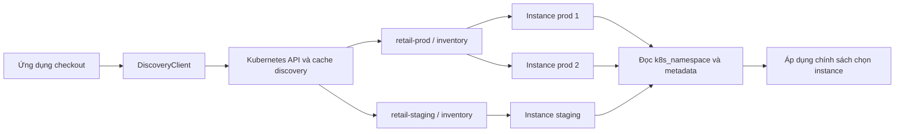

# Thông tin namespace và metadata của dịch vụ được khám phá

Thuộc chương **Khám phá dịch vụ**, module **Spring Cloud Kubernetes (`SPRING_CLOUD_KUBERNETES`)**.

Khi tích hợp ứng dụng Spring với Kubernetes, biết tên dịch vụ và địa chỉ gọi là chưa đủ để hiểu đích đến. Hai namespace có thể cùng có một Service tên `inventory`; mỗi Service có nhãn môi trường, nhóm vận hành và danh sách endpoint khác nhau. Ứng dụng cần đọc được ngữ cảnh đó để quan sát và chọn đúng tập instance.

Bài này tập trung vào namespace và metadata do DiscoveryClient cung cấp. Đây là nền tảng để sử dụng Spring Cloud LoadBalancer có chủ đích và chẩn đoán kết quả khám phá. Cấu hình từ ConfigMap, dữ liệu trong Secret, việc cập nhật cấu hình bằng Configuration Watcher và sức khỏe Pod là các mối quan tâm liên quan, nhưng mỗi loại có nguồn dữ liệu và quyền truy cập riêng.

## 1. Mục tiêu và điều kiện trước khi thực hành

Sau bài học, bạn có thể:

- Phân biệt namespace của ứng dụng gọi, phạm vi namespace được khám phá và namespace của instance trả về.
- Giải thích metadata của Service khác metadata của Pod như thế nào.
- Đọc namespace, loại Service và các nhãn được xuất qua `ServiceInstance.getMetadata()`.
- Đặt prefix để tránh trùng khóa giữa labels, annotations và thông tin cổng.
- Xử lý tình huống Service trùng tên ở nhiều namespace mà không vô tình chọn instance của môi trường khác.
- Đối chiếu kết quả discovery với Kubernetes API, RBAC và trạng thái endpoint.

Ví dụ giả định ứng dụng đã có một implementation DiscoveryClient của Spring Cloud Kubernetes tương thích với Spring Boot và Spring Cloud đang dùng. Các đoạn cấu hình mô tả client truy cập Kubernetes API trực tiếp; nếu dùng HTTP DiscoveryClient, cấu hình phạm vi và bộ lọc tương ứng phải đặt ở Discovery Server. Không cần thêm đồng thời nhiều starter discovery chỉ để đọc metadata.

Các đoạn manifest và lệnh dưới đây là tài liệu thực hành. Chúng cần một cụm thử nghiệm, namespace phù hợp, workload đang chạy và người thao tác có quyền tương ứng; chỉ tạo Service sẽ chưa tạo ra Pod hay endpoint sẵn sàng.

## 2. Namespace xác định ngữ cảnh của tên dịch vụ

### 2.1. Tên Service chỉ duy nhất trong một namespace

Với tài nguyên có namespace như Service, tên được phân biệt trong phạm vi namespace. Vì vậy có thể có cả `inventory` trong `retail-prod` và `inventory` trong `retail-staging`. Khi ghi nhận danh tính một Service trong cùng cụm, hãy giữ cả cặp `(namespace, serviceName)`. [Tài liệu Namespaces của Kubernetes](https://kubernetes.io/docs/concepts/overview/working-with-objects/namespaces/).

Trong ví dụ xuyên suốt bài:

| Namespace | Service | Nhãn môi trường | Endpoint minh họa |
| --- | --- | --- | --- |
| `retail-prod` | `inventory` | `environment=prod` | `10.42.1.21:8080` |
| `retail-prod` | `inventory` | `environment=prod` | `10.42.2.34:8080` |
| `retail-staging` | `inventory` | `environment=staging` | `10.42.3.18:8080` |

Hai dòng đầu mô tả hai instance phía sau cùng một Service. Dòng cuối thuộc Service khác, dù tên ngắn giống nhau. Nếu tổng hợp nhiều cụm vào hệ thống quan sát, cần bổ sung định danh cụm do hệ thống của bạn cung cấp; namespace tự nó không phân biệt được hai cụm.

### 2.2. Những namespace dễ bị nhầm lẫn

| Khái niệm | Ví dụ | Ý nghĩa trong bài |
| --- | --- | --- |
| Namespace của Pod gọi | `retail-apps` | Nơi ứng dụng `checkout` đang chạy |
| Phạm vi discovery | `retail-prod`, `retail-staging` | Những namespace client được cấu hình tìm dịch vụ |
| Namespace của instance được tìm thấy | `retail-prod` | Namespace của Service chứa instance đang xét |
| Namespace của nguồn cấu hình | `retail-config` | Nơi đặt một ConfigMap hoặc Secret mà ứng dụng đọc |

Đây là các vai trò độc lập. Việc đặt `checkout` trong `retail-apps` không có nghĩa tất cả instance nó nhìn thấy cũng nằm trong `retail-apps`. Tương tự, đọc được ConfigMap ở `retail-config` không tự mở rộng phạm vi discovery đến namespace đó.

Trên đường gọi thực tế, hãy trả lời ba câu riêng: ứng dụng đang ở đâu, nó được cấu hình tìm ở đâu và instance này thuộc đâu. Khi xảy ra lỗi, gộp ba câu này thành một biến `namespace` thường khiến log gây hiểu nhầm.

### 2.3. Tên DNS và serviceId không phải cùng một hợp đồng

DNS của Kubernetes có thể biểu diễn Service bằng tên chứa namespace, chẳng hạn `inventory.retail-prod.svc.cluster.local` khi cluster domain là `cluster.local`. Tên ngắn được phân giải theo search path của Pod. Cluster domain có thể khác trong cụm thực tế. [DNS for Services and Pods](https://kubernetes.io/docs/concepts/services-networking/dns-pod-service/).

Không suy ra rằng truyền chuỗi DNS đầy đủ đó vào `DiscoveryClient.getInstances(...)` sẽ luôn hoạt động. Ví dụ trong bài dùng serviceId `inventory`, sau đó kiểm tra namespace của kết quả. Nếu muốn gọi bằng DNS trực tiếp, đó là lựa chọn kết nối riêng; bạn cần xác định rõ mình đang sử dụng DNS hay danh sách instance từ DiscoveryClient.

## 3. Namespace và metadata xuất hiện ở đâu trong DiscoveryClient?

Theo hợp đồng Spring Cloud Kubernetes, `getServices()` trả các tên Service không lặp; Service trùng tên ở nhiều namespace không trở thành nhiều tên riêng. `getInstances("inventory")` trả danh sách `ServiceInstance` trong phạm vi discovery. Metadata có thể chứa labels, annotations, cổng có tên, `k8s_namespace` và `type`. API tổng quát `ServiceInstance` cung cấp `getMetadata()`; các thông tin mở rộng còn có thể được implementation cụ thể biểu diễn riêng. [DiscoveryClient for Kubernetes](https://docs.spring.io/spring-cloud-kubernetes/reference/discovery-client.html).

Đừng dùng kích thước của `getServices()` để kết luận có bao nhiêu Service phân biệt theo namespace. Trong ví dụ, danh mục có thể chỉ có một tên `inventory`, còn danh sách instance chứa cả ba địa chỉ nếu cả hai namespace đều thuộc phạm vi và các endpoint được chấp nhận.



### 3.1. Phân biệt thuộc tính kết nối và metadata

| Dữ liệu | Cách đọc từ `ServiceInstance` | Dùng để làm gì |
| --- | --- | --- |
| Tên dịch vụ | `getServiceId()` | Nhóm instance theo tên Service |
| Định danh instance | `getInstanceId()` | Ghi nhận một kết quả cụ thể; không giả định định dạng cố định |
| Địa chỉ và cổng | `getHost()`, `getPort()` | Xác định địa chỉ kết nối của kết quả |
| URI và cờ bảo mật | `getUri()`, `isSecure()` | Quan sát cách client biểu diễn đích gọi |
| Namespace | `getMetadata().get("k8s_namespace")` | Phân biệt Service cùng tên |
| Loại Service | `getMetadata().get("type")` | Hiểu loại tài nguyên được biểu diễn |
| Nhãn, chú thích, cổng phụ | Khóa trong `getMetadata()` | Bổ sung ngữ cảnh theo cấu hình xuất metadata |

Metadata dạng `Map<String, String>` không phải toàn bộ đối tượng Kubernetes đã được chuyển thành một cây JSON. Không có cơ sở để đọc tùy ý đường dẫn như `metadata.get("spec.selector.app")` hoặc ép một giá trị trong map thành cấu trúc Pod.

Nếu chương trình chỉ phụ thuộc `ServiceInstance`, không gọi trực tiếp `getNamespace()` trên biến kiểu này. Cũng không suy namespace bằng cách cắt `instanceId`, tách địa chỉ IP hoặc đoán từ tên ứng dụng. Với client hoặc phiên bản khác, hãy xác nhận hợp đồng metadata trước khi sử dụng các khóa mở rộng.

### 3.2. Một kết quả minh họa

Giả sử cấu hình dùng các prefix `label.`, `annotation.` và `port.` như phần sau. Đây là dạng dữ liệu minh họa do ứng dụng tự trình bày, không phải cam kết về JSON mặc định của framework:

```json
{
  "serviceId": "inventory",
  "host": "10.42.1.21",
  "port": 8080,
  "metadata": {
    "k8s_namespace": "retail-prod",
    "type": "ClusterIP",
    "label.app": "inventory",
    "label.environment": "prod",
    "label.discovery": "enabled",
    "annotation.example.com/owner": "stock-team",
    "port.http": "8080"
  }
}
```

Tất cả giá trị trong map trên là chuỗi, kể cả giá trị cổng. `type=ClusterIP` mô tả Service; không được suy từ đó rằng `host` của mọi kết quả discovery chính là ClusterIP. Khi kiểm tra kết nối, hãy đọc địa chỉ thực tế mà client trả về.

## 4. Xác định đúng nguồn của metadata

### 4.1. Service labels, Service selector và Pod labels

Labels là các cặp khóa và giá trị dùng để gắn thuộc tính nhận diện và chọn nhóm đối tượng. Nhãn đặt trên Service thuộc về chính Service; selector của Service lại được dùng để chọn Pod phù hợp. Nhãn trên hai đối tượng không tự đồng bộ. [Labels and Selectors](https://kubernetes.io/docs/concepts/overview/working-with-objects/labels/).

Ví dụ Service trong `retail-prod`:

```yaml
apiVersion: v1
kind: Service
metadata:
  name: inventory
  namespace: retail-prod
  labels:
    app: inventory
    environment: prod
    discovery: enabled
  annotations:
    example.com/owner: stock-team
spec:
  type: ClusterIP
  selector:
    app: inventory
  ports:
    - name: http
      port: 8080
      targetPort: 8080
```

Có ba vị trí cần đọc chính xác:

- `metadata.labels.environment`: nhãn của Service, phù hợp để phân loại cả dịch vụ theo môi trường.
- `spec.selector.app`: tiêu chí chọn Pod phía sau Service, không phải nhãn được xuất từ `metadata.labels`.
- `spec.ports[].name`: tên cổng; khi bật xuất thông tin cổng, tên này tham gia tạo khóa metadata.

Ở Deployment của backend, nhãn cho Pod phải đặt trong `spec.template.metadata.labels`, ví dụ:

```yaml
spec:
  template:
    metadata:
      labels:
        app: inventory
        release-track: stable
```

Đây là đoạn trích từ Deployment, không phải manifest hoàn chỉnh để apply. Nhãn `release-track=stable` ở Pod không tự biến thành `label.release-track` trong metadata phẳng của Service. Nếu một Service chọn cả Pod stable và canary, không thể chỉ nhìn nhãn của Service rồi kết luận mọi instance đều là stable.

### 4.2. Annotations bổ sung thông tin mô tả

Annotations phù hợp với thông tin mô tả hoặc dữ liệu cho công cụ tích hợp; Kubernetes không dùng annotations làm label selector. Chẳng hạn `example.com/owner=stock-team` giúp người vận hành biết nhóm phụ trách. [Annotations của Kubernetes](https://kubernetes.io/docs/concepts/overview/working-with-objects/annotations/).

Trong bài, `annotation.example.com/owner` là khóa do prefix `annotation.` cộng với khóa annotation gốc. Dấu `/` vẫn thuộc khóa. Khi đọc map trong Java, dùng nguyên chuỗi đó; không biến nó thành một đường dẫn đối tượng.

Không đặt token, mật khẩu hoặc nội dung Secret vào labels hay annotations để ứng dụng nhận qua discovery. Những dữ liệu này dễ được sao chép vào log, endpoint chẩn đoán và hệ thống quan sát. Metadata mô tả dịch vụ cũng không nên trở thành nơi chứa toàn bộ cấu hình nghiệp vụ.

## 5. Cấu hình phạm vi và xuất metadata rõ ràng

Với client trực tiếp và biến thể dùng Endpoints trong ví dụ, có thể diễn đạt cấu hình như sau:

```yaml
spring:
  application:
    name: checkout
  cloud:
    kubernetes:
      discovery:
        all-namespaces: false
        namespaces:
          - retail-prod
          - retail-staging
        use-endpoint-slices: false
        include-not-ready-addresses: false
        service-labels:
          discovery: enabled
        metadata:
          add-labels: true
          labels-prefix: "label."
          add-annotations: true
          annotations-prefix: "annotation."
          add-ports: true
          ports-prefix: "port."
          add-pod-labels: false
          add-pod-annotations: false
```

Các cờ `add-labels`, `add-annotations`, `add-ports` và prefix quyết định cách bổ sung các nhóm dữ liệu vào metadata. Hai cờ `add-pod-labels`, `add-pod-annotations` điều khiển việc bổ sung thông tin Pod; tên cờ annotations viết đúng là `add-pod-annotations`. Ví dụ khai báo tường minh để dễ đọc thay vì phụ thuộc các giá trị mặc định. [Danh sách thuộc tính Spring Cloud Kubernetes](https://docs.spring.io/spring-cloud-kubernetes/reference/appendix.html).

### 5.1. Phạm vi tìm kiếm, bộ lọc và metadata là ba việc khác nhau

Trong cấu hình trên:

1. Danh sách `namespaces` giới hạn nơi client tìm Service khi `all-namespaces` là `false`.
2. `service-labels.discovery=enabled` chọn Service có nhãn gốc tương ứng.
3. Các cờ trong `metadata` quyết định dữ liệu được gắn vào kết quả trả về.

Bật `add-labels` không có nghĩa chỉ tìm các Service có một nhãn nào đó. Ngược lại, có bộ lọc nhãn không có nghĩa nhãn chắc chắn được xuất cho mã Java sử dụng nếu việc xuất labels bị tắt.

Prefix chỉ tác động cách biểu diễn metadata, không đổi khóa nhãn thật trên Kubernetes. Vì vậy bộ lọc đầu vào vẫn là `discovery: enabled`; không đổi thành `label.discovery: enabled`. Ứng dụng đọc kết quả mới dùng `metadata.get("label.discovery")`.

Khi cần khám phá duy nhất production, giải pháp cấu hình đơn giản hơn là chỉ để `retail-prod` trong danh sách. Danh sách hai namespace ở đây phục vụ tình huống học cách nhận biết kết quả trùng tên, không phải yêu cầu mọi ứng dụng phải khám phá nhiều môi trường.

### 5.2. Vì sao nên đặt prefix?

Giả sử Service có label `owner=stock-team` và annotation `owner=platform-team`. Khi cùng xuất vào một map mà không có prefix phân biệt, ứng dụng khó xác định nguồn của khóa `owner` và có nguy cơ phụ thuộc thứ tự ghi đè.

Thiết kế trong bài tạo hai khóa độc lập:

```text
label.owner       -> stock-team
annotation.owner  -> platform-team
```

Hãy coi prefix là một phần hợp đồng giữa cấu hình discovery và mã đọc metadata. Nếu đổi `label.` thành `svc-label.`, các chỗ đọc `label.environment` cũng phải được cập nhật có chủ đích. Không đổi một phía rồi diễn giải giá trị `null` thành “không có môi trường”.

### 5.3. Khi nào cần metadata của Pod?

Cần biết `release-track` của từng Pod trong một Service có nhiều bản triển khai là nhu cầu khác với biết nhãn của cả Service. Khi bật xuất metadata Pod, hãy sử dụng cấu trúc mở rộng của implementation và phiên bản đang dùng; không giả định dữ liệu Pod được gộp vào map phẳng cùng prefix của Service.

Nếu nhu cầu chỉ là hiển thị namespace và nhóm phụ trách Service, hãy giữ metadata Pod tắt. Việc này giúp hợp đồng dữ liệu nhỏ và tránh đưa ra một chính sách định tuyến phụ thuộc thông tin mà ứng dụng thực ra chưa đọc được.

## 6. Đọc metadata và giữ ranh giới namespace trong Java

Ví dụ sau xây một thành phần trả về danh sách ứng viên thuộc namespace yêu cầu. Nó dùng API `DiscoveryClient` và `ServiceInstance`; không phụ thuộc lớp instance cụ thể của Fabric8 hay Kubernetes Java Client.

```java
package example.discovery;

import java.util.List;

import org.springframework.cloud.client.ServiceInstance;
import org.springframework.cloud.client.discovery.DiscoveryClient;
import org.springframework.stereotype.Component;

@Component
public class NamespacedServiceCatalog {

    private static final String NAMESPACE_KEY = "k8s_namespace";

    private final DiscoveryClient discoveryClient;

    public NamespacedServiceCatalog(DiscoveryClient discoveryClient) {
        this.discoveryClient = discoveryClient;
    }

    public List<ServiceInstance> requireInstances(
            String serviceId, String targetNamespace) {

        if (serviceId == null || serviceId.isBlank()) {
            throw new IllegalArgumentException("serviceId must not be blank");
        }
        if (targetNamespace == null || targetNamespace.isBlank()) {
            throw new IllegalArgumentException("targetNamespace must not be blank");
        }

        List<ServiceInstance> selected = discoveryClient.getInstances(serviceId)
                .stream()
                .filter(instance -> targetNamespace.equals(
                        instance.getMetadata().get(NAMESPACE_KEY)))
                .toList();

        if (selected.isEmpty()) {
            throw new IllegalStateException(
                    "No discovered instance for "
                            + targetNamespace + "/" + serviceId);
        }

        return selected;
    }
}
```

Đoạn mã sử dụng `Stream.toList()`, cần Java 16 trở lên; dự án Spring Boot hiện đại thường chọn Java 17 hoặc phiên bản phù hợp với release train của mình. Mã gọi có thể yêu cầu:

```java
List<ServiceInstance> productionInstances =
        catalog.requireInstances("inventory", "retail-prod");
```

`targetNamespace` nên đến từ cấu hình hoặc chính sách được ứng dụng kiểm soát. Không để một tham số HTTP tùy ý quyết định đích gọi đến mọi namespace mà tài khoản ứng dụng đọc được.

Có ba quyết định rõ ràng trong ví dụ:

- So sánh bằng toàn bộ chuỗi namespace, không dùng `contains`, tiền tố hoặc hậu tố.
- Instance thiếu `k8s_namespace` không được coi là instance của namespace yêu cầu.
- Nếu không có ứng viên, báo lỗi; không tự quay về danh sách chưa lọc hay chuyển sang staging.

Đây là lớp chọn ứng viên, chưa phải một HTTP client hoặc một bộ cân bằng tải. Việc gọi phương thức này không tự thay đổi danh sách instance của một `@LoadBalanced RestClient`, `WebClient` hay client khác. Nếu dùng Spring Cloud LoadBalancer, chính sách namespace phải được tích hợp vào nguồn danh sách instance mà đường gọi thực sự sử dụng; cần kiểm tra đường dữ liệu đó riêng.

Ví dụ log chẩn đoán có thể chỉ lấy các trường cần thiết:

```java
for (ServiceInstance instance : productionInstances) {
    var metadata = instance.getMetadata();
    logger.info(
            "discovery service={} namespace={} host={} port={} environment={}",
            instance.getServiceId(),
            metadata.get("k8s_namespace"),
            instance.getHost(),
            instance.getPort(),
            metadata.get("label.environment"));
}
```

Đoạn log giả định lớp gọi đã có logger. Dùng danh sách khóa được chọn giúp log phục vụ chẩn đoán mà không sao chép toàn bộ annotations của Service.

## 7. RBAC: nhìn thấy metadata cần quyền đọc đúng tài nguyên

Cấu hình namespace không tự cấp quyền Kubernetes API. Với RBAC, Role giới hạn quyền trong một namespace; RoleBinding tại namespace đích có thể cấp các quyền đó cho ServiceAccount ở namespace khác. Các động từ `get`, `list`, `watch` phục vụ đọc đối tượng, liệt kê và theo dõi thay đổi. [Using RBAC Authorization](https://kubernetes.io/docs/reference/access-authn-authz/rbac/).

Giả sử `checkout` chạy với ServiceAccount `checkout-discovery` ở `retail-apps`. Ví dụ cấp quyền đọc ở `retail-prod` cho biến thể dùng Endpoints:

```yaml
apiVersion: v1
kind: ServiceAccount
metadata:
  name: checkout-discovery
  namespace: retail-apps
---
apiVersion: rbac.authorization.k8s.io/v1
kind: Role
metadata:
  name: discovery-reader
  namespace: retail-prod
rules:
  - apiGroups: [""]
    resources: ["services", "endpoints", "pods"]
    verbs: ["get", "list", "watch"]
---
apiVersion: rbac.authorization.k8s.io/v1
kind: RoleBinding
metadata:
  name: checkout-discovery-reader
  namespace: retail-prod
subjects:
  - kind: ServiceAccount
    name: checkout-discovery
    namespace: retail-apps
roleRef:
  apiGroup: rbac.authorization.k8s.io
  kind: Role
  name: discovery-reader
```

Các namespace trong ví dụ phải tồn tại. Deployment của `checkout` phải thực sự đặt `spec.template.spec.serviceAccountName: checkout-discovery`; chỉ tạo ServiceAccount sẽ không đổi danh tính của Pod đang dùng tài khoản khác.

Danh sách tài nguyên cần đối chiếu với implementation và tính năng thực sự bật. Ví dụ Role có `pods` để hỗ trợ client cần thông tin Pod; không coi đây là bộ quyền tối thiểu cho mọi biến thể. Khi dùng EndpointSlice, cần quyền đọc tài nguyên `endpointslices` ở API group `discovery.k8s.io`, ví dụ rule tương ứng:

```yaml
- apiGroups: ["discovery.k8s.io"]
  resources: ["endpointslices"]
  verbs: ["get", "list", "watch"]
```

Đây là rule bổ sung hoặc thay thế phần endpoint theo biến thể client, không phải manifest độc lập. Không tự giả định một Role cấp quyền `endpoints` sẽ đồng thời cấp quyền `endpointslices`.

Nếu giữ phạm vi discovery gồm cả `retail-staging`, cần quyền đọc phù hợp tại namespace này nữa. Có thể tạo Role và RoleBinding tương ứng trong namespace đích. Mở `all-namespaces` không tự biến hai Role theo namespace thành quyền liệt kê trên toàn cụm.

Việc đọc metadata Service không yêu cầu cấp quyền đọc `secrets` chỉ vì cùng module còn hỗ trợ Secret. Tương tự, không thêm quyền sửa Service để xử lý một lỗi discovery chỉ cần đọc.

## 8. Đối chiếu dữ liệu theo từng lớp

Thực hiện các lệnh sau trên cụm thử nghiệm đã có workload phù hợp. Đây là quy trình quan sát; không cần sửa nhãn hoặc bật khám phá toàn cụm để bắt đầu chẩn đoán.

### 8.1. Xác nhận tài nguyên và namespace

```shell
kubectl get service inventory -n retail-prod -o yaml
kubectl get service inventory -n retail-staging -o yaml
kubectl get services -n retail-prod -l discovery=enabled --show-labels
```

Đối chiếu `metadata.namespace`, `metadata.labels`, `metadata.annotations` và `spec.ports`. Nếu chỉ Service production có nhãn `discovery=enabled`, bộ lọc đang dùng có thể loại Service staging dù namespace staging nằm trong cấu hình.

### 8.2. Xác nhận endpoint và readiness

Với biến thể Endpoints đã chọn trong cấu hình ví dụ:

```shell
kubectl get endpoints inventory -n retail-prod -o yaml
kubectl get pods -n retail-prod -l app=inventory -o wide
```

Với biến thể EndpointSlice, quan sát bằng:

```shell
kubectl get endpointslices -n retail-prod -l kubernetes.io/service-name=inventory -o yaml
```

Không tìm thấy instance có thể bắt nguồn từ selector không khớp Pod, Pod chưa sẵn sàng hoặc thông tin endpoint chưa cập nhật. Việc bật xuất labels không sửa được các nguyên nhân đó. Đồng thời, một label như `health=up` là dữ liệu tĩnh do ai đó ghi, không thay cho readiness hoặc kết quả kiểm tra sức khỏe ứng dụng.

### 8.3. Kiểm tra đúng danh tính ServiceAccount

```shell
kubectl auth can-i list services -n retail-prod --as=system:serviceaccount:retail-apps:checkout-discovery
kubectl auth can-i watch endpoints -n retail-prod --as=system:serviceaccount:retail-apps:checkout-discovery
kubectl auth can-i list pods -n retail-prod --as=system:serviceaccount:retail-apps:checkout-discovery
```

Lặp lại cho namespace đích khác và tài nguyên endpoint mà client sử dụng. Người chạy lệnh với `--as` cần quyền impersonate; nếu bị từ chối impersonation, kết quả đó chưa chứng minh ServiceAccount của ứng dụng thiếu quyền discovery. Việc người vận hành dùng tài khoản cá nhân đọc được Service cũng chưa chứng minh Pod của ứng dụng đọc được.

### 8.4. Quan sát kết quả ở ứng dụng

Ghi lại theo từng instance: serviceId, namespace, host, port và một vài khóa metadata cần thiết. So sánh với đối tượng Kubernetes vừa đọc. Với cấu hình mẫu và dữ liệu minh họa ban đầu, trước khi áp dụng chính sách namespace có ba ứng viên; sau khi yêu cầu `retail-prod`, còn hai ứng viên production.

Nếu dữ liệu vừa thay đổi, xét thời gian đồng bộ cache hoặc watch của implementation. Không đặt một khoảng chờ cố định rồi coi đó là bảo đảm cho mọi cụm. Hãy quan sát cập nhật và lỗi theo dõi tài nguyên trước khi kết luận metadata bị mất.

## 9. Chẩn đoán các tình huống thường gặp

| Hiện tượng | Giả thuyết cần kiểm tra | Cách đối chiếu |
| --- | --- | --- |
| `getServices()` chỉ có một tên `inventory` | Tên được gom duy nhất dù nhiều namespace | Kiểm tra namespace trong từng phần tử của `getInstances("inventory")` |
| Không có instance ở staging | Ngoài phạm vi, thiếu quyền, không khớp filter hoặc chưa có endpoint sẵn sàng | Đọc cấu hình, RBAC, nhãn Service và endpoint theo thứ tự |
| Đọc `environment` ra `null` | Cấu hình có prefix `label.` hoặc nhãn chỉ nằm trên Pod | Tìm `label.environment` và kiểm tra nguồn nhãn |
| Không có `label.release-track` | Dữ liệu đang nằm trên Pod, chưa được xuất theo hợp đồng Pod metadata | Xác nhận vị trí nhãn và kiểu dữ liệu mở rộng của client |
| Instance thiếu `k8s_namespace` | Kết quả đi qua client khác, wrapper làm mất khóa hoặc hợp đồng phiên bản khác | Quan sát nguồn DiscoveryClient và dữ liệu trước khi biến đổi |
| Nhìn thấy Service nhưng gọi timeout | Danh sách discovery có dữ liệu, còn đường mạng hoặc ứng dụng chưa đáp ứng | Đối chiếu host/port, khả năng kết nối, NetworkPolicy và sức khỏe backend |
| Gọi nhầm môi trường | Đường gọi sử dụng danh sách chưa áp dụng chính sách namespace | Theo dõi danh sách được đưa vào bộ chọn instance thực tế |
| Sửa annotation nhưng ứng dụng còn dữ liệu cũ | Chậm đồng bộ, watch lỗi hoặc nơi hiển thị có cache riêng | So sánh API trực tiếp, log watch và dữ liệu ở từng lớp |

Không dùng namespace hoặc nhãn môi trường làm bằng chứng đủ cho việc ủy quyền người dùng. Chúng giúp ứng dụng chọn đích và quan sát, còn kiểm soát truy cập cần được thực thi ở những lớp có trách nhiệm tương ứng. RBAC kiểm soát quyền với Kubernetes API; khả năng kết nối đến backend còn phụ thuộc cơ chế mạng và xác thực của dịch vụ.

## 10. Liên hệ với cấu hình, cập nhật và lựa chọn tính năng

Metadata discovery trả lời “instance này thuộc dịch vụ nào và mang ngữ cảnh gì”. ConfigMap hoặc Secret cung cấp dữ liệu cấu hình theo cơ chế được chọn. Nhìn thấy một annotation không đồng nghĩa Spring đã nạp nó vào `Environment`; thấy tên ConfigMap trong metadata cũng không đồng nghĩa ứng dụng đã đọc nội dung ConfigMap đó.

Khi thay đổi nhãn Service hoặc annotation được xuất, hãy kiểm tra sự cập nhật ở đường discovery. Khi thay đổi dữ liệu ConfigMap hoặc Secret và muốn ứng dụng nhận cấu hình mới, hãy kiểm tra đường cấu hình cùng cơ chế cập nhật đã chọn, chẳng hạn Configuration Watcher. Không dùng thành công của một đường làm bằng chứng đường còn lại đã hoạt động.

Nếu ứng dụng chỉ cần gọi một Service cố định bằng DNS và không cần xem hay lọc từng instance, hãy cân nhắc liệu có thực sự cần DiscoveryClient. Nếu có chính sách chọn instance dựa trên namespace hoặc metadata, cần mô tả chính sách đó, dữ liệu nó phụ thuộc và cách hành xử khi dữ liệu thiếu. Việc đưa thêm Spring Cloud Kubernetes vào triển khai nên gắn với nhu cầu cụ thể này.

## 11. Bài thực hành tự kiểm tra

Dùng cụm thử nghiệm có `inventory` ở hai namespace như ví dụ, với backend sẵn sàng và nhãn Service phù hợp. Chỉ chạy ứng dụng với phạm vi và RBAC đã chủ động thiết lập.

1. Quan sát tên trả về từ `getServices()` và liệt kê từng instance của `inventory`. Ghi nhận cặp namespace và địa chỉ; không chỉ đếm tên dịch vụ.
2. Đối chiếu `label.environment` với nhãn ở `metadata.labels` của từng Service. Xác nhận `annotation.example.com/owner` giữ nguyên phần khóa gốc sau prefix.
3. Yêu cầu danh sách `inventory` ở `retail-prod` bằng thành phần Java trong bài. Kiểm tra mọi kết quả đều có `k8s_namespace=retail-prod`.
4. Yêu cầu namespace `retail-missing`, vốn không thuộc dữ liệu thực hành. Quan sát lỗi không có ứng viên và xác nhận ứng dụng không trả về instance staging để thay thế.
5. Xác định chính sách chọn namespace đang nằm ở đâu trong đường gọi thật. Nếu dùng LoadBalancer, chứng minh danh sách đầu vào của nó đã được áp dụng chính sách, thay vì chỉ quan sát phương thức tiện ích riêng.

Hoàn thành bài thực hành khi có thể giải thích mỗi instance đến từ namespace nào, mỗi khóa metadata bắt nguồn từ đối tượng nào, quyền đọc được cấp ở đâu và vì sao một kết quả được chọn hoặc bị loại. Một danh sách địa chỉ gọi được chỉ là bước đầu; hiểu đúng ngữ cảnh của từng địa chỉ mới giúp vận hành discovery có kiểm soát.