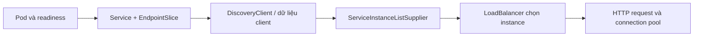

# Chiến lược cập nhật danh sách và độ trễ phát hiện thay đổi

## 1. Mục tiêu và tình huống thực tế

Trong chương **Khám phá dịch vụ** của module **SPRING_CLOUD_KUBERNETES**, bài này giải thích cách danh sách instance theo kịp thay đổi của Kubernetes và vì sao ứng dụng có thể tiếp tục chọn địa chỉ cũ sau khi Pod đã đổi trạng thái.

Tình huống xuyên suốt: ứng dụng `checkout` gọi `inventory` trong namespace `shop`. Khi tăng replica, triển khai phiên bản mới hoặc một Pod mất readiness, phía gọi cần sử dụng tập instance phù hợp. Câu hỏi thực tế là: **thay đổi xuất hiện ở đâu trước, lớp nào cập nhật sau, và bao lâu request mới sử dụng kết quả mới?**

Sau bài học, bạn có thể:

- Phân biệt danh sách endpoint trong Kubernetes, kết quả của `DiscoveryClient` và danh sách LoadBalancer đang sử dụng.
- So sánh polling, Kubernetes watch và cache theo độ trễ, chi phí cùng khả năng phục hồi.
- Ước lượng ngân sách độ trễ, rồi đo từng chặng thay vì suy luận từ một thuộc tính cấu hình.
- Chọn cơ chế theo phạm vi namespace, quyền RBAC và nhu cầu thực sự của đường gọi.

Bài tập trung vào cập nhật danh sách dịch vụ. ConfigMap, Secret và Configuration Watcher thuộc bối cảnh chung của module; thay đổi tài nguyên cấu hình không đồng nghĩa danh sách instance đã được làm mới.

## 2. Ba danh sách cần phân biệt

Giả sử Kubernetes đã có ba địa chỉ phục vụ `inventory`, nhưng `checkout` mới thấy hai địa chỉ. Trước khi sửa cấu hình, cần xác định đang quan sát danh sách nào.

| Lớp quan sát | Dữ liệu được nhìn thấy | Câu hỏi cần trả lời |
| --- | --- | --- |
| Kubernetes API | Service và EndpointSlice hoặc Endpoints tương ứng | Địa chỉ mới và điều kiện phục vụ đã xuất hiện chưa? |
| Spring DiscoveryClient | `getInstances("inventory")` | Client cụ thể trả những instance nào tại thời điểm gọi? |
| LoadBalancer và đường HTTP | Tập instance được supplier cung cấp, địa chỉ được chọn, kết nối đang dùng | Request mới thực sự đi tới đâu? |

Tên Service giữ nguyên khi replica đổi. Chỉ so sánh tên từ `getServices()` sẽ bỏ sót thay đổi địa chỉ hoặc cổng của instance. Cần quan sát cả kết quả `getInstances(serviceId)` và đường request.



Sơ đồ mô tả đường gọi mà ứng dụng chọn trực tiếp endpoint của Pod. Nếu ứng dụng gọi Service qua DNS và ClusterIP, việc chuyển tiếp traffic nằm ở Kubernetes; cần đo đường đi tương ứng.

Trong hệ thống cụ thể, hãy vẽ thêm nơi tồn tại cache và nơi có kết nối tới API server. Không mặc định mỗi lần gọi `getInstances()` đều tạo truy vấn mạng mới, cũng không mặc định mọi implementation đều có cùng cách giữ dữ liệu.

## 3. Khi nào địa chỉ đủ điều kiện phục vụ?

Một Pod vừa được tạo chưa chắc đã sẵn sàng nhận traffic. Readiness biểu diễn khả năng phục vụ, còn liveness hỗ trợ phát hiện tình trạng cần khởi động lại container. Chu kỳ probe, timeout và ngưỡng thành công hoặc thất bại góp phần vào thời gian trước khi trạng thái được cập nhật. Xem [hướng dẫn readiness và liveness của Kubernetes](https://kubernetes.io/docs/tasks/configure-pod-container/configure-liveness-readiness-startup-probes/).

EndpointSlice có các điều kiện `ready`, `serving` và `terminating`. Địa chỉ IP còn tồn tại trong tài nguyên chưa đủ để kết luận có nên chọn cho request mới; cần xét điều kiện phục vụ. Service dùng `publishNotReadyAddresses: true` cũng có ý nghĩa khác với Service thông thường. Xem [điều kiện endpoint của EndpointSlice](https://kubernetes.io/docs/concepts/services-networking/endpoint-slices/).

Chia thay đổi thành các loại riêng để đo:

| Thay đổi | Mốc khởi đầu nên ghi | Kết quả cần quan sát |
| --- | --- | --- |
| Tăng replica | Lúc yêu cầu scale được chấp nhận | Endpoint mới đủ điều kiện, client thấy địa chỉ mới, request tới replica mới |
| Readiness thất bại | Lúc backend bắt đầu không sẵn sàng | Endpoint không còn phù hợp và phía gọi loại khỏi tập chọn |
| Rolling update | Lúc bắt đầu rollout và từng chuyển tiếp Pod | Địa chỉ cũ được thay dần, địa chỉ mới xuất hiện |
| Chấm dứt Pod | Lúc bắt đầu termination | Ngừng chọn mới và xử lý request đang chạy theo chính sách drain |
| Sự cố node hoặc mạng | Lúc sự cố thực sự xảy ra, nếu xác định được | Phát hiện sự cố, cập nhật control plane và xử lý lỗi phía gọi |

Thời gian chờ scheduling hoặc kéo image thuộc quá trình tạo năng lực mới. Nó khác thời gian client phát hiện một EndpointSlice đã cập nhật. Báo cáo hai khoảng riêng giúp tránh tối ưu sai tầng.

## 4. Các chiến lược cập nhật danh sách

### 4.1. Polling: đọc lại theo lịch

Polling định kỳ lấy trạng thái hiện tại và đối chiếu snapshot trước. Cách này dễ tái lập thí nghiệm, nhưng giữa hai lần đọc luôn có khoảng chờ.

Giả sử chu kỳ bắt đầu hai lần đọc cách nhau `P` giây, mỗi lần lấy được dữ liệu mới tức thời, không có retry và thay đổi đến độc lập với lịch:

```text
0 <= thời gian chờ lần đọc kế tiếp < P
kỳ vọng thời gian chờ xấp xỉ P / 2
```

Đây là mô hình để lập ngân sách. Với lịch `fixedDelay`, thời gian thực thi tác vụ được cộng thêm trước lần chạy sau; truy vấn chậm khiến khoảng cách giữa hai quan sát lớn hơn giá trị delay.

Ví dụ tự tính: chu kỳ 12 giây khiến một thay đổi được nhìn thấy sau 0,2 giây nếu vừa kịp lần đọc, hoặc gần 12 giây nếu xuất hiện ngay sau lần đọc. Kết quả nhanh của một lần đo không phải cam kết cho mọi thay đổi.

Khi thiết kế polling, cần trả lời:

- Một lần chạy đọc toàn bộ danh mục hay chỉ dịch vụ cần dùng?
- Nếu lần đọc trước chưa xong, lần sau bỏ qua, xếp hàng hay chạy chồng?
- Khi truy vấn lỗi, giữ snapshot cũ, trả lỗi hay báo chưa đủ dữ liệu?
- Các replica phía gọi có khởi động đồng thời và truy vấn cùng nhịp không?

Jitter giúp giãn thời điểm truy vấn giữa replica. Tuy nhiên, phần ngẫu nhiên đó phải được tính vào độ trễ quan sát; nó không tự làm dữ liệu mới hơn.

### 4.2. Kubernetes watch: nhận luồng thay đổi

Kubernetes API hỗ trợ watch để gửi thay đổi qua luồng sự kiện. Mô hình truyền thống lấy snapshot ban đầu bằng LIST, giữ `resourceVersion`, rồi WATCH từ phiên bản đó. Nếu lịch sử cần thiết không còn và server trả `410 Gone`, client phải lấy lại trạng thái hiện tại rồi thiết lập lại watch. Xem [Kubernetes API: phát hiện thay đổi hiệu quả](https://kubernetes.io/docs/reference/using-api/api-concepts/#efficient-detection-of-changes).

Watch giúp tránh chờ đủ một chu kỳ polling khi kết nối hoạt động bình thường. Nhưng sự kiện vẫn cần đi qua mạng, hàng đợi xử lý và các lớp tiêu thụ trước khi ảnh hưởng tới request.

Nếu implementation dùng informer hoặc cache được nuôi bằng watch, hãy xác định:

1. **Khởi tạo:** có chờ snapshot đầu tiên trước khi công bố khả năng discovery không?
2. **Cập nhật:** thao tác thêm, sửa và xóa có tạo ra ảnh trạng thái đọc an toàn không?
3. **Khôi phục:** khi đứt kết nối, client nối lại và đồng bộ lại ra sao?
4. **Quan sát:** làm sao biết dữ liệu vừa được nguồn xác nhận hay đang giữ từ trước khi lỗi xảy ra?

Không mặc định thuật ngữ resync trong một thư viện có nghĩa là tải lại toàn bộ dữ liệu từ API. Cần đối chiếu hành vi đúng thư viện và phiên bản trước khi dùng nó làm bảo đảm độ tươi.

Nếu tự hợp nhất nhiều EndpointSlice của một Service, cần tránh đếm trùng địa chỉ khi các slice chuyển tiếp. Kubernetes mô tả khả năng một endpoint tạm xuất hiện trong nhiều slice và yêu cầu consumer tổng hợp phù hợp trong [hướng dẫn EndpointSlice](https://kubernetes.io/docs/concepts/services-networking/endpoint-slices/).

### 4.3. Cache TTL: giới hạn tần suất tải lại

Cache giữ kết quả để nhiều request dùng chung. TTL là chính sách hết hạn tại một lớp; nó không tự tạo thông tin mới tại lớp bên dưới.

Ví dụ thiết kế: cache phía gọi hết hạn sau 8 giây, nhưng nguồn cung cấp vẫn giữ địa chỉ cũ. Khi tải lại, cache có thể lại giữ địa chỉ cũ thêm một khoảng nữa. Giảm TTL chỉ hữu ích nếu tải lại có khả năng nhận snapshot mới hơn.

Phân biệt bốn việc:

- **Hết hạn:** kết quả cũ không còn được coi là hợp lệ theo chính sách cache.
- **Tải lại:** thao tác lấy snapshot khác đã diễn ra.
- **Nguồn mới:** snapshot trả về thực sự phản ánh thay đổi cần quan sát.
- **Áp dụng:** lớp lựa chọn instance dùng snapshot đó cho request mới.

Với cache tải lại khi có nhu cầu, hết hạn không đồng nghĩa một tác vụ nền lập tức lấy được danh sách mới. Request tiếp theo còn phải kích hoạt việc đọc và chờ kết quả theo thiết kế của cache.

### 4.4. Kết hợp theo từng tầng

Một phương án có thể dùng watch cho dữ liệu nguồn, snapshot bất biến cho các luồng đọc, rồi cache ngắn ở phía tiêu thụ. Phương án khác có thể dùng Service DNS để giảm số thành phần discovery trong ứng dụng.

| Chiến lược | Thuận lợi | Chi phí hoặc tình huống cần xử lý |
| --- | --- | --- |
| Polling | Dễ tái lập và đối chiếu snapshot | Khoảng chờ, tải truy vấn định kỳ, lịch bị trễ |
| Watch | Phản ứng theo sự kiện khi kết nối ổn định | Snapshot đầu tiên, reconnect, đồng bộ lại, hàng đợi |
| Cache TTL | Giảm số lần lấy danh sách trên đường request | Dữ liệu cũ trong TTL, tải lại từ nguồn cũng cũ |
| Service DNS/ClusterIP | Ứng dụng gọi tên ổn định | Cần đo đường chuyển tiếp Kubernetes và kết nối thực tế |

Đây là bảng lựa chọn kiến trúc. Không phải mỗi hàng đều tương ứng một công tắc có sẵn trong mọi starter Spring Cloud Kubernetes.

## 5. Catalog watch của Spring Cloud Kubernetes

Tài liệu nhánh 3.3 mô tả catalog watch phát heartbeat theo lịch, cần `@EnableScheduling`. Thuộc tính `spring.cloud.kubernetes.discovery.catalog-services-watch-delay` dùng mili giây, mặc định `30000`; có thể tắt bằng `spring.cloud.kubernetes.discovery.catalog-services-watch.enabled=false`. Xem [DiscoveryClient của Spring Cloud Kubernetes 3.3](https://docs.spring.io/spring-cloud-kubernetes/reference/3.3/discovery-client.html).

Catalog heartbeat của Spring và WATCH của Kubernetes API có vai trò khác nhau. Heartbeat theo lịch không chứng minh mọi cache đã bị làm mất hiệu lực, cũng không phải HTTP health check tới từng Pod.

Khi giảm delay từ 30 xuống 3 giây, kỳ vọng hợp lý là công việc theo lịch đó được kích hoạt thường xuyên hơn nếu tác vụ không bị chặn. Không thể từ đó kết luận:

- Pod hỏng được phát hiện trong tối đa 3 giây kể từ lúc sự cố bắt đầu.
- Mọi `getInstances()` bỏ qua cache và gọi trực tiếp API server.
- LoadBalancer loại ngay địa chỉ cũ khi heartbeat xuất hiện.
- Request đang chạy hoặc kết nối đã thiết lập tự chuyển sang Pod khác.

Để hiểu một đường tích hợp, hãy chỉ rõ ai phát event, ai nghe event, ai cập nhật snapshot và ai làm mất hiệu lực cache. Event xuất hiện mới xác nhận một chặng trong chuỗi đó.

HTTP DiscoveryClient còn có Discovery Server ở giữa ứng dụng và Kubernetes API. Tài liệu yêu cầu cấu hình catalog watcher ở cả hai phía; phạm vi discovery phải đặt đúng phía server. Xem [phần HTTP client trong hướng dẫn DiscoveryClient](https://docs.spring.io/spring-cloud-kubernetes/reference/discovery-client.html).

Bài dùng nhánh 3.3 làm mốc giải thích cấu hình, không khẳng định đây là phiên bản mới nhất. Dự án dùng nhánh khác cần đối chiếu tài liệu đúng nhánh và BOM tương thích. Cơ chế cacheable DiscoveryClient được giới thiệu từ 5.0 là một lớp có thể xuất hiện thêm; không suy ngược hành vi của nó về 3.3.

## 6. Lập ngân sách độ trễ

### 6.1. Đặt tên các mốc

| Mốc | Ý nghĩa |
| --- | --- |
| `t0` | Backend thực sự đổi khả năng phục vụ hoặc thí nghiệm bắt đầu |
| `tK` | Công cụ thấy trạng thái endpoint cần thiết trong Kubernetes API |
| `tD` | Probe phía gọi lần đầu thấy tập instance tương ứng từ DiscoveryClient |
| `tL` | Tập dùng để chọn instance của LoadBalancer đã phản ánh thay đổi |
| `tR` | Request mới thể hiện kết quả mong muốn trên đường gọi thực tế |

```text
L_control   = tK - t0
L_discovery = tD - tK
L_selection = tL - tD
L_request   = tR - tL
L_total     = tR - t0
```

Nếu không có instrumentation cho `tL`, chỉ báo cáo `tR - tD` là độ trễ đoạn còn lại; không gán toàn bộ nó cho cache. Các timestamp từ công cụ quan sát còn chứa độ trễ lấy mẫu và ghi log.

### 6.2. Ví dụ tính toán

Giả sử mô hình minh họa có các thành phần nối tiếp:

- Phát hiện readiness và cập nhật endpoint: khoảng 4 giây.
- Chờ lịch lấy dữ liệu: tối đa khoảng 3 giây.
- Cache phía tiêu thụ còn giữ snapshot cũ: tối đa khoảng 6 giây.
- Đến request thử nghiệm kế tiếp: tối đa khoảng 1 giây.

```text
L_total ≈ 4 + 3 + 6 + 1 = 14 giây
```

Các số do bài đặt để tính, không phải mặc định của Kubernetes hoặc Spring. Giai đoạn thực tế có thể chồng lấp; truy vấn chậm, retry và mất kết nối cũng có thể làm tổng lớn hơn. Phép cộng là ngân sách ban đầu trong các điều kiện đã nêu.

Nếu mục tiêu dưới 8 giây, chỉ giảm lịch từ 3 xuống 1 giây chưa đủ. Cần xem thành phần 6 giây, cách phát hiện readiness hoặc lựa chọn đường discovery.

### 6.3. Đo thêm và loại bỏ riêng

Tăng replica chậm được thấy làm giảm khả năng tận dụng công suất mới. Loại địa chỉ hỏng chậm có thể gây request lỗi. Hai mục tiêu cần đo riêng:

```text
L_add    = lúc phía gọi dùng được endpoint mới - lúc endpoint mới đủ điều kiện
L_remove = lúc phía gọi ngừng chọn endpoint cũ - lúc endpoint cũ không còn đủ điều kiện
```

Không thấy request tới địa chỉ cũ trong 10 giây chưa chứng minh nó đã bị loại khỏi tập chọn. Có thể chưa đủ request hoặc xác suất lựa chọn thấp. Muốn kết luận chắc hơn, quan sát snapshot của supplier hoặc log quyết định chọn instance.

## 7. Cấu hình minh họa và RBAC

Giả định ứng dụng dùng một starter discovery truy cập Kubernetes API trực tiếp, chẳng hạn `spring-cloud-starter-kubernetes-fabric8`, với dependency do BOM của dự án quản lý. Đây là phần cấu hình liên quan tới bài, không thay thế toàn bộ cấu hình ứng dụng.

```yaml
spring:
  application:
    name: checkout
  cloud:
    kubernetes:
      discovery:
        all-namespaces: false
        namespaces:
          - shop
        use-endpoint-slices: true
        catalog-services-watch:
          enabled: true
        catalog-services-watch-delay: 3000
    loadbalancer:
      cache:
        enabled: true
        ttl: 5s

lesson:
  discovery:
    sample-delay-ms: 1000
```

Ở nhánh 3.3, `use-endpoint-slices: true` chuyển discovery sang EndpointSlice và cần quyền đọc tài nguyên đó. Xem [cấu hình EndpointSlice trong DiscoveryClient](https://docs.spring.io/spring-cloud-kubernetes/reference/3.3/discovery-client.html).

TTL của Spring Cloud LoadBalancer là `Duration`; có thể tắt lớp cache bằng `spring.cloud.loadbalancer.cache.enabled=false`. Nếu có `spring.cloud.loadbalancer.cache.caffeine.spec`, đặc tả Caffeine có thể ghi đè TTL thông thường. Xem [cache của Spring Cloud LoadBalancer 4.3](https://docs.spring.io/spring-cloud-commons/reference/4.3/spring-cloud-commons/loadbalancer.html).

Các giá trị 3 giây, 5 giây và 1 giây phục vụ thí nghiệm. `lesson.discovery.sample-delay-ms` do mã mẫu của bài đọc, không phải thuộc tính Spring Cloud Kubernetes.

Nếu discovery đã giữ dữ liệu trong cache, hãy xác định cơ chế cập nhật của nó trước khi giữ thêm cache LoadBalancer. Quyết định tắt một lớp cần dựa trên lượng truy vấn và độ trễ đã đo; không phải mọi triển khai đều cần tắt cùng một lớp.

### 7.1. Quyền đọc cho namespace lab

Mẫu sau dành cho namespace `shop` đã tồn tại, cấp quyền cho ServiceAccount `checkout`. Cần đối chiếu những tài nguyên implementation thực sự sử dụng.

```yaml
apiVersion: v1
kind: ServiceAccount
metadata:
  name: checkout
  namespace: shop
---
apiVersion: rbac.authorization.k8s.io/v1
kind: Role
metadata:
  name: checkout-discovery-reader
  namespace: shop
rules:
  - apiGroups: [""]
    resources: ["services", "pods", "endpoints"]
    verbs: ["get", "list", "watch"]
  - apiGroups: ["discovery.k8s.io"]
    resources: ["endpointslices"]
    verbs: ["get", "list", "watch"]
---
apiVersion: rbac.authorization.k8s.io/v1
kind: RoleBinding
metadata:
  name: checkout-discovery-reader
  namespace: shop
subjects:
  - kind: ServiceAccount
    name: checkout
    namespace: shop
roleRef:
  apiGroup: rbac.authorization.k8s.io
  kind: Role
  name: checkout-discovery-reader
```

Deployment phía gọi phải dùng `spec.template.spec.serviceAccountName: checkout`. Mẫu hỗ trợ quan sát cả Endpoints lẫn EndpointSlice; sau khi xác định đúng client và metadata cần dùng, có thể thu hẹp tài nguyên được cấp quyền.

Lệnh kiểm tra dành cho người thực hành:

```shell
kubectl auth can-i list services --namespace shop --as system:serviceaccount:shop:checkout
kubectl auth can-i list endpointslices.discovery.k8s.io --namespace shop --as system:serviceaccount:shop:checkout
kubectl auth can-i watch endpointslices.discovery.k8s.io --namespace shop --as system:serviceaccount:shop:checkout
```

`--as` cần tài khoản thực hiện có quyền impersonate; lỗi phép thử có thể bắt nguồn từ quyền impersonation. Kiểm tra thêm log của Pod chạy bằng ServiceAccount thật. Không thêm quyền đọc Secret để chữa lỗi đọc danh sách dịch vụ.

## 8. Probe quan sát DiscoveryClient

Probe lab sau lấy mẫu `getInstances("inventory")` theo lịch, ghi timestamp, thời gian gọi và tập địa chỉ đã sắp xếp. Nó không cập nhật cache LoadBalancer và không health check HTTP tới backend.

Đặt lớp trong ứng dụng Spring Boot dùng Java 17 trở lên, có dependency discovery phù hợp. Thí nghiệm nên dùng một loại discovery implementation để tránh kết quả khó diễn giải khi nhiều client được ghép lại.

```java
package example.discovery;

import java.time.Instant;
import java.util.List;
import java.util.concurrent.TimeUnit;

import org.slf4j.Logger;
import org.slf4j.LoggerFactory;
import org.springframework.boot.SpringApplication;
import org.springframework.boot.autoconfigure.SpringBootApplication;
import org.springframework.cloud.client.discovery.DiscoveryClient;
import org.springframework.cloud.client.discovery.EnableDiscoveryClient;
import org.springframework.context.annotation.Bean;
import org.springframework.scheduling.annotation.EnableScheduling;
import org.springframework.scheduling.annotation.Scheduled;

@SpringBootApplication
@EnableDiscoveryClient
@EnableScheduling
public class DiscoveryLatencyApplication {

    public static void main(String[] args) {
        SpringApplication.run(DiscoveryLatencyApplication.class, args);
    }

    @Bean
    DiscoverySnapshotProbe discoverySnapshotProbe(DiscoveryClient client) {
        return new DiscoverySnapshotProbe(client);
    }

    static class DiscoverySnapshotProbe {
        private static final Logger log =
                LoggerFactory.getLogger(DiscoverySnapshotProbe.class);

        private final DiscoveryClient client;
        private List<String> previous = List.of();
        private boolean hasPrevious;

        DiscoverySnapshotProbe(DiscoveryClient client) {
            this.client = client;
        }

        @Scheduled(fixedDelayString = "${lesson.discovery.sample-delay-ms:1000}")
        public void sample() {
            Instant startedAt = Instant.now();
            long startedNanos = System.nanoTime();
            try {
                List<String> current = client.getInstances("inventory").stream()
                        .map(instance -> "%s|%s|%d|%s".formatted(
                                instance.getMetadata()
                                        .getOrDefault("namespace", "unknown"),
                                instance.getHost(),
                                instance.getPort(),
                                instance.isSecure()))
                        .distinct()
                        .sorted()
                        .toList();

                long durationMs = TimeUnit.NANOSECONDS.toMillis(
                        System.nanoTime() - startedNanos);
                boolean changed = !hasPrevious || !current.equals(previous);

                log.info("discovery_sample startedAt={} observedAt={} "
                                + "durationMs={} changed={} count={} endpoints={}",
                        startedAt, Instant.now(), durationMs,
                        changed, current.size(), current);

                previous = current;
                hasPrevious = true;
            } catch (RuntimeException ex) {
                log.warn("discovery_sample_failed startedAt={} "
                                + "observedAt={} durationMs={}",
                        startedAt, Instant.now(),
                        TimeUnit.NANOSECONDS.toMillis(
                                System.nanoTime() - startedNanos), ex);
            }
        }
    }
}
```

Các lựa chọn trong probe có mục đích cụ thể:

- Sắp xếp và khử trùng địa chỉ để thay đổi thứ tự trả về không tạo thay đổi giả.
- So sánh namespace, host, port và cờ secure vì bài đang đo tập đích mạng.
- Dùng `System.nanoTime()` để đo duration trong cùng JVM; timestamp dùng đối chiếu log giữa các thành phần.
- Ghi riêng lỗi truy vấn, không biến lỗi thành danh sách rỗng.
- Snapshot trước chỉ phục vụ so sánh, không được đưa vào đường request.

Nếu định tuyến phụ thuộc metadata như zone hoặc version, hãy đưa trường đó vào snapshot cần so sánh. Cùng host và port chưa chứng minh mọi quyết định định tuyến giống nhau.

Log thành công chỉ chứng minh lời gọi DiscoveryClient hoàn thành. Nếu client trả dữ liệu từ cache, timestamp đó không chứng minh vừa đồng bộ thành công với Kubernetes API. Muốn đo tuổi dữ liệu thực sự, cần tín hiệu riêng từ lớp cập nhật nguồn.

Lấy mẫu một giây có thể tăng số truy vấn nếu implementation truy cập mạng khi đọc. Chỉ bật trong lab hoặc đợt đo có kiểm soát, rồi gỡ hoặc giảm tần suất sau khi hoàn tất.

## 9. Thực hành đo ba chặng

### 9.1. Chuẩn bị

Cần có sẵn:

- Namespace `shop`, Deployment `inventory` và Service `inventory` chọn đúng nhãn Pod.
- Backend có readiness probe; nếu đo request, có endpoint trả danh tính Pod, ví dụ `/whoami`.
- `checkout` chạy probe trên bằng ServiceAccount đã kiểm tra quyền.
- Đường gọi thực tế đã tích hợp Spring Cloud LoadBalancer nếu muốn đo lớp đó. Chỉ thêm thuộc tính `spring.cloud.loadbalancer.*` không tự biến HTTP client thông thường thành client cân bằng tải.
- Đồng hồ các máy tham gia được đồng bộ; ghi sai số nếu đo qua nhiều đồng hồ.

Ghi lại replica và cấu hình baseline trước phép thử. Các lệnh bên dưới là hướng dẫn cho người học trong cluster lab, không phải kết quả đã chạy sẵn.

### 9.2. Theo dõi nguồn và phía gọi

Mở terminal để lấy baseline rồi theo dõi EndpointSlice của Service:

```shell
kubectl get endpointslices --namespace shop --selector kubernetes.io/service-name=inventory --output yaml
kubectl get endpointslices --namespace shop --selector kubernetes.io/service-name=inventory --watch --output yaml
```

Ở terminal khác:

```shell
kubectl logs --namespace shop deployment/checkout --follow --timestamps
```

Nếu `checkout` có nhiều Pod, log theo Deployment không mặc định chứng minh đã quan sát mọi replica. Chọn đúng Pod cho mỗi phép đo và lặp lại trên Pod khác. Kết quả một replica không đại diện cho replica chậm nhất.

Output watch phản ánh thời điểm công cụ nhận thay đổi. `resourceVersion` là dấu vết phiên bản, không phải timestamp có thể trừ để ra mili giây. Khi chưa có timestamp trong luồng Kubernetes, dùng công cụ thu log của môi trường ghi thời điểm nhận và công bố sai số quan sát.

### 9.3. Thử thêm instance

Giả sử lab bắt đầu với hai replica:

```shell
kubectl scale deployment/inventory --namespace shop --replicas=3
kubectl rollout status deployment/inventory --namespace shop
```

Ghi lúc yêu cầu scale, lúc địa chỉ mới đủ điều kiện xuất hiện trong EndpointSlice và dòng `discovery_sample` đầu tiên có địa chỉ đó. Với LoadBalancer, tạo đủ request mới và ghi danh tính backend đã nhận request.

Không dùng thời điểm `rollout status` kết thúc để khẳng định mọi DiscoveryClient hoặc LoadBalancer đã cập nhật. Nó là tín hiệu rollout, cần đối chiếu quan sát phía gọi.

### 9.4. Thử loại bỏ instance

Giảm từ ba về baseline hai replica:

```shell
kubectl scale deployment/inventory --namespace shop --replicas=2
kubectl rollout status deployment/inventory --namespace shop
```

Đánh dấu địa chỉ Pod bị loại, quan sát lúc EndpointSlice đổi và lúc snapshot phía gọi không còn địa chỉ đó. Nếu backend lab có công tắc readiness được thiết kế sẵn, làm thêm phép thử readiness riêng để tách trạng thái không sẵn sàng khỏi termination.

Đối với traffic, phân biệt request bắt đầu trước và sau thay đổi. Request cũ hoàn thành trên Pod đang drain khác với một lựa chọn mới tới địa chỉ không còn phù hợp.

### 9.5. Thay từng biến

Thực hiện nhiều lần cho mỗi cấu hình, mỗi lần chỉ thay một yếu tố chính:

| Lần đo | Catalog delay | Cache LoadBalancer | Điều cần so sánh |
| --- | --- | --- | --- |
| A | 3000 ms | Bật, TTL 5s | Baseline lab |
| B | 1000 ms | Giữ như A | Chặng discovery có giảm tương ứng không? |
| C | Giữ như A | Tắt | Đoạn từ DiscoveryClient tới request đổi thế nào, tải đọc tăng bao nhiêu? |
| D | Giữ như A | Giữ như A | Phục hồi sau gián đoạn kết nối API có kiểm soát mất bao lâu? |

D chỉ phù hợp môi trường thử nghiệm có kịch bản cô lập và khôi phục kết nối. Nếu chưa có điều kiện, ghi rõ chưa đo phục hồi; không suy ra từ kết quả hoạt động bình thường.

Mẫu phiếu ghi:

| Run | Sự kiện | `tK` | `tD` | `tR` | `tD - tK` | `tR - tD` | Ghi chú |
| --- | --- | --- | --- | --- | --- | --- | --- |
| 1 | Thêm | Điền khi đo | Điền khi đo | Điền khi đo | Tính sau | Tính sau | Sampling, cấu hình |
| 2 | Loại bỏ | Điền khi đo | Điền khi đo | Điền khi đo | Tính sau | Tính sau | Readiness, termination |

Báo cáo số mẫu, trung vị, p95 khi đủ mẫu và giá trị lớn nhất quan sát được. Không gọi giá trị lớn nhất đã đo là giới hạn tuyệt đối. Với probe một giây cộng thời gian truy vấn, chênh lệch nhỏ hơn độ phân giải lấy mẫu chưa đủ để kết luận cấu hình nào tốt hơn.

Sau thí nghiệm, đưa replica và cấu hình về baseline đã ghi nhận; không để probe tần suất cao chạy ngoài mục đích đo.

## 10. Chi phí và chính sách khi dữ liệu lỗi

### 10.1. Ước lượng tải polling

Gọi `N` là số replica phía gọi, `Q` là số truy vấn API trung bình mỗi lần cập nhật và `P` là khoảng thời gian giữa các lần cập nhật, tính bằng giây:

```text
số truy vấn/giây xấp xỉ N × Q / P
```

Ví dụ tự tính: `N = 80`, `Q = 2`, `P = 4` cho khoảng 40 truy vấn/giây. Hạ `P` còn một giây làm con số thành khoảng 160 truy vấn/giây. Mô hình chưa tính retry, phân trang, số namespace hoặc truy vấn phát sinh từ request.

Không áp công thức nguyên xi cho local cache được nuôi bằng watch. Với watch cần đo số luồng, khối lượng sự kiện, LIST khởi tạo và những đợt reconnect đồng thời. Discovery Server có thể tập trung một phần chi phí nhưng thêm một thành phần cần vận hành.

### 10.2. Chính sách khi không lấy được nguồn

| Chính sách thiết kế | Lợi ích có thể có | Điều phải kiểm soát |
| --- | --- | --- |
| Giữ snapshot gần nhất | Tiếp tục gọi instance đã biết khi control plane tạm lỗi | Tuổi dữ liệu, địa chỉ đã chết, cảnh báo |
| Từ chối chọn khi dữ liệu thiếu độ tin cậy | Tránh dùng dữ liệu bị coi là quá cũ | Giảm khả dụng dù backend có thể vẫn chạy |
| Cho dùng dữ liệu cũ trong cửa sổ hữu hạn | Chịu lỗi ngắn và có điểm dừng rõ | Ai đo tuổi dữ liệu và ai thực thi điểm dừng |

Bảng mô tả lựa chọn thiết kế, không khẳng định Spring Cloud Kubernetes có sẵn thuộc tính cho mọi chính sách. Nếu bổ sung logic, đặt ở đúng lớp và đo lại đường request.

Phải tách **nguồn trả thành công danh sách rỗng** và **không lấy được nguồn nên chưa biết danh sách hiện tại**. Trạng thái đầu có thể hợp lệ khi không còn instance đủ điều kiện; trạng thái sau phải được ghi là lỗi hoặc dữ liệu chưa xác nhận.

## 11. Chẩn đoán theo chặng bị chậm

| Quan sát | Giả thuyết cần kiểm tra | Bằng chứng tiếp theo |
| --- | --- | --- |
| Pod đổi nhưng EndpointSlice chưa đổi như mong đợi | Readiness, selector hoặc cập nhật endpoint | Điều kiện Pod, selector Service, nội dung endpoint |
| EndpointSlice đổi nhưng DiscoveryClient còn cũ | Đang đọc Endpoints, sai namespace, thiếu quyền, cache hoặc reconnect | Cấu hình hiệu lực, RBAC, log và trạng thái đồng bộ |
| DiscoveryClient mới nhưng request tới Pod cũ | Cache/supplier, custom filter, đường gọi khác hoặc kết nối đã thiết lập | Snapshot supplier, log lựa chọn, thời điểm tạo request |
| Giảm catalog delay mà kết quả ít đổi | Tầng khác chiếm ngân sách hoặc không có bên tiêu thụ heartbeat | Đo `tK`, `tD`, `tR`, kiểm tra listener |
| Chỉ một số replica phía gọi chậm | Trạng thái cache hoặc kết nối độc lập | Log và cấu hình từng Pod |
| Lúc nhanh lúc rất chậm | Lệch pha lịch, tác vụ chậm, retry, tải cao hoặc phục hồi watch | Duration từng lần đọc, lỗi, hàng đợi và nhiều mẫu |

Khi thay nhãn Pod hoặc Service, kiểm tra thêm bộ lọc discovery. Địa chỉ không xuất hiện do bị lọc là vấn đề điều kiện lựa chọn; tăng tần suất cập nhật không khiến nó tự phù hợp.

Configuration Watcher theo dõi thay đổi cấu hình không chứng minh danh sách dịch vụ đã hội tụ. Log refresh Environment không thể thay cho snapshot của DiscoveryClient hoặc LoadBalancer.

## 12. Chọn theo mục tiêu triển khai

Bắt đầu từ đường gọi cần có và mục tiêu đo được:

1. Nếu chỉ gọi Service nội bộ bằng tên ổn định, cân nhắc DNS/ClusterIP và đo đường Kubernetes trước khi thêm discovery ở ứng dụng.
2. Nếu cần chọn trực tiếp từng instance bằng Spring Cloud LoadBalancer, chỉ rõ nguồn danh sách, các cache và đường cập nhật của từng lớp.
3. Chọn ngân sách riêng cho thêm endpoint, loại endpoint và phục hồi kết nối.
4. Giới hạn namespace và quyền đọc phù hợp; mở toàn cluster tăng phạm vi dữ liệu cần xử lý và vận hành.
5. Đo nhiều vòng thay đổi có kiểm soát, rồi chọn giá trị đáp ứng mục tiêu với tải cập nhật chấp nhận được.

Ví dụ quyết định: nhóm đặt mục tiêu loại địa chỉ không còn phù hợp trong phần lớn phép thử dưới 10 giây kể từ khi EndpointSlice đổi. Nếu DiscoveryClient cập nhật nhanh nhưng request vẫn dùng snapshot cũ thêm 15 giây, cần xử lý lớp tiêu thụ danh sách. Tăng tần suất đọc Kubernetes không giải quyết đúng chặng đang chậm.

Một triển khai được hiểu rõ phải giải thích được: **ai phát hiện thay đổi, ai cập nhật danh sách, ai đang giữ dữ liệu cũ và request nào đã dùng kết quả mới**. Đó là cơ sở lựa chọn những tính năng Spring Cloud Kubernetes thực sự cần cho triển khai.
