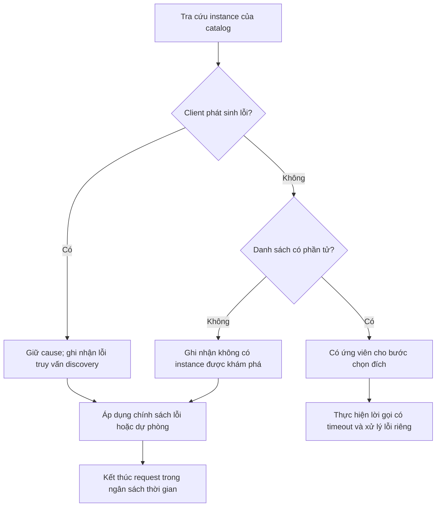

# Xử lý dịch vụ không tồn tại hoặc không có endpoint

> Chương: Khám phá dịch vụ — Module: SPRING_CLOUD_KUBERNETES.

Ứng dụng `order-service` cần khám phá `catalog` trước khi sử dụng một chức năng phụ thuộc vào danh mục sản phẩm. Trong triển khai Kubernetes, có lúc Service chưa được tạo, có lúc Service đã tồn tại nhưng chưa có Pod sẵn sàng, cũng có lúc ứng dụng không đủ quyền đọc dữ liệu khám phá. Các trường hợp này có thể cùng biểu hiện thành việc không tìm được instance, nhưng cách khắc phục khác nhau.

Mục tiêu của bài là thiết kế hành vi ứng dụng khi không có đích gọi và tìm được nguyên nhân bằng bằng chứng phù hợp. Spring Cloud Kubernetes cung cấp DiscoveryClient; Spring Cloud LoadBalancer có thể dùng danh sách khám phá để chọn instance. ConfigMap, Secret và Configuration Watcher phục vụ cấu hình, không tự tạo backend còn thiếu. Vì vậy, chỉ bật và cấp quyền cho những tính năng thực sự cần trong luồng xử lý.

## 1. Phân biệt ba câu hỏi trước khi xử lý

Khi một yêu cầu không tìm được backend, hãy tách ba câu hỏi:

1. Trong đúng cluster và namespace, tài nguyên Service có tồn tại không?
2. Service đó có những endpoint nào, và endpoint nào đủ điều kiện sử dụng?
3. Ứng dụng hiện quan sát được gì qua client, bộ lọc và các lớp cache?

Ba câu trả lời có thể chưa đồng nhất tại một thời điểm. Ví dụ, Service đã được tạo trong API server nhưng cache của ứng dụng chưa nhận cập nhật. Một Service khác có hai endpoint, nhưng cả hai đang `ready: false` nên không có ứng viên cho yêu cầu nghiệp vụ mới.

Trong bài, giả định Service đích là `catalog`, nằm trong namespace `shop`. Ví dụ chính sử dụng Service có selector và backend là Pod; các trường hợp Service không có selector hoặc `ExternalName` cần được xem theo cơ chế riêng của chúng.

| Trạng thái | Bằng chứng cần có | Ý nghĩa thực tế |
| --- | --- | --- |
| Service không tồn tại | API trả `NotFound` khi đọc đúng Service trong đúng namespace | Không có tài nguyên đó tại thời điểm đọc |
| Service tồn tại, chưa có địa chỉ backend | Đọc Service thành công nhưng chưa có địa chỉ trong các tài nguyên endpoint liên quan | Có thể chưa có Pod phù hợp, đang scale về 0 hoặc dữ liệu đang được cập nhật |
| Có địa chỉ nhưng không có ứng viên sử dụng | Endpoint chưa Ready, đang kết thúc hoặc bị chính sách lọc loại bỏ | Không có đích phù hợp với chính sách hiện tại |
| Không đọc được trạng thái khám phá | Lỗi quyền, kết nối API hoặc đồng bộ client | Chưa đủ bằng chứng để kết luận Service hay backend đã biến mất |
| Có instance nhưng gọi thất bại | Đã chọn được đích, sau đó lỗi kết nối, timeout hoặc HTTP lỗi | Sự cố thuộc bước gọi backend, không còn là danh sách khám phá rỗng |

`NotFound` là kết quả có phạm vi: tên tài nguyên, namespace, cluster và thời điểm đọc. Đọc `shop/catalog` không thấy không chứng minh rằng không có một Service `catalog` ở namespace khác.

## 2. Hiểu giới hạn của danh sách rỗng

Đoạn mã sau có thể nhận một danh sách không có phần tử:

```java
List<ServiceInstance> instances = discoveryClient.getInstances("catalog");
```

Ở góc nhìn ứng dụng, kết quả này nói rằng lần truy vấn hiện tại không cung cấp instance nào cho `catalog`. Nó chưa đủ để gắn nhãn nguyên nhân là `SERVICE_NOT_FOUND`.

Các giả thuyết cần kiểm tra gồm:

- Sai tên Service hoặc ứng dụng đang khám phá sai namespace.
- Service chưa tồn tại hoặc vừa bị xóa.
- Service tồn tại nhưng selector không khớp Pod nào.
- Backend chưa sẵn sàng, đang scale về 0 hoặc đang chuyển trạng thái.
- Bộ lọc discovery không cho Service xuất hiện trong phạm vi quan sát.
- Client hoặc một lớp cache chưa phản ánh cập nhật mới nhất.

Ngay cả khi gọi thêm `getServices()`, bạn vẫn đang đọc danh mục mà discovery client nhìn thấy. Danh mục này chịu giới hạn namespace, bộ lọc và độ mới dữ liệu. Hơn nữa, hai lần gọi `getServices()` và `getInstances()` không tạo thành một snapshot giao dịch: tài nguyên có thể thay đổi giữa hai lần gọi.

Spring mô tả hai phương thức và phạm vi khám phá trong [DiscoveryClient for Kubernetes](https://docs.spring.io/spring-cloud-kubernetes/reference/discovery-client.html). Khi cần phân loại nguyên nhân gốc, bổ sung bằng chứng từ Kubernetes thay vì suy đoán chỉ từ kích thước danh sách.

Một lỗi khác là bắt lỗi đọc API rồi đổi thành danh sách rỗng:

```java
// Ví dụ cần tránh: làm mất khác biệt giữa lỗi đọc và kết quả rỗng.
try {
    return discoveryClient.getInstances("catalog");
} catch (RuntimeException failure) {
    return List.of();
}
```

Đoạn mã này khiến người vận hành khó nhận ra tài khoản ứng dụng bị mất quyền hoặc client gặp sự cố. Cần giữ lỗi như một nhánh riêng, cùng nguyên nhân ban đầu.

## 3. Quyết định hành vi ứng dụng trước khi truy nguyên sự cố

Khi không có instance, ứng dụng vẫn phải đưa ra quyết định hữu hạn cho request hiện tại. Không chờ vô thời hạn cho tới khi một Pod xuất hiện.

| Vai trò của phụ thuộc | Hành vi có thể chọn | Điều kiện cần làm rõ |
| --- | --- | --- |
| Bắt buộc để thực hiện thao tác | Dừng luồng và trả lỗi dịch vụ phụ thuộc tạm không khả dụng | Không tạo kết quả nghiệp vụ giả để che lỗi |
| Chỉ phục vụ thông tin bổ sung | Trả phần dữ liệu chính, đánh dấu thiếu phần bổ sung | Hợp đồng API và giao diện phải thể hiện trạng thái thiếu dữ liệu |
| Có dữ liệu cache được phép dùng | Trả dữ liệu cũ trong giới hạn đã định | Có nguồn gốc, tuổi dữ liệu và phạm vi nghiệp vụ cho phép |
| Có hợp đồng xử lý bất đồng bộ | Ghi nhận vào hàng đợi bền vững rồi trả trạng thái đã tiếp nhận | Chỉ báo đã tiếp nhận sau khi việc ghi nhận thực sự thành công |

Ví dụ, mất dịch vụ gợi ý sản phẩm có thể chỉ làm ẩn khối gợi ý. Mất dịch vụ kiểm tra giá trong luồng đặt hàng không nên tự động biến giá thành `0`. Hai phụ thuộc có thể cùng không có endpoint nhưng không cùng chính sách dự phòng.

Trong ví dụ Spring của bài này, chính sách được chọn là trả HTTP `503 Service Unavailable` khi không thể cung cấp chức năng quan sát theo yêu cầu vì không có ứng viên hoặc truy vấn discovery thất bại. Đây là quyết định thiết kế của ví dụ, không phải mặc định bắt buộc của mọi tích hợp Spring.

Không chuyển lỗi hạ tầng này thành HTTP `404` của tài nguyên nghiệp vụ. “Không tìm được backend catalog” khác với “catalog đã xác nhận không có sản phẩm mang mã này”. Nếu API của bạn quản lý chính tài nguyên Kubernetes Service thì cách ánh xạ `404` có thể khác, theo hợp đồng của API quản trị đó.

## 4. Luồng xử lý kết quả discovery



Một danh sách không rỗng chỉ cung cấp ứng viên. Pod có thể kết thúc ngay sau bước khám phá; mạng có thể chặn kết nối; cổng hoặc giao thức có thể bị cấu hình sai. Vì vậy, kiểm tra danh sách không thay thế việc xử lý lỗi ở bước gọi HTTP.

Ngược lại, lỗi do `get(0)` trên danh sách rỗng không nên trở thành cách thông báo hết backend. Hãy kiểm tra trạng thái rỗng trước khi lựa chọn phần tử.

## 5. Ví dụ Spring: giữ hai nguyên nhân riêng và trả lỗi có cấu trúc

Ví dụ sử dụng Java 17 trở lên, Spring Web và Kubernetes DiscoveryClient dựa trên Fabric8. Các dependency đặt trong dự án Spring Boot đã quản lý bộ phiên bản tương thích bằng BOM:

```xml
<dependency>
    <groupId>org.springframework.boot</groupId>
    <artifactId>spring-boot-starter-web</artifactId>
</dependency>
<dependency>
    <groupId>org.springframework.cloud</groupId>
    <artifactId>spring-cloud-starter-kubernetes-fabric8</artifactId>
</dependency>
```

Ứng dụng chính bật discovery và đặt cùng package cha với các lớp bên dưới:

```java
package example.discovery;

import org.springframework.boot.SpringApplication;
import org.springframework.boot.autoconfigure.SpringBootApplication;
import org.springframework.cloud.client.discovery.EnableDiscoveryClient;

@SpringBootApplication
@EnableDiscoveryClient
public class Application {
    public static void main(String[] args) {
        SpringApplication.run(Application.class, args);
    }
}
```

Cấu hình phạm vi cho ví dụ chạy trong cluster:

```yaml
spring:
  application:
    name: order-service
  cloud:
    kubernetes:
      discovery:
        enabled: true
        all-namespaces: false
        namespaces:
          - shop
        use-endpoint-slices: true
        include-not-ready-addresses: false
        primary-port-name: http
```

Cần đối chiếu các thuộc tính với phiên bản Spring Cloud Kubernetes của dự án. Ví dụ chủ động chọn EndpointSlice; tài khoản ứng dụng phải có quyền đọc loại tài nguyên này. Không bật khám phá toàn cluster chỉ để thử khắc phục một lần không thấy Service.

### 5.1. Exception biểu diễn điều ứng dụng thực sự quan sát được

```java
package example.discovery;

public class DependencyUnavailableException extends RuntimeException {
    public enum Reason {
        NO_DISCOVERED_INSTANCE,
        DISCOVERY_QUERY_FAILED
    }

    private final String serviceId;
    private final Reason reason;

    public DependencyUnavailableException(
            String serviceId, Reason reason, Throwable cause) {
        super("Dependency unavailable: " + serviceId + ", reason=" + reason, cause);
        this.serviceId = serviceId;
        this.reason = reason;
    }

    public String serviceId() {
        return serviceId;
    }

    public Reason reason() {
        return reason;
    }
}
```

Tên `NO_DISCOVERED_INSTANCE` cố ý chỉ mô tả kết quả quan sát. Nó không khẳng định tài nguyên Service không tồn tại và cũng không khẳng định tất cả Pod đã chết.

### 5.2. Adapter kiểm tra danh sách và giữ nguyên cause

```java
package example.discovery;

import java.time.Instant;
import java.util.List;

import org.springframework.cloud.client.ServiceInstance;
import org.springframework.cloud.client.discovery.DiscoveryClient;
import org.springframework.stereotype.Service;

@Service
public class CatalogDiscoveryProbe {
    private static final String SERVICE_ID = "catalog";

    private final DiscoveryClient discoveryClient;

    public CatalogDiscoveryProbe(DiscoveryClient discoveryClient) {
        this.discoveryClient = discoveryClient;
    }

    public DiscoveryObservation inspect() {
        List<ServiceInstance> instances;

        try {
            instances = discoveryClient.getInstances(SERVICE_ID);
        } catch (RuntimeException failure) {
            throw new DependencyUnavailableException(
                    SERVICE_ID,
                    DependencyUnavailableException.Reason.DISCOVERY_QUERY_FAILED,
                    failure);
        }

        if (instances.isEmpty()) {
            throw new DependencyUnavailableException(
                    SERVICE_ID,
                    DependencyUnavailableException.Reason.NO_DISCOVERED_INSTANCE,
                    null);
        }

        return new DiscoveryObservation(
                SERVICE_ID,
                "CANDIDATES_DISCOVERED",
                instances.size(),
                Instant.now());
    }

    public record DiscoveryObservation(
            String serviceId,
            String state,
            int observedInstanceCount,
            Instant observedAt) {
    }
}
```

Phạm vi `try` chỉ bao quanh thao tác gọi discovery. Nhánh danh sách rỗng nằm bên ngoài nên exception do chính ứng dụng tạo không bị bắt lại thành `DISCOVERY_QUERY_FAILED`.

Nếu client phát sinh exception, mã giữ nguyên exception đó làm `cause`. Tuy nhiên, client dựa trên informer hoặc cache có thể gặp lỗi đồng bộ ở nền mà lần gọi `getInstances` vẫn trả dữ liệu cũ hoặc dữ liệu rỗng. Vì vậy, `DISCOVERY_QUERY_FAILED` trong mẫu chỉ có nghĩa lần gọi này ném lỗi; nó không phải bộ kiểm tra toàn diện sức khỏe của cơ chế đồng bộ discovery.

`observedAt` là lúc tạo phản hồi của ứng dụng, không phải dấu thời gian đồng bộ từ API server. `CANDIDATES_DISCOVERED` cũng không có nghĩa đã kiểm tra kết nối tới từng backend.

### 5.3. Controller và ánh xạ lỗi

```java
package example.discovery;

import org.springframework.web.bind.annotation.GetMapping;
import org.springframework.web.bind.annotation.RestController;

@RestController
public class CatalogDependencyController {
    private final CatalogDiscoveryProbe probe;

    public CatalogDependencyController(CatalogDiscoveryProbe probe) {
        this.probe = probe;
    }

    @GetMapping("/internal/dependencies/catalog/discovery")
    public CatalogDiscoveryProbe.DiscoveryObservation inspect() {
        return probe.inspect();
    }
}
```

```java
package example.discovery;

import java.time.Instant;

import org.slf4j.Logger;
import org.slf4j.LoggerFactory;
import org.springframework.http.CacheControl;
import org.springframework.http.ResponseEntity;
import org.springframework.web.bind.annotation.ExceptionHandler;
import org.springframework.web.bind.annotation.RestControllerAdvice;

@RestControllerAdvice(assignableTypes = CatalogDependencyController.class)
public class DependencyErrorHandler {
    private static final Logger log =
            LoggerFactory.getLogger(DependencyErrorHandler.class);

    @ExceptionHandler(DependencyUnavailableException.class)
    public ResponseEntity<DependencyError> handle(
            DependencyUnavailableException failure) {
        if (failure.getCause() != null) {
            log.warn("Discovery query failed for service={}",
                    failure.serviceId(), failure.getCause());
        }

        DependencyError body = new DependencyError(
                "DEPENDENCY_UNAVAILABLE",
                failure.serviceId(),
                failure.reason().name(),
                "Chưa có thông tin khám phá phù hợp để phục vụ yêu cầu.",
                Instant.now());

        return ResponseEntity.status(503)
                .cacheControl(CacheControl.noStore())
                .body(body);
    }

    public record DependencyError(
            String code,
            String serviceId,
            String reason,
            String message,
            Instant observedAt) {
    }
}
```

Một phản hồi minh họa khi danh sách rỗng:

```http
HTTP/1.1 503 Service Unavailable
Content-Type: application/json
Cache-Control: no-store
```

```json
{
  "code": "DEPENDENCY_UNAVAILABLE",
  "serviceId": "catalog",
  "reason": "NO_DISCOVERED_INSTANCE",
  "message": "Chưa có thông tin khám phá phù hợp để phục vụ yêu cầu.",
  "observedAt": "2026-11-24T04:00:00Z"
}
```

Đây là phản hồi dự kiến từ mã minh họa, không phải kết quả chạy trên một cluster cụ thể. Endpoint nội bộ cần cơ chế xác thực và giới hạn truy cập khi dùng ngoài môi trường thực hành.

Trong ứng dụng nghiệp vụ, có thể đặt kiểm tra tương tự ở biên adapter truy cập phụ thuộc. Không biến endpoint quan sát này thành bước HTTP bắt buộc trước mọi lời gọi thật: làm như vậy tăng thêm một request và vẫn không loại bỏ khoảng thời gian trạng thái có thể thay đổi.

Mẫu chưa thêm retry, timeout bao quanh client hay cơ chế giảm tần suất log. Khi triển khai, cần cấu hình timeout ở đúng lớp có thể chặn và hạn chế log lặp trong sự cố kéo dài. Không coi việc có `try/catch` là đã giới hạn thời gian chờ.

## 6. Nếu dùng Spring Cloud LoadBalancer

Spring Cloud LoadBalancer nhận danh sách ứng viên qua `ServiceInstanceListSupplier`, có thể dựa trên DiscoveryClient. Tùy cấu hình, danh sách còn đi qua cache hoặc các bộ lọc trước bước lựa chọn. Cấu trúc này được mô tả trong [tài liệu Spring Cloud LoadBalancer](https://docs.spring.io/spring-cloud-commons/reference/spring-cloud-commons/loadbalancer.html).

Vì vậy, cần xác định tập nào đang rỗng:

```text
Dữ liệu tài nguyên Kubernetes
    -> Góc nhìn của DiscoveryClient
        -> Danh sách sau các supplier/cache/bộ lọc
            -> Instance được LoadBalancer lựa chọn
                -> Kết quả gọi backend
```

Có thể DiscoveryClient thấy instance nhưng danh sách cuối không còn ứng viên phù hợp với chính sách lựa chọn. Khi đó, thêm Pod chưa chắc giải quyết được vấn đề; phải xem bộ lọc đang áp dụng.

Biểu hiện lỗi khi hết ứng viên phụ thuộc tích hợp HTTP và phiên bản thư viện: có luồng trả response lỗi, có luồng ném exception. Không viết handler dựa duy nhất vào việc dò chuỗi log như `No servers available`. Hãy xác định nhánh hết ứng viên của client cụ thể và ánh xạ về hợp đồng lỗi của ứng dụng.

Đoạn mã ở mục 5 chỉ minh họa xử lý DiscoveryClient; nó không phải cấu hình thay thế thuật toán cân bằng tải. Khi luồng gọi thật đã dùng LoadBalancer, xử lý nhánh không chọn được instance ngay ở biên tích hợp đó. Một lần kiểm tra trước đó thành công cũng không bảo đảm lần chọn đích sau đó thành công.

## 7. Retry có giới hạn và phục hồi có chủ đích

Không có endpoint đôi khi là trạng thái ngắn trong quá trình khởi động, rollout hoặc khôi phục từ scale về 0. Dù vậy, không phải mọi kết quả rỗng đều sẽ hết nếu chờ thêm.

| Nguyên nhân đã có bằng chứng | Hướng xử lý chính | Vai trò của retry |
| --- | --- | --- |
| Tên Service cấu hình sai | Sửa tên và nguồn cấu hình | Lặp lại cùng tên sai không giúp ích |
| Không được phép đọc API | Sửa Role/RoleBinding hoặc danh tính Pod | Không retry liên tục lỗi quyền |
| Selector không khớp nhãn | Sửa cấu hình sau khi xác minh | Chờ đơn thuần không làm nhãn tự khớp |
| Backend đang khởi động hợp lệ | Theo dõi readiness và thời gian khởi động | Có thể kiểm tra lại trong ngân sách đã định |
| Lỗi kết nối API tạm thời | Khôi phục kết nối và cơ chế đồng bộ | Retry có backoff có thể phù hợp |
| Scale về 0 có chủ ý | Theo hợp đồng kích hoạt backend | Chỉ chờ nếu tồn tại cơ chế kích hoạt và thời hạn rõ ràng |

Một chính sách minh họa cho request có tổng ngân sách `600 ms` là kiểm tra lần đầu, rồi cho phép tối đa một lần kiểm tra lại sau khoảng chờ ngẫu nhiên ngắn nếu còn đủ ngân sách và có lý do tin rằng trạng thái chỉ tạm thời. Các con số phải xuất phát từ yêu cầu của hệ thống; khoảng chờ ngắn không bảo đảm cache đã được làm mới.

Cần giới hạn cả số lần thử và thời gian thực tế của từng thao tác có thể chặn. Dùng đồng hồ đơn điệu để đo thời hạn xử lý. Với luồng reactive hoặc bất đồng bộ, lên lịch khoảng chờ thay vì giữ một thread bằng `Thread.sleep` trong mỗi request.

Cũng cần xác định lớp nào sở hữu retry. Nếu API gateway, client HTTP và service đều tự thử nhiều lần, số lời gọi có thể tăng nhanh trong lúc hệ thống đang thiếu năng lực phục vụ.

Việc đọc lại danh sách discovery chưa gửi thao tác nghiệp vụ tới backend. Nhưng sau khi request nghiệp vụ đã được gửi mà timeout xảy ra, không được suy ra rằng backend chưa thực hiện thao tác. Đặc biệt với đặt hàng hoặc thanh toán, chính sách thử lại phải xét tính idempotent và khóa chống xử lý trùng.

Circuit breaker có thể giúp hạn chế một số dạng lỗi lặp; nó không tạo Service, không tạo Pod và không chứng minh trạng thái endpoint. Cần xác định những lỗi nào được tính vào circuit breaker để tránh che khuất nguyên nhân cấu hình sai.

## 8. Chẩn đoán theo thứ tự bằng chứng

Các lệnh bên dưới dành cho người học thực hiện trong môi trường được phép. Không cần thay đổi cluster để bắt đầu chẩn đoán.

### 8.1. Kiểm tra context, namespace và Service

```powershell
kubectl config current-context
kubectl -n shop get service catalog -o yaml
```

Đọc riêng loại kết quả:

- `NotFound`: xác nhận lại context, namespace và tên Service; sau đó kiểm tra quy trình triển khai dự kiến.
- `Forbidden`: tài khoản thực hiện lệnh không được đọc; chưa có kết luận về sự tồn tại của Service.
- Timeout hoặc lỗi kết nối: cần kiểm tra đường tới API server trước khi kết luận về backend.
- Đọc thành công: tiếp tục với selector, loại Service và endpoint.

Tên truyền vào `getInstances("catalog")` trong ví dụ là `metadata.name` của Service. Không mặc định thay nó bằng URL `http://catalog` hoặc tên DNS đầy đủ rồi mong mọi implementation xử lý như cùng một service ID.

### 8.2. Đối chiếu selector và nhãn Pod

Ví dụ Service chọn:

```yaml
spec:
  selector:
    app: catalog
```

Khi đó kiểm tra:

```powershell
kubectl -n shop get pods -l app=catalog -o wide
kubectl -n shop get pods --show-labels
```

Nếu selector thực tế có nhiều điều kiện, cần dùng đầy đủ các điều kiện khi đối chiếu. Một nhãn đúng chưa đủ nếu các nhãn còn lại không khớp.

Không có Pod phù hợp có thể do selector sai, ứng dụng chưa triển khai hoặc số replica mong muốn đang bằng 0. Chỉ sửa selector sau khi xác minh tập Pod thật sự nên thuộc về Service. Chọn nhầm một nhóm Pod đang chạy có thể làm lưu lượng đi tới ứng dụng khác.

Quy trình đối chiếu Service, selector và endpoint được trình bày trong [Debug Services của Kubernetes](https://kubernetes.io/docs/tasks/debug/debug-application/debug-service/).

### 8.3. Xem tất cả EndpointSlice của Service

```powershell
kubectl -n shop get endpointslices -l kubernetes.io/service-name=catalog -o wide
kubectl -n shop get endpointslices -l kubernetes.io/service-name=catalog -o yaml
```

Có ba tình huống cần đọc khác nhau:

1. Chưa có slice phù hợp hoặc các slice chưa có địa chỉ: xem lại selector, Pod và quá trình cập nhật tài nguyên.
2. Có địa chỉ nhưng chưa có endpoint phù hợp để nhận yêu cầu: xem điều kiện endpoint và chính sách lọc.
3. Có ứng viên hợp lệ nhưng Spring vẫn thấy rỗng: đối chiếu phạm vi discovery, quyền và độ mới dữ liệu client.

Phải xem toàn bộ slice mang nhãn của Service, thay vì chỉ lấy slice đầu tiên. Tên slice không nhất thiết bằng tên Service. Quan hệ này được mô tả trong [tài liệu EndpointSlices](https://kubernetes.io/docs/concepts/services-networking/endpoint-slices/).

Nếu dự án thực sự đang dùng đường `Endpoints` cũ, kiểm tra thêm đúng tài nguyên đó:

```powershell
kubectl -n shop get endpoints catalog -o yaml
```

Trong cấu trúc cũ, phân biệt `subsets.addresses` và `subsets.notReadyAddresses`. Đừng chỉ nhìn thấy một IP ở đâu đó trong tài nguyên rồi kết luận client nghiệp vụ phải sử dụng nó.

### 8.4. Kiểm tra readiness và cổng backend

Ví dụ endpoint có địa chỉ nhưng chưa sẵn sàng:

```yaml
endpoints:
  - addresses:
      - 10.42.1.21
    conditions:
      ready: false
      serving: false
      terminating: false
```

Pod ở pha `Running` vẫn có thể chưa Ready. Với readiness probe thất bại, Kubernetes có thể ngừng đưa Pod vào tập backend phục vụ lưu lượng thông thường; bản thân thất bại readiness không đồng nghĩa container bị restart. Xem [Liveness, Readiness, and Startup Probes](https://kubernetes.io/docs/concepts/workloads/pods/probes/).

Đọc trạng thái và sự kiện của Pod cụ thể:

```powershell
kubectl -n shop describe pod catalog-demo
kubectl -n shop logs pod/catalog-demo --tail=100
```

`catalog-demo` là tên minh họa, cần thay bằng tên Pod thật. Kiểm tra probe, cổng đang nghe, named target port và trạng thái ứng dụng. Với Service dùng `targetPort` dạng tên, tên đó phải được khai báo đúng trên Pod; với cổng số, còn phải xác nhận ứng dụng thực sự lắng nghe cổng đó.

Không bật `include-not-ready-addresses` để làm danh sách hết rỗng trong luồng nghiệp vụ. Tương tự, `publishNotReadyAddresses` có thể phục vụ nhu cầu khám phá đặc biệt nhưng không làm ứng dụng sẵn sàng hơn. Nếu dùng các tùy chọn này cho quan sát, giữ rõ khác biệt với tập ứng viên được phép nhận yêu cầu thật.

### 8.5. Đối chiếu quyền của chính ứng dụng

Ứng dụng có thể chạy bằng ServiceAccount khác với tài khoản cá nhân đang dùng `kubectl`. Ví dụ Deployment chạy bằng `discovery-reader` trong namespace `shop` cần quyền phù hợp với cơ chế discovery của nó.

Người có quyền impersonation có thể kiểm tra:

```powershell
kubectl auth can-i list services -n shop --as=system:serviceaccount:shop:discovery-reader
kubectl auth can-i list endpointslices.discovery.k8s.io -n shop --as=system:serviceaccount:shop:discovery-reader
kubectl auth can-i watch endpointslices.discovery.k8s.io -n shop --as=system:serviceaccount:shop:discovery-reader
```

Nếu không có quyền impersonation, nhờ người vận hành thực hiện phép kiểm tra. Đọc log để xác định chính xác resource và verb bị từ chối. Quyền đối với `endpoints` trong core API group không tự cấp quyền với `endpointslices` trong `discovery.k8s.io`.

Không cấp `cluster-admin` để thử chữa lỗi không thấy endpoint. Cấp đúng quyền trong đúng namespace; bổ sung quyền đọc Pod chỉ khi implementation hoặc tính năng metadata đang dùng cần đến nó.

### 8.6. Kiểm tra phạm vi và dữ liệu client

Khi Kubernetes đã có backend phù hợp nhưng ứng dụng vẫn thấy rỗng, đối chiếu:

- Namespace được cấu hình hoặc được phân giải cho client.
- Bộ lọc nhãn Service và biểu thức lọc discovery, nếu có.
- Đường đọc EndpointSlice hay Endpoints đang thực sự được bật.
- Tình trạng khởi tạo cache, lỗi list/watch và lỗi đồng bộ trong log.
- Cache bổ sung ở LoadBalancer hoặc danh sách tự lưu trong mã ứng dụng.

Không dùng thời điểm trả HTTP của endpoint quan sát làm bằng chứng rằng lần đồng bộ cuối vừa hoàn tất. Nếu client cung cấp thông tin về đồng bộ hoặc sức khỏe watch, dùng thông tin đó cùng snapshot endpoint.

## 9. Cache rỗng và trạng thái khôi phục

Một hệ thống có thể giữ kết quả “không có instance” trong cache. Nếu không hiểu tuổi dữ liệu, người vận hành dễ tiếp tục sửa cluster dù backend đã hồi phục.

Xét một ví dụ giả định:

| Thời điểm | Trạng thái Kubernetes | Trạng thái quan sát ở ứng dụng |
| --- | --- | --- |
| `t = 0 s` | Chưa có backend Ready | Cache ngoài lưu danh sách rỗng với TTL 5 giây |
| `t = 2 s` | Đã có backend Ready | Client phía dưới đã cập nhật nhưng cache ngoài vẫn còn rỗng |
| Sau khi cache ngoài được làm mới | Backend vẫn Ready | Ứng dụng mới nhìn thấy ứng viên |

TTL 5 giây là giả định để giải thích, không phải mặc định hay giá trị khuyến nghị của Spring. Lớp nào lưu dữ liệu, lúc nào hết hạn và điều kiện làm mới phụ thuộc cấu hình cụ thể.

Cần xác định rõ ai sở hữu cache và yêu cầu về độ mới. Tránh tự giữ danh sách rỗng vô thời hạn trong một biến tĩnh. Cũng không tắt mọi cache một cách đồng loạt mà chưa đánh giá tải và cơ chế đồng bộ của implementation.

Dữ liệu “tốt gần nhất” cũng có giới hạn: một địa chỉ từng hoạt động có thể đã bị thu hồi. Nếu nghiệp vụ cho phép dùng dữ liệu hoặc ứng viên cũ, cần giới hạn tuổi, xử lý lỗi kết nối và theo dõi khi dữ liệu hết hạn. Danh sách cũ không phải bằng chứng rằng endpoint vẫn tồn tại.

## 10. Khởi động, readiness của ứng dụng gọi và chức năng tùy chọn

Không phải phụ thuộc nào chưa có endpoint cũng nên làm ứng dụng gọi bị restart. Một tiến trình vẫn có thể hoạt động bình thường, cung cấp các chức năng độc lập và trả lỗi rõ ràng cho chức năng đang thiếu phụ thuộc.

Với phụ thuộc bắt buộc cho mọi request, có thể cân nhắc đưa tình trạng đó vào readiness của ứng dụng gọi. Cần đánh giá khả năng gây lan truyền sự cố: nếu mọi service cùng mất readiness vì một phụ thuộc chung, khả năng quan sát và khôi phục có thể bị ảnh hưởng.

Không gắn sự tồn tại của một dịch vụ từ xa vào liveness một cách máy móc. Restart ứng dụng gọi không tạo thêm endpoint cho backend. Liveness nên phản ánh khả năng tiến trình tiếp tục hoạt động, còn readiness phản ánh khả năng nhận lưu lượng theo chính sách đã chọn.

Khi có một bước bắt buộc phải chờ discovery lúc khởi động, đặt thời hạn và hành vi hết hạn rõ ràng. Khi phụ thuộc là tùy chọn, có thể khởi động và báo trạng thái giảm chức năng. Các lựa chọn này thuộc hợp đồng vận hành, không suy ra tự động từ tên dependency.

Nếu service ID hoặc namespace lấy từ ConfigMap, một giá trị sai có thể làm khám phá rỗng. Khi sửa cấu hình, kiểm tra cơ chế ứng dụng thực sự tiếp nhận thay đổi: có cấu hình được nạp lại, có cấu hình cần khởi động lại. Không giả định Configuration Watcher có thể làm mới mọi thành phần tùy ý, và không thêm quyền đọc Secret nếu vấn đề chỉ là tên Service sai.

## 11. Quan sát để biết sự cố đã kết thúc

Một phản hồi `503` có cấu trúc giúp caller xử lý, nhưng vận hành còn cần biết nguyên nhân và thời gian kéo dài.

Có thể ghi nhận các thông tin sau trong log hoặc metric do ứng dụng định nghĩa:

| Thông tin | Giá trị đối với chẩn đoán |
| --- | --- |
| Service ID và namespace dự kiến | Phân biệt gọi sai tên với sai phạm vi |
| Nhánh kết quả | Tách `NO_DISCOVERED_INSTANCE` và `DISCOVERY_QUERY_FAILED` |
| Số ứng viên quan sát được | Nhận ra chuyển trạng thái từ có sang hết ứng viên |
| Thời gian kéo dài liên tục | Phân biệt biến động ngắn với gián đoạn đáng báo động |
| Mã lỗi API gốc, nếu có | Phân biệt lỗi quyền, xác thực và kết nối |
| Thông tin đồng bộ client, nếu được cung cấp | Đánh giá liệu dữ liệu đang bị cũ |

Tên metric và nhãn cần do dự án thiết kế, không phải các metric mặc định được bảo đảm bởi đoạn mã mẫu. Hạn chế nhãn có số lượng giá trị lớn như request ID hoặc Pod UID trong metric tổng hợp; giữ chúng trong log hoặc trace khi cần.

Ở lưu lượng lớn, ưu tiên ghi log khi đổi trạng thái, tổng hợp hoặc lấy mẫu thay vì in một stack trace cho mọi request bị ảnh hưởng. Thông báo lỗi ra ngoài không cần chứa token, cấu hình kết nối hoặc stack trace.

Khi hồi phục, cần xác nhận chuỗi điều kiện: backend phù hợp xuất hiện trong tài nguyên endpoint, client quan sát được ứng viên và chức năng nghiệp vụ thực sự gọi thành công. Chỉ thấy số replica mong muốn lớn hơn 0 hoặc hết một dòng log cảnh báo chưa đủ để kết luận đã phục hồi.

## 12. Thực hành quan sát mà không nhầm nguyên nhân

Trong môi trường riêng được phép thay đổi, chuẩn bị Service `catalog`, Deployment backend và ứng dụng quan sát. Có thể lần lượt tạo các tình huống dưới đây; mỗi lần ghi lại trạng thái ban đầu để khôi phục đúng.

| Tình huống thực hành | Bằng chứng nên thu thập | Kết quả mong đợi theo chính sách ví dụ |
| --- | --- | --- |
| Ứng dụng truy vấn một tên Service không được triển khai | Đọc đúng tên đó trả `NotFound`; client không có ứng viên sau khi dữ liệu hội tụ | `503`, lý do `NO_DISCOVERED_INSTANCE` |
| Scale Deployment backend về 0 trong môi trường thực hành | Service vẫn tồn tại; không còn địa chỉ backend sau khi cập nhật | `503`, vẫn không tự gắn nhãn Service bị xóa |
| Backend có IP nhưng readiness chưa đạt | Pod tồn tại; điều kiện endpoint chưa phù hợp | `503` nếu không có ứng viên nào khác |
| Thiếu quyền list/watch cần thiết | Log hoặc kết quả kiểm tra quyền thể hiện resource và verb bị từ chối | Xử lý lỗi discovery; có thể lỗi khởi động hoặc dữ liệu cũ tùy implementation |
| Backend được khôi phục | Endpoint, góc nhìn client và lời gọi thật lần lượt phục hồi | Trở lại hoạt động sau khi các lớp dữ liệu cập nhật |

Tình huống thiếu quyền không bắt buộc tạo ra `DISCOVERY_QUERY_FAILED` ở endpoint mẫu: lỗi có thể xuất hiện khi khởi động hoặc ở tác vụ đồng bộ nền. Hãy ghi lại nơi lỗi thực sự xuất hiện thay vì ép mọi biểu hiện vào cùng một response.

Nếu thực hành bằng lệnh scale, chỉ dùng Deployment dành riêng cho bài tập và khôi phục số replica đã ghi nhận. Không cần xóa Service dùng chung để học nhánh Service không tồn tại; có thể chọn một tên không được triển khai trong môi trường đó.

## 13. Những điểm cần nhớ

- Danh sách discovery rỗng chỉ chứng minh hiện không có instance được cung cấp cho lần truy vấn đó; muốn xác nhận Service không tồn tại cần bằng chứng đúng phạm vi từ Kubernetes.
- Phân biệt Service tồn tại, endpoint có địa chỉ, endpoint đủ điều kiện và backend gọi được. Mỗi bước trả lời một câu hỏi khác nhau.
- Xử lý danh sách rỗng trước khi chọn phần tử; giữ riêng lỗi truy vấn và cause gốc.
- Chọn lỗi, dự phòng hoặc chờ có giới hạn theo vai trò nghiệp vụ của phụ thuộc. Retry không sửa tên sai, selector sai hay thiếu quyền.
- Đối chiếu namespace, selector, readiness, API group, ServiceAccount và độ mới cache trước khi sửa cấu hình triển khai.
- Chỉ xác nhận phục hồi khi dữ liệu khám phá và chức năng cần sử dụng phụ thuộc đều đáp ứng yêu cầu.
