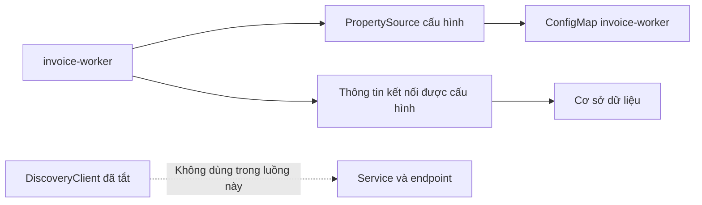

# Tắt khám phá dịch vụ khi ứng dụng chỉ cần cấu hình

Thuộc chương **Khám phá dịch vụ**, module **Spring Cloud Kubernetes (`SPRING_CLOUD_KUBERNETES`)**.

Một ứng dụng Spring chạy trên Kubernetes có thể chỉ cần đọc ConfigMap hoặc Secret để nhận tham số vận hành. Nhu cầu đó không tự kéo theo việc ứng dụng phải liệt kê Service, theo dõi endpoint hay tự chọn Pod đích bằng DiscoveryClient. Bật những tính năng không dùng khiến cấu hình triển khai, quyền RBAC và việc chẩn đoán phức tạp hơn cần thiết.

Bài này hướng dẫn chọn đúng công tắc để tắt khám phá dịch vụ trong ứng dụng vẫn cần cấu hình từ Kubernetes. Ví dụ cũng làm rõ ảnh hưởng đến Spring Cloud LoadBalancer, cập nhật cấu hình bằng Configuration Watcher và việc theo dõi sức khỏe Pod, để mỗi tính năng được giữ lại đều có lý do cụ thể.

## 1. Mục tiêu và tình huống áp dụng

Sau bài học, bạn có thể:

- Tách nhu cầu nạp cấu hình khỏi nhu cầu truy vấn danh sách dịch vụ.
- Dùng cờ tắt discovery đúng phạm vi mà vẫn giữ ConfigMap PropertySource.
- Chọn dependency cấu hình thay vì vô tình mang theo tính năng discovery không dùng.
- Thu gọn RBAC theo tài nguyên thực sự được đọc.
- Kiểm tra cả hai kết quả: discovery ngừng hoạt động và cấu hình nghiệp vụ vẫn được nạp.
- Phân biệt việc tắt discovery trong ứng dụng với cơ chế tìm đích của Configuration Watcher chạy riêng.

Tình huống xuyên suốt bài là `invoice-worker`, một ứng dụng xử lý hóa đơn theo lịch trong namespace `billing`. Nó đọc `billing.batch-size` từ ConfigMap `invoice-worker`, kết nối cơ sở dữ liệu bằng địa chỉ cấu hình sẵn và không gọi `DiscoveryClient.getServices()` hoặc `getInstances(...)`.

Ứng dụng không cần tự chọn một Pod của dịch vụ khác. Vì vậy, mục tiêu triển khai là giữ đường đọc cấu hình và bỏ đường khám phá dịch vụ trong tiến trình ứng dụng. Nếu có thành phần khác thực sự cần discovery, phải phân tích riêng trước khi áp dụng cờ tắt toàn cục.

Các đoạn cấu hình dưới đây minh họa cơ chế Config Data với một bộ phiên bản Spring Boot, Spring Cloud và Spring Cloud Kubernetes tương thích. Dự án đang dùng bootstrap cũ cần dùng đúng cơ chế của phiên bản đó; không ghép đồng thời hai cách nạp cấu hình chỉ để làm ví dụ hoạt động.

## 2. Hai luồng tích hợp độc lập

### 2.1. Đọc cấu hình trả lời câu hỏi nào?

Đường cấu hình trả lời các câu như: mỗi lượt xử lý bao nhiêu bản ghi, tính năng nào đang bật, kết nối đến địa chỉ nào và tham số có giá trị gì ở môi trường hiện tại.

Spring Cloud Kubernetes có các PropertySource giúp đưa dữ liệu ConfigMap hoặc Secret vào môi trường cấu hình Spring. Với ConfigMap, có thể xác định nguồn bằng tên và namespace; các giá trị được ứng dụng đọc qua cơ chế cấu hình thông thường. [Using a ConfigMap PropertySource](https://docs.spring.io/spring-cloud-kubernetes/reference/property-source-config/configmap-propertysource.html).

### 2.2. Khám phá dịch vụ trả lời câu hỏi nào?

Đường discovery trả lời dịch vụ nào đang hiện diện và có những địa chỉ instance nào để ứng dụng sử dụng. Nó có thể kéo theo việc đọc hoặc theo dõi Service cùng Endpoints hay EndpointSlice, tùy implementation và cấu hình. Spring Cloud Kubernetes cũng có biến thể HTTP DiscoveryClient gọi đến Discovery Server thay vì trực tiếp truy vấn Kubernetes API trong ứng dụng. [DiscoveryClient for Kubernetes](https://docs.spring.io/spring-cloud-kubernetes/reference/discovery-client.html).

Hai luồng đều liên quan đến Kubernetes, nhưng mục đích và tài nguyên truy cập khác nhau:

| Nhu cầu của `invoice-worker` | Dữ liệu cần | Thành phần ứng dụng cần |
| --- | --- | --- |
| Lấy kích thước một đợt xử lý | Khóa cấu hình trong ConfigMap | ConfigMap PropertySource |
| Nhận thông tin xác thực | Secret theo cách phân phối đã chọn | Đường nhận Secret tương ứng |
| Biết có bao nhiêu instance `inventory` | Service và endpoint | DiscoveryClient, nếu nghiệp vụ thật sự cần |
| Chọn một instance trước khi gọi | Danh sách đích và chính sách chọn | LoadBalancer hoặc thành phần chọn đích phù hợp |
| Nhận cấu hình thay đổi | Tín hiệu thay đổi và cơ chế áp dụng | Cơ chế refresh hoặc triển khai lại đã chọn |



Sơ đồ mô tả lựa chọn của ví dụ, không có nghĩa toàn cụm ngừng duy trì Service hoặc DNS. Tắt một tính năng trong JVM của `invoice-worker` chỉ tác động đến tiến trình đó.

## 3. Chọn cờ tắt đúng phạm vi

### 3.1. Tắt riêng discovery của Spring Cloud Kubernetes

Cờ trực tiếp cho tính năng khám phá dịch vụ của module là:

```properties
spring.cloud.kubernetes.discovery.enabled=false
```

Giữ cấu hình ConfigMap bật theo nhu cầu:

```properties
spring.cloud.kubernetes.config.enabled=true
```

Hai thuộc tính có phạm vi khác nhau; `discovery.enabled=false` không phải yêu cầu tắt ConfigMap PropertySource. Không cần đổi nguồn cấu hình chỉ vì bỏ discovery. [Danh sách thuộc tính Spring Cloud Kubernetes](https://docs.spring.io/spring-cloud-kubernetes/reference/appendix.html).

Cách này phù hợp khi muốn tắt Kubernetes DiscoveryClient nhưng còn một implementation discovery khác có chủ đích trong cùng ứng dụng. Chẳng hạn một ứng dụng chuyển tiếp đặc thù có thể dùng nguồn dịch vụ khác; không nên tắt toàn bộ lớp discovery mà chưa xem xét nguồn đó.

### 3.2. Tắt discovery ở lớp Spring Cloud Commons

Nếu ứng dụng hoàn toàn không cần discovery, có thể khai báo ý định đó ở lớp dùng chung:

```properties
spring.cloud.discovery.enabled=false
```

Spring Cloud Commons cũng có cờ riêng cho blocking và reactive discovery. Chỉ tắt một nhánh không diễn đạt việc tắt cả hai. Tương tự, `spring.cloud.discovery.client.health-indicator.enabled=false` chỉ tắt health indicator liên quan, không thay cho việc tắt discovery. [Spring Cloud Commons: Common Abstractions](https://docs.spring.io/spring-cloud-commons/reference/spring-cloud-commons/common-abstractions.html).

Trong tình huống `invoice-worker`, có thể đặt cả cờ toàn cục và cờ Kubernetes:

```yaml
spring:
  cloud:
    discovery:
      enabled: false
    kubernetes:
      discovery:
        enabled: false
```

Hai cờ cùng thể hiện chính sách của ví dụ: ứng dụng không cần discovery nói chung, đồng thời Kubernetes discovery được tắt rõ ràng. Đây là lựa chọn có chủ đích, không phải yêu cầu mọi dự án phải khai báo hai cờ. Với client tự viết hoặc thư viện tích hợp khác, vẫn cần kiểm tra nó có tuân theo các điều kiện tự cấu hình tương ứng hay không.

### 3.3. Những thay đổi dễ gây hiểu nhầm

| Thay đổi | Tác động chính | Vì sao chưa đáp ứng mục tiêu hoặc quá rộng? |
| --- | --- | --- |
| `spring.cloud.kubernetes.discovery.enabled=false` | Tắt Kubernetes discovery | Phù hợp khi giữ tính năng cấu hình Kubernetes |
| `spring.cloud.discovery.enabled=false` | Tắt discovery theo cơ chế dùng chung Spring Cloud | Phù hợp khi mọi implementation discovery đều không cần |
| Chỉ tắt discovery health indicator | Bỏ phần kiểm tra sức khỏe liên quan | Client hoặc cache discovery vẫn có thể tồn tại |
| `spring.cloud.kubernetes.config.enabled=false` | Tắt ConfigMap PropertySource | Trái với yêu cầu vẫn cần ConfigMap |
| `spring.main.cloud-platform=NONE` | Ép nhận diện nền tảng thành NONE | Có thể ảnh hưởng các auto-configuration cần điều kiện Kubernetes |
| Chỉ gỡ `@EnableDiscoveryClient` | Thay đổi annotation trên mã ứng dụng | Chưa chứng minh discovery không được tự cấu hình từ dependency |
| Chỉ tắt auto-registration | Điều khiển đăng ký với cơ chế registry hỗ trợ nó | Không đồng nghĩa ngừng truy vấn danh sách dịch vụ |
| Chỉ bỏ quyền đọc Service | API từ chối các truy vấn không được cấp quyền | Client có thể tiếp tục khởi tạo, báo lỗi hoặc thử lại |

Hãy dùng công tắc của tính năng đang muốn bỏ, rồi thu gọn dependency và quyền truy cập theo kết quả. Một lỗi `403 Forbidden` không phải trạng thái hoàn tất của việc tắt discovery.

## 4. Đặt lựa chọn vào cấu hình có hiệu lực lúc khởi động

### 4.1. Ví dụ đầy đủ với Config Data

Cấu hình đóng gói của `invoice-worker` có thể là:

```yaml
spring:
  application:
    name: invoice-worker
  config:
    import: "kubernetes:"
  cloud:
    discovery:
      enabled: false
    kubernetes:
      discovery:
        enabled: false
      config:
        enabled: true
        name: invoice-worker
        namespace: billing
      secrets:
        enabled: false
```

`spring.config.import: "kubernetes:"` là cách bật đường nạp Kubernetes PropertySource qua Config Data. Chuỗi có dấu `:` được đặt trong dấu nháy để YAML biểu diễn đúng giá trị. Nếu dùng cách này thì không đồng thời bật legacy bootstrap cho cùng nhiệm vụ nạp cấu hình. [Kubernetes PropertySource implementations](https://docs.spring.io/spring-cloud-kubernetes/reference/property-source-config.html).

Ví dụ tắt Secret PropertySource vì dữ liệu nghiệp vụ đang minh họa chỉ ở ConfigMap. Đây không phải chỉ dẫn tắt Secret trong mọi ứng dụng. Nếu hệ thống thực sự cần Secret, giữ đường nhận Secret theo thiết kế và quyền truy cập phù hợp; lựa chọn đó độc lập với discovery.

ConfigMap tương ứng:

```yaml
apiVersion: v1
kind: ConfigMap
metadata:
  name: invoice-worker
  namespace: billing
data:
  billing.batch-size: "40"
  billing.mode: "scheduled"
```

Giá trị `40` ở đây là dữ liệu cấu hình để kiểm tra đường nạp. Nó không phải con số khuyến nghị cho mọi hệ thống hóa đơn; ứng dụng cần chọn kích thước đợt theo nghiệp vụ và năng lực thực tế.

### 4.2. Có thể cố định chính sách bằng biến môi trường

Đoạn trích từ cấu hình container:

```yaml
env:
  - name: SPRING_CLOUD_DISCOVERY_ENABLED
    value: "false"
  - name: SPRING_CLOUD_KUBERNETES_DISCOVERY_ENABLED
    value: "false"
```

Đây là phần `env` của một container trong Deployment, không phải manifest độc lập. Cách đặt này thuận tiện khi chính sách triển khai cần rõ ràng ngay trước khi application context được tạo.

Nên đặt cờ điều khiển chức năng trong cấu hình khởi động được kiểm soát, như cấu hình đóng gói hoặc biến môi trường của Deployment. Nếu chỉ để trong ConfigMap nghiệp vụ, cần hiểu thời điểm nạp và thứ tự ưu tiên; một profile, biến môi trường hoặc tham số dòng lệnh có thể ghi đè giá trị bạn đang nhìn thấy trong file. [Externalized Configuration của Spring Boot](https://docs.spring.io/spring-boot/reference/features/external-config.html).

Sau khi sửa cờ, khởi động lại hoặc triển khai lại ứng dụng theo quy trình thông thường. Không giả định một lần refresh cấu hình sẽ tự tháo toàn bộ bean, informer và tác vụ discovery đã được tạo khi khởi động.

### 4.3. Giữ cơ chế phát hiện cấu hình thiếu

Ứng dụng khởi động được chưa chứng minh ConfigMap đã được nạp. Giá trị mặc định trong mã có thể che việc nguồn bên ngoài bị thiếu.

Trong ví dụ, có thể xác thực một thuộc tính nghiệp vụ bắt buộc khi khởi động:

```java
package example.billing;

import org.slf4j.Logger;
import org.slf4j.LoggerFactory;
import org.springframework.boot.ApplicationRunner;
import org.springframework.context.annotation.Bean;
import org.springframework.context.annotation.Configuration;
import org.springframework.core.env.Environment;

@Configuration(proxyBeanMethods = false)
public class BillingConfigurationCheck {

    private static final Logger log =
            LoggerFactory.getLogger(BillingConfigurationCheck.class);

    @Bean
    ApplicationRunner checkBillingConfiguration(Environment environment) {
        return args -> {
            int batchSize = environment.getRequiredProperty(
                    "billing.batch-size", Integer.class);

            if (batchSize <= 0) {
                throw new IllegalStateException(
                        "billing.batch-size must be positive");
            }

            log.info("Billing configuration loaded: batchSize={}", batchSize);
        };
    }
}
```

Đặt lớp trong vùng được component scan của ứng dụng quét. Ví dụ kiểm tra thuộc tính không nhạy cảm; không log mật khẩu, token hoặc toàn bộ `Environment` để chứng minh đã đọc Secret.

Nếu `billing.batch-size` cũng được cấp qua biến môi trường hoặc một nguồn khác, phép kiểm tra chỉ chứng minh có giá trị hợp lệ. Muốn chứng minh đúng ConfigMap được sử dụng, cần đối chiếu nguồn cấu hình hoặc dùng giá trị nhận diện thử nghiệm chỉ đặt ở nguồn đó trong môi trường kiểm thử.

## 5. Chọn dependency phù hợp với ứng dụng chỉ cần cấu hình

Một ứng dụng chỉ cần ConfigMap nên bắt đầu từ starter cấu hình của đúng họ client. Ví dụ dependency dùng Kubernetes Java Client:

```xml
<dependency>
    <groupId>org.springframework.cloud</groupId>
    <artifactId>spring-cloud-starter-kubernetes-client-config</artifactId>
</dependency>
```

Phiên bản được quản lý bằng bộ dependency tương thích của dự án. Với Fabric8, chọn starter cấu hình tương ứng của họ đó; không thêm cả hai họ client chỉ để chắc rằng có thể nạp ConfigMap. Starter cấu hình có vai trò riêng trong cấu trúc module Spring Cloud Kubernetes. [POM starter Kubernetes Client Config](https://raw.githubusercontent.com/spring-cloud/spring-cloud-kubernetes/main/spring-cloud-starter-kubernetes-client-config/pom.xml).

Khi chuyển một ứng dụng đang dùng nhiều tính năng sang chỉ đọc cấu hình, hãy xem xét:

1. Bỏ dependency discovery được khai báo trực tiếp nếu không còn người sử dụng.
2. Bỏ starter gom nhiều tính năng nếu chỉ cần starter cấu hình.
3. Kiểm tra dependency bắc cầu còn mang implementation discovery vào runtime hay không.
4. Giữ dependency phục vụ cơ chế cấu hình và refresh thật sự sử dụng.
5. Xóa hoặc điều chỉnh mã bắt buộc inject DiscoveryClient khi chức năng đó không còn thuộc thiết kế.

Cờ `enabled=false` diễn đạt hành vi ở runtime; bỏ dependency không cần giúp làm rõ khả năng mà ứng dụng được đóng gói để thực hiện. Không nên gỡ cả một thư viện dùng chung Kubernetes client chỉ vì nó xuất hiện trong cây dependency: đường cấu hình qua API vẫn có thể cần client đó.

## 6. Kiểm tra các thành phần đang dựa vào discovery

### 6.1. Mã ứng dụng inject DiscoveryClient

Nếu còn một constructor như sau trong một bean luôn được tạo, việc tắt discovery có thể làm lộ một phụ thuộc không còn phù hợp:

```java
public InvoiceJob(DiscoveryClient discoveryClient) {
    // ...
}
```

Với job chỉ xử lý dữ liệu từ cơ sở dữ liệu, hãy thiết kế lại để nhận đúng dependency nghiệp vụ cần dùng. Nếu chức năng discovery chỉ có trong một chế độ triển khai riêng, cấu hình tạo bean cho chế độ đó cần có điều kiện phù hợp.

Không thêm một DiscoveryClient giả trả danh sách rỗng chỉ để ứng dụng vượt qua lỗi thiếu bean. Cách đó có thể che đường gọi nghiệp vụ vẫn đang mong đợi một dịch vụ được khám phá.

### 6.2. Spring Cloud LoadBalancer và các đường gọi theo serviceId

Một lời gọi như `http://inventory/...` trên HTTP client đã gắn LoadBalancer thường mang ý nghĩa chọn instance cho serviceId `inventory`. Nếu nguồn instance của nó đến từ Kubernetes DiscoveryClient, tắt nguồn đó sẽ thay đổi khả năng gọi.

Trước khi áp dụng chính sách chỉ cấu hình, kiểm tra các nơi sau:

- Client HTTP mang `@LoadBalanced`.
- Client khai báo tên dịch vụ và trông chờ discovery để tìm địa chỉ.
- Gateway tạo route dựa trên danh mục dịch vụ.
- Tác vụ nền tự gọi `getServices()` hoặc `getInstances(...)`.

Nếu hệ thống chọn gọi Kubernetes Service bằng DNS trực tiếp, cấu hình một HTTP client thông thường và địa chỉ đích rõ ràng theo thiết kế đó. Ví dụ `http://inventory.billing.svc:8080` là một dạng địa chỉ Service trong cụm; cần dùng cổng, DNS và giao thức thực tế của triển khai. Không giữ cơ chế diễn giải host như serviceId trên client rồi kỳ vọng DNS sẽ tự thay thế nguồn instance đã tắt.

Tắt DiscoveryClient trong JVM không xóa Kubernetes Service, không tắt DNS của cụm và không ngừng cơ chế chuyển tiếp lưu lượng của Service. Ứng dụng vẫn có thể nhận request hoặc gọi địa chỉ đã được cấu hình nếu các điều kiện mạng và xác thực cho phép.

## 7. Thu gọn RBAC theo đường cấu hình còn sử dụng

### 7.1. Phân quyền theo tài nguyên và danh tính thật

Với ví dụ chỉ đọc ConfigMap qua API, ứng dụng không cần được cấp quyền đọc Service hoặc endpoint chỉ để nạp `billing.batch-size`. Một Role mẫu trong namespace `billing` có thể tập trung vào ConfigMap:

```yaml
apiVersion: v1
kind: ServiceAccount
metadata:
  name: invoice-config-reader
  namespace: billing
---
apiVersion: rbac.authorization.k8s.io/v1
kind: Role
metadata:
  name: invoice-config-reader
  namespace: billing
rules:
  - apiGroups: [""]
    resources: ["configmaps"]
    verbs: ["get", "list"]
---
apiVersion: rbac.authorization.k8s.io/v1
kind: RoleBinding
metadata:
  name: invoice-config-reader
  namespace: billing
subjects:
  - kind: ServiceAccount
    name: invoice-config-reader
    namespace: billing
roleRef:
  apiGroup: rbac.authorization.k8s.io
  kind: Role
  name: invoice-config-reader
```

Namespace phải tồn tại và Deployment phải dùng `spec.template.spec.serviceAccountName: invoice-config-reader`. Đây là Role minh họa cho đường đọc cấu hình lúc khởi động, không phải bộ quyền tối thiểu cố định cho mọi implementation.

Tùy phiên bản và chế độ đọc, loader có thể liệt kê tài nguyên trong namespace rồi chọn nguồn phù hợp, hoặc đọc theo tên. Nếu cơ chế cấu hình trong ứng dụng còn theo dõi thay đổi bằng watch, phải cấp thêm quyền tương ứng. Không giả định rằng cấu hình một tên ConfigMap luôn đồng nghĩa chỉ có một lệnh API `get`.

RBAC cộng dồn quyền từ các RoleBinding và ClusterRoleBinding liên quan. Vì vậy tạo một Role nhỏ hơn chưa thu hồi được quyền rộng đã được cấp ở nơi khác. Cần kiểm tra quyền có hiệu lực của đúng ServiceAccount trước khi kết luận quyền discovery đã bị bỏ. [Using RBAC Authorization](https://kubernetes.io/docs/reference/access-authn-authz/rbac/).

### 7.2. Secret có cách phân phối riêng

Có thể nhận Secret bằng API, volume hoặc biến môi trường tùy thiết kế. Không suy ra ứng dụng cần quyền `list secrets` chỉ vì dữ liệu xác thực xuất phát từ một Secret. Secret PropertySource và cách đọc API của nó cần được cấu hình theo phiên bản; quyền đọc danh sách Secret mở ra khả năng đọc dữ liệu nhạy cảm trong phạm vi được cấp. [Secrets PropertySource](https://docs.spring.io/spring-cloud-kubernetes/reference/property-source-config/secrets-propertysource.html).

Nếu Secret được nền tảng đưa vào container và ứng dụng chỉ đọc file hoặc biến môi trường, đừng cấp quyền API không được dùng. Ngược lại, nếu Java client thực sự gọi API để lấy Secret, phải giữ các quyền mà đường đó cần.

### 7.3. Chỉ bỏ token khi không còn đường API cần nó

Khi vẫn dùng PropertySource truy cập Kubernetes API bằng ServiceAccount trong cụm, ứng dụng cần cơ chế xác thực phù hợp. Không đặt `automountServiceAccountToken: false` chỉ vì discovery đã tắt rồi kỳ vọng đường đọc ConfigMap qua API vẫn hoạt động như trước.

Nếu toàn bộ cấu hình chuyển sang volume hoặc biến môi trường và không còn thành phần nào gọi API bằng token đó, có thể xem xét bỏ việc mount token trong thiết kế triển khai tương ứng. Đây là quyết định khác với cờ discovery và cần được kiểm tra theo các chức năng còn dùng.

## 8. Cập nhật cấu hình và Configuration Watcher sau khi tắt discovery

### 8.1. Tách tải ban đầu khỏi cập nhật khi đang chạy

Giữ ConfigMap PropertySource giúp duy trì đường tải cấu hình ban đầu. Điều đó chưa cam kết mọi bean đang chạy sẽ tự nhận giá trị mới mỗi khi ConfigMap thay đổi.

Cần chọn rõ một cơ chế: triển khai lại ứng dụng khi cấu hình đổi, hoặc sử dụng đường refresh đã thiết kế. Những đối tượng giữ giá trị tại thời điểm khởi tạo có thể cần cơ chế binding hoặc refresh phù hợp; không lấy việc file nguồn thay đổi làm bằng chứng nghiệp vụ đang dùng giá trị mới.

### 8.2. Watcher chạy riêng có cấu hình và RBAC riêng

Configuration Watcher có thể theo dõi nguồn cấu hình và gửi thông báo qua HTTP tới ứng dụng hoặc qua Spring Cloud Bus. Với HTTP, ứng dụng đích cần endpoint refresh tương ứng và đường truy cập phù hợp. Thành phần watcher có thể dùng discovery của chính nó để xác định đích cần thông báo. [Spring Cloud Kubernetes Configuration Watcher](https://docs.spring.io/spring-cloud-kubernetes/reference/spring-cloud-kubernetes-configuration-watcher.html).

Vì vậy, việc đặt `SPRING_CLOUD_KUBERNETES_DISCOVERY_ENABLED=false` trong Deployment của `invoice-worker` không có nghĩa phải sao chép cùng cờ vào Deployment của watcher. Hai tiến trình có nhiệm vụ khác nhau:

| Thành phần | Nhu cầu trong thiết kế minh họa | Cách đánh giá |
| --- | --- | --- |
| `invoice-worker` | Đọc cấu hình và xử lý hóa đơn | Không cần tự liệt kê dịch vụ |
| Watcher chạy riêng | Theo dõi thay đổi và thông báo đúng ứng dụng | Giữ các tính năng tìm đích mà watcher thực sự cần |
| Kubernetes Service của ứng dụng | Cung cấp đường truy cập tới Pod khi cần HTTP refresh | Không bị xóa chỉ vì client discovery trong ứng dụng tắt |

Quyền của ServiceAccount watcher không tự chuyển sang ServiceAccount ứng dụng và ngược lại. Khi thu gọn Role cho `invoice-worker`, không sửa nhầm Role của watcher rồi làm đứt đường thông báo.

Bài thực hành ban đầu có thể chọn triển khai lại để áp dụng cấu hình mới, qua đó quan sát riêng việc tắt discovery và tải cấu hình. Chỉ thêm cơ chế refresh khi yêu cầu vận hành cần đến nó.

## 9. Kiểm chứng hai phía của thay đổi

Để kết luận đúng, cần có bằng chứng tích cực rằng cấu hình vẫn dùng được và bằng chứng rằng đường discovery không còn được kích hoạt. Không dùng duy nhất tình trạng log yên lặng làm tiêu chí.

### 9.1. Kiểm tra cấu hình nghiệp vụ

Trên môi trường thử nghiệm:

1. Đặt một giá trị nhận diện không nhạy cảm trong ConfigMap, ví dụ `billing.batch-size=40`.
2. Xác nhận không có biến môi trường, profile hoặc tham số dòng lệnh khác cấp cùng khóa khi đang muốn kiểm tra nguồn này.
3. Khởi động phiên bản có discovery tắt và kiểm tra giá trị mà nghiệp vụ thực sự sử dụng.
4. Đổi giá trị theo một kịch bản thử nghiệm, chẳng hạn `55`, rồi triển khai lại hoặc thực hiện đúng cơ chế refresh đã chọn.
5. Xác nhận nghiệp vụ nhận giá trị mới và không cần bật lại discovery để làm việc đó.

Phần xác thực thuộc tính bắt buộc trong mã giúp tránh kết luận nhầm khi ứng dụng chỉ chạy bằng giá trị mặc định.

### 9.2. Kiểm tra tự cấu hình và người sử dụng discovery

Có thể dùng báo cáo điều kiện tự cấu hình khi khởi động với `--debug` trong môi trường thử nghiệm, hoặc công cụ Actuator đã được giới hạn truy cập. Đối chiếu các cấu hình liên quan đến Kubernetes discovery và các client discovery đang hiện diện theo đúng phiên bản.

Không đặt tiêu chí máy móc là “không được có bất kỳ bean kiểu DiscoveryClient nào” cho mọi cấu hình. Có thể còn wrapper, client khác hoặc bean tự viết; điều cần chứng minh là implementation Kubernetes và công việc truy vấn hoặc theo dõi dịch vụ không còn được kích hoạt ngoài thiết kế.

Nếu có log chờ cache discovery, lỗi liệt kê Service hoặc vòng lặp kết nối đến Discovery Server, hãy kiểm tra lại giá trị cờ có hiệu lực, dependency và thành phần khởi tạo. Không bỏ qua lỗi đó chỉ vì quá trình nạp ConfigMap đã thành công.

### 9.3. Kiểm tra quyền và truy cập API

Ví dụ lệnh quan sát quyền trên cụm thử nghiệm:

```shell
kubectl auth can-i list configmaps -n billing --as=system:serviceaccount:billing:invoice-config-reader
kubectl auth can-i list services -n billing --as=system:serviceaccount:billing:invoice-config-reader
kubectl auth can-i watch endpoints -n billing --as=system:serviceaccount:billing:invoice-config-reader
kubectl auth can-i watch endpointslices.discovery.k8s.io -n billing --as=system:serviceaccount:billing:invoice-config-reader
```

Với Role minh họa và không có binding rộng bổ sung, quyền đọc ConfigMap phải phù hợp với cách nạp đã chọn, còn các quyền discovery trên nên bị từ chối. Người chạy `--as` cần quyền impersonate; lỗi impersonation chưa chứng minh ServiceAccount đích thiếu quyền tương ứng.

Kết quả `can-i` chỉ cho biết có được phép làm việc đó hay không. Nếu hệ thống có audit log hoặc số liệu API, đối chiếu thêm danh tính của ứng dụng để biết nó có thực sự gửi yêu cầu đọc Service hay endpoint hay không. Không mong đợi toàn cụm ngừng những yêu cầu này vì controller và các ứng dụng khác vẫn cần chúng.

### 9.4. Giữ kiểm tra sức khỏe Pod có ý nghĩa

Readiness và liveness vẫn cần phản ánh khả năng phục vụ của ứng dụng theo thiết kế. Discovery health indicator biến mất không có nghĩa Pod mất khả năng được Kubernetes kiểm tra sức khỏe.

Nếu một health hoặc info contributor khác vẫn gọi Kubernetes API để lấy thông tin Pod, hãy đánh giá nhu cầu và quyền của nó riêng. Đừng quy mọi API call còn lại thành discovery, cũng đừng thu hồi một quyền rồi che lỗi của chức năng còn được yêu cầu.

## 10. Lỗi thường gặp và hướng xử lý

| Hiện tượng | Nguyên nhân cần xét | Hướng xử lý |
| --- | --- | --- |
| Sau khi tắt, không còn cấu hình từ ConfigMap | Tắt nhầm cờ config, gỡ nhầm starter, sai import, namespace hoặc RBAC | Giữ đường cấu hình rồi kiểm tra nguồn và quyền theo từng lớp |
| Vẫn có lỗi `Forbidden` khi đọc Service | Discovery chưa tắt ở nguồn có hiệu lực hoặc còn thành phần khác truy vấn Service | Xem giá trị cờ thực tế, điều kiện auto-configuration và nguồn gọi |
| Ứng dụng lỗi thiếu bean DiscoveryClient | Bean nghiệp vụ vẫn bắt buộc phụ thuộc tính năng đã bỏ | Điều chỉnh dependency của bean theo chế độ chỉ cấu hình |
| Gọi HTTP theo serviceId không còn instance | Đường gọi vẫn dựa vào danh sách discovery | Giữ discovery nếu còn nhu cầu, hoặc chuyển đường gọi theo thiết kế khác |
| Health báo tốt nhưng discovery vẫn chạy | Mới tắt health indicator | Dùng cờ discovery đúng phạm vi và kiểm tra hoạt động client |
| Khởi động được nhưng cấu hình sai | Giá trị mặc định hoặc nguồn khác che ConfigMap không được nạp | Xác thực thuộc tính bắt buộc và đối chiếu nguồn cấp giá trị |
| Watcher không gửi refresh nữa | Áp dụng cờ hoặc RBAC của ứng dụng sang watcher | Tách cấu hình, ServiceAccount và nhiệm vụ của hai tiến trình |
| Không còn xác thực để đọc ConfigMap API | Bỏ mount token dù đường API vẫn cần nó | Khôi phục cơ chế xác thực phù hợp hoặc đổi hẳn phương thức phân phối cấu hình |
| Cờ trong file là `false` nhưng hành vi không đổi | Có nguồn ưu tiên cao hơn hoặc Pod vẫn chạy phiên bản cũ | Kiểm tra cấu hình có hiệu lực và trạng thái triển khai |

## 11. Bài thực hành và tiêu chí hoàn thành

Chuẩn bị một ứng dụng thử nghiệm `invoice-worker`, namespace `billing`, ConfigMap và ServiceAccount như ví dụ. Chỉ áp dụng các manifest vào môi trường mà bạn được phép thay đổi; các lệnh trong bài là hướng dẫn thực hành, không phải điều kiện phải mở quyền toàn cụm.

Thực hiện theo thứ tự:

1. Ghi rõ ứng dụng cần những nguồn cấu hình nào và còn chức năng nào gọi discovery không.
2. Chọn starter cấu hình của một họ client và khai báo cờ discovery tắt ở phạm vi phù hợp.
3. Dùng Config Data hoặc bootstrap theo phiên bản, giữ nguyên khả năng đọc ConfigMap cần thiết.
4. Khởi động với Role cấu hình phù hợp, xác nhận thuộc tính nghiệp vụ được nạp đúng nguồn.
5. Kiểm tra discovery không khởi tạo công việc truy vấn Service hoặc endpoint không cần thiết và không còn lỗi do mã nghiệp vụ phụ thuộc nó.
6. Thử một lần thay đổi cấu hình bằng cơ chế cập nhật đã chọn, rồi xác nhận giá trị mới được sử dụng.
7. Đối chiếu riêng đường gọi dịch vụ, health của Pod và Configuration Watcher nếu chúng hiện diện.

Một cấu hình hoàn thành phải đáp ứng đồng thời các điều kiện: giá trị nghiệp vụ vẫn đến từ nguồn dự kiến, không có tính năng discovery hoạt động ngoài nhu cầu, RBAC phù hợp với tài nguyên còn dùng, và ứng dụng xử lý được lần cập nhật cấu hình tiếp theo theo quy trình đã chọn. Khi nhu cầu mới thực sự cần danh sách instance hoặc chính sách chọn Pod, hãy bổ sung discovery cùng bằng chứng sử dụng cụ thể thay vì bật sẵn mọi tính năng.