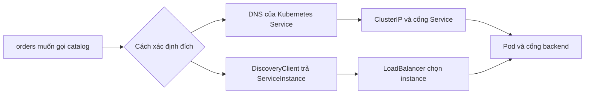

# ServiceInstance ID, host, port và URI

> Chương: ServiceInstance và cổng  
> Module: SPRING_CLOUD_KUBERNETES

Khi gọi `discoveryClient.getInstances("catalog")`, ứng dụng nhận một danh sách `ServiceInstance`. Mỗi phần tử mô tả một đích mà cơ chế discovery cung cấp: định danh instance, định danh dịch vụ, host, cổng và URI. Đọc đúng các trường này giúp giải thích vì sao một Service công bố cổng 80 nhưng caller lại kết nối tới cổng 8080 trên IP Pod.

Bài học dùng tình huống `orders` khám phá `catalog` trong namespace `ports-lab`. Trọng tâm là diễn giải dữ liệu và tạo địa chỉ yêu cầu chính xác khi tích hợp Spring với Kubernetes; từ đó biết khi nào cần DiscoveryClient và Spring Cloud LoadBalancer, khi nào chỉ cần gọi qua Service.

## 1. Mục tiêu và phạm vi

Sau bài này, bạn có thể:

- Phân biệt `instanceId` với `serviceId`, tên Pod và địa chỉ mạng.
- Đọc `host`, `port` trong bối cảnh đường gọi trực tiếp tới Pod hoặc qua Service.
- Diễn giải `getUri()`, `getScheme()` và `isSecure()` mà không nhầm với một lần kiểm tra kết nối.
- Ghép path và query của yêu cầu vào URI instance.
- Đối chiếu kết quả discovery với Service, Pod và EndpointSlice khi điều tra lỗi.

Ví dụ Java dùng Java 17 trở lên, các API phổ biến của Spring Cloud Commons và một bộ Spring Boot/Spring Cloud tương thích do BOM quản lý. Ví dụ Kubernetes giả định cluster có API `discovery.k8s.io/v1`. Các đoạn mã, địa chỉ IP, UID và kết quả JSON trong bài là minh họa, không phải dữ liệu đã đo từ một cluster thực.

Phần thực hành chính dùng Fabric8 DiscoveryClient, Service có selector và backend HTTP. Các trường hợp ExternalName, nhiều namespace và IPv6 được nêu riêng để tránh suy rộng kết luận của ví dụ đơn giản.

## 2. ServiceInstance là một mô tả đích truy cập

### 2.1. Các phương thức quan trọng

| Phương thức | Kiểu trả về | Ý nghĩa cần đọc |
| --- | --- | --- |
| `getInstanceId()` | `String` | Định danh instance do triển khai discovery cung cấp |
| `getServiceId()` | `String` | Định danh nhóm dịch vụ được khám phá |
| `getHost()` | `String` | Hostname hoặc địa chỉ IP của đích |
| `getPort()` | `int` | Cổng gắn với instance |
| `isSecure()` | `boolean` | Thông tin về việc dùng HTTPS cho đích |
| `getUri()` | `URI` | URI của instance |
| `getScheme()` | `String` | Scheme nếu triển khai cung cấp |
| `getMetadata()` | `Map<String, String>` | Metadata hỗ trợ diễn giải và lựa chọn |

Interface cho phép `getInstanceId()` và `getScheme()` trả null qua triển khai mặc định. Không buộc mọi DiscoveryClient có cùng cách sinh ID hoặc cùng dữ liệu bổ sung. Xem [hợp đồng ServiceInstance của Spring Cloud Commons](https://github.com/spring-cloud/spring-cloud-commons/blob/main/spring-cloud-commons/src/main/java/org/springframework/cloud/client/ServiceInstance.java).

### 2.2. Ví dụ nhìn từ ứng dụng

Một bản chụp dữ liệu có thể được biểu diễn như sau:

```json
{
  "serviceId": "catalog",
  "instanceId": "e3a9a88e-19e1-4567-8a45-4d41e3d9a101",
  "host": "10.42.1.17",
  "port": 8080,
  "secure": false,
  "scheme": "http",
  "uri": "http://10.42.1.17:8080",
  "namespace": "ports-lab"
}
```

Cách đọc:

- `catalog` là dịch vụ mà caller muốn tìm.
- ID nhận diện phần tử theo triển khai discovery; nó không phải tên DNS.
- `10.42.1.17:8080` là đích mạng trong ví dụ.
- URI thể hiện scheme cùng đích truy cập.
- Namespace bổ sung ngữ cảnh, không tự xuất hiện trong mọi tên dịch vụ.

Không có trường nào trong JSON này chứng minh một yêu cầu nghiệp vụ vừa thực hiện thành công. Một địa chỉ đúng về cú pháp vẫn có thể bị chặn bởi NetworkPolicy, trỏ tới tiến trình đã dừng hoặc đang nằm trong dữ liệu discovery chưa kịp cập nhật.

## 3. instanceId: định danh phần tử, không phải địa chỉ để gọi

### 3.1. Phân biệt các loại tên và ID

| Giá trị | Ví dụ | Dùng để làm gì |
| --- | --- | --- |
| Service name | `catalog` | Tìm dịch vụ trong Kubernetes |
| Service ID trong discovery | `catalog` | Tham số logic cho discovery hoặc LoadBalancer |
| Pod name | `catalog-7d8f6b95cf-q2h7m` | Xác định Pod để xem log, mô tả và vận hành |
| Pod UID | `e3a9a88e-...` | Phân biệt vòng đời của đối tượng Pod |
| Instance ID | Giá trị do discovery trả về | Đối chiếu một phần tử trong dữ liệu discovery |
| Đích mạng | `10.42.1.17:8080` | Thiết lập kết nối tới host và cổng |

Không gọi HTTP tới `http://<instanceId>` chỉ vì ID trông giống một chuỗi hostname. Việc tạo địa chỉ phải dựa trên dữ liệu kết nối và URI của instance.

### 3.2. Instance ID trong một triển khai Kubernetes cụ thể

Trong mã nguồn Fabric8 dùng API Endpoints được tham chiếu dưới đây, ID được lấy từ UID của `targetRef` nếu có; khi thiếu, triển khai dùng UID của Service làm giá trị dự phòng. Host của endpoint thông thường được lấy từ IP của endpoint.

Đây là chi tiết của nhánh triển khai được xem, không phải cam kết rằng mọi client, mọi API endpoint và mọi phiên bản đều sinh ID giống nhau. Xem [bộ cung cấp ID và host của Fabric8](https://github.com/spring-cloud/spring-cloud-kubernetes/blob/main/spring-cloud-kubernetes-fabric8-discovery/src/main/java/org/springframework/cloud/kubernetes/fabric8/discovery/Fabric8InstanceIdHostPodNameSupplier.java).

Hệ quả thực tế là không nên tự tách một ID theo dấu gạch ngang để lấy namespace, Pod name hoặc port. Nếu cần những dữ liệu đó, hãy đọc trường hoặc metadata tương ứng.

### 3.3. Vòng đời của ID

Kubernetes cấp UID cho từng đối tượng. Tạo lại một Pod cùng tên tạo ra đối tượng có UID khác; khởi động lại container bên trong cùng Pod không đồng nghĩa tạo Pod mới. Xem [tên và UID của đối tượng Kubernetes](https://kubernetes.io/docs/concepts/overview/working-with-objects/names/).

Nếu triển khai discovery dùng Pod UID làm instance ID, một lần thay Pod có thể làm ID thay đổi. Vì thế:

- Không dùng instance ID làm định danh khách hàng, đơn hàng hoặc khóa nghiệp vụ.
- Không lưu lâu dài IP và ID của một Pod để thay cho việc khám phá lại dịch vụ.
- Khi log lỗi, ghi cả service ID, instance ID, host và port để có ngữ cảnh.
- Khi dùng nhiều cluster hoặc namespace, lưu thêm phạm vi quan sát.

Instance ID cũng không nên được mặc định là khóa duy nhất cho mọi tổ hợp dịch vụ và cổng. Một Pod có thể thuộc nhiều Service; một giá trị dự phòng có thể được dùng cho nhiều endpoint. Nếu cần khóa cho bản chụp chẩn đoán, có thể dùng tổ hợp phạm vi, service ID, instance ID, host và port.

## 4. serviceId: nhóm dịch vụ mà caller đang tìm

Trong Spring Cloud Kubernetes, service ID thông thường tương ứng `metadata.name` của Service. Nó không bắt buộc bằng `spring.application.name` của backend.

Ví dụ backend có thể chạy với:

```yaml
spring:
  application:
    name: catalog-backend
```

nhưng được đặt sau Service tên `catalog`. Khi đó, tên cần truy vấn trong ví dụ vẫn là:

```java
List<ServiceInstance> instances =
        discoveryClient.getInstances("catalog");
```

Không suy ra rằng việc đặt `spring.application.name` đã tạo một Kubernetes Service hoặc đăng ký một Pod vào Service. Kubernetes vẫn cần selector, nhãn Pod và dữ liệu endpoint phù hợp.

Nếu discovery đọc nhiều namespace, tên `catalog` có thể xuất hiện ở nhiều nơi. Để giữ nghĩa rõ ràng cho bài thực hành, caller chỉ khám phá namespace `ports-lab`. Trong hệ thống nhiều namespace, phải xác định quy tắc phạm vi trước khi coi service ID là đủ để nhận diện một đích.

## 5. host: địa chỉ thuộc đúng đường gọi

### 5.1. Host không chứa scheme, path hoặc port ghép sẵn

Các giá trị host hợp lý có thể là:

```text
10.42.1.17
catalog.ports-lab.svc.cluster.local
catalog.partner.example
fd00:10:42::17
```

Các chuỗi sau là URI hoặc authority, không phải host thuần:

```text
http://10.42.1.17
10.42.1.17:8080
http://10.42.1.17:8080/api/products
```

Nếu tự tạo `DefaultServiceInstance` hoặc một triển khai riêng, không nhét toàn bộ URL vào `host`. Với dữ liệu nhận từ thư viện, cần hiểu hợp đồng của đúng loại instance thay vì tự sửa chuỗi tùy ý.

### 5.2. IP Pod khác với địa chỉ Service

Khi discovery trả endpoint của Pod, host thường là IP Pod. IP này khác:

- `spec.clusterIP` của Service.
- IP node đang chạy Pod.
- Địa chỉ LoadBalancer bên ngoài cluster.
- Hostname ingress mà người dùng trình duyệt truy cập.

Một máy cá nhân có thể đọc được dữ liệu discovery nhưng không có route tới IP Pod. Thành công khi truy cập ingress từ máy cá nhân không chứng minh có thể kết nối trực tiếp tới `10.42.1.17`.

Với ExternalName, đích có thể là tên miền ngoài cluster. Chức năng khám phá loại Service này cần được bật riêng theo khả năng của phiên bản; cách biểu diễn port và URI cũng có thể có quy ước đặc biệt. Phần lab giữ `include-external-name-services: false` để chỉ khảo sát endpoint Pod thông thường.

### 5.3. Đường đi của một yêu cầu



Hai nhánh có thể kết thúc tại cùng backend, nhưng địa chỉ caller kết nối ở mỗi nhánh khác nhau. Muốn giải thích host và port, trước hết phải xác định đang nhìn nhánh nào.

## 6. port: đọc cùng host để biết đích kết nối

### 6.1. Ví dụ Service cổng 80 chuyển tới Pod cổng 8080

Service minh họa:

```yaml
apiVersion: v1
kind: Service
metadata:
  name: catalog
  namespace: ports-lab
  labels:
    primary-port-name: http
spec:
  type: ClusterIP
  selector:
    app: catalog
  ports:
    - name: http
      port: 80
      targetPort: http
    - name: management
      port: 9000
      targetPort: management
```

Pod của backend có các cổng mang tên:

```yaml
ports:
  - name: http
    containerPort: 8080
  - name: management
    containerPort: 9090
```

Các khai báo `containerPort` mô tả cổng; ứng dụng vẫn phải thực sự lắng nghe trên các cổng đó. Đường gọi HTTP nghiệp vụ trong ví dụ:

```text
Qua Service:
catalog.ports-lab.svc.cluster.local:80
    -> Pod 10.42.1.17:8080

Qua ServiceInstance là endpoint Pod:
10.42.1.17:8080
```

Kubernetes dùng `port` cho cổng Service và `targetPort` cho cổng đích. Nếu `targetPort` là tên, tên đó được phân giải theo cổng trên Pod. Xem [ánh xạ cổng của Kubernetes Service](https://kubernetes.io/docs/concepts/services-networking/service/).

### 6.2. Đối chiếu với EndpointSlice

Một phần dữ liệu EndpointSlice có thể trông như sau:

```yaml
metadata:
  labels:
    kubernetes.io/service-name: catalog
addressType: IPv4
ports:
  - name: http
    protocol: TCP
    port: 8080
  - name: management
    protocol: TCP
    port: 9090
endpoints:
  - addresses: ["10.42.1.17"]
    conditions:
      ready: true
    targetRef:
      kind: Pod
      namespace: ports-lab
      name: catalog-7d8f6b95cf-q2h7m
      uid: e3a9a88e-19e1-4567-8a45-4d41e3d9a101
```

Đây là dữ liệu để đọc, không phải manifest cần tự áp vào slice do controller quản lý. Cổng của slice là cổng backend. Một Service có thể có nhiều slice, nên phải lấy toàn bộ slice có nhãn Service tương ứng để đối chiếu. Xem [cấu trúc và cách nhóm EndpointSlice](https://kubernetes.io/docs/concepts/services-networking/endpoint-slices/).

Trong đường discovery dựa trên endpoint, kết quả chọn cổng `http` của ví dụ là 8080. Không thay nó bằng 80 chỉ vì Service công bố 80: giữ IP Pod nhưng đổi sang cổng Service có thể tạo một đích hoàn toàn sai.

### 6.3. Một instance có một cổng được chọn

Một Service có nhiều cổng không có nghĩa mỗi `ServiceInstance` tự chứa nhiều URI nghiệp vụ. `getPort()` là một số nguyên; discovery cần chọn một cổng cho phần tử đó.

Với nhiều cổng, Spring Cloud Kubernetes có cơ chế chọn qua nhãn Service `primary-port-name` hoặc thuộc tính `spring.cloud.kubernetes.discovery.primary-port-name`, sau đó có các quy tắc dự phòng. Nhãn Service được ưu tiên hơn cấu hình chung. Nên đặt tên cổng và lựa chọn rõ ràng thay vì dựa vào thứ tự phần tử. Xem [logic chọn cổng trong DiscoveryClientUtils](https://github.com/spring-cloud/spring-cloud-kubernetes/blob/main/spring-cloud-kubernetes-commons/src/main/java/org/springframework/cloud/kubernetes/commons/discovery/DiscoveryClientUtils.java).

Cấu hình caller có thể đặt:

```yaml
spring:
  cloud:
    kubernetes:
      discovery:
        primary-port-name: http
```

Với Service ở mục 6.1, nhãn `primary-port-name: http` cũng biểu đạt lựa chọn đó. Nếu hai nơi mâu thuẫn, phải xem thứ tự ưu tiên; đừng chỉ đọc cấu hình caller rồi kết luận kết quả sai.

Trường hợp không có cổng có thể dẫn đến giá trị đặc biệt như 0 theo triển khai. Không mặc định một port bằng 0 là cổng mà HTTP backend đang lắng nghe, cũng không tự thay bằng 8080 để che lỗi dữ liệu.

## 7. URI, scheme và secure

### 7.1. URI instance là địa chỉ cơ sở

Ví dụ:

```text
http://10.42.1.17:8080
│      │          │
scheme host       port
```

URI này chưa chứa path nghiệp vụ. Để đọc sản phẩm `SP-01`, caller có thể cần:

```text
http://10.42.1.17:8080/api/products/SP-01?currency=VND
```

`getUri()` không tự biết path controller, context path, API version hay query của yêu cầu. Những thông tin đó thuộc hợp đồng API giữa caller và backend.

Trong triển khai `DefaultKubernetesServiceInstance` được tham chiếu, scheme được suy ra từ secure cho trường hợp HTTP/HTTPS thông thường. Các port đặc biệt có nhánh xử lý riêng; vì vậy không coi phép ghép `scheme + host + ":" + port` là công thức áp dụng cho mọi loại instance. Xem [triển khai URI của KubernetesServiceInstance](https://github.com/spring-cloud/spring-cloud-kubernetes/blob/main/spring-cloud-kubernetes-commons/src/main/java/org/springframework/cloud/kubernetes/commons/discovery/DefaultKubernetesServiceInstance.java).

### 7.2. secure mô tả lựa chọn giao thức

Thông tin `secure` có thể chịu ảnh hưởng của nhãn/annotation `secured`, danh sách `known-secure-ports` và tên cổng `https` theo triển khai. Đây là cơ chế diễn giải metadata/cổng, không phải một lần bắt tay TLS để xác minh backend. Xem [ServicePortSecureResolver](https://github.com/spring-cloud/spring-cloud-kubernetes/blob/main/spring-cloud-kubernetes-commons/src/main/java/org/springframework/cloud/kubernetes/commons/discovery/ServicePortSecureResolver.java).

Ví dụ ingress cung cấp `https://shop.example` nhưng kết nối nội bộ đến Pod dùng HTTP 8080. Trong trường hợp đó, URI endpoint Pod có scheme `http` là điều có thể đúng. Scheme của ingress không tự áp dụng cho mọi chặng phía sau.

Ngược lại, nếu URI instance là HTTPS, caller còn phải đáp ứng trust store, chứng thư và tên đích mà TLS kiểm tra. Đổi nhãn thành `secured: "true"` không tự bật TLS trên tiến trình backend.

### 7.3. Port trong URI có thể không được ghi tường minh

Với Java `URI`, `getPort()` trả -1 khi URI không ghi thành phần port. `http://catalog.example` và `http://catalog.example:80` đều có thể mô tả truy cập HTTP nhưng không có cùng giá trị `URI.getPort()`.

Bởi vậy, khi so sánh `ServiceInstance.getPort()` với `ServiceInstance.getUri().getPort()`, cần xét scheme và quy ước của triển khai. Không kết luận dữ liệu hỏng chỉ từ một phép so sánh số nguyên. Xem [các thành phần URI trong Java](https://docs.oracle.com/en/java/javase/17/docs/api/java.base/java/net/URI.html).

### 7.4. IPv6 và việc tự ghép chuỗi

Một URI IPv6 cần dạng như:

```text
http://[fd00:10:42::17]:8080
```

Tự nối host bằng dấu hai chấm có thể tạo URI khó phân tích hoặc không hợp lệ. Nên dùng URI thư viện cung cấp và công cụ xử lý các thành phần URI. Nếu phiên bản discovery tạo URI IPv6 không đúng, hãy ghi nhận cả host, port và lỗi tạo URI để xử lý ở đúng phiên bản, thay vì sửa bằng phép tách chuỗi theo `":"`.

## 8. Tạo URI yêu cầu từ một instance

### 8.1. Ví dụ bằng DefaultServiceInstance

Ví dụ sau tạo dữ liệu trong bộ nhớ để hiểu API; nó không thực hiện khám phá Kubernetes:

```java
import org.springframework.cloud.client.ServiceInstance;
import org.springframework.cloud.client.DefaultServiceInstance;

ServiceInstance instance = new DefaultServiceInstance(
        "demo-instance-a",
        "catalog",
        "10.42.1.17",
        8080,
        false
);

System.out.println(instance.getInstanceId());
System.out.println(instance.getServiceId());
System.out.println(instance.getHost());
System.out.println(instance.getPort());
System.out.println(instance.getUri());
```

Kết quả minh họa tương ứng:

```text
demo-instance-a
catalog
10.42.1.17
8080
http://10.42.1.17:8080
```

`DefaultServiceInstance` là một triển khai thuận tiện của abstraction, không phải bằng chứng rằng instance thực từ Kubernetes luôn có cùng cấu trúc nội bộ. Xem [mã nguồn DefaultServiceInstance](https://github.com/spring-cloud/spring-cloud-commons/blob/main/spring-cloud-commons/src/main/java/org/springframework/cloud/client/DefaultServiceInstance.java).

### 8.2. Ghép path và query bằng builder

Lớp sau dùng cho phạm vi HTTP/HTTPS endpoint Pod thông thường của bài:

```java
package example.orders;

import java.net.URI;
import java.util.Map;

import org.springframework.cloud.client.ServiceInstance;
import org.springframework.web.util.UriComponentsBuilder;

public final class CatalogUris {

    private CatalogUris() {
    }

    public static URI product(ServiceInstance instance, String sku) {
        if (instance.getPort() < 1 || instance.getPort() > 65535) {
            throw new IllegalArgumentException(
                    "Instance không có cổng backend hợp lệ");
        }

        URI base = instance.getUri();
        String scheme = base.getScheme();

        if (!base.isAbsolute()
                || base.getHost() == null
                || !("http".equalsIgnoreCase(scheme)
                    || "https".equalsIgnoreCase(scheme))) {
            throw new IllegalArgumentException(
                    "Instance không có URI HTTP/HTTPS phù hợp");
        }

        return UriComponentsBuilder.fromUri(base)
                .pathSegment("api", "products", "{sku}")
                .queryParam("currency", "{currency}")
                .encode()
                .buildAndExpand(Map.of(
                        "sku", sku,
                        "currency", "VND"))
                .toUri();
    }
}
```

Với `sku = "SP 01"` và URI instance của ví dụ, kết quả là:

```text
http://10.42.1.17:8080/api/products/SP%2001?currency=VND
```

Dùng biến URI giúp encode dữ liệu như một giá trị, thay vì coi ký tự đặc biệt trong SKU là cấu trúc của URL. Không encode trước SKU rồi lại encode lần nữa. Xem [cách xây dựng và encode URI trong Spring Framework](https://docs.spring.io/spring-framework/reference/web/webflux/uri-building.html).

Hàm trên giả định API nằm dưới đường dẫn được khai báo. Nếu backend có context path, cần đưa context path vào quy ước tạo URI; discovery không tự suy ra đường dẫn đó từ controller.

### 8.3. getUri không chọn instance

Đọc URI từ một phần tử không làm cân bằng tải cho cả danh sách. Một đoạn `instances.get(0)` lặp lại ở mọi yêu cầu có thể dồn lưu lượng vào phần tử đầu tiên và lỗi khi danh sách rỗng.

Nếu cần chọn ở phía ứng dụng, hãy dùng LoadBalancer phù hợp, xử lý trường hợp không có instance rồi dùng HTTP client tương ứng. Nếu đã chọn một URI vật lý, tránh đưa URI đó vào một HTTP client đang diễn giải host như service ID.

Ví dụ phân biệt địa chỉ:

| Cách dùng client | Địa chỉ đầu vào |
| --- | --- |
| Client tích hợp Spring Cloud LoadBalancer | `http://catalog/api/products/SP-01`, trong đó `catalog` là service ID |
| Client HTTP thông thường, sau khi đã chọn instance | `http://10.42.1.17:8080/api/products/SP-01` |
| Client HTTP thông thường gọi qua Service | `http://catalog.ports-lab.svc.cluster.local/api/products/SP-01` |

Một chuỗi giống URL chưa đủ cho biết host sẽ được xử lý như DNS hay service ID; điều đó còn phụ thuộc client và interceptor/filter được cấu hình. Xem [tích hợp HTTP client với Spring Cloud Commons](https://docs.spring.io/spring-cloud-commons/reference/spring-cloud-commons/common-abstractions.html).

## 9. Thực hành chụp đầy đủ các trường của instance

### 9.1. Cấu hình và dependency của orders

Caller cần starter web của Spring Boot và `spring-cloud-starter-kubernetes-fabric8`. Nếu thực hiện cân bằng tải phía ứng dụng, thêm `spring-cloud-starter-loadbalancer` theo BOM tương thích; việc chỉ đọc danh sách instance chưa yêu cầu gọi LoadBalancer.

Ứng dụng chính:

```java
package example.orders;

import org.springframework.boot.SpringApplication;
import org.springframework.boot.autoconfigure.SpringBootApplication;
import org.springframework.cloud.client.discovery.EnableDiscoveryClient;

@SpringBootApplication
@EnableDiscoveryClient
public class OrdersApplication {

    public static void main(String[] args) {
        SpringApplication.run(OrdersApplication.class, args);
    }
}
```

Cấu hình minh họa của `orders`:

```yaml
server:
  port: 8080

spring:
  application:
    name: orders
  cloud:
    kubernetes:
      discovery:
        enabled: true
        all-namespaces: false
        namespaces:
          - ports-lab
        use-endpoint-slices: true
        include-not-ready-addresses: false
        include-external-name-services: false
        primary-port-name: http
```

Phạm vi này giữ đối tượng khảo sát là các endpoint Pod sẵn sàng trong một namespace. Tùy phiên bản và loại DiscoveryClient, vị trí áp dụng cấu hình có thể khác; với HTTP DiscoveryClient qua DiscoveryServer, cần kiểm tra cấu hình ở phía server. Xem [hướng dẫn DiscoveryClient cho Kubernetes](https://docs.spring.io/spring-cloud-kubernetes/reference/discovery-client.html).

### 9.2. Endpoint quan sát dùng DTO riêng

Không cần trả nguyên object triển khai discovery hoặc toàn bộ metadata ra HTTP. DTO sau chỉ trình bày dữ liệu liên quan đến bài học:

```java
package example.orders;

import java.util.List;
import java.util.Map;

import org.springframework.cloud.client.ServiceInstance;
import org.springframework.cloud.client.discovery.DiscoveryClient;
import org.springframework.context.annotation.Profile;
import org.springframework.web.bind.annotation.GetMapping;
import org.springframework.web.bind.annotation.RestController;

@RestController
@Profile("ports-lab")
public class InstanceSnapshotController {

    private final DiscoveryClient discoveryClient;

    public InstanceSnapshotController(DiscoveryClient discoveryClient) {
        this.discoveryClient = discoveryClient;
    }

    @GetMapping("/internal/lab/catalog-instances")
    public List<InstanceSnapshot> snapshots() {
        return discoveryClient.getInstances("catalog").stream()
                .map(this::snapshot)
                .toList();
    }

    private InstanceSnapshot snapshot(ServiceInstance instance) {
        Map<String, String> metadata = instance.getMetadata();
        String namespace = metadata == null
                ? null : metadata.get("k8s_namespace");

        String uri = null;
        String uriError = null;
        try {
            uri = instance.getUri().toString();
        } catch (IllegalArgumentException exception) {
            uriError = exception.getClass().getSimpleName();
        }

        return new InstanceSnapshot(
                instance.getInstanceId(),
                instance.getServiceId(),
                namespace,
                instance.getHost(),
                instance.getPort(),
                instance.isSecure(),
                instance.getScheme(),
                uri,
                uriError);
    }

    public record InstanceSnapshot(
            String instanceId,
            String serviceId,
            String namespace,
            String host,
            int port,
            boolean secure,
            String scheme,
            String uri,
            String uriError) {
    }
}
```

Bật profile `ports-lab` cho caller. Controller này chỉ đọc dữ liệu discovery; không gửi yêu cầu đến từng URI. `uriError` giúp nhìn thấy trường hợp tạo URI không hợp lệ mà vẫn giữ lại host và port để đối chiếu.

### 9.3. RBAC cho ví dụ trong một namespace

Dùng ServiceAccount riêng cho `orders`:

```yaml
apiVersion: v1
kind: ServiceAccount
metadata:
  name: orders-discovery
  namespace: ports-lab
---
apiVersion: rbac.authorization.k8s.io/v1
kind: Role
metadata:
  name: orders-discovery-reader
  namespace: ports-lab
rules:
  - apiGroups: [""]
    resources: ["services", "pods"]
    verbs: ["get", "list", "watch"]
  - apiGroups: ["discovery.k8s.io"]
    resources: ["endpointslices"]
    verbs: ["get", "list", "watch"]
---
apiVersion: rbac.authorization.k8s.io/v1
kind: RoleBinding
metadata:
  name: orders-discovery-reader
  namespace: ports-lab
subjects:
  - kind: ServiceAccount
    name: orders-discovery
    namespace: ports-lab
roleRef:
  apiGroup: rbac.authorization.k8s.io
  kind: Role
  name: orders-discovery-reader
```

Deployment caller phải dùng `serviceAccountName: orders-discovery`. Quyền Pod đáp ứng những truy vấn Pod của triển khai; cần đối chiếu lại khi thay client hoặc bật metadata bổ sung. Ví dụ không cấp quyền ConfigMap hay Secret vì việc đọc ID, host, port và URI không cần hai tài nguyên đó.

### 9.4. Chuẩn bị backend và Service để đối chiếu

Backend `catalog` trong lab dùng starter web và Actuator, cấu hình:

```yaml
server:
  port: 8080

management:
  server:
    port: 9090
  endpoints:
    web:
      exposure:
        include: health
  endpoint:
    health:
      probes:
        enabled: true
```

Ứng dụng có thể cung cấp một API mẫu:

```java
package example.catalog;

import java.util.Map;

import org.springframework.web.bind.annotation.GetMapping;
import org.springframework.web.bind.annotation.PathVariable;
import org.springframework.web.bind.annotation.RequestParam;
import org.springframework.web.bind.annotation.RestController;

@RestController
public class ProductController {

    @GetMapping("/api/products/{sku}")
    public Map<String, String> product(
            @PathVariable("sku") String sku,
            @RequestParam(name = "currency",
                    defaultValue = "VND") String currency) {
        return Map.of(
                "sku", sku,
                "currency", currency,
                "pod", System.getenv()
                        .getOrDefault("HOSTNAME", "local"));
    }
}
```

Đặt controller dưới package gốc của một ứng dụng Spring Boot. Sau khi đã tạo image, dùng Deployment minh họa sau; thay `CATALOG_IMAGE` bằng image thực của môi trường:

```yaml
apiVersion: apps/v1
kind: Deployment
metadata:
  name: catalog
  namespace: ports-lab
spec:
  replicas: 2
  selector:
    matchLabels:
      app: catalog
  template:
    metadata:
      labels:
        app: catalog
    spec:
      containers:
        - name: catalog
          image: CATALOG_IMAGE
          ports:
            - name: http
              containerPort: 8080
            - name: management
              containerPort: 9090
          readinessProbe:
            httpGet:
              path: /actuator/health/readiness
              port: management
            periodSeconds: 5
            timeoutSeconds: 1
            failureThreshold: 3
```

Namespace `ports-lab` phải có sẵn. Dùng Service ở mục 6.1. Probe ở đây nhằm tạo backend sẵn sàng cho quan sát; không diễn giải cổng quản trị thành cổng API sản phẩm.

Nếu có Spring Security hoặc đổi base path Actuator, cấu hình probe phải khớp đường truy cập thực tế. Không cần đưa phần health check vào logic ghép URI sản phẩm.

## 10. Đối chiếu kết quả trong cluster

Các lệnh sau dùng PowerShell và là hướng dẫn thực hành.

### 10.1. Đọc Service, Pod và EndpointSlice

```powershell
kubectl get service catalog -n ports-lab -o yaml
kubectl get pods -n ports-lab -l app=catalog -o wide
kubectl get endpointslices -n ports-lab -l kubernetes.io/service-name=catalog -o yaml
```

Ghi lại:

1. Tên và namespace Service.
2. Cổng Service cùng `targetPort` tương ứng.
3. IP của từng Pod.
4. Cổng backend trong từng slice.
5. `targetRef.name`, `targetRef.uid` và readiness của endpoint.

Nếu cluster hoặc thư viện đang dùng API Endpoints cũ, đọc đúng tài nguyên mà client theo dõi. Không so một nguồn dữ liệu với client dùng nguồn khác rồi mặc định kết quả phải trùng ở mọi thời điểm.

### 10.2. Đọc snapshot từ orders

Giả định Deployment `orders` đã chứa controller và cấu hình bên trên, chạy trong `ports-lab`, dùng đúng ServiceAccount và profile:

```powershell
kubectl port-forward -n ports-lab deployment/orders 18081:8080
```

Ở cửa sổ khác:

```powershell
curl.exe -s http://127.0.0.1:18081/internal/lab/catalog-instances
```

Kỳ vọng sau khi dữ liệu hội tụ:

| Trường | Kết quả cần đối chiếu |
| --- | --- |
| `serviceId` | `catalog` |
| `namespace` | `ports-lab` |
| `host` | Địa chỉ endpoint backend, trong ví dụ là IP Pod |
| `port` | 8080 do chọn cổng `http` |
| `secure` | false nếu không có cấu hình làm cổng này được coi là HTTPS |
| `uri` | URI HTTP với host backend và cổng 8080 |
| `instanceId` | Giá trị do triển khai cung cấp; đối chiếu UID khi phù hợp |
| `uriError` | null trong trường hợp URI tạo thành công |

Port-forward tới caller giúp đọc snapshot từ máy cá nhân. Nó không tự tạo route từ máy cá nhân tới mọi IP Pod được trả về. Việc kiểm tra kết nối trực tiếp backend cần thực hiện từ nơi có đường mạng phù hợp.

### 10.3. Thử thay cổng ưu tiên của Service

Trong môi trường lab, đổi nhãn cổng ưu tiên:

```powershell
kubectl label service catalog -n ports-lab primary-port-name=management --overwrite
```

Chờ cơ chế theo dõi tài nguyên cập nhật rồi đọc lại snapshot. Với ví dụ này, thay đổi cần quan sát là port chuyển sang 9090 và URI dùng cổng đó. Host có thể giữ nguyên; instance ID cũng có thể giữ nguyên vì việc chọn cổng không tạo lại Pod.

Lúc này, gửi yêu cầu sản phẩm vào URI đó có thể nhận lỗi 404 hoặc phản hồi của cổng quản trị. Đây là lỗi chọn đích API, dù URI vẫn hợp lệ và cổng vẫn truy cập được.

Khôi phục ngay sau thí nghiệm:

```powershell
kubectl label service catalog -n ports-lab primary-port-name=http --overwrite
```

Thí nghiệm cũng cho thấy thuộc tính chung `primary-port-name: http` của caller không thắng nhãn Service. Khi điều tra, phải đọc cả hai nơi.

### 10.4. Thử thay vòng đời Pod

Trong lab, có thể thực hiện một rolling restart đã được chủ động lên kế hoạch rồi chụp snapshot trước và sau. Không cần giữ lại một Pod IP cố định để làm thí nghiệm thành công.

Sau khi thay Pod, hãy so sánh các trường thay vì chỉ đếm số phần tử. Số instance có thể vẫn là hai, nhưng ID và địa chỉ đã khác. Đừng giả định thứ tự danh sách phản ánh tuổi Pod, độ khỏe hoặc thứ tự được ưu tiên.

## 11. Các nhầm lẫn thường gặp

| Nhầm lẫn | Hậu quả | Cách xử lý |
| --- | --- | --- |
| Dùng instance ID như hostname | Lỗi phân giải hoặc gọi sai địa chỉ | Dùng URI/host/port của instance |
| Coi service ID bằng application name trong mọi trường hợp | Truy vấn nhầm tên | Đối chiếu Service thực tế |
| Ghép IP Pod với cổng Service | Kết nối tới cổng backend không lắng nghe | Đọc cổng endpoint và `targetPort` |
| Chọn cổng quản trị cho API nghiệp vụ | Có thể kết nối nhưng nhận 404/sai nội dung | Đặt tên cổng và chọn cổng rõ ràng |
| Thêm `https` vì ingress dùng HTTPS | Lỗi TLS ở chặng nội bộ HTTP | Kiểm tra giao thức của chính backend |
| Dùng `getScheme()` mà không xử lý null | Lỗi khi đổi triển khai discovery | Đọc hợp đồng client và URI thực tế |
| Chỉ lưu URI một lần lúc khởi động | Giữ địa chỉ của Pod đã bị thay | Dùng cơ chế discovery/cân bằng tải phù hợp |
| Cho rằng URI hợp lệ đồng nghĩa backend khỏe | Bỏ sót lỗi mạng hoặc readiness | Kiểm tra trạng thái và kết nối riêng |
| Dùng IP vật lý với client xử lý host như service ID | Bị khám phá lại bằng một tên sai | Tách rõ cách dùng client logic và client trực tiếp |
| Tách URI bằng dấu hai chấm | Sai với scheme, IPv6 và port vắng mặt | Dùng `URI` hoặc URI builder |

Khi nhận một lỗi thực tế, hãy thu thập cùng lúc service ID, namespace, instance ID, host, port, secure, URI và thời điểm. Sau đó phân loại lỗi theo việc tìm dịch vụ, chọn endpoint, tạo URI, kết nối, TLS hay xử lý HTTP.

## 12. Giới hạn của dữ liệu ServiceInstance

Một snapshot là góc nhìn của discovery tại một thời điểm. Nó không cam kết:

- Pod vẫn tồn tại tới khi caller kết nối.
- Readiness vừa đổi đã truyền tới mọi cache.
- Địa chỉ được trả về truy cập được từ mọi máy.
- URI instance đã chứa path nghiệp vụ.
- Instance ID ổn định qua mọi lần thay Pod.
- `secure` chứng minh chứng thư hợp lệ.

Với starter LoadBalancer riêng của Spring Cloud Kubernetes, mode `POD` và `SERVICE` còn ảnh hưởng việc dùng endpoint Pod hay địa chỉ Service. Luôn đọc mode và đường gọi đang dùng trước khi so host/port. Xem [các mode của Spring Cloud Kubernetes LoadBalancer](https://docs.spring.io/spring-cloud-kubernetes/reference/load-balancer.html).

Nếu chỉ cần gọi một dịch vụ nội bộ qua DNS và không cần chọn instance hay metadata ở phía ứng dụng, gọi qua Kubernetes Service có thể đáp ứng nhu cầu. Khi cần dữ liệu instance, DiscoveryClient đem lại góc nhìn chi tiết hơn và cần đi kèm RBAC, xử lý dữ liệu thay đổi cùng chính sách lỗi rõ ràng.

ConfigMap và Secret có thể cấp cấu hình cho caller, còn Configuration Watcher hỗ trợ luồng cập nhật cấu hình trong kiến trúc phù hợp. Chúng không thay thế ý nghĩa của instance ID, không biến địa chỉ ngoài cluster thành IP Pod và không tự làm một URI nghiệp vụ trở nên đúng.

## 13. Bài tập tự kiểm tra

### Tình huống 1: Service cổng 80, instance cổng 8080

Service `catalog` có `port: 80`, `targetPort: http`; Pod có cổng `http` là 8080. Discovery trả host `10.42.1.17` và port 8080.

Bạn có nên đổi URI thành `http://10.42.1.17:80` để “khớp Service” không?

**Gợi ý:** Không. Địa chỉ đang là IP Pod nên phải dùng cổng backend tương ứng. Nếu muốn dùng cổng Service, cần dùng đúng địa chỉ và đường gọi qua Service.

### Tình huống 2: Instance ID không đổi nhưng port đổi

Sau khi thay nhãn cổng ưu tiên từ `http` sang `management`, ID và host giữ nguyên nhưng port chuyển từ 8080 sang 9090.

Điều này có nhất thiết là lỗi discovery không?

**Gợi ý:** Không. Một instance có thể vẫn đại diện cùng đối tượng nền trong khi cổng được chọn thay đổi. Cần kiểm tra nhãn và cấu hình chọn cổng.

### Tình huống 3: URI là HTTP trong khi người dùng truy cập HTTPS

Người dùng truy cập ingress bằng HTTPS, còn snapshot cho biết `http://10.42.1.17:8080`.

Có thể chỉ từ thông tin đó kết luận URI sai không?

**Gợi ý:** Không. Phải kiểm tra giao thức của chặng caller tới backend; TLS có thể kết thúc tại ingress.

### Tình huống 4: Địa chỉ đúng nhưng máy cá nhân không gọi được

Snapshot trả URI đúng với EndpointSlice, nhưng `curl` từ máy cá nhân bị timeout.

Bạn cần kiểm tra điều gì trước khi thay host?

**Gợi ý:** Kiểm tra đường mạng từ nơi gửi yêu cầu tới IP Pod, sau đó mới xét NetworkPolicy, cổng lắng nghe và trạng thái backend. Dữ liệu discovery không tự tạo kết nối mạng xuyên cluster.

### Tình huống 5: Có hai namespace cùng Service catalog

Discovery được mở cho hai namespace, cả hai đều có Service tên `catalog`.

Chỉ log `serviceId=catalog` có đủ để đối chiếu lỗi không?

**Gợi ý:** Chưa đủ. Cần phạm vi namespace/cluster cùng instance ID và đích mạng. Phạm vi tìm kiếm là một phần của việc diễn giải dữ liệu.

Đọc một `ServiceInstance` hiệu quả là ghép ba lớp thông tin: định danh để biết đang quan sát phần tử nào, host/port để biết đích kết nối, và URI cùng hợp đồng API để biết yêu cầu được gửi tới đâu.
