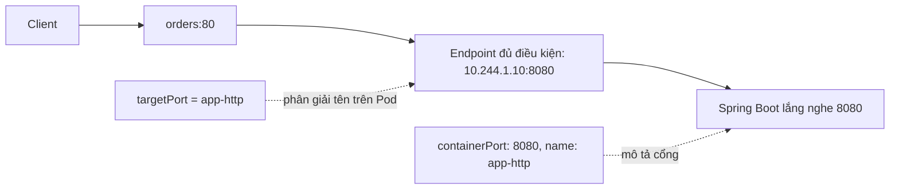

# Service port, targetPort và containerPort

## 1. Tình huống cần giải quyết

Trong chương **ServiceInstance và cổng** của module **SPRING_CLOUD_KUBERNETES**, bài này làm rõ ba khai báo cổng thường xuất hiện cạnh nhau nhưng có vai trò khác nhau: Service `port`, Service `targetPort` và Pod `containerPort`.

Giả sử ứng dụng Spring Boot `orders` lắng nghe ở cổng `8080`, còn Kubernetes Service công bố cổng `80`. Một phía gọi có thể truy cập qua tên Service hoặc dùng Spring Cloud LoadBalancer để chọn trực tiếp một Pod. Cùng một backend, nhưng hai đường gọi cần hai cặp địa chỉ và cổng khác nhau:

```text
Gọi qua Service:  orders.learning.svc.cluster.local:80
Gọi Pod trực tiếp: <Pod-IP>:8080
```

Hiểu sự khác biệt này giúp đọc đúng `ServiceInstance`, cấu hình nhiều cổng và chẩn đoán tình trạng discovery có instance nhưng request vẫn thất bại.

Sau bài học, bạn có thể:

- Đọc manifest để xác định cổng phía client, cổng backend và cổng ứng dụng thực sự lắng nghe.
- Dùng số hoặc tên trong `targetPort` mà không nhầm với tên của Service port.
- Đối chiếu Service, EndpointSlice và kết quả `DiscoveryClient`.
- Phân biệt đường chọn Pod với đường gọi Service của Spring Cloud Kubernetes.
- Giữ cấu hình ứng dụng, readiness probe và metadata cổng nhất quán khi triển khai.

Bài dùng Service kiểu ClusterIP thông thường có selector và Pod không dùng `hostNetwork`. Service headless, ExternalName, backend tự quản lý EndpointSlice và service mesh có các chi tiết riêng cần đối chiếu theo đường mạng thực tế.

## 2. Ba khai báo nằm ở đâu và có ý nghĩa gì?

| Khai báo | Vị trí thường gặp | Vai trò |
| --- | --- | --- |
| `port` | `Service.spec.ports[].port` | Cổng mà Service công bố cho client gọi qua Service |
| `targetPort` | `Service.spec.ports[].targetPort` | Số cổng hoặc tên cổng cần tìm trên Pod đích |
| `containerPort` | `Pod.spec.containers[].ports[].containerPort` | Khai báo cổng của container; có thể đi kèm tên để thành phần khác tham chiếu |
| `server.port` | Cấu hình Spring Boot | Cổng mà web server của ứng dụng thực sự được cấu hình để lắng nghe |

Theo API của Kubernetes, `targetPort` chấp nhận số hoặc tên; nếu không khai báo, giá trị `port` được dùng làm cổng đích. Xem [định nghĩa ServicePort trong Kubernetes API](https://kubernetes.io/docs/reference/kubernetes-api/core/service-v1/).

Điều cần kiểm tra khi vận hành là **tiến trình thực sự có lắng nghe tại cổng đích hay không**. Khai báo `containerPort: 8080` không tự khởi động web server, không sửa `server.port` và không tạo cơ chế đổi cổng bên trong ứng dụng. Kubernetes cũng không coi việc thiếu khai báo `containerPort` là một quy tắc chặn cổng mạng. Xem [trường ports của container trong Pod API](https://kubernetes.io/docs/reference/kubernetes-api/core/pod-v1/).

Với Spring Boot, có thể đặt cổng web server bằng `server.port`; trong manifest thường dùng biến môi trường `SERVER_PORT`. Xem [các thuộc tính ứng dụng Spring Boot](https://docs.spring.io/spring-boot/appendix/application-properties/index.html).

### 2.1. Những giá trị nào cần khớp?

Với một ứng dụng HTTP thông thường trong phạm vi bài:

```text
Cổng backend được targetPort phân giải tới
    phải phù hợp với cổng mà tiến trình đang lắng nghe.

Service port
    có thể khác cổng backend.

containerPort
    nên mô tả đúng tiến trình; nếu được tham chiếu bằng tên,
    tên đó phải tồn tại và trỏ tới đúng số cổng.
```

Không có yêu cầu tổng quát rằng `port = targetPort = containerPort`. Trường hợp cả ba bằng `8080` chỉ là một lựa chọn cấu hình thuận tiện.

## 3. Ví dụ xuyên suốt: Service 80 tới ứng dụng 8080

### 3.1. Backend Spring Boot

Giả định dự án có Spring Boot Web và dùng Java 17 trở lên. Ví dụ dưới tạo endpoint `/hello` để phân biệt các replica; mã được đóng gói thành image mà cluster có thể kéo về.

```java
package example.orders;

import java.util.Map;

import org.springframework.boot.SpringApplication;
import org.springframework.boot.autoconfigure.SpringBootApplication;
import org.springframework.web.bind.annotation.GetMapping;
import org.springframework.web.bind.annotation.RestController;

@SpringBootApplication
@RestController
public class OrdersApplication {

    public static void main(String[] args) {
        SpringApplication.run(OrdersApplication.class, args);
    }

    @GetMapping("/hello")
    public Map<String, String> hello() {
        return Map.of(
                "service", "orders",
                "instance", System.getenv().getOrDefault("HOSTNAME", "local"));
    }
}
```

Ở môi trường lab, giả định namespace `learning` đã tồn tại. Thay image minh họa `registry.example.com/learning/orders:1.0` bằng image thực của ứng dụng trước khi áp dụng manifest.

```yaml
apiVersion: apps/v1
kind: Deployment
metadata:
  name: orders
  namespace: learning
spec:
  replicas: 2
  selector:
    matchLabels:
      app: orders
  template:
    metadata:
      labels:
        app: orders
    spec:
      containers:
        - name: orders
          image: registry.example.com/learning/orders:1.0
          env:
            - name: SERVER_PORT
              value: "8080"
          ports:
            - name: app-http
              containerPort: 8080
              protocol: TCP
          readinessProbe:
            httpGet:
              path: /hello
              port: app-http
            initialDelaySeconds: 5
            periodSeconds: 5
---
apiVersion: v1
kind: Service
metadata:
  name: orders
  namespace: learning
spec:
  type: ClusterIP
  selector:
    app: orders
  ports:
    - name: http
      port: 80
      targetPort: app-http
      protocol: TCP
```

Có hai tên cổng khác nhau và chúng có chủ ý:

- `http` là tên của mục cổng trên Service.
- `app-http` là tên cổng trên Pod mà Service tham chiếu qua `targetPort`.

### 3.2. Theo dõi một request

Giả sử một Pod có IP minh họa `10.244.1.10`:



`targetPort` là một phần cấu hình ánh xạ, không phải một máy chủ trung gian có socket riêng. Cũng không tồn tại thêm một bước chuyển từ `8080` sang `containerPort` sau khi request đã tới đúng cổng Pod.

| Đích gọi trong ví dụ | Cổng sử dụng | Giải thích |
| --- | --- | --- |
| `orders` trong cùng namespace | `80` | Gọi Service bằng cổng Service công bố |
| `orders.learning.svc.cluster.local` | `80` | Cùng đường Service, ghi đầy đủ tên DNS |
| `10.244.1.10` | `8080` | Gọi backend trực tiếp tại cổng ứng dụng |
| `orders` | `8080` | Service này không công bố cổng đó |
| `10.244.1.10` | `80` | Pod ví dụ không có tiến trình được cấu hình lắng nghe ở cổng đó |

Domain `cluster.local` là giả định phổ biến của ví dụ; cluster có thể dùng domain khác. Khả năng kết nối còn phụ thuộc network policy và hạ tầng mạng, ngay cả khi cặp địa chỉ và cổng đã đúng.

## 4. targetPort dạng số, bỏ trống và dạng tên

### 4.1. Dùng số: đích là cổng số đã khai báo

Có thể thay phần cổng Service bằng:

```yaml
ports:
  - name: http
    port: 80
    targetPort: 8080
    protocol: TCP
```

Trong ví dụ này, backend vẫn phải lắng nghe tại `8080`. Kubernetes không cần tìm tên `app-http` để xác định cổng đích.

Hệ quả thực tế: nếu `targetPort` là số `8080`, khai báo `containerPort: 9090` không tự chuyển request sang `9090`. Nếu tiến trình vẫn lắng nghe `8080`, request có thể chạy dù manifest mô tả container không nhất quán. Nếu tiến trình chuyển sang `9090`, ánh xạ `8080` phải được sửa tương ứng.

### 4.2. Bỏ targetPort: không tự dò cổng ứng dụng

```yaml
ports:
  - name: http
    port: 80
    protocol: TCP
```

Với Service thông thường trong bài, cổng đích mặc định là `80`. Không có bước tự đọc `server.port`, tự chọn `containerPort` duy nhất hay tự dò socket của ứng dụng.

Đây là cách tạo lỗi phổ biến: ứng dụng chạy `8080`, Service công bố `80`, nhưng người viết manifest quên `targetPort`. Service vẫn có thể được tạo thành công trong khi request tới backend sai cổng.

### 4.3. Dùng tên: tìm tên cổng trên từng Pod

```yaml
# Trên Service
ports:
  - name: http
    port: 80
    targetPort: app-http
```

```yaml
# Trên container của Pod
ports:
  - name: app-http
    containerPort: 8080
```

Kubernetes hỗ trợ cùng một named targetPort được phân giải thành những số cổng khác nhau trên các Pod khác nhau. Cách này hữu ích khi thay đổi cổng backend giữa các phiên bản mà vẫn giữ cổng Service ổn định. Xem [định nghĩa cổng và named targetPort của Service](https://kubernetes.io/docs/concepts/services-networking/service/#port-definitions).

Phân biệt rõ:

```text
Service.spec.ports[].name = http
Service.spec.ports[].targetPort = app-http
Pod container port name = app-http
```

Tên `http` của Service không phải từ khóa khiến Kubernetes tự chọn cổng container tên `http`. Liên kết tới Pod nằm ở `targetPort`.

`targetPort: 8080` là số, còn `targetPort: "8080"` là chuỗi. Chuỗi được xử lý như tên cổng và phải hợp lệ theo quy tắc đặt tên; đặt dấu nháy quanh số không phải cách tương đương để khai báo cổng số. Nên dùng tên có nghĩa như `app-http` khi cần tham chiếu bằng tên.

## 5. Named port khi đổi cổng trong rolling update

Giả sử phiên bản cũ chạy `8080`, phiên bản mới chạy `8081`. Cả hai cùng khai báo tên `app-http` và cùng phù hợp selector của Service:

| Phiên bản Pod | Cổng ứng dụng | Tên cổng Pod | Service targetPort |
| --- | --- | --- | --- |
| Cũ | `8080` | `app-http` | `app-http` |
| Mới | `8081` | `app-http` | `app-http` |

Đối với Pod mới, cần thay đồng thời cấu hình ứng dụng và khai báo cổng:

```yaml
env:
  - name: SERVER_PORT
    value: "8081"
ports:
  - name: app-http
    containerPort: 8081
```

Cổng Service vẫn là `80`. Client gọi qua Service không cần biết mỗi replica đang dùng số backend nào.

Khi dùng EndpointSlice, các endpoint có tập cổng khác nhau có thể được tổ chức trong các slice khác nhau. Consumer phải đọc cổng đi cùng từng nhóm endpoint; không lấy một số cổng duy nhất rồi ghép tùy ý với mọi IP. Xem [cách tổ chức EndpointSlice theo cổng](https://kubernetes.io/docs/concepts/services-networking/endpoint-slices/).

Ví dụ kỳ vọng trong giai đoạn chuyển tiếp:

```text
orders:80 -> Pod cũ 10.244.1.10:8080
          -> Pod mới 10.244.2.20:8081
```

Đây là kỳ vọng từ cấu hình ví dụ, chưa phải kết quả thực thi. Cần kiểm tra readiness và nội dung endpoint thực tế. Nếu caller tự chọn từng Pod, cũng phải xác minh discovery implementation trả cổng đúng cho mỗi endpoint trước khi dùng chiến lược đổi cổng này.

Chỉ sửa `containerPort` mà không sửa `SERVER_PORT` làm tên cổng trỏ tới nơi ứng dụng chưa lắng nghe. Ngược lại, chỉ sửa `SERVER_PORT` khiến ánh xạ hoặc probe dùng tên cũ có thể tiếp tục trỏ tới số không còn đúng.

## 6. ServiceInstance phải ghép đúng host và port

`ServiceInstance` là mô hình phía Spring mô tả một đích gọi, có những thông tin như host, port, URI và cờ secure. Cần đọc cả cặp host/port, không lấy riêng `getPort()` rồi mặc định đó là Service port.

Với đường discovery trả endpoint Pod trong ví dụ:

```text
host = 10.244.1.10
port = 8080
uri  = http://10.244.1.10:8080
```

Với đường gọi qua Service:

```text
host = orders.learning.svc.cluster.local
port = 80
```

Ghép IP Pod với cổng `80` hoặc ghép DNS Service với backend port `8080` làm mất tính nhất quán của đích gọi. Backend port không tự trở thành cổng mà Service công bố.

### 6.1. Chọn cổng khi discovery có nhiều cổng

Tài liệu Spring Cloud Kubernetes mô tả cách chọn cổng theo tên: label `primary-port-name` trên Service có ưu tiên hơn thuộc tính `spring.cloud.kubernetes.discovery.primary-port-name`; khi không cấu hình, có quy tắc dự phòng cho tên cổng HTTP/HTTPS và cuối cùng là cổng đầu tiên. Xem [quy tắc cổng của DiscoveryClient nhánh 3.3](https://docs.spring.io/spring-cloud-kubernetes/reference/3.3/discovery-client.html).

Ví dụ chọn cổng business bằng label trên Service:

```yaml
metadata:
  name: orders
  namespace: learning
  labels:
    primary-port-name: http
```

Hoặc cấu hình phía dùng DiscoveryClient:

```yaml
spring:
  cloud:
    kubernetes:
      discovery:
        primary-port-name: http
```

Giá trị `http` trong hai ví dụ là **tên Service port**, tương ứng tên cổng endpoint mà discovery lựa chọn; không phải tên `app-http` dùng để phân giải targetPort trên Pod.

Nếu vừa có label vừa có thuộc tính client, cần kiểm tra ưu tiên thực tế và giá trị có khớp một tên cổng tồn tại hay không. Đừng dựa vào thứ tự YAML để định nghĩa cổng nghiệp vụ của một Service nhiều cổng.

### 6.2. Ghi lại kết quả DiscoveryClient trong lab

Có thể đặt cấu hình sau vào một ứng dụng phía gọi đã có starter discovery phù hợp. Ví dụ in cặp host/port và URI ở thời điểm chạy runner:

```java
package example.caller;

import org.springframework.boot.ApplicationRunner;
import org.springframework.cloud.client.discovery.DiscoveryClient;
import org.springframework.context.annotation.Bean;
import org.springframework.context.annotation.Configuration;

@Configuration
public class DiscoveryPortDiagnostics {

    @Bean
    ApplicationRunner printOrdersInstances(DiscoveryClient discoveryClient) {
        return args -> discoveryClient.getInstances("orders").forEach(instance ->
                System.out.printf(
                        "serviceId=%s host=%s port=%d secure=%s uri=%s%n",
                        instance.getServiceId(),
                        instance.getHost(),
                        instance.getPort(),
                        instance.isSecure(),
                        instance.getUri()));
    }
}
```

Runner này không gửi request HTTP tới backend. Có instance không chứng minh socket đang lắng nghe hay đường mạng cho phép kết nối. Nếu chưa thấy instance ngay lúc khởi động, kiểm tra trạng thái đồng bộ, namespace và quyền đọc thay vì đổi cổng ngẫu nhiên.

Bài dùng nhánh Spring Cloud Kubernetes 3.3 làm mốc giải thích các thuộc tính. Dự án dùng nhánh khác cần đối chiếu tài liệu tương ứng và dependency do BOM quản lý; ví dụ không khẳng định một phiên bản là mới nhất.

## 7. Phân biệt chế độ POD và SERVICE của LoadBalancer

Spring Cloud Kubernetes LoadBalancer có hai chế độ `POD` và `SERVICE`. Theo tài liệu nhánh 3.3, `POD` dùng DiscoveryClient để lấy instance; `SERVICE` dựng đích theo DNS Service và cổng Service. Xem [LoadBalancer cho Kubernetes](https://docs.spring.io/spring-cloud-kubernetes/reference/3.3/load-balancer.html).

| Đường chọn đích | Host trong ví dụ | Cổng phù hợp | Thành phần chọn backend tiếp theo |
| --- | --- | --- | --- |
| Discovery endpoint / POD | IP Pod | `8080` | Caller chọn instance; request tới endpoint đó |
| SERVICE | DNS Service | `80` | Kubernetes chuyển traffic Service tới backend |
| HTTP client gọi DNS trực tiếp | DNS Service | `80` | Kubernetes, không cần DiscoveryClient cho riêng thao tác gọi DNS |

Ví dụ cấu hình dành cho starter LoadBalancer Kubernetes tương ứng:

```yaml
spring:
  cloud:
    kubernetes:
      loadbalancer:
        mode: SERVICE
        port-name: http
```

`loadbalancer.port-name` dùng chọn Service port trong chế độ SERVICE. Nó khác `discovery.primary-port-name`, vốn liên quan cách DiscoveryClient chọn cổng. Chỉ thêm một thuộc tính không tự thay đổi đường đi của HTTP client chưa được tích hợp LoadBalancer.

Ví dụ này cũng giả định Service có cổng tên `http`. Nếu Service chỉ có một cổng, quy tắc chọn đơn giản hơn; nếu có nhiều cổng, phải đặt tên và chỉ rõ cổng mong muốn. Đối chiếu cả host lẫn port sau khi thay chế độ để tránh mang số backend từ đường POD sang đường SERVICE.

## 8. Nhiều cổng: tách API nghiệp vụ và quản trị

Giả sử một biến thể của backend có API tại `8080` và management server tại `9090`. Với Spring Boot Actuator và cấu hình phù hợp:

```yaml
server:
  port: 8080
management:
  server:
    port: 9090
```

Cấu hình này thuộc biến thể nhiều cổng; backend `/hello` ban đầu chưa tự có management server nếu chưa thêm dependency và cấu hình Actuator.

Pod mô tả hai cổng:

```yaml
ports:
  - name: app-http
    containerPort: 8080
  - name: admin-http
    containerPort: 9090
```

Service có thể ánh xạ như sau:

```yaml
apiVersion: v1
kind: Service
metadata:
  name: orders
  namespace: learning
  labels:
    primary-port-name: http
spec:
  selector:
    app: orders
  ports:
    - name: http
      port: 80
      targetPort: app-http
      protocol: TCP
    - name: management
      port: 9001
      targetPort: admin-http
      protocol: TCP
```

Trong Service nhiều cổng, mỗi mục cần tên rõ ràng để phân biệt. Xem [Service nhiều cổng của Kubernetes](https://kubernetes.io/docs/concepts/services-networking/service/#multi-port-services).

Bảng đối chiếu của biến thể:

| Mục đích | Qua Service | Trực tiếp Pod |
| --- | --- | --- |
| API nghiệp vụ | `orders:80` | `<Pod-IP>:8080` |
| Management | `orders:9001` | `<Pod-IP>:9090` |

Nếu caller vô tình chọn management port rồi gọi `/hello`, lỗi HTTP có thể khác với lỗi kết nối. Cổng đó có thể đang mở nhưng không có endpoint nghiệp vụ cần gọi. Cần xác định cả chức năng endpoint và cổng được chọn.

Khai báo management port trong Pod không bắt buộc Service nghiệp vụ phải công bố cổng đó. Việc có cần một Service management riêng hay không là quyết định triển khai; discovery nghiệp vụ nên chọn rõ cổng API cần dùng.

## 9. Probe, giao thức và cấu hình ứng dụng

### 9.1. Readiness probe dùng cổng của Pod

Trong manifest đầu bài:

```yaml
readinessProbe:
  httpGet:
    path: /hello
    port: app-http
```

Probe tham chiếu tên cổng Pod `app-http`, phân giải thành `8080`. Không dùng Service port `80` cho probe này chỉ vì client bên ngoài Pod gọi `orders:80`.

Nếu sửa probe thành `port: 80` trong khi Pod chỉ lắng nghe `8080`, Pod có thể tiếp tục bị đánh giá chưa sẵn sàng. Khi đó cần kiểm tra probe và socket của ứng dụng trước khi kết luận cơ chế discovery không tìm thấy Pod.

Nếu sử dụng management server riêng, probe trên management port có thể thành công trong khi đường API nghiệp vụ gặp lỗi. Lựa chọn đường kiểm tra phải phản ánh khả năng nhận traffic mà bạn muốn đánh giá.

### 9.2. TCP, HTTP và TLS là những lớp khác nhau

`protocol: TCP` của Service biểu diễn giao thức vận chuyển. Nó không tự chuyển HTTP thành HTTPS hoặc tạo cấu hình chứng chỉ cho Spring Boot.

Tương tự, đặt tên một cổng là `https` không làm ứng dụng bắt đầu lắng nghe TLS. Discovery có thể sử dụng thông tin tên hoặc metadata để quyết định scheme, nhưng đường gọi vẫn cần một TLS server thực sự ở nơi nhận kết nối.

Ví dụ suy luận sai cần tránh:

```text
Service port 443 -> targetPort 8080
=> backend chắc chắn đã có HTTPS
```

Ánh xạ cổng đơn thuần không chứng minh điều đó. Phải xác định TLS kết thúc ở đâu: ứng dụng, proxy hay thành phần khác. Với ví dụ đầu bài, backend dùng HTTP và các cổng được đặt theo HTTP.

### 9.3. ConfigMap không thay thế việc đồng bộ cổng

Nếu `SERVER_PORT` lấy từ ConfigMap, hãy kiểm tra giá trị hiệu lực của từng Pod sau triển khai. Cập nhật một giá trị cấu hình không tự sửa `targetPort`, named container port hoặc readiness probe.

Cũng không mặc định một sự kiện refresh của Configuration Watcher sẽ làm web server đang chạy đổi cổng an toàn. Việc thay listener phải được xử lý theo khả năng của ứng dụng và quy trình triển khai, thường cần tạo lại Pod với cấu hình nhất quán.

Không cần đọc Secret hoặc mở thêm quyền RBAC chỉ để sửa một ánh xạ Service port sai. Secret cho TLS, nếu có, giải quyết thông tin xác thực/chứng chỉ; nó không thay thế quyết định dùng đúng cổng và scheme.

## 10. Quy trình kiểm tra trong cluster lab

Các bước sau là hướng dẫn thực hành, chưa phải kết quả đã chạy. Giả định namespace `learning` đã có Deployment/Service từ ví dụ và một Pod công cụ tên `netcheck` có `curl`.

### 10.1. Đọc Service và Pod

```shell
kubectl get service orders --namespace learning --output yaml
kubectl get pods --namespace learning --selector app=orders --output wide
kubectl get deployment orders --namespace learning --output yaml
```

Đối chiếu lần lượt:

1. Selector của Service có khớp nhãn Pod không?
2. `port` của Service là bao nhiêu?
3. `targetPort` là số hay tên?
4. Nếu là tên, Pod có khai báo đúng tên đó không?
5. Cấu hình hiệu lực của ứng dụng và log khởi động có cho thấy listener đúng cổng không?

Manifest là ý định cấu hình. Nếu biến môi trường hoặc tham số khởi động khác ghi đè, cần kiểm tra tiến trình đang chạy và thông tin khởi động của ứng dụng.

### 10.2. Đọc EndpointSlice

```shell
kubectl get endpointslices --namespace learning --selector kubernetes.io/service-name=orders --output yaml
```

Với cấu hình đầu bài, một phần output kỳ vọng có dạng:

```yaml
ports:
  - name: http
    port: 8080
    protocol: TCP
endpoints:
  - addresses:
      - 10.244.1.10
    conditions:
      ready: true
```

Đây là phần trích minh họa, không phải manifest EndpointSlice đầy đủ để áp dụng. Số `8080` là cổng backend; tên `http` tương ứng Service port được ánh xạ. `app-http` đã được dùng ở bước phân giải named targetPort.

Nếu chuyển sang phiên bản chạy `8081`, kiểm tra toàn bộ slice thay vì chỉ dòng đầu tiên. Với triển khai discovery vẫn dùng Endpoints, cần đối chiếu thêm tài nguyên mà implementation thực sự đọc và quyền `get/list/watch` của ServiceAccount tương ứng.

### 10.3. So sánh đường Service và đường Pod

Gọi Service từ Pod công cụ:

```shell
kubectl exec --namespace learning netcheck -- curl -fsS --connect-timeout 2 http://orders:80/hello
```

Thay IP minh họa bằng IP Pod thực tế và thử trực tiếp:

```shell
kubectl exec --namespace learning netcheck -- curl -fsS --connect-timeout 2 http://10.244.1.10:8080/hello
```

Nếu Pod trực tiếp chạy nhưng Service thất bại, tập trung vào selector, endpoint, Service port và đường mạng Service. Nếu cả hai thất bại, kiểm tra listener ứng dụng, readiness, routing và policy trước khi quy mọi lỗi cho Service.

Lệnh `curl -f` báo lỗi với HTTP status lỗi; vì vậy cần xem cả thông báo lỗi và mã HTTP khi chẩn đoán. Timeout, connection refused, TLS error và HTTP 404 gợi ý những chặng khác nhau, không có cùng một nguyên nhân chắc chắn.

### 10.4. Dùng port-forward đúng ý nghĩa

Từ máy có quyền truy cập cluster:

```shell
kubectl port-forward --namespace learning service/orders 18080:80
```

Ở terminal khác:

```shell
curl http://localhost:18080/hello
```

`18080` là cổng local do người thực hành chọn; `80` là Service port được chỉ định để công cụ tìm cổng backend tương ứng. Không có nghĩa Pod bắt đầu lắng nghe thêm `18080`.

Port-forward tới Service chọn một Pod và chuyển tiếp qua kênh của công cụ. Thành công qua port-forward không kiểm chứng đầy đủ đường DNS/ClusterIP giữa các Pod. Muốn kiểm tra đường đó, dùng request từ Pod công cụ như bước trước.

## 11. Thực nghiệm lỗi có kiểm soát

Chỉ thực hiện các biến thể sau trên bản cấu hình trong lab. Ghi lại baseline để khôi phục sau mỗi phép thử; mỗi lần thay một yếu tố.

| Biến thể | Dự đoán cần kiểm chứng | Cần quan sát |
| --- | --- | --- |
| Đổi `targetPort` sang số `8081`, backend vẫn `8080` | Service trỏ tới cổng chưa có listener | Endpoint port và lỗi request |
| Giữ targetPort số `8080`, chỉ đổi containerPort sang `9090` | Không có cơ chế tự đổi đích thành `9090` | Socket thực, request và manifest không nhất quán |
| Đổi targetPort thành tên không tồn tại trên Pod | Không phân giải được đích mong muốn | EndpointSlice, sự kiện và tình trạng backend được chọn |
| Bỏ targetPort khi Service port là `80` | Đích mặc định về `80` trong phạm vi ví dụ | Endpoint port, request trực tiếp Pod và qua Service |
| Đổi tên Service port từ `http` sang tên khác nhưng giữ cấu hình chọn cổng cũ | Cần kiểm tra quy tắc chọn cổng của client | `ServiceInstance`, supplier và URI thực tế |
| Đổi readiness probe sang cổng `80` | Probe không kiểm tra đúng listener `8080` | Điều kiện Pod và endpoint đủ điều kiện |

Không coi một dòng log có IP là bằng chứng hoàn tất. Với mỗi biến thể, ghi bộ thông tin:

```text
Service:      tên cổng / port / targetPort
Pod:          tên cổng / containerPort / cổng listener thực
Endpoint:     địa chỉ / cổng / điều kiện ready
Spring:       host / port / uri / secure
Request:      nguồn gọi / đích thực / kết quả
```

Nếu ServiceInstance đúng nhưng request sai, kiểm tra lớp dựng URI và LoadBalancer có thật sự dùng instance đó hay không. Nếu DiscoveryClient trả danh sách rỗng vì thiếu quyền API, đó là vấn đề truy cập metadata; nó khác với không kết nối được socket HTTP của backend.

## 12. Bảng chẩn đoán nhanh

| Triệu chứng | Cần kiểm tra trước | Cách sửa theo nguyên nhân đã xác nhận |
| --- | --- | --- |
| Service tồn tại, request bị từ chối | Listener backend và targetPort | Đồng bộ cổng ứng dụng với cổng endpoint |
| Có Pod nhưng không có backend phù hợp | Selector, tên targetPort và readiness | Sửa đúng điều kiện chọn/phân giải, không đổi số tùy ý |
| Gọi Pod được, gọi Service không được | Service port, endpoint, policy và đường Service | Kiểm tra đường chuyển tiếp tương ứng |
| Discovery thấy IP Pod nhưng port là cổng không mong muốn | Nguồn endpoint và lựa chọn cổng của discovery | Đặt tên cổng rõ, chọn primary port phù hợp |
| API gọi nhầm management server | Host/port được chọn và URI request | Chọn cổng business, tách mục đích quản trị |
| TLS handshake lỗi sau khi đổi tên cổng | Scheme, listener TLS và nơi kết thúc TLS | Đồng bộ giao thức thực với URI, không chỉ đổi tên |
| Port-forward chạy nhưng gọi từ Pod thất bại | DNS, ClusterIP, routing và policy | Đo trực tiếp đường Pod-to-Service |
| Đổi containerPort nhưng không có gì thay đổi | Giá trị `server.port` hiệu lực và targetPort dạng số | Sửa cả ý định khai báo và cấu hình listener cần thiết |

Khi chuẩn bị một Service cho ứng dụng Spring, hãy quyết định trước caller gọi Service hay chọn Pod trực tiếp. Sau đó đặt tên cổng có nghĩa, giữ cổng đích khớp listener, kiểm tra probe, đọc endpoint đã phân giải và đối chiếu cặp host/port mà Spring thực sự sử dụng. Những bước này xác định đúng trách nhiệm của Kubernetes và của ứng dụng trong cùng đường request.
