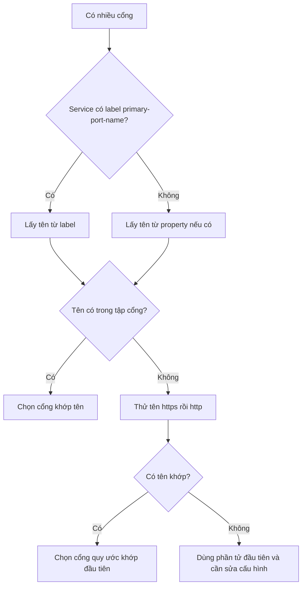

# Chọn cổng khi Service công bố nhiều cổng

Thuộc chương **ServiceInstance và cổng**, module **Spring Cloud Kubernetes (`SPRING_CLOUD_KUBERNETES`)**.

Một Kubernetes Service có thể công bố cổng HTTP nghiệp vụ, cổng HTTPS và cổng quản trị cùng lúc. Trong khi đó, một `ServiceInstance` thông thường có một cặp `host` và `port` chính để đại diện cho đích gọi. Vì vậy, khám phá đúng tên dịch vụ chưa đủ: ứng dụng còn phải chọn đúng cổng cho mục đích của mình.

Bài này giải thích cách Spring Cloud Kubernetes chọn cổng khi tạo instance, cách dùng label `primary-port-name` và property `spring.cloud.kubernetes.discovery.primary-port-name`, cũng như cách quan sát kết quả. Nội dung liên hệ với Spring Cloud LoadBalancer, RBAC, sức khỏe Pod và cập nhật cấu hình để tránh nhầm một vấn đề chọn cổng thành lỗi cấu hình hoặc lỗi mạng.

## 1. Mục tiêu và phạm vi ví dụ

Sau bài học, bạn có thể:

- Phân biệt tên cổng, cổng Service, `targetPort` và cổng endpoint.
- Giải thích thứ tự chọn cổng chính khi có nhiều lựa chọn.
- Đặt lựa chọn riêng cho một Service hoặc mặc định cho discovery client.
- Nhận ra trường hợp label sai vẫn dẫn đến một cổng fallback thay vì lỗi ngay.
- Đọc đồng thời `getHost()`, `getPort()`, `isSecure()` và `getUri()` để đánh giá một đích gọi.
- Phân biệt chọn cổng qua DiscoveryClient với chọn cổng của LoadBalancer ở chế độ `SERVICE`.

Ví dụ sử dụng Service `inventory` trong namespace `retail`, có ba đường giao tiếp:

| Mục đích | Tên cổng Service | Cổng Service | Cổng backend dự kiến |
| --- | --- | --- | --- |
| API nghiệp vụ HTTP | `http` | `80` | `8080` |
| API nghiệp vụ HTTPS | `https` | `443` | `8443` |
| Quản trị và theo dõi | `management` | `9090` | `9090` |

Giả định backend đã có các listener tương ứng, các Pod được Service chọn và endpoint sẵn sàng. Manifest Service không tự tạo ứng dụng hay bật TLS cho nó. Ứng dụng gọi đã có một implementation DiscoveryClient phù hợp với bộ phiên bản Spring Boot, Spring Cloud và Spring Cloud Kubernetes đang sử dụng.

Các quy tắc cấu hình tham chiếu tài liệu Spring Cloud Kubernetes; khi cần mô tả chính xác nhánh fallback và con số ở đường gọi endpoint, bài dùng implementation Fabric8 và bộ xử lý cổng chung tại mốc `3.3.3` làm ví dụ cụ thể. Không suy từ mốc minh họa này rằng dự án của bạn đang dùng đúng phiên bản đó.

## 2. Hiểu các lớp cổng trước khi chọn

### 2.1. Tên cổng là khóa lựa chọn

Service minh họa:

```yaml
apiVersion: v1
kind: Service
metadata:
  name: inventory
  namespace: retail
  labels:
    app: inventory
    primary-port-name: http
spec:
  type: ClusterIP
  selector:
    app: inventory
  ports:
    - name: http
      protocol: TCP
      port: 80
      targetPort: app-http
    - name: https
      protocol: TCP
      port: 443
      targetPort: app-https
    - name: management
      protocol: TCP
      port: 9090
      targetPort: admin
```

Kubernetes yêu cầu đặt tên cho các cổng khi Service có nhiều cổng để phân biệt chúng. `port` là cổng được Service công bố; `targetPort` dẫn đến cổng backend, có thể là một số hoặc một tên cổng của Pod. [Service: Port definitions và Multi-port Services](https://kubernetes.io/docs/concepts/services-networking/service/).

Trong ví dụ:

- `http` là tên dùng để chọn cổng Service.
- `80` là số cổng khi gọi đường Service tương ứng.
- `app-http` là tên cổng backend được tham chiếu bởi `targetPort`.
- `8080` là số cổng backend sau khi tên đó được phân giải trong ví dụ.

Đoạn khai báo cổng của container có thể là:

```yaml
ports:
  - name: app-http
    containerPort: 8080
  - name: app-https
    containerPort: 8443
  - name: admin
    containerPort: 9090
```

Đây là đoạn trích bên trong container của Pod template, không phải manifest triển khai hoàn chỉnh. Khai báo `containerPort` cũng không khiến tiến trình tự mở socket; cấu hình ứng dụng backend phải làm việc đó.

Nếu muốn chọn đường HTTP của Service, giá trị `primary-port-name` là `http`, không phải `80`, `8080` hoặc `app-http`. Dùng tên backend thay cho tên cổng Service là một lỗi phổ biến khi `targetPort` có tên khác.

### 2.2. Địa chỉ Service và địa chỉ endpoint đi với cổng khác nhau

Cùng một API backend có thể được tiếp cận theo hai đường:

```text
inventory.retail.svc:80
    -> cơ chế chuyển tiếp của Kubernetes Service
    -> PodIP:8080
```

```text
PodIP:8080
    -> kết nối trực tiếp đến listener của backend
```

Không thể đổi qua lại số `80` và `8080` mà giữ nguyên mọi host. Cặp `PodIP:80` có thể không có tiến trình lắng nghe; cặp `ServiceDNS:8080` cũng không đúng nếu Service chỉ công bố cổng `80` cho API đó.

EndpointSlice chứa các địa chỉ backend cùng thông tin cổng; tên cổng liên kết với tên cổng Service tương ứng, còn số cổng mô tả đích backend. Khi `targetPort` dùng tên và backend thay đổi số cổng theo bản triển khai, cần quan sát dữ liệu endpoint thực tế. [EndpointSlices của Kubernetes](https://kubernetes.io/docs/concepts/services-networking/endpoint-slices/).

Trong ví dụ Fabric8 dùng Endpoints ở mốc nêu trên, client lấy dữ liệu cổng từ endpoint để tạo `ServiceInstance`. Vì vậy chọn tên `http` dẫn đến instance dạng `PodIP:8080`, còn gọi Service bằng DNS sử dụng cổng `80`. [Implementation Fabric8 KubernetesDiscoveryClient 3.3.3](https://raw.githubusercontent.com/spring-cloud/spring-cloud-kubernetes/v3.3.3/spring-cloud-kubernetes-fabric8-discovery/src/main/java/org/springframework/cloud/kubernetes/fabric8/discovery/KubernetesDiscoveryClient.java).

Khi chuyển client hoặc chế độ kết nối, hãy kiểm tra lại cặp host và port được trả về. Không dùng riêng trường `spec.ports[].port` để suy ra mọi giá trị của `ServiceInstance.getPort()`.

## 3. Thứ tự chọn cổng chính của discovery

### 3.1. Quy tắc tổng quát

Với nhiều cổng, Spring Cloud Kubernetes cho phép chỉ định tên cổng bằng label trên Service hoặc property của discovery client. Nhãn Service có ưu tiên cao hơn property. Khi không chọn được bằng cấu hình, cơ chế có thể tìm cổng theo tên quy ước và cuối cùng dùng cổng đầu tiên trong tập đang xử lý; nhánh cuối không nên trở thành hợp đồng vận hành. [DiscoveryClient for Kubernetes](https://docs.spring.io/spring-cloud-kubernetes/reference/discovery-client.html).

Có thể đọc thứ tự xử lý như sau:

| Tình huống | Quyết định cần hiểu |
| --- | --- |
| Không có cổng trong tập dữ liệu được xử lý | Bộ chọn cổng chung có nhánh trả `0`; không coi đó là đích kết nối hợp lệ |
| Chỉ có một cổng | Dùng cổng duy nhất, không cần so tên với cấu hình cổng chính |
| Có nhiều cổng và label `primary-port-name` | Lấy tên ưu tiên từ label trên Service |
| Có nhiều cổng, không có label đó | Lấy tên từ `spring.cloud.kubernetes.discovery.primary-port-name`, nếu được cấu hình |
| Không tìm được tên ưu tiên | Có các nhánh fallback theo tên quy ước |
| Không khớp tên nào | Có thể rơi vào cổng đầu tiên trong tập dữ liệu |

Nhánh không có cổng trong bộ chọn không có nghĩa mọi Service thiếu endpoint đều tạo ra một instance có port `0`. Nếu không có địa chỉ hoặc subset phù hợp, danh sách instance có thể rỗng trước khi tạo đích gọi. Khi thấy port bằng `0` hoặc không có instance, cần kiểm tra dữ liệu đầu vào thay vì cố kết nối.

### 3.2. Nhánh fallback cụ thể và lỗi tên không tồn tại

Ở bộ xử lý chung `DiscoveryClientUtils.endpointsPort` của mốc `3.3.3`, sau khi không khớp tên ưu tiên, thứ tự thử là `https`, rồi `http`, rồi phần tử đầu tiên. Tên ưu tiên được chọn từ label nếu có; label sai không khiến client quay lại thử tên trong property. [DiscoveryClientUtils 3.3.3](https://raw.githubusercontent.com/spring-cloud/spring-cloud-kubernetes/v3.3.3/spring-cloud-kubernetes-commons/src/main/java/org/springframework/cloud/kubernetes/commons/discovery/DiscoveryClientUtils.java).

Ví dụ label ghi `primary-port-name: htpp`, property đặt `http`, còn Service có cả `http` và `https`. Không được kết luận property sẽ cứu lỗi chính tả. Trong implementation vừa nêu, tên ưu tiên vẫn là `htpp`; khi không khớp, nhánh fallback có thể chọn `https`.

Đây là lý do cần kiểm tra cả hai điều kiện: tên mong muốn thực sự tồn tại và cổng trả về đúng mục đích. “Có instance” chưa chứng minh “đã dùng đúng cấu hình cổng”. Khi phiên bản hoặc implementation thay đổi, xác nhận lại hành vi trong trường hợp cấu hình sai thay vì phụ thuộc vào fallback.



Sơ đồ mô tả nhánh nhiều cổng của implementation tham chiếu, không phải lời khuyên dựa vào vị trí đầu tiên. Thứ tự khai báo trong manifest không bảo đảm được giữ nguyên qua mọi map, cache hoặc bước chuyển đổi dữ liệu của client.

## 4. Cấu hình tên cổng một cách chủ động

### 4.1. Label cho lựa chọn riêng của một Service

Service mẫu đã khai báo:

```yaml
metadata:
  name: inventory
  namespace: retail
  labels:
    primary-port-name: http
```

Đoạn trích này đặt lựa chọn tại chính Service. Đó là label trong `metadata.labels`, không phải annotation, không phải nhãn riêng của Pod và không phải trường con của `spec.ports`.

Cách này hữu ích khi các Service có quy ước cổng khác nhau. Ví dụ `inventory` chọn `http`, còn `pricing` có thể công bố API dưới tên `api`. Mỗi Service mô tả cổng chính của nó mà không yêu cầu mọi client dùng một tên toàn cục khác nhau.

Tuy nhiên, label là dữ liệu chung của Service. Một client nghiệp vụ và một công cụ quản trị không nên tùy tiện thay label qua lại để phục vụ các request riêng. Nếu hai nhóm người gọi cần hai giao diện khác nhau, hãy thiết kế đường truy cập hoặc Service riêng phù hợp.

### 4.2. Property mặc định trong discovery client

Khi Service không đặt label cổng chính, ứng dụng có thể khai báo:

```yaml
spring:
  cloud:
    kubernetes:
      discovery:
        primary-port-name: http
```

Property tương ứng là `spring.cloud.kubernetes.discovery.primary-port-name`. Nó là tên cổng, không phải số cổng và không phải cấu hình để backend mở listener. Thuộc tính này thuộc nhóm discovery, khác `spring.cloud.kubernetes.loadbalancer.port-name`. [Common application properties](https://docs.spring.io/spring-cloud-kubernetes/reference/appendix.html).

Với DiscoveryClient truy cập Kubernetes trực tiếp, đặt property trong cấu hình của ứng dụng gọi. Nếu dùng HTTP DiscoveryClient, cần xác định nơi tạo danh sách instance và thực hiện chọn cổng ở Discovery Server; không mặc định một property đặt ở client HTTP sẽ viết lại cổng đã nhận từ server.

Ví dụ namespace và thông tin cổng để quan sát có thể khai báo cùng nhau:

```yaml
spring:
  cloud:
    kubernetes:
      discovery:
        all-namespaces: false
        namespaces:
          - retail
        primary-port-name: http
        metadata:
          add-ports: true
          ports-prefix: "port."
```

Ví dụ không quy định bắt buộc dùng Endpoints hay EndpointSlice; chọn backend discovery theo khả năng của client và phiên bản triển khai. Phần so sánh số cổng endpoint trong bài dùng tình huống đã nêu ở phần 2.

### 4.3. Cấu hình nào đang thắng?

Với các tên cổng `http`, `https`, `management`, bảng sau giúp suy luận trước khi chạy:

| Label trên Service | Property discovery | Tên cổng dự kiến được chọn |
| --- | --- | --- |
| `http` | `https` | `http`, vì label ưu tiên |
| Không có | `http` | `http` |
| `management` | `http` | `management` |
| Không có | `management` | `management` |
| Không có | Không có | Theo nhánh tên quy ước; implementation tham chiếu chọn `https` trước `http` |
| `htpp` | `http` | Tên label không tồn tại; không được giả định sẽ dùng property |

Một lựa chọn có thể đúng thuật toán nhưng sai nghiệp vụ. Chọn `management` rồi nhận HTTP `200` ở `/actuator/health` vẫn không chứng minh cổng đó phục vụ `/api/inventory`.

Nếu Service chỉ có một cổng `metrics`, không đặt kỳ vọng property `http` sẽ tạo thêm cổng HTTP hoặc loại bỏ cổng duy nhất đó. Các công tắc chọn cổng chỉ chọn từ dữ liệu hiện có.

## 5. Đọc kết quả qua ServiceInstance

### 5.1. Một instance có cổng chính, metadata có thể có nhiều cổng

Sau khi chọn `http`, kết quả endpoint trong tình huống ví dụ có thể có:

```text
serviceId = inventory
host      = 10.42.1.21
port      = 8080
secure    = false
uri       = http://10.42.1.21:8080
```

Địa chỉ trên chỉ là minh họa; không dùng nó làm địa chỉ cố định trong triển khai. Nếu bật xuất metadata cổng với prefix `port.`, có thể quan sát các khóa như `port.http`, `port.https`, `port.management`.

Trong implementation Fabric8 tham chiếu, metadata cổng được dựng từ dữ liệu endpoint, nên ví dụ tương ứng có thể là:

```json
{
  "k8s_namespace": "retail",
  "port.http": "8080",
  "port.https": "8443",
  "port.management": "9090"
}
```

Đây là phần metadata minh họa, không phải toàn bộ JSON mặc định của framework. Giá trị trong map là chuỗi. Các implementation hoặc đường SERVICE có thể lấy dữ liệu cổng ở lớp khác, nên phải đọc rõ hợp đồng đang dùng.

Không mặc định một Pod có ba cổng sẽ thành ba `ServiceInstance`, mỗi instance phục vụ một cổng. Với đường endpoint đang xét, cổng chính được chọn để tạo đích gọi, còn thông tin nhiều cổng có thể được giữ trong metadata. Tắt `metadata.add-ports` ảnh hưởng việc xuất thông tin bổ sung, không phải cách yêu cầu chọn cổng chính.

### 5.2. Mã Java quan sát cặp host và port

```java
package example.discovery;

import java.util.List;

import org.slf4j.Logger;
import org.slf4j.LoggerFactory;
import org.springframework.cloud.client.ServiceInstance;
import org.springframework.cloud.client.discovery.DiscoveryClient;
import org.springframework.stereotype.Component;

@Component
public class InventoryDiscoveryInspector {

    private static final Logger log =
            LoggerFactory.getLogger(InventoryDiscoveryInspector.class);

    private final DiscoveryClient discoveryClient;

    public InventoryDiscoveryInspector(DiscoveryClient discoveryClient) {
        this.discoveryClient = discoveryClient;
    }

    public List<ServiceInstance> inspect() {
        List<ServiceInstance> instances =
                discoveryClient.getInstances("inventory");

        if (instances.isEmpty()) {
            log.warn("No inventory instance discovered");
        }

        for (ServiceInstance instance : instances) {
            var metadata = instance.getMetadata();
            log.info(
                    "service={} namespace={} host={} port={} secure={} uri={} "
                            + "httpPort={} httpsPort={} managementPort={}",
                    instance.getServiceId(),
                    metadata.get("k8s_namespace"),
                    instance.getHost(),
                    instance.getPort(),
                    instance.isSecure(),
                    instance.getUri(),
                    metadata.get("port.http"),
                    metadata.get("port.https"),
                    metadata.get("port.management"));
        }

        return List.copyOf(instances);
    }
}
```

Đặt lớp trong vùng component scan và gọi phương thức khi chẩn đoán trên môi trường phù hợp. Đoạn mã chỉ quan sát kết quả, không tự thay đổi thuật toán discovery hoặc danh sách đầu vào của một HTTP client khác.

Khi đánh giá log, cần biết namespace đang khám phá, prefix metadata có hiệu lực và chế độ kết nối. Nếu prefix đổi thành `endpoint-port.`, các chỗ đọc `port.http` trong ví dụ phải đổi tương ứng; giá trị `null` không tự chứng minh backend thiếu cổng.

Không sửa `getPort()` bằng cách lấy một giá trị tùy ý trong metadata rồi ghép với host cũ. Metadata có thể được tạo từ tập cổng rộng hơn hoặc một lớp tài nguyên khác; trước khi tự tạo đích mới, cần bảo đảm số cổng thuộc đúng host và giao thức dự kiến.

## 6. Chọn cổng và nhận diện HTTPS là hai quyết định

Tên cổng được chọn quyết định số cổng; việc tạo URI còn phụ thuộc kết quả nhận diện kết nối bảo mật. Implementation tham chiếu xem các tín hiệu như label hoặc annotation `secured`, danh sách cổng bảo mật đã biết và tên cổng `https`. [ServicePortSecureResolver 3.3.3](https://raw.githubusercontent.com/spring-cloud/spring-cloud-kubernetes/v3.3.3/spring-cloud-kubernetes-commons/src/main/java/org/springframework/cloud/kubernetes/commons/discovery/ServicePortSecureResolver.java).

Do đó, cần quan sát cả bốn thành phần:

```text
host + port + scheme + giao thức listener thực tế
```

Ví dụ lỗi:

- Chọn `http` tương ứng backend `8080`, nhưng một label `secured: "true"` làm client coi đích là HTTPS trong khi listener chỉ hỗ trợ HTTP.
- Chọn đúng `https` và backend `8443`, nhưng chứng chỉ không hợp lệ với địa chỉ mà client sử dụng.
- Chọn cổng tên `grpc`, rồi sử dụng HTTP client thông thường mà không có đường giao thức phù hợp.

Đặt label hoặc đổi tên cổng không tự cấu hình chứng chỉ, không bật TLS trên Spring Boot và không thay thế cấu hình trust của client. Dùng `protocol: TCP` trong Service cũng chưa xác định payload là HTTP hay HTTPS.

Nếu có cả cổng nghiệp vụ và cổng quản trị dùng giao thức khác nhau, một dấu hiệu bảo mật ở cấp Service có thể không diễn đạt được mọi đường gọi mong muốn. Khi đó, tách Service theo giao diện hoặc thống nhất thiết kế kết nối thường dễ kiểm soát hơn việc trông chờ suy đoán từ số cổng.

## 7. Phân biệt DiscoveryClient với LoadBalancer ở chế độ SERVICE

Spring Cloud Kubernetes LoadBalancer có hai chế độ `POD` và `SERVICE`. Ở chế độ `POD`, nó dùng DiscoveryClient để lấy instance nên lựa chọn cổng discovery có liên quan trực tiếp. Ở chế độ `SERVICE`, cổng của Service nhiều cổng được chọn theo `spring.cloud.kubernetes.loadbalancer.port-name`; URL đích dựa trên tên Service và namespace. [LoadBalancer for Kubernetes](https://docs.spring.io/spring-cloud-kubernetes/reference/load-balancer.html).

Ví dụ chọn đường HTTP khi gọi qua Service:

```yaml
spring:
  cloud:
    kubernetes:
      loadbalancer:
        mode: SERVICE
        port-name: http
```

Với Service mẫu, có thể hình dung sự khác nhau:

| Đường kết nối | Thuộc tính chọn cổng cần xem | Đích HTTP minh họa |
| --- | --- | --- |
| Discovery endpoint, được sử dụng ở đường POD phù hợp | `discovery.primary-port-name` và label Service | `10.42.1.21:8080` |
| Kubernetes LoadBalancer chế độ SERVICE | `loadbalancer.port-name` | `inventory.retail.svc.<cluster-domain>:80` |
| HTTP client thông thường gọi DNS Service trực tiếp | Cổng trong URL do ứng dụng cung cấp | `inventory.retail.svc:80` |

`<cluster-domain>` cần thay bằng domain thực tế của cụm. Tên host ngắn có thể được phân giải qua search path của Pod; không hardcode domain của cụm khác.

Đừng đổi `discovery.primary-port-name` rồi kết luận mọi đường LoadBalancer chắc chắn đã đổi cổng. Trước tiên xác định chế độ hoạt động và thành phần thật sự tạo danh sách đích. Với `SERVICE` mode, hãy cấu hình đúng `loadbalancer.port-name` và kiểm tra URL kết quả.

Cũng không mặc định cổng ghi trong URI logic của một request có thể sửa được chính sách cổng của mọi implementation LoadBalancer. Hợp đồng lựa chọn instance và cách HTTP client tái tạo URI cần được kiểm tra trên đường gọi thực tế.

## 8. Chẩn đoán theo từng lớp

Các lệnh sau là hướng dẫn quan sát trên cụm thử nghiệm đã có workload phù hợp. Không cần mở quyền toàn cụm hoặc sửa tài nguyên trước khi thu thập dữ liệu.

### 8.1. Xác nhận Service đang công bố gì

```shell
kubectl get service inventory -n retail -o yaml
```

Đọc `metadata.labels.primary-port-name`, từng `spec.ports[].name`, `port`, `targetPort` và `protocol`. Xác nhận label đặt ở Service mà discovery thật sự đang đọc, không phải Service cùng tên trong namespace khác.

Nếu property đã đổi nhưng label cũ vẫn còn, label có thể tiếp tục thắng. Nếu tên được chỉ định là tên targetPort, sửa lại hợp đồng tên thay vì đổi ngẫu nhiên số cổng.

### 8.2. Xác nhận cổng backend được phân giải

Với backend discovery dùng Endpoints:

```shell
kubectl get endpoints inventory -n retail -o yaml
```

Với backend dùng EndpointSlice:

```shell
kubectl get endpointslices -n retail -l kubernetes.io/service-name=inventory -o yaml
```

Đọc tên cổng và số cổng cùng tập địa chỉ, không chỉ đọc tên Service. Nếu `targetPort` là tên, kiểm tra Pod có tên cổng đó và dữ liệu endpoint có số cổng dự kiến hay chưa.

Trong một lần rollout, các nhóm backend có thể mang số cổng khác nhau cho cùng tên logic. Không dùng một con số lấy từ một endpoint rồi áp đặt lên mọi Pod còn lại mà chưa quan sát tập kết quả.

### 8.3. Xác nhận Pod và listener

```shell
kubectl get pods -n retail -l app=inventory -o wide
```

Đối chiếu địa chỉ trả về từ discovery với Pod tương ứng và trạng thái readiness. Một Pod `Ready` không bảo đảm mọi cổng được công bố đều phục vụ đúng giao thức và mọi đường dẫn nghiệp vụ đều tồn tại. Cần kiểm tra listener, probe và yêu cầu thực tế của API đang gọi.

Nếu backend tách `server.port` và `management.server.port`, đối chiếu hai cấu hình đó với các đường cổng trong Service. Không dùng thành công của health endpoint làm bằng chứng cổng nghiệp vụ đã được chọn đúng.

### 8.4. Xác nhận quyền đọc và dữ liệu đã đồng bộ

Client cần RBAC phù hợp với Service và tài nguyên endpoint mà nó sử dụng. Thiếu quyền đọc endpoint có thể dẫn đến không có dữ liệu để chọn cổng; thiếu quyền đọc Service có thể làm thiếu thông tin label. Quyền đọc ConfigMap hoặc Secret không tự cấp các quyền này.

Kiểm tra lỗi `Forbidden`, lỗi watch và thời điểm cache cập nhật. Thay đổi label trên Service cần đi qua đường theo dõi hoặc làm mới dữ liệu của implementation; không giả định ứng dụng nhìn thấy kết quả mới tức thời ngay sau một lệnh cập nhật.

Đặt `discovery.primary-port-name` trong ConfigMap cũng không có nghĩa một lần thay đổi ConfigMap chắc chắn tái tạo mọi discovery bean. Configuration Watcher, cơ chế refresh và cache discovery là các mắt xích khác nhau. Khi chưa thiết kế cập nhật động cho lựa chọn này, triển khai lại client với cấu hình mới là một cách xác định rõ thời điểm áp dụng.

## 9. Các tình huống dễ chọn nhầm cổng

| Hiện tượng | Giả thuyết cần kiểm tra | Cách xử lý có căn cứ |
| --- | --- | --- |
| Property đặt `http` nhưng instance dùng `https` | Label ưu tiên hơn, label sai rơi vào fallback hoặc cấu hình có hiệu lực khác | Đọc label, property thực tế và tên cổng trả về |
| Instance có PodIP nhưng port bằng cổng Service | Nhầm lớp dữ liệu hoặc có bước biến đổi instance | Đối chiếu endpoint, implementation và cặp host/port trước khi gọi |
| HTTP `404` trên đường nghiệp vụ | Chọn cổng quản trị hoặc sai base path | So cổng được chọn với listener và đường dẫn thực tế |
| Lỗi TLS dù số cổng có vẻ đúng | Scheme bị suy từ nhãn hoặc cấu hình chứng chỉ không phù hợp | Đọc `isSecure()`, URI và kiểm tra listener TLS |
| Có cổng trong metadata nhưng `getPort()` khác | Metadata mô tả nhiều cổng, còn instance có cổng chính | Xác định tên cổng đã được chọn thay vì xem mọi khóa là cổng chính |
| Đổi thứ tự cổng khiến hành vi thay đổi | Đang phụ thuộc nhánh phần tử đầu tiên | Chỉ định tên tồn tại bằng label hoặc property |
| Chỉ đổi cờ discovery nhưng LoadBalancer SERVICE không đổi | Dùng thuộc tính của cơ chế khác | Kiểm tra `loadbalancer.mode` và `loadbalancer.port-name` |
| Không có instance để kiểm tra cổng | Selector, readiness, namespace, RBAC hoặc endpoint có vấn đề | Xác nhận có địa chỉ backend hợp lệ trước khi xét chính sách cổng |

Nếu cổng nghiệp vụ và cổng quản trị có chính sách mạng, giao thức hoặc người sử dụng khác nhau, có thể tạo hai Service với cùng selector nhưng mỗi Service chỉ công bố giao diện phù hợp. Ví dụ `inventory` dành cho API và `inventory-management` dành cho tác vụ quản trị. Đây là lựa chọn thiết kế giúp người gọi không phải dùng một cổng chính chung cho hai mục đích mâu thuẫn; vẫn cần kiểm soát truy cập tương ứng.

Việc tách Service không tự làm một endpoint quản trị an toàn hoặc có thể truy cập. Cần giữ cấu hình backend, RBAC của người đọc tài nguyên và quyền truy cập mạng nhất quán với mục tiêu của từng giao diện.

## 10. Bài thực hành theo tình huống

Chuẩn bị namespace `retail`, backend có ba listener theo bảng đầu bài và Service nhiều cổng đã mô tả. Ứng dụng gọi chỉ khám phá phạm vi cần thiết và có quyền đọc đúng tài nguyên. Các thay đổi dưới đây thực hiện lần lượt trên môi trường thử nghiệm; ghi lại cấu hình có hiệu lực sau mỗi lần áp dụng.

### Tình huống A: Dùng property mặc định

Bỏ label `primary-port-name` khỏi Service, đặt property discovery là `http` rồi quan sát từng instance. Với đường endpoint minh họa, kỳ vọng cặp địa chỉ backend có port `8080`, không dùng cổng Service `80` cho PodIP.

### Tình huống B: Quan sát label ưu tiên

Giữ property `http`, đặt label Service thành `primary-port-name: https`. Xác nhận kết quả chọn đường `https`, rồi kiểm tra cả số cổng backend và scheme. Backend phải thực sự hỗ trợ TLS để đánh giá kết nối; một lỗi chứng chỉ không chứng minh thuật toán chọn tên cổng đã sai.

### Tình huống C: Chọn cổng quản trị có chủ đích

Đặt label thành `management` trong môi trường thử nghiệm. Kiểm tra kết quả dùng đường quản trị và giải thích vì sao một client gọi API nghiệp vụ sẽ không tự được chuyển sang cổng HTTP nghiệp vụ. Sau đó trả cấu hình về mục đích sử dụng mong muốn.

### Tình huống D: Tên sai và fallback

Đặt một tên không tồn tại như `htpp`. Ghi lại hành vi trên đúng implementation và phiên bản đang dùng. Đối chiếu với nhánh fallback được mô tả, rồi sửa tên cho khớp. Tiêu chí thành công của hệ thống không phải “vẫn gọi được một cổng nào đó”, mà là “đã chọn đúng giao diện được yêu cầu”.

### Tình huống E: Đổi sang đường SERVICE

Nếu ứng dụng có Spring Cloud Kubernetes LoadBalancer, thử cấu hình `mode: SERVICE` và `port-name: http`. Xác nhận đích gọi đi qua tên Service với cổng `80` trong ví dụ. Giải thích được vì sao số cổng này khác `8080` của đường Pod endpoint mà vẫn có thể đến cùng API backend.

Hoàn thành bài khi có thể chỉ ra tên cổng được yêu cầu đến từ đâu, quy tắc nào thắng, cặp host/port nằm ở lớp Service hay endpoint, scheme có phù hợp listener hay không và cách kiểm tra kết quả sau một lần cập nhật. Khi những yếu tố đó được xác định rõ, nhiều cổng trở thành một hợp đồng kết nối có thể giải thích thay vì một lựa chọn ngẫu nhiên của discovery.