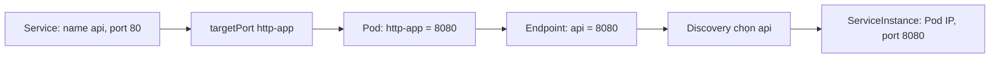

# Tên cổng và cấu hình ưu tiên cổng

> Chương: ServiceInstance và cổng  
> Module: SPRING_CLOUD_KUBERNETES

Một Service Kubernetes có thể công bố đồng thời API nghiệp vụ, cổng quản trị và cổng dùng giao thức khác. Trong khi đó, mỗi `ServiceInstance` có một giá trị `getPort()`. DiscoveryClient phải chọn cổng nào để caller sử dụng; tìm đúng Pod nhưng chọn nhầm cổng vẫn có thể khiến ứng dụng nhận lỗi hoặc gọi vào một API khác.

Bài này giải thích cách đặt tên cổng, quan hệ giữa tên cổng Service và tên cổng Pod, cùng cấu hình `primary-port-name` của Spring Cloud Kubernetes. Ví dụ xuyên suốt là ứng dụng `orders` khám phá `catalog` trong namespace `port-priority-lab`, với cổng API và cổng quản trị tách biệt.

## 1. Mục tiêu và điều kiện của ví dụ

Sau bài học, bạn có thể:

- Đọc đúng `name`, `port` và `targetPort` trong Service.
- Chọn tên phù hợp cho `spring.cloud.kubernetes.discovery.primary-port-name`.
- Giải thích thứ tự ưu tiên giữa nhãn Service và cấu hình discovery của caller.
- Nhận diện trường hợp chỉ có một cổng, không có cổng hoặc tên ưu tiên không tồn tại.
- Phân biệt lựa chọn cổng với lựa chọn giao thức HTTP/HTTPS.
- Quan sát cổng thực tế trong ServiceInstance trước khi đưa cấu hình vào đường gọi nghiệp vụ.

Ví dụ sử dụng Java 17 trở lên, một bộ Spring Boot/Spring Cloud tương thích do BOM của dự án quản lý và Kubernetes có EndpointSlice API `discovery.k8s.io/v1`. Phần lab dùng Fabric8 DiscoveryClient đọc trực tiếp Kubernetes API; không trộn thêm Kubernetes Java Client hoặc HTTP DiscoveryClient vào cùng cấu hình.

Các manifest, mã Java và kết quả bên dưới là hướng dẫn thực hành. IP, số cổng và kết quả kỳ vọng được dùng để giải thích cơ chế, không phải báo cáo một lần chạy cluster đã được kiểm chứng.

## 2. Ba nơi có tên cổng cần phân biệt

Xét một Service có hai cổng:

```yaml
apiVersion: v1
kind: Service
metadata:
  name: catalog
  namespace: port-priority-lab
spec:
  selector:
    app: catalog
  ports:
    - name: api
      port: 80
      targetPort: http-app
    - name: management
      port: 9000
      targetPort: http-admin
```

Pod được chọn có phần khai báo:

```yaml
ports:
  - name: http-app
    containerPort: 8080
  - name: http-admin
    containerPort: 9090
```

Các trường có vai trò khác nhau:

| Trường | Giá trị trong ví dụ | Ý nghĩa |
| --- | --- | --- |
| `Service.spec.ports[].name` | `api` | Tên cổng trong Service |
| `Service.spec.ports[].port` | 80 | Cổng mà Service công bố |
| `Service.spec.ports[].targetPort` | `http-app` | Tham chiếu tới cổng có tên trên Pod |
| `Pod.spec.containers[].ports[].name` | `http-app` | Tên cổng trong Pod |
| `containerPort` | 8080 | Số cổng backend được mô tả |

Ở đây, `api` và `http-app` không cần giống nhau. `targetPort: http-app` mới là phần liên kết Service tới cổng Pod có tên `http-app`. Nếu `targetPort` là số, Kubernetes dùng số đó; nếu bỏ qua, giá trị cổng đích được lấy theo cổng Service. Xem [hợp đồng ServicePort của Kubernetes](https://kubernetes.io/docs/reference/kubernetes-api/core/service-v1/).

Khai báo `containerPort: 8080` không tự mở socket hoặc đổi cấu hình tiến trình. Ứng dụng vẫn phải thực sự lắng nghe trên cổng 8080.

### 2.1. Quy tắc đặt tên

Khi Service có nhiều cổng, mỗi cổng phải có tên để phân biệt. Tên cổng Service phải duy nhất trong Service và hợp lệ theo quy tắc Kubernetes; ví dụ `api`, `management`, `http`, `https`. Dùng chữ thường, chữ số và dấu gạch ngang; tránh dấu gạch dưới hoặc khoảng trắng. Xem [Service nhiều cổng](https://kubernetes.io/docs/concepts/services-networking/service/#multi-port-services).

Tên cổng trên Pod cũng có ràng buộc riêng theo `IANA_SVC_NAME` và phải duy nhất trong Pod. Không coi quy tắc kiểm tra tên ServicePort và ContainerPort là hoàn toàn giống nhau. Các tên ngắn như `http-app` và `http-admin` trong ví dụ phù hợp cho việc tham chiếu. Xem [ContainerPort trong API Pod](https://kubernetes.io/docs/reference/kubernetes-api/core/pod-v1/).

### 2.2. Tên có vai trò ngữ nghĩa nhưng không tự cấu hình giao thức

Đặt tên cổng là `http` không biến một tiến trình TCP bất kỳ thành HTTP. Đặt tên `https` không tự bật TLS. Tên cổng giúp công cụ và thư viện diễn giải ý định; tiến trình backend, chính sách mạng và HTTP client vẫn phải được cấu hình tương ứng.

Tương tự, `protocol: TCP` mô tả giao thức vận chuyển. Nó chưa trả lời cổng đó phục vụ HTTP thuần, HTTPS, gRPC hay một giao thức TCP khác.

## 3. DiscoveryClient nhìn thấy tên và số cổng nào?

Với Service có selector, Kubernetes quản lý dữ liệu endpoint cho các Pod phù hợp. Một phần EndpointSlice của ví dụ có thể là:

```yaml
metadata:
  labels:
    kubernetes.io/service-name: catalog
addressType: IPv4
ports:
  - name: api
    protocol: TCP
    port: 8080
  - name: management
    protocol: TCP
    port: 9090
endpoints:
  - addresses:
      - 10.42.1.21
    conditions:
      ready: true
```

Đây là dữ liệu minh họa để đọc, không phải manifest cần tự áp vào EndpointSlice do controller quản lý.

Điểm cần chú ý:

- Tên cổng endpoint là `api` và `management`, tương ứng cổng Service.
- Số cổng endpoint là 8080 và 9090, tương ứng backend.
- Tên `http-app` giúp Kubernetes phân giải `targetPort` nhưng không trở thành tên `api` trong bảng cấu hình ưu tiên của caller.

Đường ánh xạ có thể hình dung như sau:



Vì vậy, khi muốn chọn API của ví dụ, cấu hình đúng là:

```properties
spring.cloud.kubernetes.discovery.primary-port-name=api
```

Cấu hình `primary-port-name=http-app` sẽ không tìm được tên đó trong bảng cổng endpoint minh họa. Cấu hình này có thể bị che bởi lựa chọn dự phòng, nên việc ứng dụng vẫn khởi động chưa chứng minh đã chọn đúng cổng.

Một Service có thể tạo nhiều EndpointSlice. Khi các Pod phân giải cùng tên cổng đích ra các số khác nhau, Kubernetes có thể nhóm chúng vào các slice khác nhau. Khi đối chiếu discovery, phải đọc đủ các slice và kiểm tra khả năng xử lý của đúng phiên bản client. Xem [cổng và cách phân chia EndpointSlice](https://kubernetes.io/docs/concepts/services-networking/endpoint-slices/).

## 4. Cấu hình cổng ưu tiên trong Spring Cloud Kubernetes

Có hai nơi cấu hình thường gặp cho đường discovery:

| Cấu hình | Nơi đặt | Phạm vi diễn đạt |
| --- | --- | --- |
| Nhãn `primary-port-name` | `metadata.labels` của Service | Cổng ưu tiên của Service đó |
| `spring.cloud.kubernetes.discovery.primary-port-name` | Cấu hình ứng dụng thực hiện discovery | Tên ưu tiên chung cho discovery của ứng dụng |

### 4.1. Thuộc tính trong caller

Trong `orders`:

```yaml
spring:
  cloud:
    kubernetes:
      discovery:
        primary-port-name: api
```

Giá trị là tên cổng, không phải số cổng, địa chỉ, URL hoặc path:

```text
Đúng với ví dụ: api

Không diễn đạt đúng tên cổng cần chọn:
8080
http://catalog
/api/products
http-app
```

`http-app` vẫn có thể là một tên hợp lệ ở nơi khác; nó không phải khóa cổng endpoint của Service trong ví dụ này.

Thuộc tính `primary-port-name` không khai báo một danh sách ưu tiên kiểu `api,management`. Một chuỗi như vậy không có nghĩa “thử api rồi thử management”; nó không phải cơ chế thiết lập chuỗi fallback tùy ý.

### 4.2. Nhãn trên Service

Service có thể chỉ định:

```yaml
metadata:
  name: catalog
  namespace: port-priority-lab
  labels:
    primary-port-name: api
```

Đặt nhãn ở Service. Đặt cùng nhãn đó trong `spec.template.metadata.labels` của Deployment chỉ gắn nó lên Pod; điều đó không tương đương với nhãn Service mà thuật toán chọn cổng đọc.

Kubernetes chấp nhận nhãn như metadata nhưng bản thân nhãn này không thay đổi `port`, `targetPort` hoặc cách kube-proxy chuyển tiếp lưu lượng. Spring Cloud Kubernetes mới là thành phần diễn giải nó cho lựa chọn cổng.

### 4.3. Nhãn Service được ưu tiên hơn thuộc tính caller

Nếu Service có:

```yaml
metadata:
  labels:
    primary-port-name: management
```

trong khi caller có:

```properties
spring.cloud.kubernetes.discovery.primary-port-name=api
```

thì tên ưu tiên ở đường discovery này là `management`. Với dữ liệu ví dụ, ServiceInstance sẽ dùng cổng backend 9090 sau khi thay đổi đã được discovery quan sát.

Tài liệu Spring Cloud Kubernetes mô tả lựa chọn qua nhãn Service trước thuộc tính chung, rồi đến quy ước tên và lựa chọn dự phòng. Xem [lựa chọn cổng trong DiscoveryClient](https://docs.spring.io/spring-cloud-kubernetes/reference/discovery-client.html).

Đây là ưu tiên giữa hai nguồn dữ liệu trong thuật toán discovery. Nó khác với thứ tự nguồn cấu hình của Spring Boot, chẳng hạn command line và biến môi trường, vốn quyết định giá trị cuối cùng của cùng một thuộc tính ứng dụng.

## 5. Hiểu chính xác các nhánh lựa chọn

Không nên nhớ thuật toán dưới dạng “cứ cấu hình primary-port-name là luôn được cổng đó”. Số lượng cổng và việc tên có tồn tại đều ảnh hưởng kết quả.

Sơ đồ logic rút gọn của triển khai được tham chiếu:

```text
Không có cổng                -> giá trị port đặc biệt, ví dụ 0
Chỉ có một cổng              -> dùng cổng duy nhất

Có nhiều cổng:
    tên ưu tiên = nhãn Service nếu có, nếu không thì thuộc tính discovery
    tìm thấy tên ưu tiên    -> dùng cổng mang tên đó
    có tên https            -> dùng https
    có tên http             -> dùng http
    còn lại                 -> lấy một phần tử theo thứ tự dữ liệu nội bộ
```

Trong mã nguồn được tham chiếu, sau khi chọn tên ưu tiên từ nhãn hoặc thuộc tính, nếu không tìm thấy tên đó thì thuật toán chuyển sang `https` rồi `http`. Nó không có bước quay lại thử thuộc tính chung khi nhãn đã được chọn nhưng không khớp. Xem [DiscoveryClientUtils và thứ tự chọn cổng](https://github.com/spring-cloud/spring-cloud-kubernetes/blob/main/spring-cloud-kubernetes-commons/src/main/java/org/springframework/cloud/kubernetes/commons/discovery/DiscoveryClientUtils.java).

Chi tiết triển khai có thể thay đổi theo phiên bản. Các kết quả bên dưới là suy ra từ luồng lựa chọn này, với giả định đang dùng đường discovery endpoint tương ứng.

### 5.1. Bảng tình huống

| Các tên cổng hiện có | Nhãn Service | Thuộc tính caller | Kết quả cần dự kiến |
| --- | --- | --- | --- |
| `api`, `management` | Không có | `api` | Chọn `api` |
| `api`, `management` | `management` | `api` | Chọn `management` |
| `https`, `http` | Không có | Không có | Chọn `https` theo quy ước |
| `https`, `http` | Không có | `http` | Chọn `http` |
| `api`, `http` | `missing` | `api` | Không dùng lại `api` từ thuộc tính; chuyển tới `http` |
| `api`, `management` | `missing` | `api` | Không có tên quy ước; rơi vào phần tử dự phòng |
| Chỉ `management` | Không có | `api` | Dùng cổng duy nhất |
| Không có cổng | Bất kỳ | Bất kỳ | Không có đích cổng nghiệp vụ hợp lệ để mặc định sử dụng |

Trong hai hàng có `missing`, cấu hình không tự trở thành đúng chỉ vì thư viện trả một số cổng.

### 5.2. Cấu hình ưu tiên không phải điều kiện bắt buộc

Trường hợp chỉ có cổng `management` nhưng caller cấu hình `api` là một ví dụ quan trọng: tùy luồng triển khai, cổng duy nhất vẫn được chọn.

Nếu yêu cầu nghiệp vụ là “chỉ được gọi API, tuyệt đối không dùng cổng khác”, chỉ đặt tên ưu tiên chưa đủ để biểu đạt ràng buộc đó. Cần thêm cách kiểm tra cấu hình/kết quả discovery phù hợp hoặc tách Service để chỉ công bố nhóm cổng mong muốn.

### 5.3. Không dựa vào phần tử đầu tiên

“Phần tử đầu tiên” trong fallback không phải hợp đồng ổn định để chọn API nghiệp vụ. Thứ tự có thể chịu ảnh hưởng của cách dữ liệu được thu thập và tổ chức trong thư viện.

Việc viết `api` trước `management` trong manifest không phải giải pháp cho một tên ưu tiên đang sai. Hãy sửa tên được chọn và xác minh kết quả.

### 5.4. Lỗi cấu hình có thể tồn tại âm thầm

Giả sử bạn gõ `primary-port-name=ap1` thay vì `api`:

- Service có thêm cổng `http`: ứng dụng có thể vẫn chọn được một cổng bằng quy ước.
- Service chỉ có `api` và `management`: ứng dụng có thể chọn một phần tử dự phòng.
- Trong cả hai trường hợp, ứng dụng có thể khởi động bình thường.

Vì thế, cần kiểm tra `ServiceInstance.getPort()`, URI và API phản hồi. Không coi việc không xuất hiện exception lúc khởi động là bằng chứng cấu hình chọn cổng đúng.

## 6. Chọn cổng và chọn HTTPS là hai bước khác nhau

Sau khi có cổng được chọn, Spring Cloud Kubernetes còn xác định có coi đích là secure hay không. Metadata `secured`, danh sách `known-secure-ports` và tên `https` có thể ảnh hưởng bước này theo triển khai. Xem [ServicePortSecureResolver](https://github.com/spring-cloud/spring-cloud-kubernetes/blob/main/spring-cloud-kubernetes-commons/src/main/java/org/springframework/cloud/kubernetes/commons/discovery/ServicePortSecureResolver.java).

Ví dụ một backend có hai cổng:

```yaml
ports:
  - name: api
    port: 80
    targetPort: 8080
  - name: api-tls
    port: 443
    targetPort: 8443
```

Muốn ưu tiên `api-tls` thì phải chọn tên đó. Việc thêm 8443 vào `known-secure-ports` chỉ giúp diễn giải một cổng đã chọn; nó không tự yêu cầu discovery chuyển từ `api` sang `api-tls`.

Ngược lại, nếu cổng tên `https` được chọn theo fallback nhưng backend chỉ phục vụ HTTP thuần, tên cổng có thể khiến URI dùng HTTPS và lời gọi thất bại ở TLS. Cần sửa sự không nhất quán giữa tên, giao thức thực và metadata.

Nếu Service có cả cổng quản trị HTTP và API HTTPS, nhãn `secured` ở cấp Service cũng cần được đánh giá theo cổng thực tế đang chọn. Không dùng một nhãn để bỏ qua việc kiểm tra giao thức của từng đường truy cập.

## 7. Đừng nhầm với cấu hình cổng của LoadBalancer mode SERVICE

Hai thuộc tính dưới đây không thay thế nhau:

| Thuộc tính | Thành phần đọc | Ngữ cảnh chính |
| --- | --- | --- |
| `spring.cloud.kubernetes.discovery.primary-port-name` | DiscoveryClient | Chọn cổng khi tạo instance từ discovery |
| `spring.cloud.kubernetes.loadbalancer.port-name` | LoadBalancer riêng của Spring Cloud Kubernetes | Chọn cổng Service ở mode `SERVICE` |

Trong mode `POD` của starter LoadBalancer riêng, danh sách instance đi qua DiscoveryClient nên cấu hình discovery có liên quan. Trong mode `SERVICE`, thành phần này chọn đích theo Service và sử dụng cấu hình cổng riêng; mặc định tên là `http` theo tài liệu.

Ví dụ riêng cho mode `SERVICE`:

```yaml
spring:
  cloud:
    kubernetes:
      loadbalancer:
        mode: SERVICE
        port-name: api
```

Với Service của bài, đường này chọn cổng Service 80. Đường discovery trực tiếp endpoint chọn `api` lại cho cổng backend 8080. Hai con số khác nhau có thể đều đúng vì host và đường kết nối khác nhau. Xem [các mode và chọn cổng của Kubernetes LoadBalancer](https://docs.spring.io/spring-cloud-kubernetes/reference/load-balancer.html).

Phần thực hành sau chỉ đọc DiscoveryClient, không yêu cầu cài starter LoadBalancer riêng. Không đưa cấu hình `loadbalancer.port-name` vào rồi kỳ vọng nó sửa kết quả của `discoveryClient.getInstances()`.

## 8. Chuẩn bị thí nghiệm

### 8.1. Các thành phần cần có

Thí nghiệm gồm:

- Backend `catalog` phục vụ API trên 8080, Actuator trên 9090.
- Service `catalog` có tên cổng `api` và `management` như mục 2.
- Caller `orders` dùng Fabric8 DiscoveryClient để chụp cổng được chọn.
- Namespace `port-priority-lab` và quyền đọc API trong namespace đó.

Backend cần starter web và Actuator của bộ Spring Boot đang dùng. Caller cần starter web và `spring-cloud-starter-kubernetes-fabric8` theo BOM tương thích. Việc chỉ quan sát discovery không cần thêm bộ cân bằng tải.

### 8.2. Backend catalog

Cấu hình ứng dụng backend:

```yaml
server:
  port: 8080

management:
  server:
    port: 9090
  endpoints:
    web:
      exposure:
        include: health
  endpoint:
    health:
      probes:
        enabled: true
```

API nghiệp vụ đơn giản, đặt dưới package gốc của ứng dụng Spring Boot:

```java
package example.catalog;

import java.util.Map;

import org.springframework.web.bind.annotation.GetMapping;
import org.springframework.web.bind.annotation.RestController;

@RestController
public class CatalogController {

    @GetMapping("/api/catalog")
    public Map<String, String> catalog() {
        return Map.of(
                "service", "catalog",
                "purpose", "business-api",
                "pod", System.getenv()
                        .getOrDefault("HOSTNAME", "local"));
    }
}
```

Ứng dụng cần lớp chính `@SpringBootApplication` thông thường. Trong lab, API này nằm trên cổng 8080; cổng quản trị 9090 cung cấp health endpoint.

Thay `CATALOG_IMAGE` bằng image thực đã chứa ứng dụng:

```yaml
apiVersion: apps/v1
kind: Deployment
metadata:
  name: catalog
  namespace: port-priority-lab
spec:
  replicas: 2
  selector:
    matchLabels:
      app: catalog
  template:
    metadata:
      labels:
        app: catalog
    spec:
      containers:
        - name: catalog
          image: CATALOG_IMAGE
          ports:
            - name: http-app
              containerPort: 8080
            - name: http-admin
              containerPort: 9090
          readinessProbe:
            httpGet:
              path: /actuator/health/readiness
              port: http-admin
            periodSeconds: 5
            timeoutSeconds: 1
            failureThreshold: 3
```

Probe dùng `http-admin` vì đây là tên cổng Pod. Thuộc tính discovery lại dùng `api` vì đó là tên cổng endpoint/Service. Đây là hai phép tham chiếu khác nhau.

Nếu ứng dụng có security hoặc thay base path của Actuator, điều chỉnh probe cho khớp. Chỉ bật các đường quản trị cần cho môi trường thí nghiệm.

### 8.3. Cấu hình caller orders

Trong ứng dụng `orders`:

```yaml
server:
  port: 8080

spring:
  application:
    name: orders
  cloud:
    kubernetes:
      discovery:
        enabled: true
        all-namespaces: false
        namespaces:
          - port-priority-lab
        use-endpoint-slices: true
        include-not-ready-addresses: false
        include-external-name-services: false
        primary-port-name: api
        metadata:
          add-ports: true
          ports-prefix: "port."
```

`primary-port-name` là tên ưu tiên; `metadata.add-ports` và `ports-prefix` chỉ phục vụ hiển thị metadata cổng. Việc bật metadata không tự chọn lại cổng. Xem [danh mục thuộc tính discovery](https://docs.spring.io/spring-cloud-kubernetes/reference/appendix.html).

Bật profile `port-priority-lab` để sử dụng controller quan sát ở phần tiếp theo. Lớp chính có thể là:

```java
package example.orders;

import org.springframework.boot.SpringApplication;
import org.springframework.boot.autoconfigure.SpringBootApplication;
import org.springframework.cloud.client.discovery.EnableDiscoveryClient;

@SpringBootApplication
@EnableDiscoveryClient
public class OrdersApplication {

    public static void main(String[] args) {
        SpringApplication.run(OrdersApplication.class, args);
    }
}
```

Với kiến trúc HTTP DiscoveryClient qua DiscoveryServer, cần tìm đúng phía tạo danh sách instance để cấu hình. Thuộc tính đặt ở caller HTTP không nên được mặc định là đã thay thuật toán chọn cổng trên server.

### 8.4. Quyền đọc Kubernetes API

Ví dụ dùng ServiceAccount riêng:

```yaml
apiVersion: v1
kind: ServiceAccount
metadata:
  name: orders-discovery
  namespace: port-priority-lab
---
apiVersion: rbac.authorization.k8s.io/v1
kind: Role
metadata:
  name: orders-discovery-reader
  namespace: port-priority-lab
rules:
  - apiGroups: [""]
    resources: ["services", "pods"]
    verbs: ["get", "list", "watch"]
  - apiGroups: ["discovery.k8s.io"]
    resources: ["endpointslices"]
    verbs: ["get", "list", "watch"]
---
apiVersion: rbac.authorization.k8s.io/v1
kind: RoleBinding
metadata:
  name: orders-discovery-reader
  namespace: port-priority-lab
subjects:
  - kind: ServiceAccount
    name: orders-discovery
    namespace: port-priority-lab
roleRef:
  apiGroup: rbac.authorization.k8s.io
  kind: Role
  name: orders-discovery-reader
```

Deployment `orders` chạy trong namespace trên và dùng `serviceAccountName: orders-discovery`. Quyền Pod hỗ trợ các truy vấn của triển khai discovery; khi thay client hoặc tùy chọn metadata cần đối chiếu lại nhu cầu thực tế.

Không cần quyền đọc Secret hoặc ConfigMap chỉ để lấy tên và số cổng từ discovery. Lỗi 403 khi đọc API phải được xử lý ở RBAC, không phải bằng cách đổi tên cổng ưu tiên.

## 9. Quan sát cổng đã chọn bằng Java

Controller dưới đây không gọi backend; nó hiển thị kết quả discovery và các metadata cổng đã chọn lọc:

```java
package example.orders;

import java.util.List;
import java.util.Map;
import java.util.TreeMap;

import org.springframework.cloud.client.ServiceInstance;
import org.springframework.cloud.client.discovery.DiscoveryClient;
import org.springframework.context.annotation.Profile;
import org.springframework.web.bind.annotation.GetMapping;
import org.springframework.web.bind.annotation.RestController;

@RestController
@Profile("port-priority-lab")
public class PortSnapshotController {

    private final DiscoveryClient discoveryClient;

    public PortSnapshotController(DiscoveryClient discoveryClient) {
        this.discoveryClient = discoveryClient;
    }

    @GetMapping("/internal/lab/catalog-ports")
    public List<PortSnapshot> snapshots() {
        return discoveryClient.getInstances("catalog").stream()
                .map(this::snapshot)
                .toList();
    }

    private PortSnapshot snapshot(ServiceInstance instance) {
        Map<String, String> ports = new TreeMap<>();
        Map<String, String> metadata = instance.getMetadata();

        if (metadata != null) {
            metadata.forEach((key, value) -> {
                if (key.startsWith("port.")) {
                    ports.put(key, value);
                }
            });
        }

        return new PortSnapshot(
                instance.getServiceId(),
                instance.getHost(),
                instance.getPort(),
                instance.isSecure(),
                instance.getUri().toString(),
                ports);
    }

    public record PortSnapshot(
            String serviceId,
            String host,
            int selectedPort,
            boolean secure,
            String uri,
            Map<String, String> ports) {
    }
}
```

Kết quả minh họa khi chọn `api`:

```json
[
  {
    "serviceId": "catalog",
    "host": "10.42.1.21",
    "selectedPort": 8080,
    "secure": false,
    "uri": "http://10.42.1.21:8080",
    "ports": {
      "port.api": "8080",
      "port.management": "9090"
    }
  }
]
```

Metadata chứa nhiều cổng không có nghĩa LoadBalancer tự thử lần lượt tất cả. Cổng chính vẫn là `selectedPort` lấy từ `getPort()`.

Trong các trường hợp nhiều nhóm endpoint có cổng khác nhau, cần đọc metadata cùng instance và dữ liệu endpoint tương ứng. Không lấy một bản đồ metadata tổng hợp bất kỳ rồi tự gán lại cổng cho mọi Pod.

## 10. Thực hành thay đổi cấu hình ưu tiên

Các lệnh dưới đây dùng PowerShell. Namespace, ứng dụng và Service phải được triển khai trước; Deployment `orders` phải chứa controller quan sát và bật đúng profile.

### 10.1. Xác nhận dữ liệu nguồn

```powershell
kubectl get service catalog -n port-priority-lab -o yaml
kubectl get pods -n port-priority-lab -l app=catalog -o wide
kubectl get endpointslices -n port-priority-lab -l kubernetes.io/service-name=catalog -o yaml
```

Đối chiếu rằng Service có hai tên `api`, `management` và dữ liệu endpoint có số cổng backend 8080, 9090. Nếu endpoint thiếu, giải quyết selector, tên `targetPort` hoặc readiness trước.

Không tự sửa EndpointSlice do controller quản lý để ép kết quả. Sửa khai báo Service, Pod hoặc tiến trình backend ở nguồn tạo ra dữ liệu.

### 10.2. Đọc kết quả từ caller

Mở một cửa sổ port-forward:

```powershell
kubectl port-forward -n port-priority-lab deployment/orders 18081:8080
```

Ở cửa sổ khác:

```powershell
curl.exe -s http://127.0.0.1:18081/internal/lab/catalog-ports
```

Khi chưa có nhãn `primary-port-name` trên Service, thuộc tính caller `api` phải dẫn tới cổng backend 8080 trong ví dụ.

Snapshot là dữ liệu quan sát từ caller. Port-forward tới caller không tự tạo route từ máy cá nhân đến mọi Pod IP mà snapshot trả về.

### 10.3. Cho nhãn Service ghi đè cấu hình caller

```powershell
kubectl label service catalog -n port-priority-lab primary-port-name=management --overwrite
```

Sau thời gian cập nhật dữ liệu discovery, đọc lại snapshot. Kết quả mong đợi là `selectedPort: 9090`, trong khi thuộc tính caller vẫn là `api`.

Thay đổi nhãn không cần khởi động lại backend vì số cổng và tiến trình backend chưa đổi. Discovery vẫn cần thời gian nhận sự kiện; nếu không thấy cập nhật, kiểm tra watch, cache và loại client đang dùng.

Đây là thay đổi chỉ dành cho lab. Không cần gửi lưu lượng nghiệp vụ tới cổng quản trị để chứng minh rằng cổng đã được chọn.

### 10.4. Chọn đúng tên ServicePort

```powershell
kubectl label service catalog -n port-priority-lab primary-port-name=api --overwrite
```

Đọc lại snapshot và đợi cổng trở về 8080. Nhãn `api` khớp tên endpoint dù `targetPort` là `http-app`.

Nếu muốn khảo sát lỗi nhầm tên, có thể đặt nhãn `http-app` trong lab rồi quan sát log và snapshot. Vì hai tên `api`, `management` không có tên quy ước `https` hoặc `http`, lựa chọn sẽ rơi xuống nhánh dự phòng; không khẳng định nó nhất thiết là 8080 hay 9090.

Ngay cả khi kết quả tình cờ vẫn là 8080, nhãn `http-app` vẫn sai với bảng cổng đang khảo sát.

### 10.5. Xóa nhãn để dùng cấu hình chung

```powershell
kubectl label service catalog -n port-priority-lab primary-port-name-
```

Dấu gạch ngang ở cuối khóa trong lệnh `kubectl label` yêu cầu xóa nhãn. Sau khi nhãn không còn, thuộc tính discovery `api` của caller lại là nguồn tên ưu tiên.

Nếu muốn giữ chính sách ở cấp Service, thay vì xóa có thể đặt lại:

```powershell
kubectl label service catalog -n port-priority-lab primary-port-name=api --overwrite
```

Chọn một trạng thái kết thúc rõ ràng cho lab và ghi lại giá trị đó để người chạy sau không phải suy đoán.

### 10.6. Kiểm tra hai cổng thực sự phục vụ gì

Chọn một Pod backend và mở port-forward riêng:

```powershell
$catalogPod = kubectl get pods -n port-priority-lab -l app=catalog -o jsonpath='{.items[0].metadata.name}'
kubectl port-forward -n port-priority-lab "pod/$catalogPod" 18080:8080 19090:9090
```

Ở cửa sổ gửi yêu cầu:

```powershell
curl.exe -i http://127.0.0.1:18080/api/catalog
curl.exe -i http://127.0.0.1:19090/actuator/health
curl.exe -i http://127.0.0.1:19090/api/catalog
```

Với backend mẫu, cổng 8080 trả API nghiệp vụ, cổng 9090 trả health và không có controller nghiệp vụ tương ứng trên management context thông thường.

Phép kiểm tra này giúp phân biệt “TCP kết nối được” với “đúng cổng của API”. Port-forward đi trực tiếp tới Pod nên không phải phép kiểm chứng đầy đủ đường LoadBalancer hoặc đường Service.

## 11. Chọn chiến lược cấu hình theo nhu cầu

### 11.1. Khi mọi dịch vụ dùng cùng quy ước

Nếu các Service đều công bố cổng nghiệp vụ dưới tên `api`, có thể đặt thuộc tính discovery chung là `api`. Các Service ngoại lệ cần cấu hình rõ ràng và được quan sát kết quả.

Quy ước tên nên biểu đạt mục đích ổn định. Không đặt tên cổng là `8080` chỉ để phản ánh số hiện tại, vì một mục đích API có thể chuyển số cổng ở phiên bản sau.

### 11.2. Khi từng Service có quy ước riêng

Nhãn `primary-port-name` ở mỗi Service giúp chỉ rõ cổng cần dùng cho Service đó. Tuy nhiên, nhãn có tác động tới các caller cùng diễn giải quy ước này, nên thay đổi nhãn phải được xem là thay đổi hợp đồng định tuyến của ứng dụng.

Đặt nhãn mới không thay một trường YAML đơn thuần: sau khi discovery cập nhật, cùng một service ID có thể dẫn caller sang cổng khác.

### 11.3. Khi các caller cần các cổng khác nhau

Giả sử `orders` cần API, còn công cụ quản trị cần cổng management. Một nhãn ưu tiên chung trên một Service không mô tả được hai lựa chọn độc lập của hai caller.

Có thể cân nhắc hai Service cùng chọn một nhóm Pod nhưng công bố các mục đích riêng:

```text
catalog-api
    chỉ công bố API nghiệp vụ

catalog-management
    công bố giao diện quản trị cho đúng đối tượng truy cập
```

Mỗi caller dùng service ID phù hợp. Cách này cũng giúp biểu đạt rõ chính sách truy cập và quan sát lưu lượng. Tách Service không tự áp đặt quyền truy cập mạng; vẫn cần cấu hình mạng và xác thực thích hợp.

### 11.4. Khi đổi tên cổng

Đổi tên `api` thành `public-api` cần xem lại các nơi tham chiếu:

- Nhãn `primary-port-name` của Service.
- Thuộc tính discovery của caller.
- Cấu hình cổng của LoadBalancer mode `SERVICE` nếu có.
- Công cụ quan sát hoặc cấu hình khác tham chiếu tên ServicePort.
- `targetPort` và probe nếu đổi cả tên cổng Pod.

Nếu chỉ đổi ServicePort name, probe đang dùng tên Pod `http-admin` không tự cần đổi. Nếu đổi tên Pod port mà quên cập nhật `targetPort`, endpoint có thể không phân giải được cổng đích.

Nên lập trình tự thay đổi tương thích và quan sát kết quả ở từng giai đoạn. Không mặc định tất cả instance và cache cập nhật cùng thời điểm.

## 12. Cập nhật cấu hình không đồng nghĩa mọi thành phần đã đổi ngay

Có hai kiểu thay đổi khác nhau trong bài:

| Thay đổi | Thành phần quan sát | Điều cần xác minh |
| --- | --- | --- |
| Sửa nhãn trên Service | Client theo dõi Kubernetes API | Sự kiện được nhận và danh sách instance được cập nhật |
| Sửa thuộc tính của ứng dụng | Cơ chế cấu hình Spring đang dùng | Giá trị hiệu lực và khả năng tạo lại thành phần liên quan |

Đưa `primary-port-name` vào ConfigMap có thể giúp quản lý cấu hình, nhưng sửa ConfigMap không tự chứng minh DiscoveryClient đã nạp lại và áp dụng giá trị. Configuration Watcher chỉ hữu ích khi được tích hợp với luồng cập nhật phù hợp; một số cấu hình vẫn cần refresh hoặc rollout theo thiết kế của phiên bản đang chạy.

Bài thực hành dùng cấu hình caller cố định và thay nhãn Service để tách hai vấn đề này. Khi triển khai thật, phải kiểm tra đúng cơ chế cập nhật của ứng dụng thay vì giả định tính động của mọi thuộc tính.

Secret không cần thiết chỉ để lưu tên cổng ưu tiên. Tên cổng thường là một phần của cấu hình định tuyến, không phải mật khẩu hoặc thông tin xác thực.

## 13. Chẩn đoán khi kết quả khác dự kiến

| Hiện tượng | Nguyên nhân cần xét | Bước đối chiếu |
| --- | --- | --- |
| Cấu hình `api` nhưng chọn 9090 | Nhãn Service đang ưu tiên management | Đọc `metadata.labels` của Service |
| Dùng `http-app` nhưng kết quả thay đổi khó hiểu | Nhầm tên Pod với tên ServicePort | Đọc tên cổng EndpointSlice |
| Service chỉ có management vẫn được khám phá | Nhánh chỉ có một cổng | Không coi thuộc tính ưu tiên là bộ lọc bắt buộc |
| Cổng đúng nhưng scheme HTTPS sai | Metadata hoặc tên cổng không khớp giao thức | Đọc secure, URI và cấu hình backend |
| Đổi `loadbalancer.port-name` không làm snapshot đổi | Đã đổi cấu hình của thành phần khác | Xác định đang đọc DiscoveryClient hay mode SERVICE |
| Service có cổng nhưng endpoint thiếu | Selector, targetPort hoặc readiness | Đối chiếu Pod và EndpointSlice |
| Metadata có nhiều cổng nhưng getPort chỉ có một | Hành vi mô hình ServiceInstance | Dùng cổng đã được chọn cho đường gọi tương ứng |
| Đổi nhãn nhưng snapshot chưa đổi | Độ trễ theo dõi, cache hoặc lỗi API | Kiểm tra log discovery và quyền watch |
| Caller trả danh sách rỗng | Không nhất thiết do chọn cổng | Kiểm tra namespace, readiness, selector và RBAC |

Các lệnh quan sát bổ sung:

```powershell
kubectl describe service catalog -n port-priority-lab
kubectl get deployment catalog -n port-priority-lab -o yaml
kubectl logs deployment/orders -n port-priority-lab
kubectl auth can-i watch endpointslices.discovery.k8s.io --as=system:serviceaccount:port-priority-lab:orders-discovery -n port-priority-lab
```

Lệnh dùng `--as` yêu cầu tài khoản thực hiện có quyền impersonation. Nếu bước impersonation bị từ chối, chưa thể kết luận ServiceAccount của caller thiếu quyền đọc EndpointSlice.

Khi ghi nhận lỗi, giữ lại tên Service, namespace, nhãn ưu tiên, thuộc tính hiệu lực, tên cổng endpoint, cổng đã chọn và URI. Các dữ liệu này giúp phân biệt chọn sai tên với lỗi mạng hoặc lỗi ứng dụng.

## 14. Bài tập củng cố

### Tình huống 1: Nhầm targetPort

Service có `name: rest`, `port: 80`, `targetPort: web`; Pod có `name: web` và `containerPort: 8080`. Caller nên đặt tên ưu tiên nào?

**Gợi ý:** `rest`, vì đó là tên cổng Service/endpoint. `web` là tên để phân giải cổng trên Pod.

### Tình huống 2: Nhãn và thuộc tính mâu thuẫn

Service có hai tên cổng `api`, `admin`, nhãn ưu tiên `admin`; caller cấu hình ưu tiên `api`.

**Gợi ý:** Nhãn Service được chọn trước trong đường discovery đang xét. Muốn thay hành vi phải xử lý nhãn hoặc thay cách công bố dịch vụ.

### Tình huống 3: Nhãn sai nhưng thuộc tính đúng

Service có `api` và `http`, nhãn ưu tiên `missing`; caller cấu hình `api`.

**Gợi ý:** Trong thuật toán được tham chiếu, sau khi nhãn không khớp, lựa chọn chuyển sang các tên quy ước. Cổng `http` có thể được chọn; thuộc tính `api` không được thử lại.

### Tình huống 4: Backend chỉ có một cổng

Service chỉ có `admin`, caller đặt `api`. Có thể xem đây là cách ngăn ứng dụng gọi nhầm cổng quản trị không?

**Gợi ý:** Không. Nhánh chỉ có một cổng có thể vẫn chọn `admin`. Cần biểu đạt ràng buộc bằng thiết kế Service hoặc kiểm tra rõ ràng hơn.

### Tình huống 5: HTTPS ở cổng tùy chỉnh

Service có `api` và `api-tls`. Thêm số backend của `api-tls` vào `known-secure-ports` có tự làm nó trở thành cổng ưu tiên không?

**Gợi ý:** Không. Cần chọn `api-tls` trước; quy tắc secure áp dụng để diễn giải giao thức cho cổng được chọn.

Tên cổng là một phần của hợp đồng giữa khai báo Kubernetes, dữ liệu endpoint và caller Spring. Cấu hình ưu tiên chỉ đáng tin khi tên được đặt đúng lớp, thứ tự ưu tiên được hiểu rõ và kết quả ServiceInstance đã được đối chiếu với đích phục vụ thực tế.
