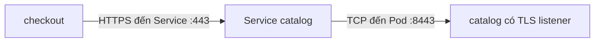
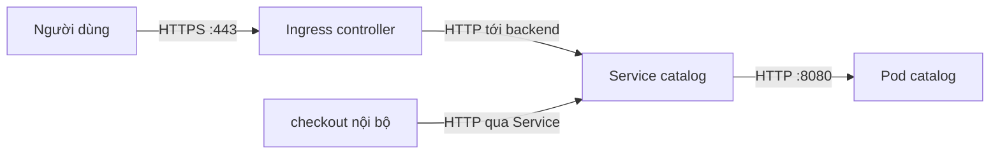

# Nhận diện kết nối an toàn và thông tin HTTPS

## Mục tiêu trong chương ServiceInstance và cổng

Trong module **SPRING_CLOUD_KUBERNETES**, ứng dụng Spring dùng DiscoveryClient để tìm nơi phục vụ request trên Kubernetes. Tìm được host và cổng mới giải quyết phần địa chỉ. Ứng dụng còn phải biết cổng đó nhận HTTP hay HTTPS, bên nào kết thúc TLS và HTTP client có xác minh được chứng thư của bên nhận hay không.

Bài học tập trung vào thông tin HTTPS của `ServiceInstance`, mối liên hệ giữa giao thức và cổng, cùng cách kiểm chứng một kết nối trong triển khai thực tế. Sau bài này, bạn có thể:

- Đọc đồng thời host, port, URI và cờ `isSecure()` để hiểu địa chỉ được discovery công bố.
- Khai báo tín hiệu HTTPS nhất quán với listener thật của ứng dụng.
- Phân biệt HTTPS tại Pod, HTTPS tại Ingress và mã hóa do service mesh đảm nhiệm.
- Khoanh vùng lỗi chọn cổng, lỗi TLS, lỗi chứng thư và lỗi phân quyền Kubernetes API.

Các ví dụ giả định namespace `learning`, một ứng dụng gọi tên `checkout` và ứng dụng được gọi tên `catalog`. Đây là tên minh họa. Những đoạn YAML dưới đây là nội dung cấu hình được trình bày trong bài, không phải yêu cầu thay đổi một cluster đang chạy. Trước khi áp dụng, đối chiếu tài liệu với đúng phiên bản Spring Cloud Kubernetes và Spring Boot của dự án.

## 1. Đọc thông tin HTTPS từ ServiceInstance

`ServiceInstance` là mô tả một địa chỉ dịch vụ do hệ thống discovery trả về. Những phương thức cần quan tâm gồm:

| Phương thức | Thông tin đọc được | Cách dùng trong bài |
|---|---|---|
| `getServiceId()` | Định danh dịch vụ | Kiểm tra đang tìm đúng `catalog` |
| `getHost()` | Host của instance | Xác định client gọi DNS hay địa chỉ IP |
| `getPort()` | Cổng của instance | Đối chiếu với listener đích |
| `isSecure()` | Cờ cho biết cổng được mô tả là dùng HTTPS | Hiểu cách client nên chọn giao thức |
| `getUri()` | URI của instance | Đọc scheme, host và port cùng nhau |
| `getScheme()` | Scheme khi implementation cung cấp | Hữu ích để đối chiếu; interface cho phép giá trị mặc định `null` |
| `getMetadata()` | Các cặp metadata | Bổ sung ngữ cảnh khi chẩn đoán |

Đây là các thành phần của [hợp đồng ServiceInstance trong Spring Cloud Commons](https://github.com/spring-cloud/spring-cloud-commons/blob/main/spring-cloud-commons/src/main/java/org/springframework/cloud/client/ServiceInstance.java). Không suy ra rằng mọi implementation đều trả metadata giống nhau.

Ví dụ một địa chỉ được biểu diễn như sau:

```text
serviceId = catalog
host      = 10.42.2.17
port      = 8443
secure    = true
uri       = https://10.42.2.17:8443
```

Dữ liệu trên cho biết client được hướng dẫn dùng HTTPS tới `10.42.2.17:8443`. Nó chưa chứng minh listener đang chạy, chứng thư còn hạn, CA được tin cậy hay địa chỉ IP có trong Subject Alternative Name của chứng thư.

Cần tách ba câu hỏi khi đọc kết quả discovery:

1. **Địa chỉ có đúng không?** Host và cổng có trỏ tới listener cần gọi không?
2. **Giao thức có đúng không?** Listener đó nhận HTTP hay TLS cho HTTPS?
3. **Danh tính có được xác minh không?** Client có kiểm tra chuỗi chứng thư và tên đích thành công không?

Một địa chỉ được đánh dấu HTTPS vẫn có thể thất bại ở bất kỳ bước nào trong ba bước này.

## 2. Spring Cloud Kubernetes nhận diện cổng HTTPS thế nào?

Với cơ chế mặc định được mô tả trong tài liệu DiscoveryClient, cổng đã chọn được nhận diện an toàn qua các tín hiệu: label `secured` của **Service**; nếu không có label thì xét annotation cùng tên; tiếp đến danh sách `spring.cloud.kubernetes.discovery.known-secure-ports` mặc định `[443, 8443]`; cuối cùng tên cổng `https`. Các giá trị bật cho `secured` gồm `true`, `on`, `yes`, `1`. Xem [quy tắc nhận diện secure của DiscoveryClient](https://docs.spring.io/spring-cloud-kubernetes/reference/discovery-client.html).

Các tín hiệu này là quy ước mô tả giao thức. Chúng không cấu hình chứng thư cho server và không thực hiện bắt tay TLS thay cho HTTP client.

Ví dụ khai báo rõ ràng cho Service chỉ công bố HTTPS:

```yaml
apiVersion: v1
kind: Service
metadata:
  name: catalog
  namespace: learning
  labels:
    app: catalog
    secured: "true"
    primary-port-name: https
spec:
  selector:
    app: catalog
  ports:
    - name: https
      protocol: TCP
      port: 443
      targetPort: 8443
```

Giả định ứng dụng phía sau thực sự nhận HTTPS trên `8443`. `secured` được đặt ở `metadata.labels` của Service, còn `spec.selector.app` dùng để chọn Pod. Đặt `secured` chỉ lên Pod không tương đương với khai báo trên Service trong cơ chế vừa nêu.

Annotation có thể là lựa chọn thay thế khi tổ chức dùng annotation để mô tả thuộc tính này:

```yaml
metadata:
  name: catalog
  namespace: learning
  annotations:
    secured: "true"
```

Không cần khai báo đồng thời cả label lẫn annotation. Tránh cấu hình chúng trái nhau rồi trông chờ một bên tự sửa ý nghĩa của bên còn lại. Đặc biệt, không dùng riêng `secured: "false"` như một cách sửa nhanh để ép HTTP khi tên cổng, số cổng hoặc cấu hình nhận diện khác vẫn gợi ý HTTPS. Hãy làm cho toàn bộ mô tả phản ánh đúng listener và đối chiếu hành vi phiên bản đang dùng.

Nếu hệ thống chuẩn hóa HTTPS trên cổng riêng, ví dụ `9443`, có thể khai báo danh sách nhận diện phía chạy discovery:

```yaml
spring:
  cloud:
    kubernetes:
      discovery:
        known-secure-ports:
          - 443
          - 8443
          - 9443
```

Cấu hình này mô tả quy ước nhận diện; nó không mở cổng `9443` và không bật TLS cho server. Giữ cả các cổng cần tiếp tục nhận diện khi khai báo danh sách. Tên thuộc tính và giá trị mặc định được liệt kê tại [phụ lục cấu hình Spring Cloud Kubernetes](https://docs.spring.io/spring-cloud-kubernetes/reference/appendix.html).

Nếu dùng DiscoveryServer với HTTP DiscoveryClient, việc suy ra thông tin instance thuộc phía server. Đặt thuộc tính ở ứng dụng chỉ tiêu thụ kết quả discovery có thể không tác động tới bước tạo instance. Cần xác định thành phần nào đọc Kubernetes API trước khi chọn nơi cấu hình.

## 3. HTTPS phải gắn với đúng cổng và đúng chặng kết nối

### 3.1. Service port và cổng đích của Pod

Trong Service minh họa, hai con số có vai trò khác nhau:

| Đường gọi | Địa chỉ minh họa | Listener phải hỗ trợ |
|---|---|---|
| Qua DNS của Service | `catalog.learning.svc.cluster.local:443` | Cổng Service chuyển tiếp tới listener HTTPS của Pod |
| Trực tiếp tới endpoint Pod | `10.42.2.17:8443` | Pod nhận HTTPS ngay tại `8443` |

`port: 443` là cổng của Service; `targetPort: 8443` là cổng đích. Kubernetes Service chuyển lưu lượng tới backend theo ánh xạ cổng; việc đặt tên `https` hoặc chọn số `443` không tự biến HTTP thành HTTPS. Xem [khái niệm Service và ánh xạ port/targetPort của Kubernetes](https://kubernetes.io/docs/concepts/services-networking/service/).



Với đường gọi trực tiếp Pod, chặng đi qua địa chỉ Service trong hình được bỏ qua. Vì vậy, đừng lấy số cổng của Service rồi ghép với IP của Pod. Tổ hợp `PodIP:443` có thể không tồn tại dù `ServiceDNS:443` đang hoạt động.

Trước khi bàn đến HTTPS, hãy in chính `host` và `port` mà instance trả về. Không áp một giả định chung rằng mọi chế độ discovery đều dùng DNS Service hoặc đều dùng Pod IP.

### 3.2. Service công bố cả HTTP và HTTPS

Giả sử `catalog` có hai listener độc lập:

```yaml
apiVersion: v1
kind: Service
metadata:
  name: catalog
  namespace: learning
  labels:
    app: catalog
    primary-port-name: https
spec:
  selector:
    app: catalog
  ports:
    - name: http
      port: 80
      targetPort: 8080
    - name: https
      port: 443
      targetPort: 8443
```

Ví dụ chủ động chọn cổng `https`, tránh phụ thuộc thứ tự các phần tử trong danh sách. Không đặt một cờ HTTPS chung rồi bỏ mặc việc chọn cổng: nếu client chọn listener HTTP trên `8080` nhưng khởi tạo TLS, request vẫn sai.

Nếu chỉ có một listener HTTP dành cho quản trị và một listener HTTPS dành cho API nghiệp vụ, việc chọn cổng sai còn có thể đưa request tới API quản trị. Do đó, tên cổng phải diễn tả chức năng rõ ràng và kết quả discovery phải được kiểm tra trước khi cho phép gọi dữ liệu nghiệp vụ.

### 3.3. Liên hệ với Spring Cloud LoadBalancer

Spring Cloud Kubernetes LoadBalancer có chế độ `POD` và `SERVICE`. `POD` dùng DiscoveryClient; `SERVICE` chọn địa chỉ Service. Với Service nhiều cổng, `SERVICE` dùng thuộc tính `spring.cloud.kubernetes.loadbalancer.portName` để chọn theo tên. Hai chế độ có đường chọn địa chỉ và cổng khác nhau; xem [tài liệu LoadBalancer for Kubernetes](https://docs.spring.io/spring-cloud-kubernetes/reference/load-balancer.html).

Ví dụ cấu hình cho đường gọi qua Service có cổng tên `https`:

```yaml
spring:
  cloud:
    kubernetes:
      loadbalancer:
        mode: SERVICE
        portName: https
```

Cấu hình chọn cổng chưa đủ để kết luận toàn bộ request đã dùng HTTPS. Cần kiểm tra tiếp cờ secure, URI sau khi resolve và cấu hình của HTTP client. Một client được tùy biến hoặc tự ghép URL có thể xử lý scheme khác với điều bạn dự kiến.

Nếu dự án chỉ cần gọi một DNS Service ổn định và không cần metadata, lọc instance hay chính sách cân bằng tải phía ứng dụng, có thể dùng DNS Kubernetes trực tiếp. Chỉ thêm DiscoveryClient hoặc LoadBalancer khi chức năng đó giải quyết một nhu cầu cụ thể.

## 4. Xác định nơi kết thúc TLS

### 4.1. TLS kết thúc tại ứng dụng trong Pod

```text
checkout -- HTTPS --> catalog:8443
```

Trong mô hình này, ứng dụng `catalog` phải có TLS listener; client `checkout` cần tin cậy CA cấp chứng thư cho `catalog`. Cờ secure phải mô tả đúng kết nối từ client tới listener đó.

Ví dụ cấu hình server Spring Boot dùng một SSL bundle PEM, với điều kiện phiên bản đang sử dụng hỗ trợ các thuộc tính này:

```yaml
spring:
  ssl:
    bundle:
      pem:
        catalog-server:
          keystore:
            certificate: file:/etc/catalog-tls/tls.crt
            private-key: file:/etc/catalog-tls/tls.key
server:
  port: 8443
  ssl:
    enabled: true
    bundle: catalog-server
```

Chứng thư và khóa riêng được giả định đã mount từ Secret vào đúng đường dẫn. Khai báo bundle mô tả vật liệu TLS; server phải tham chiếu bundle đó để sử dụng. Xem [SSL bundles trong Spring Boot](https://docs.spring.io/spring-boot/reference/features/ssl.html) và [cấu hình SSL cho web server](https://docs.spring.io/spring-boot/how-to/webserver.html#howto.webserver.configure-ssl).

Đây là ví dụ server một cổng HTTPS. Nó không tự tạo thêm listener HTTP `8080`; Service công bố cả hai cổng chỉ phù hợp khi backend đã được cấu hình cả hai listener.

### 4.2. TLS kết thúc tại Ingress



Trong cấu hình minh họa, URL công khai là HTTPS nhưng backend vẫn nhận HTTP. Nếu `checkout` gọi thẳng Service hoặc Pod, nó không đi qua TLS listener của Ingress. Gắn `secured: "true"` lên backend HTTP chỉ vì website bên ngoài có ổ khóa sẽ khiến client chọn giao thức sai.

TLS tại Ingress bảo vệ chặng đến Ingress trong mô hình kết thúc TLS này. Nếu cần HTTPS tiếp tới backend, phải cấu hình thêm TLS ở backend và cách controller xác minh backend phù hợp. Chi tiết phụ thuộc controller; xem [TLS trong tài liệu Ingress của Kubernetes](https://kubernetes.io/docs/concepts/services-networking/ingress/#tls).

Một chứng thư cho `catalog.example.test` ở Ingress cũng không mặc nhiên phù hợp với `10.42.2.17` hoặc `catalog.learning.svc.cluster.local` khi client gọi nội bộ.

### 4.3. TLS do service mesh đảm nhiệm

Một mô hình khác có đường đi như sau:

```text
Ứng dụng A -- HTTP --> proxy A == mTLS ==> proxy B -- HTTP --> ứng dụng B
```

Trong giả định này, ứng dụng trao đổi HTTP với proxy; mesh mã hóa chặng giữa các proxy. Cờ `isSecure()` cần phản ánh giao thức mà HTTP client của ứng dụng phải sử dụng trên đường gọi được cấu hình. Không đổi nó sang `true` chỉ để diễn đạt rằng hạ tầng mesh có mTLS.

Nếu mesh chuyển tiếp TLS đầu cuối hoặc ứng dụng tự nói HTTPS, mô hình sẽ khác. Hãy vẽ đúng các chặng, ghi giao thức ở mỗi chặng rồi mới chọn metadata và scheme cho client.

## 5. Thông tin discovery không thay thế cấu hình tin cậy TLS

Để một kết nối HTTPS được xác minh đúng, cần kiểm tra ít nhất các điều kiện sau:

- Đích nhận TLS tại đúng cổng.
- Server cung cấp chuỗi chứng thư phù hợp và còn hiệu lực.
- Client tin cậy CA cần thiết.
- Tên hoặc IP dùng trong URI khớp SAN của chứng thư.
- Nếu server yêu cầu mTLS, client có chứng thư và khóa riêng hợp lệ.

Ví dụ chứng thư có DNS SAN `catalog.learning.svc.cluster.local`, còn URI discovery là `https://10.42.2.17:8443`. Dù CA đã được tin cậy, xác minh danh tính vẫn có thể thất bại vì SAN không chứa IP đó.

Cách xử lý cần phù hợp với kiến trúc: dùng tên DNS đã được chứng thư bao phủ, chọn đường gọi qua Service phù hợp, hoặc thiết kế việc cấp chứng thư cho địa chỉ được gọi. Không sửa bằng cách vô hiệu hóa hostname verification hay tin cậy mọi chứng thư.

Vai trò của từng nguồn cấu hình cũng phải rõ:

| Thành phần | Nội dung phù hợp | Không có tác dụng tự động nào? |
|---|---|---|
| Metadata Service | Tên cổng, tín hiệu HTTPS | Không cài chứng thư vào client/server |
| ConfigMap | Cấu hình không nhạy cảm: tên dịch vụ, cổng, quy ước discovery | Không tạo TLS listener hay thay thế kho khóa riêng |
| Secret | Vật liệu nhạy cảm như khóa riêng, mật khẩu | Không tự bảo đảm ứng dụng đã nạp đúng chứng thư |
| Trust material của HTTP client | CA/chứng thư dùng để xác minh peer | Không sửa host hoặc cổng bị chọn sai |
| Configuration Watcher hoặc cơ chế refresh | Thông báo/cơ chế cập nhật cấu hình đã được thiết kế | Không mặc nhiên tái tạo mọi SSLContext hay connection pool |

Bảng trên là hướng dẫn thiết kế cho các ví dụ của bài. Khi thay Secret hoặc cấu hình TLS, phải xác định ứng dụng nạp lại thế nào, kết nối đang mở được xử lý ra sao và có cần restart hay không. Không suy từ việc dữ liệu trong Kubernetes đã đổi rằng toàn bộ client đang dùng ngay vật liệu TLS mới.

RBAC đọc Service/EndpointSlice và quyền truy cập HTTPS nghiệp vụ cũng thuộc hai phạm vi khác nhau. ServiceAccount đọc được Kubernetes API không đồng nghĩa HTTP client tin cậy chứng thư `catalog`; một chứng thư hợp lệ cũng không tự cấp quyền nghiệp vụ gọi API.

## 6. Quan sát kết quả discovery bằng Java

Đoạn mã sau dành cho môi trường thực hành đã có Spring Boot và implementation DiscoveryClient phù hợp. Nó chỉ in các trường cần cho bài, không gọi API nghiệp vụ và không in toàn bộ metadata.

```java
package example.catalog;

import java.util.List;

import org.slf4j.Logger;
import org.slf4j.LoggerFactory;
import org.springframework.boot.ApplicationArguments;
import org.springframework.boot.ApplicationRunner;
import org.springframework.cloud.client.ServiceInstance;
import org.springframework.cloud.client.discovery.DiscoveryClient;
import org.springframework.stereotype.Component;

@Component
public class CatalogDiscoveryInspector implements ApplicationRunner {

    private static final Logger log =
            LoggerFactory.getLogger(CatalogDiscoveryInspector.class);

    private final DiscoveryClient discoveryClient;

    public CatalogDiscoveryInspector(DiscoveryClient discoveryClient) {
        this.discoveryClient = discoveryClient;
    }

    @Override
    public void run(ApplicationArguments args) {
        List<ServiceInstance> instances =
                discoveryClient.getInstances("catalog");

        if (instances.isEmpty()) {
            log.warn("Chua tim thay instance cua catalog");
            return;
        }

        for (ServiceInstance instance : instances) {
            log.info(
                    "service={} host={} port={} secure={} uri={}",
                    instance.getServiceId(),
                    instance.getHost(),
                    instance.getPort(),
                    instance.isSecure(),
                    instance.getUri());
        }
    }
}
```

Kết quả giả định khi discovery trả endpoint của Pod:

```text
service=catalog host=10.42.2.17 port=8443 secure=true uri=https://10.42.2.17:8443
service=catalog host=10.42.3.21 port=8443 secure=true uri=https://10.42.3.21:8443
```

Đây là dữ liệu minh họa, không phải log từ cluster đã được kiểm thử. Khi thực hành, đọc toàn bộ danh sách instance: một Pod cấu hình sai cũng có thể gây lỗi ngắt quãng khi cơ chế cân bằng tải chọn trúng nó.

Không chuyển mã này thành quy tắc luôn lấy phần tử đầu tiên để gọi dịch vụ. Trong ứng dụng thật, dùng cơ chế lựa chọn instance và HTTP client đã được cấu hình phù hợp với yêu cầu của hệ thống.

## 7. Quy trình thực hành kiểm chứng một kết nối

### Bước 1: Ghi lại đường gọi mong muốn

Trước khi thử request, mô tả ngắn gọn:

```text
Caller: checkout trong namespace learning
Đích: catalog
Đường gọi: DNS Service hoặc endpoint Pod
Cổng: Service 443, backend 8443
Giao thức backend: HTTPS
Chứng thư: SAN phải khớp host trong URI thực tế
CA tin cậy: được cấp cho HTTP client của checkout
```

Nếu chưa xác định được DNS hay Pod IP, chưa thể kết luận chứng thư nào phù hợp.

### Bước 2: Đối chiếu đối tượng Kubernetes và instance

Các lệnh chỉ đọc dưới đây dành cho người thực hành có quyền truy cập namespace:

```bash
kubectl get service catalog -n learning -o yaml
kubectl get endpointslices -n learning -l kubernetes.io/service-name=catalog -o yaml
kubectl get pods -n learning -l app=catalog -o wide
```

Đối chiếu tên cổng, ánh xạ cổng, địa chỉ endpoint, trạng thái sẵn sàng và log từ mã Java. Với phiên bản hoặc cơ chế discovery khác, chọn đúng tài nguyên endpoint mà implementation đang sử dụng.

Nếu trả danh sách rỗng hoặc nhận `403 Forbidden` từ Kubernetes API, xử lý phạm vi namespace, selector, tài nguyên và RBAC trước khi chẩn đoán bắt tay TLS tới `catalog`. Không cấp quyền quản trị cluster chỉ để giải quyết một nhu cầu đọc tài nguyên trong namespace.

### Bước 3: Thử TLS từ môi trường có cùng đường mạng

Nếu có sẵn một Pod chẩn đoán được phép truy cập backend và có CA cần thiết, có thể thử:

```bash
curl --cacert /etc/catalog-ca/ca.crt \
  --connect-timeout 3 \
  --max-time 10 \
  https://catalog.learning.svc.cluster.local:443/actuator/health
```

Lệnh giả định SAN chứa tên DNS trên và endpoint health đã được công bố phù hợp. Thay đường dẫn bằng endpoint được phép dùng trong hệ thống. Không cần mở Actuator ra Internet để làm bài này.

Thành công của `curl` chỉ xác nhận đường gọi, CA và cấu hình của tiến trình `curl`. HTTP client Java vẫn phải được cấu hình trust material riêng tương ứng. Nếu ứng dụng thực tế gọi Pod IP, kết quả gọi thành công bằng DNS Service chưa chứng minh đường gọi Pod IP cũng thành công.

Không thêm `-k` vào tiêu chí kiểm chứng thành công: tùy chọn bỏ xác minh chứng thư sẽ che khuất chính vấn đề danh tính mà bài học cần phát hiện.

### Bước 4: Kiểm tra request của ứng dụng

Quan sát URI cuối cùng mà HTTP client sử dụng và kết quả thực tế:

- `secure=true` và URI HTTPS nhất quán với listener.
- Host trong request phù hợp với chứng thư.
- Mỗi backend đều có cấu hình đúng khi có nhiều instance.
- Request nghiệp vụ đáp ứng yêu cầu xác thực và phân quyền riêng.

Một phản hồi HTTP `401` hoặc `403` từ ứng dụng có thể cho thấy request đã đi qua TLS rồi bị từ chối ở lớp nghiệp vụ. Phải đọc nguồn phản hồi: `403` từ Kubernetes API trong bước discovery là một vấn đề khác.

## 8. Chẩn đoán các tình huống thường gặp

| Hiện tượng | Giả thuyết cần kiểm tra | Hướng xử lý |
|---|---|---|
| `secure=true` nhưng không bắt tay TLS được | Cổng đích thực tế nhận HTTP; chọn nhầm cổng | Đối chiếu listener, tên cổng và cặp host/port |
| `secure=false` dù backend chỉ nhận HTTPS | Thiếu hoặc sai tín hiệu nhận diện; cấu hình đặt nhầm thành phần | Kiểm tra Service và thành phần tạo instance |
| Lỗi kiểu `PKIX path building failed` | Client không dựng được chuỗi tin cậy; server thiếu intermediate | Kiểm tra chuỗi chứng thư và truststore của đúng client |
| Lỗi hostname/SAN | URI dùng DNS/IP không được chứng thư bao phủ | Đồng bộ tên đích, đường gọi và chứng thư |
| TLS thất bại khi server yêu cầu client certificate | Thiếu/sai vật liệu mTLS phía client | Kiểm tra client certificate, private key và CA server tin cậy |
| Connection refused | Sai cổng hoặc không có listener hoạt động | Kiểm tra Pod và cổng thật; thêm label HTTPS không giải quyết được |
| Timeout | Có thể do đường mạng, NetworkPolicy, backend quá tải | Kiểm tra kết nối và trạng thái backend; tránh quy kết ngay cho CA |
| URL ngoài qua Ingress chạy, gọi nội bộ lỗi | Hai đường gọi có nơi kết thúc TLS khác nhau | Vẽ lại từng chặng và thử đúng địa chỉ ứng dụng đang gọi |
| Chỉ một số request lỗi TLS | Một số Pod có chứng thư/cấu hình cũ hoặc chọn sai backend | So sánh từng instance, tiến trình rollout và thời điểm nạp chứng thư |

Tên ngoại lệ cụ thể phụ thuộc thư viện HTTP và TLS provider. Bảng dùng để đặt giả thuyết ban đầu; kết luận phải dựa trên log và đường gọi đã quan sát.

Trạng thái Pod `Ready` là một tín hiệu vận hành, nhưng ý nghĩa kiểm tra phụ thuộc probe. Một probe chỉ kiểm tra TCP hoặc HTTP ở cổng khác chưa xác minh khả năng Java client bắt tay HTTPS với CA và hostname mong muốn. Hãy chọn health check phù hợp với từng mục tiêu và bổ sung quan sát từ phía caller khi cần.

## 9. Ba tình huống áp dụng

**Backend HTTPS tại Pod:** `catalog` nhận TLS trên `8443`, Service công bố `443 → 8443`. Với đường gọi qua Service, chứng thư phải bao phủ tên DNS Service mà client sử dụng. Nếu chuyển sang gọi Pod IP, cần xem lại tính phù hợp của danh tính trong chứng thư. Không giữ nguyên giả định về hostname khi đổi cách chọn instance.

**HTTPS chỉ ở Ingress:** người dùng vào `https://catalog.example.test`, Ingress gọi backend HTTP `8080`. Client nội bộ gọi thẳng backend phải dùng giao thức của backend đó. Nếu yêu cầu bảo vệ thêm chặng nội bộ, thay đổi thiết kế TLS/mesh và kiểm chứng lại trước khi thay cờ secure.

**HTTPS trên cổng riêng:** tổ chức dùng `9443` cho API TLS, đồng thời có cổng quản trị khác. Chọn đúng cổng API, khai báo tín hiệu nhận diện ở thành phần tạo instance và xác minh listener. Đưa `9443` vào danh sách nhận diện không đủ nếu client vẫn được trỏ tới cổng quản trị.

Khi nghiệm thu một cấu hình, lưu bằng chứng gồm đường gọi dự kiến, host/port/URI discovery trả về, nơi kết thúc TLS và kết quả xác minh chứng thư từ chính HTTP client của ứng dụng. Các bằng chứng này giúp phân biệt mô tả HTTPS với một kết nối HTTPS thực sự hoạt động đúng.
