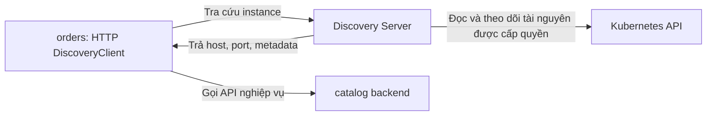
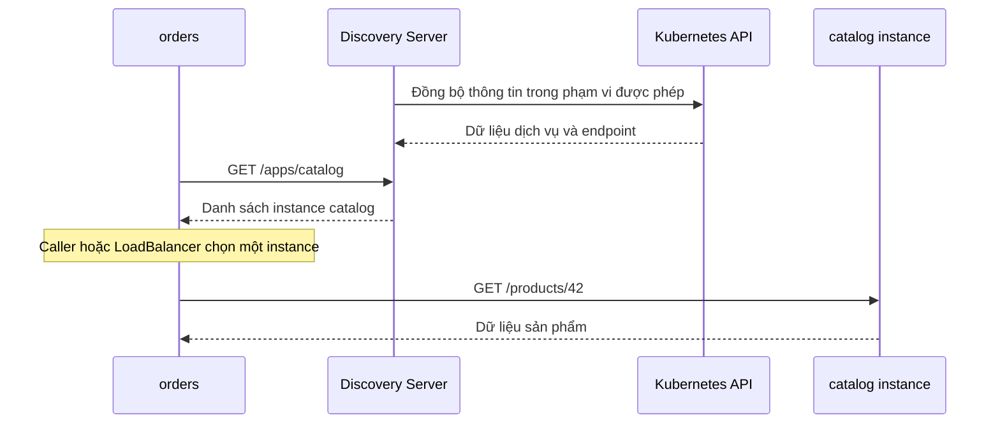

# Mục đích của Spring Cloud Kubernetes Discovery Server

> Chương: Discovery Server  
> Module: SPRING_CLOUD_KUBERNETES

Spring Cloud Kubernetes Discovery Server cung cấp một giao diện HTTP để ứng dụng lấy thông tin dịch vụ trong Kubernetes. Ứng dụng Spring có thể dùng HTTP DiscoveryClient để nhận dữ liệu từ giao diện này, thay vì tự tích hợp Kubernetes client vào đường khám phá dịch vụ. Dữ liệu gốc vẫn nằm trong Kubernetes; Discovery Server đảm nhiệm việc đọc và biểu diễn dữ liệu đó cho caller. Xem [mô tả Discovery Server của Spring](https://docs.spring.io/spring-cloud-kubernetes/reference/spring-cloud-kubernetes-discoveryserver.html).

Mục tiêu kiến trúc là tập trung việc truy cập danh mục Kubernetes tại một thành phần có quyền phù hợp, trong khi mã nghiệp vụ tiếp tục sử dụng abstraction `DiscoveryClient`. Đổi lại, hệ thống phải vận hành thêm một dịch vụ HTTP và kiểm soát đường truy cập tới nó.

Bài học dùng tình huống `orders` cần khám phá `catalog` trong namespace `shop`. Các địa chỉ, response và cấu hình dưới đây là ví dụ thiết kế; chúng chưa phải kết quả đã chạy trên một cluster cụ thể.

## 1. Kết quả cần đạt

Sau bài học, bạn có thể:

- Giải thích vì sao một ứng dụng cần danh sách instance dù Kubernetes đã có Service và DNS.
- Vẽ được đường lấy thông tin discovery và đường gọi API nghiệp vụ.
- Xác định thành phần giữ quyền đọc Kubernetes API.
- Phân biệt Discovery Server, DiscoveryClient và Spring Cloud LoadBalancer.
- Nhận biết điều kiện để caller ngoài cluster sử dụng địa chỉ được trả về.
- Quyết định khi nào việc thêm Discovery Server có lợi cho yêu cầu thực tế.

Người học nên biết Service, Pod, namespace và ý nghĩa của một `ServiceInstance`: một đối tượng mô tả vị trí cùng metadata của một instance dịch vụ.

## 2. Bài toán xuất phát: cần tên dịch vụ hay cần danh sách instance?

Giả sử `catalog` có ba Pod. Sau một lần rollout, Pod cũ bị thay bằng Pod mới, kèm theo địa chỉ IP mới. Việc ghi cố định ba IP trong cấu hình `orders` buộc đội vận hành cập nhật caller theo vòng đời của backend.

Kubernetes Service tạo một điểm truy cập ổn định phía trước các Pod được chọn. Tài nguyên endpoint liên quan được cập nhật khi tập backend thay đổi. Đây là cơ sở để ứng dụng tránh phụ thuộc vào vòng đời của từng Pod. Xem [Service trong Kubernetes](https://kubernetes.io/docs/concepts/services-networking/service/).

Có hai nhu cầu khác nhau:

| Nhu cầu của orders | Thông tin cần có | Hướng tiếp cận có thể phù hợp |
| --- | --- | --- |
| Gọi API catalog qua một địa chỉ ổn định | Tên Service và cổng công bố | Kubernetes Service và DNS |
| Tự chọn một instance catalog | Danh sách host, port và metadata | DiscoveryClient cùng cơ chế lựa chọn instance |
| Hiển thị danh mục dịch vụ nội bộ cho một công cụ | Tên dịch vụ và các instance nhìn thấy | Một API discovery được giới hạn phạm vi |
| Từ hệ thống ngoài cluster gọi catalog | Địa chỉ có thể truy cập từ mạng ngoài | Thiết kế kết nối hoặc cổng vào phù hợp, rồi mới xét discovery |

Với Service thông thường, tên như `catalog.shop.svc.cluster.local` phân giải tới ClusterIP. Service headless có cách trả lời DNS khác, có thể trả các IP backend. Phần đuôi `cluster.local` trong bài là giả định của lab; cluster thực có thể sử dụng domain khác. Xem [DNS cho Service và Pod](https://kubernetes.io/docs/concepts/services-networking/dns-pod-service/).

Nếu yêu cầu chỉ là gửi HTTP tới một tên Service ổn định, cần đánh giá trước xem discovery ở tầng ứng dụng mang lại lợi ích gì. Việc thêm server cần gắn với một nhu cầu cụ thể như cung cấp danh sách instance cho Spring Cloud hoặc tập trung quyền đọc danh mục dịch vụ.

## 3. Discovery Server đứng ở đâu trong kiến trúc?

Luồng tổng thể có thể biểu diễn như sau:



Hai loại trao đổi cần được quan sát riêng:

1. **Trao đổi discovery:** `orders` hỏi nơi cung cấp thông tin dịch vụ để biết những instance nào có thể dùng.
2. **Trao đổi nghiệp vụ:** `orders` gửi yêu cầu lấy sản phẩm tới một địa chỉ backend đã được chọn.

Discovery Server cung cấp dữ liệu cho bước thứ nhất. Trong mô hình này, yêu cầu lấy sản phẩm đi từ caller đến backend. Khi thiết kế retry, timeout và giám sát, cần đặt chúng vào đúng đường trao đổi.

Ví dụ một giao dịch có thể diễn ra theo trình tự:



Sơ đồ mô tả các quan hệ logic. Nó không có nghĩa mỗi lần nhận `GET /apps/catalog`, server bắt buộc thực hiện lại một lần liệt kê toàn bộ tài nguyên từ API server. Cách đồng bộ, cache và theo dõi thay đổi phụ thuộc phiên bản, cấu hình và triển khai.

### 3.1. Dữ liệu được hình thành từ Kubernetes

Trong ví dụ, đội triển khai tạo workload `catalog`, Service và các cấu hình liên quan. Kubernetes quản lý thông tin endpoint cho workload đó; Discovery Server đọc dữ liệu trong phạm vi của mình.

Vì vậy, việc một ứng dụng khởi động thành công chưa đủ để chứng minh nó sẽ xuất hiện trong kết quả discovery. Cần kiểm tra Service, selector, namespace, endpoint, readiness và bộ lọc discovery.

Điều này cũng giải thích khác biệt với một registry theo mô hình ứng dụng tự đăng ký: cấu hình đăng ký dành cho Eureka không thể dùng nguyên xi để giải thích hành vi của Spring Cloud Kubernetes Discovery Server. Khi chọn giải pháp, hãy bắt đầu từ nguồn dữ liệu và hợp đồng discovery thực tế.

## 4. Ba thành phần có trách nhiệm khác nhau

| Thành phần | Trách nhiệm chính trong bài | Ví dụ đầu vào hoặc kết quả |
| --- | --- | --- |
| Discovery Server | Cung cấp thông tin Kubernetes qua HTTP | API trả danh sách instance của catalog |
| HTTP DiscoveryClient | Cung cấp abstraction discovery trong ứng dụng Spring | `getInstances("catalog")` |
| Spring Cloud LoadBalancer | Chọn một instance cho một lần gọi | Chọn một địa chỉ từ danh sách được cung cấp |

Spring Cloud LoadBalancer có thể dùng một `DiscoveryClient` trên classpath làm nguồn dữ liệu cho danh sách instance. Cấu hình HTTP client tích hợp LoadBalancer là một bước riêng. Xem [Spring Cloud LoadBalancer](https://docs.spring.io/spring-cloud-commons/reference/spring-cloud-commons/loadbalancer.html).

Từ đó có ba hệ quả thực hành:

- Đọc được danh sách instance chưa chứng minh lời gọi nghiệp vụ sẽ thành công.
- Có bean `DiscoveryClient` chưa đủ để một HTTP client bất kỳ tự hiểu mọi tên dịch vụ logic.
- Thuật toán chọn instance, chính sách retry và timeout phải được xác định tại các thành phần thực hiện lời gọi.

Ví dụ, đoạn mã tự lấy phần tử đầu tiên của `getInstances("catalog")` có thể dùng để quan sát. Nếu đưa nguyên cách đó vào đường gọi sản phẩm, ứng dụng đang tự đặt ra chính sách lựa chọn riêng. Việc triển khai Discovery Server không thay thế quyết định này.

## 5. Giá trị của việc tập trung đường truy cập Kubernetes

Spring Cloud Kubernetes có các lựa chọn client truy cập Kubernetes trực tiếp và một lựa chọn HTTP dùng với Discovery Server. Starter cho lựa chọn HTTP là `spring-cloud-starter-kubernetes-discoveryclient`. Xem [các loại DiscoveryClient được hỗ trợ](https://docs.spring.io/spring-cloud-kubernetes/reference/discovery-client.html).

So sánh hai thiết kế cho riêng chức năng discovery:

| Điểm thiết kế | Client đọc Kubernetes trực tiếp | Client dùng Discovery Server |
| --- | --- | --- |
| Đường lấy danh sách instance | Caller tới Kubernetes API | Caller tới server HTTP; server tới Kubernetes API |
| Vị trí quyền đọc tài nguyên discovery | Các caller cần quyền tương ứng | Server cần quyền; caller cần quyền truy cập giao diện HTTP theo thiết kế |
| Phần tích hợp Kubernetes tại caller | Một Kubernetes client phù hợp | HTTP DiscoveryClient |
| Thành phần phải vận hành thêm | Không có server discovery trung gian riêng | Có dịch vụ Discovery Server |
| Sự cố cần chẩn đoán | Caller, API server, quyền và dữ liệu | Thêm đường mạng và tình trạng của server HTTP |

Đây là phân tích từ hai luồng kiến trúc, không phải kết quả đo hiệu năng. Ví dụ, nếu 40 replica caller cùng cần đọc danh mục, một nhóm server chuyên trách có thể giúp đội vận hành thu gọn nơi cấp quyền Kubernetes và chuẩn hóa cấu hình truy cập.

Tuy nhiên, mức giảm tải thực tế còn phụ thuộc số replica server, cách theo dõi tài nguyên, số namespace, tần suất caller hỏi danh mục và các lớp cache. Không thể suy ra một tỷ lệ giảm request chỉ từ số lượng caller.

### 5.1. Điều kiện về quyền vẫn cần được tách rõ

Kubernetes RBAC quyết định server được đọc tài nguyên nào. Chính sách bảo vệ API HTTP quyết định caller nào được nhận thông tin do server công bố. Đây là hai ranh giới cần được thiết kế độc lập.

Ví dụ, server có quyền đọc danh mục trong `shop` chưa có nghĩa Kubernetes tự áp dụng RoleBinding của từng caller lên response `/apps`. Nếu cần cách ly dữ liệu giữa các nhóm người dùng, hãy xác định cơ chế xác thực, phân quyền hoặc triển khai server với phạm vi riêng phù hợp.

Cũng cần xét các chức năng khác của `orders`. Nếu ứng dụng còn trực tiếp đọc ConfigMap qua Kubernetes API, nó vẫn cần quyền cho chức năng cấu hình đó, dù đường discovery đã chuyển sang HTTP.

## 6. Phạm vi namespace và RBAC nằm ở phía nào?

Trong mô hình HTTP discovery, cấu hình phạm vi tìm kiếm như namespace phải được đặt ở phía Discovery Server. Caller dùng URL để tới server và nhận dữ liệu trong phạm vi server cung cấp. Đặt một namespace ở client HTTP không tự mở rộng tập tài nguyên mà server nhìn thấy. Hành vi này được nêu trong [hướng dẫn phạm vi DiscoveryClient](https://docs.spring.io/spring-cloud-kubernetes/reference/discovery-client.html).

Có thể coi tập dữ liệu hữu ích là phần giao của:

```text
Phạm vi server được cấu hình để tìm
    ∩ Tài nguyên server được Kubernetes cho phép đọc
    ∩ Tài nguyên thỏa các điều kiện discovery
```

Biểu thức này là cách diễn giải để phân tích thiết kế. Nó không quy định lỗi đọc tài nguyên sẽ được triển khai nào chuyển thành danh sách rỗng hay exception; cần quan sát log và hành vi phiên bản đang chạy.

Discovery Server sử dụng quyền đọc như `get`, `list`, `watch` đối với các tài nguyên cần cho discovery. Danh sách tài nguyên cụ thể cần khớp với phiên bản và chế độ endpoint đang dùng. Một triển khai đọc `Endpoints` và một triển khai đọc `EndpointSlice` không thể được cấp quyền bằng cách đoán rằng hai tài nguyên là một.

Trong RBAC, Role giới hạn quyền trong một namespace; RoleBinding gắn quyền cho subject như ServiceAccount. Với yêu cầu đọc ở nhiều namespace, có thể thiết kế các binding theo từng namespace hoặc phạm vi rộng hơn khi thực sự cần. Xem [RBAC của Kubernetes](https://kubernetes.io/docs/reference/access-authn-authz/rbac/).

Ví dụ quyết định phân quyền cho lab:

| Câu hỏi | Quyết định minh họa |
| --- | --- |
| Server đọc danh mục ở đâu? | Namespace shop |
| Danh tính đọc API là gì? | ServiceAccount dành riêng cho server |
| Server có cần sửa Deployment không? | Yêu cầu discovery của lab chỉ cần đọc |
| orders có cần liệt kê Pod chỉ để discovery không? | Đường HTTP không yêu cầu orders tự liệt kê Pod |
| Có cần quyền đọc Secret để biết địa chỉ catalog không? | Lab không cần quyền đó cho chức năng discovery |

Những quyết định này cần được chuyển thành manifest phù hợp khi triển khai. Bài học tập trung vào lý do tồn tại và ranh giới trách nhiệm của server; nó không giả định một manifest RBAC duy nhất phù hợp mọi phiên bản.

## 7. Giao diện HTTP cung cấp thông tin gì?

Các đường dẫn discovery được tài liệu Spring mô tả gồm:

| Request | Dữ liệu được tra cứu |
| --- | --- |
| `GET /apps` | Danh mục dịch vụ cùng thông tin instance |
| `GET /apps/{name}` | Các instance của một dịch vụ |
| `GET /app/{name}/{instanceid}` | Một instance cụ thể |

Chú ý đường dẫn thứ ba dùng `app` ở dạng số ít. Xem [các endpoint Discovery Server](https://docs.spring.io/spring-cloud-kubernetes/reference/spring-cloud-kubernetes-discoveryserver.html#_endpoints).

Một response minh họa của `GET /apps/catalog`:

```json
[
  {
    "instanceId": "catalog-example-a",
    "serviceId": "catalog",
    "host": "10.42.2.31",
    "port": 8080,
    "uri": "http://10.42.2.31:8080",
    "secure": false,
    "metadata": {
      "app": "catalog"
    },
    "namespace": "shop",
    "scheme": "http"
  }
]
```

Giá trị `catalog-example-a` là dữ liệu giả để đọc ví dụ. Không viết mã nghiệp vụ dựa trên giả định rằng instance ID thực luôn có dạng này hoặc luôn trùng tên Pod.

Từ response trên, người vận hành có thể đặt các câu hỏi:

- Địa chỉ `10.42.2.31` có route từ mạng của caller không?
- Tiến trình backend có lắng nghe tại 8080 không?
- Caller có được phép kết nối tới cổng đó không?
- Giao thức được mô tả có khớp với backend không?
- Instance này có còn hợp lệ vào lúc gửi yêu cầu nghiệp vụ không?

Đây là những câu hỏi về kết nối và vận hành. Nhận một response JSON hợp lệ chỉ hoàn thành bước thu thập thông tin.

## 8. Ví dụ tích hợp một caller Spring

### 8.1. Giả định của ví dụ

Ví dụ có các điều kiện sau:

- Discovery Server đã được triển khai trong namespace `shop`.
- Một Kubernetes Service tên `kubernetes-discovery` công bố server qua cổng 80.
- Server đã có quyền và cấu hình để khám phá `catalog` trong `shop`.
- `orders` chạy trong cluster và truy cập được Service của server.
- Dự án quản lý phiên bản Spring Boot, Spring Cloud và Spring Cloud Kubernetes bằng bộ BOM tương thích.

Bài không chọn một tag image mặc định cho mọi dự án. Khi triển khai, cần dùng phiên bản server và HTTP client tương thích; hướng dẫn Spring khuyến nghị căn chỉnh phiên bản hai phía trong [phần HTTP discovery](https://docs.spring.io/spring-cloud-kubernetes/reference/discovery-client.html).

### 8.2. Dependency phía orders

Dependency dành cho đường HTTP discovery:

```xml
<dependency>
    <groupId>org.springframework.cloud</groupId>
    <artifactId>spring-cloud-starter-kubernetes-discoveryclient</artifactId>
</dependency>
```

Đoạn này được đặt trong phần dependencies của dự án đã quản lý phiên bản phù hợp. Để dùng controller bên dưới, dự án cũng cần hỗ trợ Spring MVC tương ứng. Ví dụ chỉ nhằm minh họa một đường discovery HTTP; khi dự án có nhiều cơ chế discovery, phải xác định rõ bean và thứ tự tích hợp thực sự đang được sử dụng.

### 8.3. URL của server

Cấu hình minh họa trong `application.yml` của `orders`:

```yaml
spring:
  application:
    name: orders
  cloud:
    kubernetes:
      discovery:
        enabled: true
        discovery-server-url: http://kubernetes-discovery.shop.svc.cluster.local:80
```

Thuộc tính `spring.cloud.kubernetes.discovery.discovery-server-url` chỉ tới địa chỉ gốc của Discovery Server. Danh sách thuộc tính được nêu trong [phụ lục cấu hình Spring Cloud Kubernetes](https://docs.spring.io/spring-cloud-kubernetes/reference/appendix.html).

Trong ví dụ, URL dùng tên Service của server và cổng Service 80. Nó không phải URL của `catalog`, cũng không trỏ tới Kubernetes API server. Tên Service hoặc cổng khác trong môi trường thực phải được phản ánh trong giá trị này.

Để bật rõ mục đích sử dụng discovery trong mã ví dụ:

```java
package example.orders;

import org.springframework.boot.SpringApplication;
import org.springframework.boot.autoconfigure.SpringBootApplication;
import org.springframework.cloud.client.discovery.EnableDiscoveryClient;

@SpringBootApplication
@EnableDiscoveryClient
public class OrdersApplication {

    public static void main(String[] args) {
        SpringApplication.run(OrdersApplication.class, args);
    }
}
```

### 8.4. Quan sát kết quả qua abstraction DiscoveryClient

Controller sau dùng Java 17 trở lên và Spring MVC:

```java
package example.orders;

import java.util.List;

import org.springframework.cloud.client.discovery.DiscoveryClient;
import org.springframework.web.bind.annotation.GetMapping;
import org.springframework.web.bind.annotation.RestController;

@RestController
public class DiscoveryLabController {

    private final DiscoveryClient discoveryClient;

    public DiscoveryLabController(DiscoveryClient discoveryClient) {
        this.discoveryClient = discoveryClient;
    }

    @GetMapping("/lab/discovery/catalog")
    public List<InstanceView> catalogInstances() {
        return discoveryClient.getInstances("catalog").stream()
                .map(instance -> new InstanceView(
                        instance.getServiceId(),
                        instance.getHost(),
                        instance.getPort(),
                        instance.getUri().toString(),
                        instance.isSecure()))
                .toList();
    }

    public record InstanceView(
            String serviceId,
            String host,
            int port,
            String uri,
            boolean secure) {
    }
}
```

Đường dẫn này phục vụ quan sát lab. Nếu giữ trong một ứng dụng triển khai thật, cần giới hạn truy cập vì dữ liệu trả về chứa địa chỉ nội bộ.

Mã controller chỉ hỏi danh sách và chuyển các trường cần xem sang DTO. Nó chưa gọi API sản phẩm, chưa chọn instance và chưa cài đặt retry. Nhờ giới hạn đó, người học có thể xác định riêng bước discovery có trả đúng thông tin hay không trước khi thêm đường gọi nghiệp vụ.

## 9. Quan sát tối thiểu để hiểu vai trò server

Các lệnh dưới đây dành cho PowerShell và giả định các điều kiện ở mục 8 đã được chuẩn bị. Chúng là hướng dẫn thực hành, không phải xác nhận rằng môi trường hiện tại đã có các tài nguyên đó.

### 9.1. Kiểm tra server đang được công bố

```powershell
kubectl -n shop get service kubernetes-discovery
kubectl -n shop get pods -l app=kubernetes-discovery
```

Selector trong lệnh thứ hai là giả định nhãn của lab. Nếu Deployment thực dùng nhãn khác, cần đổi selector để quan sát đúng Pod.

Tiếp theo, mở một terminal để chuyển tiếp cổng:

```powershell
kubectl -n shop port-forward service/kubernetes-discovery 18761:80
```

Giữ terminal đó hoạt động, rồi dùng terminal khác:

```powershell
curl.exe --fail http://127.0.0.1:18761/apps
curl.exe --fail http://127.0.0.1:18761/apps/catalog
```

Cần quan sát hai điều: danh mục có chứa dịch vụ mong muốn hay không, và tập host/port của riêng `catalog` có hợp lý hay không. Nếu request thất bại, ghi lại lỗi HTTP hoặc lỗi kết nối; chưa kết luận ngay backend không tồn tại.

Port-forward ở đây tạo đường truy cập tới Discovery Server để xem API. Nó không tạo route từ máy cá nhân tới mọi địa chỉ Pod trong response.

### 9.2. Đối chiếu với tài nguyên Kubernetes

```powershell
kubectl -n shop get service catalog -o yaml
kubectl -n shop get pods -l app=catalog -o wide
kubectl -n shop get endpointslices -l kubernetes.io/service-name=catalog -o yaml
```

EndpointSlice chứa địa chỉ, cổng và điều kiện của endpoint; các controller Kubernetes thường quản lý dữ liệu này theo Service. Xem [EndpointSlice của Kubernetes](https://kubernetes.io/docs/concepts/services-networking/endpoint-slices/).

Việc xem EndpointSlice hữu ích để đối chiếu backend, nhưng không chứng minh phiên bản Discovery Server đang dùng chính API đó làm nguồn đọc. Nếu triển khai sử dụng tài nguyên `Endpoints`, cần quan sát thêm tài nguyên tương ứng:

```powershell
kubectl -n shop get endpoints catalog -o yaml
```

Khi đối chiếu, tránh yêu cầu cổng backend luôn bằng cổng Service. Ví dụ Service công bố 80 nhưng trỏ tới tiến trình ở 8080; một kết quả hướng tới backend có thể cần 8080. Hãy xác định cặp host/port cùng với nhau, thay vì thay riêng con số cổng theo cảm tính.

### 9.3. Đối chiếu từ bên trong orders

Sau khi API server discovery trả dữ liệu hợp lý, gọi endpoint lab `/lab/discovery/catalog` trên ứng dụng `orders` theo đường truy cập được chuẩn bị cho lab.

Có ba lớp kết quả khác nhau cần ghi nhận:

| Lớp quan sát | Câu hỏi được trả lời |
| --- | --- |
| API trực tiếp của server | Server đang công bố những instance nào? |
| Endpoint lab của orders | DiscoveryClient trong caller đang nhận dữ liệu nào? |
| Lời gọi nghiệp vụ từ orders | Đường kết nối tới backend và API sản phẩm có hoạt động không? |

Nếu lớp thứ nhất đúng và lớp thứ hai sai, tập trung kiểm tra URL, dependency, cấu hình hiệu lực và sự tương thích client/server. Nếu hai lớp đầu đúng nhưng nghiệp vụ lỗi, cần kiểm tra backend, mạng, giao thức và chính sách gọi.

## 10. Caller ngoài cluster: phân biệt biết địa chỉ với tới được địa chỉ

Xét máy phát triển nhận được:

```text
host = 10.42.2.31
port = 8080
```

Máy đó có thể truy cập API discovery thông qua VPN hoặc một điểm truy cập được cấu hình. Tuy vậy, mạng của nó có thể chưa có route tới dải Pod. Cấu hình HTTP client chính xác vẫn chưa giải quyết được thiếu hụt mạng này.

Từ luồng kiến trúc, có thể suy ra hai yêu cầu độc lập:

1. Caller tới được endpoint discovery để lấy danh sách.
2. Caller tới được địa chỉ nghiệp vụ mà nó sẽ sử dụng.

Ví dụ các lựa chọn thiết kế cần đánh giá:

| Tình huống | Hướng xem xét |
| --- | --- |
| Công cụ nội bộ cần gọi trực tiếp từng Pod | Kết nối mạng có route tới Pod cùng chính sách truy cập phù hợp |
| Ứng dụng bên ngoài chỉ cần một API ổn định | Gateway, Ingress hoặc một điểm công bố dịch vụ thích hợp |
| Máy phát triển chỉ cần xem danh mục | Port-forward hoặc đường truy cập được giới hạn tới API discovery |
| Cần khám phá dịch vụ từ nhiều cluster | Thiết kế phạm vi dữ liệu, định danh và kết nối giữa các mạng |

Các lựa chọn trong bảng là phân tích kiến trúc cho tình huống minh họa. Triển khai Discovery Server không tự thiết lập VPN, DNS liên cluster, route hoặc cơ chế chuyển tiếp yêu cầu nghiệp vụ.

Cần chú ý cả bảo mật thông tin: danh mục có thể tiết lộ tên dịch vụ, địa chỉ nội bộ và metadata. Khi công bố API ra một miền mạng khác, quyết định ai được xem những dữ liệu nào trước khi mở đường truy cập rộng hơn.

## 11. Cập nhật dữ liệu và tình trạng sức khỏe

Một chuỗi cập nhật có thể gồm:

```text
Trạng thái Pod thay đổi
    → tài nguyên endpoint được cập nhật
    → dữ liệu discovery phía server thay đổi
    → caller quan sát dữ liệu mới
    → lần lựa chọn instance tiếp theo dùng dữ liệu phù hợp
```

Đây là chuỗi logic để tìm điểm chậm cập nhật. Thời điểm quan sát ở các bước có thể khác nhau, nhất là khi có theo dõi bất đồng bộ hoặc cache.

Readiness cho biết container đã sẵn sàng nhận traffic theo kiểm tra được cấu hình. Liveness phục vụ việc phát hiện trạng thái cần khởi động lại container; startup probe hỗ trợ quá trình khởi động. Xem [các loại probe trong Kubernetes](https://kubernetes.io/docs/concepts/workloads/pods/probes/).

Đối với kiến trúc của bài, nên phân biệt:

- Sức khỏe của Pod `catalog`.
- Khả năng Discovery Server đọc và cập nhật dữ liệu Kubernetes.
- Khả năng `orders` lấy danh sách từ server.
- Khả năng caller thực hiện thành công yêu cầu sản phẩm.

Ví dụ, server vẫn trả HTTP thành công nhưng caller liên tục lỗi kết nối tới một backend. Cần đối chiếu tuổi của dữ liệu, trạng thái endpoint và lỗi mạng, thay vì suy ra rằng HTTP thành công của server chứng minh toàn bộ chuỗi khỏe.

### 11.1. Kịch bản kiểm tra thiết kế khi server gián đoạn

Giả sử `orders` đã nhận một danh sách instance, rồi tạm mất kết nối tới Discovery Server. Nhóm triển khai cần xác định trước:

- Có giữ danh sách cũ hay trả lỗi ở lớp discovery?
- Nếu có cache, dữ liệu được sử dụng trong khoảng thời gian nào?
- Backend bị thay IP trong khoảng gián đoạn được xử lý ra sao?
- Lần gọi hết timeout sẽ ảnh hưởng đến thời gian phản hồi của orders thế nào?
- Cơ chế retry có gây tăng tải đồng loạt khi server hồi phục không?

Đây là các câu hỏi kiểm thử cho hệ thống cụ thể. Bài không giả định một chính sách fallback mặc định áp dụng cho mọi phiên bản HTTP client hoặc mọi cấu hình LoadBalancer.

## 12. Discovery Server liên hệ với cấu hình ứng dụng như thế nào?

Trong module SPRING_CLOUD_KUBERNETES, discovery và cấu hình cùng sử dụng thông tin của nền tảng nhưng phục vụ những câu hỏi khác nhau.

Ví dụ, URL của Discovery Server có thể được quản lý như một giá trị cấu hình triển khai. Nếu giá trị đó được đưa vào ConfigMap, cần xác định ứng dụng nhận nó bằng biến môi trường, file được mount hay cơ chế nạp cấu hình Spring đang dùng. Sửa đối tượng cấu hình chưa đủ để kết luận bean HTTP client đã áp dụng URL mới; cần kiểm tra cách nạp lại hoặc rollout theo thiết kế.

Secret phục vụ các dữ liệu nhạy cảm khi hệ thống có nhu cầu xác thực. Tên Service và URL nội bộ thông thường cần được phân loại theo chính sách của hệ thống; chúng không tự tạo ra nhu cầu cấp quyền đọc toàn bộ Secret cho discovery.

Configuration Watcher thuộc luồng theo dõi và phản ứng với thay đổi cấu hình. Khi xây dựng hệ thống, hãy xác định riêng yêu cầu cập nhật cấu hình ứng dụng và yêu cầu cập nhật danh sách instance. Việc chọn Discovery Server cần được đánh giá theo nhu cầu khám phá dịch vụ của bài này.

## 13. Khi nào nên chọn Discovery Server?

| Điều kiện thực tế | Đánh giá cho phương án HTTP discovery |
| --- | --- |
| Caller Spring đã cần abstraction DiscoveryClient và danh sách instance | Có cơ sở để dùng |
| Muốn tập trung quyền đọc danh mục Kubernetes ở một nhóm thành phần | Có lợi về tổ chức quyền nếu API HTTP được bảo vệ phù hợp |
| Một công cụ cần đọc dữ liệu discovery qua HTTP | Có thể phù hợp sau khi xét hợp đồng API và phạm vi truy cập |
| Chỉ cần gọi một Service qua DNS | Cần chứng minh lợi ích bổ sung trước khi thêm server |
| Caller không thể tới các backend được công bố | Cần giải quyết kết nối hoặc thay đổi đường truy cập nghiệp vụ |
| Nhóm chưa có khả năng vận hành thêm dịch vụ dùng chung | Chi phí vận hành cần được tính vào quyết định |
| Nhiều nhóm có yêu cầu cách ly danh mục | Cần thiết kế quyền và phạm vi công bố dữ liệu rõ ràng |

Một đề xuất triển khai có thể được viết bằng bốn câu hỏi:

1. Thông tin nào caller cần mà phương án đang dùng chưa cung cấp thuận tiện?
2. Thành phần nào giữ quyền Kubernetes và dữ liệu discovery nào được công bố?
3. Caller sử dụng danh sách nhận về để gọi backend theo cách nào?
4. Hệ thống hoạt động ra sao khi dữ liệu cũ hoặc server gián đoạn?

Nếu chưa trả lời được các câu hỏi này, hãy làm rõ yêu cầu trước khi đưa Discovery Server vào đường phụ thuộc của ứng dụng.

## 14. Các nhầm lẫn thường gặp khi xác định mục đích

| Nhận định cần kiểm tra | Cách hiểu phù hợp với kiến trúc của bài |
| --- | --- |
| Có Kubernetes thì mọi ứng dụng Spring đều cần thêm Discovery Server | Nhu cầu lấy danh sách instance và tổ chức quyền quyết định việc có cần thêm server |
| Server discovery sẽ chuyển tiếp mọi API sản phẩm | Caller dùng dữ liệu discovery để thực hiện đường gọi nghiệp vụ |
| Biết IP Pod là máy phát triển sẽ gọi được | Cần route, chính sách mạng và cổng backend phù hợp |
| Chuyển discovery sang HTTP là caller hết mọi nhu cầu RBAC | Các chức năng đọc Kubernetes khác vẫn có yêu cầu quyền riêng |
| Cấp quyền nhiều namespace là server tự khám phá hết | Cấu hình phạm vi và bộ lọc cũng phải phù hợp |
| Sửa namespace trong caller sẽ thay phạm vi server | Phạm vi tìm dữ liệu Kubernetes của mô hình HTTP được cấu hình tại server |
| Server trả danh sách là mọi instance đều phục vụ tốt mọi yêu cầu | Cần xét readiness, độ mới dữ liệu, mạng và hành vi API nghiệp vụ |

Giá trị của Spring Cloud Kubernetes Discovery Server nằm ở việc đưa dữ liệu discovery của Kubernetes tới caller qua một giao diện HTTP có thể vận hành tập trung. Để dùng hiệu quả, cần ghép đúng ba điều: phạm vi dữ liệu mà server được phép đọc, cách caller sử dụng danh sách instance và đường kết nối thực tế tới backend.
