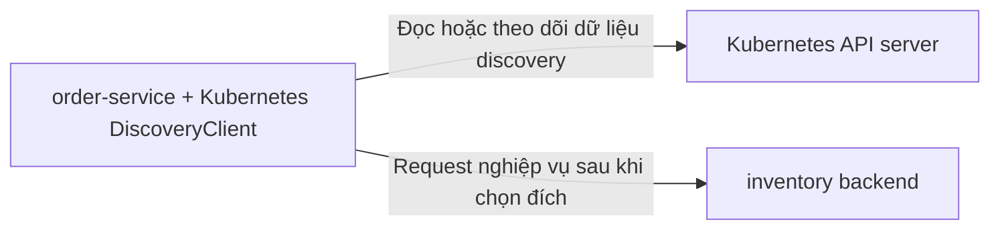
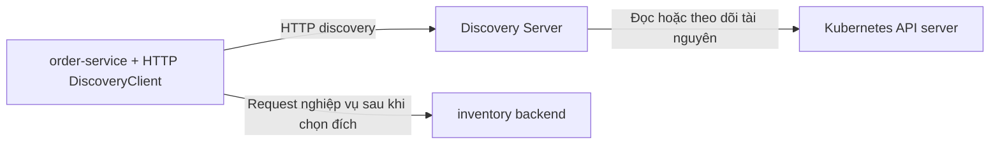

# So sánh truy cập Kubernetes API trực tiếp với qua Discovery Server

> Chương: Discovery Server — Module: SPRING_CLOUD_KUBERNETES.

Khi một ứng dụng Spring cần lấy danh sách instance của dịch vụ `inventory`, có hai cách tổ chức việc đọc dữ liệu Kubernetes: ứng dụng sử dụng Kubernetes client để truy cập API server, hoặc ứng dụng gọi HTTP tới Spring Cloud Kubernetes Discovery Server rồi nhận dữ liệu discovery đã được server cung cấp.

Quyết định này ảnh hưởng tới nơi đặt credential, phạm vi RBAC, số thành phần cần vận hành và cách xử lý sự cố. Nó không tự quyết định đường đi của request nghiệp vụ. Sau khi biết một instance có host và port nào, ứng dụng vẫn cần kết nối được tới địa chỉ đó.

Bài học dùng tình huống `order-service` cần khám phá `inventory` trong namespace `shop`. Mục tiêu là chọn đúng tính năng Spring Cloud Kubernetes cho triển khai, đồng thời hiểu ranh giới với DNS của Kubernetes, Spring Cloud LoadBalancer và các tính năng cấu hình.

## 1. Phân biệt API server, Discovery Server và Service

Ba thành phần có tên gần nhau nhưng đảm nhiệm những việc khác nhau:

| Thành phần | Vai trò trong bài |
| --- | --- |
| Kubernetes API server | Cung cấp API đọc các đối tượng như Service, Pod và EndpointSlice; kiểm tra danh tính và quyền Kubernetes |
| Spring Cloud Kubernetes Discovery Server | Đọc thông tin discovery từ Kubernetes và cung cấp nó cho ứng dụng qua HTTP |
| Kubernetes Service `inventory` | Đại diện mạng ổn định cho nhóm backend phù hợp với selector và các quy tắc Service |
| Spring `DiscoveryClient` | Abstraction ứng dụng dùng để hỏi tên dịch vụ và danh sách `ServiceInstance` |
| Spring Cloud LoadBalancer | Có thể dùng danh sách instance để lựa chọn đích khi đã tích hợp vào HTTP client |

Discovery Server trong bài là sản phẩm của Spring Cloud Kubernetes. Việc nó thường được minh họa với cổng 8761 không có nghĩa là nó sử dụng giao thức đăng ký của Eureka. Kubernetes vẫn là nguồn dữ liệu discovery; không thêm bước tự đăng ký instance theo mô hình Eureka.

Theo [tài liệu Discovery Server](https://docs.spring.io/spring-cloud-kubernetes/reference/spring-cloud-kubernetes-discoveryserver.html), server cung cấp HTTP API cho client lấy thông tin dịch vụ. Ví dụ `GET /apps/inventory` trả danh sách instance của `inventory`; đây là API discovery, không phải API nghiệp vụ của kho hàng.

### Một lựa chọn đơn giản hơn cần xét trước

Nếu nhu cầu chỉ là gọi một Service trong cluster, ứng dụng có thể gọi:

```text
http://inventory.shop.svc.cluster.local:8080
```

Ví dụ giả định cluster domain là `cluster.local` và Service công bố cổng 8080. Tên DNS của Service giúp ứng dụng tìm địa chỉ Service mà không cần tự liệt kê Pod. Cách phân giải của Service thông thường và headless Service khác nhau, như mô tả trong [DNS for Services and Pods](https://kubernetes.io/docs/concepts/services-networking/dns-pod-service/).

Chỉ thêm DiscoveryClient khi ứng dụng cần danh sách instance, metadata hoặc cơ chế lựa chọn instance ở phía client. Chỉ thêm Discovery Server khi việc tách truy cập Kubernetes API khỏi ứng dụng có giá trị vận hành rõ ràng.

## 2. Phương án A: mỗi ứng dụng truy cập Kubernetes API

Ứng dụng có implementation DiscoveryClient dựa trên Fabric8 hoặc Kubernetes Java Client. Kubernetes client nằm trong tiến trình ứng dụng và có cấu hình kết nối tới API server.



Quá trình khái quát:

1. Ứng dụng xác định cluster, namespace và danh tính truy cập.
2. Kubernetes client lấy hoặc theo dõi các tài nguyên cần cho discovery, tùy implementation và cấu hình.
3. `DiscoveryClient` chuyển dữ liệu thành `List<ServiceInstance>`.
4. Code ứng dụng hoặc thành phần tích hợp như LoadBalancer chọn đích và thực hiện request.

Không được suy ra rằng mỗi request nghiệp vụ luôn tạo một request tới Kubernetes API. Cách tổ chức cache, informer, watch và lần đọc phụ thuộc implementation cũng như phiên bản. Khi đánh giá tải, phải đo hoạt động thực tế của các client.

### Lợi ích

Ứng dụng không phụ thuộc vào một dịch vụ Discovery Server bổ sung. Nhóm phát triển kiểm soát trực tiếp phạm vi khám phá của ứng dụng và có thể chẩn đoán lỗi Kubernetes client ngay trong log của tiến trình đó.

Với số workload nhỏ và phạm vi đọc hẹp, đây có thể là cách triển khai dễ hiểu: mỗi ứng dụng có ServiceAccount riêng, quyền rõ ràng và một đường truy cập API server.

### Chi phí

Mỗi workload có nhu cầu discovery phải được quản lý credential, quyền và kết nối tới Kubernetes API. Khi scale số replica, số Kubernetes client hoạt động cũng tăng.

Việc thay đổi cấu hình discovery hoặc nâng cấp thư viện có thể cần phối hợp qua nhiều ứng dụng. Nếu mỗi nhóm tự mở rộng quyền hoặc phạm vi namespace, chi phí quản trị tăng ngay cả khi nghiệp vụ không thay đổi.

## 3. Phương án B: ứng dụng truy cập qua Discovery Server

Ứng dụng dùng HTTP-based DiscoveryClient. Discovery Server là thành phần truy cập Kubernetes API; ứng dụng hỏi server để lấy dữ liệu discovery.



Mô hình này tách hai quan hệ truy cập:

- Quan hệ `Discovery Server → Kubernetes API`: cần danh tính và quyền Kubernetes phù hợp.
- Quan hệ `ứng dụng → Discovery Server`: cần địa chỉ, kết nối và cơ chế kiểm soát truy cập được thiết kế cho HTTP endpoint đó.

Server có thể phục vụ nhiều ứng dụng. Tuy nhiên, một response discovery không đồng nghĩa với một lần server vừa đọc mới toàn bộ Kubernetes API. Độ mới của dữ liệu phải được đánh giá theo chuỗi cập nhật thực tế.

### Lợi ích

Nhóm nền tảng có thể quản lý quyền và cấu hình đọc Kubernetes tại một thành phần riêng. Các ứng dụng chỉ cần giao diện discovery thay vì mang theo Kubernetes client phục vụ mục đích này.

Việc thu hẹp phạm vi discovery hoặc cập nhật thành phần giao tiếp với API server có một nơi quản lý tập trung hơn. Lợi ích này rõ hơn khi nhiều ứng dụng có chung phạm vi khám phá và chung yêu cầu vận hành.

### Chi phí

Hệ thống thêm Deployment, Service, tài nguyên tính toán và đường HTTP cần theo dõi. Discovery Server trở thành dependency dùng chung: sự cố server có thể ảnh hưởng đồng thời tới nhiều ứng dụng.

Server và HTTP client cần được quản lý tương thích phiên bản. Các ứng dụng cũng cần chính sách timeout và cách xử lý lỗi rõ ràng khi không lấy được danh sách instance.

### Vị trí cấu hình có ý nghĩa

Tài liệu [DiscoveryClient for Kubernetes](https://docs.spring.io/spring-cloud-kubernetes/reference/discovery-client.html) phân biệt client trực tiếp với HTTP client và chỉ rõ rằng phạm vi namespace của HTTP discovery được thiết lập ở server.

Ví dụ, đặt `namespaces: [shop]` chỉ trong ứng dụng HTTP client không phải cách bảo đảm server chỉ đọc namespace `shop`. Phải cấu hình chính server và cấp quyền tương ứng. Không mặc định mọi thuộc tính discovery đều được chuyển qua HTTP để server áp dụng theo từng request.

## 4. So sánh theo tiêu chí triển khai

Bảng dưới là phân tích kiến trúc cho tình huống trong bài, không phải cam kết hiệu năng của một phiên bản thư viện.

| Tiêu chí | Truy cập API trực tiếp | Qua Discovery Server |
| --- | --- | --- |
| Nơi đặt Kubernetes client | Trong mỗi ứng dụng dùng discovery | Trong Discovery Server |
| Danh tính đọc tài nguyên | ServiceAccount hoặc credential của từng ứng dụng | ServiceAccount hoặc credential của server |
| Dependency thêm cho discovery | Kết nối tới Kubernetes API | Kết nối tới server; server kết nối tới Kubernetes API |
| Quản lý phạm vi khám phá | Phân tán theo cấu hình ứng dụng | Tập trung ở server hoặc từng nhóm server |
| Số nơi cần RBAC đọc discovery | Tăng theo số danh tính ứng dụng | Có thể gom về danh tính server |
| Chi phí vận hành thành phần mới | Không thêm Discovery Server | Cần deploy, giám sát, nâng cấp và bảo đảm khả dụng cho server |
| Điểm sự cố bổ sung | Không có lớp Discovery Server | HTTP endpoint, DNS và replica của server |
| Phạm vi ảnh hưởng của lỗi client | Thường gắn với workload có lỗi | Lỗi server dùng chung có thể ảnh hưởng nhiều workload |
| Khả năng nhìn thấy metadata | Theo quyền và cấu hình của ứng dụng | Theo dữ liệu server đọc và cho phép bên gọi nhận |
| Truy cập backend nghiệp vụ | Vẫn phải kết nối được tới backend | Vẫn phải kết nối được tới backend |

Giảm số nơi có quyền Kubernetes không tự động tạo ra phân quyền metadata theo từng tenant. Một server được phép đọc nhiều namespace có thể trở thành nơi tập hợp dữ liệu của nhiều nhóm. Nếu cần cách ly, phải thiết kế ranh giới server, namespace, mạng và kiểm soát truy cập phù hợp.

## 5. Đặt RBAC ở đúng thành phần

Trong phương án trực tiếp, `order-service` cần quyền đọc những tài nguyên mà implementation discovery sử dụng. Trong phương án HTTP, quyền đó thuộc Discovery Server nếu `order-service` không còn thành phần nào khác gọi Kubernetes API.

Ví dụ quyền đọc discovery trong namespace `shop`:

```yaml
apiVersion: v1
kind: ServiceAccount
metadata:
  name: discovery-reader
  namespace: shop
---
apiVersion: rbac.authorization.k8s.io/v1
kind: Role
metadata:
  name: discovery-reader
  namespace: shop
rules:
  - apiGroups: [""]
    resources: ["services", "pods", "endpoints"]
    verbs: ["get", "list", "watch"]
  - apiGroups: ["discovery.k8s.io"]
    resources: ["endpointslices"]
    verbs: ["get", "list", "watch"]
---
apiVersion: rbac.authorization.k8s.io/v1
kind: RoleBinding
metadata:
  name: discovery-reader
  namespace: shop
subjects:
  - kind: ServiceAccount
    name: discovery-reader
    namespace: shop
roleRef:
  apiGroup: rbac.authorization.k8s.io
  kind: Role
  name: discovery-reader
```

Đây là ví dụ phục vụ cả đường Endpoints và EndpointSlice, có đọc Pod. Nó không khẳng định mọi cấu hình discovery đều cần toàn bộ các quyền trên. Khi triển khai, đối chiếu đường tài nguyên và tính năng thực sự dùng để thu hẹp quyền.

Theo [RBAC của Kubernetes](https://kubernetes.io/docs/reference/access-authn-authz/rbac/), Role và RoleBinding trên giới hạn quyền theo namespace. Khi đọc nhiều namespace, cần bố trí binding tương ứng hoặc sử dụng cơ chế cấp quyền phù hợp; không tự chuyển sang quyền toàn cluster chỉ để hết lỗi.

Gắn ServiceAccount theo phương án được chọn:

| Phương án thực hành | Pod được gắn `serviceAccountName: discovery-reader` |
| --- | --- |
| A — trực tiếp | Pod của `order-service` |
| B — HTTP | Pod của Discovery Server |

Hai dòng này là hai lựa chọn thay thế cho bài thực hành. Trong hệ thống thật, nên dùng tên và danh tính thể hiện rõ từng workload; tránh chia sẻ một ServiceAccount giữa các ứng dụng không cần chung quyền.

Quyền đọc ConfigMap hoặc Secret không nằm trong nhu cầu discovery của ví dụ. Nếu ứng dụng còn dùng chúng qua Kubernetes API, đó là nhu cầu và bộ quyền riêng cần đánh giá trước khi gỡ credential khỏi ứng dụng.

### Kiểm tra quyền bằng danh tính dự kiến

Người vận hành có quyền impersonation phù hợp có thể chạy các lệnh minh họa:

```bash
kubectl auth can-i list services   --namespace shop   --as system:serviceaccount:shop:discovery-reader

kubectl auth can-i watch endpointslices.discovery.k8s.io   --namespace shop   --as system:serviceaccount:shop:discovery-reader
```

Kết quả `yes` chỉ xác nhận phép kiểm tra quyền tương ứng. Nó chưa chứng minh ứng dụng đang dùng đúng ServiceAccount, kết nối mạng đã thông hoặc dữ liệu discovery đã sẵn sàng.

## 6. Cấu hình mẫu cho hai phương án

Các đoạn sau dành cho một dự án Spring Boot đã được quản lý bằng Spring Cloud BOM tương thích. Chọn phiên bản theo bộ dependency của dự án và đối chiếu tài liệu cùng nhánh phiên bản; không sao chép tag image cũ chỉ vì nó xuất hiện trong một ví dụ.

### 6.1. Client truy cập API trực tiếp

Chọn một implementation Kubernetes client. Ví dụ Fabric8:

```xml
<dependency>
    <groupId>org.springframework.cloud</groupId>
    <artifactId>spring-cloud-starter-kubernetes-fabric8</artifactId>
</dependency>
```

Cấu hình của `order-service`:

```yaml
spring:
  application:
    name: order-service
  cloud:
    kubernetes:
      discovery:
        enabled: true
        all-namespaces: false
        namespaces:
          - shop
        use-endpoint-slices: true
        primary-port-name: http
```

Pod ứng dụng trong cluster cần danh tính được cấp quyền như mục 5. Không nhúng token Kubernetes vào mã nguồn hoặc cấu hình mẫu.

Ví dụ chủ động chọn EndpointSlice. Dữ liệu endpoint của Service được chia thành các đối tượng EndpointSlice; cần xét đầy đủ các slice liên quan, không coi một slice là toàn bộ backend. Xem [EndpointSlices](https://kubernetes.io/docs/concepts/services-networking/endpoint-slices/). Implementation discovery xử lý việc chuyển dữ liệu này thành các instance.

### 6.2. Client truy cập qua HTTP

Thay starter trực tiếp bằng starter HTTP discovery:

```xml
<dependency>
    <groupId>org.springframework.cloud</groupId>
    <artifactId>spring-cloud-starter-kubernetes-discoveryclient</artifactId>
</dependency>
```

Cấu hình của `order-service`:

```yaml
spring:
  application:
    name: order-service
  cloud:
    kubernetes:
      discovery:
        enabled: true
        discovery-server-url: http://discovery-server.shop.svc.cluster.local:8761
```

`discovery-server-url` là thuộc tính được công bố trong [Common application properties](https://docs.spring.io/spring-cloud-kubernetes/reference/appendix.html). URL phải trỏ tới Service hoặc endpoint của Discovery Server thực tế, khớp scheme và cổng đã triển khai.

Không giữ cả hai starter với kỳ vọng framework tự chọn đúng phương án. Hãy kiểm soát dependency và cấu hình để biết implementation nào đang cung cấp `DiscoveryClient`.

### 6.3. Phía Discovery Server

Giả định đã có image Discovery Server tương thích và Deployment của server. Đoạn dưới là **một phần Pod template**, không phải manifest độc lập; ghép vào container hiện có mang tên `discovery-server`:

```yaml
spec:
  template:
    spec:
      serviceAccountName: discovery-reader
      containers:
        - name: discovery-server
          env:
            - name: SPRING_CLOUD_KUBERNETES_DISCOVERY_NAMESPACES_0
              value: shop
            - name: SPRING_CLOUD_KUBERNETES_DISCOVERY_ALLNAMESPACES
              value: "false"
            - name: SPRING_CLOUD_KUBERNETES_DISCOVERY_USEENDPOINTSLICES
              value: "true"
            - name: SPRING_CLOUD_KUBERNETES_DISCOVERY_PRIMARYPORTNAME
              value: http
```

Deployment này chạy trong namespace `shop` để sử dụng ServiceAccount cùng namespace. Image, selector, labels, resources và probes vẫn phải được định nghĩa trong Deployment đầy đủ.

Service sau minh họa hợp đồng mạng khớp URL của client:

```yaml
apiVersion: v1
kind: Service
metadata:
  name: discovery-server
  namespace: shop
spec:
  selector:
    app: discovery-server
  ports:
    - name: http
      port: 8761
      targetPort: 8761
  type: ClusterIP
```

Ví dụ giả định Pod server có label `app: discovery-server` và container lắng nghe cổng 8761. Nếu server dùng cổng khác, phải sửa `targetPort`; nếu đổi cổng Service, phải sửa URL client tương ứng.

Nếu Pod HTTP client hoàn toàn không cần credential Kubernetes, có thể đánh giá `automountServiceAccountToken: false` cho Pod đó. Việc này cần xét cả những thành phần khác trong cùng Pod, thay vì suy ra chỉ từ starter discovery.

## 7. Code ứng dụng giữ cùng abstraction

Trong dự án có Spring Web, code quan sát discovery có thể giữ nguyên khi đổi implementation. Ứng dụng chính sử dụng `@SpringBootApplication` và `@EnableDiscoveryClient`, còn controller nằm trong package được component scan.

```java
package example.discovery;

import java.util.List;

import org.springframework.cloud.client.ServiceInstance;
import org.springframework.cloud.client.discovery.DiscoveryClient;
import org.springframework.web.bind.annotation.GetMapping;
import org.springframework.web.bind.annotation.RestController;

@RestController
public class InventoryDiscoveryController {

    private final DiscoveryClient discoveryClient;

    public InventoryDiscoveryController(DiscoveryClient discoveryClient) {
        this.discoveryClient = discoveryClient;
    }

    @GetMapping("/internal/discovery/inventory")
    public List<InstanceView> inventory() {
        return discoveryClient.getInstances("inventory").stream()
                .map(InventoryDiscoveryController::toView)
                .toList();
    }

    private static InstanceView toView(ServiceInstance instance) {
        String namespace = instance.getMetadata().get("k8s_namespace");
        return new InstanceView(
                instance.getServiceId(),
                instance.getHost(),
                instance.getPort(),
                namespace);
    }

    public record InstanceView(
            String serviceId,
            String host,
            int port,
            String namespace) {
    }
}
```

Ví dụ dùng Java có hỗ trợ record và `Stream.toList()`, chẳng hạn Java 17 trở lên nếu phù hợp với bộ Spring Boot đã chọn. Controller chỉ trả các trường cần quan sát, không xuất toàn bộ metadata.

Endpoint nội bộ cần được đặt trong phạm vi truy cập phù hợp. Nó giúp kiểm tra ứng dụng nhìn thấy instance nào, nhưng chưa gọi API của `inventory` và chưa chứng minh backend phục vụ thành công.

Có ba kết quả cần phân biệt:

- Có danh sách instance: lớp discovery đã trả được thông tin.
- Danh sách rỗng: không có instance phù hợp trong góc nhìn hiện tại; cần kiểm tra tên, phạm vi, readiness và cấu hình lọc.
- Exception hoặc timeout: đã có lỗi khi thực hiện discovery; không nên tự đổi thành danh sách rỗng mà làm mất nguyên nhân.

Nếu dùng Spring Cloud LoadBalancer, phải tích hợp nó vào HTTP client riêng. Chỉ thêm starter discovery không khiến mọi lời gọi bằng tên dịch vụ tự động được cân bằng qua các Pod.

## 8. Cache, độ trễ cập nhật và tải hệ thống

So sánh hiệu năng cần tách ba loại hoạt động:

1. Kubernetes client đồng bộ dữ liệu tài nguyên từ API server.
2. Ứng dụng gọi API discovery hoặc lấy dữ liệu từ một cache đã cấu hình.
3. Ứng dụng gửi request nghiệp vụ tới backend.

Một kiến trúc có ít Kubernetes client hơn vẫn có thể phát sinh nhiều request HTTP tới Discovery Server. Một kiến trúc trực tiếp vẫn có thể phục vụ nhiều lần hỏi discovery từ dữ liệu đã đồng bộ. Vì vậy, không dùng số request nghiệp vụ làm đại diện mặc định cho số lần đọc Kubernetes API.

### Ví dụ ước lượng số client

Giả sử có 20 ứng dụng, mỗi ứng dụng 5 replica:

```text
Tổng số Pod ứng dụng = 20 × 5 = 100

Phương án trực tiếp:
    có thể có Kubernetes discovery client trong 100 Pod

Phương án HTTP, server có 3 replica:
    có thể có Kubernetes discovery client trong 3 Pod server
    100 Pod ứng dụng gọi HTTP discovery
```

Đây là ước lượng số tiến trình chứa client theo giả định của ví dụ. Nó không chứng minh tải API giảm chính xác 100/3 lần: số namespace, loại tài nguyên, selector, watch, relist, quá trình khởi động và cơ chế cache đều ảnh hưởng kết quả.

### Độ mới là thuộc tính của cả chuỗi

Với mô hình HTTP, có thể hình dung:

```text
Thay đổi trạng thái backend
    → dữ liệu Kubernetes được cập nhật
    → Discovery Server quan sát thay đổi
    → HTTP client nhận góc nhìn mới
    → cache phía ứng dụng hoặc LoadBalancer được cập nhật nếu có
    → lần chọn instance tiếp theo dùng dữ liệu mới
```

Đây là mô hình phân tích; không khẳng định mọi triển khai đều bật đủ các tầng cache. Khi đo, chỉ tính các tầng thật sự tồn tại.

Ví dụ một Pod cũ bị loại khỏi endpoint nhưng ứng dụng vẫn chọn nó trong một khoảng ngắn. Cần xác định dữ liệu còn cũ ở Kubernetes, ở server, ở HTTP client hay ở supplier của LoadBalancer. Giảm một khoảng thời gian ở tầng không giữ dữ liệu cũ sẽ không giải quyết nguyên nhân.

## 9. Khả dụng và cách xử lý lỗi

Discovery thành công và request nghiệp vụ thành công là hai điều kiện khác nhau. Cần quan sát chúng riêng để tránh sửa nhầm lớp.

| Tình huống | Phân tích với client trực tiếp | Phân tích với HTTP client |
| --- | --- | --- |
| Không đọc được Kubernetes API | Kiểm tra credential, RBAC, TLS và mạng của Pod ứng dụng | Kiểm tra các yếu tố đó ở Pod server |
| Không gọi được Discovery Server | Không thuộc đường discovery của phương án này | Kiểm tra URL, DNS, Service, replica và timeout |
| Có instance nhưng gọi backend thất bại | Kiểm tra đường mạng, cổng và backend | Cũng phải kiểm tra đường mạng, cổng và backend |
| Có tên Service nhưng danh sách instance rỗng | Kiểm tra selector, readiness và phạm vi khám phá | Kiểm tra thêm góc nhìn dữ liệu phía server |
| Dữ liệu còn cũ sau rollout | Kiểm tra đồng bộ và các cache đang dùng | Theo dõi thêm tầng server và đường HTTP |
| Ứng dụng vừa khởi động không discovery được | Xem lỗi khởi tạo và đồng bộ dữ liệu của client | Kiểm tra server đã sẵn sàng và có dữ liệu chưa |

Không mặc định cache sẽ cho phép hệ thống hoạt động khi dependency mất kết nối. Khả năng dùng dữ liệu cũ, thời hạn giữ và hành vi khi khởi động phải được xác định theo implementation, cấu hình và yêu cầu của ứng dụng.

### Thiết kế timeout và retry

Timeout discovery cần nằm trong ngân sách thời gian của thao tác đang chờ kết quả. Nếu nhiều lớp cùng retry, số lần thử có thể nhân lên và làm request trễ hơn dự kiến.

Một chính sách có thể là fail rõ ràng khi không có dữ liệu, hoặc tạm dùng kết quả cũ trong một thời hạn đã chấp nhận. Đây là lựa chọn thiết kế cần triển khai và quan sát; không phải hành vi dự phòng tự động của mọi DiscoveryClient.

### Nhiều replica server

Nhiều replica phía sau một Kubernetes Service giúp tránh phụ thuộc vào một Pod server duy nhất, nhưng vẫn cần theo dõi:

- Replica có được phân bố và cấp tài nguyên phù hợp không.
- Server đã sẵn sàng trả discovery hữu ích hay mới chỉ mở được cổng HTTP.
- Các replica có cấu hình phạm vi discovery thống nhất không.
- Sau rollout hoặc mất kết nối API, dữ liệu từng replica hội tụ ra sao.

Không giả định các replica có cache dùng chung hoặc cùng một snapshot tại mọi thời điểm. Khi gặp kết quả thay đổi giữa các lần gọi, nên so sánh dữ liệu theo từng replica.

## 10. Ứng dụng ngoài cluster và ranh giới bảo mật

Discovery Server có thể giúp ứng dụng không cần trực tiếp mang credential Kubernetes để hỏi discovery. Tuy nhiên, khả năng gọi server và khả năng gọi backend là hai vấn đề mạng riêng.

Ví dụ laptop gọi được một Discovery Server đã được công bố ra ngoài. Server trả về `10.244.2.15:8080`. Nếu laptop không có route tới mạng Pod đó, request nghiệp vụ vẫn thất bại dù discovery trả về hợp lệ.

Các lựa chọn kết nối như VPN, gateway hoặc một endpoint được công bố cho client ngoài cluster cần được thiết kế riêng. Discovery Server không tự làm nhiệm vụ proxy hay chuyển địa chỉ Pod thành địa chỉ công khai.

Về quyền, cần phân biệt:

- RBAC Kubernetes bảo vệ việc server đọc API tài nguyên.
- Kiểm soát truy cập HTTP bảo vệ việc ứng dụng xem dữ liệu do server cung cấp.
- Chính sách mạng kiểm soát các đường kết nối giữa những thành phần liên quan.

Không suy ra caller chỉ thấy dữ liệu của namespace mình vì server đã có RoleBinding. Server thường truy cập API bằng danh tính của chính server; nếu muốn phân quyền theo caller thì phải có thiết kế hỗ trợ rõ ràng.

Ngoài địa chỉ instance, label và annotation có thể mang thông tin vận hành. Cần lựa chọn metadata phục vụ discovery theo nhu cầu, tránh đưa bí mật vào những trường được phân phối cho nhiều client.

## 11. Quy trình thực hành so sánh công bằng

Phần này là kịch bản thực hành cho người học. Các lệnh và thay đổi triển khai được thực hiện trong môi trường thử nghiệm có quyền phù hợp.

### Bước 1: cố định dữ liệu đầu vào

Chuẩn bị Service `inventory` trong namespace `shop`, có hai Pod ready và cổng nghiệp vụ được đặt tên `http`. Giữ nguyên selector, số replica và quy tắc chọn cổng khi chuyển phương án.

Kiểm tra tài nguyên nền:

```bash
kubectl get service inventory --namespace shop

kubectl get endpointslices --namespace shop   --selector kubernetes.io/service-name=inventory
```

EndpointSlice có thể có nhiều đối tượng. Đối chiếu địa chỉ và điều kiện readiness, không chỉ đếm số dòng đối tượng.

### Bước 2: quan sát phương án trực tiếp

Chạy `order-service` với starter trực tiếp, cấu hình namespace và ServiceAccount được cấp quyền. Gọi endpoint nội bộ trong mục 7 từ vị trí được phép.

Ghi nhận tập host/port, thời gian phản hồi và log liên quan tới discovery. Không dùng thứ tự instance làm tiêu chí bằng nhau.

### Bước 3: chuyển sang phương án HTTP

Triển khai server có quyền và phạm vi tương đương; chuyển ứng dụng sang HTTP starter cùng URL đúng. Nếu ứng dụng không còn nhu cầu đọc Kubernetes API nào khác, tách quyền đọc discovery khỏi danh tính của nó.

So sánh tập backend nhìn thấy được với phương án trước. Nếu khác nhau, kiểm tra namespace, readiness, tài nguyên endpoint, cổng chính và phiên bản trước khi kết luận implementation bị lỗi.

### Bước 4: quan sát thay đổi và sự cố

Trong môi trường thử nghiệm, lần lượt thay đổi số backend hoặc readiness, rồi mô phỏng mất kết nối ở từng đường đã xác định. Ghi lại thời điểm thay đổi nguồn và thời điểm ứng dụng thấy danh sách mới.

Không đồng thời cắt cả đường discovery và đường nghiệp vụ, vì khi đó khó xác định nguyên nhân. Với phương án HTTP, theo dõi riêng kết nối ứng dụng–server và server–API.

### Bước 5: đưa ra quyết định từ số liệu

| Số liệu | Điều cần trả lời |
| --- | --- |
| Thời gian khởi tạo discovery | Ứng dụng có sẵn sàng trong thời hạn triển khai không |
| Độ trễ nhận thay đổi backend | Có đáp ứng yêu cầu rollout và loại bỏ endpoint cũ không |
| Lỗi và thời gian chờ discovery | Người dùng hoặc tác vụ nghiệp vụ chịu ảnh hưởng thế nào |
| Tải Kubernetes API theo danh tính | Có lợi ích đo được từ việc gom client không |
| CPU, bộ nhớ và lưu lượng của server | Chi phí thành phần dùng chung có hợp lý không |
| Lỗi khi gọi backend | Có vấn đề kết nối ngoài phạm vi discovery không |

Các số liệu cần được thu trong điều kiện tương đương. Một lần gọi nhanh hơn trên laptop không đủ để quyết định kiến trúc production.

## 12. Chọn phương án và giữ đúng phạm vi tính năng

Có thể ưu tiên truy cập trực tiếp khi ít workload cần discovery, quyền đọc hẹp và nhóm ứng dụng đã có khả năng vận hành Kubernetes client. Quyết định hợp lý nếu lợi ích của việc bỏ một dịch vụ phụ thuộc lớn hơn chi phí quản lý quyền tại các workload đó.

Có thể ưu tiên Discovery Server khi nhiều ứng dụng có chung nhu cầu khám phá, nhóm nền tảng muốn quản lý riêng việc truy cập API và đủ năng lực vận hành dependency dùng chung. Khi đó, cần đưa server vào kế hoạch khả dụng, giám sát và nâng cấp cùng HTTP client.

Nếu mỗi nhóm có phạm vi dữ liệu rất khác nhau, hãy đánh giá nhiều server theo ranh giới tin cậy hoặc giữ client trực tiếp với quyền riêng. Không mở discovery toàn cluster chỉ để dùng một URL chung.

Trong phạm vi module Spring Cloud Kubernetes, những tính năng sau giải quyết các nhu cầu riêng:

| Tính năng | Khi có ý nghĩa |
| --- | --- |
| DiscoveryClient trực tiếp | Ứng dụng cần khám phá instance bằng Kubernetes client |
| HTTP DiscoveryClient và Discovery Server | Cần tách việc đọc Kubernetes API cho discovery sang server |
| Spring Cloud LoadBalancer | Cần lựa chọn instance phía client và đã tích hợp vào đường gọi |
| ConfigMap, Secret | Cần quản lý cấu hình hoặc dữ liệu nhạy cảm theo cơ chế phù hợp |
| Configuration Watcher | Cần cơ chế theo dõi thay đổi cấu hình theo thiết kế triển khai |

Việc chọn Discovery Server không tự chuyển các lần đọc ConfigMap hoặc Secret sang server này, cũng không thay Configuration Watcher. Một ứng dụng dùng HTTP discovery vẫn có thể có nhu cầu Kubernetes API khác; quyết định quyền và token phải dựa trên tổng nhu cầu đó.

Một quyết định kiến trúc đủ cụ thể nên ghi rõ: thành phần nào đọc Kubernetes API, namespace nào được đọc, client nhận những instance nào, đường mạng tới backend, thời hạn chấp nhận dữ liệu cũ và hành vi khi dependency discovery không sẵn sàng.
