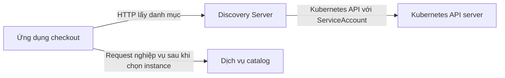

# Cấu hình HTTP DiscoveryClient kết nối đến server

## Mục tiêu trong chương Discovery Server

Trong module **SPRING_CLOUD_KUBERNETES**, DiscoveryClient giúp ứng dụng Spring lấy danh sách dịch vụ và địa chỉ instance trên Kubernetes. Khi chọn HTTP DiscoveryClient, ứng dụng gửi yêu cầu tới **Spring Cloud Kubernetes Discovery Server**; server đảm nhiệm việc đọc dữ liệu discovery từ Kubernetes API.

Bài này hướng dẫn cấu hình phía client, chọn URL phù hợp với nơi chạy, đặt cấu hình đúng phía server và xác minh từng chặng kết nối. Sau bài học, bạn có thể:

- Chọn đúng starter và khai báo URL của Discovery Server.
- Phân biệt cấu hình kết nối phía client với phạm vi namespace và RBAC phía server.
- Đọc kết quả `getServices()` và `getInstances()` từ ứng dụng Spring.
- Thực hành trong cluster hoặc qua port-forward khi chạy local.
- Phân biệt lỗi lấy danh sách dịch vụ với lỗi gọi một dịch vụ đã tìm thấy.

Các ví dụ dùng ứng dụng gọi `checkout`, dịch vụ đích `catalog`, namespace nghiệp vụ `learning` và namespace hạ tầng `platform`. Discovery Server được giả định đã triển khai với Service tên `discovery-server`, công bố cổng `80` và chuyển tiếp tới cổng server `8761`. Đó là quy ước của ví dụ; phải thay bằng tên, namespace và cổng thực tế khi áp dụng.

## 1. Hiểu đúng vai trò của HTTP DiscoveryClient



Có hai đường kết nối cần cấu hình và quan sát riêng:

1. **Đường discovery:** `checkout → Discovery Server`. Mục tiêu là lấy thông tin dịch vụ.
2. **Đường nghiệp vụ:** `checkout → catalog`. Mục tiêu là gửi request đến địa chỉ được lựa chọn.

Discovery Server không mặc nhiên chuyển tiếp request nghiệp vụ. Lấy được địa chỉ `10.42.2.17:8080` không có nghĩa server sẽ proxy request tới địa chỉ đó giúp client.

Ứng dụng tiêu thụ HTTP discovery không cần quyền đọc Kubernetes API **cho riêng chức năng này**. Quyền đọc tài nguyên nằm ở ServiceAccount của Discovery Server. Nếu ứng dụng còn dùng tính năng khác để đọc ConfigMap hoặc Secret qua API, các nhu cầu quyền của tính năng đó vẫn phải được xét riêng.

Khi chỉ cần gọi DNS của một Kubernetes Service ổn định, bạn có thể dùng DNS trực tiếp. HTTP discovery phù hợp khi ứng dụng cần abstraction `DiscoveryClient`, thông tin instance hoặc tích hợp với thành phần Spring Cloud sử dụng danh sách instance. Quyết định sử dụng nên xuất phát từ nhu cầu này.

## 2. Chuẩn bị dependency và phiên bản

Starter dành cho cách kết nối này là:

```xml
<dependency>
    <groupId>org.springframework.cloud</groupId>
    <artifactId>spring-cloud-starter-kubernetes-discoveryclient</artifactId>
</dependency>
```

Đoạn trên giả định dự án đã quản lý phiên bản bằng Spring Cloud BOM phù hợp với Spring Boot. Không lấy một phiên bản starter ngẫu nhiên rồi ghép vào một release train khác. Cần đối chiếu Spring Boot, Spring Cloud, Spring Cloud Kubernetes và phiên bản image của Discovery Server trong cùng kế hoạch nâng cấp. Xem [tài liệu Spring Cloud Release](https://docs.spring.io/spring-cloud-release/reference/index.html).

Với một ứng dụng servlet dùng trong bài thực hành, phần web có thể đã được khai báo bằng starter riêng của dự án. Dependency discovery ở trên bổ sung khả năng tra cứu dịch vụ; nó không tự thay thế cấu hình HTTP client nghiệp vụ hoặc mọi thành phần cân bằng tải cần dùng.

Phân biệt các lựa chọn để không vô tình đưa nhiều implementation cùng mục đích vào classpath:

| Lựa chọn | Cách lấy dữ liệu discovery |
|---|---|
| HTTP DiscoveryClient trong bài | Gọi Spring Cloud Kubernetes Discovery Server |
| DiscoveryClient dựa trên Fabric8 | Dùng Kubernetes client để đọc API |
| DiscoveryClient dựa trên Kubernetes Java Client | Dùng Kubernetes client để đọc API |

Nếu nhiều starter discovery cùng xuất hiện, hãy kiểm tra dependency tree và các bean discovery thực tế. Một `CompositeDiscoveryClient` có thể kết hợp nhiều nguồn; vì vậy, chỉ nhìn thấy một bean kiểu `DiscoveryClient` chưa chứng minh ứng dụng đang dùng đúng đường HTTP dự kiến.

Starter HTTP được thiết kế cho Spring Cloud Kubernetes Discovery Server, như mô tả tại [DiscoveryClient for Kubernetes](https://docs.spring.io/spring-cloud-kubernetes/reference/discovery-client.html). Không trỏ nó tới Eureka chỉ vì hệ thống đó cũng là một discovery server hoặc tình cờ dùng cùng số cổng.

## 3. Khai báo URL kết nối phía client

### 3.1. Cấu hình tối thiểu trong cluster

Ví dụ trong cấu hình ứng dụng `checkout`:

```yaml
spring:
  application:
    name: checkout
  cloud:
    kubernetes:
      discovery:
        enabled: true
        discovery-server-url: http://discovery-server.platform.svc.cluster.local:80
```

Thuộc tính cần đặt đúng là:

```text
spring.cloud.kubernetes.discovery.discovery-server-url
```

Đây là URL của Discovery Server; xem [phụ lục thuộc tính Spring Cloud Kubernetes](https://docs.spring.io/spring-cloud-kubernetes/reference/appendix.html). Chú ý có cả đoạn `discovery` trước `discovery-server-url`.

Với ví dụ trên:

| Thành phần URL | Ý nghĩa |
|---|---|
| `http` | Giao thức dùng cho chặng client tới Discovery Server |
| `discovery-server` | Tên Service của server |
| `platform` | Namespace của Service đó |
| `svc.cluster.local` | Phần DNS cluster giả định trong ví dụ |
| `80` | Cổng Service mà client truy cập |

Cluster có thể dùng domain khác `cluster.local`. Kiểm tra DNS thực tế thay vì sao chép hậu tố này sang mọi môi trường.

Cấu hình URL gốc của server; không thêm `/apps`, `/apps/catalog` hoặc `/eureka` vào giá trị trên. Các endpoint API phục vụ discovery được client gọi theo giao thức của implementation. Nếu đặt sau reverse proxy có tiền tố đường dẫn, phải kiểm chứng cách xử lý tiền tố với đúng phiên bản và cấu hình rewrite của proxy.

### 3.2. Tách URL khỏi cấu hình đóng gói

Có thể tham chiếu một biến môi trường do dự án tự đặt tên:

```yaml
spring:
  application:
    name: checkout
  cloud:
    kubernetes:
      discovery:
        enabled: true
        discovery-server-url: ${DISCOVERY_SERVER_URL}
```

`DISCOVERY_SERVER_URL` trong ví dụ là biến được placeholder trên tham chiếu. Nó không tự trở thành thuộc tính Spring Cloud Kubernetes nếu bạn bỏ khai báo ánh xạ trong YAML.

Ví dụ một đoạn cấu hình container:

```yaml
env:
  - name: DISCOVERY_SERVER_URL
    value: http://discovery-server.platform.svc.cluster.local:80
```

Ví dụ này chủ ý không đặt giá trị mặc định là `localhost`. Nhờ đó, thiếu cấu hình ở môi trường triển khai sẽ lộ ra khi nạp cấu hình thay vì âm thầm kết nối nhầm vào chính container.

Spring Boot hỗ trợ cấu hình từ file, biến môi trường và tham số dòng lệnh theo thứ tự ưu tiên xác định. Khi giá trị có vẻ không được áp dụng, kiểm tra profile và nguồn ghi đè trước khi thay tên thuộc tính. Xem [Externalized Configuration của Spring Boot](https://docs.spring.io/spring-boot/reference/features/external-config.html).

### 3.3. Chọn đúng cổng theo đường gọi

Giả định Service của Discovery Server như sau:

```yaml
apiVersion: v1
kind: Service
metadata:
  name: discovery-server
  namespace: platform
spec:
  selector:
    app: discovery-server
  ports:
    - name: http
      port: 80
      targetPort: 8761
  type: ClusterIP
```

Client gọi qua Service dùng `:80`; cổng tiến trình `8761` là cổng đích sau chuyển tiếp. Ghép DNS của Service với `:8761` sẽ sai nếu Service không công bố cổng đó.

Đoạn YAML chỉ minh họa Service; nó không tự tạo Deployment, tiến trình server hoặc ServiceAccount. Selector phải khớp nhãn Pod của Deployment thực tế. Không coi Service đã tồn tại là bằng chứng server đã có endpoint sẵn sàng.

## 4. Đặt cấu hình đúng phía client và server

| Nội dung | Thành phần cần cấu hình trong mô hình HTTP discovery |
|---|---|
| URL để client gọi server | Ứng dụng chạy HTTP DiscoveryClient |
| DNS, đường mạng tới Discovery Server | Môi trường chạy client và hạ tầng mạng |
| Namespace được tra cứu, lọc dịch vụ tại nguồn | Discovery Server |
| Quyền đọc tài nguyên Kubernetes cho discovery | ServiceAccount của Discovery Server |
| Địa chỉ, cổng và thông tin HTTPS của instance được công bố | Tài nguyên dịch vụ và cấu hình discovery phía server |
| Trust material hoặc xác thực cho chặng tới server nếu được bảo vệ | HTTP transport thực tế của client và lớp bảo vệ server |
| Timeout, TLS, xác thực của request nghiệp vụ | HTTP client gọi dịch vụ đích |

Trong mô hình HTTP, phạm vi namespace phải đặt ở Discovery Server. Ví dụ một đoạn cấu hình container server chỉ tra cứu namespace `learning`:

```yaml
env:
  - name: SPRING_CLOUD_KUBERNETES_DISCOVERY_ALLNAMESPACES
    value: "false"
  - name: SPRING_CLOUD_KUBERNETES_DISCOVERY_NAMESPACES_0
    value: learning
```

Đây là nội dung ở container **server**, không phải container `checkout`. Tài liệu [DiscoveryClient for Kubernetes](https://docs.spring.io/spring-cloud-kubernetes/reference/discovery-client.html) nêu riêng việc cấu hình phạm vi namespace ở server khi dùng HTTP client.

Khai báo phạm vi không tự cấp RBAC. Nếu server chạy bằng ServiceAccount `discovery-server` ở namespace `platform` và cần đọc `learning`, binding trong namespace được đọc phải tham chiếu đúng ServiceAccount đó. Nếu dùng EndpointSlice, quyền đọc `endpointslices` thuộc API group `discovery.k8s.io` phải phù hợp với chế độ discovery được bật.

Không mở `all-namespaces` chỉ để làm biến mất một danh sách rỗng. Trước tiên xác định namespace cần đọc, tài nguyên implementation đang dùng và quyền tương ứng. Việc mở rộng phạm vi còn tăng dữ liệu server phải theo dõi và có thể làm nhiều ứng dụng thấy dịch vụ ngoài nhu cầu của chúng.

Hai client cùng trỏ một Discovery Server không mặc nhiên nhận hai phạm vi namespace tách biệt chỉ vì mỗi client đặt cấu hình namespace khác nhau. Nếu cần cách ly phạm vi, hãy thiết kế server và chính sách truy cập phù hợp. Một bộ lọc dữ liệu discovery cũng không thay thế cơ chế phân quyền tenant.

## 5. Kiểm tra Discovery Server trước khi kiểm tra Java client

Từ môi trường có cùng đường mạng với client, thử endpoint của server:

```bash
curl --fail-with-body --connect-timeout 3 --max-time 10 \
  http://discovery-server.platform.svc.cluster.local:80/apps

curl --fail-with-body --connect-timeout 3 --max-time 10 \
  http://discovery-server.platform.svc.cluster.local:80/apps/catalog
```

Dùng phiên bản `curl` hỗ trợ các tùy chọn trên. Nếu server được bảo vệ, lệnh thử cũng phải dùng cách xác thực và CA phù hợp với môi trường đó.

Hai endpoint cần phân biệt:

- `/apps`: lấy danh mục với tên dịch vụ và thông tin instance.
- `/apps/{name}`: lấy các instance của một dịch vụ cụ thể.

Các endpoint này được mô tả trong [tài liệu Spring Cloud Kubernetes Discovery Server](https://docs.spring.io/spring-cloud-kubernetes/reference/spring-cloud-kubernetes-discoveryserver.html).

Ví dụ rút gọn, giả định response cho `/apps/catalog`:

```json
[
  {
    "instanceId": "catalog-pod-a",
    "serviceId": "catalog",
    "host": "10.42.2.17",
    "port": 8080,
    "secure": false,
    "uri": "http://10.42.2.17:8080",
    "namespace": "learning"
  }
]
```

JSON chỉ minh họa dữ liệu cần đọc; metadata và cấu trúc chi tiết phải đối chiếu với phiên bản server thực tế. Không dùng dữ liệu minh họa như kết quả kiểm thử cluster.

Nếu HTTP trả thành công nhưng không có instance `catalog`, hãy kiểm tra phạm vi namespace, bộ lọc, Service, selector, endpoint và readiness. Lấy được danh mục thành công chỉ xác nhận chặng tới server đang phục vụ API; nó chưa xác nhận dịch vụ nghiệp vụ có backend dùng được.

Tránh in toàn bộ metadata trong log production khi không cần thiết. Dữ liệu discovery có thể bao gồm địa chỉ nội bộ, nhãn và annotation phục vụ vận hành.

## 6. Dùng DiscoveryClient trong ứng dụng Spring

Ví dụ sau đặt một kiểm tra đơn giản sau khi ứng dụng khởi động. Chỉ bật bean kiểm tra khi profile `discovery-check` được kích hoạt.

```java
package example.checkout;

import java.util.List;

import org.slf4j.Logger;
import org.slf4j.LoggerFactory;
import org.springframework.boot.ApplicationRunner;
import org.springframework.boot.SpringApplication;
import org.springframework.boot.autoconfigure.SpringBootApplication;
import org.springframework.cloud.client.ServiceInstance;
import org.springframework.cloud.client.discovery.DiscoveryClient;
import org.springframework.cloud.client.discovery.EnableDiscoveryClient;
import org.springframework.context.annotation.Bean;
import org.springframework.context.annotation.Profile;

@SpringBootApplication
@EnableDiscoveryClient
public class CheckoutApplication {

    private static final Logger log =
            LoggerFactory.getLogger(CheckoutApplication.class);

    public static void main(String[] args) {
        SpringApplication.run(CheckoutApplication.class, args);
    }

    @Bean
    @Profile("discovery-check")
    ApplicationRunner inspectDiscovery(DiscoveryClient discoveryClient) {
        return args -> {
            log.info("Discovery client: {}", discoveryClient.description());
            log.info("Services: {}", discoveryClient.getServices());

            List<ServiceInstance> instances =
                    discoveryClient.getInstances("catalog");

            if (instances.isEmpty()) {
                log.warn("Khong co instance catalog trong ket qua discovery");
            }

            for (ServiceInstance instance : instances) {
                log.info("service={} host={} port={} secure={} uri={}",
                        instance.getServiceId(),
                        instance.getHost(),
                        instance.getPort(),
                        instance.isSecure(),
                        instance.getUri());
            }
        };
    }
}
```

`@EnableDiscoveryClient` thể hiện rõ mục đích của ví dụ; việc tạo implementation vẫn phụ thuộc dependency, auto-configuration, môi trường và các thuộc tính bật/tắt. Annotation không sửa được URL thiếu hoặc mạng không thông.

Tên truyền vào `getInstances("catalog")` phải là định danh dịch vụ mà server công bố. `spring.application.name: checkout` đặt tên cho ứng dụng gọi; nó không đổi tên Kubernetes Service đích thành `checkout` và không tự đăng ký thêm một Kubernetes Service.

`getServices()` dùng để quan sát trong bài thực hành. Không thêm việc liệt kê toàn bộ danh mục vào mọi request nghiệp vụ hoặc mọi probe nếu ứng dụng không cần điều đó.

Mã trên sử dụng API blocking. Với ứng dụng reactive, dùng implementation và luồng reactive thích hợp; không đặt lời gọi blocking trực tiếp lên event loop chỉ để tái sử dụng ví dụ.

## 7. Chạy client local bằng port-forward

### 7.1. Mở đường đến Discovery Server

Trong một terminal dành cho thực hành, giả định người chạy có quyền truy cập tài nguyên và port-forward:

```bash
kubectl port-forward -n platform service/discovery-server 18761:80
```

Giữ tiến trình port-forward chạy trong thời gian thử. Với Service giả định trong bài, `80` là cổng Service, còn `18761` là cổng trên máy local.

Kiểm tra đường nối:

```bash
curl --fail-with-body --connect-timeout 3 --max-time 10 \
  http://localhost:18761/apps/catalog
```

Không mang `http://localhost:18761` vào Deployment của `checkout`: trong Pod, `localhost` là môi trường mạng của Pod đó, không phải máy phát triển đang chạy port-forward.

### 7.2. Dùng profile cấu hình riêng cho thực hành local

Ví dụ nội dung cấu hình profile `local-discovery`:

```yaml
spring:
  main:
    cloud-platform: KUBERNETES
  cloud:
    kubernetes:
      discovery:
        enabled: true
        discovery-server-url: http://localhost:18761
```

Có thể kích hoạt hai profile `local-discovery,discovery-check` khi chạy ứng dụng đã được build. `spring.main.cloud-platform: KUBERNETES` dùng để kích hoạt nhận biết môi trường Kubernetes cho phiên thực hành ngoài cluster khi auto-configuration yêu cầu điều đó. Cơ chế override này được mô tả trong [phần Kubernetes Ecosystem Awareness của tài liệu Spring Cloud](https://docs.spring.io/spring-cloud/docs/current/reference/htmlsingle/spring-cloud.html#_kubernetes_ecosystem_awareness).

Chỉ bật cấu hình này cho mục đích đã xác định. Nếu classpath còn các tính năng Kubernetes khác, việc ép nhận diện Kubernetes có thể làm chúng cũng được xét khởi tạo. Vì vậy cần kiểm tra các starter có trong ứng dụng, thay vì giả định mọi kết nối đều đi qua Discovery Server.

Nếu dự án dùng bootstrap context kiểu cũ, vị trí đặt các thuộc tính khởi tạo môi trường có thể khác; đối chiếu cấu hình khởi động của phiên bản đang dùng. Ví dụ chính của bài dùng cấu hình ứng dụng thông thường, không yêu cầu bật bootstrap để khai báo URL.

### 7.3. Hiểu giới hạn của phép thử

Giả sử `getInstances("catalog")` trả `10.42.2.17:8080`. Máy local có thể chưa có route tới Pod CIDR đó. Port-forward vừa mở chỉ phục vụ đường tới Discovery Server, không mở đường tới mọi instance mà server trả về.

Trong tình huống này:

```text
localhost:18761/apps/catalog  -> thành công
10.42.2.17:8080/api/products  -> có thể không truy cập được từ máy local
```

Đây là hai điều kiện kết nối khác nhau. Để kiểm chứng request nghiệp vụ, chạy client trong cluster hoặc cung cấp kết nối mạng phù hợp tới các địa chỉ trả về. Nếu tự tạo một đường truy cập riêng cho backend, phải ghi rõ rằng đó là đường thử khác với đường gọi Pod IP do discovery cung cấp.

## 8. Quản lý URL bằng ConfigMap và liên hệ cập nhật cấu hình

URL nội bộ của Discovery Server thường là cấu hình không nhạy cảm. Có thể lưu riêng bằng ConfigMap:

```yaml
apiVersion: v1
kind: ConfigMap
metadata:
  name: checkout-discovery
  namespace: learning
data:
  DISCOVERY_SERVER_URL: http://discovery-server.platform.svc.cluster.local:80
```

Đoạn container của `checkout` nhận biến đó:

```yaml
env:
  - name: DISCOVERY_SERVER_URL
    valueFrom:
      configMapKeyRef:
        name: checkout-discovery
        key: DISCOVERY_SERVER_URL
```

Kết hợp với placeholder `${DISCOVERY_SERVER_URL}` ở phần cấu hình client. Với cách đưa giá trị qua biến môi trường của container, cập nhật ConfigMap không thay đổi biến môi trường của tiến trình đang chạy. Cần tạo lại Pod theo cơ chế rollout đã chọn để lấy giá trị mới.

Configuration Watcher không phải điều kiện để HTTP DiscoveryClient kết nối server. Nếu hệ thống dùng watcher hoặc cơ chế refresh, phải xác định cụ thể đối tượng client nào được tái tạo khi URL đổi. Một thông báo refresh không tự bảo đảm mọi HTTP transport và connection pool đã dùng URL mới.

Nếu server được bảo vệ bằng thông tin xác thực, lưu vật liệu nhạy cảm trong cơ chế Secret phù hợp và cấu hình đúng HTTP transport. Không đặt mật khẩu vào URL trong ConfigMap hoặc log. Việc server đọc Secret từ Kubernetes và việc client được phép truy cập endpoint discovery là hai chức năng cần thiết kế riêng.

## 9. HTTPS, mạng và tính sẵn sàng

Tên gọi HTTP DiscoveryClient nói đến mô hình truy cập API của Discovery Server. Khi triển khai đường HTTPS, phải kiểm tra hỗ trợ và cấu hình TLS của HTTP transport trong phiên bản đang dùng, cùng trust material, hostname và cơ chế xác thực thực tế. Không chỉ thay `http://` thành `https://` rồi kết luận kết nối đã được bảo vệ đúng.

Có thể có đồng thời hai yêu cầu TLS khác nhau:

```text
checkout -- HTTPS --> Discovery Server
checkout -- HTTPS hoặc HTTP --> catalog
```

HTTPS ở chặng discovery không quyết định `catalog` dùng HTTPS. Ngược lại, instance `catalog` được đánh dấu secure cũng không cấu hình truststore cho chặng tới Discovery Server.

Một địa chỉ Service ổn định giúp client không phải giữ URL theo Pod IP của Discovery Server. Nếu triển khai nhiều replica server, cần theo dõi readiness, khả năng đồng bộ dữ liệu và kết quả tra cứu khi request đi tới các replica khác nhau. Không mặc định rằng một danh mục đọc thành công từ một replica chứng minh mọi replica đều sẵn sàng.

Khi đặt timeout hoặc retry, phải cấu hình đúng HTTP transport mà starter đang dùng. Thuộc tính timeout dành cho Kubernetes API client phía server không mặc nhiên điều khiển request HTTP từ `checkout` tới Discovery Server. Tránh tự suy ra tên property từ một thư viện khác.

Quyết định fail khi khởi động, trả lỗi hay dùng dữ liệu cũ khi server mất kết nối phụ thuộc yêu cầu ứng dụng và các cơ chế đã được cấu hình. Không giả định có fallback hoặc cache bền vững chỉ vì đã cài starter. Nếu danh sách instance được cache bởi thành phần khác, cần tính cả độ trễ loại bỏ địa chỉ cũ khi Pod thay đổi.

## 10. Chẩn đoán theo từng lớp

| Hiện tượng | Kiểm tra đầu tiên | Hướng xử lý |
|---|---|---|
| URL thiếu hoặc không hợp lệ khi khởi tạo client | Đúng key `spring.cloud.kubernetes.discovery.discovery-server-url`, placeholder và profile | Sửa nguồn cấu hình phía client |
| Không resolve được `discovery-server...` | DNS, namespace, cluster domain và vị trí chạy client | Dùng địa chỉ phù hợp với môi trường |
| Connection refused | Cổng Service, endpoint server và listener thật | Đối chiếu `port` với `targetPort` |
| Timeout tới server | Đường mạng, NetworkPolicy, proxy và trạng thái server | Khoanh vùng kết nối trước khi sửa RBAC |
| `404` khi gọi API discovery | URL gốc, proxy path hoặc trỏ nhầm loại server | Kiểm tra trực tiếp `/apps` trên đúng server |
| `401`/`403` trên đường HTTP tới server | Lớp xác thực/ủy quyền trước Discovery Server | Cấu hình quyền truy cập HTTP phù hợp |
| Server log báo `Forbidden` từ Kubernetes API | ServiceAccount, Role/Binding, namespace và API group | Sửa RBAC phía server |
| API trả thành công nhưng danh sách rỗng | Phạm vi server, filter, Service, endpoint và readiness | So khớp tài nguyên của đúng namespace |
| Java không dùng nguồn HTTP dự kiến | Starter có mặt, profile, auto-configuration và discovery bean | Kiểm tra implementation hoặc composite thực tế |
| Đọc được instance nhưng request nghiệp vụ lỗi | Route tới host trả về, port, scheme, TLS và quyền nghiệp vụ | Kiểm tra chặng `checkout → catalog` |
| Sau khi đổi ConfigMap vẫn gọi URL cũ | Cách đưa cấu hình vào tiến trình và vòng đời client | Rollout hoặc cơ chế tái tạo client đã được xác định |

Các lệnh chỉ đọc phục vụ người thực hành kiểm tra phía Kubernetes:

```bash
kubectl get service discovery-server -n platform -o yaml
kubectl get endpointslices -n platform -l kubernetes.io/service-name=discovery-server -o yaml
kubectl get pods -n platform -l app=discovery-server -o wide
kubectl get service catalog -n learning -o yaml
kubectl get endpointslices -n learning -l kubernetes.io/service-name=catalog -o yaml
```

Tên nhãn Pod và tài nguyên endpoint cần phù hợp với triển khai thực tế. Kiểm tra thêm log server để biết nó có đọc được Kubernetes API và hoàn tất khởi tạo dữ liệu hay không.

Khi chẩn đoán `403`, luôn xác định nguồn phản hồi. `403` do reverse proxy chặn client truy cập Discovery Server khác với `403` server nhận từ Kubernetes API, và khác tiếp với `403` khi gọi API nghiệp vụ của `catalog`.

## 11. Tiêu chí hoàn thành cấu hình thực hành

Một cấu hình có thể được xác nhận theo chuỗi bằng chứng sau:

1. Classpath có đúng HTTP discovery starter và bộ phiên bản tương thích.
2. Client nạp đúng URL gốc, đúng profile và đúng cổng truy cập Service.
3. Từ môi trường của client, API `/apps` và `/apps/catalog` trả dữ liệu mong đợi.
4. Mã Java lấy được `catalog` và các instance có host, port, scheme phù hợp.
5. Server chỉ đọc phạm vi Kubernetes cần thiết bằng ServiceAccount đã được cấp quyền tương ứng.
6. Nếu bài thực hành có gọi nghiệp vụ, chính client truy cập được địa chỉ instance và vượt qua kiểm tra TLS/xác thực cần thiết.
7. Khi URL hoặc backend thay đổi, hệ thống có cách cập nhật client và quan sát dữ liệu mới đã được xác định.

Chuỗi kiểm chứng này giúp biết chính xác phần nào đã hoạt động: nạp cấu hình, kết nối Discovery Server, đọc danh mục hay gọi dịch vụ nghiệp vụ. Ghi nhận riêng từng kết quả để việc vận hành và xử lý sự cố có căn cứ.
