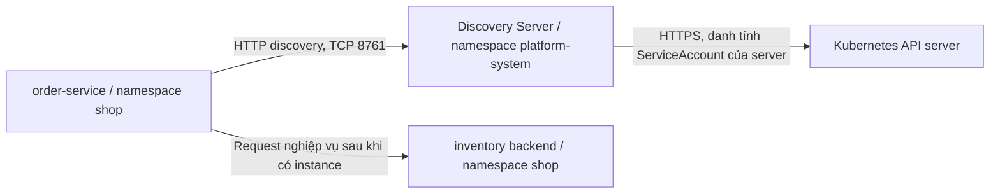

# Quyền Kubernetes của server và quyền kết nối của ứng dụng

> Chương: Discovery Server — Module: SPRING_CLOUD_KUBERNETES.

Khi dùng Spring Cloud Kubernetes Discovery Server, ứng dụng hỏi server qua HTTP để lấy danh sách instance. Server dùng danh tính của chính nó để đọc Kubernetes API. Hai quan hệ này cần được thiết kế quyền riêng: quyền đọc tài nguyên Kubernetes của server và quyền kết nối, sử dụng HTTP discovery của ứng dụng.

Một cấu hình có thể đúng RBAC nhưng sai NetworkPolicy. Ứng dụng cũng có thể gọi server thành công trong khi server không đọc được EndpointSlice. Muốn xử lý đúng, cần chỉ rõ bên gọi, bên nhận, danh tính, tài nguyên và cổng của từng đường.

Bài học dùng ví dụ hai namespace đã tồn tại: `platform-system` chạy Discovery Server, còn `shop` chạy `order-service` và backend `inventory`. Các manifest và lệnh là hướng dẫn thực hành; không giả định đã được áp dụng trên một cluster cụ thể.

## 1. Ba đường truy cập và ba câu hỏi về quyền



| Đường truy cập | Câu hỏi cần trả lời | Cơ chế liên quan |
| --- | --- | --- |
| Discovery Server → Kubernetes API | Server có được đọc những tài nguyên cần thiết trong `shop` không? | Danh tính Kubernetes, RBAC, TLS và kết nối mạng |
| `order-service` → Discovery Server | Ứng dụng có kết nối được và có được sử dụng endpoint discovery không? | DNS, Service, NetworkPolicy, TLS, xác thực và phân quyền HTTP nếu triển khai |
| `order-service` → `inventory` | Ứng dụng có gọi được host, port nhận từ discovery không? | Định tuyến, NetworkPolicy và cơ chế bảo vệ API nghiệp vụ |

Tài liệu [Spring Cloud Kubernetes Discovery Server](https://docs.spring.io/spring-cloud-kubernetes/reference/spring-cloud-kubernetes-discoveryserver.html) mô tả server cần quyền đọc Pod, Service và Endpoint. Với đường EndpointSlice, phải xét quyền tài nguyên tương ứng. Server cung cấp dữ liệu discovery qua HTTP, chẳng hạn `GET /apps/inventory`.

Quyền được cấp cho ServiceAccount của server không tự truyền sang ứng dụng. Ngược lại, ứng dụng được gateway chấp nhận gọi HTTP không làm ServiceAccount của server có thêm quyền Kubernetes.

## 2. Phân biệt danh tính, RBAC, mạng và TLS

Các lớp sau có thể cùng tham gia một kết nối nhưng không thay thế nhau:

| Lớp | Ví dụ trong bài | Điều lớp đó xác định |
| --- | --- | --- |
| Xác thực danh tính | Kubernetes API nhận token của ServiceAccount server | Bên gọi là ai |
| Phân quyền | Role cho phép `list services` trong `shop` | Danh tính được làm gì |
| Kết nối mạng | Cho phép TCP từ Pod ứng dụng tới cổng 8761 của server | Lưu lượng có thể đến nơi không |
| TLS | Client kiểm tra chứng chỉ server | Kênh truyền và danh tính đầu bên kia theo cấu hình TLS |
| Quyền sử dụng HTTP API | Gateway cho workload cụ thể gọi `/apps/**` | Caller được sử dụng giao diện discovery nào |

RBAC Kubernetes dùng các khái niệm resource, API group và verb. Một quyền `get` trên resource `services` không phải quyền gọi mọi HTTP GET tới mọi Service trong cluster.

Tương tự, NetworkPolicy cho phép cổng 8761 không phân biệt `GET /apps` với `GET /actuator/env`. Việc bảo vệ đường dẫn HTTP cần thành phần ở lớp ứng dụng hoặc proxy có chức năng phù hợp.

Trong mô hình thông thường ở bài này, Discovery Server đọc API bằng danh tính của server. Không giả định token của HTTP caller được chuyển tiếp để Kubernetes tự phân quyền từng request discovery.

## 3. Tạo danh tính riêng cho Discovery Server

Server chạy trong `platform-system`, vì vậy ServiceAccount được tạo trong namespace đó:

```yaml
apiVersion: v1
kind: ServiceAccount
metadata:
  name: sck-discovery-server
  namespace: platform-system
```

Pod của server phải dùng đúng ServiceAccount này. Đoạn dưới là phần Pod template của Deployment, không phải Deployment hoàn chỉnh:

```yaml
spec:
  template:
    metadata:
      labels:
        app: discovery-server
    spec:
      serviceAccountName: sck-discovery-server
      automountServiceAccountToken: true
```

Container, image và các trường còn lại phải được khai báo trong Deployment thực tế. Chọn image và HTTP discovery client tương thích với bộ Spring Boot, Spring Cloud và Spring Cloud Kubernetes đang dùng.

Theo [Service Accounts của Kubernetes](https://kubernetes.io/docs/concepts/security/service-accounts/), ServiceAccount gắn với namespace. Pod không tham chiếu trực tiếp một ServiceAccount ở namespace khác. Danh tính của ví dụ là:

```text
system:serviceaccount:platform-system:sck-discovery-server
```

Ở cơ chế token projected được hỗ trợ bởi cluster, token có vòng đời do Kubernetes quản lý. Kubernetes client cần làm việc đúng với credential được mount và việc luân chuyển token. Không cần sao chép token sang một biến cấu hình cố định để thực hiện discovery.

Việc mount token chỉ cung cấp credential cho Pod; nó không tự cấp quyền đọc Service hay EndpointSlice. Phần quyền nằm ở Role và binding.

## 4. Cấp quyền đọc tại namespace chứa dữ liệu

Server ở `platform-system` nhưng cần đọc tài nguyên trong `shop`. Do đó Role được đặt trong `shop`, và RoleBinding tại `shop` tham chiếu ServiceAccount của server ở `platform-system`.

```yaml
apiVersion: rbac.authorization.k8s.io/v1
kind: Role
metadata:
  name: sck-discovery-read
  namespace: shop
rules:
  - apiGroups: [""]
    resources: ["services", "pods", "endpoints"]
    verbs: ["get", "list", "watch"]
  - apiGroups: ["discovery.k8s.io"]
    resources: ["endpointslices"]
    verbs: ["get", "list", "watch"]
---
apiVersion: rbac.authorization.k8s.io/v1
kind: RoleBinding
metadata:
  name: sck-discovery-read
  namespace: shop
subjects:
  - kind: ServiceAccount
    name: sck-discovery-server
    namespace: platform-system
roleRef:
  apiGroup: rbac.authorization.k8s.io
  kind: Role
  name: sck-discovery-read
```

Ví dụ bao gồm cả Endpoints và EndpointSlice để thể hiện hai đường tài nguyên. Đây không phải tuyên bố mọi phiên bản hoặc cấu hình đều cần cả hai. Sau khi xác định implementation và tính năng sử dụng, giữ bộ quyền cần thiết cho đường thực tế; xét cả việc có đọc Pod hay không.

Theo [RBAC Kubernetes](https://kubernetes.io/docs/reference/access-authn-authz/rbac/), RoleBinding cấp quyền trong namespace của binding. Namespace của subject xác định đúng ServiceAccount nhận quyền; nó không đổi phạm vi tài nguyên của Role.

Những điểm cần đọc đúng trong ví dụ:

- `namespace: shop` trên Role và RoleBinding là nơi dữ liệu được phép đọc.
- `namespace: platform-system` trong subject là nơi ServiceAccount server tồn tại.
- `apiGroups: [""]` chỉ core API group; EndpointSlice thuộc `discovery.k8s.io`.
- `get`, `list`, `watch` là các quyền riêng; có `get` chưa đủ cho client cần đồng bộ bằng list/watch.

Role này không cấp quyền ghi tài nguyên, đọc Secret hoặc sửa Deployment. Không thêm wildcard chỉ để tránh tìm hiểu một lỗi 403.

### Đọc thêm namespace

Nếu cần đọc thêm namespace `billing`, có thể cấp quyền tương ứng tại namespace đó cho cùng ServiceAccount, hoặc thiết kế một server khác theo ranh giới tin cậy. Phải đồng thời cập nhật phạm vi discovery và quyền cần thiết.

ClusterRole có thể được dùng làm tập quyền tái sử dụng rồi bind theo namespace. ClusterRoleBinding có phạm vi rộng hơn đối với tài nguyên namespaced; không dùng nó chỉ vì server chạy khác namespace với backend.

### Lọc discovery không thay thế giới hạn quyền

Cấu hình chỉ khám phá một số Service hoặc namespace giúp giới hạn dữ liệu được sử dụng. Tuy nhiên, quyền Kubernetes thực tế vẫn được quyết định bởi toàn bộ binding áp dụng cho danh tính server.

Nếu server có quyền đọc toàn cluster nhưng chỉ được cấu hình hiển thị `shop`, credential của nó vẫn rộng hơn nhu cầu trong bài. Cần xem cả hai lớp: phạm vi hành vi và phạm vi quyền.

## 5. Cấu hình server khớp với phạm vi RBAC

Ví dụ dùng EndpointSlice và chỉ khám phá namespace `shop`. Các biến môi trường sau được đặt trong container Discovery Server hiện có:

```yaml
env:
  - name: SPRING_CLOUD_KUBERNETES_DISCOVERY_ALLNAMESPACES
    value: "false"
  - name: SPRING_CLOUD_KUBERNETES_DISCOVERY_NAMESPACES_0
    value: shop
  - name: SPRING_CLOUD_KUBERNETES_DISCOVERY_USEENDPOINTSLICES
    value: "true"
```

Cấu hình namespace cho HTTP discovery được thiết lập ở server theo [DiscoveryClient for Kubernetes](https://docs.spring.io/spring-cloud-kubernetes/reference/discovery-client.html). Nếu không chọn namespace đích rõ ràng, server có thể khám phá một phạm vi khác với điều người vận hành dự kiến.

Ba điều kiện cần khớp nhau:

```text
Danh tính Pod:
    platform-system/sck-discovery-server

Phạm vi discovery:
    shop

Quyền đọc:
    Role + RoleBinding trong shop cấp cho danh tính trên
```

Cấp đúng Role nhưng Pod vẫn chạy bằng ServiceAccount `default` không đạt yêu cầu. Tương tự, cấu hình khám phá toàn cluster trong khi chỉ có quyền tại `shop` có thể làm quá trình đồng bộ thất bại ở những phạm vi chưa được cấp quyền.

Khả năng đọc API còn cần kết nối HTTPS, chứng chỉ tin cậy và endpoint Kubernetes chính xác. Một lỗi kết nối mạng không được sửa bằng cách thêm quyền RBAC.

## 6. Ứng dụng HTTP discovery cần những gì?

`order-service` dùng starter HTTP discovery trong dự án đã quản lý BOM tương thích:

```xml
<dependency>
    <groupId>org.springframework.cloud</groupId>
    <artifactId>spring-cloud-starter-kubernetes-discoveryclient</artifactId>
</dependency>
```

Cấu hình ví dụ:

```yaml
spring:
  application:
    name: order-service
  cloud:
    kubernetes:
      discovery:
        enabled: true
        discovery-server-url: http://discovery-server.platform-system.svc.cluster.local:8761
```

Ví dụ dùng HTTP nội bộ để minh họa đường mạng. Cluster domain được giả định là `cluster.local`; URL thực tế phải khớp Service, cổng và cách bảo vệ HTTP đã triển khai.

Service phía server:

```yaml
apiVersion: v1
kind: Service
metadata:
  name: discovery-server
  namespace: platform-system
spec:
  type: ClusterIP
  selector:
    app: discovery-server
  ports:
    - name: http
      port: 8761
      targetPort: 8761
```

Manifest giả định Pod server có label tương ứng và container lắng nghe cổng 8761. Một Service được tạo thành công chưa chứng minh có endpoint ready phía sau nó.

### Tách danh tính ứng dụng khỏi quyền đọc discovery

Tạo ServiceAccount riêng cho ứng dụng:

```yaml
apiVersion: v1
kind: ServiceAccount
metadata:
  name: order-service
  namespace: shop
automountServiceAccountToken: false
```

Phần Pod template của ứng dụng có thể khai báo:

```yaml
spec:
  template:
    metadata:
      labels:
        app: order-service
    spec:
      serviceAccountName: order-service
      automountServiceAccountToken: false
```

Không cần RoleBinding đọc discovery cho ServiceAccount này chỉ để gọi HTTP tới Discovery Server.

Tuy nhiên, `automountServiceAccountToken: false` phải được đánh giá trên toàn Pod. Nếu ứng dụng hoặc sidecar còn cần Kubernetes API, workload identity hay một token projected cho cơ chế xác thực khác, phải thiết kế nhu cầu đó riêng.

Dùng HTTP discovery không tự chuyển các lần đọc ConfigMap hoặc Secret sang Discovery Server. Configuration Watcher cũng có danh tính và quyền riêng nếu được triển khai. Không gỡ credential chỉ dựa vào việc đã thay starter discovery.

## 7. Quyền kết nối mạng từ ứng dụng tới server

Giả định plugin mạng của cluster thực thi NetworkPolicy. Chính sách sau đặt trong `platform-system`, chọn Pod server và cho phép ingress TCP 8761 từ Pod `app: order-service` ở namespace `shop`:

```yaml
apiVersion: networking.k8s.io/v1
kind: NetworkPolicy
metadata:
  name: discovery-from-order-service
  namespace: platform-system
spec:
  podSelector:
    matchLabels:
      app: discovery-server
  policyTypes:
    - Ingress
  ingress:
    - from:
        - namespaceSelector:
            matchLabels:
              kubernetes.io/metadata.name: shop
          podSelector:
            matchLabels:
              app: order-service
      ports:
        - protocol: TCP
          port: 8761
```

`namespaceSelector` và `podSelector` nằm trong **cùng một phần tử** của `from`, nên cả hai cùng áp dụng cho nguồn được chọn. Nếu tách thành hai phần tử, ý nghĩa sẽ thành hai tập nguồn được phép riêng.

Theo [Network Policies của Kubernetes](https://kubernetes.io/docs/concepts/services-networking/network-policies/), các policy cho phép có tính cộng dồn. Ví dụ trên không thu hồi một đường truy cập đã được policy khác cho phép.

Chính sách minh họa chỉ xử lý ingress tới server. Để một kết nối hoạt động trong môi trường đã cô lập cả hai phía, egress của ứng dụng và ingress của server phải cùng cho phép đường tương ứng.

Đây là kiểm soát mạng theo workload được chọn, không phải xác thực người dùng ở lớp HTTP. Cũng cần quản lý ai được tạo Pod hoặc thay đổi label trong namespace nguồn.

### Những đường egress cần xét riêng

| Nguồn | Đích | Nhu cầu trong ví dụ |
| --- | --- | --- |
| Pod `order-service` | DNS của cluster | Phân giải tên Service; xét cả UDP/TCP theo hệ thống DNS thực tế |
| Pod `order-service` | Discovery Server | Gọi HTTP discovery tới cổng đã công bố |
| Pod Discovery Server | DNS nếu cần | Phân giải endpoint phụ thuộc |
| Pod Discovery Server | Kubernetes API | Kết nối HTTPS và duy trì hoạt động đọc/theo dõi cần thiết |
| Pod `order-service` | Backend `inventory` | Gửi request nghiệp vụ tới địa chỉ và cổng nhận được |

Không có một CIDR hoặc port API server duy nhất phù hợp với mọi cluster. Địa chỉ Service Kubernetes và endpoint control plane phía sau có thể khác nhau; cần đối chiếu cách plugin mạng xử lý Service và NAT trước khi viết policy egress.

Nếu dùng NodeLocal DNS hoặc kiến trúc mạng riêng của nhà cung cấp, quy tắc DNS cũng phải khớp topology đó. Không sao chép một selector DNS rồi mặc định nó phù hợp với mọi môi trường.

## 8. Xác thực và phân quyền HTTP cho ứng dụng

Một URL nội bộ không tự chứng minh caller được phép xem mọi thông tin discovery. Tùy ranh giới tin cậy, có thể đặt cơ chế bảo vệ ở gateway, reverse proxy, service mesh hoặc lớp bảo mật do hệ thống triển khai.

Một thiết kế cụ thể cần trả lời:

1. Caller dùng danh tính nào: workload certificate, credential ứng dụng hay token dành cho API này?
2. Thành phần nào xác minh credential và kiểm tra quyền?
3. Những đường dẫn discovery nào được phép sử dụng?
4. HTTP discovery client đưa credential vào request bằng cơ chế nào được phiên bản đang dùng hỗ trợ?
5. Credential được cấp phát, luân chuyển và thu hồi thế nào?

Đây là các quyết định tích hợp. Không giả định chỉ thêm starter sẽ tự bật một cơ chế xác thực hoặc gửi token theo yêu cầu của proxy.

### Không nhầm token Kubernetes với credential HTTP

Token gắn với ServiceAccount có mục đích và đối tượng nhận cần được xét rõ. Không lấy token server rồi phân phối cho mọi ứng dụng để “có quyền gọi discovery”.

Nếu một thiết kế chủ động dùng token ServiceAccount để xác thực HTTP, phía nhận phải có cơ chế kiểm tra token, issuer, audience, thời hạn và ánh xạ quyền phù hợp. Đó là một kiến trúc được triển khai riêng, không phải hệ quả mặc định của RoleBinding trong mục 4.

Cấp cho ứng dụng quyền `get services` cũng không sửa được HTTP 401 do gateway thiếu credential. Hai lỗi này thuộc hai hệ thống kiểm tra quyền khác nhau.

### TLS và client certificate

Với HTTPS, client cần tin đúng CA và xác minh đúng tên server. Nếu dùng mTLS, còn có quá trình xác minh certificate của caller và quy tắc cho phép workload tương ứng.

TLS một chiều không tự xác thực caller. mTLS xác thực danh tính cũng cần đi cùng chính sách cho phép danh tính đó sử dụng API.

Không dùng việc tắt kiểm tra chứng chỉ để sửa một URL không khớp SAN hoặc một truststore thiếu CA. Hãy sửa cấu hình endpoint và chuỗi tin cậy tương ứng.

## 9. Ranh giới dữ liệu khi server phục vụ nhiều ứng dụng

Giả sử Discovery Server được cấp quyền đọc `shop` và `billing`. Ứng dụng A chỉ nên biết `shop`, còn ứng dụng B chỉ nên biết `billing`.

RoleBinding cấp cho server không phân biệt A và B. Nếu server cung cấp một danh mục tổng hợp và không có cơ chế lọc theo caller, việc A không có quyền Kubernetes tại `billing` vẫn chưa bảo đảm A không đọc được thông tin `billing` qua server.

Có thể đánh giá các phương án:

| Phương án | Điểm cần thiết kế |
| --- | --- |
| Server riêng theo nhóm namespace | Mỗi server có phạm vi discovery, ServiceAccount và đường truy cập riêng |
| Một server có lớp kiểm soát truy cập dữ liệu theo caller | Cơ chế đó phải thật sự hiểu dữ liệu và kiểm tra quyền với mọi đường API |
| Ứng dụng dùng client Kubernetes trực tiếp | Mỗi ứng dụng có quyền hẹp và tự quản lý kết nối API |
| Chỉ dùng DNS/Service khi đủ nhu cầu | Giảm nhu cầu liệt kê instance và metadata ở phía ứng dụng |

Chỉ chặn một đường như `/apps/billing-service` chưa chắc đủ nếu caller vẫn được đọc danh mục tổng hợp ở `/apps`. Phải kiểm tra tất cả đường có thể làm lộ cùng dữ liệu.

Label và annotation có thể chứa tên đội vận hành, thông tin bản dựng hoặc mô tả nội bộ. Chỉ đưa các trường cần dùng vào dữ liệu discovery; không đặt mật khẩu hoặc token vào metadata được phân phối cho client.

## 10. Kiểm chứng từ danh tính đến kết nối thực tế

Các bước dưới phục vụ người vận hành trong môi trường có quyền phù hợp. Không in hoặc sao chép token để chẩn đoán.

### 10.1. Xác nhận Pod sử dụng đúng ServiceAccount

```bash
kubectl get pods --namespace platform-system   --selector app=discovery-server   -o custom-columns=NAME:.metadata.name,SERVICEACCOUNT:.spec.serviceAccountName

kubectl get rolebinding sck-discovery-read   --namespace shop -o yaml
```

Ở bước này, so sánh tên và namespace của subject với ServiceAccount thực tế của Pod. Không chỉ kiểm tra rằng “đã có một RoleBinding”.

### 10.2. Kiểm tra quyền Kubernetes của server

Người chạy cần được phép impersonate danh tính kiểm tra:

```bash
kubectl auth can-i list services   --namespace shop   --as system:serviceaccount:platform-system:sck-discovery-server

kubectl auth can-i watch endpointslices.discovery.k8s.io   --namespace shop   --as system:serviceaccount:platform-system:sck-discovery-server

kubectl auth can-i get secrets   --namespace shop   --as system:serviceaccount:platform-system:sck-discovery-server
```

Theo mô hình quyền mong muốn của bài, hai phép kiểm tra đầu được cho phép, phép đọc Secret bị từ chối. Nếu phép thứ ba trả `yes`, phải tìm quyền bổ sung từ những binding khác; RBAC có tính cộng dồn.

`can-i` không kiểm tra Pod có token được mount đúng, có tin CA hoặc có kết nối tới API server. Nó cũng không kiểm tra dữ liệu discovery đang được trả từ cache có mới hay không.

### 10.3. Kiểm tra ứng dụng không có quyền đọc API ngoài dự kiến

```bash
kubectl auth can-i list services   --namespace shop   --as system:serviceaccount:shop:order-service
```

Trong mô hình HTTP-only và không có binding bổ sung cho ứng dụng, mong muốn là `no`. Sau đó vẫn cần xác nhận HTTP discovery hoạt động. Hai kết quả đó cùng tồn tại là đúng với thiết kế tách quyền.

### 10.4. Kiểm tra Service và endpoint của server

```bash
kubectl get service discovery-server --namespace platform-system

kubectl get endpointslices --namespace platform-system   --selector kubernetes.io/service-name=discovery-server

kubectl logs deployment/discovery-server --namespace platform-system
```

Lệnh log giả định Deployment tên `discovery-server`. Điều chỉnh theo triển khai thực tế và kiểm tra các replica cần thiết.

Đối chiếu selector, port, targetPort, địa chỉ endpoint và điều kiện ready. Nếu Service không có endpoint ready, cấp thêm quyền cho HTTP client không giải quyết được đường kết nối này.

### 10.5. Kiểm tra HTTP từ đúng vị trí

Từ môi trường chẩn đoán được phép có công cụ HTTP và cùng đường mạng với ứng dụng:

```bash
curl --connect-timeout 3 --max-time 10 --fail-with-body   http://discovery-server.platform-system.svc.cluster.local:8761/apps/inventory
```

Lệnh minh họa giả định đường HTTP nội bộ không đòi credential bổ sung. Nếu có gateway hoặc mTLS, dùng đúng URL và cách cấp credential của thiết kế đó.

Không dùng request từ laptop hoặc port-forward làm bằng chứng duy nhất cho kết nối Pod ứng dụng. Các đường này có thể khác NetworkPolicy, DNS và cơ chế xác thực.

Một Pod chẩn đoán không mang label hoặc danh tính tương ứng cũng có thể bị chặn theo thiết kế. Hãy xác định điều kiện kiểm tra trước khi diễn giải kết quả.

## 11. Chẩn đoán lỗi theo bên phát sinh

| Biểu hiện | Bên cần kiểm tra trước | Hướng xử lý |
| --- | --- | --- |
| Server log báo Kubernetes 403 khi list/watch | Danh tính server và RBAC của resource/namespace được nêu | Đối chiếu ServiceAccount, API group, verb và binding |
| Server log báo Kubernetes 401 | Credential server | Kiểm tra cách cung cấp token và vòng đời credential |
| Client nhận HTTP 401 từ gateway | Quan hệ ứng dụng–gateway/server | Kiểm tra credential HTTP và cơ chế xác thực |
| Client nhận HTTP 403 từ gateway | Chính sách quyền HTTP của caller | Đối chiếu workload, scope hoặc đường API được cho phép |
| Kết nối timeout | DNS, route, policy và endpoint của đường đang lỗi | Xác định request bị dừng ở hop nào |
| Connection refused | Địa chỉ/cổng đích và listener | Kiểm tra targetPort, server đã lắng nghe và trạng thái endpoint |
| TLS handshake thất bại | Client và đầu TLS tương ứng | Kiểm tra CA, SAN, certificate và yêu cầu mTLS |
| HTTP 200 nhưng danh sách instance rỗng | Phạm vi và dữ liệu discovery | Kiểm tra tên Service, namespace, readiness và bộ lọc |
| Discovery có dữ liệu nhưng gọi backend lỗi | Đường ứng dụng–backend | Kiểm tra host, port, mạng và quyền API nghiệp vụ |

Cần đọc cả response và log của thành phần liên quan. Mã 403 có thể đến từ Kubernetes API, proxy hoặc ứng dụng; chỉ nhìn con số không đủ để kết luận phải sửa Role.

Một lỗi NetworkPolicy thường biểu hiện ở lớp kết nối, không tự trở thành một thông báo RBAC thiếu quyền. Ngược lại, đã nhận được phản hồi Kubernetes 403 cho request cụ thể cho thấy request đó đã tới được một thành phần xử lý HTTP phù hợp.

### Dữ liệu cache khi thay đổi quyền

Thu hồi quyền đọc không bảo đảm mọi bản sao dữ liệu đã có lập tức biến mất khỏi tất cả tầng cache. Nếu cần thu hồi quyền xem dữ liệu của caller, phải xử lý ngay tại điểm kiểm soát caller theo thiết kế.

Khi thử thay đổi RBAC, phân biệt một lần đọc mới với dữ liệu đã đồng bộ trước đó. Ghi lại thời điểm, danh tính và request cụ thể; không dùng một response cache làm bằng chứng duy nhất rằng quyền vẫn còn.

## 12. Kịch bản thực hành để kiểm tra ranh giới quyền

Thực hiện trong môi trường thử nghiệm, mỗi lần thay đổi một điều kiện và lưu lại cấu hình để khôi phục. Không cần cấp quyền quản trị cho ứng dụng để hoàn thành bài thực hành.

### Kịch bản A: ứng dụng không đọc API nhưng vẫn discovery được

1. Server dùng ServiceAccount `sck-discovery-server` với quyền tại `shop`.
2. Ứng dụng dùng ServiceAccount `order-service`, không có quyền list Service.
3. Cho phép đường mạng ứng dụng–server và server–API.
4. Xác nhận `can-i list services` của ứng dụng trả `no`.
5. Xác nhận ứng dụng vẫn lấy được instance `inventory` qua HTTP.

Kết quả mong muốn cho thấy quyền discovery đã được đặt ở server, thay vì sao chép quyền đó cho ứng dụng.

### Kịch bản B: RBAC server đúng nhưng ứng dụng không tới được server

Giữ nguyên quyền server, thay đổi điều kiện ingress trong môi trường thử nghiệm để nguồn ứng dụng không được phép. Quan sát lỗi kết nối, đồng thời xác nhận server vẫn đồng bộ được dữ liệu Kubernetes.

Khôi phục đường mạng và kiểm tra lại. Không sửa RoleBinding để giải quyết lỗi này.

### Kịch bản C: ứng dụng kết nối được nhưng server thiếu quyền

Cho phép request HTTP tới server nhưng thử một danh tính server thiếu verb hoặc resource cần dùng. Quan sát log đọc Kubernetes và hành vi thực tế của HTTP client.

Không khẳng định trước server luôn trả danh sách rỗng hay một mã HTTP cố định: hành vi có thể phụ thuộc giai đoạn khởi động, dữ liệu đã có và implementation. Mục tiêu là xác định lỗi ở đường server–API.

### Kịch bản D: HTTP discovery đúng nhưng backend bị chặn

Giữ nguyên hai đường discovery, chỉ thay đổi điều kiện kết nối tới backend trong môi trường thử nghiệm. Ứng dụng vẫn thấy host/port nhưng lời gọi nghiệp vụ thất bại.

Kết quả này chứng minh một danh sách instance hợp lệ chưa đủ cho việc sử dụng dịch vụ. Nếu dùng Spring Cloud LoadBalancer, việc chọn được instance cũng chưa bảo đảm đường mạng hoặc quyền nghiệp vụ đã đúng.

### Ghi lại hợp đồng quyền của triển khai

Sau thực hành, mô tả quyền theo đúng thành phần:

| Thành phần | Danh tính | Quyền hoặc đường kết nối cần có | Điều cần chứng minh |
| --- | --- | --- | --- |
| Discovery Server | `platform-system/sck-discovery-server` | Đọc tài nguyên discovery cần thiết tại `shop`; kết nối API | Đồng bộ được dữ liệu bằng danh tính dự kiến |
| HTTP discovery client | `shop/order-service` và credential HTTP nếu có | Tới Discovery Server, được dùng API discovery | Lấy được dữ liệu mà không cần quyền đọc API cho mục đích này |
| Client gọi nghiệp vụ | Danh tính ứng dụng theo cơ chế backend | Tới host/port của `inventory`, được sử dụng API nghiệp vụ | Request nghiệp vụ thành công |
| Thành phần cấu hình nếu được dùng | Danh tính và cơ chế riêng | Quyền ConfigMap, Secret hoặc watcher theo nhu cầu thực tế | Không bị nhầm với quyền discovery |

Hợp đồng này giúp quyết định chính xác quyền nào thuộc server, quyền nào thuộc ứng dụng và đường nào phải được kiểm tra khi triển khai hoặc khi có lỗi.
