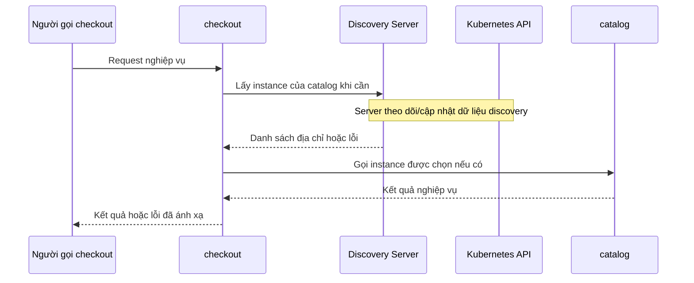

# Timeout, lỗi server và ảnh hưởng đến bên gọi

## Mục tiêu trong chương Discovery Server

Trong module **SPRING_CLOUD_KUBERNETES**, HTTP DiscoveryClient lấy thông tin dịch vụ thông qua Spring Cloud Kubernetes Discovery Server. Thành phần này trở thành một phụ thuộc trên đường tra cứu địa chỉ: nếu server chậm hoặc lỗi, ứng dụng gọi có thể chậm theo, không chọn được instance hoặc tiếp tục dùng một danh sách đã lưu trước đó tùy cấu hình.

Bài học tập trung vào tác động đó, cách đặt giới hạn thời gian, phân biệt nguyên nhân và thiết kế cách phản ứng phù hợp. Sau bài này, bạn có thể:

- Xác định request đang chờ Discovery Server hay đang chờ dịch vụ nghiệp vụ.
- Phân biệt timeout kết nối, timeout phản hồi, deadline tổng và thời gian chờ ở pool.
- Đọc đúng ý nghĩa của lỗi HTTP, danh sách instance rỗng và lỗi lấy danh sách instance.
- Chọn chính sách retry, cache, circuit breaker và giới hạn đồng thời phù hợp.
- Xác minh hành vi khi lỗi xảy ra mà không làm mất khả năng phục vụ của toàn bộ ứng dụng.

Ví dụ dùng ứng dụng `checkout`, dịch vụ đích `catalog` và một Discovery Server trong cluster. Các giá trị thời gian là số liệu thiết kế minh họa; chúng không phải giá trị mặc định hoặc khuyến nghị áp dụng cho mọi hệ thống. Cấu hình và cơ chế thực tế phải đối chiếu với đúng phiên bản Spring Boot, Spring Cloud và Spring Cloud Kubernetes đang dùng.

## 1. Nhìn riêng đường discovery và đường nghiệp vụ



Hình biểu diễn các vai trò, không khẳng định mọi request nghiệp vụ đều tạo một request discovery hoặc server luôn gọi Kubernetes API đồng bộ cho từng lần tra cứu. Cache và cơ chế theo dõi tài nguyên có thể làm đường đi thực tế khác nhau.

Có ba chặng cần quan sát:

| Chặng | Câu hỏi cần trả lời |
|---|---|
| `checkout → Discovery Server` | Có lấy được thông tin dịch vụ trong thời gian cho phép không? |
| `Discovery Server → Kubernetes API` | Dữ liệu discovery có được đọc và cập nhật đúng không? |
| `checkout → catalog` | Sau khi chọn địa chỉ, request nghiệp vụ có thực hiện được không? |

Discovery Server cung cấp API danh mục như `/apps` và `/apps/{name}`; nó không tự là proxy cho request nghiệp vụ của `checkout`. Xem [vai trò và API của Spring Cloud Kubernetes Discovery Server](https://docs.spring.io/spring-cloud-kubernetes/reference/spring-cloud-kubernetes-discoveryserver.html).

Nếu `catalog` vẫn chạy nhưng Discovery Server không truy cập được, một client cần tra cứu mới vẫn có thể thất bại. Ngược lại, tra cứu thành công cũng không chứng minh `catalog` còn nhận kết nối ở địa chỉ vừa trả về.

## 2. Timeout có nhiều phạm vi khác nhau

### 2.1. Những khoảng chờ trong một lần lấy danh sách instance

Một lần HTTP discovery có thể đi qua các khoảng sau:

```text
Chờ được thực thi
  → chờ connection pool
  → phân giải DNS
  → thiết lập TCP
  → bắt tay TLS nếu có
  → gửi request
  → chờ/đọc response
  → giải mã dữ liệu
```

Không phải HTTP transport nào cũng dùng cùng tên hoặc cùng phạm vi cho các timeout:

| Giới hạn | Phần công việc thường cần kiểm soát | Điều dễ hiểu nhầm |
|---|---|---|
| Pool acquisition timeout | Chờ lấy một kết nối từ pool | Connect timeout chưa chắc giới hạn phần chờ này |
| Connect timeout | Thiết lập kết nối tới peer | Không tương đương thời gian tối đa của toàn bộ thao tác |
| TLS handshake timeout | Bắt tay TLS nếu transport tách riêng | Đổi sang HTTPS có thể thêm độ trễ kết nối mới |
| Read/response timeout | Chờ hoặc đọc phản hồi theo semantics của thư viện | Có thể là giới hạn khoảng im lặng, không phải deadline toàn bộ body |
| Operation timeout | Toàn bộ thao tác discovery theo lớp bao ngoài | Không tự bảo đảm lời gọi mạng bên dưới đã dừng |
| Deadline request nghiệp vụ | Tổng thời gian còn lại mà caller chấp nhận | Phải bao gồm cả tra cứu và gọi backend khi chúng nằm trên đường request |

Đặc biệt cần kiểm chứng DNS và TLS có nằm trong giới hạn mà bạn đang cấu hình hay không. Không suy từ tên `readTimeout` rằng toàn bộ đường mạng đã bị chặn bởi một deadline duy nhất.

### 2.2. Hết thời gian chờ không đồng nghĩa đã hủy xong công việc

Một lớp bao ngoài có thể ngừng chờ kết quả, trong khi tác vụ blocking hoặc socket bên dưới vẫn còn hoạt động. Ví dụ, `Future.get(timeout)` giới hạn thời gian thread gọi chờ kết quả, nhưng bản thân nó không thiết lập connect/read timeout cho HTTP transport.

Tương tự, đặt timeout lên một chuỗi reactive không biến một lời gọi blocking tùy ý thành thao tác có khả năng hủy hoàn toàn. Cần kiểm tra hành vi của scheduler, transport và tài nguyên sau khi hủy.

Vì vậy, thiết kế thường cần đồng thời:

- Timeout tại HTTP transport thực sự thực hiện discovery.
- Giới hạn thời gian thao tác và deadline ở lớp gọi.
- Giới hạn số tác vụ, kết nối và hàng đợi để công việc chậm không tích lũy vô hạn.

## 3. Đặt timeout đúng thành phần trong Spring

### 3.1. Phân biệt ba nhóm cấu hình

| Nhóm | Ví dụ hoặc nơi kiểm tra | Phạm vi |
|---|---|---|
| HTTP DiscoveryClient tới Discovery Server | HTTP client/request factory mà starter thực tế sử dụng | Request HTTP lấy dữ liệu discovery |
| Spring Cloud LoadBalancer lấy danh sách instance | `spring.cloud.loadbalancer.service-discovery.timeout` khi dùng supplier tương ứng | Bước lấy instance phục vụ chọn backend |
| HTTP client gọi dịch vụ nghiệp vụ | Cấu hình của RestClient, RestTemplate, WebClient, Feign hoặc thư viện được chọn | Request tới `catalog` |

Không lấy thuộc tính `spring.cloud.kubernetes.client.request-timeout` rồi mặc định nó điều khiển HTTP DiscoveryClient. Nhóm `kubernetes.client` phục vụ Kubernetes API client tương ứng; việc nó áp dụng cho chặng nào phụ thuộc thành phần sử dụng. Các thuộc tính `cache-loading-timeout-seconds` và `wait-cache-ready` liên quan khởi tạo cache discovery, không phải giới hạn cho mọi request nghiệp vụ. Đối chiếu [phụ lục cấu hình Spring Cloud Kubernetes](https://docs.spring.io/spring-cloud-kubernetes/reference/appendix.html).

Cách xác định điểm cấu hình đúng là đọc dependency và auto-configuration của phiên bản đang chạy, biết transport nào được tạo, rồi kiểm tra timeout hiệu lực bằng một lần gọi bị trì hoãn có kiểm soát. Không tự thêm một key `discovery.read-timeout` nếu phiên bản đó không cung cấp thuộc tính này.

### 3.2. Ví dụ giới hạn tại supplier của LoadBalancer

Nếu đường gọi dùng `DiscoveryClientServiceInstanceListSupplier` hỗ trợ thuộc tính này, có thể cấu hình:

```yaml
spring:
  cloud:
    loadbalancer:
      service-discovery:
        timeout: 500ms
```

Đây là giới hạn của bước lấy instance qua supplier; nó không phải cấu hình chung cho mọi lần gọi trực tiếp `discoveryClient.getInstances(...)`. Thuộc tính được liệt kê trong [Configuration Properties của Spring Cloud Commons](https://docs.spring.io/spring-cloud-commons/reference/configprops.html).

Trong implementation được tham chiếu, supplier có thể xử lý timeout hoặc lỗi discovery bằng cách trả danh sách rỗng cho lớp lựa chọn instance. Vì vậy, một thông báo kiểu “không có instance” ở phía LoadBalancer có thể là biểu hiện sau xử lý lỗi, chưa đủ để kết luận Kubernetes không có backend. Xem [mã nguồn DiscoveryClientServiceInstanceListSupplier](https://github.com/spring-cloud/spring-cloud-commons/blob/main/spring-cloud-loadbalancer/src/main/java/org/springframework/cloud/loadbalancer/core/DiscoveryClientServiceInstanceListSupplier.java) và đối chiếu tag đúng phiên bản triển khai.

Không suy rằng cấu hình `500ms` đã giải phóng ngay mọi socket hoặc tác vụ bên dưới. Sau khi giới hạn chờ hoạt động, vẫn cần kiểm tra số tác vụ và kết nối còn đang sử dụng.

## 4. Phân bổ ngân sách thời gian cho bên gọi

Giả sử một request `checkout` cần hoàn thành trong **1.500 ms**. Với đường đi tuần tự và một lần tra cứu không có cache hit, có thể thiết kế ngân sách ban đầu như sau:

| Thành phần | Ngân sách minh họa |
|---|---:|
| Xử lý cục bộ trước/sau gọi phụ thuộc | 100 ms |
| Toàn bộ bước discovery | 500 ms |
| Toàn bộ request tới `catalog` | 700 ms |
| Dự phòng cho lập lịch, truyền phản hồi và biến động | 200 ms |
| Tổng | 1.500 ms |

Với giả định trên:

```text
Tổng ≈ xử lý cục bộ + discovery + gọi catalog + dự phòng
```

Nếu discovery chờ đến 2 giây, toàn bộ request đã vượt mục tiêu trước khi kịp gọi backend. Tăng timeout discovery có thể làm giảm số timeout tại lớp đó nhưng làm tăng thời gian chờ của người dùng và lượng tài nguyên bị giữ.

Khi có retry, tổng ngân sách phải tính mọi lần thử và khoảng nghỉ:

```text
Ngân sách discovery 500 ms
Lần thử 1: tối đa 180 ms
Nghỉ trước retry: tối đa 60 ms
Lần thử 2: tối đa 180 ms
Còn lại: 80 ms cho chi phí khác
```

Đây là phép phân bổ, không phải bằng chứng thời gian thực tế đã được chặn đúng. Phải đo với cả kết nối mới, kết nối tái sử dụng và lúc pool bận. Nếu connect, DNS hoặc thời gian chờ pool nằm ngoài giới hạn mỗi lần thử, tổng vẫn có thể vượt ngân sách.

Ở mọi bước, dùng thời gian còn lại của deadline. Không bắt đầu một retry có thể chờ 180 ms khi caller chỉ còn 40 ms. Nếu gateway đã trả lỗi cho người dùng mà ứng dụng vẫn tiếp tục tra cứu và retry, tài nguyên vẫn bị tiêu tốn dù kết quả không còn hữu ích.

## 5. Phân loại lỗi trước khi chọn cách phản ứng

| Quan sát | Ý nghĩa có thể có | Hướng xử lý ban đầu |
|---|---|---|
| DNS resolution lỗi | Sai tên Service/namespace/domain hoặc DNS có vấn đề | Kiểm tra URL và DNS từ môi trường caller |
| Connection refused | Cổng không có listener hoặc đường Service không có đích dùng được | Kiểm tra cổng, endpoint và trạng thái Pod server |
| Connect timeout | Không thiết lập kết nối kịp; có thể liên quan đường mạng hoặc quá tải | Kiểm tra mạng, policy, server và pool theo bằng chứng |
| Read/response timeout | Đã kết nối nhưng không nhận phản hồi theo giới hạn của transport | Kiểm tra độ trễ server, proxy, tải và giới hạn client |
| TLS/certificate lỗi | Không xác minh được peer hoặc bắt tay không tương thích | Sửa trust material, hostname, chứng thư hoặc cấu hình TLS |
| HTTP `401`/`403` từ endpoint discovery | Lớp bảo vệ API từ chối client | Kiểm tra xác thực và quyền HTTP |
| Server log có `403 Forbidden` từ Kubernetes API | ServiceAccount thiếu quyền cho tài nguyên/phạm vi cần đọc | Sửa RBAC phía server |
| HTTP `404` | Có thể sai URL/path hoặc không đúng API server dự kiến | Kiểm tra hợp đồng endpoint của đúng phiên bản |
| HTTP `429`, `502`, `503`, `504` | Có thể do quá tải, proxy hoặc backend lỗi | Xác định nơi phát sinh và chính sách retry được phép |
| HTTP `200` với dữ liệu không giải mã được | Response không đúng hợp đồng hoặc client/server không tương thích | Kiểm tra nội dung, proxy và bộ phiên bản |
| Danh sách instance rỗng hợp lệ | Chưa có backend phù hợp hoặc đã bị lọc | Kiểm tra Service, namespace, selector, readiness và bộ lọc |

Không retry liên tục lỗi cấu hình cố định như sai URL, sai CA hoặc thiếu RBAC. Retry phù hợp hơn với lỗi tạm thời đã được nhận diện và còn ngân sách.

### Ba trạng thái phải quan sát được

Về mặt ứng dụng, cần phân biệt:

1. **Đọc thành công, có instance:** có thể bước sang chọn và gọi backend.
2. **Đọc thành công, danh sách rỗng:** tra cứu hoạt động nhưng không có địa chỉ phù hợp tại thời điểm đó.
3. **Không đọc được kết quả:** timeout, transport lỗi, HTTP lỗi hoặc giải mã thất bại.

Không bắt mọi exception rồi trả `List.of()` mà không giữ dấu vết lỗi. Cách đó khiến dashboard và người vận hành không phân biệt được “không có backend” với “mất khả năng tra cứu”. Nếu thư viện trung gian đã chuyển lỗi thành danh sách rỗng, bổ sung quan sát ở phía trước điểm chuyển đổi hoặc tại HTTP transport.

## 6. Lỗi discovery lan tới bên gọi ra sao?

### 6.1. Độ trễ và cạn tài nguyên

Khi request nghiệp vụ phải chờ discovery, thời gian chờ đó giữ các tài nguyên liên quan. Với lời gọi blocking, thường có thread bị giữ; với luồng reactive, vẫn có connection, bộ nhớ, trạng thái subscription và hàng đợi cần giới hạn.

Ở mức 200 request/giây, một cửa sổ chờ 2 giây có thể tích lũy khoảng 400 lời gọi nếu chưa có cơ chế giảm tải hoặc trả lỗi. Đây là minh họa theo tốc độ đến và thời gian giữ tài nguyên, không phải dự đoán chính xác cho mọi tải. Khi hàng đợi dài thêm, những endpoint không cần `catalog` cũng có thể chậm nếu chúng dùng chung tài nguyên.

Chỉ chuyển sang reactive không làm phụ thuộc biến mất. Cần đo và giới hạn số thao tác đang chờ ở cả hai mô hình.

### 6.2. Kết quả lỗi tới API bên ngoài

Ứng dụng nên có chính sách ánh xạ lỗi phụ thuộc rõ ràng. Ví dụ, API `checkout` có thể trả `503 Service Unavailable` cho trường hợp không thể xác định backend cần thiết:

```json
{
  "code": "DEPENDENCY_DISCOVERY_UNAVAILABLE",
  "message": "Dich vu phu thuoc tam thoi khong san sang",
  "traceId": "example-trace-id"
}
```

Đó là lựa chọn hợp đồng API của ví dụ, không phải mã phản hồi được mọi integration tự tạo. Một gateway hoặc HTTP client khác có thể biểu diễn lỗi bằng exception hay status khác. Cần kiểm tra đường ánh xạ thực tế và giữ nguyên cause trong log nội bộ.

Nếu trả một kết quả dự phòng, phải giữ đúng ý nghĩa nghiệp vụ. Không biến việc không lấy được `catalog` thành thông tin “sản phẩm không tồn tại”, giá bằng 0 hoặc đặt hàng thành công.

### 6.3. Request đang chạy và kết nối đã có

Một kết nối nghiệp vụ đã được thiết lập không nhất thiết cần tra cứu lại ngay khi Discovery Server lỗi. Những request tiếp theo có thể dùng danh sách đã cache hoặc yêu cầu tra cứu mới tùy đường gọi. Vì vậy, sự cố có thể xuất hiện thành lỗi ngắt quãng hoặc tăng dần sau khi cache hết hạn.

Theo dõi cả thời điểm bắt đầu lỗi, tuổi dữ liệu và lần làm mới gần nhất. Không kết luận “server hỏng nhưng ứng dụng không bị ảnh hưởng” chỉ vì một vài request trên kết nối hoặc dữ liệu cũ vẫn thành công.

## 7. Retry, circuit breaker và giới hạn đồng thời

### 7.1. Retry có giới hạn và có lý do

Một lần retry có thể vượt qua lỗi tạm thời, nhưng mỗi lần thử lại cũng tạo thêm tải lên server đang khó khăn. Nên xác định:

- Nhóm lỗi nào được thử lại.
- Tổng số lần thử, gồm cả lần đầu tiên.
- Backoff có giới hạn và jitter để nhiều client không thử lại cùng lúc.
- Deadline tổng và lượng request retry tối đa.

Ví dụ ba lớp đều cho phép tối đa hai lần thử thì một thao tác ban đầu có thể kéo theo tới `2 × 2 × 2 = 8` lần thử ở lớp sâu nhất, tùy đường thực thi. Cần kiểm tra retry ở gateway, client nghiệp vụ, LoadBalancer và HTTP discovery để tránh nhân tải ngoài dự kiến.

Tra cứu danh mục là thao tác đọc, nhưng retry toàn bộ nghiệp vụ có thể thực hiện lại một hành động ghi đã thành công ở backend mà caller chưa nhận được response. Yêu cầu idempotency của nghiệp vụ vẫn tồn tại. Xem [phân tích timeout, retry và backoff của AWS Builders Library](https://aws.amazon.com/builders-library/timeouts-retries-and-backoff-with-jitter/).

Trong một phép thử muốn cô lập retry do Spring Cloud LoadBalancer cung cấp, có thể dùng cấu hình sau nếu integration và phiên bản hỗ trợ:

```yaml
spring:
  cloud:
    loadbalancer:
      retry:
        enabled: false
```

Key này chỉ điều khiển retry của LoadBalancer tương ứng. Nó không tắt retry ở reverse proxy, thư viện HTTP discovery hoặc mã ứng dụng tự viết. Tài liệu [Spring Cloud LoadBalancer](https://docs.spring.io/spring-cloud-commons/reference/spring-cloud-commons/loadbalancer.html) mô tả các cơ chế cache và retry của thành phần này.

### 7.2. Circuit breaker

Circuit breaker có thể tạm ngừng gửi thêm yêu cầu khi phụ thuộc liên tục lỗi và chỉ cho số lượng thử giới hạn khi kiểm tra phục hồi. Cần quyết định nó bảo vệ riêng bước discovery hay cả một thao tác nghiệp vụ; hai lựa chọn có thống kê lỗi và ý nghĩa fallback khác nhau.

Starter HTTP discovery không tự bảo đảm có một circuit breaker với chính sách phù hợp. Nếu bổ sung, xác định rõ điều kiện tính lỗi, cửa sổ đo, thời gian mở, số lần thử lúc phục hồi và cách quan sát trạng thái.

Không gộp việc dịch vụ không có instance theo thiết kế, lỗi quyền HTTP và timeout vào cùng một số đếm mà không cân nhắc ý nghĩa. Circuit breaker giúp giới hạn tác động; nó không sửa cấu hình hoặc tạo ra instance mới.

### 7.3. Giới hạn đồng thời và hàng đợi

Bulkhead giới hạn số thao tác một phụ thuộc được phép chiếm cùng lúc. Ví dụ, bước discovery có thể có giới hạn riêng để không chiếm hết tài nguyên phục vụ các API độc lập. Số giới hạn cần dựa vào tải và khả năng xử lý đã đo.

Nếu hàng đợi đã đầy, trả lỗi có kiểm soát thường tốt hơn việc tiếp nhận vô hạn rồi timeout hàng loạt. Không tạo một thread pool mới cho mỗi request hoặc dùng executor không giới hạn để “đẩy việc chờ sang nền”.

## 8. Cache giảm phụ thuộc tức thời nhưng có giới hạn

Cần biết cache nằm ở đâu: phía Discovery Server, trong DiscoveryClient, ở supplier của LoadBalancer hay trong mã ứng dụng. Chúng có vòng đời và quy tắc hết hạn khác nhau.

| Trạng thái dữ liệu phía caller | Điều có thể làm theo chính sách đã thiết kế | Rủi ro cần kiểm soát |
|---|---|---|
| Có dữ liệu còn hiệu lực | Chọn instance từ dữ liệu đã lưu | Backend có thể đã thay đổi sau lần làm mới |
| Dữ liệu hết hạn, server hoạt động | Làm mới rồi chọn instance | Tăng độ trễ ở lần làm mới |
| Dữ liệu hết hạn, server lỗi | Trả lỗi hoặc dùng dữ liệu cũ trong giới hạn riêng nếu đã triển khai | TTL thông thường không tự cho phép tiếp tục dùng dữ liệu cũ |
| Chưa có dữ liệu lần nào | Tra cứu hoặc trả lỗi khi tra cứu không được | Không có danh sách cũ để dự phòng |

Ví dụ cấu hình cache LoadBalancer trong một môi trường thực hành:

```yaml
spring:
  cloud:
    loadbalancer:
      cache:
        enabled: true
        ttl: 5s
```

Ví dụ chỉ có tác dụng khi đường supplier thực tế có lớp caching tương ứng và không bị cấu hình cache khác ghi đè. Nó không cam kết phục vụ dữ liệu hết hạn khi server lỗi. Cách cấu hình cache và trường hợp Caffeine specification ghi đè các thiết lập chung được nêu trong [tài liệu cache của Spring Cloud LoadBalancer](https://docs.spring.io/spring-cloud-commons/reference/spring-cloud-commons/loadbalancer.html#loadbalancer-caching).

Nếu chủ động thiết kế việc dùng dữ liệu cũ khi lỗi, cần lưu thời điểm tra cứu thành công cuối cùng, giới hạn tuổi tối đa, cơ chế thử làm mới và dấu hiệu đang phục vụ ở chế độ suy giảm. Với dữ liệu quá cũ, Pod đã bị thay thế hoặc IP được tái sử dụng, tiếp tục gọi địa chỉ đó có thể gây lỗi hoặc đi sai đích.

Không tự chuyển sang một namespace khác hoặc backend được viết cứng chỉ vì discovery hiện tại lỗi. Một đường dự phòng phải có cùng yêu cầu về định danh, quyền truy cập và ý nghĩa nghiệp vụ.

## 9. Khởi động, readiness và liveness khi server lỗi

### 9.1. Ứng dụng mới khởi động

Ứng dụng chưa từng lấy được danh sách instance khác với ứng dụng đang phục vụ và còn cache hợp lệ. Quyết định xử lý khi khởi động cần trả lời:

- Mọi chức năng có bắt buộc cần discovery ngay không?
- Có được khởi động rồi chỉ trả lỗi ở chức năng phụ thuộc không?
- Khi chưa sẵn sàng, chờ bao lâu và ai quan sát được nguyên nhân?

Không dùng chính sách chờ vô hạn để giữ Pod ở trạng thái khởi động không rõ kết quả. Cũng không mặc định rằng ứng dụng phải thoát chỉ vì một lần đọc discovery tạm thời lỗi; hành vi phải phù hợp với cách tích hợp và yêu cầu thực tế.

### 9.2. Readiness theo khả năng phục vụ

Readiness trả lời ứng dụng có nên nhận traffic hay không. Nếu mất discovery khiến mọi request thiết yếu đều không phục vụ được, có thể cân nhắc đưa trạng thái đó vào quyết định readiness. Nếu chỉ một nhóm chức năng phụ thuộc và phần còn lại vẫn hoạt động, loại toàn bộ Pod khỏi Service có thể làm ảnh hưởng rộng hơn cần thiết.

Liveness trả lời liệu tiến trình có cần được khởi động lại. Không buộc liveness thất bại chỉ vì một Discovery Server dùng chung đang mất kết nối: restart mọi caller không sửa được phụ thuộc dùng chung và có thể tạo một đợt tải khởi động mới. Đây cũng là nguyên tắc trong [hướng dẫn Kubernetes probes của Spring Boot](https://docs.spring.io/spring-boot/reference/actuator/endpoints.html#actuator.endpoints.kubernetes-probes).

Kubernetes phản ứng khác nhau với readiness và liveness: readiness không đạt làm Pod không được chọn nhận traffic Service theo cơ chế sẵn sàng; liveness thất bại đủ ngưỡng có thể dẫn đến restart container. Xem [Liveness, Readiness, and Startup Probes](https://kubernetes.io/docs/concepts/workloads/pods/probes/).

Nếu toàn bộ caller đều bị đánh dấu không sẵn sàng do cùng một phụ thuộc, một Service có thể không còn backend nhận traffic. Cách thể hiện lỗi tới người dùng còn phụ thuộc Ingress, gateway và đường mạng; không giả định mọi trường hợp đều tự trả HTTP `503`.

## 10. Ghi nhận thời gian và lỗi ngay tại lớp tra cứu

Ví dụ sau đo một lời gọi trực tiếp tới `DiscoveryClient`. Nó giữ nguyên exception thay vì biến lỗi thành danh sách rỗng. Đoạn mã không cài đặt timeout, retry hoặc cache; các giới hạn đó phải được cấu hình ở đúng thành phần như các phần trên.

```java
package example.checkout;

import java.util.List;
import java.util.concurrent.TimeUnit;

import org.slf4j.Logger;
import org.slf4j.LoggerFactory;
import org.springframework.cloud.client.ServiceInstance;
import org.springframework.cloud.client.discovery.DiscoveryClient;
import org.springframework.stereotype.Component;

@Component
public class CatalogDiscoveryObserver {

    private static final Logger log =
            LoggerFactory.getLogger(CatalogDiscoveryObserver.class);

    private final DiscoveryClient discoveryClient;

    public CatalogDiscoveryObserver(DiscoveryClient discoveryClient) {
        this.discoveryClient = discoveryClient;
    }

    public List<ServiceInstance> findCatalogInstances() {
        long startedAt = System.nanoTime();
        String outcome = "error";

        try {
            List<ServiceInstance> instances =
                    discoveryClient.getInstances("catalog");

            outcome = instances.isEmpty() ? "empty" : "success";
            return instances;
        }
        catch (RuntimeException ex) {
            log.warn("Discovery failed for service=catalog", ex);
            throw ex;
        }
        finally {
            long elapsedMs = TimeUnit.NANOSECONDS.toMillis(
                    System.nanoTime() - startedAt);
            log.info("Discovery service=catalog outcome={} elapsedMs={}",
                    outcome, elapsedMs);
        }
    }
}
```

Trong ví dụ, `empty` chỉ nghĩa là lời gọi trả một danh sách rỗng tại ranh giới đang đo. Nếu một delegate phía dưới đã che lỗi, cần quan sát thêm tại delegate/transport. Không thể khôi phục nguyên nhân chỉ từ kích thước danh sách.

Đối với tải production, dùng timer, counter và tracing phù hợp thay vì ghi một log INFO cho mọi lần tra cứu. Các nhãn metric nên có số lượng giá trị hữu hạn, ví dụ nhóm kết quả và tên dịch vụ đã kiểm soát; tránh đưa trace ID, Pod IP thay đổi liên tục hoặc nội dung exception vào nhãn.

Những số liệu hữu ích gồm:

- Latency và tỷ lệ timeout/lỗi của bước discovery, tách với latency backend.
- Số lần thử cho một thao tác, lượng retry và số request bị từ chối vì giới hạn đồng thời.
- Cache hit/miss, thời điểm làm mới thành công cuối cùng và tuổi dữ liệu đang dùng.
- Kết nối/tác vụ đang chờ, queue depth và mức sử dụng pool.
- Latency HTTP server, restart, readiness và lỗi đọc Kubernetes API phía Discovery Server.

Giữ liên kết trace giữa request vào `checkout`, bước lấy instance và request tới `catalog` khi hạ tầng quan sát hỗ trợ. Nhờ vậy có thể biết request đã thất bại trước hay sau khi chọn backend.

## 11. Thực hành lỗi có kiểm soát

Chỉ thực hiện trong môi trường thử nghiệm đã được chuẩn bị, với endpoint hoặc proxy thử riêng cho đường discovery. Những ví dụ dưới đây là hướng dẫn học; không yêu cầu gây lỗi trên hệ thống đang phục vụ người dùng.

### 11.1. Đo riêng API discovery

Từ một môi trường Linux có cùng đường mạng với caller, có thể dùng:

```bash
curl --silent --show-error --fail-with-body \
  --connect-timeout 0.2 --max-time 1.5 \
  --output /dev/null \
  --write-out 'http_code=%{http_code} dns=%{time_namelookup} connect=%{time_connect} tls=%{time_appconnect} first_byte=%{time_starttransfer} total=%{time_total}\n' \
  http://discovery-server.platform.svc.cluster.local:80/apps/catalog
```

Các mốc thời gian `curl` là số đo của lệnh thử; nhiều mốc là thời gian tích lũy tính từ đầu thao tác, không được cộng trực tiếp với nhau. `http_code=000` là dấu hiệu chưa nhận được HTTP status trong phép thử, không phải mã HTTP server trả về. Timeout của `curl` cũng không cấu hình timeout cho JVM.

Điều chỉnh URL, TLS và thông tin xác thực theo môi trường. Ghi thêm exit code và thời điểm thử để đối chiếu với log server.

### 11.2. Các tình huống cần thử và điều cần quan sát

| Kịch bản trong môi trường thử | Quan sát quan trọng |
|---|---|
| Server trả danh sách hợp lệ ngay | Latency nền và khả năng gọi backend |
| Proxy thử trì hoãn phản hồi lâu hơn deadline discovery | Caller kết thúc đúng giới hạn và tài nguyên được thu hồi |
| Endpoint thử trả `503` | Retry có giới hạn, không tạo tải thử lại vô hạn |
| Endpoint thử trả `401` hoặc response sai định dạng | Phân loại đúng lỗi, không che thành “không có sản phẩm” |
| Server trả danh sách rỗng hợp lệ | Kết quả rỗng được phân biệt với lỗi transport |
| Chưa có cache rồi mất kết nối server | Hành vi khởi động hoặc lần gọi đầu tiên đúng hợp đồng |
| Đã có cache rồi server lỗi, sau đó cache hết hạn | Hành vi trước/sau hết hạn và tuổi dữ liệu được quan sát |
| Một endpoint nghiệp vụ không cần discovery được gọi đồng thời | Chức năng độc lập không bị nghẽn bởi tài nguyên dùng chung |
| Server phục hồi | Giảm lỗi, làm mới danh sách và không bùng tải đồng loạt |

Với mỗi kịch bản, ghi deadline mong muốn, thời gian thực tế, số lần thử, kết quả API, số tác vụ/kết nối còn treo và tình trạng health của caller. Chỉ nhìn một response lỗi nhanh chưa đủ để kết luận cơ chế timeout đã giải phóng tài nguyên đúng.

Nếu thử nhiều replica Discovery Server, kiểm tra cả từng replica và lỗi dùng chung như DNS hoặc Kubernetes API. Thêm replica có thể giảm tác động của một Pod server lỗi, nhưng không tự loại bỏ mọi điểm phụ thuộc chung hoặc bảo đảm các replica có dữ liệu mới như nhau.

## 12. Khi cấu hình và chứng thư thay đổi

Trong phạm vi module, ConfigMap, Secret và Configuration Watcher có thể tham gia cung cấp hoặc thông báo cập nhật cấu hình. Chúng không mặc nhiên sửa một client đã giữ URL cũ, thay trust material của mọi connection pool hoặc giảm tải khi server quá chậm.

Nếu URL hoặc timeout được đưa vào container bằng biến môi trường từ ConfigMap, thay ConfigMap không đổi biến của tiến trình đang chạy. Cần rollout hoặc cơ chế tái tạo ứng dụng/client đã được thiết kế. Với Secret chứa chứng thư, xác định cách nạp lại vật liệu TLS và thời điểm kết nối mới thực sự dùng dữ liệu đó.

Sau thay đổi, đối chiếu cấu hình hiệu lực, phiên bản client/server và kết quả phép thử lỗi. Không công bố đã khắc phục chỉ vì giá trị mới xuất hiện trong tài nguyên Kubernetes.

Một thiết kế có thể chấp nhận sự cố Discovery Server cần trả lời được bốn điều: caller chờ tối đa bao lâu, tải phát sinh khi thử lại bị giới hạn thế nào, dữ liệu cũ được dùng trong điều kiện nào và người dùng nhận kết quả gì khi không thể xác định backend. Các câu trả lời phải được kiểm chứng trên đúng đường gọi mà ứng dụng sử dụng.
