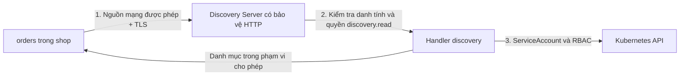

# Giới hạn truy cập và bảo vệ endpoint khám phá

> Chương: Discovery Server  
> Module: SPRING_CLOUD_KUBERNETES

Endpoint khám phá có thể cung cấp tên dịch vụ, địa chỉ instance, cổng và metadata của hệ thống. Vì vậy, quyền đọc danh mục cần được thiết kế cùng với quyền gọi API nghiệp vụ. Một ứng dụng được phép gọi một API sản phẩm chưa đương nhiên cần xem toàn bộ danh mục dịch vụ.

Spring Cloud Kubernetes Discovery Server đọc dữ liệu Kubernetes và cung cấp giao diện HTTP cho caller. Bài này trình bày cách giới hạn dữ liệu server đọc, giới hạn nguồn kết nối và xác thực, phân quyền request HTTP. Ví dụ sử dụng namespace `platform-discovery` cho server và `shop` cho các ứng dụng được khám phá.

Các manifest, đoạn Java và kết quả kỳ vọng dưới đây là tài liệu thực hành. Chúng chưa được áp dụng hoặc chạy trên một cluster cụ thể. Ví dụ Java dành cho bản build tùy biến dùng Spring Boot 3.x, WebFlux và Spring Security 6.x, cùng bộ Spring Cloud Kubernetes tương thích do dự án quản lý.

## 1. Mục tiêu bảo vệ

Sau bài học, bạn có thể:

- Xác định thông tin có thể bị công bố qua API khám phá.
- Phân biệt quyền Kubernetes của server với quyền HTTP của caller.
- Viết NetworkPolicy giới hạn nguồn kết nối theo namespace và nhãn Pod.
- Thiết kế xác thực máy với máy và quyền đọc discovery.
- Bảo vệ TLS, credential, metadata và endpoint quản trị.
- Xây dựng phép kiểm tra cho cả request được phép và request phải bị từ chối.

Trong tình huống minh họa, `orders` cần khám phá các instance của `catalog`. Một Pod khác, dù cùng cluster, không mặc nhiên được quyền nhận danh mục đó.

## 2. Xác định những endpoint và dữ liệu cần bảo vệ

Các đường dẫn HTTP discovery được tài liệu Spring mô tả gồm:

| Endpoint | Dữ liệu trả về |
| --- | --- |
| `GET /apps` | Danh mục dịch vụ cùng các instance |
| `GET /apps/{name}` | Các instance của một dịch vụ |
| `GET /app/{name}/{instanceid}` | Thông tin một instance |

Đường dẫn cuối sử dụng `app` ở dạng số ít. Xem [giao diện Discovery Server](https://docs.spring.io/spring-cloud-kubernetes/reference/spring-cloud-kubernetes-discoveryserver.html#_endpoints).

Một response có thể chứa thông tin như:

```json
{
  "serviceId": "catalog",
  "host": "10.42.3.20",
  "port": 8080,
  "namespace": "shop",
  "metadata": {
    "app": "catalog",
    "release-track": "internal"
  }
}
```

Đây là dữ liệu minh họa đã rút gọn. Nó đủ để thấy ba dạng thông tin cần xét:

- **Danh tính dịch vụ:** tên ứng dụng và namespace có thể bộc lộ cấu trúc hệ thống.
- **Vị trí mạng:** host và cổng giúp xác định các đích kết nối nội bộ.
- **Metadata:** label hoặc annotation có thể mang thông tin triển khai ngoài nhu cầu discovery.

Với ví dụ này, hãy xác định trước caller cần xem danh mục nào, trường dữ liệu nào phục vụ lựa chọn instance và trường nào có thể bỏ. Việc response chỉ phục vụ thao tác đọc vẫn cần phân quyền khi dữ liệu có giá trị nội bộ.

## 3. Ba ranh giới cần kiểm soát độc lập



| Ranh giới | Câu hỏi cần trả lời | Cơ chế minh họa |
| --- | --- | --- |
| Mạng | Pod nào có thể mở kết nối tới server? | ClusterIP và NetworkPolicy |
| HTTP | Danh tính nào được đọc endpoint discovery? | JWT, kiểm tra audience và scope |
| Kubernetes API | Server được đọc tài nguyên trong phạm vi nào? | ServiceAccount, Role và RoleBinding |

Từ luồng trên có thể rút ra những giới hạn thực tế:

- Chỉ cấp một Role hẹp cho server vẫn để lại câu hỏi ai được gọi API HTTP của nó.
- Chỉ kiểm tra JWT vẫn để lại câu hỏi phạm vi dữ liệu mà server đã đọc và công bố.
- Chỉ giới hạn mạng theo nhãn Pod vẫn để lại câu hỏi ai được tạo hoặc sửa workload mang nhãn đó.

Các cơ chế bổ sung cho nhau. Khi đánh giá thiết kế, phải xác định rõ mỗi cơ chế đang đưa ra quyết định tại ranh giới nào.

### 3.1. Danh tính Kubernetes và danh tính HTTP

ServiceAccount của Discovery Server là danh tính dùng để đọc Kubernetes API trong ví dụ. Access token của `orders` là credential mà server kiểm tra khi nhận request HTTP.

Không suy ra rằng một token ServiceAccount bất kỳ sẽ được Discovery Server tự chấp nhận. Nếu muốn dùng danh tính workload hoặc xác thực dựa trên Kubernetes token, phải thiết kế bên kiểm tra, audience và cách ánh xạ quyền tương ứng.

Tương tự, RoleBinding của `orders` không tự được áp dụng cho `GET /apps/catalog`. Trong mô hình HTTP, ứng dụng server hoặc lớp bảo vệ trước nó phải đưa ra quyết định phân quyền request.

## 4. Giới hạn phạm vi server đọc từ Kubernetes

Trong mô hình HTTP discovery, phạm vi namespace tìm kiếm được cấu hình ở phía server. Tài liệu Spring mô tả sự khác biệt này trong [cấu hình DiscoveryClient](https://docs.spring.io/spring-cloud-kubernetes/reference/discovery-client.html).

Cấu hình minh họa cho server:

```yaml
spring:
  cloud:
    kubernetes:
      discovery:
        all-namespaces: false
        namespaces:
          - shop
```

Kết hợp phạm vi đó với một ServiceAccount chuyên dụng:

```yaml
apiVersion: v1
kind: ServiceAccount
metadata:
  name: discovery-reader
  namespace: platform-discovery
---
apiVersion: rbac.authorization.k8s.io/v1
kind: Role
metadata:
  name: discovery-reader
  namespace: shop
rules:
  - apiGroups: [""]
    resources: ["services", "pods", "endpoints"]
    verbs: ["get", "list", "watch"]
---
apiVersion: rbac.authorization.k8s.io/v1
kind: RoleBinding
metadata:
  name: discovery-reader
  namespace: shop
subjects:
  - kind: ServiceAccount
    name: discovery-reader
    namespace: platform-discovery
roleRef:
  apiGroup: rbac.authorization.k8s.io
  kind: Role
  name: discovery-reader
```

Role trên minh họa một triển khai đọc tài nguyên `Endpoints`. Nếu phiên bản và chế độ server thực tế sử dụng `EndpointSlice`, bổ sung quy tắc cần thiết rồi loại các quyền không còn dùng:

```yaml
- apiGroups: ["discovery.k8s.io"]
  resources: ["endpointslices"]
  verbs: ["get", "list", "watch"]
```

Không coi việc cấp đồng thời mọi tài nguyên là định nghĩa của quyền tối thiểu. Cần đối chiếu tài nguyên được server thực sự sử dụng. Tài liệu [quyền của Discovery Server](https://docs.spring.io/spring-cloud-kubernetes/reference/spring-cloud-kubernetes-discoveryserver.html#_permissions) nêu các thao tác đọc cần thiết cho discovery.

Deployment của server phải tham chiếu ServiceAccount đó tại `spec.template.spec.serviceAccountName`. Trong ví dụ, server cần credential để đọc Kubernetes API; không tắt mount token của server một cách máy móc khi chưa có phương thức xác thực thay thế.

Role có phạm vi namespace; RoleBinding có thể tham chiếu một ServiceAccount ở namespace khác. Quyền RBAC có tính cộng gộp, nên cần xét các binding khác của cùng danh tính. Xem [RBAC Kubernetes](https://kubernetes.io/docs/reference/access-authn-authz/rbac/).

Với chức năng discovery trong bài, không có nhu cầu cấp quyền sửa workload hoặc liệt kê Secret. Nếu server còn thực hiện chức năng khác, hãy ghi rõ lý do và tách yêu cầu quyền của chức năng đó.

## 5. Giới hạn đường mạng tới server

### 5.1. Công bố bằng Service nội bộ

Bản server tùy biến của lab sẽ nghe HTTPS tại cổng 8443. Service ánh xạ cổng 443 tới cổng này:

```yaml
apiVersion: v1
kind: Service
metadata:
  name: kubernetes-discovery
  namespace: platform-discovery
spec:
  type: ClusterIP
  selector:
    app: kubernetes-discovery
  ports:
    - name: https
      port: 443
      targetPort: 8443
      protocol: TCP
```

Cổng 8443 ở đây là lựa chọn của lab. Phải cấu hình tiến trình server tương ứng; riêng tên `https` của Service không bật TLS.

Dùng ClusterIP giúp giữ đường công bố Service ở phạm vi nội bộ theo mô hình mạng cluster. Việc giới hạn caller bên trong cluster vẫn cần chính sách riêng. Đồng thời kiểm tra hệ thống có Ingress, Gateway, NodePort, hostPort hoặc đường công bố khác tới cùng backend hay không.

### 5.2. Chỉ cho một nhóm Pod mở kết nối

Policy minh họa:

```yaml
apiVersion: networking.k8s.io/v1
kind: NetworkPolicy
metadata:
  name: discovery-ingress-from-orders
  namespace: platform-discovery
spec:
  podSelector:
    matchLabels:
      app: kubernetes-discovery
  policyTypes:
    - Ingress
  ingress:
    - from:
        - namespaceSelector:
            matchLabels:
              kubernetes.io/metadata.name: shop
          podSelector:
            matchLabels:
              app: orders
              discovery-client: "true"
      ports:
        - protocol: TCP
          port: 8443
```

Hai selector nằm trong cùng một phần tử `from`: nguồn phải đồng thời thuộc namespace `shop` và có các nhãn Pod được chỉ định. Nếu tách thành hai phần tử, tập nguồn cho phép sẽ rộng hơn theo cách kết hợp OR.

Policy chọn cổng đích của Pod là 8443, tương ứng với `targetPort` của Service. Cần kiểm tra mạng cluster thực sự hỗ trợ và thực thi NetworkPolicy; chỉ tạo thành công đối tượng policy chưa chứng minh traffic đã bị chặn.

NetworkPolicy có tính cộng gộp: policy khác có thể cho phép thêm nguồn. Kết nối cũng chịu egress policy của Pod nguồn nếu có. Các quy tắc và cách kết hợp được mô tả trong [NetworkPolicy Kubernetes](https://kubernetes.io/docs/concepts/services-networking/network-policies/).

Ví dụ này chỉ cấu hình ingress. Nếu môi trường đã giới hạn egress, cần cho phép đúng các kết nối phụ thuộc như caller tới server, server tới Kubernetes API, DNS và nơi cung cấp khóa xác minh JWT. Không mở egress toàn bộ chỉ để che một lỗi kết nối chưa xác định.

### 5.3. Nhãn là một phần của chính sách vận hành

Policy trên giả định quyền tạo workload và quyền sửa nhãn được kiểm soát. Một người có thể tạo Pod mang nhãn `app: orders` trong namespace `shop` có thể khiến Pod đó thỏa điều kiện mạng.

Vì vậy, hãy xem nhãn như dữ liệu phục vụ lựa chọn nguồn mạng. Xác thực HTTP vẫn cần kiểm tra credential của caller. Với các ranh giới tin cậy chặt hơn, có thể đánh giá danh tính workload và mTLS theo cơ chế của nền tảng.

## 6. Thêm xác thực và phân quyền HTTP

Có hai cách bố trí thường gặp:

| Bố trí | Điểm cần kiểm soát |
| --- | --- |
| Bảo vệ ngay trong bản server tùy biến | Dependency bảo mật, filter chain, cấu hình token và TLS của server |
| Bảo vệ tại proxy hoặc gateway phía trước | Cơ chế xác thực ở proxy, đường tới backend và khả năng caller bỏ qua proxy |

Nếu dùng proxy, backend phải chỉ nhận kết nối từ các thành phần được chỉ định. Một endpoint đi qua proxy yêu cầu đăng nhập nhưng vẫn có một Service khác gọi thẳng backend chưa tạo được ranh giới bảo vệ đầy đủ.

Ví dụ sau chọn cách bảo vệ trong server để minh họa rõ quyết định tại từng request. Mã nguồn Discovery Server được Spring công bố sử dụng WebFlux; có thể tham khảo [khai báo dependency của dự án](https://raw.githubusercontent.com/spring-cloud/spring-cloud-kubernetes/main/spring-cloud-kubernetes-controllers/spring-cloud-kubernetes-discoveryserver/pom.xml). Khi triển khai, cần làm việc với đúng release đã chọn, thay vì sử dụng nhánh phát triển làm phiên bản triển khai.

### 6.1. Điều kiện của bản build tùy biến

Bổ sung hỗ trợ OAuth2 Resource Server vào dự án server đã quản lý bộ phiên bản tương thích:

```xml
<dependency>
    <groupId>org.springframework.boot</groupId>
    <artifactId>spring-boot-starter-oauth2-resource-server</artifactId>
</dependency>
```

Đây là dependency minh họa cho nền Spring Boot 3.x của bài. Bản build cần có các thành phần Spring Security cho Resource Server và xác minh JWT tương ứng. Không giả định một image Discovery Server bất kỳ đã chứa dependency hoặc tự nạp lớp Java bên dưới.

Chỉ truyền `spring.security.user.password` hoặc một biến môi trường có tên gợi ý bảo mật không chứng minh endpoint đã được bảo vệ. Hành vi còn phụ thuộc classpath và cấu hình security thực sự được nạp. Xem [tích hợp Spring Security của Spring Boot](https://docs.spring.io/spring-boot/reference/web/spring-security.html).

### 6.2. Hợp đồng access token của lab

Lab sử dụng access token có các điều kiện:

| Thuộc tính | Điều kiện minh họa |
| --- | --- |
| Chữ ký | Hợp lệ theo khóa của nơi cấp token được tin cậy |
| `iss` | Khớp issuer đã cấu hình |
| `aud` | Có giá trị `discovery-api` |
| Thời hạn | Token còn hiệu lực theo các validator thời gian |
| Quyền | Có scope `discovery.read` |

Các giá trị này cần được thống nhất với hệ thống cấp token. Một JWT có cấu trúc đọc được chưa đủ để đáp ứng hợp đồng.

Ví dụ claim đã rút gọn, không phải token sử dụng thật:

```json
{
  "iss": "https://identity.example.internal",
  "sub": "orders-service",
  "aud": ["discovery-api"],
  "scope": "discovery.read"
}
```

Dùng access token dành cho API và audience phù hợp. Không lấy một ID token hoặc một token dành cho API khác để thay thế chỉ vì nó cũng ở định dạng JWT.

### 6.3. Security filter chain và validator

```java
package example.discovery.security;

import java.util.List;

import org.springframework.beans.factory.annotation.Value;
import org.springframework.context.annotation.Bean;
import org.springframework.context.annotation.Configuration;
import org.springframework.http.HttpMethod;
import org.springframework.security.config.Customizer;
import org.springframework.security.config.annotation.web.reactive.EnableWebFluxSecurity;
import org.springframework.security.config.web.server.ServerHttpSecurity;
import org.springframework.security.oauth2.core.DelegatingOAuth2TokenValidator;
import org.springframework.security.oauth2.jwt.JwtClaimValidator;
import org.springframework.security.oauth2.jwt.JwtValidators;
import org.springframework.security.oauth2.jwt.NimbusReactiveJwtDecoder;
import org.springframework.security.oauth2.jwt.ReactiveJwtDecoder;
import org.springframework.security.web.server.SecurityWebFilterChain;
import org.springframework.security.web.server.context.NoOpServerSecurityContextRepository;

@Configuration(proxyBeanMethods = false)
@EnableWebFluxSecurity
public class DiscoveryEndpointSecurity {

    @Bean
    SecurityWebFilterChain discoverySecurity(ServerHttpSecurity http) {
        return http
                .securityContextRepository(
                        NoOpServerSecurityContextRepository.getInstance())
                .httpBasic(ServerHttpSecurity.HttpBasicSpec::disable)
                .formLogin(ServerHttpSecurity.FormLoginSpec::disable)
                .authorizeExchange(authorize -> authorize
                        .pathMatchers(HttpMethod.GET,
                                "/actuator/health/liveness",
                                "/actuator/health/readiness")
                        .permitAll()
                        .pathMatchers(HttpMethod.GET,
                                "/apps", "/apps/*", "/app/*/*")
                        .hasAuthority("SCOPE_discovery.read")
                        .anyExchange()
                        .denyAll())
                .oauth2ResourceServer(oauth2 ->
                        oauth2.jwt(Customizer.withDefaults()))
                .build();
    }

    @Bean
    ReactiveJwtDecoder discoveryJwtDecoder(
            @Value("${app.security.jwt.issuer}") String issuer,
            @Value("${app.security.jwt.jwk-set-uri}") String jwkSetUri,
            @Value("${app.security.jwt.audience}") String audience) {

        NimbusReactiveJwtDecoder decoder =
                NimbusReactiveJwtDecoder.withJwkSetUri(jwkSetUri).build();

        JwtClaimValidator<List<String>> audienceValidator =
                new JwtClaimValidator<>("aud",
                        values -> values != null && values.contains(audience));

        decoder.setJwtValidator(new DelegatingOAuth2TokenValidator<>(
                JwtValidators.createDefaultWithIssuer(issuer),
                audienceValidator));

        return decoder;
    }
}
```

Các property dưới `app.security.jwt` là property tự định nghĩa của ví dụ, được đọc bởi các tham số `@Value`. Chúng không phải tên cấu hình bảo mật tích hợp sẵn của Spring Cloud Kubernetes.

Validator audience được ghép với bộ validator mặc định có issuer, giữ việc kiểm tra thời gian và issuer. Decoder vẫn thực hiện xác minh chữ ký. Spring Security ánh xạ scope sang authority với tiền tố `SCOPE_`; xem [JWT Resource Server cho WebFlux](https://docs.spring.io/spring-security/reference/reactive/oauth2/resource-server/jwt.html).

Rule chỉ cho phép GET trên các đường dẫn đã liệt kê và từ chối phần còn lại. Thứ tự rule cần được giữ có chủ đích vì quy tắc được xét theo thứ tự. Xem [phân quyền request trong WebFlux](https://docs.spring.io/spring-security/reference/reactive/authorization/authorize-http-requests.html).

Mẫu giữ cơ chế CSRF mặc định. Các endpoint discovery được cho phép ở đây chỉ dùng GET; không cần vô hiệu hóa CSRF trên toàn ứng dụng chỉ để phục vụ những request đó.

Hai endpoint probe được cho phép truy cập không có token theo quyết định của lab. Phần sau giới hạn thông tin health được công bố; dữ liệu discovery vẫn yêu cầu quyền đọc.

### 6.4. Phạm vi dữ liệu sau khi đã xác thực

Trong mẫu, `discovery.read` cho phép đọc toàn bộ danh mục mà server này công bố. Scope đó không tự tạo ra bộ lọc chỉ dành cho từng service hoặc namespace.

Nếu cần `orders` chỉ thấy `catalog`, phải thiết kế thêm chính sách ở mức dữ liệu hoặc bố trí server có phạm vi riêng. Cần xử lý đồng thời:

- Danh mục tổng tại `/apps`.
- Danh sách instance tại `/apps/{name}`.
- Tra cứu instance riêng tại `/app/{name}/{instanceid}`.
- Các đường discovery bổ sung mà phiên bản hoặc tính năng đang dùng thực sự yêu cầu.

Chặn riêng một đường tra cứu cụ thể vẫn có thể để dữ liệu xuất hiện qua danh mục tổng. Đồng thời, thu hẹp endpoint mà không xét cách HTTP DiscoveryClient làm việc có thể làm caller lỗi. Cần kiểm tra đầy đủ luồng discovery của client/server được lựa chọn, bao gồm tính năng catalog watch nếu bật.

## 7. Bật TLS và giới hạn health endpoint

Cấu hình minh họa bổ sung cho bản server tùy biến:

```yaml
server:
  port: 8443
  ssl:
    enabled: true
    certificate: file:/var/run/discovery-tls/tls.crt
    certificate-private-key: file:/var/run/discovery-tls/tls.key

app:
  security:
    jwt:
      issuer: https://identity.example.internal
      jwk-set-uri: https://identity.example.internal/oauth2/jwks
      audience: discovery-api

management:
  endpoints:
    web:
      exposure:
        include: health
  endpoint:
    health:
      probes:
        enabled: true
      show-details: never
      show-components: never
```

URL issuer và JWK Set URI là địa chỉ minh họa; thay bằng địa chỉ của nhà cung cấp danh tính thực tế. Kết nối lấy khóa cũng cần sử dụng TLS và trust phù hợp.

Spring Boot hỗ trợ cấu hình TLS bằng certificate và private key theo [hướng dẫn embedded web server](https://docs.spring.io/spring-boot/how-to/webserver.html#howto.webserver.configure-ssl). Chứng thư phục vụ discovery phải có SAN phù hợp với tên caller dùng, chẳng hạn:

```text
kubernetes-discovery.platform-discovery.svc.cluster.local
```

Đuôi domain trên là giả định của lab. Caller phải tin CA cấp chứng thư; không coi việc bỏ kiểm tra chứng thư là cách khắc phục lâu dài cho lỗi trust hoặc tên host.

### 7.1. Gắn vật liệu TLS từ Secret

Một phần của Pod template trong Deployment:

```yaml
spec:
  serviceAccountName: discovery-reader
  containers:
    - name: discovery-server
      volumeMounts:
        - name: discovery-tls
          mountPath: /var/run/discovery-tls
          readOnly: true
      readinessProbe:
        httpGet:
          scheme: HTTPS
          path: /actuator/health/readiness
          port: 8443
      livenessProbe:
        httpGet:
          scheme: HTTPS
          path: /actuator/health/liveness
          port: 8443
  volumes:
    - name: discovery-tls
      secret:
        secretName: discovery-serving-tls
```

Đây là trích đoạn đặt dưới `spec.template` của Deployment, không phải một Deployment hoàn chỉnh. Secret `discovery-serving-tls` phải được chuẩn bị trong `platform-discovery`, với các key chứa certificate và private key theo đường dẫn đã cấu hình. Image tùy biến, cấu hình, labels và các trường triển khai khác phải được bổ sung tương ứng.

Quyền đọc Kubernetes phục vụ discovery vẫn giới hạn theo Role đã thiết kế. Việc kubelet gắn một Secret đã khai báo vào Pod không đồng nghĩa tiến trình discovery cần quyền API để liệt kê mọi Secret.

### 7.2. Health và dữ liệu quản trị

Actuator có cơ chế exposure và phân quyền riêng. Cấu hình exposure của Actuator không dùng để đóng các route `/apps` của controller discovery. Xem [endpoint và Kubernetes probe trong Spring Boot](https://docs.spring.io/spring-boot/reference/actuator/endpoints.html).

Trong ví dụ:

- Chỉ expose Actuator health qua HTTP.
- Không trả chi tiết hoặc danh sách thành phần health.
- Chỉ hai route probe được filter chain cho phép không có token.
- `/actuator/health` tổng và các route quản trị khác không nằm trong rule cho phép.

Cần kiểm tra probe hoạt động sau khi bật TLS, đổi cổng hoặc thay policy mạng. Probe thành công cho biết phép kiểm tra health của nó đạt điều kiện; cần phép kiểm tra riêng để chứng minh JWT và quyền discovery được thực thi.

## 8. Giảm dữ liệu công bố và bảo vệ credential

### 8.1. Metadata chỉ nên chứa thông tin cần thiết

Có thể đánh giá cấu hình metadata phía server như sau:

```yaml
spring:
  cloud:
    kubernetes:
      discovery:
        metadata:
          add-labels: false
          add-annotations: false
          add-ports: false
          add-pod-labels: false
          add-pod-annotations: false
```

Đây là lựa chọn minh họa khi caller không cần metadata bổ sung. Trước khi sử dụng, xác định metadata nào đang được dùng để lọc hoặc chọn instance; tắt một trường đang được caller sử dụng có thể làm thay đổi hành vi. Các property được liệt kê trong [phụ lục Spring Cloud Kubernetes](https://docs.spring.io/spring-cloud-kubernetes/reference/appendix.html).

Các quy tắc này không xóa nhu cầu phân quyền response. Caller được cấp quyền vẫn có thể nhận tên dịch vụ, host và port theo hợp đồng discovery.

Không đặt mật khẩu, access token hoặc private key vào label/annotation. Một giá trị cấu hình có nguồn từ Secret cũng phải được giữ kín sau khi ứng dụng đọc vào bộ nhớ hoặc biến môi trường.

### 8.2. Quản lý token và khóa

Các quyết định cần có cho lab khi chuyển sang môi trường vận hành:

| Loại dữ liệu | Cách quản lý cần xác định |
| --- | --- |
| Private key TLS | Lưu trong cơ chế Secret được kiểm soát; chỉ mount cho thành phần cần dùng |
| Access token của caller | Cấp theo danh tính caller, thời hạn phù hợp và cơ chế cấp lại |
| Khóa công khai xác minh JWT | Lấy từ nguồn tin cậy, có kế hoạch xử lý xoay khóa |
| CA tin cậy phía caller | Phân phối và cập nhật theo quy trình chứng thư |
| Credential cấp token | Hạn chế quyền truy cập, phạm vi và nơi sử dụng |

Secret sử dụng base64 để biểu diễn dữ liệu; base64 không tạo tính bí mật. Cần quản lý quyền truy cập, lưu trữ và việc sử dụng giá trị Secret theo [hướng dẫn Kubernetes Secrets](https://kubernetes.io/docs/concepts/security/secrets-good-practices/).

Không đưa token vào URL truy vấn hoặc nội dung log. Ưu tiên cơ chế truyền credential tránh in giá trị ra terminal, bản ghi lệnh hoặc báo cáo lỗi. Việc đọc credential từ một file cũng cần quyền file, quyền mount và thời hạn thích hợp.

### 8.3. Tích hợp credential vào HTTP DiscoveryClient

URL cấu hình của caller phải trỏ tới điểm HTTPS được bảo vệ. Ngoài URL và CA trust, còn cần cơ chế đưa access token hoặc credential phù hợp vào request discovery.

Các bước cần xác định theo phiên bản HTTP client đang dùng:

1. Điểm tích hợp để cấp header xác thực hoặc sử dụng danh tính kết nối.
2. Cách caller lấy token với audience và quyền dành cho discovery.
3. Cách cấp lại token trước khi hết hạn.
4. Cách xử lý khi việc cấp token hoặc discovery thất bại.
5. Cách bảo đảm mọi đường discovery cần thiết đều đi qua cơ chế đó.

Không suy ra rằng cấu hình OAuth2 Resource Server ở phía server sẽ tự cấp token cho caller. Trong ví dụ của bài, hai phía giữ trách nhiệm khác nhau: server kiểm tra token, caller phải gửi credential đúng.

## 9. Ma trận kiểm tra quyền truy cập

Trước khi kiểm tra, cần có server tùy biến, cấu hình, chứng thư, nơi cấp token, ServiceAccount, Service và policy phù hợp. Network plugin phải thực thi NetworkPolicy.

Bảng dưới đây ghi **kết quả kỳ vọng của thiết kế**, chưa phải kết quả đã chạy:

| Nguồn và credential | Request | Kỳ vọng |
| --- | --- | --- |
| Pod orders được phép, không có token | GET /apps | 401 |
| Pod orders được phép, token sai chữ ký hoặc hết hạn | GET /apps | 401 |
| Pod orders được phép, token sai issuer hoặc audience | GET /apps/catalog | 401 |
| Pod orders được phép, token hợp lệ thiếu discovery.read | GET /apps/catalog | 403 |
| Pod orders được phép, token đủ quyền | GET /apps/catalog | 200 nếu handler và dữ liệu hoạt động đúng |
| Pod orders được phép, token đủ quyền | GET /app/catalog/{instanceid} | Truy cập được phép; kết quả còn phụ thuộc instance tồn tại |
| Pod thiếu nhãn cho phép | GET /apps | Bị chặn ở lớp mạng |
| Pod ở namespace khác | GET /apps | Bị chặn ở lớp mạng |
| Pod được phép, không có header xác thực | GET /actuator/health/readiness | Không bị yêu cầu JWT; mã health phụ thuộc trạng thái |
| Pod được phép, token discovery hợp lệ | GET /actuator/env | Bị từ chối theo rule HTTP |

Kết nối bị chặn mạng thường không cung cấp một mã 403 HTTP từ ứng dụng. Cần phân biệt timeout, lỗi TCP, lỗi TLS và response từ security filter.

### 9.1. Quan sát policy và tài nguyên được chọn

```powershell
kubectl -n platform-discovery get service kubernetes-discovery -o yaml
kubectl -n platform-discovery get pods -l app=kubernetes-discovery --show-labels
kubectl -n platform-discovery describe networkpolicy discovery-ingress-from-orders
kubectl -n shop get pods --show-labels
```

Cần đối chiếu Pod đích, cổng đích và các selector với tài nguyên thật. Đồng thời xem toàn bộ policy áp dụng lên server và caller trong môi trường lab để phát hiện rule khác mở rộng hoặc chặn kết nối.

### 9.2. Kiểm tra từ Pod được phép

Giả sử một Pod thử nghiệm có tên `discovery-allowed` trong `shop`, mang nhãn `app: orders` và `discovery-client: "true"`. Pod có công cụ curl, CA tại `/run/discovery-client/ca.crt` và các mount cần thiết.

Kiểm tra request thiếu token:

```powershell
kubectl -n shop exec discovery-allowed -- curl --silent --show-error --connect-timeout 3 --max-time 10 --cacert /run/discovery-client/ca.crt --output /dev/null --write-out "%{http_code}" https://kubernetes-discovery.platform-discovery.svc.cluster.local/apps
```

Theo mẫu security, kỳ vọng 401. Không dùng tùy chọn bỏ xác minh TLS để làm phép kiểm tra này vượt qua lỗi chứng thư.

Để kiểm tra token đủ quyền, chuẩn bị riêng một file chỉ chứa dòng header Authorization tại `/run/discovery-client/authorization.header`. Token phải được cấp qua quy trình của lab, không chép giá trị thật vào bài học hoặc log.

Với phiên bản curl hỗ trợ đọc header từ file:

```powershell
kubectl -n shop exec discovery-allowed -- curl --silent --show-error --connect-timeout 3 --max-time 10 --cacert /run/discovery-client/ca.crt --header @/run/discovery-client/authorization.header --output /dev/null --write-out "%{http_code}" https://kubernetes-discovery.platform-discovery.svc.cluster.local/apps/catalog
```

Lệnh chỉ hiển thị mã HTTP. File header vẫn là dữ liệu nhạy cảm; giới hạn quyền đọc và thời gian tồn tại theo vòng đời token.

Nếu request được phép trả danh sách rỗng, cần kiểm tra phạm vi và dữ liệu discovery riêng. Mã 200 chưa chứng minh có instance đáp ứng nghiệp vụ.

### 9.3. Kiểm tra từ Pod bị từ chối

Chuẩn bị Pod `discovery-denied` trong `shop` với công cụ và CA tương tự, nhưng không mang đủ nhãn được policy cho phép:

```powershell
kubectl -n shop exec discovery-denied -- curl --silent --show-error --connect-timeout 3 --max-time 10 --cacert /run/discovery-client/ca.crt --output /dev/null --write-out "%{http_code}" https://kubernetes-discovery.platform-discovery.svc.cluster.local/apps
```

Mục tiêu là chứng minh request không tới HTTP handler do lớp mạng. Tùy cơ chế thực thi, có thể thấy timeout hoặc lỗi kết nối; cần ghi nhận cả exit code và thông báo lỗi. Nếu nhận 401 từ chính Discovery Server, đường mạng vẫn đang cho phép request đó đi tới server.

Port-forward từ máy vận hành có thể hữu ích để quan sát HTTP, nhưng không thay thế phép kiểm tra bằng Pod nguồn thật cho NetworkPolicy.

### 9.4. Kiểm tra quyền của server

```powershell
kubectl auth can-i list services -n shop --as=system:serviceaccount:platform-discovery:discovery-reader
kubectl auth can-i list secrets -n shop --as=system:serviceaccount:platform-discovery:discovery-reader
```

Với thiết kế Role của bài và không có binding cấp thêm, kỳ vọng lần lượt là `yes` và `no`. Tài khoản thực hiện lệnh cần quyền impersonation cho `--as`; lỗi thiếu quyền impersonation chưa cho phép kết luận ServiceAccount server thiếu quyền discovery.

## 10. Chẩn đoán theo ranh giới phát sinh lỗi

| Hiện tượng | Phạm vi cần kiểm tra trước |
| --- | --- |
| Timeout từ Pod được phép | NetworkPolicy, egress caller, selector, cổng đích và route |
| TLS handshake thất bại | CA trust, SAN, tên URL, thời hạn và cấu hình TLS |
| Không có token mà vẫn đọc được /apps | Security chain được nạp, route thực tế và khả năng đi tới backend khác |
| Token hợp lệ nhưng nhận 401 | Issuer, audience, chữ ký, thời hạn, nguồn khóa và đồng hồ |
| Token hợp lệ nhưng nhận 403 | Scope, ánh xạ authority và rule đang khớp |
| Server ghi lỗi Kubernetes API 403 | ServiceAccount, RoleBinding và tài nguyên server đang đọc |
| Pod sai nhãn vẫn kết nối được | Policy có chọn đúng Pod đích không, policy khác có mở thêm không, CNI có thực thi không |
| Probe lỗi sau khi đổi bảo mật | Scheme, cổng, route health và rule cho phép tương ứng |
| Một nhóm caller thấy dữ liệu của nhóm khác | Phạm vi server, quyền HTTP và thiết kế lọc dữ liệu |
| Bật policy mới làm server mất dữ liệu | Các đường phụ thuộc bị chặn, đặc biệt API server hoặc nguồn khóa JWT |

Theo dõi riêng số request 401, 403, lỗi TLS, request được phép và lỗi đọc Kubernetes. Log nên có thời điểm, route đã chuẩn hóa, quyết định và mã tương quan; giới hạn việc ghi tên dịch vụ hoặc instance ID nếu chúng thuộc dữ liệu nhạy cảm.

Không ghi Authorization header, private key hoặc toàn bộ response discovery vào log thông thường. Nếu đặt rate limit để bảo vệ tài nguyên server, chọn điểm thực thi và giới hạn theo nhu cầu caller; quá giới hạn có thể trả 429 theo chính sách đã cấu hình. Bài không giả định Discovery Server có một property rate limit tích hợp sẵn.

## 11. Thay đổi chính sách và cập nhật cấu hình

Bảo vệ endpoint cần được duy trì khi có thay đổi:

- Đổi namespace hoặc labels của orders phải được đối chiếu với policy mạng.
- Đổi issuer, audience hoặc scope cần được phối hợp với bên cấp token và caller.
- Xoay khóa TLS cần bảo đảm server nạp vật liệu mới và caller còn tin chuỗi chứng thư.
- Thu hẹp phạm vi server cần kiểm tra tác động tới danh mục các caller đang dùng.
- Thêm endpoint hoặc bật catalog watch cần cập nhật rule có chủ đích.

Có thể quản lý giá trị không nhạy cảm bằng ConfigMap và vật liệu nhạy cảm bằng Secret phù hợp. Tuy nhiên, một thay đổi đối tượng Kubernetes hoặc sự kiện Configuration Watcher chưa chứng minh filter chain, JWT decoder hay bộ nạp TLS đã áp dụng giá trị mới. Phải xác định cơ chế reload, refresh hoặc rollout mà bản build hỗ trợ và kiểm tra hành vi sau cập nhật.

Nếu dùng proxy hoặc gateway, hãy kiểm tra cả đường vào được công bố lẫn đường gọi thẳng backend. Việc thêm một cơ chế bảo vệ ở ngoài cần đi cùng việc đóng những đường vòng có thể bỏ qua nó.

## 12. Tự kiểm tra thiết kế trước khi triển khai

Một thiết kế hoàn chỉnh cần trả lời được:

1. Server được phép đọc tài nguyên nào và trong namespace nào?
2. Ai có thể tạo hoặc sửa workload thỏa selector mạng?
3. Caller được xác thực bằng credential nào và token dành cho audience nào?
4. Quyền đọc áp dụng cho toàn bộ danh mục hay có lọc theo caller?
5. Tất cả endpoint discovery đang dùng có cùng chính sách bảo vệ không?
6. API quản trị và probe được công bố với mức thông tin nào?
7. Caller lấy, cấp lại và giữ kín credential theo cơ chế nào?
8. Khi token, chứng thư hoặc chính sách đổi, thành phần nào phải reload hoặc rollout?
9. Phép kiểm tra nào chứng minh caller bị cấm thực sự bị từ chối?
10. Khi truy cập lỗi, dữ liệu quan sát có đủ để phân biệt mạng, TLS, HTTP và Kubernetes API không?

Giới hạn truy cập endpoint khám phá là việc phối hợp phạm vi dữ liệu, kết nối mạng và quyền của danh tính HTTP. Với Spring Cloud Kubernetes, cần kiểm chứng riêng từng ranh giới để bảo đảm danh mục được công bố đúng cho những caller thực sự cần sử dụng.
