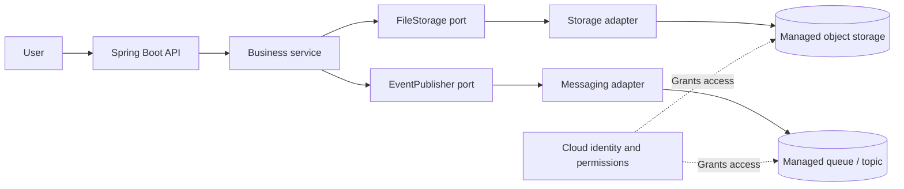

# What Is Cloud Provider Integration and What Problems Does It Solve?

> **Chapter:** Orientation  
> **Scope:** Integrating Spring Boot applications with managed services from Amazon Web Services (AWS), Microsoft Azure, and Google Cloud using the corresponding Spring Cloud libraries.

## 1. From a Runnable Application to an Operable Application

A Spring Boot application can handle HTTP requests, query a database, and save files on a developer's machine. However, when deployed for many users, simple initial choices often reveal limitations:

- **Saving images to the local disk:** files can disappear when a container is replaced; multiple application replicas do not automatically share the same directory.
- **Sending emails or generating reports directly inside an HTTP request:** users have to wait for slow tasks; failures in dependent services can cause the request to fail.
- **Self-hosting and maintaining infrastructure:** the development team must handle backups, availability, monitoring, recovery, and scaling.
- **Putting passwords and API keys in `application.yml`:** secrets can easily be pushed to Git or exposed in logs, container images, and pipelines.
- **Creating shared cloud access keys:** it is hard to restrict permissions and hard to trace which application performed which action.

Cloud providers offer **managed services** to handle these infrastructure capabilities: object storage, queues, pub/sub, databases, secret stores, identity management, monitoring, etc. "Managed" means the provider operates a significant portion of the underlying system; **the application team remains responsible** for data, permission configuration, fault tolerance, cost, and how the service is used.

**Cloud provider integration** is the process of connecting an application to those services through appropriate APIs/SDKs, integration libraries, configuration, and authentication mechanisms. For this module, the focus is **Spring Boot combined with Spring Cloud AWS, Spring Cloud Azure, and Spring Cloud GCP**.

## 2. How Is Cloud Integration Different from Cloud Deployment?

The two activities often go together, but they are not identical:

| Concept | Question to answer | Example |
| --- | --- | --- |
| **Deploying to the cloud** | Where does the application run? | Running a Spring Boot Docker image on AWS ECS, Azure Container Apps, or Google Cloud Run. |
| **Integrating cloud services** | Which cloud capabilities does the application use and how? | Writing files to Amazon S3, Azure Blob Storage, or Google Cloud Storage. |
| **Operating in the cloud** | How is the system secured, observed, and recovered? | Granting role-based permissions, storing logs, tracking errors, taking backups, and setting cost alerts. |

An application running on a laptop can still access a cloud bucket if it has network connectivity and valid permissions. Conversely, an application already running in the cloud might not use any managed services beyond the compute host at all.

### Typical Integration Flow



Here, a **port** is an interface owned by the application (such as `FileStorage`), while an **adapter** contains the provider-specific library/SDK calls. This organizational style is not mandatory for every small project, but it is especially useful when you need testability, control over vendor coupling, or the ability to swap implementations later.

A typical cloud operation goes through these steps:

1. The application receives a business request and determines the resource to use (bucket, queue, database...).
2. The SDK client obtains an **identity** appropriate for the runtime environment.
3. The cloud service authenticates the identity and checks **permissions** for the specific action and resource.
4. The API performs the operation; the application handles the result, transient errors, timeouts, and observability.

> **Principle:** Simply configuring the right endpoint and resource name is not enough. The identity running the application must be granted the right permissions; network, region, data format, and service limits must also match.

## 3. What Problems Do Managed Services Solve?

| Application need | AWS service | Azure service | Google Cloud service | Problem solved |
| --- | --- | --- | --- | --- |
| Store files, images, documents | Amazon S3 | Azure Blob Storage | Cloud Storage | Decouples file data from container lifecycle; allows independent access and capacity scaling. |
| Asynchronous task processing | Amazon SQS | Azure Service Bus | Pub/Sub (subscription) | Reduces temporal coupling between sender and processor; absorbs traffic spikes. |
| Event distribution | Amazon SNS, EventBridge | Azure Service Bus topics, Event Grid | Pub/Sub | Allows multiple processors to react to an event according to the appropriate model. |
| Managed relational database | Amazon RDS/Aurora | Azure Database for PostgreSQL | Cloud SQL | Reduces database operational burden; supports backups and high-availability options. |
| Secret management | AWS Secrets Manager, Systems Manager Parameter Store | Azure Key Vault | Secret Manager | Separates secrets from source code; manages access, auditing, and secret lifecycle. |
| Workload identity | IAM role and workload identity mechanisms | Managed Identity via Microsoft Entra ID | Service account / Workload Identity | Grants scoped permissions to applications, limiting static access keys. |
| System observability | CloudWatch | Azure Monitor | Cloud Monitoring / Cloud Logging | Collects metrics, logs, and alerts to diagnose incidents. |

The table above is a **mapping by need**, not an implication that the products are strictly equivalent. For example, SQS is a queue service, whereas Pub/Sub emphasizes a topic/subscription model; characteristics such as ordering, fan-out, retries, message filtering, and retention duration must be evaluated for each specific case.

### Example 1: Storing Uploaded Documents

If you use a container's `/uploads` directory to store documents, scaling the application to multiple instances or replacing a container makes it difficult to access the files again. With object storage, the API receives and validates the file, generates an object key, and writes it to a bucket/container. The database only needs to store **metadata** such as document ID, owner, object key, file type, and processing status.

Key benefit: file data has a lifecycle independent of the application; you can apply permission boundaries, lifecycle policies, encryption, and controlled download mechanisms. In return, the application must account for network latency, request/egress costs, and behavior when the service is unavailable.

### Example 2: Processing Orders Without Slowing Down the API

After recording an order, the application can publish an `OrderCreated` event. A worker receives the event to send notifications or update an external system. The HTTP request can return sooner, and the processing system can scale up the number of workers under high load.

A queue **does not automatically guarantee exactly-once processing**. In many common configurations, a message may be redelivered after a timeout or failure. Consumers should be **idempotent**: processing the same `eventId` repeatedly does not produce duplicate side effects, such as resending an invoice or charging a payment twice. You need to define retries, dead-letter queues/subscriptions, how failed messages are handled, and how backlog is monitored.

### Example 3: Connecting to a Managed Database

Spring Boot can continue using JDBC, Spring Data JPA, or R2DBC with a managed database. Here, the Spring Cloud SDK **is not necessarily the primary data-access layer**: the application still uses database drivers and data-access libraries, while the cloud infrastructure handles provisioning, backups, and certain operational features. Concerns such as connection pooling, schema migrations, transactions, connection limits, and authentication methods still require dedicated design.

### Example 4: Protecting Secrets

Instead of writing database passwords into Git, the application is granted an identity and permission to read the corresponding secret at runtime. Spring Cloud or the SDK can help fetch the secret and bind it to application configuration depending on the platform. Using a secret manager **does not automatically eliminate all risks**: the application must still avoid logging secret values, restrict read permissions, and have a plan for when secrets are rotated.

## 4. How Do Spring Boot, Spring Cloud, and SDKs Work Together?

Spring Boot provides the foundation for building the application: dependency injection, configuration, web, data access, health checks, metrics, and standalone execution. The provider's SDK is responsible for **calling APIs** according to that provider's conventions and style. Provider-specific Spring Cloud projects integrate the SDK into the Spring ecosystem: starter dependencies, client auto-configuration, configuration property binding, and, for certain services, Spring-style templates or listeners.

| Layer | Role | Example |
| --- | --- | --- |
| Spring Boot business logic | Determines when to store files / publish events | `DocumentService`, `OrderService` |
| Application port | Defines the required capability | `FileStorage.put(...)` |
| Spring Cloud integration | Connects starters, configures beans, provides listeners/templates where available | Spring Cloud AWS / Azure / GCP |
| Cloud SDK | Builds requests, signs/authenticates, and calls cloud APIs | AWS SDK for Java, Azure SDK for Java, Google Cloud Java client libraries |
| Managed service | Stores or processes the actual resource | S3, Blob Storage, Cloud Storage... |

Some common starter names (depending on project version):

- **AWS:** `io.awspring.cloud:spring-cloud-aws-starter-s3`, `io.awspring.cloud:spring-cloud-aws-starter-sqs`.
- **Azure:** `com.azure.spring:spring-cloud-azure-starter-storage-blob`, `com.azure.spring:spring-cloud-azure-starter-servicebus`.
- **Google Cloud:** `com.google.cloud:spring-cloud-gcp-starter-storage`, `com.google.cloud:spring-cloud-gcp-starter-pubsub`.

**You must choose starter and BOM versions compatible with the Spring Boot version in use**, checking each project's official documentation before installing. Do not assume all three providers share the same annotations, property keys, or data types. A system is also not required to use Spring Cloud for every service: calling the SDK directly, using JDBC/JPA, or using standard protocols can be a reasonable choice.

## 5. Identity, Authentication, and Authorization: The Most Important Starting Point

For cloud integration, distinguish three questions:

- **Who is the application?** The identity can be an AWS role, an Azure Managed Identity, or a Google service account/workload identity.
- **How does the application prove its identity?** Credentials can be short-lived tokens obtained from the runtime environment, local login, or another method supported by the SDK.
- **What is the application allowed to do?** Permission policies specify actions (e.g., reading objects) on specific resources (e.g., a bucket or object path).

### Local and Production

| Environment | Common approach | What to verify |
| --- | --- | --- |
| Developer machine | AWS CLI profile/SSO, `az login`, Google Application Default Credentials (`gcloud auth application-default login`) depending on service | Developer identity has minimal permissions; do not commit credentials. |
| Cloud runtime | AWS IAM role attached to workload, Azure Managed Identity, GCP service account/Workload Identity | Runtime receives tokens/credentials via standard mechanisms; policies only allow required resources. |
| CI/CD | Workload identity federation or short-lived workload identity when supported by the platform | Separate deployment permissions from runtime application permissions; avoid long-lived keys when safer options exist. |

**Principle of least privilege:** a service that only needs to write documents should not have permission to delete an entire bucket or read every secret. Authorization must also consider environment boundaries: dev accounts should not implicitly have access to production data.

When encountering errors, diagnose by layer: missing or expired credentials; valid identity but missing permissions; wrong resource/region/project/subscription; network blocks; quota/rate limits; or service errors. An HTTP 403 error usually suggests checking permissions, but you must also inspect the specific SDK error code and cloud-side logs rather than blindly broadening permissions.

## 6. Minimal Example: Spring Boot Saving Documents to Amazon S3

Suppose the application needs to save a PDF file after authenticating the user, validating the file type, and checking size limits. This example uses **Spring Cloud AWS** to create the S3 client bean and **AWS SDK for Java v2** to perform the write operation. It illustrates only one adapter; Azure and GCP environments will have different adapters while still being able to share the same business port.

**Maven dependency** (version managed by a Spring Cloud AWS BOM compatible with the project's Spring Boot version):

```xml
<dependency>
    <groupId>io.awspring.cloud</groupId>
    <artifactId>spring-cloud-aws-starter-s3</artifactId>
</dependency>
```

**Example configuration** in `application.yml`:

```yaml
app:
  files:
    bucket: ${APP_FILES_BUCKET}
spring:
  cloud:
    aws:
      region:
        static: ${AWS_REGION:ap-southeast-1}
```

`APP_FILES_BUCKET` is the bucket name provisioned for the environment. The region must match the resource's region. This configuration **contains no access key/secret key**: the client uses the credential provider mechanism appropriate for the environment (such as a local profile or an IAM role for the workload).

**Business port**:

```java
public interface FileStorage {
    void put(String key, byte[] content, String contentType);
}
```

**S3 adapter**:

```java
import org.springframework.beans.factory.annotation.Value;
import org.springframework.stereotype.Component;
import software.amazon.awssdk.core.sync.RequestBody;
import software.amazon.awssdk.services.s3.S3Client;
import software.amazon.awssdk.services.s3.model.PutObjectRequest;

@Component
public class S3FileStorage implements FileStorage {
    private final S3Client s3;
    private final String bucket;

    public S3FileStorage(S3Client s3,
                         @Value("${app.files.bucket}") String bucket) {
        this.s3 = s3;
        this.bucket = bucket;
    }

    @Override
    public void put(String key, byte[] content, String contentType) {
        PutObjectRequest request = PutObjectRequest.builder()
                .bucket(bucket)
                .key(key)
                .contentType(contentType)
                .build();

        s3.putObject(request, RequestBody.fromBytes(content));
    }
}
```

Preconditions for this example: the bucket already exists; the corresponding object write permission has been granted; dependencies, BOM, and authentication configuration are valid. For real-world usage, you also need to handle large file sizes via streaming/multipart, verify ownership, generate unpredictable object keys, validate content types, configure encryption, use selective logging, and set appropriate timeouts and retry strategies. For large files, holding the entire content in a `byte[]` can consume excessive memory.

If you want to switch to Blob Storage or Cloud Storage, the business service calling `FileStorage` can stay the same, but you must **write the corresponding adapter and re-test behavior**, because access policies, metadata, object versioning, and certain features are not uniform across providers.

## 7. Designing Integrations to Withstand Real Faults and Traffic

Integrating with a managed service means depending on a **system over the network**. Even when APIs and SDKs look simple, the application should plan for these scenarios:

| Scenario | Symptom | Mitigation |
| --- | --- | --- |
| Network timeout or interruption | File save / message send request has an unclear outcome | Set timeouts; verify outcome before retrying operations with side effects. |
| Quota or rate limit | Throttling errors, increased latency | Retry with backoff and jitter, limit concurrency, monitor quotas. |
| Duplicate message delivery | One event is processed multiple times | Use `eventId`/business key and idempotency; manage acknowledgements properly. |
| Unprocessable message | Worker retries indefinitely, backlog grows | Limit retry attempts, route to dead-letter, and establish an analysis/replay process. |
| Incorrect access permissions | Authorization errors on read/write | Check runtime identity, policy scope, and exact resource; avoid overly broad permissions. |
| Failure between DB write and event publish | Order saved but no message sent (or vice versa) | Consider transactional outbox, state synchronization, and reliable replay mechanisms. |
| Unexpected cost spikes | High request volume, egress, stale data | Tag resources, monitor usage, quotas, and lifecycle/retention policies. |

**Retries are only appropriate for transient errors**. Retrying every 4xx error caused by permissions or misconfiguration can slow down the system and mask the root cause. For sensitive workflows (payments, invoicing), design idempotency and data consistency before enabling retries.

### When Do You Need a Common Abstraction Layer?

If a product will definitely run on a single provider and uses few features, calling the SDK from a concise adapter may be sufficient. If the product targets multi-cloud deployment, needs local fakes for testing, or wants to keep SDK dependencies out of business logic, design dedicated ports at the **exact capability boundary actually needed**, such as `FileStorage`, `EventPublisher`, or `SecretReader`.

Avoid trying to "unify" all cloud features into one giant API: presigned URLs, access control policies, latency, retries, ordering, delivery guarantees, and pricing can differ significantly. Good abstraction keeps the **application's contract** stable and explicitly documents the properties that business logic actually relies on.

## 8. Testing Cloud Integrations by Layer

1. **Unit tests:** mock `FileStorage` or `EventPublisher`; verify business rules without calling the cloud.
2. **Integration tests in an emulated environment:** use appropriate tools, such as LocalStack for certain AWS APIs, Azurite for Azure Storage, or the Pub/Sub emulator for Google Cloud Pub/Sub. Can be combined with Testcontainers if the runtime environment supports it. Verify serialization, client configuration, and basic connectivity behavior.
3. **Integration tests against sandbox cloud resources:** verify IAM/Managed Identity/service accounts, networking, region, policies, SDK behavior, retries, and features unsupported by emulators.
4. **Failure scenario testing:** missing or expired credentials, insufficient permissions, nonexistent resources, duplicate messages, timeouts, throttling, secret rotation, and recovery after failures.

Do not treat emulators as full proof of authorization or every behavior of the real service. Use dedicated test projects/accounts/subscriptions, configure resources with least-privilege permissions, clean up test data, and set cost limits.

To make incidents observable, include correlation/request IDs in logs, metrics for latency/errors/retries/backlog, and traces across key operations. Avoid putting tokens, sensitive file contents, or secrets into logs/tracing.

## 9. Criteria for Choosing AWS, Azure, or Google Cloud

No single option is always better for every application. A team should evaluate:

- **Existing organizational infrastructure:** enterprise identity, networking, operations, team expertise, and organizational policies.
- **Fit for data and messaging models:** object lifecycle, queues vs. pub/sub, throughput, deduplication, ordering, dead-lettering, and replay capabilities.
- **Security capabilities:** workload identity provisioning, resource-level permission scoping, encryption key management, auditing, and data residency requirements.
- **Actual cost:** storage capacity, request counts, data transfer, message volume, database sizing, logs, and test environments.
- **Spring Boot compatibility:** maintained starters/SDKs and version compatibility; ease of debugging, testing, and deployment.
- **Provider portability requirements:** how necessary portability is compared to the cost of maintaining multiple adapters and test suites.

In practice, many projects use **one primary provider**, then integrate additional external services when there is a clear benefit. Multi-cloud provides options, but it also increases the number of identity mechanisms, configurations, operational patterns, and testing costs.

## 10. Common Misconceptions

**"Using Spring Cloud makes the application automatically secure."** False. Starters help wire configuration and SDKs; the organization still needs to design IAM, network segmentation, encryption, business access control, secret protection, and auditing.

**"A managed service means no failures."** False. The application must still handle network errors, quotas, service limits, misconfigurations, corrupted data, and bugs in business code itself.

**"Renaming the dependency is enough to run on another cloud."** False. Even within the same category like object storage or messaging, SDKs, authentication, resource models, and delivery semantics differ; dedicated adapters and tests are required.

**"Every type of data needs a Spring Cloud starter."** False. JDBC/JPA remains an appropriate foundation for many relational databases; sometimes a direct SDK or standard protocol is easier to understand.

**"Successfully sending a message means the business action is complete."** False. A successful publish operation only proves the provider accepted it according to the specific API; the consumer may still not have processed it, may fail, or may process it more than once.

## 11. Orientation Exercise

**Scenario:** Build a document management service with Spring Boot. Users upload PDFs, and the system stores the document, generates a preview, and sends a notification when finished.

Draw the processing flow and answer the following questions:

1. Where should the PDF file live so it remains accessible when the application scales to three instances? What information should the DB store instead of the file contents?
2. Should preview generation run inside the upload request? If moved to a queue/topic, how should `eventId`, retries, dead-lettering, and idempotency be designed?
3. Which workload needs **write** permission for files, and which workload needs **read** permission? Which components are allowed to read secrets?
4. What changes are needed in the adapter when using S3, Blob Storage, or Cloud Storage respectively?
5. Create a test plan covering unit tests, emulators, and sandbox cloud resources for insufficient permissions, timeouts, and duplicate message processing.

**Pass criteria:** clearly explain the application's responsibilities versus the provider's responsibilities; distinguish deployment from integration; identify appropriate managed services; describe secure identity/permission provisioning; and state at least one failure scenario and one testing strategy for storage or messaging.

---

### Takeaways Before Starting the Hands-On Lessons

Cloud integration addresses needs for **durable storage, asynchronous processing, data management, secrets, identity, and operating at larger scale**. Spring Boot handles business orchestration; Spring Cloud and SDKs facilitate communication with managed services. Integration quality is determined by **sound data contracts, proper permissions, intentional error handling, multi-layer testing, and understanding provider differences** — not merely by making a single API call succeed.
