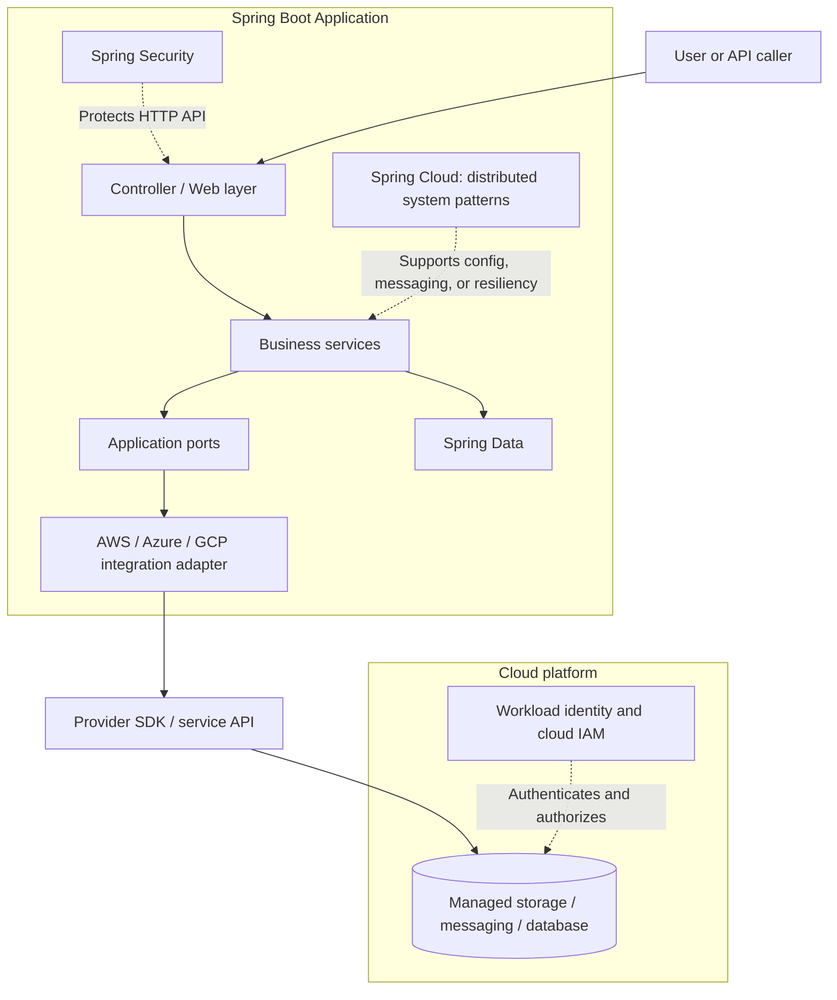
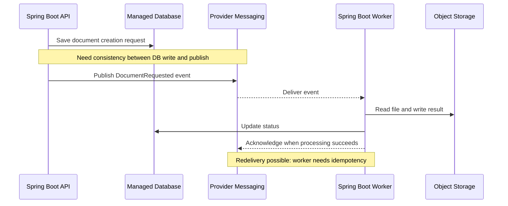
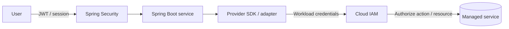

# Where Provider Integration Fits in the Spring Cloud Ecosystem

> **Chapter:** Orientation  
> **Module:** `SPRING_CLOUD_PROVIDER_INTEGRATION`  
> **Scope:** Integrating Spring Boot with managed services from AWS, Azure, and Google Cloud, including identity and permissions, storage, messaging, data, secrets, integration testing, and differences across cloud providers.

## 1. Why Put Cloud Integration in the Right Place?

When building a Spring Boot application, development teams often use several similarly named libraries at the same time: Spring Framework, Spring Boot, Spring Cloud, Spring Data, Spring Security, Spring Integration, and starters for AWS, Azure, and Google Cloud. Without clearly distinguishing their responsibilities, designs easily run into problems:

- Putting cloud SDK calls directly inside controllers and business services, making testing and switching services difficult.
- Using a starter for the wrong purpose, such as expecting Spring Cloud Gateway to connect to object storage automatically or expecting Spring Security to provision IAM permissions for a workload.
- Treating every library named "Spring Cloud" as part of the same release train, leading to incompatible dependency versions.
- Confusing the service connection mechanism with operational requirements: identity, permissions, timeouts, retries, auditing, costs, and recovery capabilities.
- Assuming services in the same category on AWS, Azure, and Google Cloud have identical APIs and behavior.

**Cloud provider integration** is a specialized part of the Spring ecosystem: it helps Spring applications access services operated by cloud providers. It **stands alongside and collaborates with** Spring Boot, Spring Cloud projects, and other Spring modules; it does not replace business logic, the security architecture, or data modeling.

## 2. Map of the Spring Ecosystem from a Cloud Application Perspective

To visualize relationships, it helps to group components by role rather than trying to force everything into strict inheritance layers.

| Technology group | Primary responsibility | Relationship with AWS/Azure/GCP integration |
| --- | --- | --- |
| **Spring Framework** | Dependency injection, component-oriented programming, transactions, HTTP, core abstractions | Provides the foundation for registering client beans and wiring integration components into the application. |
| **Spring Boot** | Auto-configuration, starters, externalized configuration, Actuator, packaging and running the app | Serves as the anchor for cloud integration starters and environment-based client configuration. |
| **Spring Cloud (shared projects)** | Distributed system patterns such as distributed configuration, gateway, discovery, circuit breakers, and messaging abstractions depending on the project | Solves system-level concerns; can be used alongside cloud clients. |
| **Spring Cloud AWS / Spring Cloud Azure / Spring Cloud GCP** | Integrating specific managed services into Spring | Provides starters, configuration, templates, listeners, or access mechanisms for corresponding services; support scope depends on project/version. |
| **Provider SDK** | Calling service APIs, obtaining credentials/tokens, serializing requests, and handling responses | Typically the underlying client layer beneath the provider's Spring Cloud library. |
| **Spring Data** | Repositories, mapping, data access across multiple data store types | Can be used to access managed databases; not every cloud database requires a provider starter. |
| **Spring Security** | Authenticating and authorizing users/APIs within the application | Complements, but is distinct from, **IAM/Managed Identity/service accounts** used when the application calls the cloud. |
| **Spring Integration / Spring Cloud Stream** | Enterprise integration patterns, message flows, and abstractions for supported brokers | Can be an option for messaging flows, depending on requirements and supported binders/adapters. |
| **Spring Cloud Kubernetes** | Integrating with Kubernetes APIs and resources | Suitable when operating on Kubernetes; does not replace SDKs/APIs for S3, Blob Storage, or Pub/Sub. |

The key point is that **a single application can use many of these groups simultaneously**. For example: Spring MVC receives the request, Spring Security authenticates the user, Spring Data JPA writes the order record, Spring Cloud AWS sends a message to SQS, Spring Boot Actuator exposes health/metrics, and an observability library records request traces.

### Responsibility Relationship Diagram



This diagram is a model for organizing responsibilities, not a mandatory rule that every project must have every exact layer. A small application can inject an SDK client directly into an integration service; a large product may need dedicated adapters and explicit contracts to protect the business domain.

## 3. What Does Spring Boot Provide to Provider Integration Libraries?

Spring Boot is the "application runtime framework" into which integrations are plugged. Specifically:

1. **Dependency injection (DI):** cloud clients, templates, listener containers, and adapters are managed as beans; business services receive dependencies via constructor injection.
2. **Auto-configuration:** starters can automatically create clients/beans when dependencies and configuration conditions are met. Specific mechanisms vary by provider and version.
3. **Externalized configuration:** bucket names, queues, regions, projects, endpoints, namespaces, etc. are read from configuration instead of being hardcoded in business logic.
4. **Lifecycle and operations:** Spring Boot starts and stops resources, provides logging, and offers Actuator/metrics; integrations can contribute additional metrics or health indicators when supported.
5. **Profiles and environments:** different configurations can be selected for local, test, staging, and production without maintaining multiple codebases.

For example, **application-specific** configuration can be placed under a prefix managed by the development team:

```yaml
app:
  documents:
    storage-provider: aws
    bucket: ${DOCUMENTS_BUCKET}
  messaging:
    order-created-destination: ${ORDER_CREATED_DESTINATION}
```

The `app.*` properties above are simply **application-defined configuration**; they do not automatically make Spring Boot connect to the cloud. Appropriate starters/clients and code reading those values must exist. Do not assume AWS, Azure, and GCP share a single common set of property keys. Official properties for each starter are defined by that project's documentation.

### A Starter Does Not Automatically Grant Application Permissions

Adding a starter only solves the library integration layer. To perform real operations, the application still needs:

- Existing cloud resources with the correct name/region/project/subscription.
- A valid runtime identity.
- Permissions to perform the action on the specific resource.
- Network and endpoint connectivity allowing access.
- A plan for timeouts, transient errors, retries, and observability.

For instance, an S3 client bean can be created successfully by Spring Boot, yet a bucket read call can still be rejected because the IAM policy does not grant permission.

## 4. What Do "Shared" Spring Cloud Projects Solve?

The name "Spring Cloud" does not mean "a library for calling a cloud provider's services." It is a broad ecosystem of projects supporting many patterns for distributed applications.

| Problem | Related Spring project group | Example used alongside provider integration |
| --- | --- | --- |
| Managing configuration across instances | Spring Cloud Config and Spring Boot configuration mechanisms | Fetch centralized application config; secrets still require proper storage and authorization mechanisms. |
| API routing and gateway policies | Spring Cloud Gateway | Route incoming requests to applications; downstream services use adapters to call cloud storage. |
| Service location discovery | Spring Cloud discovery clients, depending on platform | Internal services calling each other; connecting to S3/Pub/Sub typically uses SDK endpoints rather than internal service discovery. |
| Preventing cascading failures | Spring Cloud Circuit Breaker and supporting libraries | Trip a circuit or limit service calls on repeated errors, where appropriate for the calling interface. |
| Event flows at an abstraction level | Spring Cloud Stream | Define producers/consumers via broker-compatible binders; specific support depends on available binders. |
| Message processing flow patterns | Spring Integration | Organize channels, transformers, routers, adapters, and asynchronous processing. |

A service can perfectly well use **Spring Cloud Gateway on the HTTP side** and **Spring Cloud GCP on the Pub/Sub side** without any conceptual conflict. They answer two different questions: "where do requests go?" and "how does the service interact with managed messaging?".

Not every application needs a Gateway, Config Server, Service Discovery, or Circuit Breaker. Only add these components when the architecture and real operational problems call for them.

## 5. Where Do the Three Provider Integration Families Sit?

Each integration family can be viewed as a **bridge between Spring programming idioms and a provider's specific APIs/services**.

| Integration family | Provider | Common integrations | Key differences to recognize |
| --- | --- | --- | --- |
| **Spring Cloud AWS (AWSpring)** | Amazon Web Services | Amazon S3, SQS, SNS, Secrets Manager, Parameter Store, and other services depending on release | IAM permission model, regions, AWS credential provider chain, resource ARNs; SQS is queue-based. |
| **Spring Cloud Azure** | Microsoft Azure | Blob Storage, Service Bus, Key Vault, Cosmos DB, and other services depending on release | Azure Identity, Microsoft Entra ID/Managed Identity, subscriptions, resource groups, namespaces. |
| **Spring Cloud GCP** | Google Cloud | Cloud Storage, Pub/Sub, Secret Manager, and other GCP integrations depending on release | Application Default Credentials, service accounts, project IDs, topics/subscriptions. |

They have **different maintenance histories, release lifecycles, BOMs, and APIs**. The shared "Spring Cloud" name across all three does not guarantee matching compatible versions or identical features.

Examples of common Maven coordinates (illustrating **how starters are chosen per service**, without declaring versions):

```xml
<!-- AWS: SQS queue integration -->
<dependency>
    <groupId>io.awspring.cloud</groupId>
    <artifactId>spring-cloud-aws-starter-sqs</artifactId>
</dependency>

<!-- Azure: Service Bus integration -->
<dependency>
    <groupId>com.azure.spring</groupId>
    <artifactId>spring-cloud-azure-starter-servicebus</artifactId>
</dependency>

<!-- GCP: Pub/Sub integration -->
<dependency>
    <groupId>com.google.cloud</groupId>
    <artifactId>spring-cloud-gcp-starter-pubsub</artifactId>
</dependency>
```

The example is for comparison only. When building a real application, select **one library set according to your needs**, check the **compatibility matrix for your current Spring Boot/JDK versions**, and configure the BOM or dependency versions recommended by the maintainers. Do not copy all three dependencies into one project just to "support the cloud" generically.

### Why Not Use One Universal Starter for All Three Clouds?

Providers differ in **service models**:

- **AWS SQS** sends/receives messages through queues; **Google Cloud Pub/Sub** is based on topics and subscriptions; **Azure Service Bus** supports both queues and topics/subscriptions with distinct locking/settlement mechanisms.
- **Amazon S3**, **Azure Blob Storage**, and **Google Cloud Storage** all store objects, yet differ in authorization methods, metadata details, versioning, lifecycle rules, access URLs, and pricing.
- **IAM roles**, **Managed Identities**, and **service accounts** can all provide workload identity, but differ in how they are created, attached, and authorized.
- Managed database support can rely on **JDBC/R2DBC/Spring Data**, not necessarily on the provider's Spring Cloud starter itself.

A common abstraction can only unify behaviors explicitly defined by the application. There is no guarantee that renaming a dependency will let an application switch providers without code changes and testing.

## 6. Relationship Between Spring Cloud Stream, Spring Integration, and Cloud Messaging

This is where newcomers often get confused because all three can appear in a message-processing project.

**Calling the provider's client or template** is appropriate when the application needs control over service-specific APIs and semantics: queue URLs, subscriptions, locking/acknowledgement, batching, or provider-specific message attributes.

**Spring Cloud Stream** provides a function/binding/binder model for several brokers and messaging services. When a supported, compatible binder exists, developers can focus more on message contracts. However, a binder does not magically eliminate differences in ordering, retries, dead-lettering, or transactions.

**Spring Integration** uses channels and adapters to connect processing flows, route or transform messages, and coordinate multiple systems. It fits when an application needs multi-step integration flows beyond simply sending/receiving a single message.

| Question | Usually appropriate approach |
| --- | --- |
| Need to call specific features of SQS/Service Bus/Pub/Sub? | Provider-specific client/template/listener integration. |
| Want to define producers/consumers with relatively broker-independent binding contracts? | Consider Spring Cloud Stream **if a suitable binder exists**. |
| Need filtering, routing, transformation, and connecting multiple channels/adapters? | Consider Spring Integration. |
| Just need a worker consuming from a single simple queue? | A direct listener/client can be clearer and easier to operate. |

You are not required to use all of these layers together. Choosing an abstraction should be driven by technical requirements rather than the number of libraries in the project.

### A Business Flow with Managed Messaging



This diagram illustrates the target processing flow and does not yet solve treating the DB write and event publish as two independent operations. If connectivity drops between those two steps, data can be persisted without emitting the event; for high-reliability requirements, consider **transactional outbox**, synchronization, and replay.

## 7. Relationship Between Spring Data, Managed Databases, and Provider Integration

A database running as a managed service is still a database engine with its own driver, wire protocol, and transaction rules.

For example, if an application uses **Amazon RDS for PostgreSQL**, **Azure Database for PostgreSQL**, or **Google Cloud SQL for PostgreSQL**, table access code is typically still written with **Spring Data JPA/JDBC** and the PostgreSQL driver:

```java
public interface InvoiceRepository
        extends org.springframework.data.jpa.repository.JpaRepository<Invoice, Long> {
}
```

The data abstraction layer does not necessarily change when moving where PostgreSQL is hosted. What may change are the connection address, networking, TLS, authentication mechanisms, proxies/connectors, credential delivery, and connection limits.

Conversely, when using a data service with its own model such as **Azure Cosmos DB**, you need a library/SDK or Spring Data module suited to its query model, consistency, and partitioning. Do not assume every managed database behaves like standard PostgreSQL.

### Responsibilities That Cannot Be Offloaded to Libraries

Even when the provider manages the database server, the application must still handle schema migrations, transaction boundaries, connection pool tuning, slow query control, data-level authorization, and error handling. Spring Cloud libraries do not automatically make these decisions for you.

## 8. Relationship Between Spring Security, Cloud IAM, and Secrets

Both types of security appear together, but at **two different boundaries**.

**The user → application boundary** is typically handled by Spring Security: authenticating users/tokens, protecting endpoints, and checking business permissions. For instance, only the document owner may request a document download.

**The application → cloud service boundary** is controlled by the provider's identity and authorization mechanisms: which identity the workload runs under, and whether it is allowed to read objects or publish messages. For instance, the service's identity is permitted to write objects in the document bucket, but not to read every secret in production.



| Environment | Common cloud identity mechanism | Notes |
| --- | --- | --- |
| Local developer | AWS profile/SSO, Azure CLI credential, appropriate Google ADC | Use a development identity with limited permissions; do not commit credentials. |
| Production on AWS | IAM role attached to workload when supported by platform | SDK obtains credentials from the environment; avoid embedding access keys. |
| Production on Azure | Managed Identity / appropriate Azure Identity mechanism | Grant roles scoped to required resources; pay attention to data-plane permissions. |
| Production on Google Cloud | Service account/Workload Identity or appropriate mechanism | Grant roles with minimal scope for the workload and resources. |
| CI/CD | Federation and short-lived credentials if supported by platform | Separate deployment permissions from runtime permissions. |

**Secret management** is another concern. AWS Secrets Manager, Azure Key Vault, and Google Secret Manager provide places to store and read secrets. Spring Boot can load configuration from external sources via supported integrations, or code can read secrets using the SDK when needed. You must control load timing, refresh behavior, access errors, rotation, and prevent secrets from leaking into logs.

Avoid confusion: an application with proper Spring Security whose workload has cloud-wide admin rights is still a dangerous configuration. Conversely, tightly scoped IAM does not replace end-user authorization checks.

## 9. Example of Placing Provider Integration in the Right Layer: Publishing Order Events

Suppose Spring Boot writes an order to the database and needs to send a notification to a worker. The design goal is for **the business service to depend on the behavior of "publishing an event"**, not on SDK class names. AWS SQS is used for illustration; Azure Service Bus or Google Pub/Sub require their own adapters.

### Step 1: Define the Application Contract

```java
public record OrderCreatedEvent(String eventId, String orderId) {}

public interface OrderEventPublisher {
    void publish(OrderCreatedEvent event);
}
```

This is **pure Java code**, requiring no imports from AWS/Azure/GCP. It expresses the business language of "order created," making it easy to test with a fake publisher.

### Step 2: Service Using That Contract

```java
import java.util.UUID;
import org.springframework.stereotype.Service;

@Service
public class OrderNotificationService {
    private final OrderEventPublisher publisher;

    public OrderNotificationService(OrderEventPublisher publisher) {
        this.publisher = publisher;
    }

    public void notifyCreated(String orderId) {
        publisher.publish(
            new OrderCreatedEvent(UUID.randomUUID().toString(), orderId)
        );
    }
}
```

In a real application, `eventId` should be generated when the event is recorded and kept stable across retries, rather than regenerated on each publish attempt. You must design the DB commit and publish flow so events are not lost when one of the two operations fails.

### Step 3: AWS Adapter Using Spring Cloud AWS

When choosing SQS, one option is to use `SqsTemplate` in the Spring Cloud AWS 3.x family (API registration details may vary across versions).

```java
import io.awspring.cloud.sqs.operations.SqsTemplate;
import org.springframework.beans.factory.annotation.Value;
import org.springframework.stereotype.Component;

@Component
public class SqsOrderEventPublisher implements OrderEventPublisher {
    private final SqsTemplate sqs;
    private final String queue;

    public SqsOrderEventPublisher(
            SqsTemplate sqs,
            @Value("${app.messaging.order-created-destination}") String queue) {
        this.sqs = sqs;
        this.queue = queue;
    }

    @Override
    public void publish(OrderCreatedEvent event) {
        sqs.send(to -> to.queue(queue).payload(event));
    }
}
```

Illustrative dependency:

```xml
<dependency>
    <groupId>io.awspring.cloud</groupId>
    <artifactId>spring-cloud-aws-starter-sqs</artifactId>
</dependency>
```

At runtime, the starter and AWS SDK must be configured to resolve the right region, credentials, and queue. The workload must have permission to send messages to the target queue. Depending on the Spring Cloud AWS version, the Java payload must be serialized using an appropriate message converter; in practice, you must test the exact message format received by the worker.

If switching to Azure Service Bus or Google Pub/Sub, `OrderNotificationService` can stay unchanged; replace the `OrderEventPublisher` implementation, starter/SDK, configuration, and integration tests. When supporting multiple providers **simultaneously**, a clear bean selection mechanism (profiles, configuration, or conditional beans) is needed so Spring does not encounter multiple implementations of the interface without knowing which bean to inject.

### Responsibility Breakdown of the Example

| Component | What is it responsible for? |
| --- | --- |
| `OrderNotificationService` | Deciding **when** business logic needs to emit an event. |
| `OrderEventPublisher` | Defining the **contract** required by the application. |
| `SqsOrderEventPublisher` | Mapping the contract to the specific SQS API. |
| Spring Cloud AWS | Providing convenient Spring integration, such as templates and client configuration. |
| AWS SDK | Communicating with AWS APIs and handling credentials via supported mechanisms. |
| AWS IAM and SQS | Checking permissions, receiving, and storing messages according to service semantics. |
| Event-consuming worker | Processing messages, acknowledgement, retries, idempotency, and business errors. |

For workflows requiring guaranteed event delivery upon DB commit, the `notifyCreated` step only illustrates architectural layering; evaluate an outbox or another consistency mechanism before going to production.

## 10. Configuration and Version Management: Error-Prone Boundaries

The three provider library ecosystems can **follow different release cadences** from Spring Boot and core Spring Cloud. To manage dependencies:

1. Identify the project's **JDK and Spring Boot** versions.
2. Identify the **provider** and **managed services** actually needed.
3. Check the compatibility matrix of the corresponding Spring Cloud AWS, Azure, or GCP project.
4. Use the BOM according to official documentation to manage dependency groups **within the same library family**; avoid mixing individual artifact versions without good reason.
5. Check for potential dependency conflicts (e.g., SDK, Netty, Jackson, Reactor versions) when integrating multiple clouds or multiple starters.
6. Pin verified versions in the build, run integration tests, and re-verify after upgrading Spring Boot or starters.

Note: **a BOM is a dependency version alignment mechanism; it does not grant permissions or create cloud resources**. "Building cleanly" also does not prove runtime connectivity to the service.

### Distinguishing Configuration Types

| Category | Example | Where should it be managed? |
| --- | --- | --- |
| Business configuration | Max file size, allowed file types, event names | `application.yml` / application configuration. |
| Environment configuration | Bucket, queue, project, region, endpoint | Environment variables, config service, or deployment configuration. |
| Workload identity | IAM role, Managed Identity, service account | Cloud infrastructure and runtime configuration. |
| Secrets | Database passwords, third-party tokens | Secret manager or approved secret mechanism, accessed via identity. |
| Permission policies | Who can read objects, publish messages, access secrets | Provider IAM/RBAC/resource policies. |

Do not copy static `access-key`/`secret-key` or private keys into Git just to "make the starter work." Prefer runtime environment identity mechanisms and least-privilege permissions for workloads.

## 11. Where Does Provider Integration Testing Fit in the Test Strategy?

Because cloud integration has two distinct layers — application logic and SDK/service behavior — a practical test suite should include:

| Layer | What it verifies | Tools or strategy |
| --- | --- | --- |
| Business unit tests | Emitting the right events, choosing keys/paths, enforcing business rules | Fakes/stubs of `OrderEventPublisher` or `ObjectStorage`, with no cloud calls. |
| Emulator integration tests | Serialization, listeners, properties, endpoints, and basic flows | LocalStack for certain AWS APIs; Azurite for Blob Storage; Pub/Sub emulator for GCP Pub/Sub, depending on use case. |
| Sandbox cloud integration tests | IAM, Managed Identity/service accounts, region/project, networking, real semantics | Temporary resources in a test account/project/subscription with minimal permissions. |
| Failure tests | Timeouts, duplicate messages, rate limits, revoked secrets, failing queues | Fault injection in a suitable environment; verify retry/backoff, dead-letter, idempotency. |
| Operations and observability | Latency, error rate, retry count, backlog, cost | App metrics/tracing/logs combined with cloud monitoring. |

Emulators have limitations and may not fully simulate IAM, quotas, throughput limits, and every consistency behavior of real services. Therefore, **good unit tests do not replace cloud integration tests**, and running a single happy-path cloud test does not replace testing errors, retries, and duplicates.

In real cloud environments, isolate test resources from production, protect sensitive data, and clean up resources to avoid unnecessary costs.

## 12. When to Use a Spring Cloud Provider Starter, Direct SDK, or Another Abstraction?

There is no one-size-fits-all answer. You can decide using these questions:

| Case | Preferred option to consider | Rationale |
| --- | --- | --- |
| Spring Boot app using a service well-supported by a starter | **Spring Cloud provider starter** | Spring configuration, DI, templates/listeners, and conventions can reduce boilerplate. |
| Need brand-new APIs or specialized features unsupported by the starter | **Direct provider SDK** | Full control over SDK capabilities, though still best wrapped in an adapter with a clear contract. |
| Want messaging logic focused on functions/bindings with a compatible binder | **Spring Cloud Stream** | Reduces coupling between producers/consumers and some broker details. |
| Need multi-step orchestration, channels, transformers, routers | **Spring Integration** | Expresses complex integration flows using established patterns. |
| Storing relational data on managed PostgreSQL | **Spring Data/JDBC + appropriate driver** | Continues working with familiar relational models and transactions. |
| Need simple testing and ability to swap backends | **Application port + adapter** | Keeps business logic independent of clients, abstracting only the behavior actually used. |

A helpful rule of thumb: **choose the abstraction based on business requirements and operability first, then pick the implementation library**. If the application requires exactly-once business effects, merely adding a messaging starter is not enough; you must analyze delivery semantics, idempotency, transactions/outbox, and replayability.

### Architectural Pitfalls to Avoid

- **Cosmetic "cloud agnosticism":** creating overly broad shared interfaces that accidentally hide crucial differences in permissions, ordering, retries, signed URLs, and consistency.
- **Letting cloud SDKs leak into the domain:** controllers/business services directly accepting types like `PutObjectRequest`, `ServiceBusMessage`, or `PubsubMessage`, causing tests and backend changes to ripple everywhere.
- **Integrating all three providers unnecessarily:** increases dependencies, credential setup, test paths, and operational complexity.
- **Equating API security with IAM:** end-user access control and workload permission boundaries are two separate layers that must be designed independently.
- **Treating a starter as a runtime contract:** dependencies can successfully create beans while still having wrong resource names, permissions, networking, or message converters.
- **Relying on retries for data correctness:** blind retries can cause duplicate side effects; idempotency and error classification are required.

## 13. Orientation Practice: Choosing the Right Spring Components

**Context:** A Spring Boot document service needs to authenticate users, write metadata to managed PostgreSQL, store PDFs, emit an event after upload, and generate previews via a worker. The company is considering deploying on AWS, Azure, or Google Cloud.

**Design requirements:**

1. Choose appropriate Spring components for the REST API, user authorization, PostgreSQL access, object storage, and messaging. Explain the roles of Spring Boot, Spring Security, Spring Data, and provider libraries.
2. Draw a diagram including the controller, business service, `DocumentStorage` port, storage adapter, `DocumentEventPublisher` port, messaging adapter, worker, and managed services. Mark where IAM checks happen.
3. Create a mapping table: `S3 + SQS`, `Blob Storage + Service Bus`, `Cloud Storage + Pub/Sub`. For each pair, identify the required identity and at least two functional differences that must be tested.
4. Choose a runtime authorization strategy (role, Managed Identity, or service account) without using static credentials in source code.
5. Propose a unit test for business logic; an integration test with an emulator; an integration test on a sandbox cloud; and a failure test for duplicate messages.
6. Explain why succeeding in writing metadata to the DB and then failing to publish the message is a risk, and propose an approach such as outbox.
7. Self-assess whether to use a starter, direct SDK, or Spring Cloud Stream based on requirements and actual support.

**Completion criteria:** the learner accurately distinguishes the responsibilities of Spring components; selects suitable integration libraries for each provider and service; understands that IAM/credentials live outside business logic; describes a testable structure; and identifies at least one messaging difference to watch out for.

---

## Key Takeaways

In the Spring ecosystem, **Spring Boot structures and runs the application; shared Spring Cloud projects address distributed-system concerns; Spring Cloud AWS/Azure/GCP connect the app to managed service APIs; SDKs handle provider communication; and IAM governs cloud access permissions**. Spring Security and Spring Data solve separate concerns, yet typically operate within the same system.

Placing integration in the right layer keeps boundaries clear between business logic, connectivity, and infrastructure. For safe deployments, always verify **version compatibility, workload permissions, data contracts, failure semantics, integration tests, and operational costs** before considering a cloud service fully integrated.
