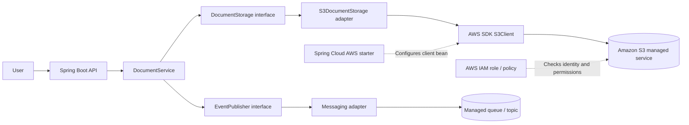
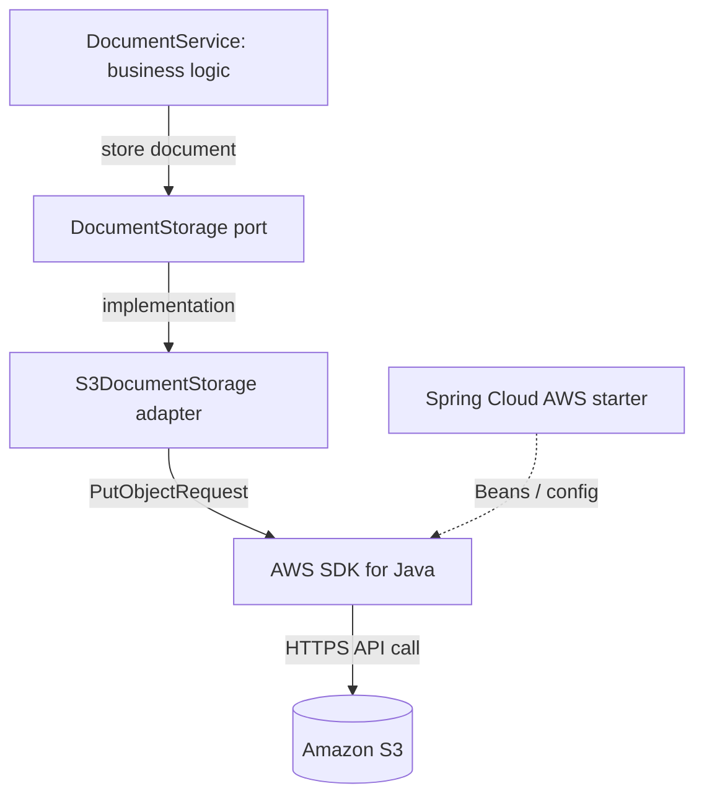
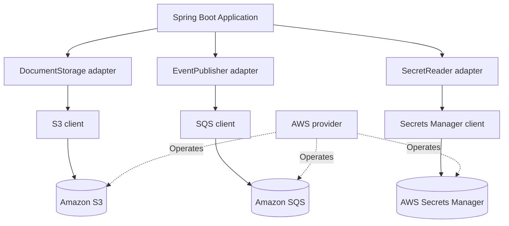

# Distinguishing Cloud Providers, Managed Services, SDKs, Starters, and Adapters

> **Chapter:** Orientation  
> **Module:** `SPRING_CLOUD_PROVIDER_INTEGRATION`  
> **Scope:** Spring Boot integrating with managed services from AWS, Azure, and Google Cloud via Spring Cloud and related Java libraries; from identity and access permissions to storage, messaging, data, secrets, and testing.

## 1. Lesson Objective

When you hear the sentence "The Spring Boot application uses Spring Cloud to save files to AWS," at least **five different concepts** are collapsed into a single phrase:

1. **Cloud provider:** AWS is the organization/platform providing compute capacity and services.
2. **Managed service:** Amazon S3 is the specific service used to store objects.
3. **SDK (Software Development Kit):** The AWS SDK for Java provides Java APIs to call S3.
4. **Spring integration starter:** The Spring Cloud AWS starter wires SDK clients/components into Spring Boot's configuration and dependency injection mechanisms.
5. **Application adapter:** A class written by the development team that uses a client or template to fulfill a business contract like `DocumentStorage.save(...)`.

These concepts are **not synonymous**, nor are they the same kind of entity. The provider and service exist outside the application; the SDK and starter are libraries inside the application; the adapter is code implementing connection rules owned by the application itself.

By the end of this lesson, you should be able to answer: "Which code belongs to business logic, which library assists programming, which resource exists in the cloud, which identity is granted permissions, and if we switch providers, which parts must change?"

## 2. The Big Picture in One Example

Suppose we build a Spring Boot service that allows users to upload PDF contracts, stores them securely, and emits an event so a worker can generate a preview.



In this diagram:

- **AWS** is the provider, owning the account ecosystem, infrastructure, and APIs.
- **Amazon S3** is the managed service that actually stores the data.
- **`S3Client`** is a client in the AWS SDK for Java that calls the S3 API.
- **The Spring Cloud AWS starter** can configure `S3Client` in the Spring context and provide additional relevant integrations.
- **`S3DocumentStorage`** is the adapter written by the development team to translate the "save document" request into an S3 operation.
- **`DocumentService`** is business code and does not need to know how HTTP requests to S3 are constructed.
- **The IAM role/policy** decides whether the workload is permitted to write objects. A starter does not automatically create or grant IAM permissions simply by being added to the project.

The runtime call path is typically: **business logic → application interface → adapter → SDK/client → managed service API**. The starter primarily participates in dependency declaration, bean creation/configuration, and Spring lifecycle integration.

## 3. Cloud Provider: Who Provides the Platform?

A **cloud provider** is the organization operating the compute platform and offering a catalog of services that customers consume through consoles, APIs, and governance mechanisms.

| Provider | Typical resource organization | Common identity/permissions | Service examples |
| --- | --- | --- | --- |
| **Amazon Web Services (AWS)** | AWS account, region, resources, and policies | AWS IAM user/role, policies, workload identity mechanisms | S3, SQS, SNS, RDS, Secrets Manager |
| **Microsoft Azure** | Tenant, subscription, resource group, resource | Microsoft Entra ID, Azure RBAC, Managed Identity | Blob Storage, Service Bus, Azure Database for PostgreSQL, Key Vault |
| **Google Cloud** | Organization/folder/project, location, resources | IAM roles, service accounts, Workload Identity | Cloud Storage, Pub/Sub, Cloud SQL, Secret Manager |

"Choosing AWS" only chooses the **platform**; it does not yet specify which services the application will use, what operational SLAs apply, how APIs are called, or which workload receives permissions.

Details such as account/subscription/project and region/location also directly affect endpoints, permission boundaries, network connectivity, data residency, latency, and pricing.

### A Provider Is Not a Single Uniform API

Two services under the same provider do not necessarily share endpoints, input formats, or granular permission policies. For instance, writing an object to S3 and sending a message through SQS are **two different APIs, two different resource types, and two different permission sets**, even though both use AWS identity mechanisms.

Similarly, "the application is signed in to Azure" does not mean it automatically has permission to write to Blob Storage or send messages to Service Bus; each resource requires its corresponding permissions.

## 4. Managed Service: Which Product Solves the Problem?

A **managed service** is a cloud service where the provider assumes part of the work of provisioning, maintaining, and operating the underlying system within a defined scope. The application still needs to create/configure resources, choose the usage model, and manage data and access permissions.

Some common needs in this module:

| Problem | AWS | Azure | Google Cloud | What the application remains responsible for |
| --- | --- | --- | --- | --- |
| Store files and objects | Amazon S3 | Azure Blob Storage | Cloud Storage | Key naming, access control, lifecycle, metadata, errors, and cost |
| Process asynchronous tasks | Amazon SQS | Azure Service Bus queues | Pub/Sub subscriptions | Message design, retries, idempotency, dead-lettering |
| Broadcast events to multiple processors | Amazon SNS/EventBridge | Azure Service Bus topics/Event Grid | Pub/Sub topics | Routing, delivery semantics, schemas, and consumers |
| Managed relational database | RDS/Aurora | Azure Database for PostgreSQL | Cloud SQL | Schema, queries, transactions, pooling, data permissions |
| Store secrets | Secrets Manager/Parameter Store | Key Vault | Secret Manager | Who can read secrets, rotation, safe usage without leaking secrets |
| Operational observability | CloudWatch | Azure Monitor | Cloud Monitoring/Logging | Required metrics, dashboards, alerts, and log control |

**Managed** does not mean "everything is guaranteed automatically":

- The service can reject requests due to wrong permissions, wrong resource names, or wrong regions.
- Data storage or message sending operations can encounter timeouts, throttling, or service errors.
- The application must still protect sensitive data, ensure appropriate backups/retention, and manage costs.
- Message delivery guarantees, ordering, and consistency depend on the **specific service and configuration**, and cannot be inferred from the label "managed."

### Same Category, Not Necessarily the Same Model

For example, **S3**, **Blob Storage**, and **Cloud Storage** are all suitable for storing files/objects, yet they differ in resource hierarchy, credentials, ACL/RBAC, upload APIs, signed URLs, and certain lifecycle policies.

Likewise, **SQS queues**, **Service Bus queues/topics**, and **Pub/Sub topics/subscriptions** cannot be treated as one queue type under different names. To design a worker, you must understand ack/settlement, retries, dead-lettering, retention, ordering, and redelivery mechanisms.

## 5. SDK: What Do Developers Use to Call a Managed Service?

An **SDK** is a set of libraries and programming tools for interacting with a platform's APIs. In a Java project, an SDK typically provides:

- Clients and request/response types for each service.
- Mechanisms to locate, load, or refresh appropriate credentials/tokens.
- HTTP/gRPC calls, request signing where needed, and serialization/deserialization.
- Configuration for endpoints, regions, timeouts, retries, proxies, and some observability support.
- Exceptions and error codes helping the application classify failures.

Examples of Java clients for object storage:

| Provider | Typical SDK/client | Key concepts/objects |
| --- | --- | --- |
| AWS S3 | **AWS SDK for Java v2**, `S3Client` | Bucket, object key, `PutObjectRequest` |
| Azure Blob Storage | **Azure Storage Blob SDK for Java**, `BlobServiceClient`/`BlobContainerClient` | Storage account, container, blob |
| Google Cloud Storage | **Google Cloud Java client libraries**, `Storage` | Project, bucket, blob/object |

By calling the SDK directly, an application can integrate with the cloud **without requiring a Spring Cloud starter**. Illustrative example with AWS SDK for Java v2:

```java
import software.amazon.awssdk.core.sync.RequestBody;
import software.amazon.awssdk.services.s3.S3Client;
import software.amazon.awssdk.services.s3.model.PutObjectRequest;

S3Client s3 = S3Client.create();

PutObjectRequest request = PutObjectRequest.builder()
    .bucket("example-documents")
    .key("contracts/contract-123.pdf")
    .contentType("application/pdf")
    .build();

s3.putObject(request, RequestBody.fromBytes(pdfBytes));
```

This is a **minimal illustration of the core operation**: `pdfBytes` must be supplied, the bucket must exist, credentials/region must be valid, and the workload needs write permission. In a real application, you should deliberately configure and manage the client lifecycle rather than creating a new client per HTTP request. Synchronous SDK clients are typically reusable resources; close the client when the application shuts down.

### Does the SDK Replace Business Logic and IAM?

No. The SDK knows how to **request** a "put object" on a bucket. It does not know which user is allowed to upload which contract, what object key is valid, how metadata should be persisted in the database, or when to emit an event.

Nor does the SDK "create permissions": it presents the workload's credentials; the cloud service evaluates IAM/RBAC and relevant policies before allowing the operation.

## 6. Starter: How Integration Enters the Spring Boot Lifecycle

In the Spring Boot ecosystem, a **starter** is typically a dependency that bundles required libraries and activates/provides conditional **auto-configuration**. For cloud integration, it can help:

- Pull in the right group of supported Spring and SDK dependencies.
- Create/configure client, template, listener, or helper beans when conditions match.
- Map Spring configuration properties onto clients.
- Integrate portions of observability/lifecycle mechanisms tailored to each project.
- Reduce repetitive `@Configuration` code when using common managed services.

Examples of Maven artifacts across the three integration families:

```xml
<!-- AWS example: S3 -->
<dependency>
    <groupId>io.awspring.cloud</groupId>
    <artifactId>spring-cloud-aws-starter-s3</artifactId>
</dependency>

<!-- Azure example: Blob Storage -->
<dependency>
    <groupId>com.azure.spring</groupId>
    <artifactId>spring-cloud-azure-starter-storage-blob</artifactId>
</dependency>

<!-- GCP example: Cloud Storage -->
<dependency>
    <groupId>com.google.cloud</groupId>
    <artifactId>spring-cloud-gcp-starter-storage</artifactId>
</dependency>
```

These are **three independent options** illustrating how to choose a starter, not a recommendation to put all three into one `pom.xml`. Compatible Spring Boot/JDK versions and BOMs must be selected from the corresponding Spring Cloud AWS/Azure/GCP documentation. Class names, properties, configuration paths, and supported APIs vary across versions.

### How Does a Starter Differ from an SDK?

| Criterion | SDK | Spring Boot/Spring Cloud starter |
| --- | --- | --- |
| Purpose | Make direct calls to service APIs | Bring clients/integration tools into Spring Boot conventions |
| Requires Spring Boot? | Not necessarily | Usually yes |
| Provides service-specific request/response APIs? | Yes | Can reuse the SDK and add convenience APIs |
| Automatically creates `@Bean`s from config? | Not its focus | Can provide auto-configuration |
| Handles business flows like "save contract"? | No | No |
| Grants IAM/RBAC permissions and creates buckets/queues? | Not automatically | Not automatically |
| Can be used standalone? | Yes | Depends on Spring, SDK, and corresponding configuration |

A project may choose the direct SDK when it needs new features or uncommon APIs not yet supported by the starter. Conversely, when a starter is well-maintained and feature-complete, using it reduces boilerplate configuration and keeps code idiomatic to Spring.

> **A BOM is not a starter:** A Bill of Materials aligns dependency version sets. A BOM does not create clients, connect to the cloud, grant permissions, or provision resources.

## 7. Adapter: Application Code Connecting Business Logic to Services

An **adapter** in application architecture is a component **implemented by the development team** to translate business calls into calls suitable for an external system. An adapter typically implements an interface/port defined by the application.

For example, business logic wants to **"save a document and receive an object key,"** whereas the S3 SDK requires a bucket, key, content type, and body. The adapter bridges those two contracts.



The adapter layer is the appropriate place to:

- Select resource names from configuration and transform data into SDK formats.
- Map technical errors into error types understood by the application.
- Apply timeouts/retries suitable for the operation type and business state.
- Record logs/metrics for operations without exposing secrets or sensitive content.
- Decouple business code from SDK types and enable unit testing with fake ports.

**Note on the word "adapter":** Spring also has framework classes with *Adapter* in their names, and Spring Integration has channel adapters. This lesson uses "adapter" in the architectural sense of **ports-and-adapters / hexagonal architecture**. The naming may vary (`Gateway`, `Repository implementation`, `CloudClientFacade`), but the bridging responsibility remains the same.

### Is an Adapter the Same as a Starter?

No. A **starter is a dependency added to the build** to provide integration mechanics. An **adapter is code owned by the application** that calls an SDK or template suited to the business logic. An adapter can use the SDK directly, an SDK configured by a starter, or an abstraction such as `S3Template` if supported by the library and project version.

## 8. Complete Example: Saving Documents with a Port + AWS Adapter

This example assumes the application uses Spring Boot, Spring Cloud AWS, and Amazon S3. Its goal is to highlight the boundaries between the **five concepts**, not to build a full production upload system.

### Step 1: Business Contract Without Mentioning AWS

```java
public interface DocumentStorage {
    void save(String objectKey, byte[] content, String contentType);
}
```

`DocumentStorage` expresses the capability the application needs. It does not import any `software.amazon.*`, `com.azure.*`, or `com.google.cloud.*` types.

The business service uses the interface:

```java
import java.util.UUID;
import org.springframework.stereotype.Service;

@Service
public class DocumentService {
    private final DocumentStorage storage;

    public DocumentService(DocumentStorage storage) {
        this.storage = storage;
    }

    public String storePdf(byte[] pdfBytes) {
        String key = "documents/" + UUID.randomUUID() + ".pdf";
        storage.save(key, pdfBytes, "application/pdf");
        return key;
    }
}
```

In this example, the method assumes `pdfBytes` has already been authenticated and validated for size/content type at the appropriate layer. Real-world data also needs ownership, authorization, metadata, and memory limits; you should not trust only the `.pdf` extension or client-declared headers.

### Step 2: Adapter Using the SDK Client

Suppose a `spring-cloud-aws-starter-s3` dependency compatible with Spring Boot is present, client configuration is valid, and auto-configuration provides `S3Client`:

```java
import org.springframework.beans.factory.annotation.Value;
import org.springframework.stereotype.Component;
import software.amazon.awssdk.core.sync.RequestBody;
import software.amazon.awssdk.services.s3.S3Client;
import software.amazon.awssdk.services.s3.model.PutObjectRequest;

@Component
public class S3DocumentStorage implements DocumentStorage {
    private final S3Client s3Client;
    private final String bucket;

    public S3DocumentStorage(
            S3Client s3Client,
            @Value("${app.documents.bucket}") String bucket) {
        this.s3Client = s3Client;
        this.bucket = bucket;
    }

    @Override
    public void save(String objectKey, byte[] content, String contentType) {
        PutObjectRequest request = PutObjectRequest.builder()
                .bucket(bucket)
                .key(objectKey)
                .contentType(contentType)
                .build();

        s3Client.putObject(request, RequestBody.fromBytes(content));
    }
}
```

In this snippet:

- `S3DocumentStorage` is the **application adapter**.
- `S3Client`, `PutObjectRequest`, and `RequestBody` are **SDK** APIs.
- `spring-cloud-aws-starter-s3` is the **starter** that registers/configures the client with Spring.
- `Amazon S3` is the **managed service** performing the store operation.
- `AWS` is the **provider** operating S3 and verifying identity/permissions.

### Step 3: Resource and Identity Configuration

Example `application.yml`:

```yaml
app:
  documents:
    bucket: ${DOCUMENTS_BUCKET}
spring:
  cloud:
    aws:
      region:
        static: ${AWS_REGION:ap-southeast-1}
```

`app.documents.bucket` is a property **defined by the application itself** and injected via `@Value`. The property `spring.cloud.aws.region.static` belongs to Spring Cloud AWS's configuration mechanism for the corresponding version line. The chosen region must match the actual resource and environment, rather than blindly relying on example defaults in real deployments.

**Credentials are not in the code above**. The SDK/starter retrieves credentials via the provider chain supported in the runtime environment, such as a local developer profile/SSO or an IAM role attached to the workload on AWS. The actual identity must be permitted to perform the corresponding operation on the bucket/key. Avoid embedding access keys in Git or build artifacts.

### Step 4: Why Not Inject `S3Client` Directly into Business Logic?

If `DocumentService` injected `S3Client` directly, the service would have to know about `bucket`, `PutObjectRequest`, and handling `S3Exception`. When switching to Azure Blob Storage, business code would also have to change to `BlobClient`/`BlobContainerClient` and different exception types.

When using a port, the service still calls `storage.save(...)`. We swap in an `AzureBlobDocumentStorage` or `GcsDocumentStorage` implementation that fulfills the agreed contract. **Only changing the adapter** is the design goal, though not an absolute guarantee: if business logic depends on differing capabilities (presigned URLs, object versioning, retention, metadata...), you must review the contract and tests to reflect real-world limitations.

### Limitations of This Example

The example uses `byte[]` for brevity. When handling large files, use streaming/multipart uploads or an appropriate direct-upload mechanism to avoid holding entire files in memory. You also need user authentication, application-layer authorization, validation, malware/content inspection as required, encryption, retention policies, size limits, timeout handling, and observability. Do not treat a single successful `putObject` call as proof that the integration is production-ready.

## 9. Switching Providers: What Changes and What Stays?

Suppose the company moves PDF storage from AWS to Azure or Google Cloud.

| Layer/component | AWS | Azure | Google Cloud | Likelihood of staying unchanged |
| --- | --- | --- | --- | --- |
| Provider | AWS | Microsoft Azure | Google Cloud | No |
| Managed service | S3 | Blob Storage | Cloud Storage | No |
| Cloud resource | Bucket | Storage account + container | Bucket in a project | No |
| SDK/client | `S3Client` | `BlobServiceClient`/`BlobContainerClient` | `Storage` | No |
| Starter (if used) | Spring Cloud AWS S3 | Spring Cloud Azure Blob | Spring Cloud GCP Storage | No |
| Adapter | `S3DocumentStorage` | `AzureBlobDocumentStorage` | `GcsDocumentStorage` | Must be implemented/tested separately |
| Application port | `DocumentStorage` | `DocumentStorage` | `DocumentStorage` | **Possibly**, if the contract is generic enough |
| Business service | `DocumentService` | `DocumentService` | `DocumentService` | **Possibly**, if independent of service specifics |
| Cloud identity/policy | IAM role + policy | Managed Identity + Azure RBAC | Service account/Workload Identity + IAM | No |
| Integration test suite | S3 tests | Blob tests | Cloud Storage tests | Contract tests can be shared; provider-specific tests must be added |

The right mindset is to **keep application requirements stable**, not assume providers are completely equivalent. For example:

- A port requiring `save(key, bytes, type)` can be implemented fairly uniformly.
- A port requiring "issue a one-time read URL valid for exactly 30 seconds with a very specific permission model" may be hard to map identically across providers.
- A messaging port requiring strict global ordering across the entire stream may be incompatible with the target service's characteristics.

Cross-cloud portability is **a design goal with real cost**, not an automatic feature of Spring Cloud.

## 10. The Messaging Case: Where Distinctions Matter Even More

Take the problem: "after uploading a PDF, emit an event so a worker generates a preview."

| Item to distinguish | AWS | Azure | Google Cloud |
| --- | --- | --- | --- |
| Provider | AWS | Azure | Google Cloud |
| Managed messaging service | Amazon SQS | Azure Service Bus | Pub/Sub |
| Send/receive entity | Queue | Queue or topic/subscription | Topic and subscription |
| Java SDK/client | AWS SDK SQS client | Azure Service Bus Java SDK | Google Cloud Pub/Sub client libraries |
| Common Spring integration | Spring Cloud AWS SQS | Spring Cloud Azure Service Bus | Spring Cloud GCP Pub/Sub |
| Application adapter | `SqsEventPublisher` | `ServiceBusEventPublisher` | `PubSubEventPublisher` |
| Business port | `DocumentEventPublisher` | `DocumentEventPublisher` | `DocumentEventPublisher` |

Do not call these managed services "the same queue" and ignore differences. The system must answer:

- When publish succeeds, under what guarantee has the broker accepted the data?
- When a consumer fails, can the message be redelivered? What happens when the lock/ack deadline expires?
- Is ordering guaranteed, and at what scope?
- Are retries configured on the client, worker, or service? Where do poison messages go?
- If the same event is processed twice, is the business operation safe?
- If the database write succeeds but publish fails, how does the system recover the event?

A **common port** hides library call mechanics, but **must not obscure processing guarantees required by business logic**. When event emission must be coupled with database transactions, consider a transactional outbox and idempotent consumers.

## 11. One Provider Can Offer Many Managed Services; One Adapter Can Use Multiple SDKs

The relationships among the five concepts are generally **many-to-many**, not one service per provider or one adapter per application.



A Spring Boot module can use only S3, or use S3 + SQS + Secrets Manager with separate starters/clients. Each adapter should carry a coherent, testable set of responsibilities; an adapter does not have to map 1:1 to an SDK package if a business capability needs to coordinate multiple calls.

Similarly, an enterprise might run the application on Azure while storing documents in another provider, if networking, identity, and policies allow it. **Where the application runs**, **where data is stored**, and **which provider's SDK is used** are distinct decisions that should be made explicitly.

## 12. Where Do Identity, Permissions, and Secrets Fit in the Model?

There are three distinct questions:

1. **Who is making the call?** Workload identity: an AWS IAM role, Azure Managed Identity, or Google service account/Workload Identity suitable for the environment.
2. **Which actions are allowed?** IAM policies, Azure RBAC/data roles, Google Cloud IAM roles, and other resource-level controls.
3. **Where does the application get sensitive values?** A secret manager, credential provider/identity mechanism, and approved security configuration.

| Boundary | Handling component | Example |
| --- | --- | --- |
| User → Spring Boot | Spring Security and business authorization logic | User A cannot read User B's contract |
| Spring Boot → SDK | Starter/client + credential provider | Client obtains workload tokens/credentials |
| SDK → managed service | Service API and IAM/RBAC mechanism | Workload is only allowed to write to a designated bucket |
| Application → secret store | Identity, secret read permissions, and corresponding SDK/starter | Only the worker needing an API token is allowed to read it |

Key point: **a starter does not turn the application into an admin identity**, and valid credentials do not grant access to every resource. Follow **least privilege**, separate dev/staging/prod, and avoid storing access keys or long-lived secrets in source code.

For instance, the service uploading contracts to storage needs permission to **write objects** in the documents area. The preview-generating worker may need permission to **read source objects and write output objects**. An API should not be given permission to manage every secret simply because it uses a Spring Cloud starter.

## 13. When to Choose Direct SDK, Starter, or Adapter?

These are not three mutually exclusive choices: **an adapter can use a direct SDK or a client/template configured by a starter**.

| Scenario | Option to consider | Rationale |
| --- | --- | --- |
| A non-Spring Java application | Direct SDK | No need for Spring Boot DI/auto-configuration mechanisms |
| Spring Boot using a managed service with a well-maintained starter | Starter + thin adapter | Leverages Spring context and configuration while keeping business logic clean |
| New cloud API not yet fully supported by the starter | Direct SDK inside an adapter | Accesses new features while controlling version and client lifecycle |
| Multiple providers needed and unit tests without cloud connectivity | Port + multiple adapters | Keeps the business contract stable and makes mocking/faking easier |
| Small project calling the cloud in a single place | SDK/bean in a concise integration service | Avoids over-engineering layers before there is a real need |
| Messaging needing binding abstraction with a supported binder | Spring Cloud Stream if appropriate | Decouples some broker details, while still requiring understanding of delivery semantics |
| Managed PostgreSQL database | Spring Data JDBC/JPA + driver | The database model does not change just because it is cloud-hosted |

**Library selection rule:** read the official documentation and compatibility matrix of the Spring Cloud provider project for your actual Spring Boot/JDK versions; confirm the starter supports the exact service/API; test in a sandbox environment. Do not choose a library simply because its artifact name contains "cloud."

## 14. Testing Must Match Each Boundary

Each layer raises a different testing question:

| Boundary to verify | Testing question | How to test |
| --- | --- | --- |
| Business logic → port | Does `DocumentService` generate valid keys, save only when permitted, and avoid sending wrong metadata? | Unit tests with a fake/mock `DocumentStorage` |
| Adapter → SDK | Does the adapter set the right bucket, key, content type, and handle client errors? | Adapter unit tests with a mock client, or SDK-appropriate tests |
| SDK/starter → endpoint | Is the client configured properly and sending/receiving valid payloads? | Integration tests with an emulator when supported |
| Workload → IAM → real service | Does the role/identity have the right permissions on the exact resource? | Tests in a dedicated sandbox account/project/subscription |
| End-to-end flow | Can DB writes followed by file save / event publish recover from mid-flight failures? | Integration/failure tests with timeouts, permission errors, and duplicates |
| Operations | Are latency, retries, backlog, API quotas, and costs observable? | Metrics/traces/logs and alerts in test/staging environments |

Emulator examples: LocalStack supports certain AWS APIs; Azurite emulates some Azure Blob Storage functionality; Google Cloud provides a Pub/Sub emulator for messaging. **Emulators do not prove IAM policies or full real-cloud behavior**, so controlled tests against real services are still needed.

A fake `DocumentStorage` can store data in an in-memory `Map` to test business logic without an SDK or network. This is a clear benefit of separating a **port** from an **adapter**.

### Error Examples by Concept

| Symptom | Where to check first | Why? |
| --- | --- | --- |
| `S3Client` bean not found | Starter dependency, auto-configuration, bean conditions | The client was not created to inject into the adapter |
| `NoSuchBucket` or resource not found | Managed service resource, name, and region/project | SDK called correctly, but the resource does not exist or is referenced wrongly |
| `AccessDenied` / permission denied | Workload identity, IAM/RBAC, policies, and resource | The account/identity may be missing a specific permission |
| Outgoing payload has wrong format | Adapter, serializer, SDK/client converter | The API received data violating the contract |
| Bean ambiguity with two storage adapters | DI configuration, profiles/conditionals/qualifiers | Spring does not know which implementation to inject |
| Retries create duplicate data | Business contract, idempotency, and retry strategy | Failures are a system property, not just an SDK detail |

Exact error codes and exception names vary by provider, SDK, and context; read specific error details, include correlation IDs in logs, and avoid logging credentials or sensitive document contents.

## 15. Common Misconceptions

**"AWS is S3."** No. AWS is the provider; S3 is one service under AWS.

**"S3 is a Java library."** No. S3 is a managed service. `S3Client` and request types are parts of the SDK the application uses to call the service.

**"Adding the starter means integration is complete."** Not yet. Starters create/configure clients and Spring utilities; you still need cloud resources, identity/permissions, adapters or usage logic, error handling, and tests.

**"SDK and starter are two names for the same thing."** Not quite. The SDK is the underlying client/API; the starter helps configure and use the client in Spring. Many starters wrap the SDK underneath.

**"Adapters must be provided by Spring Cloud."** No. An adapter can be a class written by the application team. Spring Cloud may provide templates/adapter frameworks, but the business port and application boundaries are designed by the development team.

**"Creating a common interface lets you switch from AWS to GCP immediately."** No. An interface only stabilizes an application-level contract. Adapters, identity, resource models, semantics, tests, and costs still need re-evaluation.

**"IAM solves end-user authorization too."** No. IAM determines which cloud APIs a workload may call; Spring Security and business logic determine who in the system can view or edit a document.

**"Managed means zero operations."** No. The application team still manages configuration, security, data, monitoring, limits, and recovery plans.

## 16. Practice Exercise: Distinguishing the Five Concepts

**Context:** A Spring Boot document management application runs in an enterprise environment. Users upload PDFs, data is stored in object storage, and the system emits events for a worker to generate previews. The team wants options for AWS, Azure, and Google Cloud.

### Exercise 1: Assign the Right Role

Classify each item as **provider**, **managed service**, **SDK**, **starter**, or **application adapter**:

- Microsoft Azure
- Google Cloud Pub/Sub
- AWS SDK for Java `S3Client`
- `spring-cloud-aws-starter-s3`
- `AzureBlobDocumentStorage` written by the development team
- Amazon SQS
- `com.google.cloud.storage.Storage`
- Spring Cloud GCP Storage starter
- Google Cloud
- `SqsEventPublisher` implemented by the application

**Self-check:** which items must be provisioned/authorized in the cloud? Which items are purely Java dependencies? Which items are product-specific code?

### Exercise 2: Draw Architectural Boundaries

Draw the flow from `UploadController` to `DocumentService`, `DocumentStorage`, adapter, SDK, and the storage service. Mark where client creation happens, where IAM is enforced, where end-user permissions are checked, and where the bucket/container name is read from configuration.

### Exercise 3: Compare Three Options

For each option below, identify the managed service name, Java client, corresponding Spring starter (if available), workload identity, and at least **two differences that must be tested**:

1. AWS: Amazon S3 + Amazon SQS.
2. Azure: Blob Storage + Service Bus.
3. Google Cloud: Cloud Storage + Pub/Sub.

### Exercise 4: Identify What Changes When Switching Clouds

Suppose `DocumentService` only calls `DocumentStorage.save(key, bytes, type)`. List the changes required to move from S3 to Azure Blob Storage: dependencies, adapter, configuration, identity/roles, resources, and integration tests. Explain why `DocumentService` can stay unchanged while real behavior still needs testing.

### Exercise 5: Incident Analysis

The application starts cleanly and the storage client bean exists, but file writes fail with a permission error. Explain why modifying the `DocumentStorage` interface or adding another starter is unlikely to fix it. Focus on the **actual runtime identity of the application**, policies on the exact resource, and service logs.

**Pass criteria:** accurately distinguish the five concepts; diagram the relationships among them; select an SDK/starter/adapter for a storage or messaging need; identify IAM boundaries and a testing plan when switching providers.

---

## Key Takeaways

| Question | Concept |
| --- | --- |
| **Who** operates the platform? | **Cloud provider**: AWS, Azure, Google Cloud |
| **Which service** handles storage, messaging, data, or secrets? | **Managed service**: S3, Blob Storage, Pub/Sub, Cloud SQL... |
| **Which library** builds and sends requests to the service API? | **SDK/client**: `S3Client`, Azure Storage client, GCP `Storage`... |
| **Which dependency** brings integration into Spring Boot? | **Starter**: corresponding Spring Cloud AWS/Azure/GCP starter |
| **Which code** translates the application contract into cloud calls? | **Adapter**: dedicated class implementing a business port |

The five concepts work together yet have **distinct responsibilities, lifecycles, configurations, and risks**. When integrating Spring Boot with managed services, always explicitly identify the provider, service, SDK/starter, adapter, identity/permissions, and contract to test. This is the foundation for designing cloud applications that remain maintainable and safe to evolve.
