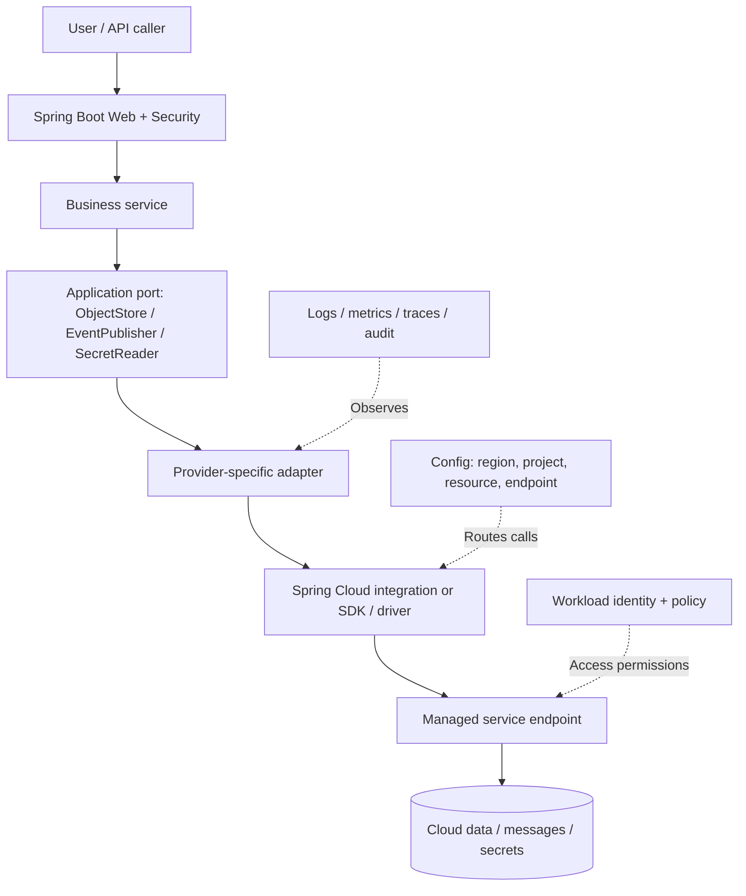
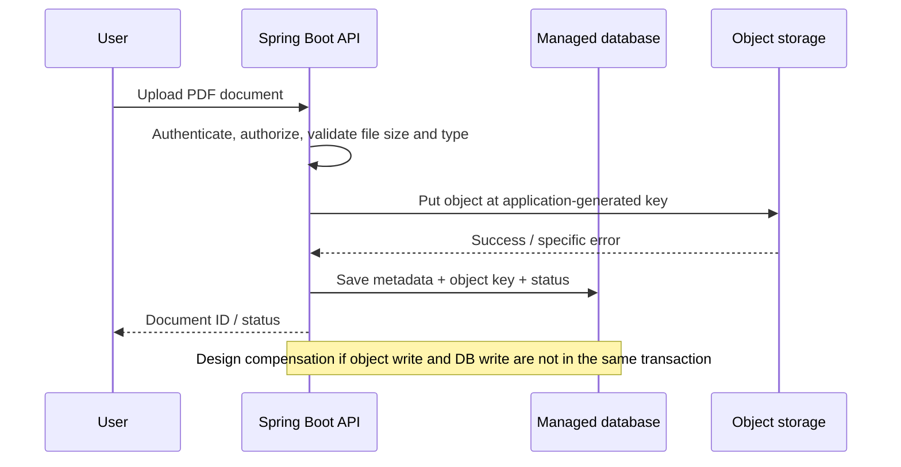
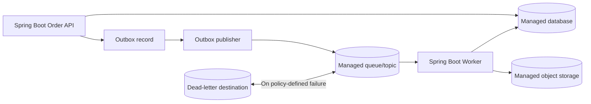

# Map of AWS, Azure, Google Cloud, OCI, and Alibaba Cloud

> **Chapter:** Orientation  
> **Module:** `SPRING_CLOUD_PROVIDER_INTEGRATION`  
> **Hands-on focus:** Integrating Spring Boot with managed services from AWS, Microsoft Azure, and Google Cloud using Spring Cloud AWS, Spring Cloud Azure, and Spring Cloud GCP. Oracle Cloud Infrastructure (OCI) and Alibaba Cloud are included in the map to broaden perspective, compare concepts, and understand limitations when switching providers.

## 1. Objective: Read the "Map" Instead of Memorizing Service Names

A business requirement such as "store PDF documents, emit an event for background processing, and protect connection passwords" can be implemented on many cloud platforms. Yet product names, configuration methods, identity systems, and API behaviors differ. Therefore, before reaching for a starter or SDK, developers must be able to answer:

1. **Which provider** operates the resource, and where is the resource's **governance boundary**?
2. **Which managed service** meets the exact storage, messaging, data, or secret need?
3. **How will Spring Boot connect:** a Spring Cloud provider library, direct Java SDK, standard driver, or an integration adapter?
4. **Which identity and permissions** are granted to the application when running on a personal machine, CI, and cloud runtime?
5. **Which characteristics must be verified** before designing the system: message ordering, retries, consistency, regions, latency, backups, costs?

The "map" here is a **capability comparison framework**, not a claim that the services of all five providers are strictly equivalent. The hands-on Spring Cloud portion of this module prioritizes **AWS, Azure, and Google Cloud**; OCI and Alibaba Cloud help clarify which parts of an architecture are reusable and which parts must change when working with another provider.

## 2. Overview of the Five Providers

| Provider | Full name | Common resource governance units | Geographic scope to watch | Starting point for Spring Boot apps |
| --- | --- | --- | --- | --- |
| **AWS** | Amazon Web Services | Account, organization/account structure, IAM role/policy | Region, Availability Zone, sometimes regional endpoints | Spring Cloud AWS (AWSpring), AWS SDK for Java |
| **Azure** | Microsoft Azure | Microsoft Entra tenant, subscription, resource group, resource | Region, availability zone, and service-specific scope | Spring Cloud Azure, Azure SDK for Java |
| **Google Cloud** | Google Cloud | Organization/folder, project, resource, IAM | Region/zone, multi-region, or service-specific location | Spring Cloud GCP, Google Cloud Java client libraries |
| **OCI** | Oracle Cloud Infrastructure | Tenancy, compartment, policy, resource | Region, availability domain/fault domain depending on region | OCI Java SDK and client configuration in Spring Boot |
| **Alibaba Cloud** | Alibaba Cloud | Account, resource group, RAM identity/policy | Region and zone; product-specific endpoints | Alibaba Cloud SDK for the corresponding service; Spring Cloud Alibaba projects when appropriate |

Do not equate these columns:

- An **AWS account** does not share the same organizational model as an **Azure subscription** or a **Google Cloud project**.
- An **OCI compartment** is a core structure for grouping and authorizing resources within a tenancy; it is not merely a display folder.
- **Alibaba Cloud RAM** manages identities and access permissions; a **resource group** helps organize resources but does not replace the permission system.
- Every provider has a concept of **deployment regions**, yet APIs, product availability, replication options, and pricing depend on each region.

### Two Decisions Often Conflated

**Where does the application run?** For example, Spring Boot running on a laptop, VM, Kubernetes, or managed container service.

**Whose services does the application call?** For example, Spring Boot running on Azure can still use Amazon S3 if networking, identity, and permissions allow it. This is a **cross-cloud** integration choice, which typically introduces additional requirements around networking, security, latency, egress, and operations.

Choosing where to deploy does not automatically choose where data is stored or where messaging lives. Each of these relationships must be explicitly represented in the architecture.

## 3. Layered Map: From Business Logic to Cloud Services



In this diagram:

- A **port** is an interface owned by the application, such as `ObjectStore.put(...)`; it expresses what the business logic needs.
- An **adapter** is code written by the application to call an external service; it may use a starter-created client or initialize an SDK client in a controlled manner.
- **Spring Cloud provider integration** typically assists with dependencies, auto-configuration, beans, templates, or listeners when the service/version supports them.
- The **SDK/driver** handles communication using the service's API/protocol.
- The **managed service** handles storage or messaging on the provider side; **IAM/RBAC/policies** govern workload permissions.

Note that Spring Cloud AWS, Spring Cloud Azure, and Spring Cloud GCP are integration families with their own scopes and release cycles. There is no single universal Spring Cloud starter that automatically maps all services across **all five** providers.

## 4. Object Storage Map: Where Files and Objects Live

For a Spring Boot application allowing users to upload images, PDFs, or processed log files, object storage is generally far better suited than persisting permanently on a container's local filesystem.

| Provider | Service | Key resource units | Common operations |
| --- | --- | --- | --- |
| AWS | **Amazon S3** | Bucket, object key | Put/Get/Delete object; lifecycle, versioning, presigned URLs |
| Azure | **Azure Blob Storage** | Storage account, container, blob | Upload/Download blob; lifecycle, SAS, versioning depending on service features |
| Google Cloud | **Cloud Storage** | Bucket, object | Upload/Download object; signed URLs, lifecycle, versioning |
| OCI | **Object Storage** | Namespace, bucket, object | Put/Get object; pre-authenticated requests, lifecycle |
| Alibaba Cloud | **Object Storage Service (OSS)** | Bucket, object | Put/Get object; signed URLs, lifecycle, versioning |

**Shared need:** files survive Spring Boot restarts, scaling from one to multiple instances, or deploying new containers. Typically, the application database stores metadata such as document ID, owner ID, object key, version/status, and creation timestamp; object storage holds the file contents.

**Not strictly equivalent:** signed URLs / SAS / pre-authenticated requests differ in signing mechanisms, scopes, and lifecycles; encryption key options, retention, replication, versioning, access controls, and API limits also differ. The name "bucket" in S3, GCP, OCI, and Alibaba Cloud does not guarantee the same API or IAM model.

### Example Document Storage Flow



You cannot treat an object write and a database write as a single shared ACID transaction just because both are managed services. You must handle cases where **the file upload succeeded but writing metadata failed**, or metadata was saved first and the upload failed. Practical options include intermediate states, orphan-object cleanup jobs, outboxes, or reconciliation workflows according to business requirements.

### How Do SDKs and Integrations Approach Storage?

| Provider | Typical Java client/SDK | Connecting with Spring Boot |
| --- | --- | --- |
| AWS | AWS SDK for Java v2 `S3Client` | Can use Spring Cloud AWS S3 starter to configure the client |
| Azure | Azure Storage Blob SDK, e.g., `BlobServiceClient`/`BlobContainerClient` | Can use Spring Cloud Azure Storage Blob starter |
| Google Cloud | Google Cloud Java client `Storage` | Can use Spring Cloud GCP Storage starter |
| OCI | OCI Java SDK for Object Storage | Use SDK/client and project-specific Spring `@Configuration`/adapters |
| Alibaba Cloud | OSS SDK / Alibaba Cloud SDK matching service version | Use SDK/client and adapters; check specific Spring integration projects |

This is an **approach-level** map, not an assertion that every API, class, or starter supports the same capabilities or the same Java/Spring Boot versions. When doing hands-on work, check the official BOM and compatibility matrix of the chosen library.

## 5. Messaging Map: How Queues, Events, and Streams Differ

Messaging is a classic example of why **you should not swap one service name for another merely by looking down a column**.

| Need | AWS | Azure | Google Cloud | OCI | Alibaba Cloud |
| --- | --- | --- | --- | --- | --- |
| **Task queue** | Amazon SQS | Azure Service Bus queues | Pub/Sub via topic + subscription for asynchronous consumer processing | OCI Queue | Simple Message Queue (SMQ, formerly known as MNS) |
| **Event distribution / pub-sub** | Amazon SNS, EventBridge | Service Bus topics, Event Grid | Pub/Sub | OCI Notifications; OCI Events depending on routing needs | EventBridge, ApsaraMQ products according to specific model |
| **Data / event streaming** | Amazon Kinesis Data Streams, Amazon MSK | Azure Event Hubs | Pub/Sub or Managed Service for Apache Kafka depending on requirements | OCI Streaming | ApsaraMQ for Kafka / RocketMQ depending on use case |

Product catalogs and labels can be renamed or expanded over time; when implementing, consult each provider's current documentation. Names in this table **orient you toward capabilities** and do not imply that each row shares a protocol or delivery semantics.

### Three Common Models

- **Work queue:** workers pull units of work; failed messages can be retried and moved to a dead-letter destination. Many services provide at-least-once delivery under certain conditions, so workers need idempotency.
- **Publish/subscribe:** publishers emit events; one or more consumers receive them via subscriptions or matching delivery targets. Event copy counts and fan-out mechanics depend on the product/configuration.
- **Event stream:** events are appended continuously to a log/stream, often emphasizing partitions, scoped ordering, offsets, and replay. Do not treat it as identical to a traditional queue.

For instance, Google Cloud Pub/Sub publishes messages to a **topic** and consumers typically read from a **subscription**; Amazon SQS operates with a **queue**. Do not build a common abstraction promising business-level "exactly once" unless the system has dedicated deduplication and consistency mechanisms.

### Questions to Ask Before Choosing a Messaging Service

1. Does an event need to be processed by **one worker** or **multiple independent consumer groups**?
2. Is ordering required **system-wide**, per **partition key**, or not required at all?
3. When a consumer fails, how does the broker **redeliver**, **lock messages**, **extend acknowledgements**, or support **replay**?
4. How does the system handle dead-lettering, backoff, retry limits, and poison messages?
5. Is a single guarantee needed across database changes and event emission? If so, is a **transactional outbox** appropriate?
6. Which APIs/message formats have Spring Cloud integrations or SDKs compatible with your current Spring Boot version?

### Conceptual Diagram of an Asynchronous Flow



This is a conceptual flow; how a DLQ is wired and how failed messages move depend on the provider. An outbox bridges the gap between **DB commit** and **event publish** by storing the event in the same DB transaction, then having a separate publisher send it and mark its status; consumers must still tolerate duplicate deliveries.

## 6. Data Map: Relational, NoSQL, and Cache

"Managed database" describes **how it is operated**, not its data model. Spring Boot can access managed databases via JDBC/JPA/R2DBC or dedicated SDKs.

| Need | AWS | Azure | Google Cloud | OCI | Alibaba Cloud |
| --- | --- | --- | --- | --- | --- |
| **Managed relational database** | Amazon RDS, Aurora | Azure Database for PostgreSQL, Azure SQL Database | Cloud SQL, AlloyDB | Autonomous Database; corresponding managed database services | ApsaraDB RDS / PolarDB |
| **NoSQL or document/key-value** | DynamoDB | Azure Cosmos DB | Firestore, Bigtable | OCI NoSQL Database | Tablestore / corresponding data products |
| **Managed cache** | ElastiCache | Azure Managed Redis offerings depending on timeframe | Memorystore | OCI Cache | ApsaraDB for Redis |

This table is **not a 1:1 replacement matrix**. For example, DynamoDB, Cosmos DB, Firestore, OCI NoSQL, and Tablestore differ in data types, partitioning, querying, and consistency models. Choose technology based on query patterns, target latency, transaction capabilities, cost model, and operational skills — not merely the "NoSQL" label.

### Spring Data Remains in Its Proper Place

An application using managed PostgreSQL can continue using `Spring Data JPA`/`JDBC` and the PostgreSQL driver. When moving PostgreSQL from self-managed hosting to a compatible managed service, business repositories can remain largely unchanged; changes usually live in **networking, endpoints, TLS, connection configuration, identity, backups, and connection limits**.

If you change the **data model** from PostgreSQL to a document/key-value store, migration is much harder: schemas, joins, transactions, queries, and consistency assumptions must be redesigned. A Spring Cloud provider starter does not automatically migrate data or preserve application semantics.

## 7. Identity and Permissions Map: Same Purpose, Different Mechanisms

A Spring Boot service sending requests to the cloud must have a **workload identity**; the target service checks whether that identity is authorized to perform the action on the exact resource.

| Provider | Identity / permission system | Common workload approach | Permission boundary to recognize |
| --- | --- | --- | --- |
| AWS | AWS IAM role, policy, resource policy | IAM role attached to workload; local profile/SSO or valid credential source | Actions on ARNs/resources and policy conditions |
| Azure | Microsoft Entra ID, Azure RBAC, Managed Identity | Managed Identity on supported services; Azure Identity credential chain | Subscription/resource scope and appropriate data-plane roles |
| Google Cloud | Cloud IAM, service account, Workload Identity | Service account/workload identity; local Application Default Credentials | IAM roles at project or resource level, per service |
| OCI | OCI IAM, policies, dynamic groups | Instance principal/resource principal/workload identity when supported by environment | Policies scoped by tenancy/compartment/resource |
| Alibaba Cloud | Resource Access Management (RAM), roles/policies, STS | RAM roles and temporary credentials via supported runtime/federation mechanisms | Actions/resources and policies, service-dependent |

**Do not put long-lived access keys, client secrets, or private keys directly into the repository.** On cloud runtimes, prefer short-lived credentials or native workload identity mechanisms. For local development, use the SDK/CLI login method documented by the provider with an identity limited to dev environments.

### Distinguishing Two Security Layers

- **User → Spring Boot:** Spring Security authenticates users, and the application decides which documents a user may access.
- **Spring Boot → cloud resource:** cloud IAM/RBAC/policies decide whether the application identity may write objects, send messages, or read secrets.

The development team must govern **both layers**. Proper IAM does not automatically stop User A from requesting User B's document if API code lacks business authorization checks; proper Spring Security does not give an under-privileged IAM role permission to access a bucket.

### Diagnostic Scenario

An upload REST endpoint works and Spring Boot builds the SDK client, yet storing the object is rejected:

1. Check which identity is **actually** being used by the SDK; local and runtime environments may resolve different credential sources.
2. Check the exact account/subscription/project/tenancy and region.
3. Check the policy for the **write object** action on the exact bucket/container, not merely permission to list/view the resource name.
4. Check additional network restrictions, encryption key permissions, or resource policies if required by the service.
5. Read the SDK error code/request ID and audit logs; do not hastily grant broad admin permissions just "to make it work."

## 8. Map of Secrets, Keys, and Observability

### Secret Stores

| Provider | Reference service | Integration purpose |
| --- | --- | --- |
| AWS | AWS Secrets Manager, Systems Manager Parameter Store | Store and retrieve sensitive configuration governed by IAM |
| Azure | Azure Key Vault | Manage secrets, keys, and certificates according to service capabilities |
| Google Cloud | Secret Manager | Store secret versions and control access |
| OCI | OCI Vault | Store secrets and manage keys according to service features |
| Alibaba Cloud | KMS / Secrets Manager | Manage keys and secrets according to product/configuration |

A service can use an adapter to read a secret and configure a client for another system. However, secret manager integration **does not automatically guarantee instant rotation takes effect**: the application must know when to reload secrets, when to rebuild connection pools/clients, and how to handle overlap while old tokens or passwords remain valid.

### Observability and Operations

| Provider | Typical observability service group |
| --- | --- |
| AWS | Amazon CloudWatch, CloudTrail |
| Azure | Azure Monitor, Application Insights, Activity Log |
| Google Cloud | Cloud Monitoring, Cloud Logging, Cloud Audit Logs |
| OCI | OCI Monitoring, Logging, Audit |
| Alibaba Cloud | CloudMonitor, Simple Log Service (SLS), ActionTrail |

Each provider has its own tools, yet a Spring Boot application should still emit standard signals where appropriate: **latency**, **error rate**, **retry count**, **message backlog**, **request/correlation IDs**, and **traces**. Spring Boot Actuator alongside Micrometer/OpenTelemetry can form part of the solution. Strictly avoid putting secrets, tokens, or sensitive document contents into logs or traces.

## 9. Spring Cloud Map: What Belongs to the Core Integration Track of This Module?

In the `SPRING_CLOUD_PROVIDER_INTEGRATION` module, learners focus hands-on practice on these three Spring Boot integration tracks:

| Provider | Integration technology family | What you can leverage | Notes |
| --- | --- | --- | --- |
| AWS | **Spring Cloud AWS / AWSpring** | Starters, auto-configuration, and Spring APIs for supported services such as S3, SQS | Check Spring Boot/JDK compatibility and AWSpring BOM |
| Azure | **Spring Cloud Azure** | Starters and Azure SDK integrations for Blob Storage, Service Bus, Key Vault, and supported services | Check Azure Identity, data-plane permissions, and BOM |
| Google Cloud | **Spring Cloud GCP** | Starters, templates/clients, and integrations for Storage, Pub/Sub, and supported services | Check project ID, Application Default Credentials, and compatibility |
| OCI | **OCI Java SDK with Spring Boot** | Create clients via configuration/beans, wrap SDK in adapters; specialized integrations if applicable | Do not assume a Spring Cloud OCI starter symmetric with the three above |
| Alibaba Cloud | **Alibaba Cloud Java SDK; Spring Cloud Alibaba as needed** | Cloud service SDKs; Spring Cloud Alibaba components for systems like Nacos/Sentinel/RocketMQ depending on version | "Spring Cloud Alibaba" does not mean every Alibaba Cloud service has a corresponding starter |

**Important distinction:** `Spring Cloud Alibaba` is the name of a project suite integrating ecosystem components such as service discovery/configuration, resilience, and messaging depending on version. It is **not a universal adapter for every Alibaba Cloud managed service**. Likewise, when using the OCI SDK in Spring Boot, evaluate each actual service rather than assuming the same starter/configuration structure as AWS, Azure, or GCP.

### Dependency Examples When Practicing the Three Main Providers

The coordinates below illustrate **artifact families**, without pinning versions. Every option must be paired with a Spring Boot-compatible BOM/version per official documentation.

```xml
<!-- AWS option: S3 -->
<dependency>
  <groupId>io.awspring.cloud</groupId>
  <artifactId>spring-cloud-aws-starter-s3</artifactId>
</dependency>

<!-- Azure option: Blob Storage -->
<dependency>
  <groupId>com.azure.spring</groupId>
  <artifactId>spring-cloud-azure-starter-storage-blob</artifactId>
</dependency>

<!-- Google Cloud option: Cloud Storage -->
<dependency>
  <groupId>com.google.cloud</groupId>
  <artifactId>spring-cloud-gcp-starter-storage</artifactId>
</dependency>
```

These dependencies are listed **for comparison**, not as a requirement to add all three simultaneously to one project. APIs, property keys, and bean mechanics are defined by each project. OCI or Alibaba Cloud can also be integrated into Spring Boot via their direct Java SDKs and application-configured beans.

## 10. One Application Contract, Five Provider Adapters

Suppose a team wants to prevent business logic from depending directly on a storage SDK. We can place a minimal interface at the application layer:

```java
public interface DocumentObjectStore {
    void put(String objectKey, byte[] content, String contentType);
}
```

The business service only cares about generating keys and storing documents:

```java
import java.util.UUID;
import org.springframework.stereotype.Service;

@Service
public class DocumentService {
    private final DocumentObjectStore store;

    public DocumentService(DocumentObjectStore store) {
        this.store = store;
    }

    public String uploadPdf(byte[] validatedPdf) {
        String key = "documents/" + UUID.randomUUID() + ".pdf";
        store.put(key, validatedPdf, "application/pdf");
        return key;
    }
}
```

In this example, `validatedPdf` is assumed to have passed upload authorization, file type validation, and size checks before the call. The example uses `byte[]` for readability; large files should use streaming/multipart or an appropriate direct-upload flow.

The application can have adapters: `S3DocumentObjectStore`, `AzureBlobDocumentObjectStore`, `GcsDocumentObjectStore`, `OciDocumentObjectStore`, `OssDocumentObjectStore`. Each adapter knows how to call its provider's client and resources, while `DocumentService` uses the same port.

### Example AWS Adapter with a Spring-Managed SDK Client

```java
import org.springframework.beans.factory.annotation.Value;
import org.springframework.stereotype.Component;
import software.amazon.awssdk.core.sync.RequestBody;
import software.amazon.awssdk.services.s3.S3Client;
import software.amazon.awssdk.services.s3.model.PutObjectRequest;

@Component
public class S3DocumentObjectStore implements DocumentObjectStore {
    private final S3Client client;
    private final String bucket;

    public S3DocumentObjectStore(
            S3Client client,
            @Value("${app.storage.bucket}") String bucket) {
        this.client = client;
        this.bucket = bucket;
    }

    @Override
    public void put(String key, byte[] bytes, String contentType) {
        PutObjectRequest request = PutObjectRequest.builder()
                .bucket(bucket)
                .key(key)
                .contentType(contentType)
                .build();

        client.putObject(request, RequestBody.fromBytes(bytes));
    }
}
```

The assumption here is that the `S3Client` bean has already been created appropriately, for example through a compatible Spring Cloud AWS S3 starter. The client needs a valid region and workload credentials; the resource must already exist and have write permissions granted. Nothing in this code creates the bucket or grants the IAM role.

### Configuration Should Not Be Assumed Shared Across Every Provider

```yaml
app:
  storage:
    provider: aws
    bucket: ${DOCUMENT_BUCKET}
```

`app.storage.*` is an **application-defined** prefix used to select the adapter and resource name. If the application defines multiple beans implementing `DocumentObjectStore`, you must use `@Qualifier` or provider-based conditional configuration; merely adding a `provider: aws` property will not automatically select the right bean.

When switching providers, you must change dependencies/clients, adapters, resource configuration, credentials, IAM/RBAC, endpoints, and integration tests. The port can remain unchanged **if the shared contract is genuinely sufficient**. If business logic requires object locking, signed URLs with specific semantics, or different guarantees, you may need to revise the contract and redesign portions of behavior.

## 11. Comparing Options by Requirements, Not by Service Count

All five providers offer common cloud capabilities, but your selection should be grounded in real requirements.

| Criterion | How to verify it? | Impact on Spring Boot |
| --- | --- | --- |
| **Data and storage location** | Residency region, encryption, backups, lifecycle, replication | Resource/region selection, secret handling, and deletion policies |
| **Messaging model** | Queue vs. topic/subscription vs. stream; retries, ordering, dead-lettering | Adapter choice, message schema, idempotency, outbox |
| **Identity governance** | Workload identity, least privilege, federation, auditing | Credential chain/client config and permission tests |
| **Framework compatibility** | Which JDK versions does the Java SDK support? Is there a Spring Boot-compatible starter? | BOM, dependencies, and bean configuration |
| **Observability** | Does the SDK emit usable traces/metrics? Which actions do cloud audit logs cover? | Troubleshooting, correlation IDs, metrics, alerts |
| **Latency, networking, and egress** | Are app and resources in the same region/provider? | Timeouts, retries, private connectivity, transfer costs |
| **Cost** | Requests, storage, data egress, message volume, retention, logs | Quotas, lifecycle, batching, and backpressure design |
| **Operations team** | Expertise in IAM, databases, incident response, and vendor support | Maintainability, recovery procedures, and deployment |

### An Often Underestimated Decision: Where Data Lives

If the API runs on one provider while object storage lives on another, every upload/download may incur extra latency and data transfer costs while introducing two separate identity and audit boundaries. In some cases this is a valid design, but it must be calculated and tested rather than assuming "it's all cloud so it's the same."

## 12. Learning Path in This Module and Appropriate Depth of Practice

Because the module's goal is **hands-on integration of Spring Boot with managed services from AWS, Azure, and Google Cloud using the corresponding Spring Cloud libraries**, one end-to-end business scenario can be carried across them:

**Problem:** An API accepts requests to create a case file, stores a PDF, emits an event to generate a preview, persists metadata in a database, and reads a secret needed for processing.

| Practice step | AWS | Azure | Google Cloud | OCI / Alibaba Cloud in the lesson |
| --- | --- | --- | --- | --- |
| Identity setup | IAM role / credential chain | Managed Identity / Azure Identity | Service account / ADC | Recognize principals, policies, RAM/OCI IAM |
| Store documents | Spring Cloud AWS + S3 | Spring Cloud Azure + Blob | Spring Cloud GCP + Storage | Compare Object Storage/OSS and SDKs |
| Emit events | SQS/SNS per flow | Service Bus / Event Grid per flow | Pub/Sub | Distinguish OCI Queue/Notifications, SMQ/ApsaraMQ |
| Data | Managed relational DB + Spring Data | Managed relational DB + Spring Data | Managed relational DB + Spring Data | Recognize equivalent services by need, without assuming API equivalence |
| Secrets | Secrets Manager | Key Vault | Secret Manager | Compare OCI Vault/Alibaba KMS |
| Integration tests | Local emulator when supported + AWS test | Emulator when supported + Azure test | Emulator when supported + GCP test | Propose contract tests + dedicated sandbox cloud account |

In this way, **AWS/Azure/GCP are the three deep hands-on tracks**, while **OCI/Alibaba Cloud broaden analytical thinking**. This approach avoids presenting five providers as five identical APIs and does not force learners to install every SDK/starter simultaneously in one sample application.

## 13. Testing Strategy When Comparing Multiple Providers

An application with `DocumentObjectStore` and `DocumentEventPublisher` ports can divide testing into layers:

1. **Business unit tests:** use fake ports to verify keys, authorization checks, and business rules. No cloud account needed.
2. **Adapter contract tests:** every implementation must satisfy shared behaviors, such as storing an object and reading back its exact contents; pay attention to semantics that cannot be standardized.
3. **Emulator integration tests where available:** LocalStack for supported AWS APIs; Azurite for certain Azure Blob Storage features; Pub/Sub emulator for Google Cloud Pub/Sub. Do not assume all error types, IAM behaviors, or features are emulated.
4. **Integration tests against real sandbox cloud resources:** verify workload identity, policies, networking, regions, serialization, and real behavior. For OCI/Alibaba Cloud, use SDK mocks/fakes or sandbox/test resources according to provider-supported tools and capabilities.
5. **Failure tests:** insufficient permissions, missing objects, timeouts, rate limits, duplicate messages, ordering variations, dead-lettering, and recovery after incidents.

An emulator is useful for catching client or payload misconfigurations, yet **is not full proof** of IAM, regions, throughput limits, or real cloud semantics. When enabling retries, classify transient failures separately from configuration/permission errors; consumers handling potentially redelivered messages need idempotency keyed by event ID or business key.

### Verification Checklist per Provider

| Question | Verification level |
| --- | --- |
| Is the client configured with the right endpoint/region/project/compartment? | Runtime + integration |
| Does the actual identity have permissions on the right resource, without being overly broad? | Cloud IAM + integration |
| Are payloads/metadata/object names encoded properly? | Contract + integration |
| Are errors mapped to clear business outcomes? | Adapter unit + failure |
| Are timeouts, conditional retries, and idempotency in place? | Failure/integration |
| Are logs/metrics/traces sufficient to trace failed requests? | Observability |
| Are test resources cleaned up and costs capped? | Test environment |

## 14. Common Misconceptions When Reading the Cloud Map

**"All five providers have the same service set, so you just swap product names."** False. Even within storage or messaging, data models, APIs, permissions, and delivery semantics differ. Comparison tables only identify **functional candidates** for further evaluation.

**"Having Spring Cloud AWS means AWS and the other clouds all work the same way."** False. Each integration family focuses on the services that project supports. For OCI/Alibaba Cloud, specific SDKs and Spring Boot configurations may be the better path.

**"Spring Cloud Alibaba means a universal starter for every Alibaba Cloud service."** False. It is a project suite with its own scope; check individual components, maintenance status, and version compatibility.

**"Using a managed database means you don't need Spring Data/drivers."** False. For relational databases, applications still typically use drivers, JDBC/JPA/R2DBC, migrations, transactions, and connection pool management.

**"Using workload identity means API users are automatically authorized."** False. Workload permissions toward the cloud and end-user permissions toward documents are two distinct boundaries.

**"Integrating the starter means you are production-ready."** False. You still need provisioned resources, IAM, endpoint configuration, validation, error handling, integration tests, monitoring, and cost estimation.

**"Multi-cloud always makes a system safer."** Not by default. Multiple providers mean multiple policies, credentials, networks, billing models, SDKs, failure modes, and operations teams. Adopt it only when there is a clear resilience, customer, regulatory, or strategic requirement.

## 15. Orientation Exercise: Building Your Own Map for a Product

**Scenario:** Build an order and case-document management system in Spring Boot. The system needs:

- A REST API with authentication and document access authorization.
- Durable PDF storage.
- A `DocumentUploaded` event for out-of-band worker processing.
- Order metadata stored in a relational database.
- Management of a secret used to call an external system.
- Tracking for latency, errors, retry counts, and backlog.

### Task A: Complete the Capability Table

Build a five-row table for **AWS, Azure, Google Cloud, OCI, and Alibaba Cloud**. For each row, fill in appropriate storage, messaging, relational database, secret manager, workload identity, and observability tools. Mark cells that require **checking current official documentation/policies**.

### Task B: Describe the Spring Boot Architecture

Diagram the flow from `UploadController` to `DocumentService`, `DocumentObjectStore`, adapter, SDK, and object storage. Continue the flow for emitting events to managed messaging and the worker. Clearly mark the boundaries of Spring Security, IAM, database transactions, and the secret manager.

### Task C: Choose Integration Paths

For **AWS/Azure/GCP**, identify the corresponding starter/Spring Cloud project or suitable SDK. For **OCI/Alibaba Cloud**, explain how to configure an SDK client as a Spring bean when no suitable starter is used; explain why you should not assume all providers share the same API surface.

### Task D: Propose Testing

Design one unit test using fake storage, one adapter contract test, one sandbox cloud integration test, and one failure test for duplicate message processing. Explain why emulator tests cannot replace real permission verification.

### Task E: Make a Reasoned Decision

Suppose the enterprise already runs its main system on Azure, but the development team wants to put PDFs in OCI Object Storage. List what must be investigated before approving this: regional service availability, authorization mechanics, network connectivity, egress cost, latency, SDK support, backups/retention, and observability.

**Pass criteria:** learners accurately name providers and their roles, compare service capabilities by need, separate where the app runs from where data resides, select appropriate Spring/SDK libraries, and identify key controls for IAM, messaging, and integration testing.

---

## Key Takeaways

The **five-cloud map** answers "which platform provides which capability," but does not mean similarly named services share identical APIs or technical guarantees. AWS, Azure, and Google Cloud are the three core platforms for practicing **Spring Cloud provider integration** in this module; OCI and Alibaba Cloud expand perspective on resource models, identities, and Spring Boot integration strategies.

When designing an application, start from **business need → managed service category → resources and permissions → SDK/starter → adapter → testing and operations**. Comparing layer by layer helps teams choose clouds on evidence, limit provider coupling, and avoid false assumptions when migrating or combining multiple platforms.
