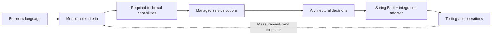
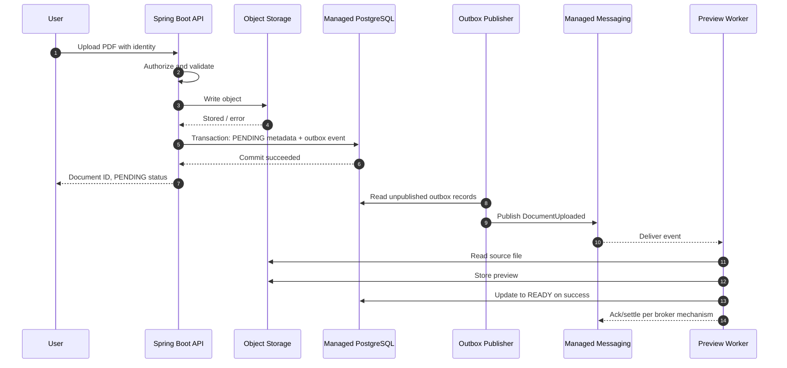
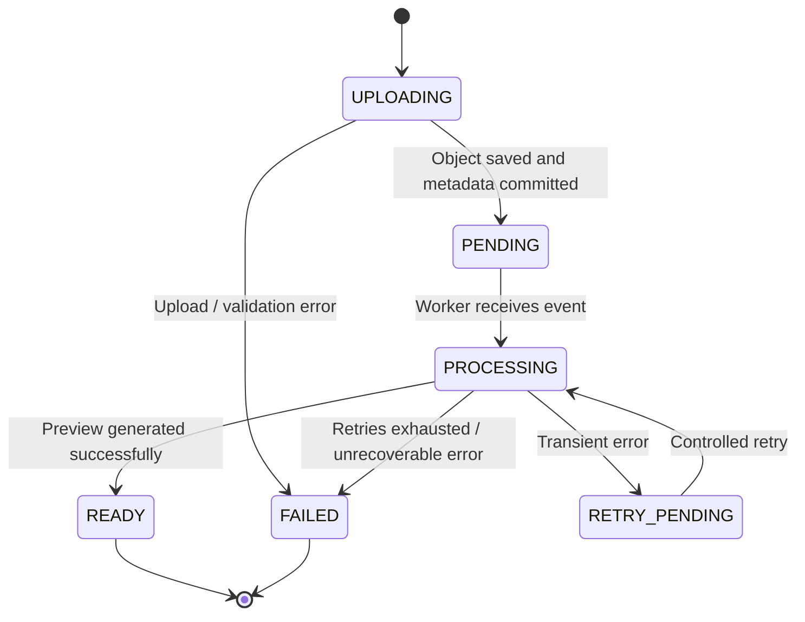
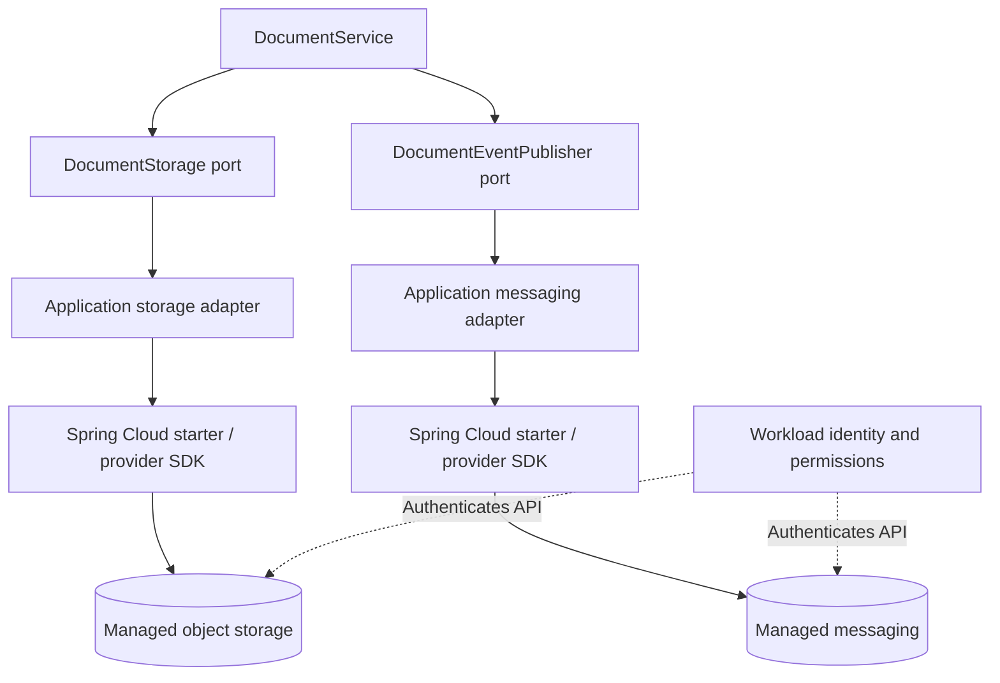

# From Business Requirements to Service Selection and Integration Approach

> **Chapter:** Orientation  
> **Module:** `SPRING_CLOUD_PROVIDER_INTEGRATION`  
> **Scope:** Analyzing requirements to integrate Spring Boot with managed services from AWS, Azure, and Google Cloud via Spring Cloud AWS, Spring Cloud Azure, Spring Cloud GCP, or appropriate SDKs/drivers. Focuses on the decision-making process for storage, messaging, data, identity, permissions, secrets, testing, and operations.

## 1. The Real-World Problem: Business Requirements Don't Name Cloud Services

Suppose a development team receives this requirement:

> "Customers upload PDF contracts to the system. The system must store the documents, allow owners to view them later, generate a preview in the background, and send a notification when complete. Data is private and must not be lost after application redeployments. When many users are active, uploads must remain reliable."

In the requirement above, the business does not mention Amazon S3, Azure Blob Storage, Google Cloud Storage, queues, or Spring Cloud starters. That is completely normal: **stakeholders describe the desired outcome; the engineering team must translate that outcome into technical capabilities, criteria, and integration options**.

Several implementation approaches may look plausible at first glance yet carry very different consequences:

- Saving PDFs to a container's local directory: easy to prototype, but difficult to share across multiple instances and lacks a durability strategy.
- Storing entire PDFs as BLOBs in the database: acceptable in some cases, yet impacts database size, backups, and access/retrieval patterns.
- Pushing PDFs to object storage and metadata to the database: decouples file data from application lifecycle, but requires handling partial failures between operations.
- Generating previews directly inside the HTTP request: easy to picture, but increases response latency and timeout risk.
- Offloading preview requests to messaging: separates load between API and workers, yet requires handling duplicate messages, retries, dead-lettering, and progress status.

**The goal of this lesson** is to practice an explainable and verifiable path:



The starting point must be **product needs and real constraints**, not picking a familiar service upfront and forcing the business logic to conform to how that service works.

## 2. Turning Descriptions into Verifiable Requirements

A good requirement must be clear enough to guide service selection and build acceptance tests. For the document scenario, requirements can be categorized as follows.

### 2.1. Functional Requirements and Data Contracts

| Business description | Questions to clarify | Technical requirements to record |
| --- | --- | --- |
| "Let customers upload contracts" | File types, size, count, upload permissions? | Accept PDFs only after validation; enforce size limits and authorization checks. |
| "View their documents later" | Who may view? Access via API or temporary URLs? | Each document carries `ownerId`; only the owner or authorized roles may read it. |
| "Do not lose documents across redeployments" | Are old versions, accidental-delete recovery, or retention periods needed? | Files live in storage independent of containers; retention/backup policies match requirements. |
| "Generate a preview" | Target completion time, retryability, what to show on failure? | Asynchronous preview generation; workflow has `PENDING/READY/FAILED` states. |
| "Send notifications" | Strictly once or is duplicate delivery acceptable? | Include an event ID and safeguards against duplicate side effects. |
| "Protect private data" | Sensitivity level, encryption, auditing, data residency region? | Least-privilege access, transport encryption, encryption at rest, and auditing as required. |

In practice, clarify early which data belongs to **file contents**, which data is **metadata**, which events represent **business facts**, and which state transitions are allowed. Without defining these early, storage/messaging designs can be API-correct while exhibiting wrong user behavior.

### 2.2. Non-Functional Requirements: Set Targets, Don't Guess

Below are **illustrative figures for practice**, not defaults of any cloud provider or service guarantees:

| Category | Example target | How to verify? |
| --- | --- | --- |
| File size | PDF up to **20 MiB** | API validation and boundary upload tests. |
| Throughput | Peak **100 uploads/minute** | Load testing on the upload path and dependent resources. |
| API latency | Metadata API response p95 **under 500 ms**, excluding full file transfer time | APM/metrics, with exact start and end boundaries defined for the measurement. |
| Previews | **99%** of previews succeed within **2 minutes** of upload completion | Measure `uploadedAt` → `previewReadyAt` and monitor backlog. |
| Availability | Application service target **99.9%** over evaluation window | SLIs/SLOs, health checks, and multi-layer incident tracking. |
| Data residency | Documents stored only in organization-approved regions | Verify region/location, replication, policies, and audits. |
| Permissions | Only owner or authorized roles may read files | Test both API authorization and workload IAM. |
| Cost | Within product budget limits | Estimate requests, storage, egress, messages, logs, and alerts. |

Do not turn example numbers into rigid rules. An option is acceptable only when **targets match real needs** and the team has a way to verify them. For example, setting "p95 API under 500 ms" is meaningless if the measurement includes the time a user spends uploading a 20 MiB file over a slow network.

### 2.3. Questions to Ask Early

Before choosing a provider, clarify:

1. **Data:** sensitivity level, sizes, required storage location, retention, deletion, and recovery.
2. **Volume:** read/write rates, peak traffic, message sizes, processing time.
3. **Consistency:** if upload succeeds but metadata fails to write, what should the system display?
4. **Resilience:** acceptable downtime, RTO/RPO if any, replay requirements.
5. **Security:** which users may view documents, and which workloads may read/write storage or secrets.
6. **Operations:** who owns deployment, permissions, monitoring, backups, and incident response?
7. **Cost and contracts:** budget, provider limits, organizational technical/legal constraints.

If any answer is missing, **record it as a testable assumption** in the architectural decision. Avoid hiding uncertainty by picking a familiar-sounding service.

## 3. From Requirements to Technical Capabilities, Then to Services

A managed service is chosen because it satisfies a **technical capability**. The table below traces that reasoning chain:

| Clarified requirement | Required capability | Typically suitable options | Decision questions |
| --- | --- | --- | --- |
| Files survive independent of containers | Durable object storage | S3 / Blob Storage / Cloud Storage | Need versioning, lifecycle, signed URLs, or API-proxied downloads? |
| Metadata is relational and needs transactions | Relational database | RDS/PostgreSQL; Azure Database for PostgreSQL; Cloud SQL | Queries/transactions, backups, migrations, connection limits? |
| Previews take time and are retryable | Messaging + worker | SQS; Service Bus queue; Pub/Sub topic/subscription | Possible duplicate delivery? How do timeouts/acks/retries/dead-letter work? |
| Multiple systems react to events | Event distribution | SNS/EventBridge; Service Bus topic/Event Grid; Pub/Sub | Fan-out, event filtering, schemas, and independent consumers? |
| Keep passwords out of Git | Secret management | Secrets Manager; Key Vault; Secret Manager | How do workloads fetch secrets and handle rotation? |
| Only the app may call cloud APIs | Workload identity + IAM/RBAC | IAM role; Managed Identity; service account/Workload Identity | Who can read/write which exact resources? |
| Track errors and latency | Logging, metrics, tracing, audit | Spring Boot Actuator + provider monitoring tools | Where do SLIs, request IDs, retry counts, and backlog live? |

One requirement may demand **multiple capabilities**. For example, "send a notification exactly once after a contract is processed" is not solved by messaging alone: it also requires business state tracking, idempotency, and possibly an outbox.

Conversely, not every capability requires a Spring Cloud starter. For managed PostgreSQL, Spring Data JPA/JDBC and the driver can remain the primary access layer; cloud SDKs typically participate in identity, networking, or supplementary features when needed.

## 4. A Repeatable Selection Process

A seven-step process works for most integration requirements:

### Step 1 — Write Scenarios and Define Success

Instead of "need S3," write "an authorized user uploads a PDF and can read it back after API restarts; other users are denied; the system reports preview status." Include happy paths, denied paths, and failure scenarios.

### Step 2 — Separate Data Contracts

Define document metadata, object keys, event IDs, event schemas, and processing states. Decide which data requires transactional consistency and which can complete asynchronously.

Conceptual internal event example:

```json
{
  "eventType": "DocumentUploaded",
  "eventVersion": 1,
  "eventId": "evt-901",
  "documentId": "doc-123",
  "objectKey": "documents/doc-123/source.pdf",
  "occurredAt": "2026-01-01T09:00:00Z"
}
```

This is an **illustrative schema**. Never put entire PDF contents or secrets into a message. Consumers must validate schema versions, handle duplicate events, and avoid blindly trusting unverified metadata.

### Step 3 — Set Criteria and Priorities

Record **mandatory** constraints: data residency region, access permissions, communication formats, processing time, and workload type. Only then weigh trade-off criteria: cost, provider coupling, build time, and operability.

If an option violates a mandatory constraint, eliminate it before comparing prices.

### Step 4 — Generate Options, Not Just One Answer

For example, with storage:

- **Database BLOB** can be acceptable for small data requiring tight transactions with records, if budget and backups allow.
- **Object storage via backend API** simplifies centralized upload checks, at the cost of the application carrying file transfer bandwidth.
- **Direct-to-object-storage with time-limited URLs/tokens** reduces API bandwidth for large files, but requires upload confirmation, tight scope/permission limits, and orphan cleanup workflows.

Similarly for previews: **synchronous processing**, **queue + worker**, and **event bus/pub-sub** offer different trade-offs. A queue is not always necessary if tasks are brief and immediate results are required.

### Step 5 — Map Options to Providers

Evaluate specific products on AWS/Azure/GCP against the recorded needs. Verify regional availability, identity, quotas, request size limits, retry semantics, retention, and billing. Do not assume "services on the same row of a table" have equivalent APIs.

### Step 6 — Choose the Spring Boot Integration Approach

Evaluate **Spring Cloud AWS/Azure/GCP starters**, **direct Java SDKs**, **Spring Data/drivers**, or **Spring Cloud Stream** if an appropriate binder exists. Pin dependencies/BOMs to your Spring Boot/JDK versions; keep cloud code inside integration adapters/services so SDK types do not leak into business logic.

### Step 7 — Define Acceptance Tests and Operational Criteria

Create tests for permissions, timeouts, duplicate events, misconfiguration, networking, latency, and costs; specify required logs/metrics/traces. Conclude that an option is suitable only after verifying the decisive risks.

## 5. AWS, Azure, and Google Cloud Option Map for the Example

| Capability | AWS | Microsoft Azure | Google Cloud |
| --- | --- | --- | --- |
| **Object storage** | Amazon S3 | Azure Blob Storage | Cloud Storage |
| **Background messaging** | Amazon SQS | Azure Service Bus queues | Pub/Sub topic + subscription |
| **Event distribution** | SNS/EventBridge as needed | Service Bus topics/Event Grid | Pub/Sub |
| **Managed PostgreSQL** | Amazon RDS for PostgreSQL | Azure Database for PostgreSQL | Cloud SQL for PostgreSQL |
| **Secret store** | AWS Secrets Manager | Azure Key Vault | Secret Manager |
| **Workload identity** | IAM role attached to workload | Managed Identity / Microsoft Entra ID | Service account/Workload Identity |
| **Common Spring integration** | Spring Cloud AWS | Spring Cloud Azure | Spring Cloud GCP |
| **Observability** | CloudWatch/CloudTrail | Azure Monitor/Activity Log | Cloud Monitoring/Logging/Audit Logs |

This mapping is by **capability**; products differ in interfaces, delivery guarantees, service limits, IAM, and pricing. For instance:

- With **SQS**, the core unit is a queue; with **Pub/Sub**, publishers send to topics and consumers receive via subscriptions; **Service Bus** supports both queues and topics/subscriptions.
- Never promise "messages will be processed only once" solely because a broker offers certain delivery modes. **Business side effects** still require idempotency and an appropriate transaction model.
- Every managed database service has its own connection limits, backup behavior, networking, and recovery characteristics.
- Workload identity management varies by compute runtime and target resource, even when service names sound alike.

For OCI or Alibaba Cloud outside the module's primary hands-on track, the **same flow applies: requirements → capabilities → services → SDK/adapter → testing**; however, do not assume an equivalent Spring Cloud starter suite matching the three primary tracks.

## 6. Choosing Communication Architecture: Synchronous, Queue, or Events?

A business action can be split into **what is needed immediately to respond to the user** and **what can be processed asynchronously later**.

| Task | Synchronous in API | Queue + worker | Pub/sub or event distribution |
| --- | --- | --- | --- |
| Permission/file-type checks | Suitable; usually mandatory | Do not push all authorization checks to workers | Not suitable to replace request validation |
| Initial metadata persistence | Suitable when immediate feedback is needed | Only suitable if product accepts eventual acknowledgement | Can emit an event after persistence |
| PDF upload | Depends on file size and upload strategy | Can stage processing, but needs durable file storage | Events usually signal "uploaded" rather than carrying files |
| CPU/time-intensive preview generation | Risks timeouts if long-running | Usually suitable | Suitable when multiple consumers handle independent steps |
| Sending notifications | Can be slow if external services lag | Suitable | Suitable if multiple notification channels listen to the event |

### Recommended Flow for the Example Scenario



The diagram assumes the API proxies file contents to object storage for simplicity. With **direct upload**, you can separate generating an upload token, confirming file arrival, scanning/validating content appropriately, and then committing metadata and emitting the event. Sequencing and trust boundaries must be re-evaluated accordingly.

### Why Use an Outbox?

Writing a row to PostgreSQL and then calling a messaging API are **two operations without a shared transaction by default**. If the database commit succeeds but publishing times out, the event can be lost; if publishing succeeds but the client misses the response, retrying can produce duplicate messages.

A **transactional outbox** stores metadata updates and the outgoing event **in the same database transaction**. A separate publisher reads the outbox, sends to the broker, and updates publish status appropriately. This pattern reduces event loss between database and broker, **yet does not automatically guarantee single delivery**; the publisher can re-send after a crash. Consumers must therefore be idempotent.

### Business State and Recovery

Example state machine:



If an object is stored but the database commit fails, the file can become an **orphan object**; plan a cleanup strategy using keys, temporary states, or a reconciliation job. If a worker crashes after writing the preview but before acknowledging the message, the next attempt must detect the existing preview or overwrite safely to prevent duplicate side effects.

## 7. Choosing Cloud Coupling Depth in Spring Boot Code

Only after deciding on services should you choose **how to connect** business code to SDKs/providers.



### 7.1. Ports Describe Needs; Adapters Describe Execution

Ports should have small, easily testable contracts:

```java
public interface DocumentStorage {
    void put(String objectKey, byte[] content, String contentType);
}

public interface DocumentEventPublisher {
    void publish(DocumentUploaded event);
}

public record DocumentUploaded(
        String eventId,
        String documentId,
        String objectKey) {}
```

This is an **application contract**, importing no SDK types. To test business logic, fake implementations of both ports can verify key selection, statuses, and event payloads.

When switching from S3 to Blob Storage or Cloud Storage, the team can keep the ports if all providers satisfy the **committed behavior**. Features such as signed URLs, object locking, versioning, or message delivery modes may require more explicit contracts and dedicated adapters.

### 7.2. Example Adapter: Spring Cloud AWS + S3 SDK

If you choose Amazon S3 and Spring Cloud AWS, an illustrative Maven dependency is:

```xml
<dependency>
    <groupId>io.awspring.cloud</groupId>
    <artifactId>spring-cloud-aws-starter-s3</artifactId>
</dependency>
```

Import the BOM and choose a starter version **compatible with the project's Spring Boot/JDK versions** per official documentation. Do not pick arbitrary versions or assume all three Spring Cloud provider families share a single BOM.

Partial configuration:

```yaml
app:
  documents:
    bucket: ${DOCUMENTS_BUCKET}
spring:
  cloud:
    aws:
      region:
        static: ${AWS_REGION}
```

`app.documents.bucket` is an application-defined property; the `DOCUMENTS_BUCKET` environment variable must be supplied. The SDK's region and credentials must match the target environment. Never hardcode access keys in this file.

The adapter can use the `S3Client` bean created and managed by Spring Cloud AWS:

```java
import org.springframework.beans.factory.annotation.Value;
import org.springframework.stereotype.Component;
import software.amazon.awssdk.core.sync.RequestBody;
import software.amazon.awssdk.services.s3.S3Client;
import software.amazon.awssdk.services.s3.model.PutObjectRequest;

@Component
public class S3DocumentStorage implements DocumentStorage {
    private final S3Client client;
    private final String bucket;

    public S3DocumentStorage(
            S3Client client,
            @Value("${app.documents.bucket}") String bucket) {
        this.client = client;
        this.bucket = bucket;
    }

    @Override
    public void put(String key, byte[] data, String contentType) {
        PutObjectRequest request = PutObjectRequest.builder()
                .bucket(bucket)
                .key(key)
                .contentType(contentType)
                .build();

        client.putObject(request, RequestBody.fromBytes(data));
    }
}
```

This snippet illustrates the **API call path** and does not replace validation, content scanning, encryption policies, user authorization, or size limits. For large files, use streaming/multipart/direct uploads to avoid loading entire files into a `byte[]`. The bucket must exist with proper policies, and the application's role needs scoped object write permissions.

### 7.3. What Changes When Switching to Azure or GCP?

| Component | AWS | Azure | Google Cloud |
| --- | --- | --- | --- |
| Storage service | Amazon S3 | Azure Blob Storage | Cloud Storage |
| Spring integration | Spring Cloud AWS S3 | Spring Cloud Azure Storage Blob | Spring Cloud GCP Storage |
| Typical SDK client | `S3Client` | `BlobServiceClient`/`BlobContainerClient` | `Storage` |
| Resource | Bucket + object key | Storage account, container + blob name | Bucket + object name |
| Identity | AWS IAM role/profile | Azure Managed Identity/credential chain | Service account/ADC |
| Code that changes | `S3DocumentStorage` | `AzureBlobDocumentStorage` | `GcsDocumentStorage` |
| Code that can stay | `DocumentService`, `DocumentStorage` | Same if contract is generic enough | Same if contract is generic enough |

Do not apply `spring.cloud.aws.*` settings to Azure or GCP; each starter has its own configuration namespace and client beans. When multiple `DocumentStorage` implementations exist on the classpath, deliberately select the active bean via conditional configuration, profiles, or qualifiers.

### 7.4. When Do You Not Need a Spring Cloud Starter?

- **Relational databases:** Spring Data JPA/JDBC/R2DBC with a driver is typically the primary integration layer.
- **New APIs not yet supported by a starter:** calling the Java SDK directly inside an adapter can be appropriate.
- **Messaging abstractions:** Spring Cloud Stream can help if a compatible binder exists and message contracts fit; do not assume every provider has the same binder.
- **Small apps with a single call:** a client configured as a Spring bean can be sufficient without over-abstracting.

What matters is the responsibility boundary: **business logic decides *when* and *why* to call; the adapter decides *how* to call; the SDK/starter assists connectivity; the managed service performs the action; IAM controls permissions**.

## 8. Decide Identity, Permissions, and Secrets Before Running Code

An application running in the cloud can construct an SDK client bean successfully yet still fail to call the service due to **missing identity, missing permissions, or wrong resource references**.

| Environment / provider | Common identity approach | Critical checks |
| --- | --- | --- |
| Local AWS | Developer profile/SSO via supported credential chain | Active role/profile; permissions scoped only to dev |
| Production AWS | IAM role attached to workload on supported platform | `s3:PutObject` on target prefix/bucket; separate send/receive permissions on queues |
| Local Azure | Appropriate Azure Identity/CLI credential | Correct tenant/subscription and data-plane role |
| Production Azure | Managed Identity | Appropriate RBAC on Blob Storage or Service Bus resource |
| Local Google Cloud | Development Application Default Credentials | Correct project and account calling resources |
| Production Google Cloud | Appropriate service account/Workload Identity | IAM roles on target bucket/topic/subscription |

Each identity should follow **least privilege**. The upload API may only need write permission on the documents prefix; the preview worker may need read access to source files and write access to preview outputs. The API should never receive permissions to delete every bucket or read every secret.

**Distinguish the two security boundaries**:

- Spring Security and business logic check **whether the user is allowed to act on the document**.
- IAM/RBAC checks **which cloud APIs and resources the Spring Boot workload may call**.

Secrets (database passwords, external API tokens...) should be managed in services like AWS Secrets Manager, Azure Key Vault, or Google Secret Manager where appropriate, with restricted read access. How the app loads or refreshes secrets depends on the starter/SDK and runtime; handle rotation and avoid logging secret values.

### Verify Data and Network Boundaries

Beyond IAM, verify:

- The service is in the right region/location and satisfies data residency requirements.
- The cloud runtime can reach endpoints, DNS, and any required proxies/firewalls/private endpoints.
- Encryption in transit and at rest meets product requirements.
- Key management, versioning, retention, backups, and lifecycle policies are appropriate.
- Secret scopes, staging/production environments, and auditing are isolated.

These items are **selection criteria**; they affect feasibility, cost, and integration complexity — not just "getting it deployed."

## 9. Trade-Off Matrix for Evidence-Based Decisions

When multiple options exist, build a decision matrix instead of choosing by intuition. Example for document uploads:

| Option | Implementation complexity | Pressure on API | Upload control | Best fit when |
| --- | --- | --- | --- | --- |
| Upload through Spring Boot, then save object | Low to medium | Backend streams all bytes | Direct validation inside request | Small/medium files, controlled traffic, centralized checks needed |
| Direct upload via scoped URL/token | Medium to high | Offloads file bandwidth from API | Needs post-upload confirmation/validation and strict policies | Large files, high upload volume |
| Store file as BLOB in database | Low initially; operations can get heavy | Depends on upload path | Shares data access layer with metadata | Small files when transactions and special storage rules justify it |

Example for event emission:

| Option | Advantages | Limitations | When to consider |
| --- | --- | --- | --- |
| Synchronous HTTP call to worker | Easy immediate result tracking | Couples latency and uptime to worker | Short tasks requiring immediate results |
| Queue + worker | Decouples processing time; supports retries/backpressure | Requires backlog monitoring, idempotency, DLQ | Previews, reports, background tasks |
| Pub/sub events | Multiple independent subscribers | Harder to govern end-to-end flows without discipline | Multiple features reacting to the same event |
| Managed stream | Fits high-volume streams, partitioning/replay | Offsets, partitions, and operations are more complex | Continuous event data, streaming requirements |

A chosen option should carry **clear justification**: mandatory requirements met, risks mitigated, remaining risks, and who owns controls. Avoid assigning "absolute scores" to providers without real project data.

## 10. Write a Concise Architecture Decision Record (ADR)

A useful architectural decision helps others understand why a choice was made when conditions change.

### Sample ADR: Storing PDFs and Processing Previews Asynchronously

**Context:** A Spring Boot system must store PDFs durably, share data across multiple API instances, and generate previews after upload. Data may only be accessed by owners.

**Mandatory requirements:** storage independent of containers; user and workload authorization; approved data residency region; preview status visibility; recovery when workers fail.

**Options:** database BLOB vs. object storage; preview inside HTTP request vs. via messaging.

**Decision for this practice scenario:** object storage for PDFs; managed PostgreSQL for metadata; provider-appropriate queue/pub-sub for previews; outbox to link events with database commits; ports/adapters in Spring Boot.

**Rationale:** offloads file volume from database and API lifecycle; workers scale independently; business tests do not depend on SDKs.

**Consequences to manage:** orphan objects, at-least-once delivery, idempotency, credentials and IAM, storage/request/egress costs, backlog, outbox publisher, and resource cleanup policies.

**Verification criteria:** files remain readable after API restarts; other users are denied; previews reach READY within SLO; redelivered messages cause no duplicate side effects; permission or network failures are logged and handled.

**Re-evaluation triggers:** extremely large files, sharp upload growth, requirements for single-transaction data/file atomicity, or migration to another provider/region.

This ADR describes a choice **for a hypothetical scenario**; real architectures must be adjusted using measured data and organizational constraints.

## 11. Testing the Choice: From Ports to the Real Cloud

| Testing layer | Purpose | Example in the document system |
| --- | --- | --- |
| **Business unit tests** | Verify cloud-independent business rules | Fake `DocumentStorage` records keys; unauthorized users cannot trigger `put` |
| **Adapter tests** | Verify request/response mapping and exceptions | S3 adapter sets bucket, key, content type, and classifies errors |
| **Emulator integration tests** | Verify config and basic call paths where supported | LocalStack for certain AWS APIs; Azurite for Blob Storage; Pub/Sub emulator for GCP Pub/Sub |
| **Cloud integration tests** | Verify identity, IAM, resources, networking, and real behavior | Upload/download against a test bucket using a restricted runtime identity |
| **Controlled failure/chaos tests** | Verify recovery and idempotency | Kill worker after writing preview before ack, then redeliver event |
| **Load/soak tests** | Measure SLO targets, quotas, and cost | Peak uploads, backlog, API p95, worker throughput, error rate |

Emulators **do not guarantee exact simulation** of all IAM, network, transaction, quota, or delivery semantics. For cloud integrations, testing against real sandbox cloud resources is essential to verify provider-dependent risks.

### Requirement-Linked Acceptance Test Suite

1. Upload a valid file, restart the API, and still download the file with intact contents.
2. User B cannot download User A's document; the workload cannot read/write outside its granted scope.
3. Invalid file types or oversized files are rejected before storage; logs do not leak sensitive data.
4. Worker receives the same `eventId` twice: preview/notification produces no duplicate side effects.
5. During temporary messaging failures, the outbox retains events for replay; backlog and retries are recorded as metrics.
6. When object storage or the database fails, the API returns accurate status and a reconciliation mechanism cleans up incomplete records/files.
7. Under simulated load, measure target p95/SLO and identify limits before production launch.
8. Zero leftover test resources, sensitive data, or stray secrets remain after tests finish.

### Metrics to Observe

- **API:** request rate, error rate, p50/p95/p99 latency by endpoint and operation type.
- **Storage:** upload/download success, latency, request errors, stored bytes, and egress.
- **Messaging:** publish failures, queue/subscription backlog, message age, retries, DLQ depth.
- **Worker:** processing duration, completed/failed jobs, duplicate suppression.
- **Database/outbox:** unpublished event count, oldest unpublished event age, connection pool usage, slow queries.
- **Security/operations:** access denied counts, audit events, permission changes, and secret rotations.

You can combine Spring Boot Actuator and Micrometer/OpenTelemetry with AWS, Azure, or Google Cloud monitoring tools according to your environment. Propagate correlation IDs from upload requests through events to workers without putting tokens, private data, or secrets into traces.

## 12. Cost and Operability Are Part of Service Selection

Total cost is never just the price of storing 1 GiB of data. For the upload/preview flow, account for:

```text
Relative total cost
  = object storage + read/write request counts
  + data transfer volume (especially egress and cross-region)
  + message publish/receive/retention
  + API and worker compute
  + database + backups
  + logs/metrics/tracing
  + operations, on-call, and maintenance effort
```

Do not lock in numbers before knowing region, file count, average size, read frequency, retention, and recovery targets. Build **scenario-based estimates**: normal load, peak load, and incident scenarios causing heavy retries. Apply quotas, lifecycle/retention policies, budget alerts, and test environment cleanup.

### When Multi-Cloud Is Requested

If AWS, Azure, and GCP must all be supported, clarify the **cloud-portability goal**:

- Must production run simultaneously on multiple providers, or do you only want easier future migration?
- Do you want the minimal common denominator or maximum use of each provider's strengths?
- Who owns three sets of credentials, policies, observability, networking, and integration tests?
- Is data legally allowed to move across regions/providers? What are transfer costs and migration timelines?

Ports/adapters limit provider coupling in code, **not** differences in data, permissions, SLAs, APIs, and cost. Multi-cloud must be an intentional trade-off, not an excuse to install every starter automatically.

## 13. Common Thinking Pitfalls When Choosing Cloud Services

**"The team knows S3, so every file must go into S3."** Evaluate transactions, backups, sizes, throughput, permissions, and access patterns first. Sometimes a database BLOB or another storage option fits better.

**"Adding a Spring Cloud starter completes the integration."** Starters assist with libraries and configuration; cloud resources, IAM, networking, error handling, idempotency, and observability still require implementation.

**"Using a queue means messages can never be lost or duplicated."** Queues/brokers have concrete limits and delivery semantics; you still need retries, an outbox where appropriate, and idempotent consumers.

**"S3, Blob Storage, and Cloud Storage are identical because all store objects."** Credentials, policies, signed URLs, metadata, versioning, APIs, and pricing differ; dedicated adapters and tests are necessary.

**"Running on Kubernetes/managed containers means you don't need to care about credentials."** Runtimes only receive permissions when configured with proper identities and policies; mechanisms differ per provider.

**"Testing with a mocked SDK guarantees production readiness."** Mocks do not verify IAM, regions, networking, or real service behavior.

**"Using a provider's availability SLA guarantees the app meets that SLO."** Product SLOs depend on APIs, networks, databases, workers, dependencies, deployments, and operations combined. Measure at the user boundary.

## 14. Synthesis Practice: Designing from Requirements to Integration

**Scenario:** A Spring Boot contract management platform must accept PDFs, restrict viewing to owners, generate previews in the background, store processing history, emit notifications, and avoid exposing secrets. The team may choose AWS, Azure, or Google Cloud.

### Part A — Rewrite Requirements into Criteria

Create a table with columns **requirement**, **constraints**, **metrics to measure**, **acceptance test**, and **open questions**. Include at least one item each for data, permissions, uploads, previews, availability, and cost. Clearly mark all unconfirmed numbers as assumptions.

### Part B — Select Managed Services

Prepare three provider options with columns: object storage, messaging, managed PostgreSQL, secret store, workload identity, logging/metrics. For messaging, explain queues, topics/subscriptions, retries, and DLQs in the chosen option.

### Part C — Design Spring Boot Contracts

Define `DocumentStorage` and `DocumentEventPublisher` interfaces. Diagram business logic → port → adapter → client/SDK → cloud resource. Mark where Spring Cloud starters create beans, where user permissions are checked, and where cloud IAM applies.

### Part D — Error Handling and Consistency

Present at least three scenarios: **object upload succeeds but metadata fails**, **DB commit succeeds but event publish fails**, and **worker finishes processing but the event is redelivered**. For each scenario, propose a recovery mechanism and how to test it.

### Part E — Write an ADR and Measurement Plan

Choose one preferred option and write an ADR covering context, options, decision, consequences, and review triggers. Propose metrics for API latency, backlog, preview delay, security failures, and cost; describe sufficient acceptance criteria.

**Completion criteria:** learners can trace every cloud choice back to a concrete business requirement; do not confuse starters with managed services or IAM; recognize DB/messaging/storage failure risks; and validate the design across multiple test layers.

---

## Key Takeaways

Choosing cloud services is an **engineering decision-making process grounded in verifiable requirements**. A useful sequence is:

**Business outcome → functional and non-functional requirements → technical capabilities → managed service selection → identity, permissions, and configuration → Spring Cloud/SDK/adapter → testing, monitoring, and re-evaluation.**

In the `SPRING_CLOUD_PROVIDER_INTEGRATION` module, this approach applies directly to Spring Boot on **AWS, Azure, and Google Cloud**. Service names may change, but responsibility for protecting data, handling errors, ensuring consistency, testing real behavior, and balancing costs always belongs to the development team.
